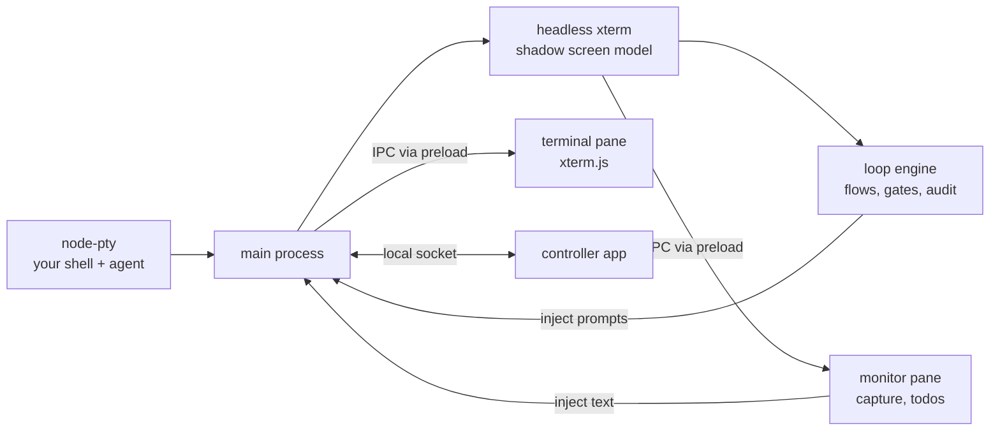

# Agent Terminal

A desktop app for running, monitoring and steering terminal coding agents such as [Claude Code](https://docs.anthropic.com/en/docs/claude-code) and [Codex](https://github.com/openai/codex). You run the agent in a real shell as usual. Agent Terminal watches what the agent prints, lets you turn its output into todos and send them back, and can take a GitHub ticket through a full test-driven workflow (groom, plan, RED, GREEN, refactor, finalize), stopping for your approval where it matters.

> **Status: experimental.** This is an early, actively developed project (v0.1). Flow and loop definition formats, settings and behaviour may change without notice. It runs on macOS and Linux; Windows is not supported.


## Features

- **A real terminal for your agent.** Your own shell and its configuration run on a real PTY, rendered with xterm.js. Running an agent here works the same as in a native terminal.
- **A shadow screen model.** Every output byte is also fed into a headless xterm in the main process. It tracks the live screen, terminal modes, the alternate screen and *quiescence* (when the agent has gone quiet), and everything below is built on it.
- **Monitor pane and injection.** Capture what the agent shows, turn findings into todos, and send text back into the agent's input, either inserted at the cursor or inserted and submitted. Injection honours bracketed-paste mode and strips paste-breakout sequences.
- **Flows and loops.** A *flow* is a sequence of steps that takes a ticket from start to finish. Most steps are *loops*: the agent does the work, reviewer sub-agents review it, the agent fixes what they find, the findings are consolidated, and then a gate decides whether the step is done. A gate is either `auto` (the engine decides and falls back to you if it can't) or `human`. Progress, gates and loop rounds appear in the rail and the always-visible status bar, and every run writes an append-only audit log under `~/.agent-terminal/audit/`.
- **Bundled flows.** Four ready-to-run flows ship with the app (see [below](#bundled-flows)), along with their loop definitions, reviewer charters, Claude Code slash commands, and Codex agents and skills. Each run installs its own Claude Code reviewer sub-agents in its run folder.
- **Artifacts view.** A file tree and viewer for the plans, reports and other artifacts that steps produce.
- **Controller.** A separate tray app with one status card per terminal. It shows which agents are working or idle and which ones need you, and can bring the right window forward. See [docs/controller.md](docs/controller.md).

  

## Install

### From a release

Download the latest build from [GitHub Releases](https://github.com/dylanb/agent-terminal/releases):

- **macOS:** `.dmg` or `.zip`
- **Linux:** `.AppImage` or `.deb`

Each release includes two apps: **agent-terminal** (the terminal) and the **controller**.

### From source

Prerequisites:

- macOS or Linux
- Node.js 22
- [pnpm](https://pnpm.io) 10 (the exact version is pinned in `packageManager` in `package.json`)
- A C/C++ toolchain for `node-pty` (Xcode Command Line Tools on macOS; `build-essential` and `python3` on Linux)

```sh
git clone https://github.com/dylanb/agent-terminal.git
cd agent-terminal
pnpm install        # postinstall rebuilds node-pty against Electron automatically
pnpm run dev        # electron-vite dev mode with renderer HMR
```

> **The native-module gotcha:** `node-pty` must be compiled against **Electron's** Node ABI.
> If startup fails with a `NODE_MODULE_VERSION` mismatch (after an Electron bump, or if
> install scripts were skipped), run:
>
> ```sh
> pnpm run rebuild
> ```

`.npmrc` pins `node-linker=hoisted` so `@electron/rebuild` and electron-builder see a flat `node_modules`.

To build your own installers:

```sh
pnpm run package    # dmg/zip on macOS, AppImage/deb on Linux
```

This builds the terminal into `dist/` and the controller (`electron-builder.controller.yml`) into `dist/controller/`. `node-pty` ships as a native binary per platform, so build on (or cross-build for) each target OS.

## Getting started

1. **Launch Agent Terminal.** The shell starts in `$HOME`; set `APP_LAUNCH_DIR` to start in a repo. Run your agent (`claude`, `codex`, …) exactly as you would in any terminal.
2. **Install the examples.** Open **Settings** and choose **Install examples**. This copies the bundled flows, step definitions and loop definitions into `~/.agent-terminal/`, the Claude Code slash commands into `~/.claude/` (or `$CLAUDE_CONFIG_DIR`), and the Codex reviewer agents and skills into `~/.codex/` (or `$CODEX_HOME`, and skipped if that directory doesn't exist). You'll see a preview, and it asks before replacing any file you've changed. Run it again after upgrading to pick up updated loops. Claude Code reviewer sub-agents aren't installed here: each run installs its own in its run folder when you start it, so start your agent session after pressing Start, or restart it when the app asks.
3. **Pick a flow and start it.** Choose a flow from the picker in the rail, give it a GitHub issue, and press **Start**. The ticket steps use the [GitHub CLI](https://cli.github.com/) (`gh`), so install it and sign in with `gh auth login` first.
4. **Steer.** Open the quick-send overlay to send todos to the agent or capture its latest report. Watch the status bar to see what the engine is doing. It turns red when a gate needs your decision.

### Bundled flows

| Flow | What it does |
|---|---|
| `feature-dev-v3` | The full test-driven chain: groom the ticket → human approval → plan → human approval → build test infrastructure → RED / GREEN / refactor for each planned slice → integration slice → human approval → finalize the PR for a human to merge. Epics fan out into sub-tickets. Each phase ends in a `git commit`. Described in [spec §28](docs/spec/28-the-full-tdd-development-process-a-chain-of-loops.md). |
| `simple-dev-v1` | A lighter chain for a ticket that fits one `feature-dev-v3` slice: plan → human approval (with a too-big warning) → one TDD development loop → integration slice → human approval → finalize. |
| `plan-only` | Groom a ticket and produce a reviewed implementation plan, then stop. |
| `two-step-example-v1` | The smallest flow built from reusable step definitions: two manual steps, each advanced by you. |

[`docs/flows/`](docs/flows/README.md) has a page for each flow with a diagram of its steps, gates and loop-backs and what each step's loop does, plus a page on how the engine runs each kind of loop.

The definitions live in [`example/flows/`](example/flows), [`example/steps/`](example/steps) and [`example/loops-v2/`](example/loops-v2). `feature-dev-v3` and `simple-dev-v1` share their `preparation`, `plan-approve`, `impl-approve` and `finalize` steps through the `dev-` step definitions in `example/steps/`. You can write your own flows as `flow.yaml` files in `~/.agent-terminal/flows/` (global) or `<repo>/.agent-terminal/flows/` (per repo; a repo entry wins when names clash). See [spec §18](docs/spec/18-flow-definitions-flow-yaml.md) and [§27](docs/spec/27-in-terminal-loop-engine-the-live-design.md).

## Settings (environment variables)

| Variable | Default | Meaning |
|---|---|---|
| `APP_SHELL` | `$SHELL`, else `bash` | Shell binary for the hosted session. Set this to override the login shell (e.g. Homebrew bash on macOS). |
| `APP_LAUNCH_DIR` | `$HOME` | Directory the session starts in. An unusable directory falls back to the default. |
| `APP_HOME_DIR` | `$HOME` | Where app state lives (`<dir>/.agent-terminal/`). Must be an absolute path. |
| `APP_SUBMIT_DELAY_MS` | `50` | Settle delay between an injected paste and the submitting `\r`. Raise on loaded machines/CI if "Insert & submit" submissions are swallowed. |
| `APP_QUIET_MS` | `1000` | How long the screen must stay unchanged before the agent reads as quiet. |
| `APP_STARTUP_EXIT_GRACE_MS` | `1000` | A shell that exits sooner than this is treated as a startup failure, and the window stays open to show the diagnostic. |
| `APP_SHELL_INTEGRATION` | on | `0` disables the bash OSC 133 hooks used for command capture. |
| `APP_AUTO_GATE_DECISION_MS` | `300000` | How long the engine may take to decide an `auto` gate before it hands the gate to a human. A non-finite or non-positive value falls back to the default; values above 2147483647 are clamped to it. |

## Architecture



- `src/main/` holds the PTY lifecycle, the shadow terminal and quiescence detection, the injection API, the loop engine and the audit recorder. `node-pty` and the shadow model live only here.
- `src/preload/` exposes the typed `term` and `monitor` APIs through `contextBridge`. The renderer never sees `ipcRenderer`, and `contextIsolation` is always on.
- `src/renderer/` holds the terminal pane, the monitor pane, the artifacts view and the controller window.
- `src/shared/ipc.ts` is the single typed IPC contract shared by all three.

[`terminal-web-ui-spec.md`](terminal-web-ui-spec.md) is the authoritative design spec, with one file per section under [`docs/spec/`](docs/spec). [`flow-management-requirements.md`](flow-management-requirements.md) records the reasoning behind the flow decisions, and [`design/`](design) holds the design tokens and reference mockups.

## How this repo is built

Agent Terminal is developed largely by coding agents running inside Agent Terminal, using its own `feature-dev-v3` flow. The repo is written so an agent can follow it:

- **The spec is the contract.** Each subsystem implements a numbered section of [`terminal-web-ui-spec.md`](terminal-web-ui-spec.md). When the code and the spec disagree, the spec wins, or the spec gets a changelog entry.
- **Standards files are what reviewers grade against.** [`CLAUDE.md`](CLAUDE.md) holds the rules, and [`CODE-STANDARDS.md`](CODE-STANDARDS.md), [`UI-STANDARDS.md`](UI-STANDARDS.md), [`TRACER-BULLET.md`](TRACER-BULLET.md) and [`TICKET-STANDARDS.md`](TICKET-STANDARDS.md) explain the reasoning. The bundled reviewer sub-agents check work against these files.
- **Tickets are intent contracts.** A GitHub issue becomes ready for the agent loop only after a human has vetted it and applied the `agent-loop/ready` label.
- **Humans keep the decisive gates.** Groom, plan and implementation approval are `human` gates, and merging is always left to a person.

## Testing

```sh
pnpm test                  # typecheck, then vitest: unit, integration and browser projects
pnpm run lint              # eslint, including the repo's local rules
./scripts/e2e-podman.sh    # Playwright _electron e2e in a Linux container under Xvfb
```

The e2e suite needs a focusable display and an OS clipboard, which a macOS subprocess launch cannot provide. Run it through the Podman harness ([docs/e2e-podman.md](docs/e2e-podman.md)), which needs [Podman](https://podman.io). Tests use the real `@xterm/headless` parser and, in e2e, a real PTY and shell. The terminal emulator and the PTY are never mocked.

## Contributing

Pull requests are welcome, but the bar is high and it's enforced:

- **TDD is mandatory.** Write a failing test first, watch it fail, then make it pass. Tests check observable behaviour, never implementation details.
- **Show a clean run.** Before a PR is ready, the full suite has to pass locally: unit, integration, browser and the Podman e2e.
- **One theme per PR.** Cite spec sections (e.g. §9.3) rather than re-arguing settled design.
- **Open PRs as drafts** until they are ready for review.

Read [`CLAUDE.md`](CLAUDE.md) and [`CODE-STANDARDS.md`](CODE-STANDARDS.md) before starting. For anything larger than a bug fix, open an issue first so the change can be agreed against the spec. Bug reports and ideas are welcome as [issues](https://github.com/dylanb/agent-terminal/issues).

## License

Copyright © 2026 Dylan Barrell.

Agent Terminal is free software: you can redistribute it and/or modify it under the terms of the [GNU Affero General Public License](LICENSE) as published by the Free Software Foundation, either version 3 of the License, or (at your option) any later version.
