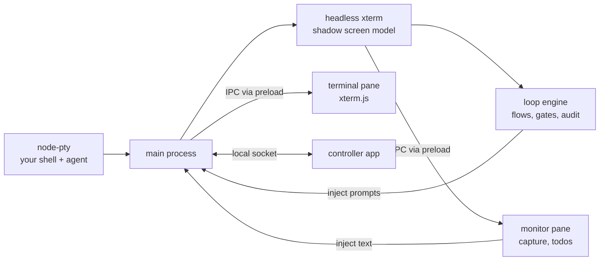

# Agent Terminal - Your Personal Software Factory

A local software factory for you so you can produce production quality applications without looking at the code.

Its implemented as a desktop app for running, monitoring and steering terminal coding agents such as [Claude Code](https://docs.anthropic.com/en/docs/claude-code) and [Codex](https://github.com/openai/codex). It leverages the agent context you already have set up. It gets the permissions you give it. You run the agent in a real shell as usual. Agent Terminal watches what the agent prints, lets you turn its output into todos and send them back, and can take a GitHub ticket through a full test-driven workflow (groom, plan, RED, GREEN, refactor, finalize), stopping for your approval where you. think it matters.

## Highlights

- **Watch the agent work.** It runs in a real, visible terminal. Prompts are injected into the interactive session (never `claude -p`), so you see everything and can step in at any time.
- **Bring your own setup.** Claude Code or Codex runs in your shell, so your `CLAUDE.md`, plugins, MCP servers and global config all apply.
- **Ticket to PR, with human gates.** `feature-dev-v3` takes a GitHub issue through groom, plan, RED, GREEN, refactor, integration and finalize. Groom, plan and implementation approval are yours, and merging is always left to a person.
- **Reviewer sub-agent panels.** Each loop has its own reviewers, including security, taint and accessibility, plus a RED-authenticity reviewer.
- **Provable TDD.** The RED gate checks that your new tests fail by assertion at the exact `file:line` they declared, and GREEN is checked with `git` to confirm it didn't touch the RED tests.
- **Converging review.** A materiality floor and closed dispositions mean a round that changed nothing is clean, and a consolidator verdict decides whether to go again or stop for a human.
- **Context hygiene.** `/clear` at loop boundaries and checkpoint `/compact` in goal loops keep long runs focused.
- **Proof of work in the PR body.** The finalize step publishes a flow-audit report with gate decisions, timeline and review resolutions, backed by an append-only audit log.
- **One tray for many terminals.** The controller shows a card per terminal: working, idle, needs you, or errored.
- **Local-first and open.** State is files on disk, git operations in untrusted repos run with hooks disabled, and the code is AGPL-3.0-or-later.

> **Status: experimental.** This is an early, actively developed project (v0.1). Flow and loop definition formats, settings and behaviour may change without notice. It runs on macOS and Linux; Windows is not supported.


## Features

### Terminal and agent hosting

- **A real terminal for your agent.** Your own shell and its configuration run on a real PTY, rendered with xterm.js. Because the agent runs in your shell, its existing setup (`CLAUDE.md`, plugins, MCP servers, global config) applies unchanged.
- **Claude Code or Codex.** Run `claude` or `codex` as you normally would. Engine prompts are injected into the visible interactive session with bracketed paste, never through `claude -p`, so you watch every step as it happens.
- **A shadow screen model.** Every output byte is also fed into a headless xterm in the main process, which tracks the live screen, terminal modes and the alternate screen.
- **Quiescence from the screen, not the bytes.** The agent reads as quiet when the *rendered* screen stops changing, so a TUI's idle repaints don't count as work.
- **Safe injection.** Injection honours the live bracketed-paste mode, strips the `ESC[201~` paste-breakout sequence, and suppresses the echo of its own injected text so it isn't captured again. The settle delay before submit is configurable (`APP_SUBMIT_DELAY_MS`).
- **Monitor pane.** Capture what the agent shows (command output is tracked with OSC 133 shell integration), turn findings into todos, and send text back into the agent's input: **Insert at cursor** or insert and submit.
- **Artifacts view.** A file tree and viewer for the plans, reports and other artifacts that steps produce.

### Flows and loops

- **Flows.** A *flow* is a sequence of steps that takes a ticket from start to finish. Most steps are *loops*: the agent does the work, reviewer sub-agents review it, the agent fixes what they find, the findings are consolidated, and a gate decides whether the step is done.
- **`feature-dev-v3`.** The full chain: `preparation` (manual), `groom-intent`, `groom`, `groom-approve`, `plan`, `plan-approve`, `infra`, `red`, `green`, `refactor` (repeating back to `red` for each slice), `integration-slice`, `impl-approve`, `finalize`. See [Bundled flows](#bundled-flows).
- **`plan-only`.** Groom a ticket and produce a reviewed plan, then stop.
- **Epics.** An epic-capable plan is parsed into ordered sub-tickets. At the approve gate, a confirm-first **promote** action creates them on GitHub, and the preview and the promotion read the same parse.
- **Goal-mode work turns.** A loop step can run as an agent `/goal` session that reports progress through a validated progress file.
- **Context hygiene.** `/clear` is sent at loop boundaries (`boundary: pre-work`), and goal loops send `/compact` as a checkpoint every `checkpoint.passes` review passes (set per loop), with an optional boundary `/compact`.
- **Conflict hold at pickup.** If the ticket's branch or PR already exists, the run holds and offers to inspect it, delete the branch or close the PR, each confirm-first.
- **Runs are bound to their flow.** A started run keeps the flow definition it started with. If that definition changes or vanishes, the run is held and you can rebind or terminate it.

### Review and quality gates

- **Reviewer sub-agent panels.** The plan-goal, infra, red, green, refactor and integration-slice loops each have their own reviewers, installed as `<loop>--<reviewer>` sub-agents.
  - **Security** reviewers in plan, infra, green and integration-slice.
  - **Taint** reviewers in infra, green and integration-slice.
  - **Accessibility** reviewers in green and integration-slice.
  - A **RED-authenticity** reviewer in red.
- **RED authenticity.** The RED step declares each test's `intendedFailures` as `file:line`. The red-check report must show exactly those tests failing by assertion; errors, undeclared failures and tests that don't fail are refused. This proves tests fail for the intended reason.
- **Frozen tests.** GREEN may not change the RED tests. This is a plain `git` diff check against `test_globs` (the engine never runs your tests for it), re-checked at approve.
- **Converging review.** A *materiality floor* means reviewers' findings are fixed only if they change an observable outcome. Each finding gets one of four closed dispositions (fixed, dismissed out of scope, dismissed invalid, needs a human), so a round that changed nothing is clean and the loop converges.
- **Consolidator verdict.** After each round a consolidator turn emits a JSON verdict (clean, another round, or stop for a human) and chooses the next reviewer roster. The agent gets a checker command built on the engine's own predicates.
- **Crash-safe auto gates.** A relaunch halt is persisted so a crash can't silently re-approve, and failed outward side effects (push, PR) are tracked.

### Human in the loop

- **Gates.** A gate is `auto` (the engine decides and falls back to you if it can't or takes longer than `APP_AUTO_GATE_DECISION_MS`) or `human`. In `feature-dev-v3`, `groom-approve`, `plan-approve`, `impl-approve` and `finalize` are human gates; the rest are auto-gated. Merging is always left to a person.
- **Gate options.** approve, request-changes, impasse, redo, polish, and **Back to RED** (with an optional slice brief).
- **Hand back to me.** Returns an iterating loop to you at the next consolidation.
- **Decision boundaries.** Briefs state what the agent may decide; anything outside it surfaces under **Needs your call** at the gate.
- **Todo checklists per stage** (ticket grooming, plan review, implementation review, finalize). Todo status changes (active, in progress, done) are recorded in the audit trail.
- **Needs-you signals.** The terminal shows a red **Loop needs you** status bar, and the controller highlights the card and tray icon. These are in-app signals, not OS notifications.

### Controller

A separate tray app (see [docs/controller.md](docs/controller.md)):

- One status card per launch directory. A terminal's identity is fixed at launch, so a later `cd` doesn't regroup it.
- Statuses: Working, Idle, Needs a human, Flow error, Completed, Disconnected.
- Tray dot: amber when a human is needed, red on error.
- **Bring forward** raises the right window. Agents sharing a directory are flagged **Duplicate directory**, with **Bring both forward**.
- An always-on-top toggle.

  

### Proof of work and audit

- **Audit log.** Every run writes an append-only YAML log per run under `~/.agent-terminal/audit/<repo>/`. Flow state lives in `<worktree>/.agent-terminal/flow-state.yaml`.
- **Flow-audit report in the PR body.** The `finalize` loop writes a flow-audit report and publishes it into the PR body between `<!-- agent-terminal:flow-audit:start -->` and `<!-- agent-terminal:flow-audit:end -->` markers, preserving the rest of the body. It covers:
  - scope and status
  - execution and decisions, including human gate decisions with rationale
  - stage timeline and elapsed time, including gate durations
  - exceptions, blocks and checklist outcomes
  - evidence gaps and follow-up
  - finalize work and PR readiness
  - review findings and resolutions by step, including Copilot's

### Configuration

- **Flow locations.** Flows are discovered at `~/.agent-terminal/flows/<id>/flow.yaml` (global) and `<repo>/.agent-terminal/flows/` (per repo; the repo wins a name clash).
- **Install examples.** **Settings** then **Install examples** copies the example flows and loops into `~/.agent-terminal/`, the reviewer sub-agents and slash commands into `~/.claude/`, and the skills into `~/.codex/`. It previews first and confirms before replacing any file you've changed.
- **`loop-capabilities.yaml`** tells the loops about your project:
  - `test_globs`: which files are tests (also used by the frozen-tests check).
  - `test_command`, `build_command`: guidance strings for the agent, never executed by the engine.
  - `select_template`: optional; how to run a selected subset of tests.
  - `red_check_command`: produces the per-test outcome report the RED gate uses.
- **Environment variables.** See [Settings](#settings-environment-variables).

### Security

- Local-first: state is plain files on disk; there is no hosted service.
- `contextIsolation` is always on, `nodeIntegration` is off, and the renderer never sees `ipcRenderer`.
- Git operations in untrusted repos run with hooks disabled (`core.hooksPath` pointed at an empty temp dir) and `fsmonitor` off.
- Paths derived from repo content are confined to a jail, and reads are bounded and don't follow symlinks.
- Window navigation is guarded, and OSC 133 capture is hardened against adversarial marks.
- A worktree lock is identity-checked by PID and start time and stored in app-owned space.
- The app never modifies your `.gitignore`.

## Install

### From a release

Download the latest build from [GitHub Releases](https://github.com/dylanb/agent-terminal/releases):

- **macOS:** `.dmg` or `.zip`
- **Linux:** `.AppImage` or `.deb`

Each release includes two apps: **agent-terminal** (the terminal) and the **controller**.

### From source

Prerequisites:

- macOS or Linux
- Node.js 22
- [pnpm](https://pnpm.io) 10 (the exact version is pinned in `packageManager` in `package.json`)
- A C/C++ toolchain for `node-pty` (Xcode Command Line Tools on macOS; `build-essential` and `python3` on Linux)

```sh
git clone https://github.com/dylanb/agent-terminal.git
cd agent-terminal
pnpm install        # postinstall rebuilds node-pty against Electron automatically
pnpm run dev        # electron-vite dev mode with renderer HMR
```

> **The native-module gotcha:** `node-pty` must be compiled against **Electron's** Node ABI.
> If startup fails with a `NODE_MODULE_VERSION` mismatch (after an Electron bump, or if
> install scripts were skipped), run:
>
> ```sh
> pnpm run rebuild
> ```

`.npmrc` pins `node-linker=hoisted` so `@electron/rebuild` and electron-builder see a flat `node_modules`.

To build your own installers:

```sh
pnpm run package    # dmg/zip on macOS, AppImage/deb on Linux
```

This builds the terminal into `dist/` and the controller (`electron-builder.controller.yml`) into `dist/controller/`. `node-pty` ships as a native binary per platform, so build on (or cross-build for) each target OS.

## Getting started

1. **Launch Agent Terminal.** The shell starts in `$HOME`; set `APP_LAUNCH_DIR` to start in a repo. Run your agent (`claude`, `codex`, …) exactly as you would in any terminal.
2. **Install the examples.** Open **Settings** and choose **Install examples**. This copies the bundled flows and loop definitions into `~/.agent-terminal/`, the Claude Code slash commands and reviewer sub-agents into `~/.claude/` (or `$CLAUDE_CONFIG_DIR`), and the Codex skills into `~/.codex/` (or `$CODEX_HOME`, and skipped if that directory doesn't exist). You'll see a preview, and it asks before replacing any file you've changed. Run it again after upgrading to pick up updated loops.
3. **Pick a flow and start it.** Choose a flow from the picker in the rail, give it a GitHub issue, and press **Start**. The ticket steps use the [GitHub CLI](https://cli.github.com/) (`gh`), so install it and sign in with `gh auth login` first.
4. **Steer.** Open the quick-send overlay to send todos to the agent or capture its latest report. Watch the status bar to see what the engine is doing. It turns red when a gate needs your decision.

### Bundled flows

| Flow | What it does |
|---|---|
| `feature-dev-v3` | The full test-driven chain: groom the ticket → human approval → plan → human approval → build test infrastructure → RED / GREEN / refactor for each planned slice → integration slice → human approval → finalize the PR for a human to merge. Epics fan out into sub-tickets. Each phase ends in a `git commit`. Described in [spec §28](docs/spec/28-the-full-tdd-development-process-a-chain-of-loops.md). |
| `plan-only` | Groom a ticket and produce a reviewed implementation plan, then stop. |

The definitions live in [`example/flows/`](example/flows) and [`example/loops-v2/`](example/loops-v2). You can write your own flows as `flow.yaml` files in `~/.agent-terminal/flows/` (global) or `<repo>/.agent-terminal/flows/` (per repo; a repo entry wins when names clash). See [spec §18](docs/spec/18-flow-definitions-flow-yaml.md) and [§27](docs/spec/27-in-terminal-loop-engine-the-live-design.md).

## Settings (environment variables)

| Variable | Default | Meaning |
|---|---|---|
| `APP_SHELL` | `$SHELL`, else `bash` | Shell binary for the hosted session. Set this to override the login shell (e.g. Homebrew bash on macOS). |
| `APP_LAUNCH_DIR` | `$HOME` | Directory the session starts in. An unusable directory falls back to the default. |
| `APP_HOME_DIR` | `$HOME` | Where app state lives (`<dir>/.agent-terminal/`). Must be an absolute path. |
| `APP_SUBMIT_DELAY_MS` | `50` | Settle delay between an injected paste and the submitting `\r`. Raise on loaded machines/CI if "Insert & submit" submissions are swallowed. |
| `APP_QUIET_MS` | `1000` | How long the screen must stay unchanged before the agent reads as quiet. |
| `APP_STARTUP_EXIT_GRACE_MS` | `1000` | A shell that exits sooner than this is treated as a startup failure, and the window stays open to show the diagnostic. |
| `APP_SHELL_INTEGRATION` | on | `0` disables the bash OSC 133 hooks used for command capture. |
| `APP_AUTO_GATE_DECISION_MS` | `300000` | How long the engine may take to decide an `auto` gate before it hands the gate to a human. A non-finite or non-positive value falls back to the default; values above 2147483647 are clamped to it. |

## Architecture



- `src/main/` holds the PTY lifecycle, the shadow terminal and quiescence detection, the injection API, the loop engine and the audit recorder. `node-pty` and the shadow model live only here.
- `src/preload/` exposes the typed `term` and `monitor` APIs through `contextBridge`. The renderer never sees `ipcRenderer`, and `contextIsolation` is always on.
- `src/renderer/` holds the terminal pane, the monitor pane, the artifacts view and the controller window.
- `src/shared/ipc.ts` is the single typed IPC contract shared by all three.

[`terminal-web-ui-spec.md`](terminal-web-ui-spec.md) is the authoritative design spec, with one file per section under [`docs/spec/`](docs/spec). [`flow-management-requirements.md`](flow-management-requirements.md) records the reasoning behind the flow decisions, and [`design/`](design) holds the design tokens and reference mockups.

## How this repo is built

Agent Terminal is developed largely by coding agents running inside Agent Terminal, using its own `feature-dev-v3` flow. The repo is written so an agent can follow it:

- **The spec is the contract.** Each subsystem implements a numbered section of [`terminal-web-ui-spec.md`](terminal-web-ui-spec.md). When the code and the spec disagree, the spec wins, or the spec gets a changelog entry.
- **Standards files are what reviewers grade against.** [`CLAUDE.md`](CLAUDE.md) holds the rules, and [`CODE-STANDARDS.md`](CODE-STANDARDS.md), [`UI-STANDARDS.md`](UI-STANDARDS.md), [`TRACER-BULLET.md`](TRACER-BULLET.md) and [`TICKET-STANDARDS.md`](TICKET-STANDARDS.md) explain the reasoning. The bundled reviewer sub-agents check work against these files.
- **Tickets are intent contracts.** A GitHub issue becomes ready for the agent loop only after a human has vetted it and applied the `agent-loop/ready` label.
- **Humans keep the decisive gates.** Groom, plan and implementation approval are `human` gates, and merging is always left to a person.

## Testing

```sh
pnpm test                  # typecheck, then vitest: unit, integration and browser projects
pnpm run lint              # eslint, including the repo's local rules
./scripts/e2e-podman.sh    # Playwright _electron e2e in a Linux container under Xvfb
```

The e2e suite needs a focusable display and an OS clipboard, which a macOS subprocess launch cannot provide. Run it through the Podman harness ([docs/e2e-podman.md](docs/e2e-podman.md)), which needs [Podman](https://podman.io). Tests use the real `@xterm/headless` parser and, in e2e, a real PTY and shell. The terminal emulator and the PTY are never mocked.

## Contributing

Pull requests are welcome, but the bar is high and it's enforced:

- **TDD is mandatory.** Write a failing test first, watch it fail, then make it pass. Tests check observable behaviour, never implementation details.
- **Show a clean run.** Before a PR is ready, the full suite has to pass locally: unit, integration, browser and the Podman e2e.
- **Test proof gates merges.** Locally generated proof of those runs is posted as the `test-proof/vitest` and `test-proof/e2e` commit statuses, and filtered, dirty or mismatched runs are refused. See [docs/test-proof.md](docs/test-proof.md).
- **One theme per PR.** Cite spec sections (e.g. §9.3) rather than re-arguing settled design.
- **Open PRs as drafts** until they are ready for review.

Read [`CLAUDE.md`](CLAUDE.md) and [`CODE-STANDARDS.md`](CODE-STANDARDS.md) before starting. For anything larger than a bug fix, open an issue first so the change can be agreed against the spec. Bug reports and ideas are welcome as [issues](https://github.com/dylanb/agent-terminal/issues).

## License

Copyright © 2026 Dylan Barrell.

Agent Terminal is free software: you can redistribute it and/or modify it under the terms of the [GNU Affero General Public License](LICENSE) as published by the Free Software Foundation, either version 3 of the License, or (at your option) any later version.
