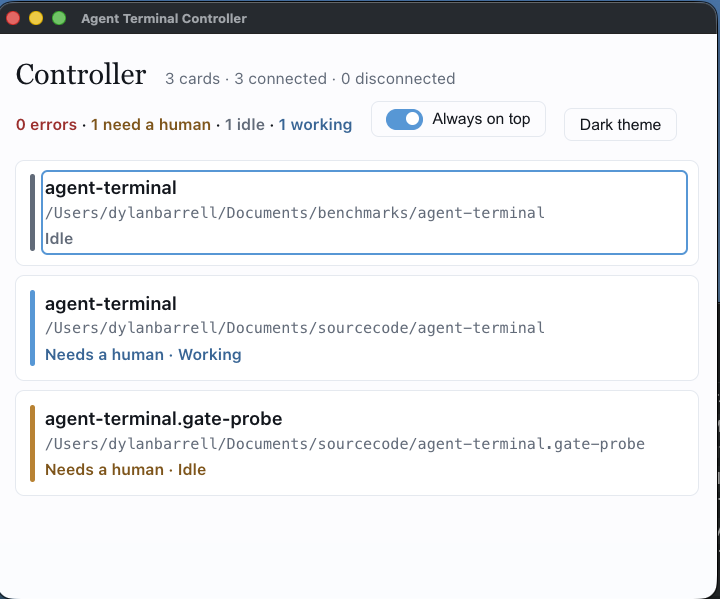
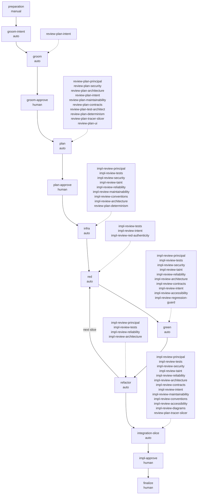
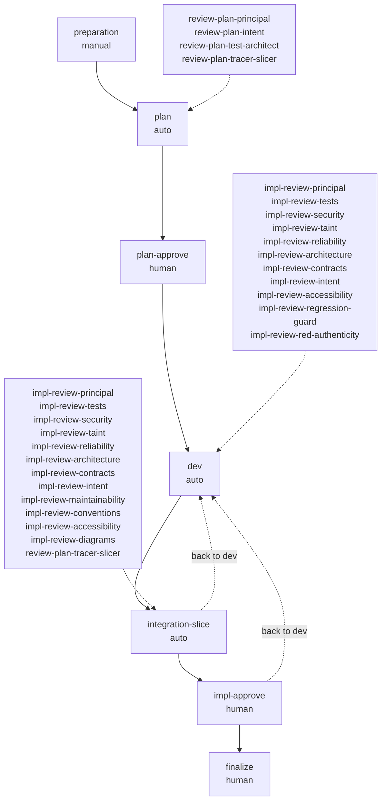
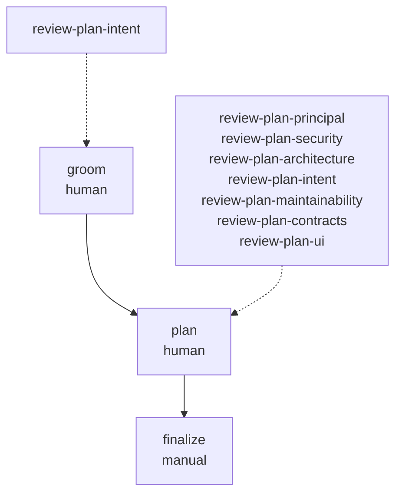
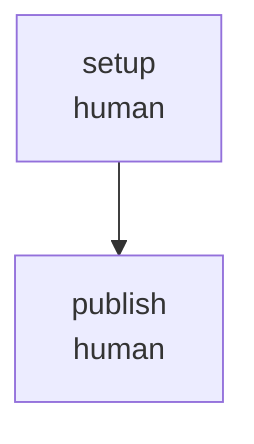
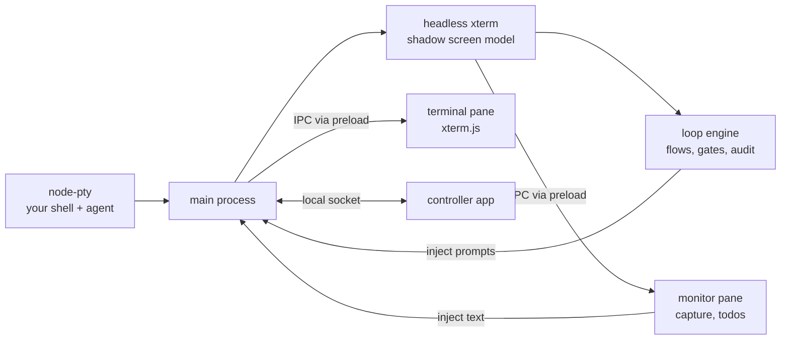

# Agent Terminal - Your Personal Software Factory

A local software factory for you so you can produce production quality applications without looking at the code.

Its implemented as a desktop app for running, monitoring and steering terminal coding agents such as [Claude Code](https://docs.anthropic.com/en/docs/claude-code) and [Codex](https://github.com/openai/codex). It leverages the agent context you already have set up. It gets the permissions you give it. You run the agent in a real shell as usual. Agent Terminal watches what the agent prints, lets you turn its output into todos and send them back, and can take a GitHub ticket through a full test-driven workflow (groom, plan, RED, GREEN, refactor, finalize), stopping for your approval where you. think it matters.

## Highlights

- **Watch the agent work.** It runs in a real, visible terminal. Prompts are injected into the interactive session (never `claude -p`), so you see everything and can step in at any time.
- **Bring your own setup.** Claude Code or Codex runs in your shell, so your `CLAUDE.md`, plugins, MCP servers and global config all apply.
- **Ticket to PR, with human gates.** `feature-dev-v3` takes a GitHub issue through groom, plan, RED, GREEN, refactor, integration and finalize. Groom, plan and implementation approval are yours, and merging is always left to a person.
- **Reviewer sub-agent panels.** Each loop has its own reviewers, including security, taint and accessibility, plus a RED-authenticity reviewer.
- **Provable TDD.** The RED gate checks that your new tests fail by assertion at the exact `file:line` they declared, and GREEN is checked with `git` to confirm it didn't touch the RED tests.
- **Converging review.** A materiality floor and closed dispositions mean a round that changed nothing is clean, and a consolidator verdict decides whether to go again or stop for a human.
- **Context hygiene.** `/clear` at loop boundaries and checkpoint `/compact` in goal loops keep long runs focused.
- **Proof of work in the PR body.** The finalize step publishes a flow-audit report with gate decisions, timeline and review resolutions, backed by an append-only audit log.
- **One tray for many terminals.** The controller shows a card per terminal: working, idle, needs you, or errored.
- **Local-first and open.** State is files on disk, git operations in untrusted repos run with hooks disabled, and the code is AGPL-3.0-or-later.

> **Status: experimental.** This is an early, actively developed project (v0.1). Flow and loop definition formats, settings and behaviour may change without notice. It runs on macOS and Linux; Windows is not supported.


## Getting started

**Prerequisite:** install both apps and the tools they need, as described in [Install](#install), including [Before you use it](#before-you-use-it).

1. **Launch the controller and Agent Terminal.** The shell starts in `$HOME`; set `APP_LAUNCH_DIR` to start in a repo. Run your agent (`claude`, `codex`, …) exactly as you would in any terminal.
2. **Install the `agent-terminal` launcher.** Open **Settings → Command line → Install**, then open a new shell. From then on, `agent-terminal [dir]` opens a terminal rooted at `dir` (default: the current directory), and `agent-terminal --controller` starts the controller. On Linux, read [The `agent-terminal` command](#the-agent-terminal-command) first: the `.deb` needs `~/.local/bin` on your `PATH`, and an AppImage alone cannot keep a working command.
3. **Install the examples.** Open **Settings** and choose **Install examples**. This copies the bundled flows and loop definitions into `~/.agent-terminal/`, the Claude Code slash commands and reviewer sub-agents into `~/.claude/` (or `$CLAUDE_CONFIG_DIR`), and the Codex skills into `~/.codex/` (or `$CODEX_HOME`, and skipped if that directory doesn't exist). You'll see a preview, and it asks before replacing any file you've changed. Run it again after upgrading to pick up updated loops.
4. **Pick a flow and start it.** Open a terminal in your repo (`agent-terminal ~/path/to/repo`), choose a flow from the picker in the rail, give it a GitHub issue, and press **Start**. The ticket steps use the [GitHub CLI](https://cli.github.com/) (`gh`), signed in with `gh auth login`.
5. **Steer.** Open the quick-send overlay to send todos to the agent or capture its latest report. Watch the status bar to see what the engine is doing. It turns red when a gate needs your decision.

For what each bundled flow does, which one fits your ticket, and what you decide at each gate, see [Bundled flows](#bundled-flows).

## Features

### Terminal and agent hosting

- **A real terminal for your agent.** Your own shell and its configuration run on a real PTY, rendered with xterm.js. Because the agent runs in your shell, its existing setup (`CLAUDE.md`, plugins, MCP servers, global config) applies unchanged.
- **Claude Code or Codex.** Run `claude` or `codex` as you normally would. Engine prompts are injected into the visible interactive session with bracketed paste, never through `claude -p`, so you watch every step as it happens.
- **A shadow screen model.** Every output byte is also fed into a headless xterm in the main process, which tracks the live screen, terminal modes and the alternate screen.
- **Quiescence from the screen, not the bytes.** The agent reads as quiet when the *rendered* screen stops changing, so a TUI's idle repaints don't count as work.
- **Safe injection.** Injection honours the live bracketed-paste mode, strips the `ESC[201~` paste-breakout sequence, and suppresses the echo of its own injected text so it isn't captured again. The settle delay before submit is configurable (`APP_SUBMIT_DELAY_MS`).
- **Monitor pane.** Capture what the agent shows (command output is tracked with OSC 133 shell integration), turn findings into todos, and send text back into the agent's input: **Insert at cursor** or insert and submit.
- **Artifacts view.** A file tree and viewer for the plans, reports and other artifacts that steps produce.

### Flows and loops

- **Flows.** A *flow* is a sequence of steps that takes a ticket from start to finish. Most steps are *loops*: the agent does the work, reviewer sub-agents review it, the agent fixes what they find, the findings are consolidated, and a gate decides whether the step is done.
- **`feature-dev-v3`.** The full chain: `preparation` (manual), `groom-intent`, `groom`, `groom-approve`, `plan`, `plan-approve`, `infra`, `red`, `green`, `refactor` (repeating back to `red` for each slice), `integration-slice`, `impl-approve`, `finalize`. See [Bundled flows](#bundled-flows).
- **`simple-dev-v1`.** The light path for a ticket that would be one `feature-dev-v3` slice: `preparation` (manual), `plan` (picks up the ticket and writes its intent), `plan-approve` (warns when the ticket is better suited to `feature-dev-v3` and flags new complexity that would go under-reviewed), `dev` (one test-driven loop with a `RED:` and a `GREEN:` commit per increment, written by Sonnet sub-agents), `integration-slice`, `impl-approve` and `finalize`. Back to dev on the `dev`, `integration-slice` and `impl-approve` gates returns the run to `dev`.
- **`plan-only`.** Groom a ticket and produce a reviewed plan, then stop.
- **`repo-setup`.** Gets a repository ready for agent loops with no ticket: the agent ignores `.agent-terminal/` in `.gitignore` and writes a `loop-capabilities.yaml`, you approve, then it opens a draft PR following the repository's own contribution rules.
- **Setup check.** For the directory the terminal is in, the app checks that the installed examples are current, that git ignores the whole `.agent-terminal/` folder, and that the repository has a valid `loop-capabilities.yaml`. When something fails, a **setup needed** button appears in the status bar. Pressing it opens a popup that lists what fails and offers **Install/update examples**, **Run setup loop** (starts `repo-setup`; offered once Claude Code or Codex is running in the terminal), or a dismissal per repository or until the app updates. See [spec §29](docs/spec/29-repository-setup-check.md).
- **Epics.** An epic-capable plan is parsed into ordered sub-tickets. At the approve gate, a confirm-first **promote** action creates them on GitHub, and the preview and the promotion read the same parse.
- **Goal-mode work turns.** A loop step can run as an agent `/goal` session that reports progress through a validated progress file.
- **Context hygiene.** `/clear` is sent at loop boundaries (`boundary: pre-work`), and goal loops send `/compact` as a checkpoint every `checkpoint.passes` review passes (set per loop), with an optional boundary `/compact`.
- **Conflict hold at pickup.** If the ticket's branch or PR already exists, the run holds and offers to inspect it, delete the branch or close the PR, each confirm-first.
- **Runs are bound to their flow.** A started run keeps the flow definition it started with. If that definition changes or vanishes, the run is held and you can rebind or terminate it.

### Review and quality gates

- **Reviewer sub-agent panels.** The plan-goal, infra, red, green, refactor and integration-slice loops each have their own reviewers, installed as `<loop>--<reviewer>` sub-agents.
  - **Security** reviewers in plan, infra, green and integration-slice.
  - **Taint** reviewers in infra, green and integration-slice.
  - **Accessibility** reviewers in green and integration-slice.
  - A **RED-authenticity** reviewer in red.
- **RED authenticity.** The RED step declares each test's `intendedFailures` as `file:line`. The red-check report must show exactly those tests failing by assertion; errors, undeclared failures and tests that don't fail are refused. This proves tests fail for the intended reason.
- **Frozen tests.** GREEN may not change the RED tests. This is a plain `git` diff check against `test_globs` (the engine never runs your tests for it), re-checked at approve.
- **Converging review.** A *materiality floor* means reviewers' findings are fixed only if they change an observable outcome. Each finding gets one of four closed dispositions (fixed, dismissed out of scope, dismissed invalid, needs a human), so a round that changed nothing is clean and the loop converges.
- **Consolidator verdict.** After each round a consolidator turn emits a JSON verdict (clean, another round, or stop for a human) and chooses the next reviewer roster. The agent gets a checker command built on the engine's own predicates.
- **Crash-safe auto gates.** A relaunch halt is persisted so a crash can't silently re-approve, and failed outward side effects (push, PR) are tracked.

### Human in the loop

- **Gates.** A gate is `auto` (the engine decides and falls back to you if it can't or takes longer than `APP_AUTO_GATE_DECISION_MS`) or `human`. In `feature-dev-v3`, `groom-approve`, `plan-approve`, `impl-approve` and `finalize` are human gates; `preparation` is a manual step and the rest are auto-gated. Merging is always left to a person.
- **Gate options.** approve, request-changes, impasse, redo, polish, and **Back to RED** (with an optional slice brief).
- **Hand back to me.** Returns an iterating loop to you at the next consolidation.
- **Decision boundaries.** Briefs state what the agent may decide; anything outside it surfaces under **Needs your call** at the gate.
- **Todo checklists per stage** (plan review, implementation review, polish, finalize). Todo status changes (active, in progress, done) are recorded in the audit trail.
- **Needs-you signals.** The terminal shows a red **Loop needs you** status bar, and the controller highlights the card and tray icon. These are in-app signals, not OS notifications.

### Controller

A separate tray app (see [docs/controller.md](docs/controller.md)):

- One status card per launch directory. A terminal's identity is fixed at launch, so a later `cd` doesn't regroup it.
- Statuses: Working, Idle, Needs a human, Flow error, Completed, Disconnected.
- Each card's header shows the repository, the terminal's title (its PR's or ticket's title, else the one you gave it), its git branch and its status, so sibling checkouts of one repository are told apart even when collapsed. The branch is re-read every five minutes by default (`APP_BRANCH_REFRESH_MS`).
- An expanded card shows a timeline of its three newest events, newest first with times: notifications, and status changes such as Working, Idle, a flow step or Disconnected. **Clear history** empties it.
- Cards sort by **Attention** (Errors, Needs a human, Idle & unassigned, Working, each under a heading with its count, longest-waiting first) or **Recently used** (cards you used in the controller first), picked in the window header. The choice survives a restart.
- Each card header shows how long it has been in its state, for example **Needs a human · Idle · waiting 41m**.
- A card under your pointer, or with keyboard focus in it, holds the list still and shows **position held**, so nothing moves while you act on it. The list re-sorts when you move away.
- Tray dot: amber when a human is needed, red on error.
- The arrow icon in each card's header (**Bring forward**) raises the right window, collapsed or expanded. Agents sharing a directory are flagged **Duplicate directory**, and the same icon brings all of them forward.
- An always-on-top toggle.

  

### Proof of work and audit

- **Audit log.** Every run writes an append-only YAML log per run under `~/.agent-terminal/audit/<repo>/`. Flow state lives in `<worktree>/.agent-terminal/flow-state.yaml`.
- **Flow-audit report in the PR body.** The `finalize` loop writes a flow-audit report and publishes it into the PR body between `<!-- agent-terminal:flow-audit:start -->` and `<!-- agent-terminal:flow-audit:end -->` markers, preserving the rest of the body. It covers:
  - scope and status
  - execution and decisions, including human gate decisions with rationale
  - stage timeline and elapsed time, including gate durations
  - exceptions, blocks and checklist outcomes
  - evidence gaps and follow-up
  - finalize work and PR readiness
  - review findings and resolutions by step, including Copilot's

### Configuration

- **Flow locations.** Flows are discovered at `~/.agent-terminal/flows/<id>/flow.yaml` (global) and `<repo>/.agent-terminal/flows/` (per repo; the repo wins a name clash).
- **Install examples.** **Settings → Install examples** copies the example flows, loops, reviewer sub-agents, slash commands and skills into place. It previews first and asks before replacing any file you've changed. See [Getting started](#getting-started) step 2 for where each goes.
- **`loop-capabilities.yaml`** tells the loops about your project:
  - `test_globs`: which files are tests (also used by the frozen-tests check).
  - `test_command`, `build_command`: guidance strings for the agent, never executed by the engine.
  - `select_template`: optional; how to run a selected subset of tests.
  - `red_check_command`: produces the per-test outcome report the RED gate uses.
- **Environment variables.** See [Settings](#settings-environment-variables).

### Security

- Local-first: state is plain files on disk; there is no hosted service.
- `contextIsolation` is always on, `nodeIntegration` is off, and the renderer never sees `ipcRenderer`.
- Git operations in untrusted repos run with hooks disabled (`core.hooksPath` pointed at an empty temp dir) and `fsmonitor` off.
- Paths derived from repo content are confined to a jail, and reads are bounded and don't follow symlinks.
- Window navigation is guarded, and OSC 133 capture is hardened against adversarial marks.
- A worktree lock is identity-checked by PID and start time and stored in app-owned space.
- The app never modifies your `.gitignore`.

## Install

### From a release

Get the latest release from **[github.com/dylanb/agent-terminal/releases/latest](https://github.com/dylanb/agent-terminal/releases/latest)**. Downloads are listed under **Assets**.

**Published builds:** macOS on Apple silicon (arm64) and Linux on x64 (amd64). On an Intel Mac or Linux arm64, [build from source](#from-source). Windows is not supported.

Each release holds two apps, and you need both:

- **agent-terminal** is the terminal that hosts your coding agent and runs flows.
- **agent-terminal-controller** is a small companion app: one window and a tray icon that show a card per open terminal (working, idle, needs you, or errored; see [docs/controller.md](docs/controller.md)). It is required. Until it is running, a terminal shows "Startup paused: Waiting for the controller" and starts no shell. The terminal then starts on its own once the controller confirms it. Install both from the same release.

#### macOS (Apple silicon)

Assets: `agent-terminal-<version>-arm64.dmg`, `agent-terminal-<version>-arm64-mac.zip`, and the same two files for `agent-terminal-controller`.

1. With a `.dmg`: open it and drag the app into **Applications**. With a `.zip`: unzip it and move the `.app` into **Applications**.
2. Do this for both apps. Put them in the same folder (such as `/Applications`), because the `agent-terminal` command looks for the controller next to the terminal.
3. Get past the first-launch block (next step), then launch the controller and the terminal, in either order.

**First launch.** Both apps are ad-hoc signed and not notarized, so macOS blocks each one the first time. Do either of these for each app:

- Try to open the app once. Then open **System Settings → Privacy & Security**, scroll to the blocked app, and choose **Open Anyway**.
- Or, before the first launch, run `xattr -dr com.apple.quarantine "/Applications/agent-terminal.app"` and `xattr -dr com.apple.quarantine "/Applications/agent-terminal-controller.app"`, adjusting the path if you installed elsewhere.

#### Linux (x64)

Assets: `agent-terminal_<version>_amd64.deb`, `agent-terminal-<version>.AppImage`, and the same two files for `agent-terminal-controller`.

- **`.deb`** (Debian, Ubuntu): run `sudo apt install ./agent-terminal_<version>_amd64.deb ./agent-terminal-controller_<version>_amd64.deb` from the download folder. Launch each app from your applications menu.
- **`.AppImage`**: run `chmod +x agent-terminal-<version>.AppImage agent-terminal-controller-<version>.AppImage`, then start each file (`./agent-terminal-<version>.AppImage`).

#### The `agent-terminal` command

Optional but handy. `agent-terminal [dir]` opens a new terminal rooted at `dir` (default: the current directory), and `agent-terminal --controller` starts the controller. To install it, open **Settings → Command line → Install** in the app, or use the install button on the "Startup paused" card.

- It goes to `~/.local/bin` (then `~/bin`) when that folder is already on the app's own `PATH` when it starts, and only you can write to it. Otherwise it goes to `~/.agent-terminal/bin`, and a block is added to your shell profile that appends that folder to `PATH`. Either way, open a new shell afterwards.
- **Linux `.deb`:** the package also links `/usr/bin/agent-terminal` to the app itself, which is not the command. So the command must go to `~/.local/bin`, which a stock Ubuntu profile puts on `PATH` before `/usr/bin` once the folder exists. Create it (`mkdir -p ~/.local/bin`), log out and back in so the desktop session, and the app launched from it, picks it up, then install the command. In a new shell, `command -v agent-terminal` should print a path under your home folder. If it prints `/usr/bin/agent-terminal`, the app did not see `~/.local/bin`: check that `echo $PATH` lists it before `/usr/bin`, log out and back in, and install again.
- **Linux `.AppImage`:** a command installed from an AppImage stops working when that app exits, so there is no working command with an AppImage alone. Use the `.deb` if you want the command.

#### Before you use it

- Install the [GitHub CLI](https://cli.github.com/) and sign in: `gh auth login`.
- Install Claude Code or Codex, and sign in to it.

#### Upgrading

1. Install the newer release of both apps over the old ones: replace the two `.app`s in the same folder; or run `sudo apt install ./<newer>.deb` for each `.deb`; or replace the AppImage files.
2. Relaunch both apps (macOS may block the replaced apps again; repeat the first-launch step).
3. Open **Settings → Install examples** to pick up updated flows and loops. It previews the changes and asks before replacing any file you changed.
4. If the apps moved, reinstall the `agent-terminal` command.

> **`simple-dev-v1`** (see [Bundled flows](#bundled-flows)) is not yet in a published release. It is available when built from source.

### From source

Prerequisites:

- macOS or Linux
- Node.js 22
- [pnpm](https://pnpm.io) 10 (the exact version is pinned in `packageManager` in `package.json`)
- A C/C++ toolchain for `node-pty` (Xcode Command Line Tools on macOS; `build-essential` and `python3` on Linux)

```sh
git clone https://github.com/dylanb/agent-terminal.git
cd agent-terminal
pnpm install        # postinstall rebuilds node-pty against Electron automatically
pnpm run dev        # electron-vite dev mode with renderer HMR
```

> **The native-module gotcha:** `node-pty` must be compiled against **Electron's** Node ABI.
> If startup fails with a `NODE_MODULE_VERSION` mismatch (after an Electron bump, or if
> install scripts were skipped), run:
>
> ```sh
> pnpm run rebuild
> ```

`.npmrc` pins `node-linker=hoisted` so `@electron/rebuild` and electron-builder see a flat `node_modules`.

To build your own installers:

```sh
pnpm run package    # dmg/zip on macOS, AppImage/deb on Linux
```

This builds the terminal into `dist/` and the controller (`electron-builder.controller.yml`) into `dist/controller/`. `node-pty` ships as a native binary per platform, so build on (or cross-build for) each target OS.

## Bundled flows

A *flow* is a chain of steps the app runs against a GitHub issue. Most steps are *loops*: an agent does the work, then *reviewer personas* (reviewer sub-agents, each grading one concern such as security or tests) review it, the agent fixes what they find, and the cycle repeats until a round changes nothing. Every step then ends at a *gate*:

- **`auto`**: the engine approves the step by itself, but only when it finishes clean. Anything else, or a decision that takes longer than `APP_AUTO_GATE_DECISION_MS`, stops for a person ([spec §27.9.1](docs/spec/27-in-terminal-loop-engine-the-live-design.md)).
- **`human`**: a person decides. A loop step with no `gate_authority` in its flow file is `human`.
- **`manual`**: not a loop. A person does the step and marks it done ([spec §18](docs/spec/18-flow-definitions-flow-yaml.md)).

Merging is always left to a person. The definitions live in [`example/flows/`](example/flows) and [`example/loops-v2/`](example/loops-v2).

### Choosing a flow

| Your ticket | Use |
|---|---|
| A bug fix or small feature that fits one slice of work | `simple-dev-v1` (build from source until a release ships it) |
| A multi-slice feature, or an epic to split into sub-tickets | `feature-dev-v3` |
| "Plan this, don't build it" | `plan-only` |
| Get a repository ready for agent loops (no ticket) | `repo-setup` (build from source until a release ships it) |

`simple-dev-v1` runs fewer reviews. Its plan approval warns you when the ticket looks too big for it, and the way out is to terminate that run and start the ticket again under `feature-dev-v3`.

### What happens at a `human` gate

The flow stops and waits. The terminal's status bar turns red and reads **Loop needs you**. In the controller, the terminal's card reads **Needs a human** with a bell-marked message, and the tray icon gets an amber dot. These are in-app signals, not OS notifications. Open the terminal and pick one of the gate's options:

- **Approve**: accept the result and run the gate's side effects (listed per flow below).
- **Redo**: run the step's work again from a clean slate: the agent gets only the ticket, the plan and an instruction you type, with none of the earlier findings.
- **Request changes**: send your feedback (chosen review todos plus free text) into another review-and-fix round.
- **Polish**: the loop stops typing and you talk to the agent directly in the terminal, then approve when done.
- **Back to *step*** (**Back to red** in `feature-dev-v3`, **Back to dev** in `simple-dev-v1`; the button names the step it returns to): send the run back to the step that restarts the current slice of test-driven work (`red` in `feature-dev-v3`, `dev` in `simple-dev-v1`).

Each gate offers only some of these. An `auto` step offers them too when it stops for a person.

### `feature-dev-v3`

**What:** The full test-driven chain for a ticket: a groomed ticket, an approved plan (an epic becomes ordered sub-tickets), test infrastructure, then RED, GREEN and refactor per slice, an integration review, and a PR prepared for you to merge with a flow-audit report in its body.

**How:** `preparation` is a step you do by hand. Then each step runs as listed; `refactor` loops back to `red` once per planned slice.



Legend: `manual` means a person completes the step. Dotted lines link a step to the reviewer personas that review it. `groom-intent`, `groom-approve`, `plan-approve`, `impl-approve` and `finalize` have no reviewers.

**Your decisions:**

- `groom-approve` (approve or redo): approve writes the groomed ticket into the issue body.
- `plan-approve` (approve or redo): approve marks the PR ready and offers to create an epic's sub-tickets on GitHub.
- `impl-approve` (approve, redo or Back to red): approve commits and publishes the implementation description in the PR body.
- `finalize` (approve or redo): the PR has been prepared and checked; approve it, then merge yourself.

**When:** a multi-slice feature or an epic, where you want every phase reviewed and a human check after grooming, planning and implementation.

### `simple-dev-v1`

Not yet in a published release; available when built from source.

**What:** A plan and one test-driven development pass for a ticket that fits one `feature-dev-v3` slice, with the same integration review and finalize.

**How:** `preparation` is by hand. `plan` picks up the ticket and writes its intent, `dev` does RED and GREEN commits per increment in one loop, then `integration-slice` reviews it all. Back to dev at `dev`, `integration-slice` or `impl-approve` returns the run to `dev`.



Legend: `manual` means a person completes the step. Dotted lines to a step link its reviewer personas; the two labelled dotted lines are the Back to dev returns. `plan-approve`, `impl-approve` and `finalize` have no reviewers.

**Your decisions:**

- `plan-approve` (approve or redo): approve marks the PR ready. You see the too-big warning here.
- `impl-approve` (approve, redo or Back to dev): approve commits and publishes the implementation description in the PR body.
- `finalize` (approve or redo): approve the prepared PR, then merge yourself.

**When:** a ticket that fits one slice of work and does not need a separate groom and plan.

### `plan-only`

**What:** A groomed ticket and a reviewed implementation plan, then it stops. Nothing is built.

**How:** both loop steps are `human`: nothing moves on without you. `finalize` is a manual step.



Legend: `manual` means a person completes the step.

**Your decisions:**

- `groom` (approve, request changes, redo or polish): approve writes the groomed ticket into the issue body.
- `plan` (approve, request changes, redo or polish): approve marks the PR ready.
- `finalize`: you complete it and mark it done.

**When:** you want a reviewed plan to hand to someone else, or to build later.

### `repo-setup`

Not yet in a published release; available when built from source.

**What:** Gets a repository ready for agent loops. It takes no GitHub issue. The agent adds a whole-folder `.agent-terminal/` rule to `.gitignore` if git doesn't already ignore it, and writes a `loop-capabilities.yaml` from the repository's real test files and commands if there is none, checking it with the app's own reader. Nothing is committed or pushed until you approve.

**How:** start it from the picker, or with **Run setup loop** in the setup-check popup. It refuses to start while the repository already has a flow run in progress.



Legend: neither step has reviewers.

**Your decisions:**

- `setup` (approve or redo): review the `.gitignore` and `loop-capabilities.yaml` changes. Approve lets the agent commit them and open a draft PR, following the repository's `CLAUDE.md`, `CONTRIBUTING` and PR template; it files an issue only if those rules require one.
- `publish` (approve or redo): approve completes the run. Merging the PR is yours.

**When:** a new repository, or one the setup-check popup says is missing its ignore rule or capabilities file.

### Your own flows

Write a `flow.yaml` in `~/.agent-terminal/flows/<id>/` (for every repo) or `<repo>/.agent-terminal/flows/<id>/` (that repo only). When names clash, the repo copy wins. The folder form lets a flow keep its own templates beside it. See [spec §18](docs/spec/18-flow-definitions-flow-yaml.md) for the format, [§27](docs/spec/27-in-terminal-loop-engine-the-live-design.md) for the loop engine, and [§28](docs/spec/28-the-full-tdd-development-process-a-chain-of-loops.md) for how the full TDD chain is built.

## Settings (environment variables)

| Variable | Default | Meaning |
|---|---|---|
| `APP_SHELL` | `$SHELL`, else `bash` | Shell binary for the hosted session. Set this to override the login shell (e.g. Homebrew bash on macOS). |
| `APP_LAUNCH_DIR` | `$HOME` | Directory the session starts in. An unusable directory falls back to the default. |
| `APP_HOME_DIR` | `$HOME` | Where app state lives (`<dir>/.agent-terminal/`). Must be an absolute path. |
| `APP_SUBMIT_DELAY_MS` | `50` | Settle delay between an injected paste and the submitting `\r`. Raise on loaded machines/CI if "Insert & submit" submissions are swallowed. |
| `APP_QUIET_MS` | `1000` | How long the screen must stay unchanged before the agent reads as quiet. |
| `APP_STARTUP_EXIT_GRACE_MS` | `1000` | A shell that exits sooner than this is treated as a startup failure, and the window stays open to show the diagnostic. |
| `APP_SHELL_INTEGRATION` | on | `0` disables the bash OSC 133 hooks used for command capture. |
| `APP_BRANCH_REFRESH_MS` | `300000` | How often a terminal re-reads its git branch for its controller card. A branch switch can take up to this long to show; a change of repository shows at once. Lower it (e.g. `1000`) to follow switches sooner, at the cost of one `git` process per terminal per interval. |
| `APP_AGENT_WAIT_MS` | `60000` | How long a loop turn waits for an agent (`claude`, `codex`, …) to reach the prompt before it stops with an error. Start the agent within this time after starting a flow. A non-finite or non-positive value falls back to the default. |
| `APP_AGENT_COMMANDS` | `claude,codex` | Comma-separated program names that count as an agent at the terminal's prompt. Loop turns are typed only into one of these, and the setup popup offers Run setup loop only while one is running. Add another agent, or the name of your own wrapper or alias (`cc`). An empty list falls back to the default. |
| `APP_AUTO_GATE_DECISION_MS` | `300000` | How long the engine may take to decide an `auto` gate before it hands the gate to a human. A non-finite or non-positive value falls back to the default; values above 2147483647 are clamped to it. |

## Architecture



- `src/main/` holds the PTY lifecycle, the shadow terminal and quiescence detection, the injection API, the loop engine and the audit recorder. `node-pty` and the shadow model live only here.
- `src/preload/` exposes the typed `term` and `monitor` APIs through `contextBridge`. The renderer never sees `ipcRenderer`, and `contextIsolation` is always on.
- `src/renderer/` holds the terminal pane, the monitor pane, the artifacts view and the controller window.
- `src/shared/ipc.ts` is the single typed IPC contract shared by all three.

[`terminal-web-ui-spec.md`](terminal-web-ui-spec.md) is the authoritative design spec, with one file per section under [`docs/spec/`](docs/spec). [`flow-management-requirements.md`](flow-management-requirements.md) records the reasoning behind the flow decisions, and [`design/`](design) holds the design tokens and reference mockups.

## How this repo is built

Agent Terminal is developed largely by coding agents running inside Agent Terminal, using its own `feature-dev-v3` flow. The repo is written so an agent can follow it:

- **The spec is the contract.** Each subsystem implements a numbered section of [`terminal-web-ui-spec.md`](terminal-web-ui-spec.md). When the code and the spec disagree, the spec wins, or the spec gets a changelog entry.
- **Standards files are what reviewers grade against.** [`CLAUDE.md`](CLAUDE.md) holds the rules, and [`CODE-STANDARDS.md`](CODE-STANDARDS.md), [`UI-STANDARDS.md`](UI-STANDARDS.md), [`TRACER-BULLET.md`](TRACER-BULLET.md) and [`TICKET-STANDARDS.md`](TICKET-STANDARDS.md) explain the reasoning. The bundled reviewer sub-agents check work against these files.
- **Tickets are intent contracts.** A GitHub issue becomes ready for the agent loop only after a human has vetted it and applied the `agent-loop/ready` label.
- **Humans keep the decisive gates.** Groom, plan and implementation approval are `human` gates, and merging is always left to a person.

## Testing

```sh
pnpm test                  # typecheck, then vitest: unit, integration and browser projects
pnpm run lint              # eslint, including the repo's local rules, then a parse check of every Markdown Mermaid diagram
./scripts/e2e-podman.sh    # Playwright _electron e2e in a Linux container under Xvfb
```

The e2e suite needs a focusable display and an OS clipboard, which a macOS subprocess launch cannot provide. Run it through the Podman harness ([docs/e2e-podman.md](docs/e2e-podman.md)), which needs [Podman](https://podman.io). Tests use the real `@xterm/headless` parser and, in e2e, a real PTY and shell. The terminal emulator and the PTY are never mocked.

## Contributing

Pull requests are welcome, but the bar is high and it's enforced:

- **TDD is mandatory.** Write a failing test first, watch it fail, then make it pass. Tests check observable behaviour, never implementation details.
- **Show a clean run.** Before a PR is ready, the full suite has to pass locally: unit, integration, browser and the Podman e2e.
- **Test proof gates merges.** Locally generated proof of those runs is posted as the `test-proof/vitest` and `test-proof/e2e` commit statuses, and filtered, dirty or mismatched runs are refused. See [docs/test-proof.md](docs/test-proof.md).
- **One theme per PR.** Cite spec sections (e.g. §9.3) rather than re-arguing settled design.
- **Open PRs as drafts** until they are ready for review.

Read [`CLAUDE.md`](CLAUDE.md) and [`CODE-STANDARDS.md`](CODE-STANDARDS.md) before starting. For anything larger than a bug fix, open an issue first so the change can be agreed against the spec. Bug reports and ideas are welcome as [issues](https://github.com/dylanb/agent-terminal/issues).

## License

Copyright © 2026 Dylan Barrell.

Agent Terminal is free software: you can redistribute it and/or modify it under the terms of the [GNU Affero General Public License](LICENSE) as published by the Free Software Foundation, either version 3 of the License, or (at your option) any later version.
