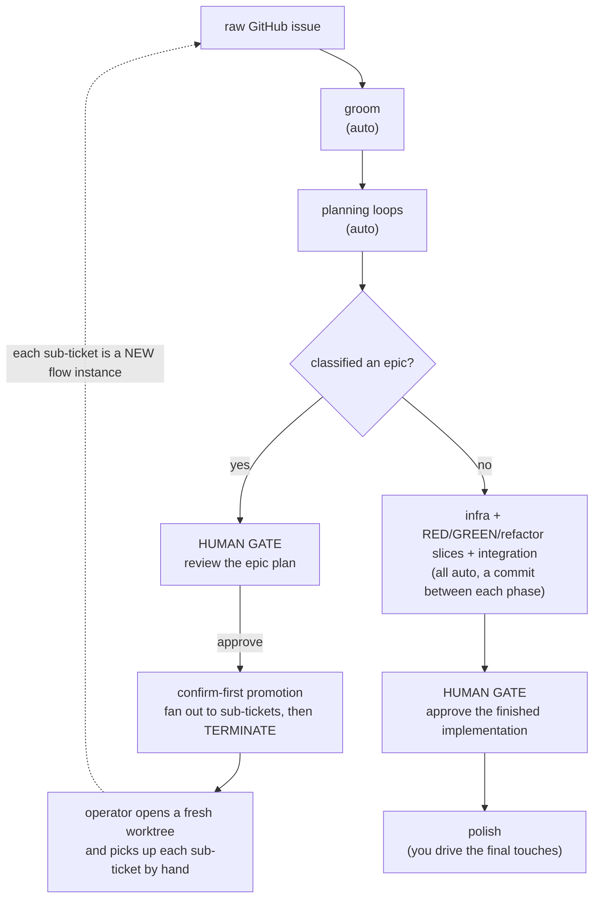
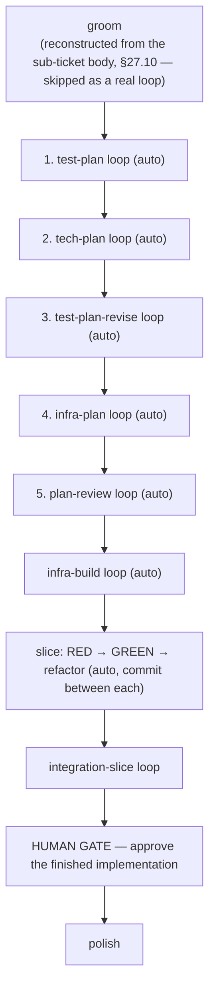

> **Vendored snapshot — not a live mirror (A0 · §18.7).** This document was vendored into the repo as a **dated snapshot** so the ticket's `design/…` citation resolves in-repo; the **live reference is Epic #129**. The authored contract is **§18.7 of `terminal-web-ui-spec.md`**, which **wins on any conflict** with this doc. Six statements below diverge from §18.7 and must **not** be copied as-authored:
> - **§4.2 item 3** — the picker "*switching … resets to `not_started`*" — is **superseded** by §18.7.4's **no-transition** switching semantics (switching while no run has started makes no run-state transition).
> - **§4.3 first bullet** — "the … `loopNamespace` confinement … is the pattern to copy" — is **superseded** by §18.7.6's **per-tier** confinement (`resolveJail` for a per-repo entry, `resolveOwnedDirJail` for a global entry, plus the safe-segment gate); `loop_namespace` does **no** path confinement, so that note is factually wrong.
> - **§4.2 item 2** — the storage line "`flow-state.yaml` (§19.1) records `activeFlow: <name>`" — is **superseded**: §18.7.2 makes the pointer's **own disjoint file mandatory** (CLAUDE.md / CODE-STANDARDS's independent-lifecycle-state standard — "own file, **never as a field**"; a hand-maintained field carry list is explicitly rejected), so the doc's flat `activeFlow`-on-`flow-state.yaml` co-location is **not admissible** for this new state — the §22.3.1 `title`'s co-location is legacy, not a template — and is never a normative field name.
> - **§4.2 item 4** — the pickup stamp "*(a label or a body line)*" — is **tightened** by §18.7.5 to **one shared writer↔reader carrier**, defined once and read the same by both sides, **not** a "label **or** body line" the two sides could read differently; the doc's phrasing names the under-specified precursor, not a sanctioned second carrier.
> - **§4.3 "re-read every access" bullet** — "*adding/removing a **catalog flow** while the app runs is picked up on the next directory entry*" — is **superseded** by §18.7.3's **run-start disposition** for *pointer-catalog* resolution: a catalog **addition must not** replace a begun run's fallback, and **removal** of a begun run's selected source surfaces the §18.1 **error**, never a live swap (and the bound tier/source is persisted run-scoped so a restart cannot re-resolve to a different tier). The live re-read remains accurate for the **local `flow.yaml`** leg (leg 1) and for the **picker's enumeration** of a *not-yet-started* worktree — only a **begun-run pointer-catalog source** is now sticky.
> - **§4.1 item 1 / §4.4 A1 — "a sibling of `loops-v2/`"** — is **wrong on the root**: the catalog anchors at the **app-state home** `<A>/.agent-terminal/flows` (§18.1/§23.4, `APP_HOME_DIR`-relocatable), whereas `loops-v2` anchors under the **independent** Claude config home (`CLAUDE_CONFIG_DIR`/`~/.claude`, `src/main/userConfig.ts`). They are **not** sibling destinations and move independently, so A1 must seed the catalog through the app-state resolver/root, never the loops-v2 one.
>
> **One §18.7 requirement is not in this doc's slice list.** §18.7.7 (its own subsection) makes a **deterministic, operator-invokable recovery affordance out of the loop-less begun-run flow-load-error state** a **required** Theme A deliverable — its own slice **A5** (leg-2's routine per-repo source loss makes that state reachable). It is **orthogonal to A3's picker** and maps to **none** of §4.4's A0–A4 slices, so §4.4's slice list is **incomplete** on this point — a Theme A build plan must add an A5 slice for it. §18.7 wins on conflict.
>
> **Scope realized so far:** A0 authors **Theme A only** (the flow catalog + selection, §18.7). This doc's **Theme B** content and its §5 slices are **not yet spec**.

# Plan — a granular-planning flow, plus multiple selectable flows

**Status:** proposal, drafted 2026-08-30 on branch `feat/new-personas`. Not yet a spec section.
**Assumes:** PR #127 (authorize epic promotion before its confirm preview, §28.7) has landed.
**Supersedes for this flow:** the §28.8 P8.1 "one plan-bundle-loop" decision (operator has chosen to re-split it) and the §27.9 "every gate is a human gate" assumption (operator wants auto-advancing gates).

---

## 0. What this delivers, in one paragraph

The workflow the operator described *is* §28 ("the full-TDD development process — a chain of §27 loops") — whose **§27 loop engine and the `example/loops-v2/` loops and personas already ship**, while **§28 the process itself is drafted, no code** (v2.144/v2.145 document status): every step maps to an existing loop under `example/loops-v2/`, and the personas already exist. This plan changes two things on top of that. **(A)** The app learns to hold **several installed flows** and lets the operator **pick which one a worktree runs** (today it reads exactly one `flow.yaml`). **(B)** A **new, separate flow** splits today's single planning loop into **five sequential planning loops**, and introduces a **per-step "human vs automatic" gate setting** so that — for an ordinary ticket — the AI reviewer panels approve every step and the operator approves **only the finished implementation**. Epics keep one human checkpoint: review the epic plan, then break it into sub-tickets.

Everything here is **additive** to §27/§28. No §27 loop mechanic is edited; the two new engine capabilities are a gate-authority field and a flow catalog/selector.

---

## 1. Where this sits relative to what already exists

| Concept | Today (shipped) | This plan |
|---|---|---|
| Loop engine (`work → review-and-fix → consolidate → gate`, §27.3) | unchanged | unchanged |
| Loops under `example/loops-v2/` | groom, plan-bundle, infra, red, green, refactor, integration-slice | **split** plan-bundle into 5 planning loops; reuse the rest |
| Personas (charters) | 12 impl + 6 plan + test-architect/determinism/tracer-slicer/red-authenticity/regression-guard | **redistribute** across the 5 planning loops; author 5 planning work-recipes; no brand-new lenses required |
| Flow definition | one `flow.yaml`, read local-first then global (§18.1) | **a catalog of flows** + a per-worktree **active-flow pointer** + a picker |
| Gate | always stops for a human (§27.9) | gate gains an **authority**: `human` or `auto` (auto still stops on a "needs a human" verdict) |
| Epic breakdown | plan classified `epic` → confirm-first promotion → terminate (§28.7/§28.8 P7b) | unchanged mechanics; the epic's human review rides the confirm-first promotion |

The persona *content* barely changes. The real new work is **two engine capabilities** and **one new flow definition** that wires the existing (re-split) loops with the new gate setting.

---

## 2. The agreed target model

### 2.1 Two kinds of run

- **Epic run:** the human's *only* checkpoint is **reviewing the epic plan**. Approving it fans the plan out into stacked sub-tickets (confirm-first, §28.7) and **terminates** the flow (§28.8 P7b). Each sub-ticket is then a **separate, fresh flow instance** the operator picks up by hand.
- **Sub-ticket run:** the human's *only* checkpoint is **approving the finished implementation** at the very end. Every planning loop and every code slice before it is **reviewer-approved and auto-advances**.

### 2.2 A sub-ticket, expanded — where the five planning loops sit

Each box is one instance of the §27.3 loop shape (worker produces an artifact; a reviewer panel critiques; the worker fixes; a judge decides another-round-or-clean). "Auto" means the judge's `clean` verdict advances the chain by itself; a `stop for a human` verdict still halts (§2.4).

### 2.3 Gate authority — the one new gate concept

Every loop step in a flow gains a gate **authority**:

| authority | on consolidator `clean` | on `stop for a human` | who fires the side-effects (commit / promote / mark-ready) |
|---|---|---|---|
| `human` (today's only behavior) | wait for the operator | wait for the operator | the operator, at the gate |
| `auto` (new) | **advance automatically** | **still wait for the operator** | the engine, on the automatic approval |

- **Safety (operator decision):** `auto` never means "never stop." A `stop for a human` verdict — the loop is spinning, or hit something only a human can rule on — **overrides `auto`** and halts at the gate. A blocked loop can never sail past the operator.
- **Side-effects on an auto gate still fire** (that is how "a commit between each phase" happens without the operator clicking): the RED/GREEN/refactor commits (§28.3) fire on the automatic approval. The receiver still carries the identity of what it commits (§6 payload-identity), unchanged.
- **`redo`/`request-changes`/`polish`** remain human levers — reachable only when a gate is actually showing (a `human` gate, or an `auto` gate that stopped on `stop for a human`).

### 2.4 Where the two human gates actually come from

- **Sub-ticket final gate** = the last loop step (integration-slice) is declared `gate: human`. One approval, at the finish line.
- **Epic plan review** = the plan-review loop's approval, for an epic, fires the **confirm-first `promote` side-effect** (§28.7, already confirm-first since PR #127). The operator reviews the epic plan and confirms the fan-out — that *is* the "review the plan, then break it into tickets" step. See §5.5 for the one design nuance (the same `plan-review` step is a silent auto-advance for a single-ticket and a human confirm for an epic).

---

## 3. Two themes → two epics/PRs, spec-first

Per CLAUDE.md's one-theme-per-PR rule, this is **two themes**, and per §28.8.6 (and §27's N0 precedent) each lands its **spec first, then code**:

- **Theme A — Flow catalog + selection** (engine + UI). A new §18 subsection: multiple installed flows, a per-worktree active-flow pointer, a picker. Independent of Theme B and independently useful (you could select between today's `feature-dev` flow and any future flow).
- **Theme B — The granular-planning flow + gate authority** (engine + content). A new §28 subsection (or a §29): the `auto` gate authority, the five-way split of the planning loop, the new work-recipes, and the reviewer redistribution — packaged as one new flow definition.

Theme A is a **prerequisite** for Theme B being *useful* (you need a way to choose the new flow), but the two are separable: Theme A ships against the existing flows; Theme B's flow becomes selectable the moment Theme A lands. Recommended order: **A, then B.**

---

## 4. Theme A — multiple installable flows + active-flow pointer

### 4.1 Current state (the constraint we are lifting)

- A flow is **one** `flow.yaml`, read from `<worktree>/.agent-terminal/flow.yaml` **local-first**, else the global home (`loadFlowDefinitionLocalFirst`, `src/main/flow.ts`).
- The installer (`installExamples.ts`) copies **one** bundled `example/flow/` to the global flow home. There is exactly one `flow` install destination and no notion of a named catalog.
- There is no picker; the flow a worktree runs is "whatever `flow.yaml` is at that path."

### 4.2 Design

1. **A flow catalog.** Bundle flows under `example/flows/<flow-name>/flow.yaml` (+ co-located `todo-templates/`), and install them into a user-config **`flows/<flow-name>/`** catalog (a sibling of `loops-v2/`) *(superseded — see the header's sixth divergence: the catalog roots at the **app-state home** `<A>/.agent-terminal/flows` per §18.1/§23.4, **not** a sibling of `loops-v2/`, which lives under the independent Claude config home `CLAUDE_CONFIG_DIR`/`~/.claude`; the two roots move independently, so A1 must seed through the app-state resolver, not the loops-v2 one)*, reusing the existing install machinery (preview/confirm/atomic-write, symlink refusal, overwrite policy). Today's single `example/flow/` becomes `example/flows/feature-dev/`; the new granular flow (Theme B) is `example/flows/granular-tdd/` (name TBD).
2. **A per-worktree active-flow pointer.** The worktree's flow state (`flow-state.yaml`, §19.1) records `activeFlow: <name>`. The definition resolver becomes: **the worktree's local `flow.yaml` if present (back-compat) → else the catalog entry named by `activeFlow` → else the current global fallback.** Local-first is preserved, so no existing worktree changes behavior.
3. **A picker.** The flow strip (`flowStrip.ts`) gains a chooser (the design/README `shell/` language already anticipates rail widgets) that lists catalog flows and sets `activeFlow`, **enabled only before the flow starts** (`not_started`) so a run can't have its definition swapped mid-flight. Switching flow resets to `not_started` for that worktree (the §18.4 restart semantics already clear inputs). *(Superseded by §18.7.4 — see the header: switching while no run has started makes no run-state transition.)*
4. **Selection at pickup.** When a sub-ticket is picked up into a fresh worktree, the active-flow pointer is seeded so the new instance runs the intended flow. Recommended: **the promotion stamps the chosen flow name into the sub-ticket** (a label or a body line) and pickup reads it; absent that, the picker's default applies. (This keeps "each sub-ticket is a new separate flow instance" true and self-selecting.)

### 4.3 Contract & safety notes

- `activeFlow` is an **untrusted, persisted value that selects a path** — it goes through `isSafePathSegment` before it is joined to any catalog root (the §18.1 / `loopNamespace` confinement already in `flow.ts` is the pattern to copy — *superseded by §18.7.6: confinement is **per-tier** via `resolveJail`/`resolveOwnedDirJail` + the safe-segment gate; `loop_namespace` does no path confinement*), and an unknown/removed flow name degrades to the fallback with a visible reason, never a crash.
- The flow definition is still **re-read every access** and the machine rebuilt only when its signature changes (the existing `createFlowManager` cache), so adding/removing a catalog flow while the app runs is picked up on the next directory entry. *(Superseded by §18.7.3 for a **begun run's pointer-catalog source** — see the header's fifth divergence: that source is a run-start disposition, not a live swap; the live re-read still holds for the local `flow.yaml` leg and the picker's enumeration of a not-yet-started worktree.)*
- One theme: this PR does **not** author the granular flow's loops (that's Theme B). It ships the catalog + pointer + picker against the flows that exist today, with a second bundled flow (even a trivial variant) purely to prove selection end-to-end.

### 4.4 Tracer-bullet slices (Theme A)

Each UI-bearing slice is main → `src/shared/ipc.ts` → preload → renderer → an existing strip control, RED-first with an `_electron` e2e (CLAUDE.md tracer-bullet rule).

- **A0 — spec.** New §18 subsection: flow catalog, `activeFlow` pointer, resolver precedence, picker, pickup seeding. No code.
- **A1 — catalog install (foundation).** `example/flows/<name>/` layout + installer destination that seeds the user-config `flows/` catalog. RED-first over the install machinery's fixtures (mirror `exampleAssetsBuild.test.ts` / `installExamplesResolution.test.ts`); no UI. Includes the fresh-machine first-run test that deletes the config root first (CLAUDE.md). *(TRACER-BULLET admits **no** foundation exemption: every slice is fireable through the UI and ends in a RED-first `_electron` e2e. The existing **Install-examples** control fires this slice, so its e2e invokes that control and observes the catalog **destination/result**, not only installer fixtures. Catalog root is the **app-state home** `<A>/.agent-terminal/flows` (§18.1/§23.4) — see the sixth divergence.)*
- **A2 — resolver + pointer.** `activeFlow` in its **own disjoint pointer file** (mandatory per §18.7.2 — **not** `flow-state.yaml`; co-location is not admissible for this new state); resolver precedence (local → catalog[activeFlow] → global); **per-tier confine-at-use** (`resolveJail` for a per-repo entry, `resolveOwnedDirJail` for a global entry) **beyond** the safe-segment gate, per §18.7.6 — the segment gate alone does not catch a symlink planted at the resolved entry (CWE-22/59). RED-first unit/integration over `flow.ts`.
- **A3 — the picker (UI).** Strip chooser that lists catalog flows and sets `activeFlow`, disabled once `not_started` is left. e2e: install two flows, pick the second, assert the strip renders the second flow's steps. *(§18.7.4 supersedes the gate wording and the e2e: the gate is **state-based** — enabled whenever progression **is** `not_started`, including after a first-step `revertStep` rollback, not a one-way "disabled once `not_started` is left"; and the e2e must also **start** the selected flow and assert the chooser is **disabled** during the begun run — RED-first UI wiring per TRACER-BULLET, with A2 separately pinning the main-side write rejection. The listing seam carries the worktree's `repoKey`, §18.7.6.)*
- **A4 — pickup seeding.** Promotion stamps the flow name; pickup reads it into `activeFlow`. e2e over the promotion → fresh-worktree path with a recorded `gh`. *(§18.7.5/§18.7.6 supersede: promotion stamps the **canonical `flow:list` catalog-entry ID** — not the in-file `name:` — and **omits** the stamp for a non-catalog (leg-1/leg-3) selection; and the seed is written **pre-`start()`** via the observable pre-start ticket-identity carrier A4 must define, since the existing pickup runs **after** `start()` and would hit the begun-run write rejection. A body carrier is fenced as untrusted at the prompt sink, §18.7.5.)*

---

## 5. Theme B — the granular-planning flow, gate authority, and personas

### 5.1 Engine change: the `auto` gate authority (§2.3)

- Add an optional `gate_authority: human | auto` to a flow step (default `human`, so every existing flow is unchanged). The consolidator/gate wiring already computes the verdict; `auto` routes `clean` to the existing **advance** transition (firing side-effects) instead of raising the gate, while `stop for a human` and a failed/again verdict route to the gate exactly as today.
- This is the §28.8 P8.1 assumption relaxed for *this flow*: gates can advance without a human. It touches the gate-decision executor, not the loop shape — additive, per §28.11's map.
- **RED-first pin:** an `auto` step whose consolidator returns `clean` advances and fires its side-effect with **no human input**; an `auto` step whose consolidator returns `stop for a human` **still raises the gate**. Both are observable at the flow/IPC boundary (a state transition vs. a `humanNeeded` loop view).

### 5.2 Content change: split plan-bundle into five planning loops

Today's `plan-bundle-loop` produces four delimited sections in one work turn (test plan / technical plan / infrastructure plan / slice plan) reviewed by nine personas at one gate. This flow splits that into five chained loops, each with its own work-recipe, its own reviewer line-up, and its own (auto) gate. The personas are the **same charters**, redistributed — no new lenses.

| # | New loop | Work recipe produces | Reviewer line-up (existing charters) | Gate |
|---|---|---|---|---|
| 1 | `test-plan-loop` | the **test plan** — every acceptance criterion → an observable-behavior test at the right layer, RED-first | `test-architect` (lead), `intent` | auto |
| 2 | `tech-plan-loop` | the **technical plan** — the smallest correct design: files, seams, contracts | `architecture`, `contracts`, `security`, `maintainability`, `principal` | auto |
| 3 | `test-plan-revise-loop` | the **test plan, updated** to the seams the design revealed | `test-architect`, `determinism` | auto |
| 4 | `infra-plan-loop` | the **infrastructure plan** — harness, fakes, fixtures; hermetic & scriptable-per-turn | `determinism` (lead), `architecture`, `reliability` | auto |
| 5 | `plan-review-loop` | the **slice plan + epic classification**, and a coherence pass over all four prior artifacts | `tracer-slicer` (lead), `principal`, `intent` | auto for a single ticket; **human confirm** for an epic (§5.5) |

Notes:
- The four artifacts chain by §27.10 `inputs`/`outputs` (each loop reads the prior artifacts, writes its own), so the split is pure §27.10 chaining — no new mechanic.
- **The slice breakdown and the epic classification move to loop 5** (`plan-review`), which is exactly "review all of the above, then decide how to cut it and whether it's an epic." This keeps epic classification where the operator's epic review naturally lands.
- Loops 2 and 3 realize "update the test plan": the design (loop 2) is produced, then loop 3 reconciles the test plan to it — an explicit, recorded step, not a silent edit.

### 5.3 The rest of the sub-ticket chain (reused unchanged)

`infra-loop` → `red-loop` → `green-loop` → `refactor-loop` → `integration-slice-loop`, all as they exist in `example/loops-v2/`, with:
- gate authority `auto` on infra/red/green/refactor (commit-between-each fires on the automatic approval),
- gate authority **`human`** on `integration-slice-loop` (the single finish-line approval),
- then a manual `finalize`/polish step (§27.9 polish) where the operator drives.

### 5.4 Persona curation (the "only relevant reviewers" ask)

The consolidator already chooses the next round's roster from the loop's catalog (§27.6; the `consolidate.md` recipe). This plan **tightens that recipe** so selection is driven by **what changed in the round report**: round 1 runs the whole line-up; later rounds run only the lanes whose area the round actually touched (no UI edit ⇒ drop `accessibility`/`diagrams`; no untrusted-input edit ⇒ drop `taint`/`security`; a wording-only edit ⇒ tests/intent only). This is a **recipe edit, not an engine change**, and it applies inside every loop above. (If you prefer, we leave the recipe's current judgment-based wording and change nothing — but the explicit changed-area→lane mapping is what makes "only run the relevant reviewers" a rule rather than a hope.)

### 5.5 The one design nuance — plan-review as auto-or-human

The same `plan-review-loop` step is a **silent auto-advance** for a single ticket and a **human confirm** for an epic. Two ways to model it; recommend the first:

- **(Recommended) Lean on the confirm-first `promote` side-effect.** The step is declared `gate_authority: auto`, but its approve side-effect for an epic is `promote`, which is inherently confirm-first (§28.7 / PR #127): the engine's automatic approval reaches the promotion, the promotion raises its confirm preview, and the operator reviews the epic plan and confirms the fan-out. A single ticket has no `promote` side-effect, so `auto` advances silently. **No new gate concept needed** — the epic's human review is the promotion confirm, which already exists.
  - The one thing to verify: the promotion confirm surfaces enough of the **epic plan** (not just the list of sub-ticket titles) for a real review. If it doesn't today, that's a small addition to the confirm preview — captured as a slice below.
- **(Alternative) A `gate_authority: human_if_epic`.** A conditional authority that raises a human gate when the artifact is classified `epic`. More explicit, but a new conditional-gate concept; only worth it if the promotion confirm can't carry the review.

### 5.6 Persona inventory — reuse / redistribute / create

- **Reuse verbatim:** all 12 impl charters + all 6 plan charters + `test-architect`, `determinism`, `tracer-slicer`, `red-authenticity`, `regression-guard`. **No charter's text needs to change** for this flow.
- **Redistribute:** the nine plan-bundle reviewers spread across loops 1–5 as in §5.2 (each new loop's `*.yaml` lists its subset).
- **Create:** five short **work-recipes** (`prompts/work.md`) — author the test plan / the technical plan / the revised test plan / the infra plan / the slice-plan-and-classification. Each is authored in the style of the existing `plan-bundle-loop/prompts/work.md` (which already contains all five as sections — so this is mostly *cutting one recipe into five*, not writing from scratch). Recipes that instruct the agent to write a result the engine validates derive their vocabulary from the shared source and embed a canonical example (§28.5.5 / CODE-STANDARDS writer-in-shared-semantics).
- **Content-parity test:** extend `loopsV2ContentParity.test.ts` to pin the five new loops' charters (identity marker, shared fragments, no dead engine tokens) and the five work-recipes (the section/heading contract), exactly as it pins today's five new charters.

### 5.7 Tracer-bullet slices (Theme B)

- **B0 — spec.** New §-subsection: the `auto` gate authority (+ the safety override), the five-loop split, the plan-review-as-auto-or-human nuance, the curation rule. Cites §27/§28; spec wins. No code.
- **B1 — gate authority (engine).** `gate_authority` on the step model + gate-decision executor. RED-first: an `auto` step advances on `clean` and halts on `stop for a human`, observable at the IPC boundary. (Reuses the §27.15 fake-agent seam to script the consolidator verdict.)
- **B2 — the five planning loops + recipes (content).** The five loop `*.yaml`s, the five `work.md`s, the redistributed rosters; pinned by the extended content-parity test. Content-only, RED-first at the parity boundary (§28.10 S6 precedent).
- **B3 — curation recipe.** Tighten `consolidate.md` to the changed-area→lane mapping; RED-first over a round-report fixture that asserts the chosen roster drops the untouched lanes.
- **B4 — the granular flow definition.** `example/flows/granular-tdd/flow.yaml` chaining groom → the five planning loops (auto) → infra/red/green/refactor (auto) → integration (human) → finalize; installed via Theme A's catalog. e2e: a fake-agent runs the chain; assert it auto-advances through planning and the slices, commits between phases, and **stops once** at the integration gate.
- **B5 — epic path.** plan-review classified `epic` → confirm-first promotion surfaces the epic plan for review → approve fans out sub-tickets → terminate; each sub-ticket a fresh instance selecting this flow (Theme A's pickup seeding). e2e over the promotion path with recorded `gh`. Includes the promotion-confirm "surface the epic plan" addition if §5.5 needs it.
- **B6 — full Podman e2e** green at the integration gate and polish (§28.8 P8.4 timing).

---

## 6. Open decisions to confirm

1. **Flow name** for the new granular flow (`granular-tdd`? `full-tdd`? `epic-tdd`?).
2. **Curation** (§5.4): adopt the explicit changed-area→lane mapping, or leave the consolidator's current judgment-based roster wording untouched. (Recommend: adopt the explicit mapping — it's what makes the ask a rule.)
3. **plan-review nuance** (§5.5): lean on the confirm-first promotion (recommended) vs. a new `human_if_epic` authority.
4. **`test-plan-revise` skippability:** always run for the record (recommended — a clean revise round is cheap and leaves a paper trail), or skip when the design turned up nothing new.
5. **Does today's `feature-dev` flow stay** as a selectable catalog entry alongside the new one (recommend yes — that is the whole point of the catalog), and does it keep §28's human gates or also gain `auto` variants?

---

## 7. Risks & guardrails

- **Auto-advancing past a real problem.** Mitigated by the §2.4 safety override (a `stop for a human` verdict always halts) and by the reviewer panels being the *approver* at each auto step. The frozen-tests machine flag (§28.5.1) still fires into `regression-guard` on GREEN/refactor, so a weakened test is surfaced even though the operator isn't gating that step.
- **Selection confinement.** `activeFlow` is untrusted persisted state selecting a path — it must be **per-tier confined at use** (§18.7.6: `resolveJail`/`resolveOwnedDirJail` beyond the safe-segment gate; the segment gate alone misses a planted symlink, §4.3), or it is a path-traversal seam (CWE-22/59).
- **Two-theme discipline.** Theme A and Theme B are separate PRs; a friction fix hit while doing one is fixed in that one, but a *second theme* is a second PR (CLAUDE.md).
- **Spec-first.** A0/B0 land before their code; downstream slices cite them; the spec wins on conflict.
- **e2e is local.** Every slice's e2e is run in the Podman/Xvfb harness before "done" — never deferred to CI (CLAUDE.md).

---

## 8. Recommended sequencing

1. **A0 spec → A1–A4** (flow catalog + pointer + picker), shipping against the existing flows.
2. **B0 spec → B1** (gate authority), the one engine primitive Theme B needs.
3. **B2–B3** (the five loops, recipes, curation) — content, pinned by parity tests.
4. **B4** (the granular flow definition), now selectable via Theme A and running on the B1 gate authority.
5. **B5–B6** (epic path + full e2e).

At that point the operator's workflow is real: install the flows, pick the granular one, and a sub-ticket runs planning → build → integration entirely on reviewer approval, stopping once for the operator at the finished implementation; an epic stops once for the operator to review the plan, then fans out.
