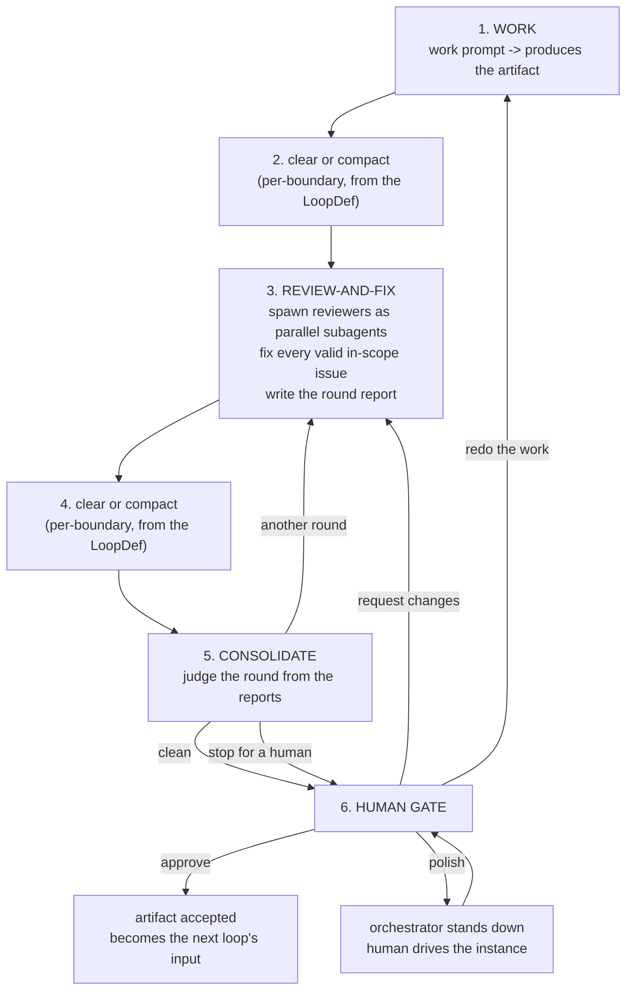
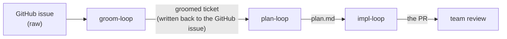

# New loop engine — interview brief

**Status:** decisions captured from an operator interview, 2026-07-12. Not yet a spec.
**Drives:** [#59](https://github.com/dylanb/agent-terminal/issues/59) — but supersedes its framing.
**Branch:** `feat/new-loops`.

## 1. Why #59 as written is not the change we're making

#59 scopes a *cost optimization* with behavior held constant: bound what a reviewer ingests so per-round cost stops growing with iteration depth, while keeping the verdicts, the roster, the signature, and reviewer independence exactly as they are.

The operator's position is that cost and latency are **symptoms**. The disease is that the loop carries machinery it does not need. So the fix is not to bound the context a reviewer is handed — it is to **stop handing reviewers context at all**, and to collapse the work→review→consolidate→re-work cycle into something with far fewer moving parts.

The #59 cost curve then disappears **by construction** rather than by optimization, which is a stronger outcome than the issue asks for.

## 2. The single insight

> Reviewers receive the **ticket** and their **charter**. Nothing else. They pull what they need with tools.

Today the engine *pushes* context at every reviewer: the ticket body, the standards, the plan or the diff, and the accumulating pile of prior reviews and notes. That push is what makes a round cost `roster-size × shared-context-size`, and it is why the cost grows with history.

In the new loop the reviewer prompt is **constant-sized**. A taint reviewer may go read half the codebase; an accessibility reviewer may pull only the UI diff. Each reviewer's cost is proportional to *what it actually needs*, decided by the reviewer, and is a function of the artifact under review — never of how many rounds have already run.

## 3. The loop

### What each step is

**1. Work — runs once.** The work prompt produces the artifact (groomed ticket / plan / implementation). It is *not* re-run on a consolidator verdict. The only thing that re-enters it is the human's explicit "redo the work" lever.

**3. Review-and-fix — one turn, not two.** The main instance spawns the roster as parallel `Task` subagents, receives their findings **into its own context as tool results** (not as files), fixes every valid in-scope issue, dismisses what is out of scope or invalid, and writes the round report. This is the change that makes the app's injection ability the driver: findings never round-trip through the filesystem to be re-read by someone else.

**5. Consolidate — judges the round, not the findings.** It no longer merges persona JSONs into a verdict. It reads the **last two round reports** and decides:

| verdict | meaning | action |
|---|---|---|
| `clean` | the round changed nothing — every issue raised was dismissed | stop at the human gate |
| `another round` | the round fixed something, so the artifact changed and needs fresh eyes on the new state | back to step 3 |
| `stop for a human` | the loop is spinning (we fixed X last round and X is back), or something needs a human ruling | stop at the human gate |

### The termination rule

**Clean = the round changed nothing.** Scope is a function of the ticket, not of history — so a memory-less reviewer re-raising an out-of-scope item every round, and a memory-less fixer re-dismissing it for the same reason every round, is *not* a failure. It is the system correctly re-deriving a settled judgment. The loop terminates when a round produces no changes, which means the artifact is stable under review.

This is what lets both the reviewers and the fixer be memory-less, which is what makes the cost flat.

### The human gate

- **Approve** — accept the artifact. It becomes the next loop's input.
- **Request changes** — typed feedback joins the next review-and-fix round (step 3).
- **Redo the work** — typed instruction re-enters the **work** agent whose *only* inputs are the ticket, the plan, and that instruction. No findings, no report history. The deliberate clean-slate lever.
- **Polish** — the orchestrator stands down and releases the prompt; the human converses with the live instance directly in the terminal, then approves. The instance keeps the context from the round it just finished.
- **Abandon** is not a loop verdict — it is flow-level *terminate*, which already exists.

## 4. Three loops, one engine

The shape is identical for every loop. They differ only in the work prompt, the reviewer roster/charters, and the gate side-effects. Each produces an artifact that is the next loop's input:

**Groom-loop is new** — it has no definition today. Building all three is deliberate: three defs on one engine make it impossible to accidentally hardcode a plan/impl assumption into the engine.

Groom's approve gate **publishes the groomed ticket back to the GitHub issue body**. Bootstrap/pickup (branch, draft PR, labels) stays a separate app action before the plan loop, as it is today — groom does not absorb it.

## 5. What changes about the artifacts

| today | new |
|---|---|
| `reviews/<iter>/review-<persona>.json`, one per persona per round | **gone** — findings return as `Task` results into the fixer's context |
| `reviews/<iter>/consolidated.json` — a merge of the persona files | **gone** — the consolidator judges reports, it does not merge findings |
| context pushed at every reviewer | reviewers get **ticket + charter**; they pull the rest with tools |
| — | **the round report** — prescribed-structure Markdown, **versioned per iteration**, recording what was raised, what was fixed, what was dismissed and why |

The round report is the **sole contract** between the fixer and the consolidator. If an issue is not in the report, it did not happen. The versioned history gives us the same forensic record the current agent-loop's artifacts give us.

## 6. Clear vs compact

A `/clear` at every actor boundary is why nothing amortizes. The new engine makes the boundary policy **data-driven from the LoopDef**: each boundary declares `clear`, or `compact` with a **custom compact message**. Different loops make different choices.

## 7. Landing strategy

**Replace the spec first, then implement.** Building a new engine against a spec that still describes the old one guarantees exactly the churn the rewrite exists to stop.

1. The new engine is **§27**; **§26 stays, marked retired**, until its code is deleted. *(Revised — the interview's decision was to rewrite §26 in place, keeping its number. Measurement killed it: **804 `§26.x` citations across 91 files** in `src/`/`tests/`, and **nine of thirteen subsection numbers reused for different concepts**. Keeping the number preserves the *link* while replacing the *target* — 804 citations, plus every changelog entry from v2.99 to v2.132, would still resolve, to the wrong clause. A new number costs nothing and keeps them all true.)*
2. The three defs are **owned by agent-terminal** in a new schema. `dequelabs/loops` is left alone; its defs stay valid for the legacy Go engine, which the app no longer speaks to.
3. **The two engines coexist behind one app-side contract; §26 is deleted in a single sweep at N8.** *(Revised — the interview's decision was that each slice deletes the machinery it replaces, no parallel engine. That is incompatible with a working `main`: N1 replaces the def and loop-state schemas every §26 actor depends on, so slice-by-slice deletion breaks the loop on `main` from N1 until N5.)* The seam is that **agent-terminal's loop contract is already engine-neutral** — `FlowLoopView.status` is an unbounded string, `gateOptions` is a `string[]` read from the def, `humanNeeded` is a shared open predicate over strings — so both engines are two implementations of **one `FlowLoopView` provider and one gate-decision executor**, chosen by the def's schema. `ipc.ts` takes only additive widenings (`GATE_DECISION_OPTIONS` gains `redo`/`polish`). **Compatibility runs to the app boundary and no further:** nothing below it is preserved, and no §26 code is edited to accommodate §27.
4. **The sweep deletes §26 whole** — code, tests, defs, and the spec section — **decided with the operator, not unilaterally.** `grep -r '§26' src tests` returning nothing is the completion evidence, which is what turns "gone from the tree, not merely unreferenced" into a check rather than a claim.

**The accepted cost of (3):** two engines and two test suites in the tree for the epic's duration, and one large deletion PR instead of eight small ones. Bought with it: every slice merges to `main` on its own, `main`'s loop keeps working throughout, and each slice gets reviewed at the granularity it deserves rather than arriving inside an eight-slice branch merge.

Compatibility with the old Go `agent-loop` is **not** a constraint. Divergence is preferred over contorting the design to preserve it.

## 8. The five open items — resolved

1. **Iteration cap → none.** The old cap existed to bound a loop whose termination rule was a counter. This loop's rule is a property of the artifact ("the round changed nothing"). The backstop against a runaway is a **human interrupt**: the operator arms "hand back to me", the round in flight completes, and the consolidator honors it at its next invocation — routing to the gate regardless of verdict, and stating the verdict it *would* have reached. Queued, never mid-turn, so there is no half-applied round.
2. **Reviewer failure → the fixer's problem, but it cannot be hidden.** The engine can't see `Task` results, so it can only learn of a dead reviewer through the report. Therefore the report **must account for every persona in the round's roster**, including one that failed — the engine validates that, and a round with a failed reviewer **can never be judged clean**.
3. **Reports → local, versioned, uncommitted**, under `<repo>/.agent-terminal/loop/reports/<n>.md`. Not just tidiness: the impl-loop's reviewers *pull the diff with tools*, so a committed report would turn up **inside the diff they are reviewing**.
4. **Cost meter → refactor, not reuse.** It must price the **entire run from flow start to terminate** — work turn, every reviewer subagent, the consolidator, the human's polish conversation, retries — not per-iteration segments rolled up. It remains the evidence for the #59 claim.
5. **#59 → close it; open an epic.** Its non-goals forbid most of what this design does, so it is the wrong ticket to carry the work. It closes citing the rebuild, and its cost criterion becomes an acceptance criterion of the epic's cost-meter slice.

## 9. New decisions taken while drafting §26

- **The consolidator chooses the next round's roster** (from the LoopDef's catalog; round 1 runs all of it). This **replaces the footprint skip-optimization outright** — instead of hashing `plan.md` and diffing `last_seen_files` to guess who can be pruned, the actor that just read the round's report decides who needs to look next.
- **The fixer marks its own homework** — recorded as the design's load-bearing accepted risk (§26.5/N5a). The consolidator sees only the report, so nothing in the loop can catch an issue the fixer declined to write down. It is bounded by the full-roster accounting rule, the versioned report series, and the human gate.
- **CI has no waiter.** A reviewer that cares about check state **pulls it with a tool**, like it pulls everything else.
