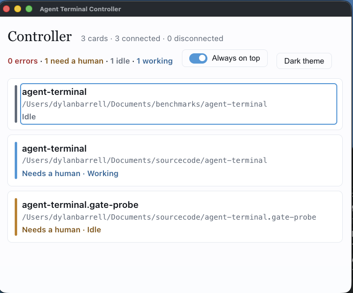

# The controller

The controller is a separate app that shows one status card per launch directory, so you can watch many agent terminals from one window and see at a glance which one needs you. The authoritative design is [spec §23](spec/23-multi-instance-and-epics.md).

## Starting it

Install both apps and launch them in either order: a terminal shows a "Startup paused" card and starts its shell once, on its own, when the controller confirms registration. The card can install the `agent-terminal` command, after which `agent-terminal --controller` starts the controller from the same build. If startup keeps waiting and the card names no version mismatch, restart the controller. Both apps must run as the same user.

For development: `pnpm run build`, then `pnpm exec electron out/main/controller.js`, and launch terminals with `pnpm exec electron .` (set `APP_LAUNCH_DIR` to choose each one's directory).

## Cards

An ordinary single-terminal card shows the terminal's name, launch directory, status (Working, Idle, Activity unavailable, Completed, Disconnected and others), ticket, flow and activity. A flow error or human request is shown together with what the agent is doing, for example **Needs a human · Working** or **Flow error · Idle**; the card takes the error or needs-a-human colour, and is counted there, only once its agent is idle or its activity is unavailable, and the working colour while the agent still works.

Click a card's header (or focus it and press Enter or Space) to collapse or expand it; a collapsed card shrinks to its header. In a window narrower than 640 pixels, cards that need you start expanded and the rest start collapsed, so a card with an error or request opens when its agent goes quiet and closes when the agent works again; your toggles survive membership changes and disconnection, and reset after registration from zero connections or a controller restart.

**Bring forward** restores that terminal; it sends no shell input and never decides a gate — make gate decisions in the terminal. Long reasons show three lines until **Show full reason**. **Dismiss** removes a disconnected card. **Dark theme** in the window header (**Light theme** while dark is on) is the controller's own setting, separate from each terminal's theme.

## Notifications

Human-attention notifications appear immediately in the ordinary card, even when its terminal is focused. The highlighted received message has a bell and receipt time; the separate live status tells you whether action is still needed. Updated terminals do not send OS notifications, including while the controller is unavailable. Both apps need notification support; older compatible versions still register and show ordinary status. Reading a message never decides a gate. Each directory keeps the newest three distinct messages in memory. Repeated matching text increments its arrival count without moving the entry or changing its original receipt time. **History N/3** includes the highlighted latest entry and toggles the earlier messages. When history is expanded and nonempty, **Clear history** removes every retained entry and count, including the latest message, while keeping the card and its live error or human-needed condition. Clear and Dismiss are separate actions; neither resolves a gate. Open history and equivalent History/Clear focus survive live updates and arrivals; removed controls use the card focus fallback, and outside focus is untouched. If history or its directory representation changes before Clear applies, Clear visibly refuses and preserves the new state for explicit retry. Unrelated live-status updates do not invalidate Clear. Clear on a connected or disconnected card also keeps its unchanged current request hidden through same-run reconnect and refresh. A genuinely new qualifying stop can notify even with identical wording; changes within a continuing stop follow the existing qualification rules. Dismiss, controller restart and directory overlap forget this suppression, so a current request received after those resets starts with a fresh receipt time and count one. No current request means no rebuilt notification. Manual card collapse is respected. Disconnected cards keep this history without implying live work; same-run reconnection reuses it. **Dismiss** forgets the disconnected card and its history completely. Restart starts empty and reconstructs only current requests from reconnecting terminals. Overlapping terminals discard all notification history; reducing to one starts fresh from the survivor’s current request.

## Tray

The controller lives in the system tray (the menu bar on macOS). Its icon shows a dot when a card needs you, following the cards' colours: amber when a card is in the needs-a-human colour, red when any card is in the error colour (a flow error whose agent is idle or whose activity is unavailable, a disconnected terminal or a duplicate directory); red wins when both apply. A card whose agent is still working adds no dot.

Click the icon to open the window. Its menu (right-click on macOS; on Linux, the menu your tray host shows) counts the connected cards, the errors and the cards needing a human, and offers **Open Controller**, **Always on top** and **Quit Controller**. Closing the window hides it on macOS (click the Dock icon or the tray icon to bring it back) and minimizes it on Linux; it keeps following your terminals while closed. To exit, use **Quit Controller** or the application menu's Quit (Cmd-Q on macOS, Ctrl+Q on Linux). Terminals keep working if the controller quits and reconnect automatically when it returns.

## Window

**Always on top** in the window header, and in the tray menu, keeps the controller above other windows; it is on for a new install. The controller remembers its size, position, always-on-top choice and theme across restarts. It reopens at the default place when the saved position is on no attached display, and never reopens maximized or full screen.

## Duplicate directories

When two or more live terminals share a launch directory, their card shows **Duplicate directory**, the instance count and guidance to reduce them to one. It hides all work, ticket, human-request and error details until only one connection remains; that survivor's current ordinary information then returns. Stopping an agent without closing its terminal does not clear the conflict. Different worktrees stay separate, and changing a shell's directory does not regroup cards. The header counts cards, with a conflict counted once as an error. Collapsed conflicts retain the warning and count.

**Bring both forward** (or **Bring N terminals forward**) restores all windows represented when clicked. Failed or unconfirmed attempts produce **Terminal unavailable** feedback with the failed count out of that original total; retry uses current members. The controller never closes terminals or resolves gates: close extra instances in their actual windows. The last departure leaves one identified disconnected card with **Dismiss**; reconnect replaces it, and a delayed dismissal cannot remove a replacement.

## Testing note

Native macOS GUI keyboard checks for the controller are not automated, because Accessibility/event-posting permission is unavailable to the test run; those cases are covered on Ubuntu.
