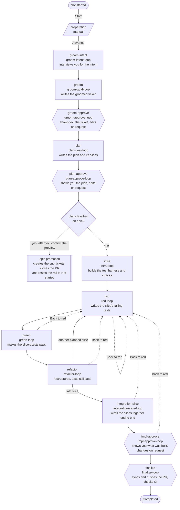
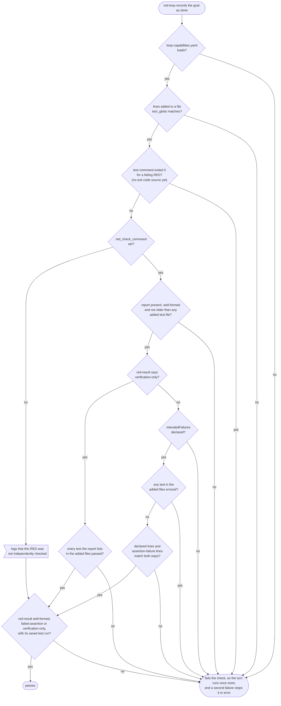

# feature-dev-v3

The full test-driven chain, described in [spec §28](../spec/28-the-full-tdd-development-process-a-chain-of-loops.md). `red`, `green` and `refactor` run once for each impl-slice in the plan, and `refactor` loops back to `red` until the last one is built. An epic plan fans out into sub-tickets instead of being built. [How to read the flow diagrams](README.md#how-to-read-the-flow-diagrams) explains the shapes and arrows.

| Step | Loop | Gate | Gate options | On approve |
|---|---|---|---|---|
| `preparation` | none | manual | Advance | |
| `groom-intent` | `groom-intent-loop` | auto | approve, redo | |
| `groom` | `groom-goal-loop` | auto | approve, redo | |
| `groom-approve` | `groom-approve-loop` | human | approve, redo | Writes the groomed ticket into the issue body. |
| `plan` | `plan-goal-loop` | auto | approve, redo | |
| `plan-approve` | `plan-approve-loop` | human | approve, redo | Marks the PR ready for review. For an epic plan it shows a preview of the sub-tickets instead, and confirming creates them, closes the planning PR and resets the rail to **Not started**. Declining leaves you at the gate. |
| `infra` | `infra-loop` | auto | approve, redo, polish | Commits `infra`. |
| `red` | `red-loop` | auto | approve, redo, polish, back-to-red | Commits `RED`. |
| `green` | `green-loop` | auto | approve, redo, polish, back-to-red | Commits `GREEN`. |
| `refactor` | `refactor-loop` | auto | approve, redo, polish, back-to-red | Commits `refactor`, then loops back to `red` while planned slices remain. |
| `integration-slice` | `integration-slice-loop` | auto | approve, redo, polish, back-to-red | Commits `integration`. |
| `impl-approve` | `impl-approve-loop` | human | approve, redo, back-to-red | Commits `approve` and publishes the plan as the PR body. |
| `finalize` | `finalize-loop` | human | approve, redo | |

`groom-intent` asks for the ticket. Entering `plan` opens the run's branch and draft PR (pickup). If pickup fails, the run steps back to `groom-approve` so you can fix the cause and advance again. `red` can split its own slice, which adds to the count of slices still to build.

## What each loop does in feature-dev-v3

[How to read the loop tables](README.md#how-to-read-the-loop-tables) explains the columns. Each step from `infra` to `integration-slice` also has to leave its section of `impl-report` holding its decisions, review history and test evidence.

| Step | Runs as | Work turn | Reviewers | Done when |
|---|---|---|---|---|
| `groom-intent` | [single work turn](loops.md#single-work-turn) | Reads the issue and the code it touches, then interviews you, highest-impact question first, until the intent is settled, including what the groomer may decide alone. Writes `groom-intent`. | none | It writes `groom-intent`. |
| `groom` | [goal loop with review passes](loops.md#goal-loop-with-review-passes) | Writes the groomed ticket from the intent: an imperative title, the problem with a spec citation, scope, non-goals and measurable acceptance criteria. It never asks you anything. Writes `groomed-ticket` and `groom-report`. | intent | The review ends and `groom-report` logs every decision and finding. |
| `groom-approve` | [single work turn](loops.md#single-work-turn) | Shows you a summary of the ticket and what needs your call, then stays in the session to make the edits you ask for. Writes `groom-summary`. | none | You approve at the gate. |
| `plan` | [goal loop with review passes](loops.md#goal-loop-with-review-passes) | Writes the plan (test, technical and infrastructure plans, the slices and the epic classification) and polishes it. Writes `plan` and `plan-report`. | principal, security, architecture, intent, maintainability, contracts, test-architect, determinism, tracer-slicer, ui | The review ends and `plan-report` logs every decision, every item left for you and every finding. |
| `plan-approve` | [single work turn](loops.md#single-work-turn) | Shows you each acceptance criterion with its slice and test, and an epic's sub-tickets, then makes the plan edits you ask for. Writes `plan-summary` and `plan`. | none | You approve at the gate. |
| `infra` | [goal loop with review passes](loops.md#goal-loop-with-review-passes) | Builds the test harness, fakes and fixtures the slice plan needs, and the small checks (a type, a lint rule, a test or a script) it finds the ticket would benefit from, test first. Larger ones are logged for you, not built. Writes `infra-capabilities`. | principal, tests, security, taint, reliability, maintainability, conventions, architecture, determinism | The review ends and the tests this step ran pass. |
| `red` | [goal loop with review passes](loops.md#goal-loop-with-review-passes), once per slice | Writes failing tests for the slice's acceptance criteria, or proves a slice that is already built is verification-only. Writes `red-result`, and `plan` when it splits the slice. | tests, intent, red-authenticity | The review ends, the new tests fail by assertion (or all pass for a verification-only slice), and every other test that ran passes. The [RED completion check](#red-completion-check) is what the engine then verifies. |
| `green` | [goal loop with review passes](loops.md#goal-loop-with-review-passes), once per slice | Writes the smallest change that makes the slice's tests pass, and logs any edit to a RED test. Writes `green-result`. | principal, tests, security, taint, reliability, architecture, contracts, intent, accessibility, regression-guard | The review ends, the tests and the build pass, and every RED test edit is logged. |
| `refactor` | [goal loop with review passes](loops.md#goal-loop-with-review-passes), once per slice | Restructures the slice's code without changing what it does, and its review passes decide what to change. It records its test result in a file the engine names. | principal, tests, reliability, architecture | The review ends and the tests still pass. |
| `integration-slice` | [goal loop with review passes](loops.md#goal-loop-with-review-passes) | Wires the slices together and adds an end-to-end test that runs the feature from a control in the real UI. | principal, tests, security, taint, reliability, architecture, contracts, intent, maintainability, conventions, accessibility, diagrams, tracer-slicer | The review ends and the full suite passes, end-to-end tests included. |
| `impl-approve` | [single work turn](loops.md#single-work-turn) | Shows you each acceptance criterion with where it was built and its test, every change to a RED test, the decisions and the test evidence. Then it makes the changes you ask for, test first. Writes `impl-summary`. | none | You approve at the gate. |
| `finalize` | [goal loop without reviewers](loops.md#goal-loop-without-reviewers) | Confirms the PR, brings it up to date with its base, commits and pushes, waits for CI on the latest push, updates the PR description and publishes the run's audit report. It never merges. Writes `finalize-summary`. | none | The PR is up to date and pushed, local checks and CI on the latest push pass, the description is updated, and the published audit report matches the local one. |

`impl-approve` also writes its own section of `impl-report`. `infra`, `red`, `green` and `refactor` leave polish findings to `integration-slice`. When the engine approves `green`, `refactor` or `integration-slice`, it first records which RED tests the step changed, for `impl-approve` to show you. It stops for you there only when it can't run that check.

## RED completion check

When `red-loop`'s session records the goal as done, the engine decides whether the slice's RED really fails for the right reason ([spec §28.5.3](../spec/28-the-full-tdd-development-process-a-chain-of-loops.md)). Only `red-loop` runs this check. The session writes the failing tests, saves the raw test run, and writes `red-result` with its outcome and, in `intendedFailures`, a `{"file", "line"}` entry for every check it means to fail. When the repository sets a `red_check_command` in `loop-capabilities.yaml`, the session also runs it over the test files it added or changed and saves the report it prints. This repository's command is `node scripts/red-check.mjs`, which runs the tests in those files (for a Playwright spec, only the tests around the changed lines) and sorts each one into `passed`, `failed-assertion`, `errored` or `skipped`.

In this diagram a diamond is a check, the flag-shaped box is a line the engine writes to the run log, and a rounded box is where the check starts or ends. The list under it names the other lines the engine logs.

- **Capabilities and added tests.** The engine reads `test_globs` from `loop-capabilities.yaml`, so a missing or malformed file fails the check. It then needs at least 1 file matching `test_globs` with lines added against `HEAD`, or a new untracked one. A turn that only deletes tests or removes lines from them fails.
- **Exit code.** A failing RED whose test command exited 0 fails. No exit code is recovered yet, so this check never fires today. A verification-only RED expects exit 0 and skips it.
- **No red check command.** The RED passes on its result alone, and the run log records that it was not independently checked.
- **The report.** It has to exist, parse, and be no older than any added test file, so the session runs the check again after any later edit to those tests.
- **Verification-only.** Every test the report lists in the added files has to pass. A skipped, errored or failing test fails the check. An added file the report doesn't cover isn't checked, and the run log records that its tests were not independently seen passing. When a verification-only RED completes, the run log also records that the slice's new tests pass against behavior already built.
- **A failing RED.** `red-result` has to declare `intendedFailures`, and no test in the added files may error. Every declared line has to fail by assertion, and every assertion failure in the added files has to be declared. A declared failure in a file the report doesn't cover isn't checked, and the run log records it as not independently checked.
- **The result.** `red-result` has to be well-formed, report `failed-assertion` (or `passed` with `verificationOnly`), and have its saved test run beside it, non-empty.

A failure runs the turn once more, and a second failure stops the step in `error` for you. Accepting the turn by hand still needs every one of these checks to pass.
