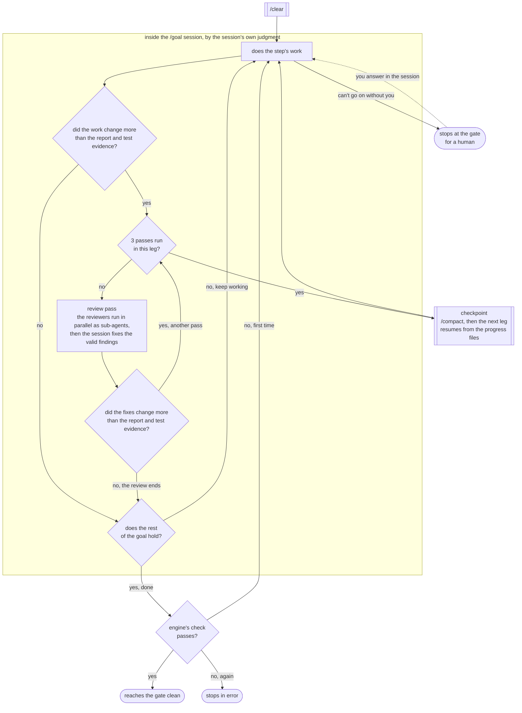
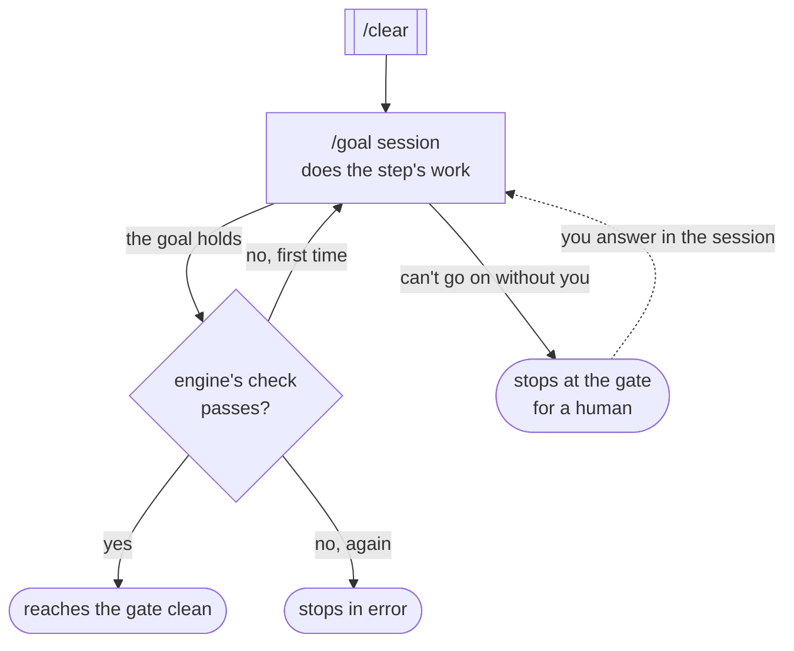
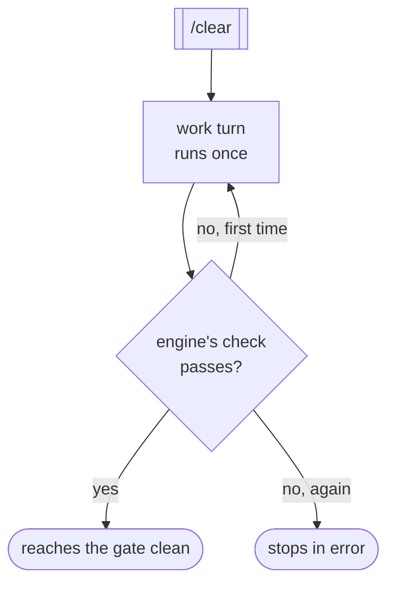
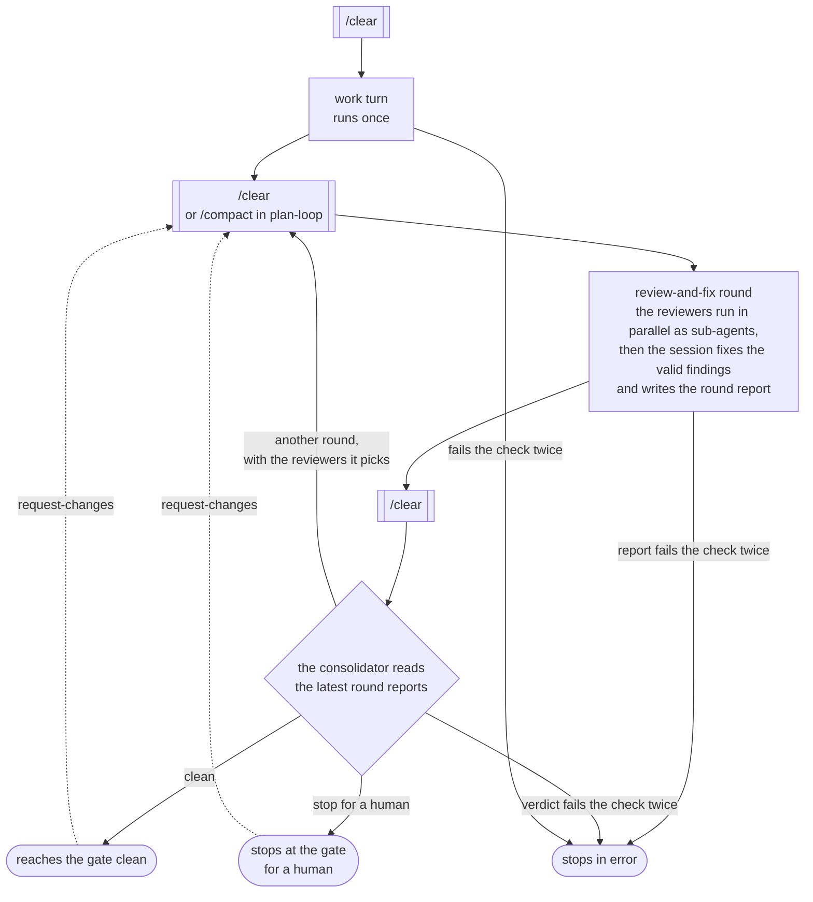

# How each loop runs

The loops in all 3 [bundled flows](README.md) run in only 4 ways, so each way is drawn once here. Each flow page's **What each loop does** table says which way each of its loops runs.

Every loop starts its work turn in a cleared session. In these 4 diagrams a box with double side bars is a command the engine sends to the session, a rectangle is a turn the session runs, a diamond is a decision, a rounded box is where the step ends up, and a dotted arrow is something you do. The frame in the first diagram holds the decisions the session makes for itself.

The engine checks what each turn leaves behind ([spec §27.12](../spec/27-in-terminal-loop-engine-the-live-design.md)). Every leg of a goal loop needs a well-formed progress file, whether it ends done, at a checkpoint or blocked. The engine checks the product of a single work turn, of a review-round loop's work turn, and of a goal leg that records the goal as done.

- `red-loop` needs lines added to a file the repository's test patterns match, and its result has to record the new tests failing by assertion or a verification-only result. When the repository sets a red check command, it also needs a fresh red check report that agrees with that result ([spec §28.5.3](../spec/28-the-full-tdd-development-process-a-chain-of-loops.md)). The [RED completion check](feature-dev-v3.md#red-completion-check) draws every step of it.
- `green-loop` needs its result to record the tests and the build as passed and a RED baseline recorded on the branch, and `refactor-loop` needs its result to record the tests as passed ([spec §28.5.3](../spec/28-the-full-tdd-development-process-a-chain-of-loops.md)).
- Any other loop whose product is a file needs that file with its completion marker, and any other loop whose product is its commits, `infra-loop` included, needs nothing more.

A turn that fails the check is run once more, and a second failure stops the step in `error` for you. A malformed round report or verdict is repaired rather than rerun, a reviewer the session can't load stops the step at once, and a turn that goes silent after its prompt goes in stops in `error` without a retry, but finishes normally if it signals done later. A step that reaches its gate clean is approved by the engine when its gate is `auto`, unless one of the halt reasons in [spec §27.9.1](../spec/27-in-terminal-loop-engine-the-live-design.md) holds, and waits for you when it is `human`. A step that stops for a human always waits for you.

## Goal loop with review passes

`groom-goal-loop`, `plan-goal-loop`, `infra-loop`, `red-loop`, `green-loop`, `refactor-loop`, `integration-slice-loop`, `simple-plan-loop-v1`, `simple-dev-loop-v1` and `simple-integration-slice-loop-v1` run this way ([spec §27.3](../spec/27-in-terminal-loop-engine-the-live-design.md)).

The engine sends the session a `/goal` made of the loop's goal (the **Done when** column) and tells it to checkpoint after 3 review passes in a leg. The session decides the work, whether to run a review pass, when it has run 3 and whether the goal holds, which is everything inside the frame. It records those decisions in a progress file, and the engine learns them only from that file. The `/clear`, the checkpoint's `/compact` and the engine's check sit outside the frame. A leg that ends at a checkpoint or blocked also needs a well-formed progress file, so it can stop in `error` the same way, which the diagram leaves out.

- A review pass runs only when the work changed more than the step's report and its test evidence. Passes repeat until one whose fixes change nothing beyond those, which ends the review. The session then checks the rest of the goal and goes back to work if it doesn't hold.
- The first pass runs every reviewer the loop names. A later pass runs only the reviewers whose findings were fixed or whose area the fixes touched, and runs them all again when a fix changes the acceptance criteria, the scope, the approach or the slices. A reviewer whose area the change can't touch, such as accessibility with no UI change, is skipped and logged.
- When 3 passes have run in a leg and the goal doesn't hold yet, the session records a checkpoint. The engine compacts the session and starts the next leg, which picks up from the progress and notes files.
- The session stops for a human only when no choice inside the decision boundary you gave it lets it go on. Anything else outside that boundary is logged under **Needs your call** and the work carries on. If you answer it in the session while the step is still waiting at its gate, the loop carries on from where it stopped. A choice you make at the gate first stands.

## Goal loop without reviewers

`finalize-loop` runs this way. The goal has no review passes and no checkpoint, so it runs in 1 leg.

It stops for you when the PR or repository can't be confirmed, or when a conflict or CI failure can't be settled from the approved intent. If you answer it in the session while the step is still waiting at its gate, it carries on.

## Single work turn

`groom-intent-loop`, `groom-approve-loop`, `plan-approve-loop` and `impl-approve-loop` run this way. They have no goal and no reviewers.

`groom-intent-loop` talks to you during its turn. The approve loops show you their summary and then stay in the session, so you can ask for changes there before you approve.

## Review rounds with a consolidator

`groom-loop` and `plan-loop` in `plan-only` run this way ([spec §27.6](../spec/27-in-terminal-loop-engine-the-live-design.md)).

The work turn runs once. Before each round the session is cleared, or compacted in `plan-loop`, and it is cleared again before the consolidator reads this round's report and the one before it, if there is one. Round 1 runs every reviewer the loop names, and the consolidator picks the reviewers for each round after it.

- The consolidator returns `clean` when a round fixed nothing, and `stop for a human` when an issue needs you. A reviewer that fails to run is run again in the next round, and the loop stops for you only if it fails again.
- There is no round limit. **Hand back to me** in the loop panel lets the round in flight finish and then sends the loop to its gate whatever the verdict ([spec §27.9](../spec/27-in-terminal-loop-engine-the-live-design.md)).
- `request-changes` at the gate starts a new round with every reviewer and your feedback.
- The work turn, each round report and each verdict get the engine's check, so any of them can stop the step in `error` as above.
