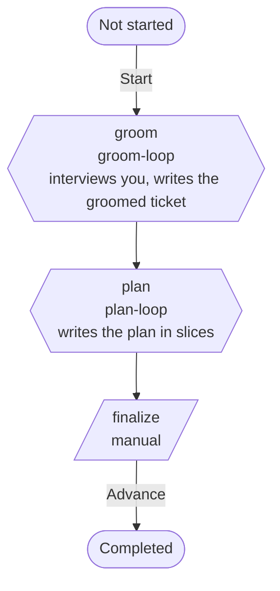

# plan-only

Groom a ticket and produce a reviewed plan, then stop. Its loops run review rounds with a consolidator, so their gates also offer `request-changes` (the **changes** button), which sends your feedback into the next review round. Neither step declares a gate authority, so both are human gates. [How to read the flow diagrams](README.md#how-to-read-the-flow-diagrams) explains the shapes and arrows.

| Step | Loop | Gate | Gate options | On approve |
|---|---|---|---|---|
| `groom` | `groom-loop` | human | approve, request-changes, redo, polish | Writes the groomed ticket into the issue body. |
| `plan` | `plan-loop` | human | approve, request-changes, redo, polish | Marks the PR ready for review. |
| `finalize` | none | manual | Advance | |

`groom` asks for the ticket. Entering `plan` opens the run's branch and draft PR (pickup), and if pickup fails the run steps back to `groom`. `finalize` gives you the `polish` todo list to work through before you press **Advance**.

## What each loop does in plan-only

[How to read the loop tables](README.md#how-to-read-the-loop-tables) explains the columns.

| Step | Runs as | Work turn | Reviewers | Done when |
|---|---|---|---|---|
| `groom` | [review rounds with a consolidator](loops.md#review-rounds-with-a-consolidator) | Reads the issue and the code, then interviews you until every gap, ambiguity and questioned acceptance criterion has your decision. Then it writes the groomed ticket. Writes `groomed-ticket`. | intent | The consolidator returns `clean`. It returns `stop for a human` while any item you were asked about lacks your decision. |
| `plan` | [review rounds with a consolidator](loops.md#review-rounds-with-a-consolidator) | Plans the issue as tracer-bullet slices, with an architecture sketch, the contracts, a file-level change list and a RED-first test strategy with an end-to-end test for each slice. Writes `plan`. | principal, security, architecture, intent, maintainability, contracts, ui | The consolidator returns `clean`. |
