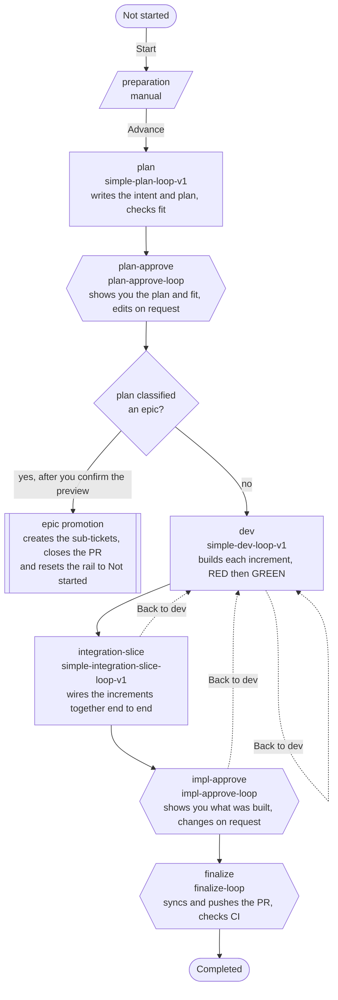

# simple-dev-v1

A lighter chain for a ticket that fits one `feature-dev-v3` impl-slice. `dev` builds the whole plan in one loop, committing a `RED:` and then a `GREEN:` for each increment, and **Back to dev** reopens `dev`. `plan` checks whether the ticket fits, and `plan-approve` warns you when it doesn't, an epic included, so you can restart it under `feature-dev-v3`. [How to read the flow diagrams](README.md#how-to-read-the-flow-diagrams) explains the shapes and arrows.

`plan-approve` declares the same epic promotion as `feature-dev-v3`. The planner is told never to write the epic tokens the engine reads, so in practice approval only marks the PR ready and the epic branch doesn't fire.

| Step | Loop | Gate | Gate options | On approve |
|---|---|---|---|---|
| `preparation` | none | manual | Advance | |
| `plan` | `simple-plan-loop-v1` | auto | approve, redo | |
| `plan-approve` | `plan-approve-loop` | human | approve, redo | Marks the PR ready for review. An epic plan is promoted instead, as in `feature-dev-v3`. |
| `dev` | `simple-dev-loop-v1` | auto | approve, redo, polish, back-to-red | Commits `dev`. |
| `integration-slice` | `simple-integration-slice-loop-v1` | auto | approve, redo, polish, back-to-red | Commits `integration`. |
| `impl-approve` | `impl-approve-loop` | human | approve, redo, back-to-red | Commits `approve` and publishes the plan as the PR body. |
| `finalize` | `finalize-loop` | human | approve, redo | |

`preparation`, `plan-approve`, `impl-approve` and `finalize` reference the shared step definitions `dev-preparation`, `dev-plan-approve`, `dev-impl-approve` and `dev-finalize` in [`example/steps/`](../../example/steps), which `feature-dev-v3` uses too. The loops those steps run ship in the shared folder `example/loops-v2/`. `feature-dev-v3` keeps its own copies under the same names in its own folder, and a flow's own folder comes first in the lookup, so `plan-approve-loop` and `impl-approve-loop` keep their `simple-dev-v1` prompts.

`plan` asks for the ticket, and entering it opens the run's branch and draft PR (pickup). If pickup fails, the run steps back to `preparation`. `impl-approve` declares a `repeat` only to name `dev` as the `back-to-red` target. Its count never rises above 1, so approving it always moves on to `finalize`. An increment that only adds verification ends at its `RED:` commit.

## What each loop does in simple-dev-v1

[How to read the loop tables](README.md#how-to-read-the-loop-tables) explains the columns. `dev` and `integration-slice` also have to leave their section of `impl-report` holding their decisions, review history and test evidence.

| Step | Runs as | Work turn | Reviewers | Done when |
|---|---|---|---|---|
| `plan` | [goal loop with review passes](loops.md#goal-loop-with-review-passes) | Reads the issue and writes `groom-intent` without asking you anything. Then it writes the plan, with a fit check for this flow, scrutiny flags, test and technical plans and the increments, and polishes it. Writes `plan`, `plan-report` and `groom-intent`. | principal, intent, test-architect, tracer-slicer | The review ends, the plan holds its intent, fit check, scrutiny flags and increments, and `plan-report` logs every decision, every item left for you and every finding. |
| `plan-approve` | [single work turn](loops.md#single-work-turn) | Shows you the plan summary, opening with a warning when the ticket is better suited to `feature-dev-v3`, then makes the plan and intent edits you ask for. Writes `plan-summary`, `plan` and `groom-intent`. | none | You approve at the gate. |
| `dev` | [goal loop with review passes](loops.md#goal-loop-with-review-passes) | Builds each increment with fresh sub-agents, committing the failing tests as `RED:` and the code as `GREEN:`, then reverts anything outside the ticket's scope. After **Back to dev** it keeps finished increments and redoes only what was flagged. | principal, tests, security, taint, reliability, architecture, contracts, intent, accessibility, regression-guard, red-authenticity | The review ends, every increment has a `RED:` commit whose new and edited tests fail by assertion and then a `GREEN:` commit, or a verification-only `RED:` commit whose tests pass and are shown failing in a scratch copy, the tests and the build pass, every RED test edit is logged, and nothing outside the scope remains. |
| `integration-slice` | [goal loop with review passes](loops.md#goal-loop-with-review-passes) | The same work as in [`feature-dev-v3`](feature-dev-v3.md#what-each-loop-does-in-feature-dev-v3), over the increments. | principal, tests, security, taint, reliability, architecture, contracts, intent, maintainability, conventions, accessibility, diagrams, tracer-slicer | The review ends and the full suite passes, end-to-end tests included. |
| `impl-approve` | [single work turn](loops.md#single-work-turn) | The same work as in [`feature-dev-v3`](feature-dev-v3.md#what-each-loop-does-in-feature-dev-v3), except that it finds the changes to RED tests from the branch's `RED:` commits. Writes `impl-summary`. | none | You approve at the gate. |
| `finalize` | [goal loop without reviewers](loops.md#goal-loop-without-reviewers) | The same work as in [`feature-dev-v3`](feature-dev-v3.md#what-each-loop-does-in-feature-dev-v3). Writes `finalize-summary`. | none | The same as in `feature-dev-v3`. |

`impl-approve` also writes its own section of `impl-report`. `dev` leaves polish findings to `integration-slice`. `dev` declares no `completion`, so the engine runs no RED completion check on its `RED:` commits, unlike `feature-dev-v3`'s [red step](feature-dev-v3.md#red-completion-check). Its own goal and its reviewers, `red-authenticity` among them, are what check that each `RED:` fails by assertion. When the engine approves `integration-slice`, it first records which RED tests the step changed, and stops for you only when it can't run that check.
