# N8 sweep — the proposed deletion list

**Status:** proposed, awaiting the operator gate. Assembled 2026-07-26; corrected 2026-07-26 against the
iteration-3 and iteration-4 review rounds and two returned devil's-advocate passes (§K).
**Drives:** [#98](https://github.com/dylanb/agent-terminal/issues/98) (N8), PR #99.
**Branch:** `plan-loop/issue-98`.

**One call that was the operator's is now recorded rather than open — §K.1, AC 5's notice.** The iteration-4
round measured that the notice as previously prescribed had **no producer at all** rather than a durability
gap, which changed what the choice was between. It is settled inside the approved plan's declared scope and
written up in [§K.1](#k1-the-escalation-and-how-it-is-settled); an operator who disagrees with that call
should press there first.

The artifact §27.15 and issue #98 require: the sweep is **reviewed with the operator, not decided
unilaterally**, and the agreed list is carried into the PR because ACs 2, 3 and 7 are graded against it.
The title says *proposed* until the operator's agreement lands; the commit that records that agreement flips
the word.

**Every present-tense verb below describes the sweep as planned, not the system as it ships.** Its
`path:line` pointers are pinned to this branch's pre-sweep tree and go stale as the sweep lands; nothing
holds them true afterwards (§E.4 disposes of this document itself).

**Baselines measured 2026-07-26 on `plan-loop/issue-98`, all three in their own unit** — the `§26` column in
every table below is the third one, matching lines:

| measure | command | value |
|---|---|---:|
| files | `grep -rl '§26' src tests` | **119** |
| matching lines | `grep -rc '§26' src tests` summed | **890** |
| occurrences | `grep -ro '§26' src tests` | **1006** |

A line may carry the citation more than once, which is the whole of the 890 ↔ 1006 gap. The `§26` column
across §A, §B, §C and §D sums to **888** over 122 distinct files; the remaining **2** are
`src/main/exampleSkills.ts`, whose class is delete-whole via the orphan walk and whose row therefore lives
in §I.1 rather than in a class table. **888 + 2 = 890**, never 1006. An operator repeating that arithmetic
should land exactly there.

## Contents

| § | what it holds |
|---|---|
| [How to read this](#how-to-read-this) | the three classes, the class-decision rule, and its diagram |
| [Method](#method) | how the partition was assembled and iterated to a fixpoint |
| [A](#a-delete-whole) | Delete whole — `src/`, the vendored def tree, and the tests that go with them |
| [B](#b-split--src-a-surviving-module-loses-only-its-26-only-code) | Split — a surviving module loses only its §26-only code |
| [C](#c-scrub-only--the-files-sole-26-content-is-a-citation) | Scrub only — the file's sole §26 content is a citation |
| [D](#d-tests) | Tests: deleted, Split, scrubbed, and the new RED-first table |
| [E](#e-ac-7--every-surviving-26-citation-outside-src-and-tests-with-its-disposition) | AC 7 — every surviving §26 citation outside `src/`/`tests/`, with its disposition |
| [F](#f-ac-9--capabilities-removed-recorded-not-discovered) | AC 9 — capabilities removed, recorded not discovered |
| [G](#g-changes-invisible-to-ac-1s-grep) | the changes AC 1's grep cannot see |
| [H](#h-deliberately-retained--justified-without-a-citation-pinned-behaviourally) | deliberately retained surface, justified without a citation |
| [I](#i-touched-with-zero-26-citations--invisible-to-ac-1s-grep) | touched with **zero** §26 citations |
| [J](#j-fixpoint-result) | the fixpoint result, as measured |
| [K](#k-review-status--the-devils-advocate-passes) | **the settled escalation (§K.1)**, then what each devil's-advocate pass found |
| [L](#l-checked-and-cleared) | checked and cleared |

**Subsections, because three quarters of this document's cross-references target one.** Of the `§X.n`
references below, **76% name a subsection**, and §B and §D hold over half of those between them — so a
top-level-only index resolves a minority of them.

| § | subsections |
|---|---|
| A | [A.1 `src/main`](#a1-srcmain--the-retired-engines-machinery) · [A.2 `src/shared`](#a2-srcshared) · [A.3 `src/renderer`](#a3-srcrenderer) · [A.4 vendored defs](#a4-vendored-def-snapshot-and-its-bundled-skills) · [A.5 tests](#a5-tests-deleted-because-their-subject-is-deleted) |
| B | [B.1 `loopOrchestrator`](#b1-srcmainlooporchestratorts-27--the-sharpest-case) · [B.2 `turnDoneFile`](#b2-srcmainturndonefilets-5) · [B.3 `flow.ts`](#b3-srcmainflowts-21) · [B.4 `loopNamespace`](#b4-srcsharedloopnamespacets-3) · [B.5 `flowEntryActions`](#b5-srcmainflowentryactionsts-10) · [B.6 `loopDefV2` + AC 5](#b6-srcmainloopdefv2ts-1--a-new-ac-5-migration-path) · [B.7 `ipc.ts`](#b7-srcsharedipcts-32) · [B.8 `ipcValidation`](#b8-srcmainipcvalidationts-3) · [B.9 `loopPanel`](#b9-srcrenderersrclooppanelts-16--split-not-scrub) · [B.10 `flowStrip`](#b10-srcrenderersrcflowstripts-3--split-not-scrub) · [B.10a `styles.css`](#b10a-srcrenderersrcstylescss-2--split-not-scrub) · [B.11 install destinations](#b11-srcmaininstallexamplests-4--srcmainexampleassetsts-2--srcmainexampleassetsbuildts-1) · [B.12 `userConfig`](#b12-srcmainuserconfigts-3) · [B.13 `appBootstrapCommand`](#b13-srcmainappbootstrapcommandts-0-26) · [B.14 `auditRecorder`](#b14-srcmainauditrecorderts-2--the-writer-half) · [B.15 `index.ts`](#b15-srcmainindexts-92--the-composition-root) · [B.16 `loopTurn`](#b16-srcsharedloopturnts-4--split-not-scrub) · [B.17 `flowInputModal`](#b17-srcrenderersrcflowinputmodalts-1--split-not-scrub-operator-visible-text) · [B.18 `flowState`](#b18-srcmainflowstatets-2--the-persisted-document) · [B.19 renderer `installExamples`](#b19-srcrenderersrcinstallexamplests-1--split-not-scrub) · [B.20 pointers](#b20-surviving-27-modules-whose-26-content-is-entirely-explanatory) · [B.21 `loopActivity`](#b21-srcsharedloopactivityts-1--split-not-scrub-operator-visible-phrases) |
| D | [D.1 deleted](#d1-deleted--subject-deleted) · [D.2 Split](#d2-split--the-file-mixes-a-deleted-subject-with-a-surviving-one) · [D.2a `app.spec.ts`](#d2a-testse2eappspects-test-by-test) · [D.3 Scrub](#d3-scrub-only) · [D.4 new RED-first tests](#d4-new-tests-red-first) |
| E | [E.1 deleted](#e1-deleted) · [E.2 rewritten](#e2-rewritten-to-what-ships-present-tense-content-changes) · [E.3 re-pointed](#e3-re-pointed-the-concept-survives-under-27-at-its-actual-27-home--not-all-one-section) · [E.4 history](#e4-left-standing-as-history--not-rewritten) |
| H | [H.1 audit kinds](#h1-the-25-audits-loopcost-and-loopci-union-members-and-the-readers-fold-of-them) · [H.2 `started_at`](#h2-started_at-in-the-persisted-flow-progression-document) · [H.3 `APP_STATE_DIRS`](#h3-agent-loop-in-app_state_dirs) · [H.4 `userConfigLoopsDir`](#h4-userconfigloopsdir-and-ac-5s-presence-check) · [H.5 the `legacy` literal](#h5-the-legacy-literals-recognition-in-srcsharedloopnamespacets) |
| I | [I.1 orphans](#i1-deleted--the-orphan-walk-is-the-evidence-not-the-grep) · [I.2 retiring surface](#i2-split--surviving-files-carrying-retiring-surface) · [I.3 dead exports](#i3-dead-exports-on-surviving-modules) |
| K | [K.1 the settled escalation](#k1-the-escalation-and-how-it-is-settled) · [K.2 first pass](#k2-what-the-first-pass-found-and-what-was-done-with-it) · [K.3 second pass](#k3-what-the-second-pass-found-and-what-was-done-with-it) · [K.4 the composition-root walk](#k4-the-walk-of-the-composition-root-and-the-one-finding-that-changed-a-disposition) · [K.5 follow-ups](#k5-two-follow-ups-recorded-deliberately-not-done-here--and-not-yet-filed-as-issues) |

## How to read this

Every file below carries exactly one class, **and appears under exactly one heading.** Where a reader would
plausibly look for it in another section, that section carries a bare cross-reference with **no**
prescription of its own, so a corrected prescription cannot survive in a second place.

| class | meaning | graded under |
|---|---|---|
| **Delete whole** | exists only to implement §26; goes with its tests | AC 1 |
| **Split** | a surviving module holding §26-only code; it loses that code and keeps the rest — **bounded** by AC 3's Split clause (it may lose only what this list names) | AC 2 / AC 9 / AC 10 |
| **Scrub** | the file's only §26 content **is** a citation; the edit touches comments, doc-comments, test names and prose only, and changes no behavior | AC 3 |

**Ownership decides the class, not location and not the header.** A §26 header is evidence, never proof:
`loopOrchestrator.ts` and `turnDoneFile.ts` both sit behind §26.3 headers and both are imported by the
§27 engine, so both are Split. `FlowLoopView` reads as the retired mirror and is in fact the surviving
engine-neutral contract. Conversely `src/renderer/src/wireBootstrapConflict.ts` carries a single citation
that reads like a comment and is in fact the whole module's reason to exist.

**The survival question is asked differently of a module and of a test**, because nothing depends on a
test's code — so a single "does anything depend on it?" gate would route every file under `tests/` to
DELETE WHOLE, which is AC 2's named defect. A test's class is decided by whether its **subject** survives.

```mermaid
flowchart TD
  F["A file in src/ or tests/"] --> K{"Production module, or test file?"}
  K -->|"production module"| Q1{"Does a SURVIVING §27 or engine-neutral path depend on any of its code?"}
  K -->|"test file"| QT{"Does its subject survive, and are its fixtures still built?"}
  Q1 -->|"no"| DW["DELETE WHOLE &#40;§A, §I.1&#41;<br/>its own tests do not count as the consumer"]
  QT -->|"subject deleted"| DW
  Q1 -->|"yes"| Q2{"Is its §26 content confined to comments, doc-comments, test names and prose?"}
  QT -->|"subject survives"| Q2
  Q2 -->|"no — live code, a rendered string, an assertion, an operator-visible label, or a fixture that must be re-expressed"| SP["SPLIT &#40;§B, §D.2, §I.2, §I.3&#41;<br/>graded under AC 2 / 9 / 10, never AC 3"]
  Q2 -->|"yes"| SC["SCRUB &#40;§C, §D.3&#41;<br/>AC 3: no exported surface, control flow or behavior changes"]
  DW --> FIX["Re-ask the consumer question over the whole tree"]
  SP --> FIX
  FIX --> Q3{"Did this round orphan a module, strand a test whose fixtures it built, or leave an export whose last consumer just went?"}
  Q3 -->|"yes"| F
  Q3 -->|"no"| DONE["Fixpoint &#40;§J&#41;"]
  SC --> DONE
```



Two clauses of AC 1 are **not** visible to the grep and are listed separately:

- **§I — touched with zero §26 citations.** `grep -c '§26'` returns 0 for these, so the grep is not the
  evidence. Three kinds: a module orphaned when its last production importer goes (§I.1, the orphan walk
  is the evidence); a *surviving* file that nonetheless carries retiring surface (§I.2, found only by
  asking which files reference what §B retires); and a dead export on a surviving module (§I.3).
- **§H — deliberately retained.** Surface that survives *because a §27 path or an on-disk document
  depends on it*, each with a justification that does not rest on a citation, and a behavioural pin.

## Method

The list was assembled **per source root** (`src/main`, `src/shared`, `src/renderer`, `src/preload`) and
**iterated to a fixpoint**: after each delete-whole round the consumer question was re-asked, because a
module orphans only once its last *production* importer goes. **A module's own tests never count as the
consumer that keeps it alive.** The walk starts from the three real entry points — `src/main/index.ts`,
`src/preload/index.ts`, `src/renderer/src/index.ts` — plus the two modules `electron.vite.config.ts`
imports at build time (`appIconBuild.ts`, `exampleAssetsBuild.ts`).

The fixpoint found **two** modules the grep cannot see as orphans and **three** whose citation count
understates them (§I.1), and **nine** more files that survive while carrying retiring surface (§I.2).
Neither the type-check nor the build can fail on an orphan: both `tsconfig`s include their roots wholesale
and the bundler simply omits an unreferenced module. That is why AC 1's no-orphan clause gets its own
suite-level assertion rather than riding on `pnpm run build`.

The same walk was run over `tests/` — every test file importing a symbol §A deletes, **and every test whose
fixtures are built by a §26 helper even where it imports nothing deleted** — because that is the only way to
find a test whose **subject survives** but whose **fixtures do not**. It found
`tests/integration/loopNotifier.test.ts`, `tests/e2e/statusBar.spec.ts`, and nine tests inside
`tests/e2e/app.spec.ts` (§D.2a), none of which cite §26 at all.

**Three discovery mechanisms, and what each cannot see.** The §26 grep finds citations and misses surface
that retires without naming §26 (§G). The orphan walk finds unreachable modules and misses a *reachable*
module that lost a consumer, and misses dead exports (§I.3). The retiring-surface question — "which files
name a symbol, channel, id or destination §B removes?" — is the only one that reaches §I.2 and §E's
docs-side rows, and it has to be asked over **all** of `src/`, `tests/` and `docs/`, not only over files
that cite §26 zero times.

---

## A. Delete whole

### A.1 `src/main` — the retired engine's machinery

| file | §26 | what it is |
|---|---:|---|
| `agentLoopBridge.ts` | 2 | §19.1 / §24.2.3 T2 — the read-only mirror of `.agent-loop/state.yaml`. Scope item 1: support for externally-driven `agent-loop` runs ends here. |
| `loopDef.ts` | 41 | The §26 LoopDef parser and its tier resolver, including `loopExecAllowed` / `readLoopExecAllowed` (origin-gated execute authority + the repo's `loops_deny_exec` opt-out) and `gateForStatus`. |
| `loopStateWriter.ts` | 22 | The `.agent-loop/state.yaml` v4 whole-document writer (§26.6). |
| `loopStateReader.ts` | 10 | The engine-extension read-back of the same file (§26.6). |
| `loopRecipe.ts` | 12 | §26.5/§26.3 actor-turn prompt composition from the retired def's `prompts/` templates. |
| `loopPickup.ts` | 10 | §26.9 / L1 in-app pickup ending in the initial `state.yaml` write. |
| `loopResume.ts` | 7 | §26.11 / L8 auto-resume + errored-turn reconstruction. |
| `loopRebind.ts` | 4 | §26 D42a resume-into-a-new-loop rebind. |
| `gateActions.ts` | 14 | §26.6 / L5 / D52 — the pure gate-outcome decision over the retired def's `on_*` action lists. |
| `gateExecutor.ts` | 18 | §26.6 / L5 / D52 — the imperative side (state write, gh side-effects, human note, re-iterate). |
| `gateExec.ts` | 3 | §26.6 — the `exec` gate action and its argv interpolation. Carries origin-gated execute authority. |
| `gateGithub.ts` | 3 | §26.6 / D53 — out-of-band gh side-effects for gate transitions. |
| `humanNotes.ts` | 1 | §26.6 — the `append-human-note` gate action's writer into `.agent-loop/human-notes/`. Its only wiring is the gate executor's port (`index.ts:1372`); §27 persists a request-changes reason on its own run-state (`AppLoopRunState.feedback`, N5), not here. |
| `reviewArtifacts.ts` | 11 | §26.4 / D47a(b) — per-persona review JSON presence + the merge surface. Superseded by the §27 round report (N3). |
| `personaSkip.ts` | 5 | §26.5/§26.13 L6 — the fan-out skip-optimization and `persona_state` footprints. Superseded by the consolidator's roster (N4). |
| `findingSignature.ts` | 5 | §26.8 — the SHA256 stuck detector. Superseded by the consolidator's `stop for a human` (N4). |
| `costMeter.ts` | 6 | §26.10 — session-JSONL token recovery for the cost meter. |
| `ciChecks.ts` | 4 | §26.7 / D54 / L8 — the run-don't-block CI snapshot. |
| `epicPlan.ts` | 3 | §26.9 / L8 — epic classification of `plan.md`, feeding epic-promote. |

**19 modules**, and this table has 19 rows. `loopOrchestrator.ts` (27 citations) is **not** here — it is
Split (§B.1), because the §27 engine imports its turn runner. `legacyPickupPorts.ts` (**0** citations) and
`exampleSkills.ts` (**2**) are not here either, for two *different* reasons: the grep cannot weigh
`legacyPickupPorts.ts` at all, while `exampleSkills.ts` does carry citations and is nonetheless invisible
as an orphan, because it is orphaned by §B.11's Split edit rather than by anything in §A. Both are reached
by the orphan walk and both are listed with their subject in §I.1 — which is also where their 2 citing
lines are counted, so the §26 arithmetic under the H1 closes.

### A.2 `src/shared`

| file | §26 | what it is |
|---|---:|---|
| `pricing.ts` | 7 | §26.10 model→dollar pricing (`ModelTokens`, `CostResult`, `PRICING`, `priceTokens`, `formatCost`). |

**Its five production importers, each with the class that accounts for it** — the status strip is **not**
one of them, and no renderer or shared module imports it:

| importer | class |
|---|---|
| `src/main/costMeter.ts:9` (`ModelTokens`) | delete whole (§A.1) |
| `src/main/loopStateReader.ts:11` (`CostResult`) | delete whole (§A.1) |
| `src/main/loopStateWriter.ts:13` (`CostResult`) | delete whole (§A.1) |
| `src/main/auditRecorder.ts:26` (`CostResult`) | Split (§B.14) |
| `src/main/index.ts:93` (`priceTokens`, `formatCost`, `CostResult`) | Split (§B.15) |

The §25 audit's `loop.cost` union member carries a plain `usd: number` and does **not** import this
module — see §H.1.

### A.3 `src/renderer`

| file | §26 | what it is |
|---|---:|---|
| `wireBootstrapConflict.ts` | 1 | §26.9 — the bootstrap-conflict confirm wiring, whose whole subject is the §26 pickup's wipe-and-retry prompt. Its `onBootstrapConflict` subscription and `resolve` port are the `flow:onBootstrapConflict` / `flow:resolveBootstrapConflict` pair §B.7 deletes; §27's equivalent is the separate `wireAppBootstrapConflict.ts`, which survives untouched. `confirmDialog.ts` survives — `wireAppBootstrapConflict.ts`, `terminateConfirm.ts` and `flowModalCoordinator.ts` are its other consumers. |

**Re-classified out of §C during this correction.** Its single citation reads like a header comment, which is
exactly the evidence-not-proof trap: the module has no surviving consumer once the §26 channel pair goes, so
scrubbing it would have left an orphan (AC 1) with a live import in `src/renderer/src/index.ts:12`.

### A.4 Vendored def snapshot and its bundled skills

| path | what it is |
|---|---|
| `example/loops/` (whole tree: `impl-loop/`, `plan-loop/`, their `charter/`, `prompts/`, `skills/`) | The committed snapshot of the retired-schema defs (§26.5) and the reviewer-persona skills the install action offered. `example/loops-v2/` is the surviving tree and is untouched. |

Contains the one §26 citation outside `src`/`tests`/`docs` that is deleted rather than disposed of:
`example/loops/plan-loop/plan-loop.yaml:196`.

### A.5 Tests deleted because their subject is deleted

Every entry names the subject from §A whose deletion accounts for it (AC 2).

| test file | §26 | subject |
|---|---:|---|
| `tests/unit/loopResume.test.ts` | 8 | `loopResume.ts` |
| `tests/unit/findingSignature.test.ts` | 7 | `findingSignature.ts` |
| `tests/unit/loopRebind.test.ts` | 5 | `loopRebind.ts` |
| `tests/unit/personaSkip.test.ts` | 2 | `personaSkip.ts` |
| `tests/unit/epicPlan.test.ts` | 2 | `epicPlan.ts` |
| `tests/unit/ciChecks.test.ts` | 3 | `ciChecks.ts` |
| `tests/unit/pricing.test.ts` | 3 | `src/shared/pricing.ts` |
| `tests/unit/gateExec.test.ts` | 2 | `gateExec.ts` |
| `tests/integration/humanNotes.test.ts` | 2 | `humanNotes.ts` |
| `tests/integration/loopDef.test.ts` | 15 | `loopDef.ts` |
| `tests/integration/loopStateWriter.test.ts` | 21 | `loopStateWriter.ts` |
| `tests/integration/loopStateReader.test.ts` | 11 | `loopStateReader.ts` |
| `tests/integration/gateActions.test.ts` | 12 | `gateActions.ts` |
| `tests/unit/gateExecutor.test.ts` | 12 | `gateExecutor.ts` |
| `tests/integration/reviewArtifacts.test.ts` | 10 | `reviewArtifacts.ts` |
| `tests/integration/loopRecipe.test.ts` | 9 | `loopRecipe.ts` |
| `tests/integration/loopPickup.test.ts` | 8 | `loopPickup.ts` + `legacyPickupPorts.ts` |
| `tests/integration/costMeter.test.ts` | 6 | `costMeter.ts` |
| `tests/integration/loopExecConfig.test.ts` | 5 | `loopDef.ts`'s `loopExecAllowed` / `readLoopExecAllowed` + `gateExec.ts` |
| `tests/integration/agentLoopBridge.test.ts` | 3 | `agentLoopBridge.ts` |
| `tests/unit/agentLoopBridge.test.ts` | 0 | `agentLoopBridge.ts` — **invisible to the grep** |
| `tests/unit/exampleSkills.test.ts` | 1 | `exampleSkills.ts` (§I.1) |
| `tests/unit/wireBootstrapConflict.test.ts` | 2 | `wireBootstrapConflict.ts` (§A.3) — **re-classified out of §D.3** |
| `tests/unit/flowLoop.test.ts` | 4 | `deriveLoopView` + `classifyHumanNeeded` (§B.3). **Re-classified out of §D.2 in this revision:** the file has exactly two `describe` blocks — `deriveLoopView (§24.2.3 T2)` at `:41` and `classifyHumanNeeded (§24.2.3 T4)` at `:169` — and both subjects go. It imports `AgentLoopState` (`:4`), `LoopDef` (`:5`) and `mkGate` (`:7`), all deleted, and cites §27 nowhere, so its former §D.2 row ("goes: §26 provider paths / stays: §27 provider paths") described content the file does not contain. The surviving predicate is already covered by `tests/unit/loopStatusShared.test.ts`, so no coverage is lost. |
| `tests/helpers/loopGate.ts` | 1 | `loopDef.ts`'s `LoopGate`. **Re-classified: delete whole.** Its sole export `mkGate` returns a §26.6 `LoopGate` and it builds **no** `FlowLoopView` fixture; its only two importers are `tests/unit/flowMachine.test.ts:7` and `tests/unit/flowLoop.test.ts:7`, both of which lose their §26 fixture code under §D.2. Nothing in it survives. |

**No surviving subject loses its test, and no surviving assertion is weakened.** Where a test file mixes
§26 and §27 subjects it is listed in §D as a Split, never deleted.

---

## B. Split — `src/` (a surviving module loses only its §26-only code)

### B.1 `src/main/loopOrchestrator.ts` (27) — the sharpest case

The §27 engine imports `createTurnRunner`, `TurnRunner` and `HostedAgentState` from this module
(`appLoopEngine.ts:20`), and `index.ts` imports `classifyHostedAgent` / `hostedAgentPresent` for the
§27 wiring.

- **Goes:** `ConsolidateOutcome`, `ConsolidateInputs`, `decideConsolidateOutcome` — the §26.6 consolidate
  verdict routing (clean/needs-work → gate, iterate, or the retired triage/cap branch). Its only
  production consumer is `index.ts`'s §26 chain.
- **Stays:** `TurnState`, `HostedAgentState`, `TurnRunnerDeps`, `TurnRunner`, `createTurnRunner`,
  `hostedAgentPresent`, `classifyHostedAgent`. Header re-pointed at §27.
- **Not an import-level Split:** it imports no §A module. The graph cannot report this one; only reading it
  can (§J).

### B.2 `src/main/turnDoneFile.ts` (5)

- **Goes:** the `AGENT_LOOP_TURN_DONE_SUBDIR = '.agent-loop'` default (`:12`) and its defaulted parameter on
  all three exports (`readTurnDone` `:20`, `clearTurnDone` `:33`, `watchTurnDone` `:44`).
- **Stays:** `readTurnDone` / `clearTurnDone` / the watcher, with `subDir` **required**.
- **Ordering, because "every caller passes its own area" is only true after §B.15 lands.** Three call sites
  rely on the default today and all three are in the §26 chain: `index.ts:412` (`clearTurnDone`), `:572`
  (`watchTurnDone` inside `armTurnDoneWatch`) and `:574` (`readTurnDone`, key-matching against
  `activeTurn`). They go with §B.15, so **this edit is made after it, not before** — made first it produces
  three type errors whose easiest "fix" is to keep the default, which is the change not happening.
- **Checked:** §27's `armAppTurnDoneWatch` (`index.ts:543`–`:553`) already passes `appTurnDoneSubdir`
  explicitly to **both** `watchTurnDone` and the `readTurnDone` inside its callback, and
  `appLoopEngine.ts:537` passes `APP_TURN_DONE_SUBDIR` to `clearTurnDone`. No surviving caller relies on the
  default, so requiring the parameter changes no §27 behavior (AC 2).

### B.3 `src/main/flow.ts` (21)

- **Goes:** `import type { AgentLoopState }` and `import { gateForStatus, type LoopDef }`; the
  `FlowReadLoop` / `FlowReadLoopDef` ports and their `readLoopState` / `readLoopDef` deps;
  **`deriveLoopView` in full** (`:50`–`:80`) — its second parameter is `AgentLoopState | null` and its third
  is `LoopDef | null`, both deleted types, and its body calls the deleted `gateForStatus` at `:57` and `:60`,
  so nothing in it can be kept; its only production caller is the §26 provider path at `:434`, and the
  **surviving `FlowLoopView` producer is `deriveAppLoopView` (`loopViewV2.ts:28`)**. Also the whole cost
  port — `FlowReadLoopCost` (`:280`), the `readLoopCost` parameter (`:296`), the dep (`:578`) and its
  plumbing (`:607`) — with the `cost` readout member (AC 9 — the readout goes); and
  **`startedAt` and every line that threads it**, named individually because §H.2's bounded-tolerance
  argument rests on the whole set going, not on the stamps alone: the local (`:351`), the terminate-reset
  in `hydrate` (`:364`), the **read-back** at `:373` (`persisted.startedAt`), the **persist** at `:442`,
  the two stamps (`:472` `start`, `:492` `restart`) and the two clears (`:509` `revertStep`, `:521`
  `terminate`). Leaving `:373`/`:442` behind would re-read a pre-sweep document's `started_at` and
  re-write it on every transition, which turns §H.2's bounded window into an indefinite retention;
  `index.ts:640` is the field's last reader and goes with §B.15. Also `legacyLoopNameForStep` (`:119`, the §26 gate-decision write
  half's engine selector — **named exactly**, an earlier draft called it `legacyLoopName`).
  **`classifyHumanNeeded` (`:26`) goes too, rather than surviving with a changed signature:** its second
  parameter is the deleted `LoopDef`, and with it always absent the function reduces to
  `if (!loopDef) return isHumanNeededStatus(status)` — it *is* the shared predicate, so its callers use that
  directly. `tests/unit/loopStatusShared.test.ts` already covers the predicate, so no coverage is lost.
  `computeRefs`' fallback onto the mirror's `linkedIssues` / `pr` (`:394`) goes with the bridge — recorded in
  §F as a removed capability, not as an incidental edit.
- **Stays:** everything else, including `FlowLoopView` production and the whole flow state machine.
- **Changes (AC 4, new behavior, own tests):** `loop_namespace` parsing — absence resolves to the
  surviving engine; `legacy` parses and marks the binding as **naming no surviving engine**; every other
  value keeps today's whole-file rejection; the loop **name** guard becomes unconditional at load
  (`:197`–`:199`, today gated on `loopNamespace === APP_LOOP_NAMESPACE`); and the local-first fallback
  (`:230`) stops re-reading the absent local file when a present-but-invalid global one fails, so a bad
  value is no longer reported as a missing flow.
- **Guard landing with that widening (CWE-117/CWE-1007, §16.3): one strip over the whole composed message,
  at the single place `FlowLoad.error` is produced — not per interpolated scalar.** The earlier
  per-scalar wording (`raw.loop_namespace`, `raw.loop` only) left the sink partly unsanitized and made the
  claim "sanitizes identically to the status-bar-title and loop-status paths" false: those strip the whole
  value once at the boundary (`shared/statusBar.ts:28`, `shared/loopStatus.ts:16`). Every load-error
  message in `flow.ts` interpolates repo-authored content, not just those two: `:170`
  (`flow.yaml is not valid YAML: ${errMsg(e)}` — a js-yaml exception message embeds a snippet of the
  offending **raw source**), `:185` (`String(raw.kind)`), `:205` (`String(raw.bootstrap)`), and `raw.id`
  in all of `:183`, `:185`, `:187`, `:192`, `:198`, `:201`, `:203`, `:208` — including inside `:198`, the
  very message the AC 4 widening makes fire for **every** loop step. All of them reach
  `flowStrip.ts:332`'s `err.textContent`, a third human-facing sink with no caller of
  `stripDisplayControlChars` on the flow path today. So the strip is applied **once, to the composed
  message**, where `FlowLoad.error` / `FlowStateView.error` is populated. §B.10 carries a bare
  cross-reference to this and no prescription of its own, per the single-prescription rule at the top of
  this document. RED row in §D.4, planted in a step `id` and in `kind:` — a `loop:`-only fixture cannot
  tell the two prescriptions apart.

### B.4 `src/shared/loopNamespace.ts` (3)

- **Goes:** the `legacy` member of the closed set, and "absence means §26".
- **Stays / changes:** the closed set narrows to one member; absence resolves to it; a new
  **"names no surviving engine"** classification is added for the `legacy` literal, written by the loader
  and read by all three seams. **Selection becomes an affirmative test against the surviving member**, never
  the negation of the deleted one, so a marked binding is unbindable by construction.
  One definition, both sides (CLAUDE.md shared-semantics). The `legacy` literal's own retention is §H.5.

### B.5 `src/main/flowEntryActions.ts` (10)

- **Goes:** the `runPickup` / `resumeLoop` §26 ports and the §26 branch of the dispatcher (`:76`–`:95`).
- **Changes (AC 10, new behavior, own tests):** the engine dispatch (today `:63`–`:70`, above everything)
  moves **below** `skill` injection and `bootstrap` setup, so a namespace-less step keeps both. **Five**
  things the reorder decides, each named here rather than left to implementation:

  1. **The busy-shell refusal is scoped to the injection, not to the whole entry.** Today `:72`–`:75`
     returns `BUSY_NOTICE` before anything else runs, which for a §26 step also suppressed its pickup. An
     `app`-bound step entered on a busy shell **starts its work turn today** (the dispatch at `:63` is
     unconditional and above the refusal), so a reorder that let the refusal short-circuit the dispatch
     would be an AC 2 regression on a surviving path. After the reorder: at a busy shell the skill is not
     typed, the notice is returned, and the engine dispatch and `bootstrap` still proceed. The §26-era
     coupling — a busy skill suppressing pickup — is removed **with the engine**, which is the Chesterton's
     fence: it existed because §26's pickup typed into the same terminal the skill did.
  2. **A declared `bootstrap` the bound def cannot satisfy reverts the step, surfaces its reason, and
     dispatches nothing — all three stated, because naming only the revert leaves the surface disagreeing
     with the persisted flow.** `enter()` fires *after* the transition is committed (`flow.ts:452`–`:462`;
     `advance()` at `:478`–`:481` persists then enters), and `EntryActionResult.notice` is by contract
     one-shot and dropped by the next `state()` re-pull (`ipc.ts:574`–`:577`, `flowStrip.ts:399`–`:405`) —
     so a notice alone would leave the step persisted `in_progress` with no branch, no draft PR and no
     durable reason. The precedent already in the tree is used instead — **all of it, not half**:
     `flow:onBootstrapError` (`ipc.ts:622`–`:633`, carrying `repoKey` + `step` + `reason`) paired with
     `flow.revertStep(stepId)` (`flow.ts:502`–`:513`) **and `pushFlowChanged()`**. Every revert site in the
     tree pairs those last two — `index.ts:930`/`:931`, `:961`/`:962`, and §27's own `rollbackStep` at
     `:1136`/`:1137` — and without the push nothing re-pulls, so the strip keeps the stale station until an
     unrelated broadcast happens to fire. Three consequences follow, and each is decided here:
     - **The no-contract check runs BEFORE the engine dispatch and returns without dispatching.** Item 1
       establishes that the busy-shell refusal does *not* stop the dispatch; this failure is the opposite
       case and must, or the engine starts a work turn for a step the flow has just reverted away from
       (CWE-755, against AC 10's "the step does not run").
     - **The revert is deferred off the synchronous `enter()`, with the identity guard `rollbackStep`
       already uses** (`index.ts:1126`–`:1135`: `entryToken` + status + `stepName` + issue). §27's precedent
       is async, which is *why* it carries that guard; AC 10's check is synchronous at entry, and
       `advance()` evaluates `view()` **before** `enter()` (`flow.ts:481`), so a revert performed inside
       `onEnter` cannot appear in the returned view — the renderer's `applyTransition` would paint step N+1
       `in_progress` while disk says step N. Deferring it past the transition and guarding on identity
       makes the surface and the document agree, and reuses a tested mechanism rather than adding one.
     - The flow rolls back to the prior good state rather than sitting `in_progress` (CLAUDE.md: never allow
       an unrecoverable state; CWE-755).
  3. **`skill` gets a load-time content constraint (CWE-74/CWE-78), and `src/shared/controlChars.ts` gains
     the predicate that expresses it.** `flow.ts:200` type-checks `raw.skill` and nothing more, while the
     sibling `loop` name one line up is held to `isSafePathSegment`. Today `flowEntryActions.ts:63`'s early
     return means no `app`-bound step reaches the injection sink at all; the reorder first exposes that sink
     to **namespace-less loop steps that declare `skill:`** — the operator-authored pre-N1 shape AC 10
     exists for. (**Corrected:** the shipped `example/flow/flow.yaml` declares **no** `skill:` key on any
     step — `:7`, `:16` and `:21` are its `loop_namespace: app` lines — so `:72`'s `if (step.skill)` is
     false for all three and the shipped example is unaffected. It is cited here only in the AC 2 sense.
     §D.4's rows name their own fixture.) `inject.ts:8`'s `wrapForPaste` converts `\n` to `\r` and does not
     remove `\r`, and on the `bracketed: false` branch the body reaches the PTY unbracketed — so a newline
     inside a `skill:` value is delivered as a submit and its remainder runs as its own line at the agent's
     prompt. The §19.3 busy-shell refusal does not mitigate this: it guarantees injection at a READY prompt,
     which is where bracketed paste is most likely off. So `raw.skill` is rejected at load when it contains
     any control character, with the same whole-file rejection shape as `:198`.
     **The reused thing has to be added, because it does not exist yet:** `controlChars.ts` exports only
     `stripDisplayControlChars`, a *replacer* over a set wider than `\p{Cc}` (it also covers U+2028/U+2029,
     the bidi controls and U+FEFF), and the class itself lives inside the private `DISPLAY_UNSAFE`
     (`:4`–`:7`). Prescribing "reuse the `\p{Cc}` class already there" is unimplementable as written and
     resolves to either the hand-rolled regex it forbids or a rejection keyed on the wider display set. So
     this sweep **adds a `hasControlChars(text): boolean` predicate to that module**, defined off the same
     character class the strip uses, so the load-time rejection and the display strip cannot become two
     hand-maintained classes that agree today (CLAUDE.md shared-semantics). RED row in §D.4, landing with
     the reorder.

  4. **The two injections must not land on one input line — and this, not item 3, is the guard for it
     (CWE-74, instruction-channel framing).** The reorder puts a `submit: false` injection and a
     `submit: true` one on the same entry, and a control character is not required to exploit that. The
     step's `skill` is injected without a `\r` (`index.ts:1004` → `inject.ts:40`–`:46`), so a repo-authored
     scalar sits on the agent's input line; the engine's own injector submits (`index.ts:488`), and
     `requestTurn` on an **INITIAL** turn calls `tryInject()` **synchronously in the same tick**
     (`loopOrchestrator.ts:206`–`:220`) — an unsubmitted line leaves the instance reading `idle`, so nothing
     defers it. The app's boundary preamble and composed work prompt are therefore appended to the
     repo-authored scalar and submitted as **one instruction**, on both `wrapForPaste` branches. Submitting
     the skill is not on its own sufficient either: `createInjector` defers the `\r` by `SUBMIT_DELAY_MS`
     through `setTimeout` (`inject.ts:46`), so both bodies would still be written before either CR.
     **Decided:** on a step that declares `skill` **and** binds the surviving engine, (a) the skill
     injection is **submitted** — a loop step has no operator-review moment, the engine is about to type —
     and (b) the engine's first turn is requested on the **chained** arm, the `noteSettle()` +
     wait-for-a-fresh-settle path `requestTurn` already takes for a turn chained after a prior one
     (`loopOrchestrator.ts:211`–`:219`), rather than the initial arm. That serializes the pair through the
     mechanism already in the tree: the skill's own turn drains, the instance re-quiesces, `notifyInjectable`
     fires, and only then does the boundary preamble go. A manual (`§18.6`) step is untouched — it keeps
     `submit: false`, because there the operator *is* the one who presses Enter. RED row in §D.4; item 3's
     `\p{Cc}` rejection stays, but it cannot fail on this flow and is not what closes it.

  5. **On the unsatisfied-required-input return the skill is injected exactly once, and a refusal is never
     dropped by a prompt.** This is the *common* path, not an edge: `bootstrap: pickup` needs its required
     input to resolve the issue number (`:80`–`:84`), and the bootstrap branch returns a `prompt` when one
     is missing (`:77`–`:79`) — the shape `app.spec.ts:2793` pins today. Answering it calls `provideInput`,
     which runs `enter(view())` again (`flow.ts:526`), so the entry action **re-executes from the top**.
     With `skill` above `bootstrap`, that injects the invocation twice — once before the prompt and once on
     re-entry — and if the shell went quiet in between, a second agent turn starts alongside the work turn
     the dispatch then begins. Today this cannot happen on a namespace-less step, because `:63`'s app
     dispatch returns first and `:64`–`:66` prompts without injecting. **Decided:** for a **`loop`** step
     the missing-required-input check is **hoisted above the `skill` block**, which both makes the injection
     happen exactly once across the round-trip and reproduces today's app-bound behaviour at `:64`–`:66` —
     the smaller of the two candidates (the other being to track per-entry that the skill was already
     injected). **The hoist is scoped to `kind: 'loop'` deliberately:** applied unconditionally it would
     also reorder a *manual* step that declares `skill` with unsatisfied required inputs, which today
     injects its skill and prompts for nothing — a behavior change on a surviving path, i.e. an AC 2 defect
     introduced by the fix. **And:** `EntryActionResult` carries one `notice` and one `prompt`, and the
     bootstrap branch returns `{ prompt }` alone, so a skill refused over a busy shell (`:73`) would have
     its §19.3 refusal silently dropped whenever a prompt is also produced. Both are returned together;
     they are not mutually exclusive. AC 10's own test shape — a namespace-less step declaring `skill` *and*
     `bootstrap: pickup` — is exactly the shape that exercises this. RED rows in §D.4.

### B.6 `src/main/loopDefV2.ts` (1) + a new AC 5 migration path

- `loopDefV2.ts` (1): scrub the "independent of the §26 parser" header sentence.
- **AC 5 lands here** (or in a sibling module the resolver owns): where resolution **falls through to the
  app-bundled tier**, **detect the retired tier's presence** — no content read, nothing parsed, moved,
  modified or deleted — then **write the app's own copy into the surviving tier** and raise a one-shot
  notice. Where **no** tier answers at all, the retired tier's presence turns a bare "no def named X" into
  a surfaced reason naming the retired schema.
- **The trigger is an affirmative test on the RESOLVED ORIGIN, not on one tier's silence** — the same rule
  §B.4 states for engine selection ("affirmative against the surviving member, never the negation of the
  deleted one"), applied to tiers. An earlier draft keyed it on *the surviving operator tier answering
  nothing*, which omits the tier that outranks both: `resolveLoopDefV2` pushes `repoCandidate` **first**
  (`:399`–`:406`), reading the cloned repo's own `.agent-loop.yaml` `loops:` map (`:375`–`:397`) — the tier
  `:31`–`:32` documents as *untrusted*. Keyed on operator silence, the migration would fire on a def the
  **repo** answered for: the app would create `~/.claude/loops-v2/<name>/<name>.yaml` from its own bundle
  because an untrusted repo asked, that copy would then outrank the app bundle for **every** repo forever
  (so later bundle updates never reach the operator), and it would carry the origin §27.8 designates as the
  execution-authority boundary (CWE-829/CWE-732). So: **the probe and the write fire only when
  `resolveLoopDefV2` actually resolved with `origin === 'app-bundled'`.** RED row in §D.4 for the repo-
  override negative.
- **A repo `.agent-loop.yaml` `loops:` override pointing at a RETIRED-schema def is its own case, and it is
  decided rather than left to fall out.** That registry is the same file, key and path convention the
  retired engine's own `resolveLoopDefPath` / `resolveLoopDir` read (pinned today by
  `tests/unit/installDestinations.test.ts:81`, `:92`–`:93`), so a pre-N1 repo can map a loop name to a
  §26-schema def. After the re-point a namespace-less step binds §27, that repo path resolves **first**,
  `parse` fails, and the resolver returns `{ok: false, reason}` without falling through — by design
  (`:447`–`:452`, and the no-fall-through rule stated at `:365`–`:367`). AC 5 cannot migrate it: the app
  does not rewrite files it does not own (ticket non-goal). **Disposition:** a recorded AC 9 loss plus
  AC 4's surfaced per-step reason **naming the retired schema** rather than a bare parse error, with the
  rest of the flow operable. RED row in §D.4. This is also why §F item 5's "checked, and narrower than it
  first looks" is not the whole of that fact — the surviving reader is benign for `loops_deny_exec` and is
  the *mechanism* here.
- **Two filesystem touches, and they do not use the same primitive.** Both sit on ground the user owns, so
  both jail with `resolveOwnedDirJail` (CLAUDE.md path-confinement rule; `resolveJail(dirname, basename)` is
  **not** substituted — it returns `null` when `~/.claude` is absent, the first-run regression CLAUDE.md
  records as nearly shipped). They differ in what they do with a refusal:
  - the **presence probe** only gates and reports nothing to a human, so it keeps `confinedRealPath` —
    precisely the case that primitive documents at `confinedPath.ts:77`;
  - the branch that **surfaces a reason** uses `confinedRealPathResult` and names the cause, mirroring the
    surviving resolver at `loopDefV2.ts:430`–`:437`. `unresolvable` is never reported as `escapes`
    (`confinedPath.ts:59`–`:63` states this as the primitive's contract).
- **One write, one primitive: `atomicWriteFileSync` extended with a destination-exclusive commit.** The two
  bullets this replaces were mutually unsatisfiable against the tree, and the sweep's only new production
  write cannot be left for the implementer to reconcile (this document's own rule: no row defers the call).
  `atomicWriteFileSync` applies `wx` to the **temp** path (`atomicFile.ts:47`) and commits with
  `renameSync(tmp, file)` (`:56`), which **clobbers**; `AtomicWriteOptions` (`:28`–`:34`) exposes no
  destination-exclusive mode. So "call the named primitive" and "enforce additive-only with an
  exclusive-create flag" cannot both be obeyed: one loses additive-only (silently replacing an operator's
  own `loops-v2/<name>/<name>.yaml`, CWE-367, which the ticket's non-goal forbids outright), the other
  hand-rolls `writeFileSync(dest, …, {flag:'wx'})` and loses `isRealContainer` (`:20`–`:26`), the 0o600
  default, and the single-place hardening `atomicFile.ts:1`–`:4` commits to (CWE-59) — and a hand-rolled
  write is not atomic, so an `ENOSPC` or revoked `EACCES` after the exclusive create leaves a **truncated**
  YAML def that additive-only then makes permanent, giving a def-parse failure on that step forever
  (CWE-459/CWE-755).
  **Decided — extend the primitive rather than bypass it:** add `exclusive?: boolean` to
  `AtomicWriteOptions` and, when set, commit with `linkSync(tmp, file)` followed by unlinking the temp,
  instead of `renameSync`. `link(2)` fails `EEXIST` when the destination exists and does **not** follow a
  symlink standing there, so absence is **structural** — no probe, no TOCTOU window — and a failed write
  leaves nothing behind, while `isRealContainer`, the unpredictable temp name and the mode default all stay
  in the one place. The container guard its guarded sibling already carries applies unchanged:
  `installExamples.ts` writes into *this very container* (`appLoops` → `userConfigLoopsV2Dir`, `:189`–`:195`),
  pairs the primitive with `isWritableContainer` (`:322`) over every container the write enters (`:590`) and
  treats a false return as an `escapes` refusal (`:638`) rather than swallowing it; the migration write does
  the same.
  **Two `EEXIST`s, and they mean different things.** From the commit (`linkSync`) it means *the surviving
  tier already answers* — the additive-only no-op, not an error. From the temp create (`atomicFile.ts:49`–`:53`)
  it means *the temp path pre-existed*, which the primitive already rethrows and which is a genuine failure.
  The migration distinguishes them by which call threw, never by the errno alone.
  RED rows in §D.4 for **both** the new option's own behaviour (destination pre-existing → refusal, not
  clobber; container symlink → refusal) and the migration's use of it, so the primitive change is not
  itself untested.
- **The probe and the write are each wrapped so nothing thrown reaches the resolver's caller.** AC 5's own
  words make the write best-effort ("the step still runs"), and it sits on the def-resolution critical path
  `flow.state()` drives on every poll (`flow.ts:465`–`:468` → `view()` → `readAppLoopView`). Reachable
  triggers with concrete errno: a plain file already occupying the target directory path (`EEXIST` /
  `ENOTDIR`), a read-only or root-owned `~/.claude` on a managed machine (`EACCES`), a full volume
  (`ENOSPC`). Unwrapped, any of them escapes the `flow:state` handler on every subsequent poll and the strip
  renders an error view for the whole flow that the operator cannot clear without fixing the filesystem by
  hand — the opposite of AC 5. Each caught value is coerced through `src/main/errno.ts` (`isErrno` for the
  code, `errMsg` for the user-facing string), never an inline `(e as Error).message`; a failed write degrades
  to "no copy written, step still runs" and reports the real errno rather than a bare "no def named X"
  (CLAUDE.md best-effort rule; CWE-703/CWE-755). RED row in §D.4.
- A config root the app declines to resolve yields **no** probe and **no** write. The retired tier's
  directory name resolves through `userConfigLoopsDir` (§H.4), never a bare literal.
- **This write changes the tier's write profile, which §F records.** `loopDefV2.ts:30`–`:32` stamps
  `userConfigLoopsV2Dir` with the **`operator`** origin — `LoopDefV2Origin` is
  `'operator' | 'app-bundled' | 'repo'` (`:34`), and the doc-comment those lines carry reads "`operator` is
  the user's own config tier". (**Corrected:** three places here and in §F said `operator-config`. That is
  `LoopDefOrigin` at `src/main/loopDef.ts:139`, the **deleted** §26 module's enum, where the exec gate reads
  `if (def.origin !== 'operator-config')` at `:394` — a token that will exist nowhere under `src/` after the
  sweep, carrying no §26 marker for AC 1's grep to catch. The two engines' authority enums are exactly what
  this list exists to keep apart.) The `operator` label is the one §27.8 designates as the
  execution-authority boundary (`docs/spec/27-…:116`: only an operator-authored def may name a program to
  execute). Content that resolves `app-bundled` today resolves **`operator`** after the migration, and this
  is the tier's first *unattended* writer (the only existing one is the previewed, `previewId`-bound,
  consent-gated install action at `installExamples.ts:674`–`:703`). The exec sink is inert today
  (`loopDefV2.ts:110`–`:113`) and its origin gate is named in the tree as sub-ticket 2's work (`:63`,
  `:111`), so recording the changed profile is this slice's work and building the distinction is not
  (CWE-829; §F item 13, the operator-tier unattended writer).
- **AC 5's notice has a carrier the tree can actually deliver, and this is where it is named.** As
  previously prescribed the notice fired **zero** times, not once: `FlowStateView.notice` is written in
  exactly one place in main (`flow.ts:459`, merging `EntryActionResult.notice` out of `onEnter`'s return),
  `createFlowEntryActions`' dep set (`flowEntryActions.ts:22`–`:39`) holds no def resolver and no migration
  seam, and `advance()` evaluates `return enter(view())` (`flow.ts:481`) — so the resolver reached through
  `readAppLoopView` runs, the copy is written, and the filesystem condition is already false before
  `enter()` ever calls `onEnter`. **Decided (§K.1):** the migration keeps its resolver placement — that is
  what makes the same `view()` call return a *resolved* loop view rather than a failure frame — and the
  notice rides a **one-shot the resolver records and the entry seam drains**, keyed by loop name. The
  filesystem condition self-clears, per AC 5; **the notice's own condition does not**, and specifically a
  plain `state()` poll that resolves first does **not** clear it — only the entry seam reporting it does.
  The engine-dispatch dep therefore returns what it observed rather than `void`, so
  `EntryActionResult.notice` can carry it. No new IPC member, no new on-disk artifact, no widening of the
  view contract — the approved plan's Contracts section stands unamended. The residual is bounded and
  recorded in §F item 16, AC 5's rendered-once notice.

### B.7 `src/shared/ipc.ts` (32)

Every §27 widening was additive, so what goes is the surface only the retired engine produced or consumed.

- **Goes:** `FlowLoopView.cost` (with its only producer — AC 9); `flow:gateDecision` **and its message type
  `FlowGateDecisionMsg` (`:733`)**, whose only consumer is `isValidFlowGateDecision`
  (`ipcValidation.ts:185`, the validator §B.8 deletes); `flow:markTurnComplete` **and
  `FlowMarkTurnCompleteMsg` (`:714`)**, which already has no consumer at all; and `flow:retryTurn`, which
  has **no** message interface — its handler validates through `isValidFlowRequest`, so its absence from
  this list is checked, not overlooked. (**Corrected:** an earlier draft named `GateDecisionRequest`, an
  identifier that exists nowhere in the tree — `grep -rn 'GateDecisionRequest' src tests` returns zero.
  Followed literally, both real `Msg` interfaces would have survived in the contract file with only their
  doc-comments at `:711`/`:729` scrubbed to satisfy the grep, which is precisely the outcome #98 says the
  grep exists to prevent and would no longer detect.) Then
  the §26.9 bootstrap-conflict pair **in full**: the channel names `flow:onBootstrapConflict` /
  `flow:resolveBootstrapConflict` (`:58`–`:59`), their channel-map entry (`:368`), **both** message types —
  `FlowBootstrapConflictMsg` (`:649`) and `FlowResolveBootstrapConflictMsg` (`:662`) — and the matching
  `FlowApi.onBootstrapConflict` / `resolveBootstrapConflict` members (`:1080`, `:1083`). Its only producer is
  `index.ts:918`–`:923` (the `case 'conflict'` arm of `firePickup`'s `decidePickupAction` result) and its only
  consumer `index.ts:953`–`:963`, both dying with `loopPickup.ts`; §27's independent pair is `:60`–`:61`,
  `:669`, `:676`. Also the
  `loops` and `skills` members of `INSTALL_DESTINATION_IDS` (`:877`–`:883`, five → three); and the
  `state.yaml linked_issues` / `pr` fallback half of the `FlowRefs` doc-comment at `:513`–`:519`.
- **Stays, checked not assumed:** `flow:onBootstrapError` (`:622`) is **shared** — `index.ts:1149` is its
  §27 producer — so its citation is re-pointed, not removed. `GATE_DECISION_OPTIONS` (`:726`) is the
  **shared** option set `flow:appGateDecision` also types against (`ipcValidation.ts:224`), so it survives
  whole; only the §26 channel that consumed it goes. `flow:onAppBootstrapConflict` /
  `flow:resolveAppBootstrapConflict` are §27's own pair and are untouched.
- The §27 route-out is a *separate* channel: `loopPanel.ts:178` gates its three affordances on
  `loop.appTurn` and dispatches `appRouteOut('retry'|'accept'|'terminate')`, while `loopPanel.ts:158` gates
  `retryTurn` on `loop.iteration !== undefined` and `:552` renders `markTurnComplete` unconditionally on
  service presence. Both are wired only from the §26 chain (`index.ts:615`, `:1500`).
  `flow:appGateDecision` survives and already carries the target identity §6 requires;
  `flow:gateDecision` carries none, which is why it cannot be the survivor.
- **Stays:** everything else. `FlowLoopView` is the engine-neutral contract both engines implemented and
  is **not** the mirror despite its §24.2.3 T2 doc comment — that comment is **rewritten** to describe what
  §27 provides (AC 9: no surface still labels the loop view as a mirror of a file the app no longer reads).
- **AC 5's notice rides the existing one-shot transient-notice field** rather than widening the contract,
  and §B.6 names the producer that makes it fire — a one-shot the resolver records and the entry seam
  drains into `EntryActionResult.notice`. **Settled semantics (§K.1): rendered once**, on the transition
  that enters the step, and not shown until acknowledged. The bounded residual — an operator who never
  re-enters that step after the migration is not told — is §F item 16, AC 5's rendered-once notice, not an open question.
- **A removal here is invisible to both evidence mechanisms, so it gets its own guard.** TypeScript does
  not constrain `Omit`'s second parameter to `keyof T`, so a consumer naming a removed member in an `Omit`
  key list compiles clean (§B.10, §I.2), and a member like `gateDecision` carries no citation for the grep
  to find. §D.4 therefore adds one assertion in the same guard as AC 1's citation grep: for each removed
  `FlowApi` member name **and each removed message TYPE name**, the identifier appears nowhere under
  `src/`. The type half is not covered by the member half — `gateDecision` / `markTurnComplete` do not
  match `FlowGateDecisionMsg` / `FlowMarkTurnCompleteMsg` case-sensitively — and a leftover exported `Msg`
  interface is invisible to `tsc`, to the grep and to the orphan walk alike.

### B.8 `src/main/ipcValidation.ts` (3)

- **Goes:** the `flow:gateDecision` validator and the `flow:resolveBootstrapConflict` validator
  (`isValidFlowResolveBootstrapConflict`, `:269`), in lockstep with B.7.
- **Stays:** every §27 validator, **including the `GATE_DECISION_OPTIONS` import at `:10` and its use at
  `:224`** — the shared option set is not §26's (corrected: an earlier draft of this row read "the §26
  gate-option set goes", which would have taken the set `flow:appGateDecision` types against).
  `flow:resolveBootstrapConflict`'s §26.9 citation goes with its validator.
- **The file's third citation is at `:196`, not where the previous draft put it.** Its three citing lines
  are `:183` (the `flow:gateDecision` validator doc), `:196` (the doc on the **surviving**
  `flow:appRouteOut` validator — "The `action` is confined to the §27 set (never a §26 gate option)") and
  `:269` (the `flow:resolveBootstrapConflict` doc). An earlier draft claimed
  `flow:resolveAppBootstrapConflict`'s citation is re-pointed at §27.10 — `isValidFlowResolveAppBootstrapConflict`
  (`:276`) carries **no doc comment at all**, so there is nothing there to re-point, and the real third
  citation was disposed of nowhere. **Disposition for `:196`: the parenthetical "(never a §26 gate option)"
  is REMOVED, not re-pointed** — after the sweep there is no §26 gate option for the §27 set to be
  distinguished from. A comment-only edit on a surviving validator: the scrub half of this Split.

### B.9 `src/renderer/src/loopPanel.ts` (16) — **Split, not Scrub**

Its labels are text an operator reads, so AC 3's behavior-preserving rule does not cover it (AC 9).

- **Goes:** the `gateDecision` service and the §26 decision-button branch (`appTurn`-presence routing
  collapses to one path); the **text** of the `State · .agent-loop/state.yaml (v4)` labelling (`:441`–`:443`)
  — **the `div.seg-h` node and its `body.append(segH)` at `:444` STAY, and the replacement string is named
  here** the way §B.17 names its own: **`State`**, naming the surviving run state rather than the retired
  file. A bare deletion would satisfy §D.4's negative pin while stripping the `.ldl` polite live region
  (`:446`–`:450`) of the only label telling an operator what the rows beneath it are — the SC 1.3.1 role
  this section's own accessibility note assigns it. §D.4's row is therefore **positive as well as
  negative**: the panel still renders a `.seg-h` naming the state section, *and* its text carries no
  `.agent-loop/state.yaml`. And — added
  in this correction — **two more exported organism-contract members whose producers §B.7/§I.2 delete**:
  `LoopPanelDeps.markTurnComplete` (`:31`) with the mark-complete block at `:551`–`:558`, and
  `LoopPanelDeps.retryTurn` (`:52`) with `syncRetry` (`:154`–`:169`). Both are injected unconditionally by
  `src/renderer/src/index.ts` (`:186`, `:195`) and both render on a **§27** view — `:552` on service
  presence alone, `syncRetry` whenever status is `error` and iteration is defined, neither gated on
  `appTurn`. Left in place they would be deps with no producer (§I.3's dead-export class).
- **Corrected:** an earlier draft's "**Stays:** … the retry affordance" was false in the same breath as
  §B.7 deleting `flow:retryTurn` — `deps.retryTurn` would be permanently `undefined` and `syncRetry`'s
  guard could never pass. What stays is `syncAppRouteOut`'s **Retry** at `:183`–`:205`, which is a
  different control on a different channel.
- **Also goes: the `[data-loop-retry]` term in `focusDecision`'s selector** (`:566`). It is the middle of
  three, so the query still resolves — which is exactly why a stale term here is invisible: it silently
  never matches instead of failing. `[data-gate-option]` and `[data-app-route-out]` stay, and
  `[data-loop-close]` remains the fallback. **The §22.3.1 alert→panel→focus contract (WCAG 2.4.3) is not
  "unchanged" — it holds on a different control, which is why it needs a pin rather than an assurance.**
  `focusDecision`'s comma-list `querySelector` returns the first match in **document** order and `syncRetry`
  appends before `syncAppRouteOut` (`:543`–`:544`), so on a §27 error view carrying a round the focus target
  moves from `[data-loop-retry]` to the route-out group's first button. Nothing in the suite pins that
  today: `focusDecision()` is called by exactly three unit tests (`loopPanel.test.ts:205` gate-option,
  `:214` error→retry, `:221` → close) and one e2e (`app.spec.ts:5644`, the gate branch), and **no** test at
  any level calls it on a route-out view — the `[data-app-route-out]` tests at `:432`–`:493` assert presence
  and clicks only. §D.4 adds the pin; §D.2 keeps the `:209` test rather than deleting it (see there).
- **Stays:** the gate-options row, the error/reason row, the live region, `syncAppRouteOut`, `syncCatalog`,
  `syncArmInterrupt`.
- **AC 4's route out for a marked binding is on the flow strip, and that is stated rather than implied.** A
  `legacy`-marked binding has no turn, so `FlowLoopView.appTurn` is absent by its own contract and
  `syncAppRouteOut`'s guard (`:178`) fails; `loop.iteration` is likewise absent, so `syncRetry` would not
  have rendered either. The panel therefore shows an error status and a reason row (`:146`–`:148`) with **no
  in-panel control**, which is correct — an inert control would violate WCAG 4.1.2. The route out is the
  flow strip's **Advance** (`flowStrip.ts:20`) and **Terminate** (`:292`–`:295`), both live for the
  step (`flowStrip.ts:391` renders the control, `:394`–`:396` the Terminate button). §D.4 pins it: a
  legacy-bound step reaches `error` with an `errorReason`, the panel renders no inert control, and Terminate
  on the strip returns the flow to `not_started`.
- **Graded under AC 2 / AC 9 with its own component test + the `@relocatable` organism test**
  (UI-STANDARDS: organisms get a per-component test, an e2e, and a relocation test).
- **Accessibility, corrected.** The `State · …` string is a `div.seg-h` with plain `textContent`, no role
  and no accessible name of its own, so nothing about **name, role or value** changes when its text changes:
  the governing criterion for a section label that conveys visually-only what the rows beneath it are is
  **WCAG 1.3.1** (info and relationships), not 4.1.2. Adding the programmatic association that does not
  exist today (`role="group"` + `aria-labelledby`, the pattern already shipped at
  `installExamples.ts:200`–`:205`) is a §27 a11y improvement that would stand without the sweep — an
  explicit ticket non-goal — so it is filed as a follow-up, not done here. **Focus order changes, and the
  delta is per branch, not a single number**: the mark-complete button is the last child of `.lbody` and the
  panel's last tab stop today, so wherever only it renders — including the run-less failure view, where
  `syncRetry`'s iteration guard already suppresses Retry — the panel loses **one** tab stop. On a §27
  **error** view carrying a round, the shape both of `loopViewV2.ts`'s live-error and run-state branches
  produce when `round` is defined, mark-complete **and** `syncRetry`'s Retry both render today and both go,
  so the delta there is **two**. A pin written to the flat number stays green while a second
  keyboard-reachable control is missing (WCAG 2.1.1 / 2.4.3).
- **One a11y-rationale comment goes with the control it names.** `loopPanel.ts:448`–`:449` justifies the
  `.ldl` polite live region (SC 4.1.3) by naming "the mark-complete control" this section deletes; it is
  rewritten to name a surface that still exists (the orchestrator transition that updates status/iteration
  in place). CLAUDE.md: a mechanism comment the change alters is updated or deleted in that same change.

### B.10 `src/renderer/src/flowStrip.ts` (3) — **Split, not Scrub**

- **Goes:** the §26.10 cost node — its **structural presence** (`:138`–`:140`), its value node
  (`:188`–`:196`) and its **value-only patch handler** inside `patchInPlace` (`:464`–`:469`, the
  `host.querySelector('.loop-cost')` block guarded on `state.loop.cost !== undefined`), which the previous
  draft omitted (AC 9: no surface may be left asserting the strip carries a running cost) — and the
  **five** retired `FlowStripDeps` `Omit` keys — `markTurnComplete`, `gateDecision`, `retryTurn`
  (`:79`–`:81`) **and `onBootstrapConflict` / `resolveBootstrapConflict` (`:73`–`:74`)** — with the
  doc-comment at `:61`–`:67` that names `markTurnComplete` (§26.3/D47a c) and `retryTurn` (§26.3/D48) for
  methods that will no longer exist. The stylesheet's dead `.loop-cost` rule is **§B.10a**, its own row,
  because a CSS rule is live code and not the scrub class.
- **Corrected:** an earlier draft named "the `formatCost` import from the deleted `pricing.ts`". There is no
  such import — the strip consumes the already-formatted `loop.cost` **string** off `FlowLoopView`
  (`:140`, `:189`–`:196`), and the real `formatCost` call site is `src/main/index.ts:1043` (§B.15).
- **Stays — restricted to nodes this module actually renders**, because three of the five the previous draft
  listed are elsewhere and one of them does not survive as stated: the tone pill, the iteration node, and
  the flow-error sink at `:332`. The **spinner** is `statusBar.ts`'s `createSpinner` (`:222`); the loop
  **activity phrase** renders in `statusBar.ts:45`–`:48` off the strip's `onStatusBar` hand-off (this
  module's own `.flow-derived` line at `:377`–`:381` is the §8.3 *agent* activity and renders only on a
  **non**-loop step), and §B.21 / §F item 15 (the strip's turn phrase and spinner) make it go dark during a turn, so "stays" was false for it;
  **`verdict` does not appear in `flowStrip.ts` at all** (`syncVerdictRows` is the panel's). See §B.21 and
  §F item 15 (the strip's turn phrase and spinner) for the phrase's real fate, `statusBar.ts` for the spinner, `loopPanel.ts` for the verdict rows.
- The flow-error sink at `:332` renders the value §B.3 sanitizes; the strip prescribes nothing of its own
  about that strip — see §B.3, which states it once.
- **WCAG 1.3.1**, not 4.1.2, is the criterion re-checked for the removed node: removing a node changes no
  *surviving* element's name, role or value, and the node's own comment at `:193`–`:194` cites SC 1.3.1 for
  exactly why its `aria-label` exists (a bare figure needs its `cost` context under `aria-atomic` false).
  Contrast (1.4.3) unaffected. The 4.1.2 statement that *is* true concerns the surviving `.loopstat`
  `role=button`, whose accessible name and expanded state do not change.

### B.10a `src/renderer/src/styles.css` (2) — **Split, not Scrub**

Filed as its own class because the edit is to a **CSS rule**, which is not a comment, doc-comment, test name
or prose — so §C's definition of the scrub class does not cover it, and AC 3's "a scrub is never the reason
a surviving module's behavior changes" is the line a §C placement would cross. §C carries a bare pointer
here and no prescription. The file's own two §26 citations are at `:124` and `:163`, so AC 1's grep never
lands on this edit either way.

- **Goes: the `.flowstrip .loopstat .loop-cost` SELECTOR — not a line.** `:301`–`:302` is **one grouped
  selector** whose declaration block is shared with the surviving `.loop-iter`:

  ```
  .flowstrip .loopstat .loop-iter,
  .flowstrip .loopstat .loop-cost { font-size:11px; color:var(--dim); white-space:nowrap; flex-shrink:0; }
  ```

  Deleting line `:302` leaves `.flowstrip .loopstat .loop-iter,` dangling onto `:303`, so the surviving
  iteration read-out silently inherits `.car`'s `font-size:8px; margin-left:auto` and **loses**
  `white-space:nowrap; flex-shrink:0` — the declarations `:298`–`:299`'s own comment says keep values from
  breaking mid-token in the 200px rail (WCAG 1.4.10 Reflow, 1.4.4 Resize Text). `.mono` (`:52`) sets no
  `font-size`, so nothing else restores it. The edit is: drop the `.loop-cost` selector from the group,
  leaving `.loop-iter` alone with the block unchanged.
- **Also goes: the rationale comment at `:298`–`:299`**, which justifies `flex-wrap` on `.loopstat .v` by
  naming the removed cost value `$4104.09 +unknown`. Rewritten to name a value that still exists
  (CLAUDE.md: a mechanism comment the change alters is updated or deleted in that same change).
- **Pin:** §D.4 grades `.loop-iter`'s **computed** style in the `browser` project — CLAUDE.md forbids
  re-deriving a painted value by parsing the stylesheet, and no pin in §D.2 or §D.4 graded that box before.

### B.11 `src/main/installExamples.ts` (4) + `src/main/exampleAssets.ts` (2) + `src/main/exampleAssetsBuild.ts` (1)

- **Goes:** the `loops` and `skills` destination specs (both source from `resolveExampleLoopsDir`);
  `resolveExampleLoopsDir` itself; `copyExampleLoops`; the build-time skill-name-collision guard; and the
  `loops`/`skills` rows of `DESTINATION_LABEL` (in the renderer half, §B.19).
- **Stays:** `flow`, `appLoops`, `commands`. The surviving defs carry charters **by reference**, so no §27
  path depends on the skills tree.
- **AC 9:** both are user-visible entries in the install report — recorded as removed capabilities.

### B.12 `src/main/userConfig.ts` (3)

- **Three citations, three different dispositions — enumerated because they do not share one:**
  - `:1` (header, "§24.2.3, §26.10 … and by the cost meter's session logs") — **rewritten**: the cost
    meter's session logs stop being a consumer of this root.
  - `:18` ("the origin §26.6 grants `exec` authority on") — **removed** with `userConfigSkillsDir`.
  - `:47`, on the **surviving** `userConfigLoopsV2Dir` ("a sibling of the §26 `loops` dir") — **rewritten,
    not removed.** That sibling relationship is precisely what §H.4's retained presence-check anchor rests
    on, so the sentence has to say it without citing the deleted section.
- **Goes:** `userConfigSkillsDir` (dead once the `skills` destination goes).
- **Stays:** `userConfigLoopsDir` — **retained deliberately** as AC 5's presence-check anchor (§H.4);
  `userConfigLoopsV2Dir`, `userConfigCommandsDir`, the root resolver.

### B.13 `src/main/appBootstrapCommand.ts` (0 §26)

- **Goes:** `runLegacy` — dead once `legacyPickupPorts.ts` goes (**invisible to the grep**; §I.3).
- **Stays:** `run`, `CommandFailure`.

### B.14 `src/main/auditRecorder.ts` (2) — the writer half

- **Goes:** `recordCost` (`:205`) / `recordCi` (`:213`) and the `loop.cost` / `loop.ci` **emitters**, with
  their `CostResult` / `CiSnapshot` imports (`:26`–`:27`).
- **Stays:** the `loop.cost` and `loop.ci` **union members** and the reader's fold of them — see §H.1.
- **The surviving member is `recordLoop` (`:70`, impl `:166`), not `recordLoopStatus`** — that identifier
  exists nowhere in the tree (`loop.status` is the *event* type, not the method). It stays and is fed by the
  surviving view provider, so the §25 `loop.status` record is not a casualty (§D.2a). **Its doc-comment at
  `:69` is rewritten**: "Record an agent-loop state.yaml observation" names the deleted mirror as its
  source, carries no §26 citation, and was in no Goes list.
- **`agentLoopFiles()` (`:39`–`:55`) and the `outputs.snapshot` emission at `:182` SURVIVE, and saying so
  changes two sentences elsewhere in this document.** `recordLoop` keeps them: `agentLoopFiles` reads
  `path.join(repoKey, '.agent-loop')` at `:40` and `outputs.snapshot` carries `.agent-loop/`-relative
  `files[].path`. So the app **does** still read that directory after the sweep — it takes a byte-level
  snapshot of whatever is in it — which falsifies the prescribed comment rewrite "after the sweep the app
  neither reads nor writes that directory". §C and §H.3 are corrected to the true statement: **the app no
  longer *writes* that directory and no longer *interprets* its contents, but still snapshots it for the
  §25 record.** `audit.ts`'s `outputs.snapshot` member therefore stays under §H.1's closed-to-new-writers
  treatment with a live producer, not as a reader-only retention.
- **`src/shared/audit.ts` is Scrub, not Split, and its whole disposition lives in §C** — bare pointer only
  here, per the single-prescription rule at the top of this document. (It was re-classified out of this
  section in an earlier revision; stating the disposition in both places is exactly what that rule exists
  to prevent.)

### B.15 `src/main/index.ts` (92) — the composition root

**Three buckets, not two.** An earlier draft read "loses every §26 wiring … keeps every §27 wiring
untouched", which has no room for the shape a systematic walk of all 92 citations actually found: **a seam
shared by both engines, sitting behind a §26 citation, where the correct edit is to narrow a two-arm fan-out
to one arm.** Neither delete nor leave untouched — it is the ticket's Split logic applied one level below
module granularity, to a symbol inside the composition root. It is also the shape that breaks §27 if swept
by citation, and AC 1's grep *forces* an edit to every one of these, so none can be left alone. **Six**
instances — the walk that produced the block table below found two more than the four first recorded — each
named with what survives **and with the test that fails if the surviving arm is dropped**, because a seam
whose survivor nothing grades is a warning rather than evidence:

| seam | what goes | what survives | what fails if the survivor is dropped |
|---|---|---|---|
| `notifyInjectable` — the §8.3 quiescence→injection signal. Declared `:216` under the `§26.2/§26.3` citation at `:214`, fired at `:228` (`if (status.agentState === 'quiet') notifyInjectable();` with its own `§26.2` trailing comment), assigned `:556` with an explicitly two-armed body under `:553`–`:555` ("**Fans out to both engines**") | the `turnRunner.onInjectable()` arm (`:557`) | the declaration, the `onStatus` call site and the assignment. Citations at `:214`, `:228`, `:553` re-point at **§27.2/§27.3**. Delete the mechanism and §27's work turn **never injects** | e2e `app.spec.ts:3863` — the §27 work→review→consolidate run never starts |
| `shadow.onActivity` — the stall-watchdog reset (`:563`–`:566`), under the `§26.3` citation at `:560`–`:562` | the `turnRunner.noteActivity()` arm | the subscription and `appEngine.noteActivity()`. Citation re-points at **§27.12**. Delete it and a streaming §27 turn counts down to a **false stall** | **nothing, today — and that is the gap.** `appLoopEngine.test.ts:498` calls `engine.noteActivity()` **directly**, so it passes with the subscription deleted; the only streaming-turn e2e is `app.spec.ts:3289`, which §D.2a deletes; and `seedFakeAgentV2` (`:3781`–`:3797`) has no streaming option, so no §27 e2e runs a turn long enough to reach `APP_TURN_TIMEOUT_MS`. §D.4 adds the row that closes it |
| `autoAdvanceFlow` (`:1324`–`:1329`) — carries a `§26 D42a` citation at `:1320` and is called from **both** engines: `:1395` (the §26 gate executor) and **`:1420`** (`advanceFlow:` inside the §27 gate-decision composition root, whose own header at `:1400` says it is "isolated from the §26 executor above (AC8)") | the `:1395` call site, with the executor | the function. Its citation is the **only** §26 thing about it; it re-points at **§27.9/§27.13**. The trap: `boundLoopName` (`:1311`–`:1318`) *is* genuinely §26 and goes with `legacyLoopNameForStep` — the two sit nine lines apart and read alike | e2e `app.spec.ts:5012` — approve ends polish → terminal accept → **advance**; the advance never happens |
| `armTurnDoneWatch` (`:570`–`:576`, `unwatchTurnDone`, the defaulted subdir, `activeTurn?.turnKey`) vs `armAppTurnDoneWatch` (`:543`–`:552`, `unwatchAppTurnDone`, `appTurnDoneSubdir`, `appEngine.activeTurnKey()`) | the §26 one, whole | the §27 one, whole. Named together because they sit ~20 lines apart and read nearly identically | any §27 turn completion — e2e `app.spec.ts:3863` first |
| **`hostedAgentPresent` / `classifyHostedAgent` (the `:239`–`:240` citation).** Found by this walk, not in the first four: the comment cites §26.2 for a derivation whose symbols §B.1 keeps for the §27 wiring | nothing — comment only | both symbols and the derivation. Citation re-points at **§27.2** | e2e `app.spec.ts:5151` — the §27 no-artifact / route-out run depends on the presence gate classifying correctly |
| **The PTY tee's completion comment (`:1448`).** Also found by this walk. It is engine-neutral surviving code whose comment states that completion is detected "via the `.agent-loop/turn-done` FILE only" — after the sweep §27's file lives in the §27 loop area, so this is a **rewrite**, not a re-point | nothing — comment only | `ptyProcess.onData`'s tee, untouched | comment only; nothing observable. Recorded so an implementer does not re-point it and ship a false sentence |

**One row per §26 wiring block, each naming the §A/§B subject that accounts for it** — the standard §D.2a
applies to `app.spec.ts`, applied to the file that most needs it. `index.ts` is 1797 lines and is where the
two engines' wiring interleaves, so "loses every §26 wiring / keeps every §27 wiring" is not checkable at the
granularity the risk lives at.

| block (citing lines) | disposition | subject that accounts for it |
|---|---|---|
| bridge watcher + `parseAgentLoopState` wiring | goes | `agentLoopBridge.ts` (§A.1) |
| launch-root and `cd` auto-resume (`:274`, `:279`, `:771`–`:782`, `:824`, `:1785`–`:1789`) | goes | `loopResume.ts` (§A.1) |
| turn descriptor + runner deps (`:331`, `:348`, `:349`, `:353`, `:383`, `:397`, `:409`, `:444`, `:446`, `:455`) | goes | `loopOrchestrator.ts`'s §26 consumers + `loopRecipe.ts` (§A.1, §B.1) |
| the turn chain: work → fan-out → consolidate (`:459`, `:460`, `:463`, `:465`, `:470`, `:661`, `:686`, `:690`, `:699`, `:713`) | goes | `decideConsolidateOutcome` (§B.1) + `reviewArtifacts.ts` (§A.1) |
| stuck detector (`:708`, `:748`) | goes | `findingSignature.ts` (§A.1) |
| skip footprint (`:626`, `:723`) | goes | `personaSkip.ts` (§A.1) |
| cost meter — imports and call sites at `:93`, `:632`, `:638`–`:643` (`iterationCost`), `:738`, `:1039`, `:1043` (`formatCost`) | goes | `costMeter.ts` + `src/shared/pricing.ts` (§A.1, §A.2) |
| CI snapshot (`:646`, `:649`, `:651`) | goes | `ciChecks.ts` (§A.1) |
| in-app pickup + the conflict pair (`:873`, `:877`, `:892`, `:902`, `:910`–`:926`, `:950`, the `flow:onBootstrapConflict` send at `:921`, `pendingConflict`/`resolveBootstrapConflict` at `:953`) | goes | `loopPickup.ts` + `legacyPickupPorts.ts` + `wireBootstrapConflict.ts` (§A.1, §A.3, §I.1) |
| §26 D42a resume-into-a-new-loop (`:965`, `:968`) | goes | `loopRebind.ts` (§A.1) |
| gate executor + its ports (`:1331`, `:1332`, `:1348`, `:1361`, `:1363`, `:1368`, `:1373`, `:1375`, `:1382`, `:1392`) | goes | `gateActions.ts`, `gateExecutor.ts`, `gateExec.ts`, `gateGithub.ts`, `humanNotes.ts`, `epicPlan.ts` (§A.1) |
| `boundLoopName` + the gate-decision engine selector (`:1309`, `:1314`, `:1315`) | goes | `legacyLoopNameForStep` (§B.3) |
| error recovery / retry / mark-complete (`:583`, `:601`, `:610`) and their handler registrations (`:1497`, `:1502`, `:1506`, `:1543`) | goes | `flow:retryTurn`, `flow:markTurnComplete`, `flow:gateDecision`, `flow:resolveBootstrapConflict` (§B.7) |
| the `turn`-arm activity readout (`:340`, `:413`, `:580`, `:892`, `:1240`) | goes | `loopActivity.ts`'s `turn` arm (§B.21, §F item 15, the strip's turn phrase and spinner) |
| turn-done watch, §26 arm (`:567`, `:568`, `:573`) | goes | `armTurnDoneWatch` — seam row 4 above |
| the six shared seams | **narrowed** | the seam table above |
| entry-action wiring (`:999`, `:1008`) | **Split** — comment rewritten, `enterAppLoop` dep survives and gains AC 10's ordering | §B.5 |
| §27 gate composition root (`:1400`, `:1427`, `:1440`) | **stays**; its §26 citations are negatives, re-pointed | §27 wiring, untouched |
| install-examples bundle resolution (`:1740`) | **stays**; citation re-points at §18.1/§23.4/§27.8 | §B.11 |

**Adjacency — where a §26 and a §27 block sit close enough that a mis-cut takes the survivor.** These are
the places to read twice:

| §26 side | §27 side sitting beside it |
|---|---|
| `armTurnDoneWatch` (`:570`–`:576`) | `armAppTurnDoneWatch` (`:543`–`:552`) — ~20 lines apart, near-identical bodies |
| `boundLoopName` (`:1311`–`:1318`) | `autoAdvanceFlow` (`:1324`–`:1329`) — nine lines apart, both carrying `§26 D42a` citations, only one of them §26-owned |
| the conflict pair (`:918`–`:963`) | §27's bootstrap-error path (`:1136`, `:1149`) — the same channel family, different channels |
| the two §26 handlers (`:615`, `:1500`) | the surviving `appRouteOut` wiring in the same registration block |
| the §26 gate executor (`:1331`–`:1392`) | the §27 gate composition root immediately below it (`:1400`+), whose own header says it is isolated |

**`loopOrchestrator.ts`'s Goes/Stays boundary is claimed on the import evidence in §L, not on a walk of its
body** — `decideConsolidateOutcome` and its two types have exactly one importer and one call site
(`index.ts:85`, `:714`) and nothing else in `src/` names them, which is what makes §B.1's cut clean. Said
here so the claim's basis is visible rather than implied.

### B.16 `src/shared/loopTurn.ts` (4) — **Split, not Scrub**

- **Goes:** `AGENT_LOOP_DONE_REL_PATH` (`.agent-loop/turn-done`) and its use as the **default parameter** of
  `doneSignalInstruction`. `doneRelPath` becomes **required**.
- **Stays:** `TURN_DONE_FILENAME`, `doneSignalInstruction` and its artifact-verification block.
- **Checked:** every §27 caller already passes the path explicitly — `appWorkTurn.ts:93`,
  `reviewTurn.ts:109`, `consolidateTurn.ts:75`. The only caller relying on the default is the deleted
  `loopRecipe.ts` (`:52`, `:139`).

### B.17 `src/renderer/src/flowInputModal.ts` (1) — **Split, not Scrub. Operator-visible text.**

The one place in production `src/` where a §26 citation is **rendered to the user**, not written in a
comment:

```
flowInputModal.ts:62
help.textContent = `Runs ${prompt.bootstrap} on entry to start the loop (§26.9). Threaded to later steps' inputs.`
```

That element (`div.help`) is the input's `aria-describedby` target (`:63`–`:64`), so the string is also the
field's **accessible description** — the text a screen-reader user hears before typing. Filing this as a
scrub would have shipped a retired section number in the UI *and* in the a11y tree.

- **Goes:** the `(§26.9)` citation, and the sentence's claim about what `bootstrap` does, which AC 10
  changes — `bootstrap: pickup` is now satisfied by the surviving engine's bootstrap contract.
- **The replacement sentence is named here, not left to implementation:**
  `Runs ${prompt.bootstrap} on entry: the bound loop definition's own branch-and-draft-PR setup. Threaded to later steps' inputs.`
  It states what AC 10 makes true and cites nothing.
- **Graded under AC 9** (no surface may imply a removed capability is still available) and re-checked
  against **WCAG 1.3.1** (info and relationships), since the description association is what carries it.
- **`tests/unit/flowInputModal.test.ts` is Split, not Scrub** (moved out of §D.3 in this correction):
  - `:38`'s `expect(host.textContent).toContain('§26.9')` **must change**, and it is **not** an AC 2
    "weakened assertion" defect — its subject's rendered text legitimately changes under AC 9.
  - The replacement is **not** a re-assertion of `'pickup'`: `:37` already asserts that, so dropping `:38`
    to another `toContain('pickup')` would be a no-op reading as a replacement. It asserts the AC 10 claim
    — that the help text names the bound def's own bootstrap contract — and it is **scoped to the element
    `aria-describedby` resolves to**, not to `host.textContent`, since the whole point of the row is the
    accessible description.
  - `:231`'s `associates the first field help text with its input via aria-describedby (WCAG 1.3.1)` pin
    **stays and is re-asserted against the rewritten string**, so the association cannot silently lapse
    while the text changes.

### B.18 `src/main/flowState.ts` (2) — the persisted document

- **Goes:** nothing from `PERSISTED_KEYS`.
- **Stays:** `started_at` / `startedAt` and `readStartedAt`. See §H.2 for the justification and the pin; the
  doc-comment is rewritten to say that rather than to cite §26.10.

### B.19 `src/renderer/src/installExamples.ts` (1) — **Split, not Scrub**

Re-classified out of §C in this correction: the file does not merely cite §26, it **enumerates the
destination id set**. `DESTINATION_LABEL` (`:28`–`:34`) is a `Record<InstallDestinationId, string>` with a
row per member, rendered at `:137` as the user-visible group heading.

- **Goes:** the `loops: 'Legacy loop definitions'` and `skills: 'Claude Code skills'` rows, in lockstep with
  §B.7's narrowing of `INSTALL_DESTINATION_IDS`. A `Record<Id, …>` over the narrowed union makes leftover
  rows a compile error, which is why this one is caught by `tsc` where §B.10's `Omit` keys are not.
- **Also goes — two free-text strings `tsc` cannot reach, with their replacements named here** the way
  §B.17 names its replacement sentence. Both survive the `Record` narrowing untouched and would keep telling
  the operator that the action installs destinations that no longer exist — an AC 9 violation on a surviving
  surface, and, for the second, a false instruction sitting beside the control (WCAG 3.3.2 Labels or
  Instructions):
  - `:69`, the `sub` beneath the `Example flow` heading — today "…its app **and legacy** loop definitions,
    **reviewer persona skills**, and commands…". The surviving set is **the flow, app loop definitions and
    commands**: `Install the bundled feature-dev flow, its app loop definitions, and commands so a new instance can render and run them.`
  - `:80`, the `.kp-help` instruction beside the `Install examples` button — today "…the app loops,
    **legacy loops, persona skills** and commands…":
    `Copies the flow to ~/.agent-terminal, and the app loop definitions and commands to your Claude config directory. Files you already have are left untouched unless you choose to replace them.`
- **Stays:** `flow`, `appLoops`, `commands` rows and every other behavior.
- **AC 9:** the removed labels are the operator-visible names of the two removed destinations.
- §D.4 asserts the install view's **rendered text** names neither `legacy` nor `skills`; the
  `DESTINATION_LABEL` narrowing alone cannot reach `:69`/`:80`.

### B.20 Surviving §27 modules whose §26 content is entirely explanatory

`appLoopEngine.ts` (5), `loopViewV2.ts` (2), `appGateDecision.ts` (7), `appLoopState.ts` (1) — the citations
read "reads no §26 loop state", "never reaches the §26 executor". **These are Scrub (§C), not Split.**
Named here with no prescription of their own, because a reader scanning for the §27 engine will look for
them under §B; the prescription lives in §C.

### B.21 `src/shared/loopActivity.ts` (1) — **Split, not Scrub. Operator-visible phrases.**

Re-classified out of §C in this revision. The module's shared vocabulary **narrows**, because one of its two
input arms loses its only producer — a §I.3-class change, not a citation edit.

`loopActivityFor` (`index.ts:1242`–`:1249`) feeds `deriveLoopActivity` two arms:

- **`pickup:` survives.** `pickupInFlight` has **two** setters — `index.ts:894` (§26, goes) and `:1088`
  inside `createAppLoopBootstrapCoordinator` (§27, survives) — so the bootstrap phrase keeps a producer.
- **`turn:` has no producer after the sweep.** It reads `activeTurn?.repoDir`, `turnRunner.state()` and
  `turnPromptInjected` (`index.ts:578`, `:580`, `:413`), all three §26-only, and **`appEngine` feeds nothing
  into `loopActivityFor`** — the only call sites are `:1243` and `:1253`.

- **Goes (dead once the `turn` arm's producer goes):** `LoopActivityInputs.turn` (`:46`), the
  `if (inputs.turn)` branch of `deriveLoopActivity` (`:54`), and four of the five `LoopActivityKind`
  members (`:6` — `waiting`, `work`, `reviewers`, `consolidate`) with their four `loopActivityPhrase` arms
  (`:26`–`:33`) and the operator-visible strings they return: *"Waiting for the agent"*, *"Working"*,
  *"Running reviewers"*, *"Consolidating reviews"*.
- **Stays:** the `pickup` kind and its three phrases (`:23`–`:25`), `LoopActivity`, `loopActivity`,
  `LoopActivityContext`. The **wire member stays too** — `src/shared/ipc.ts:588`'s `loopActivity?` and
  `src/shared/statusBar.ts:14`/`:61` keep carrying it for the surviving bootstrap phrase.
- **`tests/unit/loopActivity.test.ts` (4) moves out of §D.3 to §D.2** for the same reason: it covers the four
  retiring kinds, so its edit is not confined to prose.
- **AC 9 (§F item 15, the strip's turn phrase and spinner):** the strip's loop-mechanics phrase and spinner go dark **during a turn**. This is a
  removed capability, not a refactor. Wiring `appEngine` into `loopActivityFor` would restore it — and by the
  ticket's own non-goal test ("would the change still make sense with §26 left in the tree?") it would, so it
  is a second theme and belongs in its own PR.

---

## C. Scrub only — the file's sole §26 content is a citation

Comments, doc-comments, test names and prose. **No exported surface, control flow, or observable behavior
changes.** A file whose behavior must change is not here — it is in §B.

**`src/main`:** `appGateDecision.ts` (7), `appLoopEngine.ts` (5), `shadow.ts` (2), `runtimeConfig.ts` (1),
`shellIntegration.ts` (1), `appLoopState.ts` (1), `loopDefV2.ts` (1), `loopViewV2.ts` (2).

`appStateDirs.ts` (1) is here too, and its rewrite is spelled out because the current comment is wrong in
two ways: it names **`filterAgentLoopStatus`** (`:4`), a symbol that exists nowhere else in the tree, and it
justifies the `.agent-loop` member as "the §26.9 pickup clean-tree gate … the app's own churn". **The
replacement sentence must be true, and "the app neither reads nor writes that directory" is not** — the
surviving `recordLoop` still snapshots it (`auditRecorder.ts:39`–`:55`, `:182`; §B.14). What is true after
the sweep is that the app no longer **writes** it and no longer **interprets** its contents, so the honest
basis is **tolerance for residual state the app no longer writes** — see §H.3, which states the retention
and its pin. The array's membership is unchanged.

`exampleSkills.ts` is **not** here — it is deleted (§I.1). Bare pointer only; the prescription is there.

**`src/shared`:** `loopGate.ts` (2), `loopStatus.ts` (1), `audit.ts` (5 — **this is the single place
`audit.ts`'s disposition is stated**; §B.14 carries a bare pointer). All five of its §26 lines are
comments: `:40` and `:42` (union-member docs), `:213` and `:215` (`RunTimeline` field docs), and `:348`
(a `§26 D48` reference inside the surviving `gateDecisionAuditCmd` doc). Both the union members (`:41`,
`:44`) and the reader's fold (`:290`–`:295`) stay under §H.1, and `outputs.snapshot` keeps a live producer
(§B.14), so nothing behavioural changes — which is the definition of the scrub class. **Re-classified out
of §B.14** in an earlier revision).
`loopActivity.ts` (1) was also initially filed here and **re-classified Split** — see §B.21: its `turn` input
arm loses its only producer, so four of its five activity kinds and their operator-visible phrases become
dead exported surface, which is not a citation edit.
`loopTurn.ts` (4) was initially filed here and **re-classified Split** on inspection — see §B.16. It is the
worked example of why a §26 header is evidence and not proof, in the direction AC 3 forbids: its §26
content is a live exported constant, not a citation, so scrubbing it would have changed behavior.

**`src/renderer`:** `confirmDialog.ts` (3), `spinner.ts` (1), `errorDialog.ts` (1), `index.html` (1).
Four files were initially filed here and **re-classified** on inspection: `flowInputModal.ts` (1) → Split
(§B.17, a rendered string), `installExamples.ts` (1) → Split (§B.19, it enumerates the destination id set),
`styles.css` (2) → Split (**§B.10a**, a live CSS rule is not a comment, doc-comment, test name or prose, so
this section's own definition of the class never covered it), and `wireBootstrapConflict.ts` (1) →
**delete whole** (§A.3, the citation names the module's entire subject).

**`tests/`:** see §D.3.

**How the re-classifications out of this section were found**, so the operator can judge the coverage
rather than take it on trust — two mechanical scans plus one question, and the *third* is what caught the
last four:

1. A scan for `§26` on lines that are **not** pure comment lines, across all of `src/` and `tests/`. In
   production `src/` it returns exactly four hits — `flowInputModal.ts:62` (a rendered string),
   `exampleAssetsBuild.ts:36` (a thrown message, inside code §B.11 deletes anyway), and two trailing
   comments on code lines in modules already Split.
2. The same scan over `tests/`. **Corrected:** an earlier draft said "everything else in `tests/` is a
   `describe`/`it` title, which is scrub territory". It is not — `tests/unit/flowInputModal.test.ts:38` is
   `expect(host.textContent).toContain('§26.9')`, a live assertion, and across all of `tests/` it is the
   only §26 occurrence inside an `expect(...)` argument. That one hit is what moved the file to §D.2.
3. **"Does a surviving path depend on any of its code?", asked of every scrub candidate regardless of what
   its citation looks like.** This is the only mechanism that reaches `wireBootstrapConflict.ts` (whose one
   citation is a header comment over a module with no surviving consumer) and
   `renderer/installExamples.ts` (whose one citation is prose while its `Record` over the destination union
   is live code).

---

## D. Tests

### D.1 Deleted — subject deleted

See §A.5. Every entry names its subject.

### D.2 Split — the file mixes a deleted subject with a surviving one

| test file | §26 | goes | stays / changes |
|---|---:|---|---|
| `tests/unit/loopOrchestrator.test.ts` | 26 | the `decideConsolidateOutcome` block | the turn-runner behavior §27 depends on |
| `tests/unit/flowLoopNamespace.test.ts` | 15 | the "absence selects §26" pins | **rewritten to AC 4's three cases** + the reason-accuracy rule, incl. the global-home negative |
| `tests/unit/loopPanel.test.ts` | 13 | the §26 decision-service and mirror-label assertions; the `markTurnComplete` cases at `:102`–`:112`, `:251` and `:500`; the `retryTurn` cases at `:116`–`:126`, `:133`, `:148`, `:162`, `:175` and `:406` — **including the §27 scenario at `:406`** ("error and retryTurn wired, but no round has run"), whose subject (`deps.retryTurn`) is itself removed, which is why its deletion is accounted for and not an AC 2 defect | every surviving panel behavior incl. `syncAppRouteOut`; **new** AC 9 label assertions and the §B.9 no-inert-control pin. **`:209`'s test STAYS, re-expressed — moved out of the goes column in this revision.** `:212` sits inside "falls back to the recovery action when the human-needed state is an error, not a gate (WCAG 2.4.3)", whose subject is `focusDecision()`'s error-branch fallback (`loopPanel.ts:564`–`:569`), which **survives**: the selector keeps `[data-app-route-out]`, so a §27 error view carrying `appTurn` must still land focus somewhere actionable. Deleting it removes the last pin on the error branch of the §22.3.1 alert→panel→focus contract — AC 2's "a §27 test deleted while its subject survives", with a WCAG 2.4.3 pin as the casualty. Re-expressed: render a §27 error view carrying `appTurn`, assert `panel.focusDecision()` is true and `document.activeElement` is `[data-app-route-out="retry"]` (§B.9 explains why the target moves) |
| `tests/unit/flowEntryActions.test.ts` | 10 | the §26 pickup/resume port assertions | **new** AC 10 assertions on a namespace-less step: injection order, the busy-shell scoping, the no-bootstrap-contract revert |
| `tests/unit/loopTurn.test.ts` | 9 | the `.agent-loop` default-subdir pins | the done-signal contract |
| `tests/integration/turnDoneFile.test.ts` | 5 | the defaulted-subdir pins | read/clear/watch behavior |
| `tests/unit/loopNamespace.test.ts` | 4 | the two-member set | the narrowed set + the "names no surviving engine" classification |
| `tests/unit/audit.test.ts` | 4 | the cost/CI **emitter** tests | the **reader** fold of `loop.cost` / `loop.ci` — retitled as historical-record tolerance (§H.1), **kept and strengthened** with the no-surviving-emitter assertion |
| `tests/unit/flowMachine.test.ts` | 4 | §26 loop-state wiring; its `mkGate` import (§A.5) | flow machine behavior |
| `tests/integration/installExamples.test.ts` | 4 | `loops` / `skills` destination assertions | `flow` / `appLoops` / `commands` |
| `tests/unit/installDestinations.test.ts` | 1 | the `loops` / `skills` target pins, **and the `resolveLoopDir` import at `:7`** — a symbol in the deleted `loopDef.ts`, which this row did not name (the sibling `installExamplesResolution.test.ts` row does name its `parseLoopDef` import, so the list was inconsistent about this) | the narrowed id set — **and the `describe` at `:72`–`:99` is RELOCATED onto `appLoops`, not deleted.** That block is the repository's **only** override-present enforcement of CLAUDE.md's precedence-aware corollary: its header comment at `:22`–`:24` names the corollary, its fixture plants a live `.agent-loop.yaml` `loops:` override (`:79`–`:81`), and its three assertions (`:96`–`:98`) are the only ones in the suite that can fail when a writer is wired to a precedence-aware resolver. Deleting it is legitimate under AC 2 (its subject goes) — the defect is that the rule's **live** subject survives with no pin: `appLoops` is asserted only at `:66` in a **no-override** fixture, its reader `resolveLoopDefV2` **is** precedence-aware, and AC 5 adds a **second** writer into that tier. So: same fixture, override in force, asserting `targetOf(dirs,'appLoops')` is `userConfigLoopsV2Dir(configDir)` and is neither the override dir nor under the repo |
| `tests/unit/userConfig.test.ts` | 0 | `userConfigSkillsDir` pins | `userConfigLoopsDir` pin **kept** (§H.4) |
| `tests/unit/exampleAssets.test.ts` | 3 | `resolveExampleLoopsDir` pins | `resolveExampleLoopsV2Dir` / flow / commands |
| `tests/unit/exampleAssetsBuild.test.ts` | 2 | `copyExampleLoops` + collision-guard pins | the surviving copies |
| `tests/unit/ipcValidation.test.ts` | 3 | the `flow:gateDecision` validator tests (incl. `:315`) and the `flow:resolveBootstrapConflict` validator tests | every §27 validator, **including `:219` and `:267`** — the `GATE_DECISION_OPTIONS` cases, whose subject survives (§B.8) |
| `tests/unit/loopActivity.test.ts` | 4 | **deleted with their subject:** the `waiting` / `work` / `reviewers` / `consolidate` kind + phrase cases and the `turn`-arm cases of `deriveLoopActivity`. **Re-anchored, NOT deleted:** `:38`'s `loopActivity('work')` — the only pin on the wrapper's "presence alone means the loop is busy" contract, whose subject survives on the `pickup` arm — restated as `loopActivity('pickup', …)` | the `pickup` kind, its three phrases, and the idle→`null` case. **Re-classified out of §D.3** (§B.21) |
| `tests/unit/flowStrip.test.ts` | 2 | **both** cost blocks, each accounted for by a subject §B.10 names: the presence test at `:585` (the structural-presence key, `flowStrip.ts:138`–`:140`) and the value-only **patch** test at `:616` (the `patchInPlace` handler at `:464`–`:469`, and its `aria-label` assertion). An earlier draft said "the cost-node presence test", singular, leaving the second unaccounted | the strip's surviving nodes; **new**: the flow-error sink sanitizes through the shared strip (§B.3) |
| `tests/unit/installExamplesView.test.ts` | 1 | **deleted with their subject:** the `loops` / `skills` rows of the destination fixtures at `:30`–`:34`, and the removed ids in the contract-order test at `:311`/`:314`/`:321` (`expect(order).toEqual(['flow','appLoops','loops','skills','commands'])`). **Re-anchored, NOT deleted — the goes column previously mis-described these as fixture rows:** `:129`–`:158` are `openConsent([...])` **arguments and assertions**, not fixtures — including `expect(consentBox('loops')).toBeNull()` at `:138`, restated as `consentBox('appLoops')`; the test at `:133` ("offers one decision per CONFLICTING destination and none for the clean ones") asserts **two** conflicting plus **two** clean, a shape a three-member id set cannot hold, so it is restated as 2-conflicting / 1-clean rather than silently losing a negative assertion; and `:157` is likewise a fixture, not "the report-group assertion", with `:351`'s `'Legacy loop definitions'` restated as `'App loop definitions'` | every other view behavior, and **two WCAG pins RE-ANCHORED on `appLoops`/`commands`, never deleted** — `:324` "exposes the consent options as a NAMED group (WAI-ARIA group; WCAG 1.3.1)", whose fixtures are `openConsent(['loops','skills'])` at `:327` and a loop at `:337` over `['loops','skills'] as InstallDestinationId[]`, where **the `as` cast means `tsc` stays green after the union narrows** so nothing but this row catches it; and `:342` "keeps the conflicting file list out of a consent checkbox's accessible name (accname 1.2, WCAG 4.1.2)", whose only fixture is `openConsent(['loops'])` at `:346` asserting `'Legacy loop definitions'` at `:351` while its subject (the checkbox's accessible name) survives — deleting it is the AC 2 defect shape exactly. **Re-classified out of §D.3**: the fixtures enumerate the destination id set, so the edit is not confined to prose (§B.19) |
| `tests/unit/flowInputModal.test.ts` | 2 | the `'§26.9'` rendered-text assertion at `:38` | `:231`'s `aria-describedby` pin, **re-asserted against the rewritten help text** (§B.17). **Re-classified out of §D.3** |
| `tests/integration/flowState.test.ts` | 1 | — | **the §H.2 write-path pin ALREADY EXISTS at `:113`** ("leaves an existing progression untouched when only the name changes"): it writes `{ step, status, inputs: { ticket: '42' }, startedAt: 1234 }`, calls `writeTitle(...)`, and deep-equals the re-read document including `startedAt: 1234`. Dry-run with `started_at` removed from `PERSISTED_KEYS`: `decodeStrict` returns null, `writeTitle` throws `unrecognized progression`, the test goes red — so it *is* the pin, and "strengthened" overstated the new work. **The one real addition, named:** `:113`'s fixture is produced by the app's own `write()`, and after §B.3 no production writer sets the field, so the honest pre-sweep artifact is a **raw `flow-state.yaml` literal** carrying `started_at`. One case is added (or `:113` converted) to use that literal instead of a `write()` round-trip |
| `tests/integration/appBootstrapCommand.test.ts` | 3 | the `runLegacy` tests (§I.3) | the `run` / `CommandFailure` tests |
| `tests/e2e/statusBar.spec.ts` | 0 | its `seedLoopRepo()` fixture (`:52`–`:70`) — the `.agent-loop.yaml` + `impl-loop.yaml` + `.agent-loop/state.yaml` write — and the **four** writes into `stateFile` at `:86`, `:102`, `:120` and `:129` | **all SIX tests survive; THREE of them use the fixture.** (**Corrected on both counts:** the file has six top-level tests — `:84`, `:107`, `:127`, `:171`, `:186`, `:206` — and only three call `seedLoopRepo` (at `:85`, `:108`, `:128`, which are the CALL sites, not writes). The previous "all five … re-driven" carried the devil's-advocate pass's number unchecked and prescribed fixture work on three tests that touch no loop state.) Re-driven from a §27 run-state fixture: `:84` (alert raise **and** clear — needs **both** `:86` and `:102` re-expressed, as human-needed then terminal; the un-named `:102` is the transition its `await expect(statusAlert()).toHaveCount(0)` half depends on, so relocating "the three writes" would silently reduce a two-state alert test to a one-state one while it stayed green — AC 2's weakened-assertion shape on a §22.3.1/§24.2.3 T4 surface), `:107` (PR-outranks-title, `:120`), `:127` (layout/motion, `:129` — its activity phrase is injected into the DOM by hand at `:143`–`:151`, so it needs no activity producer). **`:171`, `:186` and `:206` touch no loop state and are untouched by the sweep.** Its subject (the status bar's title precedence, activity, alert and title-write refusal) is engine-neutral and survives; deleting any test would be an AC 2 defect. **Absent from every table before the iteration-3 correction** |
| `tests/e2e/app.spec.ts` | 129 | see **§D.2a** — one row per deleted test | every §27 test; the shared fake-agent/PTY harness; **new**: the six tracer-bullet assertions of AC 6 |

### D.2a `tests/e2e/app.spec.ts`, test by test

At 7213 lines and 177 tests this file carries 17% of the e2e suite, and AC 2 requires that *every* test the
sweep removes is accounted for by a subject this list names. "~30 tests" named no subject and the boundary
was not recoverable mechanically — `grep` over the 177 `test(` titles for `legacy` or `§26` returns 0. The
boundary used here is **which §26 fixture helper the test's body calls**: `seedLoopFlowRepo`,
`seedRefsFlowRepo`, `seedBootstrapFlowRepo`, `seedChainFlowRepo`, `seedFakeAgent`, `driveToWorkTurn`,
`driveToPlanGate`, `seedResumeRepo`, `RETIRED_SENTINEL`. Two helpers are **deliberately excluded**, and
saying which is what makes the boundary evidence rather than description:

- `seedFakeGhGit` — an engine-neutral fake `gh`/`git` on PATH that the §27 tests use too.
- **`seedOperatorPlanLoopConfig` — removed from the set in this revision, because it is not a §26 helper at
  all.** It seeds `<root>/loops-v2/plan-loop` (`:4083`–`:4084`), the **surviving** `userConfigLoopsV2Dir`
  tier the §27 resolver reads. Left in, the stated rule selects **53** tests, four of which appear in no
  table below and whose subjects survive — `:4231` ("a §27 pickup onto existing resources
  (`on_conflict: wipe-and-retry`) confirms first…"), `:4302` ("a §27 pickup conflict declined destroys
  nothing and reverts the step"), `:4571` ("a §27 def with no pickup enters work without invoking bootstrap
  ports") and `:5084` ("a failed §27 approve side-effect is surfaced…"). An implementer applying the rule
  literally would delete four §27 tests: AC 2's named defect, reached through the *derivation* while the
  tables themselves are right.

**Closure check.** With that one removal the rule reproduces the three line-numbered tables exactly:
**48 helper-selected + 2 accounted for by their TITLES** (`:3863` and `:4112`, which call no helper in the
set) **= the 50 numeric rows** — 39 deleted + 9 re-expressed + 2 negative-retained — with nothing left over
in either direction. The remaining two of the 52 touched tests (the narrowed `:2413` and the scrubbed
`:299`) are named inline below rather than in a table, because neither is helper-selected: they are reached
by their titles. That closure is what makes the boundary evidence rather than description.

**Deleted — 39 tests.** Line numbers are pre-sweep.

| line | test | subject that accounts for it |
|---:|---|---|
| 2295 | in-app pickup records a `pickup` command event with its exit | `loopPickup.ts` |
| 2793 | entering a bootstrap loop step prompts for its input; Confirm runs in-app pickup | `loopPickup.ts` |
| 2866 | a busy shell does NOT block pickup | `loopPickup.ts` |
| 2914 | a bootstrap pickup that cannot run (dirty tree) NEVER fails silently | `loopPickup.ts` |
| 2972 | a pickup that completes AFTER the operator terminates the flow drops as stale | `loopPickup.ts` (`decidePickupAction`) |
| 3044 | a re-pickup onto an EXISTING branch (on_conflict: wipe-and-retry) asks first | `loopPickup.ts` + `wireBootstrapConflict.ts` |
| 3105 | a re-pickup conflict that the operator CANCELS wipes nothing | `loopPickup.ts` + `wireBootstrapConflict.ts` |
| 3213 | a printed done-signal sentinel line never completes a turn | `index.ts`'s §26 turn chain (`RETIRED_SENTINEL`) |
| 3244 | a work-agent turn injected after pickup advances on plan.md | `loopRecipe.ts` + the §26 chain |
| 3266 | a repainting hosted agent still reaches quiet, so the work turn injects | the §26 chain |
| 3289 | a work turn that streams past the stall window still advances | the §26 chain |
| 3332 | a work turn whose screen stays frozen stops in a recoverable error | the §26 chain |
| 3361 | a work turn with NO hosted agent at the prompt errors | the §26 chain |
| 3405 | the loop panel "mark turn complete" control advances a sentinel-less turn | `flow:markTurnComplete` (§B.7/§B.9) |
| 3429 | a work turn stranded in error with plan.md present is accepted after a relaunch | `loopResume.ts` |
| 3494 | cd into a repo stranded in error reconstructs the turn so Retry re-drives it | `loopResume.ts` + `flow:retryTurn` |
| 3561 | a work turn completes on the turn-done FILE alone | the §26 chain |
| 3588 | the work turn chains into the reviewer fan-out | `reviewArtifacts.ts` |
| 3612 | a reviewer fan-out missing one persona JSON retries once then stops in error | `reviewArtifacts.ts` |
| 3641 | the fan-out chains into consolidate; a clean verdict stops at the plan gate | `decideConsolidateOutcome` (§B.1) |
| 3670 | a needs-work verdict /clears and re-iterates | `decideConsolidateOutcome` |
| 3697 | a needs-work verdict at the iteration cap routes to plan-triage | `decideConsolidateOutcome` (the cap branch) |
| 5465 | a legacy (§26) loop step still runs the §26 work path unchanged | **inverted, not removed** — AC 4's `legacy` case replaces it, asserting the step now surfaces a per-step failure with a route out |
| 5483 | a persona clean last iteration with an unchanged plan is pruned | `personaSkip.ts` |
| 5509 | two consecutive iterations with an identical finding signature flag the run stuck | `findingSignature.ts` |
| 5534 | request-changes resets the per-loop cap window | `gateExecutor.ts`'s `reset-cap` + `decideConsolidateOutcome` |
| 5587 | the plan bootstrap first work turn is preceded by an actor-boundary /clear | the §26 chain |
| 5605 | approve at the plan gate marks the PR ready and terminates the loop | `gateActions.ts` + `gateExecutor.ts` |
| 5658 | approve at the plan gate auto-advances the flow and resumes into the impl loop | `loopRebind.ts` |
| 5715 | approve at the plan gate runs the exec ticket-body publish out of band | `gateExec.ts` |
| 5737 | a repo that opts the loop out via loops_deny_exec runs no exec | `loopDef.ts`'s `readLoopExecAllowed` |
| 5761 | request-changes at the plan gate writes a human note | `humanNotes.ts` |
| 5791 | impasse at the plan gate terminates the loop at the impasse status | `gateActions.ts` |
| 5820 | approve on an epic plan creates N-1 sub-issues | `epicPlan.ts` |
| 5858 | completing an iteration prices the fixture tokens | `costMeter.ts` + `pricing.ts` |
| 5916 | completing an iteration snapshots CI without blocking | `ciChecks.ts` |
| 6008 | an interrupted run resumes at the consolidate turn on launch | `loopResume.ts` |
| 6059 | resume re-enters the work turn when a re-iteration has a stale plan | `loopResume.ts` |
| 6109 | resume runs only the post-consolidate branch | `loopResume.ts` |

**Surviving subject, §26 fixtures — re-expressed, never deleted (9 tests).** This is the §I.2 class at e2e
scale, and the reason it needs naming: each of these cites §26 zero or once, so nothing in AC 1's grep or
the orphan walk points at it, and every one of them would pass a careless "it was in the §26 block" reading.

| line | test | why it survives, and what its fixture becomes |
|---:|---|---|
| 2222 | a loop step records the state.yaml mirror and live edits append `loop.status` (§25.5) | `recordLoop` survives (§B.14); the fixture becomes a §27 run-state whose status changes |
| 2261 | resolving a github-ticket input records `input.resolved` and `ticket.assoc` (§25.5) | typed-input audit is engine-neutral; `seedBootstrapFlowRepo`'s namespace-less step now binds §27, so the fixture needs a resolvable §27 def |
| 5626 | activating the status-bar alert opens the docked panel and lands focus on the gate decision (§22.3.1 / WCAG 2.4.3) | the alert→panel→focus contract is engine-neutral; re-driven to a **§27** gate. Deleting it would drop a WCAG 2.4.3 pin |
| 6147 | Restart clears a resolved stage-transition input so the next entry re-prompts (§24.2.3 T3) | `restart()` clearing inputs is engine-neutral |
| 6190 | loop-derived ticket + PR surface only once the flow enters the loop step (§24.2.3 T7) | the progress-gated `refs` display survives; the `state.yaml linked_issues`/`pr` **source** dies with the bridge, so the fixture supplies the refs as typed inputs and the fallback assertions go (§F item 12, the ticket/PR fallback onto the mirror) |
| 6230 | Terminate clears the ticket/PR display even though state.yaml still carries the loop | same; the title becomes "even though the loop's run-state still carries it" |
| 6269 | Restart clears the ticket/PR display until the flow re-enters a loop step | same |
| 6315 | a loop step shows a Loop read-out that expands a docked state-mirror panel, live; advancing early warns (§24.2.3 T2) | the read-out, the docked panel and the §19.2 not-ready warning are engine-neutral; re-driven from a §27 run-state |
| 6405 | the reveal signal lands the user on the loop read-out, from another view and from viewer-fullscreen (§24.2.3 T4) | engine-neutral; re-driven from a §27 run-state |

**Two surviving §27 tests carry a §26 NEGATIVE in their title and assertions, and need an explicit call.**
Both subjects survive; both assert that a §27 step writes no `.agent-loop/state.yaml`. Silently dropping the
negative is AC 2's "weakened assertion" shape, so the disposition is stated: **the assertion is retained**,
re-worded from "leaving §26 untouched" / "never §26 state" to "creates no `.agent-loop/state.yaml`" — still
meaningful after the sweep, because §F item 2 (externally-driven agent-loop support) makes *nothing* in the app write that file, so a regression
that started writing it would be a real defect.

| line | test |
|---:|---|
| 3863 | a §27 app step runs work → review-and-fix → CONSOLIDATE → the clean gate, **leaving §26 untouched** |
| 4112 | entering a pickup-bearing §27 def bootstraps out-of-band into app-owned state, **never §26 state** or terminal injection |

**Narrowed, not deleted (1 test).** `:2413` *"installing the bundled examples seeds the flow, app and legacy
loop definitions, skills and commands"* — its subject (the install action) survives; the assertion narrows
to flow + app + commands and the title loses "legacy … skills".

**Scrub (1 test).** `:299` *"the CMD-3 Todos/Review-gate view is gone"* — one prose citation, no fixture.

**Accounting:** 39 deleted + 9 re-expressed + 2 negative-retained + 1 narrowed + 1 scrubbed = 52 of the
**177** top-level `test(` blocks touched; 125 untouched. (`grep -cE '^[[:space:]]*(it|test)(\.[a-z]+)?\('`
also returns 177 — the file has no nested `it(`, so there is no second count to reconcile.)

**Cross-check against the citation, which reaches the same boundary from the other side:**
`grep -cE '^test\(.*§26'` returns **42** titles citing §26, and 42 = the 39 deleted + the 2 §27 negatives
above + the 1 narrowed install test. Nothing is left over and no deleted test is missing from the first
table. The two counts are independent — one is built from fixture helpers, the other from title text — so
their agreeing is worth more than either alone.

**@ownapp tagging.** CLAUDE.md makes this a correctness rule (a stranded boot is a worker-teardown timeout
that belongs to no test, which `retries` cannot absorb), pinned by the canary at `app.spec.ts:160`. Of AC 6's
six assertions, **(c)** (a config carrying only the retired tier), **(d)** (the AC 5 migration, whose RED
removes the user-config root first) and **(f)** (a namespace-less `skill` + `bootstrap: pickup` step, which
needs a bespoke flow file on disk before boot) each relaunch Electron with a bespoke env and are therefore
tagged `{ tag: '@ownapp' }`. The canary is re-run after the §26 e2e block is removed.

### D.3 Scrub only

`tests/integration/shadow.test.ts` (5),
`tests/unit/confirmDialog.test.ts` (3), `tests/integration/appGateDecision.test.ts` (3),
`tests/unit/spinner.test.ts` (2), `tests/unit/githubUrl.test.ts` (2 — `numberFromGithubUrl` survives via
`appGateGithub.ts`), `tests/unit/errorDialog.test.ts` (2),
`tests/unit/appWorkTurn.test.ts` (2), `tests/integration/loopDefV2.test.ts` (2),
`tests/integration/auditRecorder.test.ts` (2), `tests/integration/appLoopEngine.test.ts` (2),
`tests/unit/runtimeConfig.test.ts` (1), `tests/unit/modalShell.test.ts` (1),
`tests/unit/loopStatusShared.test.ts` (1), `tests/integration/loopViewV2.test.ts` (1),
`tests/integration/appLoopState.test.ts` (1).

Five files were initially filed here and **re-classified** on inspection:
`tests/integration/appBootstrapCommand.test.ts`, `tests/unit/flowInputModal.test.ts` and
`tests/unit/installExamplesView.test.ts` → Split (§D.2); `tests/helpers/loopGate.ts` → delete whole (§A.5);
`tests/unit/wireBootstrapConflict.test.ts` → delete whole (§A.5). Each either imports a deleted symbol or
pins a set the sweep narrows, so in none of them is the edit confined to prose.

### D.4 New tests (RED first)

Each row states how it goes RED **before** the sweep, because a guard that passes the moment it is written
is worse than none. **Two kinds of row live here and they are marked**, because a blank "how it fails first"
hid two different situations: a **RED** row fails on today's build, and a **pin** row grades *retained*
behaviour and therefore cannot go red — its falsifiability comes from the mutation named beside it, not from
the pre-sweep tree. Every row now carries one or the other; none is left as an em dash.

| RED test | how it fails first | AC |
|---|---|---|
| the citation grep over `src` + `tests` returns zero | 890 matching lines today. The needle is **constructed** (`String.fromCharCode(0xA7) + '26'`) so the guard does not match its own source and needs no exclusion list, and the file set is fixed as **every file** under `src/` and `tests/`, not a TypeScript glob — `src/renderer/index.html` and `src/renderer/src/styles.css` both carry citations AC 1's grep counts | 1 |
| the orphan walk from the three entry points + the two build-time modules, `*.d.ts` excluded as a closed rule, test files counted as non-consumers | **Measured today: 168 of 169 `src/**/*.ts` are reachable and the one exception is `src/renderer/src/env.d.ts`, a declaration file — so there are zero real orphans pre-sweep and the guard would pass the moment it is written.** Its RED is therefore *sequenced*: the walk is written and run **after** §A's modules are deleted and **before** §I.1's, so it fails naming `legacyPickupPorts.ts` in its assertion message; §I.1's deletions turn it green. A unit test over a synthetic module graph with a planted orphan and a planted test-only importer pins the algorithm independently of the tree. The walk resolves relative `from`/`import()` specifiers only; a non-relative specifier is a package, not a module in the graph | 1 |
| for each removed `FlowApi` member name **and each removed message TYPE name**, the identifier appears nowhere under `src/` | RED. `markTurnComplete`, `gateDecision`, `retryTurn`, `onBootstrapConflict`, `resolveBootstrapConflict` all appear today, including in `Omit` key lists `tsc` cannot check (§B.10) and in a `Record` it can (§B.19); so do `FlowGateDecisionMsg` and `FlowMarkTurnCompleteMsg`, which the member-name half **cannot** match case-sensitively (§B.7) | 1 / 2 |
| the narrowed namespace vocabulary; absence → surviving engine; `legacy` → marked; any other value → whole-file rejection; the classification helpers agree | absence selects §26 today | 4 |
| each of the three seams yields a human-needed error for a marked binding, with a route out, while the rest of the flow advances / undoes / reverts / terminates | `legacy` binds and runs today | 4 |
| a legacy-bound step reaches `error` with an `errorReason`, the loop panel renders **no** inert control, and **Terminate on the strip** returns the flow to `not_started` | the route out is asserted on the surface that actually carries it (§B.9) | 4 |
| a misspelled namespace and an unsafe loop **name** fail the whole load, reason names the real cause — **including from the operator's global home** | today the global-home path re-reads the absent local file and reports a missing flow (`flow.ts:230`) | 4 |
| the flow-load error surface strips display-unsafe control characters from the **whole composed message**, planted in a step **`id`** and, separately, in **`kind:`** — not only in `loop:` | RED, and RED on the right thing: `stripDisplayControlChars` has no caller on the flow path today, and a `‮` reorders the reason text. A `loop:`-only fixture cannot distinguish the whole-message strip from the per-scalar one the earlier draft prescribed, which is why the plant sites are named (§B.3) | 4 (§B.3) |
| the migration write into the surviving tier; the notice fires **exactly once**, on the transition that enters the step (settled semantics, §K.1 — *rendered once*, not *shown until acknowledged*); the step still runs; the retired def is never read/parsed/moved/deleted. **RED removes the user-config root first**, and the write is asserted to land in the **named user-config branch with a repo `.agent-loop.yaml` `loops:` override in force** — a no-override fixture passes either way (CLAUDE.md's precedence-aware corollary; §D.2's relocated `installDestinations` pin is the other half) | RED. No migration exists, and no producer of the notice exists: `FlowStateView.notice` is written only from `onEnter`'s return (`flow.ts:459`) | 5 |
| a `state()` poll that resolves the def **before** any entry does **not** consume the notice: the copy is written, and the next entry into that step still reports it exactly once | RED. Nothing records the migration for the entry seam to drain today (§B.6) | 5 |
| **the trigger is the resolved origin, not operator silence** — with a repo `.agent-loop.yaml` `loops:` override answering for the name and a retired-tier def present, the repo def resolves, **no** probe fires, **nothing** is written into the operator tier and no notice is raised | RED. `repoCandidate` is pushed first (`loopDefV2.ts:399`–`:406`); keyed on operator silence the migration fires here and lands app-bundled content in the `operator`-origin tier at an untrusted repo's request (CWE-829/CWE-732, §B.6) | 5 |
| a repo whose `.agent-loop.yaml` maps the bound name to a **retired-schema** def gets a surfaced per-step reason **naming the retired schema** — not a bare parse error — and the rest of the flow stays operable | RED. Today the parse failure returns `{ok:false, reason}` with no fall-through (`loopDefV2.ts:447`–`:452`) and nothing names the schema (§B.6) | 4 / 5 / 9 |
| **the new `exclusive` commit option, graded on its own:** a pre-existing destination is left byte-for-byte unchanged and the write refuses rather than clobbering; a symlinked container refuses | RED. `AtomicWriteOptions` has no such option and `atomicWriteFileSync` commits with `renameSync`, which clobbers (`atomicFile.ts:56`, §B.6) | 5 |
| both-tiers-answer → the surviving def wins (the recorded AC 9 substitution) | **Pin, not RED** — it grades retained resolver precedence, which is already correct. Falsified by mutating the tier order in `resolveLoopDefV2` and watching it fail | 5 / 9 |
| no-tier-answers + retired tier present → surfaced reason naming the retired schema, and an `unresolvable` root is **not** reported as an `escapes` | `confinedRealPath` collapses the two causes; the reporting branch must use `confinedRealPathResult` (§B.6) | 5 |
| a symlink at a candidate **under** the tier (`<loops>/<name>` → outside) makes the probe report absent and the write refuse with cause `escapes`; a symlink at the tier **entry** is followed as §18.1 policy and probe and write stay confined to the relocated jail; an unresolvable config root suppresses both | **Corrected:** `resolveOwnedDirJail` is `realpathBounded(resolve(dir))` (`confinedPath.ts:55`–`:57`), which resolves the tier root *including* its final segment, so a link at the entry **does** relocate the jail and the probe **does** fire — by deliberate §18.1 policy (`confinedPath.ts:53`–`:54`). The negative that is provable is "never *outside its root*", which is the plan's own wording | 5 |
| a destination file created **after** the probe and **before** the write is left byte-for-byte unchanged, and the migration reports rather than clobbers | RED. `renameSync` clobbers; the `linkSync` commit is what makes absence structural with no TOCTOU window (§B.6) | 5 |
| with a plain file planted at the surviving tier's target directory path, and separately with a read-only tier root, the step still enters and runs, no exception escapes `flow:state`, and the surfaced reason names the write failure by errno | an unwrapped `EEXIST`/`ENOTDIR`/`EACCES` would error the whole flow view on every poll (§B.6) | 5 |
| a namespace-less step's `skill` is injected and its `bootstrap: pickup` sets up the branch | RED. Today the `app` dispatch at `flowEntryActions.ts:63` returns before either | 10 |
| **the two injections never share the agent's input line:** on a namespace-less step declaring `skill`, the bytes written to the PTY carry the skill invocation followed by its **own** `\r` before any boundary-preamble or work-prompt body is written | RED, and this — not the control-character rejection — is the guard for it. Today the skill is written `submit: false` (`index.ts:1004`) and `requestTurn`'s initial arm calls `tryInject()` synchronously in the same tick (`loopOrchestrator.ts:206`–`:220`), so the app's own instruction is appended to a repo-authored scalar and submitted as one line on both `wrapForPaste` branches (CWE-74, §B.5 item 4) | 10 |
| on a **busy** shell the same step returns the refusal notice, types nothing, **and still starts its work turn** | RED. Today the refusal at `:72` returns before the dispatch for a §26 step; the assertion is that an app-bound step's dispatch is not newly suppressed (AC 2) | 10 / 2 |
| a namespace-less step with `skill` + `bootstrap: pickup` + an **unresolved required input** injects its skill **exactly once** across the prompt round-trip | RED. `provideInput` re-runs `enter(view())` (`flow.ts:526`), so with `skill` above the missing-input check the invocation is submitted twice (§B.5 item 5) | 10 |
| a **busy shell on that same step** surfaces the §19.3 refusal **alongside** the input prompt | RED. The bootstrap branch returns `{ prompt }` alone (`:77`–`:79`), so the refusal is dropped whenever a prompt is also produced (§B.5 item 5) | 10 / 19.3 |
| a **manual** step declaring `skill` with an unsatisfied required input still injects its skill and does not newly prompt | **Pin, not RED** — it grades the behaviour the `kind: 'loop'`-scoped hoist must not disturb (AC 2). Falsified by making the hoist unconditional and watching it fail (§B.5 item 5) | 2 |
| a declared `bootstrap` whose bound def carries no contract raises `flow:onBootstrapError`, **reverts the step**, **pushes the change**, and **starts no work turn**: afterwards the strip shows the PRIOR step, the error dialog carries the reason, and no turn exists for the failed step | RED. Today the step short-circuits with no bootstrap at all; and without the push nothing re-pulls, so a revert-only implementation leaves the strip on the stale station (§B.5 item 2) | 10 |
| a `skill` value containing a control character fails the whole flow load, via the new `hasControlChars` predicate rather than a hand-rolled regex | RED. `flow.ts:200` type-checks and nothing more, and `controlChars.ts` exports no such predicate today (§B.5 item 3) | 10 |
| the typed-input modal's field help names the surviving bootstrap contract and no retired section, **scoped to the element `aria-describedby` resolves to**, and stays that element | `:38` asserts `'§26.9'` on `host.textContent` today (§B.17) | 9 / 10 |
| loop panel + status strip carry no mirror label and no cost readout; the panel **still renders a `.seg-h` naming the state section** and its text carries no `.agent-loop/state.yaml`; the tab-stop count drops by **one** where only mark-complete renders and by **two** on a §27 error view carrying a round | RED today: `loopPanel.ts:441`–`:443` renders `State · .agent-loop/state.yaml (v4)` and `flowStrip.ts:138`–`:140`/`:188`–`:196` render the cost node, so the negatives fail on this build, and the tab-stop counts are red as absolute post-sweep numbers. The positive `.seg-h` half is what stops a bare deletion satisfying the row (§B.9) | 2 / 9 |
| a **human-needed §27 error view carrying `appTurn`** lands `focusDecision()` on `[data-app-route-out="retry"]`, not on the close control | RED. Today the only error-state focus pin (`loopPanel.test.ts:209`) resolves `[data-loop-retry]`, the term §B.9 removes, and no test at any level calls `focusDecision()` on a route-out view (WCAG 2.4.3) | 2 / 9 |
| **`.loop-iter`'s computed style** in the `browser` project keeps `font-size:11px`, `white-space:nowrap` and `flex-shrink:0` after the `.loop-cost` selector is dropped | RED against the mis-prescription rather than the tree: deleting `styles.css:302` as a *line* leaves `.loop-iter,` dangling onto `.car` and the pin fails (WCAG 1.4.10 / 1.4.4, §B.10a). No pin graded that box before | 2 / 9 |
| the install view's **rendered text** names neither `legacy` nor `skills` | RED. `installExamples.ts:69` and `:80` are free-text strings the `DESTINATION_LABEL` `Record` narrowing cannot reach, so `tsc` stays green over them (WCAG 3.3.2, §B.19) | 9 |
| a **§27 work turn that streams changing output past a short `APP_TURN_TIMEOUT_MS`** still advances on its done-signal | RED by mutation, and the row exists because nothing grades this today: unwire `appEngine.noteActivity()` from `shadow.onActivity` and the turn is killed mid-stream, yet `appLoopEngine.test.ts:498` calls `noteActivity()` directly and passes, and no §27 e2e streams. Implemented by giving `seedFakeAgentV2` the streaming option `seedFakeAgent` already has (`app.spec.ts:1905`) and a short timeout, as its §26 sibling at `:3299` does (§B.15) | 2 |
| the pre-sweep changelog entries are byte-for-byte unchanged and the file gains **exactly one** new entry | free RED: mutate one existing entry and watch it fail. 38 existing citations in `docs/spec/changelog.md`, and the single most plausible mistake in a 890-line mechanical edit is a repo-wide rewrite that also lands there | 8 |
| a repo dirty **only** under `.agent-loop/` still passes the surviving bootstrap's clean-tree gate | **Pin, not RED** — it grades a retention that already holds, so it passes by construction today. Falsified by dropping `.agent-loop` from `APP_STATE_DIRS` and watching it fail (§H.3) | 2 (§H.3) |
| an audit stream carrying `loop.cost` / `loop.ci` still reconstructs a whole timeline, **and no production emitter can produce either kind** | the second half is RED today — `recordCost`/`recordCi` exist (§H.1) | 2 (§H.1) |
| a pre-sweep flow-state document carrying `started_at` + step/status/inputs survives `setTitle('x')` — the call **succeeds** and the re-persisted document still carries all four | **Pin, not RED — and it already exists**: `tests/integration/flowState.test.ts:113` is that pin today, and it goes red under the mutation it guards (drop `started_at` from `PERSISTED_KEYS` → `decodeStrict` returns null → `writeTitle` throws `unrecognized progression`). The **delta this sweep adds** is one case whose fixture is a **raw pre-sweep `flow-state.yaml` literal** rather than a `write()` round-trip — after §B.3 no production writer sets the field, so the round-trip fixture stops being the artifact the retention exists for. (Also corrected: the read paths ignore unknown keys, so a read-only pin stays green after the member is dropped; the only enforcer of `PERSISTED_KEYS` is `decodeStrict` at `flowState.ts:112`, whose sole caller is the **write** path `writeTitle` (`:151`) — §H.2) | 2 (§H.2) |
| the six AC 6 tracer-bullet e2e assertions — the (c) fixture carries **only** the retired tier; (c), (d) and (f) are `@ownapp` | RED. Assertion (a) — a namespace-less step binds the surviving engine — fails on today's build, because absence still selects §26; (d) and (f) have no implementation at all | 6 |

---

## E. AC 7 — every surviving §26 citation outside `src/` and `tests/`, with its disposition

AC 1's grep does not reach here, so this table **is** the evidence.

**The closure claim is over two enumerations unioned, not over the citation grep alone** — stated that way
because the earlier framing put the zero-citation rows *outside* the closure they are part of, which is the
same mechanism failure that first hid `docs/spec/19-…:5` and `docs/spec/17-…:13`. The union is:

1. every tracked path outside `src/` and `tests/` that carries a **§26 citation** (`git ls-files` +
   `grep -l`), and
2. every tracked path outside `src/` and `tests/` carrying **retiring surface with no citation** — §G's
   sixth class: present-tense prose, Mermaid nodes, a table-of-contents row, a build-config `include` entry,
   a live call to a deleted function. Found by asking *which document, diagram, config or asset names a
   symbol, channel, destination, file or capability §A/§B removes*, never by grepping for §26.

Every *citing line* in bucket 1, and every named site in bucket 2, is disposed of in exactly one of
§E.1–§E.4. Two paths are deleted rather than disposed of, and one of them is this document (§E.4).

Bucket 1 is **16** paths: `docs/spec/26-…` (43 citing lines), `docs/spec/changelog.md` (38),
**`docs/n8-deletion-list.md` — this file**, `docs/spec/27-…` (23),
`CODE-STANDARDS.md` (5), `docs/spec/18-…` (4), `design/new-loop-brief.md` (3),
`docs/spec/04-architecture.md` (2), `docs/spec/08-…` (2), `docs/spec/15-…` (1), `docs/spec/22-…` (1),
`docs/spec/24-…` (1), `design/shell/tokens.css` (1), `electron-builder.yml` (1),
`example/loops/plan-loop/plan-loop.yaml` (1), `terminal-web-ui-spec.md` (1). **This file's own count is
deliberately not stated**: it is the one figure in the table that cannot stay true, having moved
162 → 166 → 184 → 203 across this branch's commits, and §E's closure argument needs only the path
enumerated. Qualitatively it carries more §26-citing lines than any other tracked path, the section being
deleted included — which strengthens rather than weakens §E.4's reason for exempting a dated
point-in-time artifact.

**Every row names exactly one of the three dispositions, with a §27 destination for a re-point.** No row
defers the call to implementation.

### E.1 Deleted

| path | note |
|---|---|
| `docs/spec/26-in-terminal-loop-engine-v2-99-retired-superseded-by-section-27.md` (43 citing lines) | the section file (its self-citations go with it) |
| `example/loops/plan-loop/plan-loop.yaml:196` (1) | goes with §A.4 |
| `terminal-web-ui-spec.md:37` (**0** citing lines) | the section-26 row of the spec table of contents. It reads *"26. In-terminal loop engine, v2.99 — RETIRED, superseded by §27"* and cites **§27**, not §26, so no grep over `§26` reaches it — §G's sixth class again. The file's one §26-citing line is `:4`, disposed of in §E.2, which is why the path appears in both buckets and the *lines* do not. |

### E.2 Rewritten to what ships (present-tense content changes)

| path:line | what changes |
|---|---|
| `terminal-web-ui-spec.md:4` | the document-status / **Scope** paragraph — three claims become false at once: §26 is "retired-but-running", §27 "is built alongside it", and the sweep is "pending". Rewritten to what ships. |
| `docs/spec/18-…:8` | **"There are five destinations"** → three, dropping "the legacy engine's **loop-config location** (§24.2.3)" and the **skills** directory from the prose. Carries no §26 citation, which is why the citation-driven sweep missed it. |
| `docs/spec/18-…:10` | the **Skills fan in** bullet — the whole mechanism (each bundled skill written twice, once under the §26.5 loop-config layout) goes with the destination (AC 9). |
| `docs/spec/18-…:15` | "The **five** destination roots are derived by the app" → three. No citation; found only by asking which prose names the retiring set. |
| `docs/spec/18-…:16` | `loopExecAllowed` / origin-gated execute authority is gone (AC 9); the surviving schema still declares the capability, which is what the note must now say. |
| `docs/spec/18-…:42`, `:50`, `:51`, `:57`, `:59` | the install-examples `flowchart TD`: drop node `BL` (`example/loops/<loop>`, the tree §A.4 deletes), nodes `DL` (`loops`) and `DS` (`skills`), and the two `BL` edges (`whole tree` → `DL`, `skills/ fan in` → `DS`). `BF`/`BV`/`BC` → `DF`/`DV`/`DC` and the `WRITE --> DEST` edge survive unchanged, and the `DEST` subgraph title stays accurate at three destinations — node/edge removal only, no re-quoting, and the block already follows the repo Mermaid rules. |
| `docs/spec/18-…:94` | the flow-step schema's own account of `loop_namespace`'s legal values and its absence default (AC 4). |
| `docs/spec/18-…:101` | §18.3's account of `bootstrap` (AC 10) — no longer "runs `agent-loop pickup` for a legacy-bound step". |
| `docs/spec/19-…:5` | "A main-process **bridge** watches/parses `.agent-loop/state.yaml` and derives loop progress … for the status strip" — a present-tense requirement statement, false once `agentLoopBridge.ts` goes (§A.1, scope item 1). No §26 citation. |
| `docs/spec/17-…:3` | the §17 status line's "It builds a management layer on top of … the external **`agent-loop`** engine (config-driven loops with phases, gates, verdicts; state in `.agent-loop/state.yaml`)". The *dated* framing ("requirements … drafted v2.27") stands; the present-tense architectural claim inside it is rewritten (AC 7's both-cases rule). |
| `docs/spec/17-…:7` | "it does **not** reimplement `agent-loop`" — false: §27 is the in-app engine. |
| `docs/spec/17-…:13` | "**agent-loop owns its per-step loop state** (`.agent-loop/state.yaml`). The app keeps the two in sync" — the app no longer reads or writes it (AC 9). |
| `docs/spec/17-…:14` | "Gates are driven by injection … the app types `/agent-loop-approve` …" — the injected gate commands retired at §26.12 and the surviving gate is in-app (§27.9). |
| `docs/spec/22-…:23` | **Re-classified in this revision: rewritten, not re-pointed.** The line reads "The engine activity — the §26 phrase + spinner. This is the **only** surface that shows it", and an earlier draft re-pointed it at §27.11 — wrong twice over. First, §27.11 is *Cost accounting*; an activity-phrase citation has no business there. Second, and decisively, **a re-point asserts the concept survives under §27, and for a turn it does not**: §B.21 shows the `turn` arm of the activity descriptor loses its only producer, so the four turn phrases go dark and only the bootstrap phrase survives. So the sentence is rewritten to what ships — the strip shows the bootstrap phrase, and nothing during a turn (§F item 15, the strip's turn phrase and spinner). (Also corrected: this line carries **no** running-cost claim; a still earlier draft filed the AC 9 cost correction here, which now sits on `docs/spec/27-…:238`.) |
| `docs/spec/24-…:121` | the T4 `flowchart LR` source node `SY["state.yaml watch"]` — the watch §A.1 deletes. **Re-labelled**, not removed, onto the surviving engine's app-owned run state. (**Narrowed in this revision:** the earlier "the rest of the T4 flow … survives intact, so this is a one-node relabel" was an affirmative claim about a chain it had not fully checked — see the `:125` row immediately below, a second node of the same diagram that the sweep falsifies. The clause now covers only the chain it checked: human-needed classify → status-bar alert → OS notification → §25 `notify.failed`.) |
| `docs/spec/24-…:125` | the T4 `flowchart LR` node `FOCUSGATE["LoopPanel.focusDecision: focus gate decision / Retry / Close entry"]`. Its middle target is the affordance §B.9 deletes — `LoopPanelDeps.retryTurn` (`loopPanel.ts:52`), `syncRetry` (`:154`–`:169`) and the `[data-loop-retry]` term in `focusDecision`'s own selector (`:566`). **Re-labelled** to the surviving targets: `focus gate decision / route out / Close entry` — which also fixes a pre-existing omission, since `[data-app-route-out]` was already in the selector and never in the label. A surviving diagram depicting a removed control is AC 9's forbidden shape. **Found by asking after `retry`, not after `§26`** — this node carries no citation, which is why the retiring-surface question is re-run over **every** Mermaid label in `docs/spec/`, not only over nodes a §26 grep or a `state.yaml` search reaches. |
| `docs/spec/24-…:139` | the §24.2.3 **T2** item — the one §24 statement #98 names by name ("`FlowLoopView` … survives — and its §24.2.3 T2 documentation, along with the panel's `State · .agent-loop/state.yaml (v4)` labelling, is corrected to describe what §27 actually provides"). AC 7's **both-cases** shape: the `✅ done (v2.68)` framing and the T2 fire/land record **stand as history**; the present-tense clauses are **rewritten** — "The app **shows** agent-loop state at all times", the `src/main/agentLoopBridge.ts` watch/parse mechanism, and "the strip/panel shows the **real v4 vocabulary** live". Rewritten **in lockstep with §B.7's rewrite of the `loop?` doc-comment at `ipc.ts:589`**, because they are the writer↔reader pair of one claim (CLAUDE.md shared-semantics) and were previously able to drift. |
| `docs/spec/25-…:101` | the Phase-2 event list sources the **surviving** §25 vocabulary from mechanisms §A.1 deletes: `pr.assoc` `{ pr }` "(from the `state.yaml` mirror)", and `loop.status` / `loop.iteration` "diffed from the mirror on each observation". The events survive; their **source** becomes the surviving engine's run state (`audit.ts:185`/`:188` are fed by the §27 view provider after `agentLoopBridge.ts` goes). This file carries **zero** §26 citations, so bucket 1 structurally cannot reach it — it is in bucket 2, and it is the one spec section #98's "Affected contracts" names for the audit vocabulary. |
| `docs/spec/25-…:112` | "**Explicit ID sourcing only** (Phase 2) — ticket/PR numbers come from resolved inputs **and `state.yaml`**" → resolved inputs only (§F item 12, the ticket/PR fallback onto the mirror). |
| `docs/spec/25-…:121` | the Phase-2 build record's present-tense clause "Everything sourced from the **agent-loop bridge** (tickets, PRs, inputs, loop status/iteration, injected commands, output snapshots)". The dated framing stands; the clause re-points at the surviving engine's run state (AC 7's both-cases rule). |
| `docs/spec/24-…:144` | the T7 prose's "falling back to the loop's `linked_issues` … the loop's `state.yaml` `pr`" — the fallback dies with the bridge (`flow.ts:394`; §F item 12, the ticket/PR fallback onto the mirror). |
| `docs/spec/24-…:148` | the T7 `flowchart LR` node `IN` — drop its "OR state.yaml linked_issues + pr" half, leaving the typed-input source. |
| `docs/spec/27-…:3` (status line) | "This is the live loop design; **§26 is retired but still running**" → false. |
| `docs/spec/27-…:11` | "On any conflict with §17–**§26**, this section wins" — the range's upper bound no longer exists. |
| `docs/spec/27-…:24` | the parenthetical "*§15.6 and §8.3 **currently** cross-reference [this] as §26.2; those refs **are re-pointed** to §27.2 at N8*" — present tense plus a future promise, both false once E.3 lands. **Decided: removed.** It says nothing the re-pointed citations at §8.3 do not, and it names a slice that has landed. |
| `docs/spec/27-…:231` (§27.14 preamble) | "still in the tree, still specified by §26, and still runs, **until** the N8 sweep deletes it… Code implementing the left column is therefore not a review finding **while §26 stands**" → every clause false. **The map itself (the table) stands as history — except the one row at `:238`, below.** |
| `docs/spec/27-…:238` (a §27.14 table row) | "The strip carries **iteration, last verdict, and running cost** (§27.11)." This is the assertion AC 9 forbids leaving standing, and it is **carved out of the "the table stands as history" clause**: a table row making a present-tense claim about what the strip carries *today* is AC 7's "present-tense claim re-points, historical framing stands" case. Rewritten to iteration + last verdict. |
| `docs/spec/27-…:262` | "The old engine is **never modified, only routed around** … until N8 deletes it whole" → false. |
| `docs/spec/27-…:263` | "N8 **is** a big-bang deletion" (future tense) **and its burn-down-test sentence** — the burn-down test was never built (ticket non-goal), so this is the one line that is neither history nor re-pointable; it is rewritten to say the grep is the evidence and no burn-down test existed. |
| `docs/spec/27-…:200` (§27.11) | "The sweep is bounded below by the instant the flow started (`started_at` in `flow-state.yaml`)" — after §B.3 nothing writes that field; §B.18 retains only the decode side. The premise is annotated: the field survives for decode tolerance (§H.2) and has no producer, so N7 must supply its own lower bound. |
| `docs/spec/27-…:301` (the N7 build-phase bullet) | **Moved out of §E.4.** N7 has not shipped, so this is not yet a build record: "It is a *new* meter … not an edit to §26's per-iteration one, **which keeps running for the §26 engine until N8**" and "bound only by no **§26-bound step's** numbers, behavior or rendering changing" are both false after this slice — no §26-bound step exists. |
| `docs/spec/27-…:302` (the N8 build-phase bullet) | states the sweep as future work, and names only §8.3/§15.6 as the live cross-references — an undercount this list corrects (§E.3). |
| `CODE-STANDARDS.md:164`–`:167` | the named worked example for the CLAUDE.md-linked rule "every IPC payload carries the identity of the resource it acts on". It cites `flow:onBootstrapConflict` — the channel §B.7 deletes in full — and then prescribes, **in the present tense**, "Bind the handler to the identity the message carries (`wireBootstrapConflict` takes it injected, no cwd dependency)": a live instruction to copy a module §A.3 deletes whole. **Rewritten** on the pattern §E.2's `CODE-STANDARDS.md:76`/`:88` row already establishes: the exemplar is restated in the **past** tense as the defect that produced the rule, and the surviving §27 anchor — `wireAppBootstrapConflict.ts` on `flow:onAppBootstrapConflict`, which carries `repoKey` + `step` — is named as the live one. CLAUDE.md binds reviewers to cite this file in review, so its named primitives have to exist. Zero §26 citations on those lines: bucket 2. |
| `CODE-STANDARDS.md:76`, `:88` | **Moved out of §E.3 and decided: rewritten, not re-pointed.** The *rule* (a persisted value feeding a safety limit is validated in two non-redundant places, and fails toward the limit still firing) survives untouched. Its worked example has **no surviving §27 anchor** — the surviving engine ships no persisted iteration cap; the consolidator's "stop for a human" replaced it — so the example is restated in the **past** tense as the defect that produced the rule, dropping the live citations and the names of the deleted modules (`loopStateReader`, `decideConsolidateOutcome`). |

**§27 citations that stand as history, checked line by line:** `:5` (why a new section number), `:229`
(the map is "larger than §26's"), `:258` and `:261` (the coexistence bargain and its accepted cost),
`:267`, `:268`, `:270`, `:272`, `:273`, `:279` (N1's and N3's departures — dated changelog blocks),
`:282`, `:285` (N5's), `:294`, `:295`, `:299` (build-phase records of what each slice did).
A history note may cite a deleted section (AC 7).

**Reconciling the arithmetic:** `grep -c '§26'` finds **23** citing lines in `docs/spec/27-…`, and the two
tables above account for all of them — 15 history + the 8 §E.2 rows at `:3`, `:11`, `:24`, `:231`, `:262`,
`:263`, `:301`, `:302`. The other two `docs/spec/27-…` rows in §E.2, `:200` and `:238`, carry **no** §26
citation at all: they are §G's sixth class — surface that retires without naming the retired engine — and
they are in §E because AC 7 and AC 9 reach them, not because a grep did.

That is **15** of §27's 23 citations standing as history and **8 rewritten** — the split the operator should
sanity-check first, because §27's own account of the engine it replaced is exactly where "leave as history"
and "rewrite the present-tense claim" sit one line apart. (`:301` moved from history to rewritten in this
correction; `:238` was carved out of the `:231` row.)

### E.3 Re-pointed (the concept survives under §27, at its actual §27 home — not all one section)

| path:line | destination |
|---|---|
| `docs/spec/08-…:64` (`§26.2` — the injectable gate) | **§27.2** (as §27.2 itself already directs) |
| `docs/spec/08-…:92` | §27.2 |
| `docs/spec/04-architecture.md:39` (`§15.6/§26.2`) | §27.2 |
| `docs/spec/04-architecture.md:75` | §27.2. Line 75's prose also states what the tracker feeds **today**, so it is the both-cases shape: the present-tense clause re-points, any historical framing stands. |
| `docs/spec/15-…:50` | the `Amended v2.132` note. **The worked both-cases example:** the historical framing stands (§E.4) and its present-tense clause stating what the command tracker feeds today re-points to **§27.2**. |
| `CODE-STANDARDS.md:259` (bootstrap reverts the flow, §26.9) | §27.10 |
| `CODE-STANDARDS.md:260` (`error` status + retry, §26.3/D48) | §27.12 |
| `CODE-STANDARDS.md:354` ("reviewable … by the §26 persona fan-out") | **§27.4** (*Reviewers pull; the engine never pushes*) — a present-tense claim about how review works now, and the concept survives. **This row was stranded outside every table before the correction, and §E is the criterion's evidence.** |
| `electron-builder.yml:19` (`§18.1/§23.4/§26.5`) | §18.1/§23.4/§27.8, **and** the `example/loops` entry is removed from the shipped files list (§A.4) |
| `tsconfig.node.json:49` (**0** citing lines) | **not a citation either — a stale path in a per-file `include` array.** It lists `"src/renderer/src/wireBootstrapConflict.ts"`, a file §A.3 deletes whole. TypeScript **silently ignores** an `include` pattern that matches nothing, so the residue is invisible to `tsc`, to AC 1's grep (outside `src`/`tests`) and to the orphan walk alike. The entry is **removed**. Same class as the `electron.vite.config.ts` row below, in a different build config — the class was already recognized here and this instance was simply not found. |
| `electron.vite.config.ts:5`, `:23` (**0** citing lines) | **not a citation at all — a live call to a function the sweep deletes.** `:5` imports `copyExampleLoops` from `./src/main/exampleAssetsBuild` and `:23` calls it; §B.11 removes the function. Both the import term and the call go (`copyExampleCommands`, `copyExampleFlow`, `copyExampleLoopsV2` and the `:24` call stay). Zero §26 citations and outside `src/`/`tests/`, so **neither AC 1's grep nor a citation-driven §E could reach it** — §G's sixth class in a build config. Listed here because §E is the only table that reaches outside `src/`/`tests/`. |
| `design/shell/tokens.css:69` (`§26` loop-mechanics activity) | **§27.10** (*Artifacts, chaining & bootstrap*) — **corrected from §27.11**, which is *Cost accounting* and was never the right home for an activity token. §27.10 is where the one phrase that keeps a producer (the bootstrap phrase, §B.21) lives, so the token still describes something that ships. |

### E.4 Left standing as history — not rewritten

- `docs/spec/changelog.md` (38) — **every existing entry byte-for-byte** (AC 8). Its entries cite §26; they
  were true when written. **Exactly one new entry is added** recording §26's deletion, the `loop_namespace`
  absence re-point, and each capability §F names, with the version bump on `terminal-web-ui-spec.md`:
  **Draft v2.140 → v2.141** (current value read from `terminal-web-ui-spec.md:3`). Pinned by the §D.4 AC 8
  row, so "adding is not rewriting" is a test rather than an assurance.
- `docs/spec/24-…:11` — the `Amended v2.132` note; describes what was true at a past version. (Its two
  Mermaid diagrams are **not** history — see §E.2 `:121` and `:148`.)
- `docs/spec/17-…` — the "Status: requirements … drafted v2.27" framing itself stands; the present-tense
  claims inside it are rewritten (§E.2).
- `docs/spec/27-…` §27.14's map (minus `:238`), §27.15's coexistence record, and §27's rationale for taking
  a new section number — §27's own account of the engine it replaced. A history note may cite a deleted
  section.
- `design/new-loop-brief.md:104`, `:106`, `:107` (3) — the design interview record; a dated artifact
  describing what was decided, not how the system works now.
- **Checked and left — past-tense motivating-defect records that name deleted modules.** `CLAUDE.md:38`,
  `CODE-STANDARDS.md:44`, `:268` and `:309` name modules this sweep deletes, but each does so **only inside
  a past-tense record of the defect that produced a rule**, which AC 7 leaves standing as history. Recorded
  so their survival reads as checked rather than missed — the contrast is `CODE-STANDARDS.md:164`–`:167`,
  whose exemplar is in the **present** tense and is therefore rewritten (§E.2).
- **`docs/n8-deletion-list.md` — this document.** It is a **dated point-in-time artifact**: the Status line under the H1
  says so, and every present-tense verb in it describes the sweep as planned rather than the system as it
  ships. Its `path:line` pointers are pinned to the pre-sweep tree and nothing holds them true afterwards —
  AC 1's guard greps only `src` and `tests`. It is therefore not rewritten and not re-pointed, on the same
  basis as `design/new-loop-brief.md`. **Recorded because §E is AC 7's evidence and an unlisted violator in
  it is a hole in the criterion**, not because the document is ambiguous.

**No surviving document describes current behavior by citing a section that no longer exists.**

---

## F. AC 9 — capabilities removed, recorded not discovered

**Cross-references to this section name the capability alongside the number.** An ordinal is the one
identifier an insertion silently invalidates, and three references had drifted by exactly one after items
were appended to this list — so every `§F item N` elsewhere in this document now carries the capability's
name too, and a future insertion breaks the *name* match rather than passing unnoticed.

1. **Epic-promote** (§26.9 / L8) — nothing replaces it until N9 (#93). No interim surface, no stub, no
   warning dialog (ticket non-goal).
2. **Support for externally-driven `agent-loop` runs** — the app no longer reads or writes
   `.agent-loop/state.yaml`. No surface still labels the loop view as a mirror of it.
3. **The running-cost readout** on the status strip and its per-iteration `loop.cost` events — no §27
   equivalent until N7 (#92). No spec section is left asserting the strip carries a running cost
   (§E.2 `docs/spec/27-…:238`).
4. **The run-don't-block CI snapshot** and its `loop.ci` audit events.
5. **Origin-gated execute authority — both halves.** The rule "only an operator-authored def may name a
   program to run" was a two-sided control: origin **admits** (`loopDef.ts:393`–`:396`) and the repo's own
   `.agent-loop.yaml` `loops_deny_exec` **subtracts** (`readLoopExecAllowed`, `:379`–`:386`). Both go with
   `loopDef.ts`. An operator repo carrying `loops_deny_exec: {plan-loop: true}` keeps a switch the app
   silently stops honouring — an operator-expressed *denial* going inert, which is the AC 9 shape exactly.
   The surviving schema still declares the exec capability; no equivalent ships here.
   **Checked, and narrower than it first looks:** the rest of `.agent-loop.yaml` does **not** go inert. Its
   `loops:` registry override is read by the *surviving* resolver at `loopDefV2.ts:375`–`:397`
   (`repoCandidate`), so only the `loops_deny_exec` key loses its last reader.
6. **The operator def tier the retired engine read** — the app stops seeding it and stops resolving defs
   from it, retaining only AC 5's presence check, and leaves it in place on the operator's disk untouched.
7. **The silent substitution** — where both tiers answer for one name the surviving def wins and the
   retired one is ignored, unsurfaced; the app genuinely cannot tell a customised retired copy from the one
   its own install seeded.
8. **The reviewer-persona skills** the install action offered — their bundled source goes with the retired
   def tree; the surviving defs carry charters by reference.
9. **The `loops` and `skills` install destinations** — user-visible entries in the install report, and
   user-visible labels in the report view (`DESTINATION_LABEL`, §B.19).
10. **Three §26 IPC channels and the panel controls they backed.** `flow:gateDecision`
    (`flow:appGateDecision` survives and carries the target identity §6 requires); **`flow:markTurnComplete`
    and `flow:retryTurn`**, whose loop-panel controls therefore stop rendering — the "Mark turn complete"
    button and `syncRetry`'s **Retry**, both of which render on a §27 view today (§B.9). §27's own route-out
    Retry (`syncAppRouteOut`) is a different control on `flow:appRouteOut` and is unaffected. Both handlers
    drive the §26 chain (`index.ts:615`, `:1500`), so the controls were already §26-only in *effect*; they
    were not §26-only in *appearance*, which is why the loss is recorded rather than assumed away.
11. **`flow:onBootstrapConflict` / `flow:resolveBootstrapConflict`** and the confirm wiring behind them
    (§A.3) — the §26.9 wipe-and-retry prompt. §27's `flow:onAppBootstrapConflict` pair is the survivor.
12. **The ticket/PR fallback onto the mirror.** `computeRefs` resolved a flow's ticket from
    `state.yaml linked_issues` and its PR from `state.yaml pr` when no typed input supplied them
    (`flow.ts:394`, typed at `agentLoopBridge.ts:22`). No surviving §27 module supplies either, so after the
    sweep a flow surfaces only the refs its own typed inputs resolve — visible in the status-bar title as
    well as the popout (`tests/e2e/statusBar.spec.ts:95` pins the PR-titled bar).
13. **The operator tier gains an unattended app writer.** AC 5's migration copy lands app-bundled
    content in `userConfigLoopsV2Dir`, the tier `loopDefV2.ts:30`–`:32` stamps with the **`operator`**
    origin (`LoopDefV2Origin` at `:34` is `'operator' | 'app-bundled' | 'repo'`) — the origin §27.8
    designates as the execution-authority boundary. (The retired engine's own label was
    `operator-config`, `LoopDefOrigin` at `src/main/loopDef.ts:139`, and it is **deleted**; three places
    in this document previously carried that token for the surviving tier, which conflated the two
    engines' authority enums.) Content that resolves `app-bundled` today resolves `operator` after the
    migration, and this is the first writer into that container that is not the previewed, consent-gated
    install action. Recorded here so sub-ticket 2's origin gate inherits the fact (CWE-829; §B.6). The
    gate itself is **recorded in §K.5 and not yet filed as an issue** — filing it is the operator's call,
    not this list's.
14. **The clean-tree gate now exempts a directory the app no longer observes.** `.agent-loop` stays in
    `APP_STATE_DIRS` (§H.3) and `treeIsClean` (`gitTreeState.ts:5`–`:11`) grants it a blanket dirty-exemption
    — as the precondition (`appBootstrapGit.ts:247`) immediately before remote `deleteRef`
    (`:312`, `:418`), `git checkout --detach` (`:319`) and `branch -D` (`:343`). With `agentLoopBridge.ts`
    gone the app has
    no means of observing that an externally-driven run is live in the repo at the moment it judges the tree
    quiescent enough to delete that run's branch. The retention is still right (dropping it regresses AC 2
    on a destructive path); the *exposure* is recorded rather than discovered.

15. **The strip's loop-mechanics phrase and spinner during a turn — and, specifically, a `role=status`
    live region that goes silent for the whole turn.** The activity descriptor's `turn` input
    arm loses its only producer with the §26 turn runner, and no §27 substitute is wired — `appEngine` feeds
    nothing into `loopActivityFor` (§B.21). The four phrases *"Waiting for the agent"*, *"Working"*,
    *"Running reviewers"* and *"Consolidating reviews"* therefore have no producer after the sweep; the
    bootstrap phrase survives, because `pickupInFlight` has a §27 setter. **The a11y consequence, not only
    the visual one:** those phrases render into `src/renderer/src/statusBar.ts:45`–`:48`, a `role=status`
    `aria-live="polite"` region, and `renderActivity(null)` (`:210`–`:212`) **empties** it — so after the
    sweep a screen-reader user receives no announcement at all for the entire duration of a §27 turn. Three
    surviving pins keep driving that region from phrases no producer can emit and are re-anchored on the
    surviving `pickup` phrase rather than deleted: `tests/unit/statusBar.test.ts:345`–`:363` (the SC 4.1.3
    announce-in-place pins), `tests/browser/styleContrast.test.ts:168` (the real-Chromium
    `.sb-activity .phrase` contrast fixture) and `tests/unit/flowStrip.test.ts:248`–`:279` — see §I.2.
    `docs/spec/22.3`'s claim that this is "the **only** surface that shows" engine activity is rewritten
    accordingly (§E.2), rather than re-pointed at a §27 section that does not provide it. Restoring the
    phrase means feeding the surviving engine into the descriptor, which would stand as a change without
    the sweep — a second theme, and so a separate PR.

16. **AC 5's migration notice is rendered once, not held until acknowledged — and an operator who never
    re-enters that step is not told.** The settled semantics (§K.1) route the notice through
    `EntryActionResult.notice` → `FlowStateView.notice`, produced by a one-shot the resolver records and the
    **entry seam** drains. That makes it fire exactly once on the transition that enters the step, and it
    makes a `state()` poll unable to consume it — but it does not make it durable: if the migration is
    triggered by a poll on a step the operator entered on an earlier build and never re-enters, the notice
    has no moment to be delivered in. The bound is narrow (the drain happens in the same transition as the
    write in every ordinary path) and it is the cost of not widening the view contract, which the approved
    plan forbids. A durable acknowledged notice is recorded as a follow-up in §K.5, not built here.

---

## G. Changes invisible to AC 1's grep

AC 1 passing is evidence for **none** of these; each carries its own test (§D.4).

1. The `loop_namespace` **absence re-point** (AC 4).
2. `APP_STATE_DIRS` **membership** (§H.3).
3. The persisted flow-state **key set** (§H.2).
4. AC 5's **migration behavior**.
5. AC 10's **dispatch ordering**, its busy-shell scoping, and its revert-on-no-contract failure path.

**A sixth class, found while assembling this list and not named in the plan: surface that retires while
citing §26 zero times.** Neither the grep nor the orphan walk reaches it, because the file survives and
cites nothing. It spans three roots, not one:

- **`src/`** — `src/preload/index.ts`, `src/renderer/src/index.ts`, `src/main/artifactTree.ts` (§I.2);
  `FlowStripDeps`'s five retired `Omit` keys (§B.10) and the `.loop-cost` selector in `styles.css` (§B.10a); the
  `[data-loop-retry]` term in `focusDecision`'s selector, which silently never matches rather than failing
  (§B.9); and `bootstrapPorts.ts`'s three §26-only interfaces, which the orphan walk cannot see either
  because the module survives (§I.3).
- **`tests/`** — five unit/integration files, `tests/unit/statusBar.test.ts` and `tests/unit/statusBarModel.test.ts` (whose turn-phrase fixtures lose their producer), plus `tests/e2e/statusBar.spec.ts` and nine tests inside
  `tests/e2e/app.spec.ts` (§I.2, §D.2, §D.2a).
- **`docs/` and the build config** — `docs/spec/18-…:8`/`:15` ("five destinations"), `docs/spec/19-…:5` and
  `docs/spec/17-…:13` (the present-tense `state.yaml` ownership contract), the two `docs/spec/24-…` data-flow
  diagrams, `docs/spec/25-…:101`/`:112`/`:121`, `docs/spec/24-…:125`'s `FOCUSGATE` node, `docs/spec/24-…:139`'s T2 record, `CODE-STANDARDS.md:164`–`:167`'s present-tense exemplar, `tsconfig.node.json:49`'s stale `include` entry, `docs/spec/27-…:238`'s running-cost claim, the spec table-of-contents row at
  `terminal-web-ui-spec.md:37` (it cites §27), and **`electron.vite.config.ts:5`/`:23`, which is not a
  citation at all but a live call to a function §B.11 deletes** (§E.1–§E.3). §E was built by grepping for
  §26, so none of these could surface that way.

The two `Omit`-key and `as`-cast cases are worth separating out, because they defeat the *type checker* as
well: TypeScript constrains `Omit<T, K>`'s `K extends keyof any`, not `keyof T`, so a stale key compiles
clean (§B.10), and a `['loops','skills'] as InstallDestinationId[]` cast in a test keeps compiling after the
union narrows (§D.2). "`tsc` is green" is evidence for neither.

The only mechanism that reaches all three is **asking by retiring surface name** — every
`INSTALL_DESTINATION_IDS` member, channel name, `FlowLoopView` field, `FlowApi` member and def-tier the
sweep removes — rather than by citation. §D.4 turns the `src/` half of that into a suite assertion; the
`docs/` half has no grep and is exactly why §E is a reviewed artifact (AC 7).

---

## H. Deliberately retained — justified without a citation, pinned behaviourally

### H.1 The §25 audit's `loop.cost` and `loop.ci` union members and the reader's fold of them

The on-disk audit format carries **no schema version and written records are never migrated**; §25.6's
contract is that a complete timeline is recoverable from the record alone. A stream written before the
sweep must still reconstruct whole. **Writer half only** is retired (§B.14).

**Both retained kinds are CLOSED to new writers.** On an unversioned, never-migrated append-only log,
reusing `loop.cost` with §27 semantics would make one union member carry two meanings, and
`reconstructTimeline`'s costs fold (`audit.ts:290`–`:292`) would silently merge pre- and post-sweep records
with nothing able to tell them apart. So N7 (#92) takes a **distinct event name** (`app.cost`, `app.ci`)
rather than re-entering these. The decision is recorded here so N7 inherits it instead of re-litigating it.

**Pin:** an audit stream carrying both kinds reconstructs a whole timeline, **and** the reconstructed
`costs`/`ci` arrays are populated only from a pre-sweep fixture, with no production emitter able to produce
either kind.

### H.2 `started_at` in the persisted flow-progression document

`PERSISTED_KEYS` (`flowState.ts:39`) is a **closed set**, and the decoder that enforces it is `decodeStrict`
(`:109`–`:117`, the rejection at `:112`). **Corrected — the real path and the real consequence:**

- `decodeStrict`'s **sole caller is `writeTitle`** (`:151`). It is a **write** path.
- Both read paths ignore unknown keys: `read()` (`:119`–`:122`) goes through the lenient `decode`
  (`:94`–`:107`) and `readTitle()` (`:159`–`:162`) through `loadDoc` + `normalizeTitle`.

So dropping the member does **not** make existing documents "fail to decode", and does **not** silently
discard the operator's position or inputs — `read()` returns them unchanged. What breaks is
`setTitle` (`flow.ts:531`–`:539`) → `writeTitle` → `decodeStrict` returning `null` → a **thrown**
`cannot update .agent-terminal/flow-state.yaml: unrecognized progression` (`flowState.ts:152`) on every
document that carries `started_at`. `write()` omits the key when `startedAt` is unset, so that is every
document from a run that stamped it, not literally every document. The operator lands unable to name or
rename the worktree, recoverable only by hand-editing the file — surfaced, not silent, and unrecoverable
through the UI (CWE-754; CLAUDE.md "never allow an unrecoverable state to occur"). The format carries no
version and is never migrated.

**The tolerance window is bounded, and the bound follows from the code only because §B.3 names every line
that threads the field.** `write()` is a whole-document rewrite (`flowState.ts:124`–`:134`, `persist` at
`:88`–`:92`) that omits the key when `startedAt` is unset — but *whether it is unset at that moment* depends
on `flow.ts:373` (`hydrate` reading `persisted.startedAt` back into the local) and `:442` (`persist`
writing it out), not on the stamps alone. Removing only "the `startedAt` stamping" would leave
hydrate-and-re-persist intact: a pre-sweep document's `started_at` would be read back and re-written on
every transition, the key would never be dropped, and this retention would be **indefinite** rather than
bounded. §B.3's Goes list therefore names the whole set — `:351`, `:364`, `:373`, `:442`, `:472`, `:492`,
`:509`, `:521` — and with those gone the first post-sweep flow transition drops the key from that document.
The retention covers exactly the interval between the sweep landing and a repo's next flow transition,
which is when `writeTitle` would otherwise throw on a document written by the old build. That is a real
interval on every repo an operator already has a flow in, and it is not open-ended; framing it as
indefinite tolerance would overclaim. **It matters that the bound is real** — the bound is what tells the
next slice the member is safe to drop, and dropping it while any line above survives re-arms the thrown
`unrecognized progression` (CWE-754).

**Pin (a write exercise, not a read one):** write a pre-sweep `flow-state.yaml` carrying `started_at` plus
step/status/inputs, then assert `setTitle('x')` **succeeds** and the re-persisted document still carries
`started_at`, `step`, `status` and `inputs`. The `read()`/`readTitle()` assertions stay, but they are not
the pin.

### H.3 `.agent-loop` in `APP_STATE_DIRS`

Two readers: the artifact viewer's live-reload watch (`viewerWatch.ts:111`), and the **clean-tree predicate
backing the surviving engine's bootstrap gate** (`gitTreeState.ts:3`, read at `appBootstrapGit.ts:247`) —
the precondition checked immediately before a branch deletion. (The retired engine's own reader,
`legacyPickupPorts.ts:14`, goes with it; the surviving one is what keeps the member alive.)
Dropping the member would make every repo that has ever run the external engine
judge dirty and refuse: an AC 2 regression on a destructive path.

**The retention is right and its recorded basis inverts with this sweep, so the basis is restated.**
`appStateDirs.ts:1`–`:5` justifies the member today as *the app's own churn* (and cites a symbol,
`filterAgentLoopStatus`, that no longer exists anywhere in the tree). After §F item 2 (externally-driven agent-loop support) the app no longer
**writes** that directory and no longer **interprets** its contents — it does still take a byte-level
`outputs.snapshot` of it for the §25 record (`auditRecorder.ts:39`–`:55`, `:182`; §B.14), which is why the
blanket "neither reads nor writes" that an earlier draft prescribed would have replaced one wrong comment
with another. The honest basis is **tolerance for residual state the app no longer writes**
— a directory whose contents are now wholly foreign, still exempted from the dirty check. The consequence
of that exemption on a destructive path is recorded as §F item 14 (the clean-tree gate's `.agent-loop` exemption) rather than left to be discovered.

**Pin:** a repo dirty only under `.agent-loop/` still passes the surviving bootstrap's clean-tree gate.

### H.4 `userConfigLoopsDir` and AC 5's presence check

**Indefinite retained surface, not deferred cleanup. It carries no removal TODO.** No slice owns removing
it — §27.15's N9–N11 are epic-promotion work — and the app can **never observe** an operator having
migrated off the retired tier, because it never reads that tier's contents. Its one lasting coupling is the
retired tier's directory name, which resolves through this existing resolver rather than a bare literal.
**Pin:** AC 5's behavioural tests (§D.4), including the negatives.

### H.5 The `legacy` literal's recognition in `src/shared/loopNamespace.ts`

The most visible remnant of the deleted engine, and it needs the same sign on the fence as §H.4. AC 4
requires a flow file naming `legacy` to **load** and fail per-step, which means the loader must still
recognize the literal well enough to mark the binding; only the *member of the surviving set* goes.

Justified without a citation: it is **tolerance for flow files that were valid until this release** — the
same reasoning AC 4 gives for why they load rather than being rejected. **No slice owns removing it**, and
the app can never observe an operator having migrated their flow files, so it is indefinite like §H.4 and
carries no removal TODO. Without this note a future engineer greps for engine remnants, finds a lone
`legacy` string in the surviving vocabulary with no recorded reason, and deletes it — collapsing AC 4's
designed per-step failure back into today's whole-file rejection.
**Pin:** §D.4's three-case namespace test and the marked-binding seam test.

---

## I. Touched with **zero** §26 citations — invisible to AC 1's grep

### I.1 Deleted — the orphan walk is the evidence, not the grep

**Three** of the five carry citations the grep *does* see; they are here because the grep cannot see that
they are **orphans** — nothing points at them once their importer goes, and their citation count is what a
reader would use to judge how §26-owned they are.

| file | §26 | orphaned by |
|---|---:|---|
| `src/main/legacyPickupPorts.ts` | 0 | `loopPickup.ts` — its only importer. The **one** orphan the walk reports from §A's seed set (§J) |
| `src/main/exampleSkills.ts` | 2 | the `skills` install destination (`installExamples.ts:17`) + the build-time collision guard (`exampleAssetsBuild.ts:9`) — its only two importers, both removed by the §B.11 **Split edit**, not by §A. **This row is where its 2 citing lines are counted**, which is what closes the §26 arithmetic under the H1 |
| `tests/unit/agentLoopBridge.test.ts` | 0 | `agentLoopBridge.ts` |
| `tests/unit/exampleSkills.test.ts` | 1 | see §A.5 |
| `tests/unit/wireBootstrapConflict.test.ts` | 2 | see §A.5 |

The last two rows are **pointers, not second prescriptions** — their subjects and full accounting live in
§A.5, matching the treatment `tests/helpers/loopGate.ts` (1) already gets. All three are delete-whole for
the same reason; §A.5 is the single place that says so.

### I.2 Split — surviving files carrying retiring surface

Neither the grep nor the orphan walk sees these: the file survives and cites nothing (or cites something
unrelated). They are found by asking which files reference the surface §B retires.

| file | §26 | what goes |
|---|---:|---|
| `src/preload/index.ts` | 0 | the `flowGateDecision`, `flowMarkTurnComplete` and `flowRetryTurn` bridge methods, and the `onBootstrapConflict` / `resolveBootstrapConflict` pair at `:152`–`:158` (§B.7) |
| `src/renderer/src/index.ts` | 0 | the `markTurnComplete` / `gateDecision` / `retryTurn` service wiring (`:186`–`:197`) and the `wireBootstrapConflict` import + call (`:12`, `:168`–`:172`, §A.3); the panel's `appRouteOut` + `appGateDecision` wiring and `wireAppBootstrapConflict` (`:13`, `:173`–`:177`) stay |
| `src/main/artifactTree.ts` | 0 | the stale `TODO(agent-loop bridge, §24.2): LoopDef artifacts: declarations` at `:2` — it names a bridge and a def schema that both cease to exist. Removed (CLAUDE.md: no TODO without a live owner) |
| `tests/unit/preload.examples.test.ts` | 0 | the `'skills'` destination in its apply fixture |
| `tests/unit/destRelative.test.ts` | 0 | the retired skills-tree fixture path; `destRelative` itself survives |
| `tests/integration/installExamplesResolution.test.ts` | 0 | the `loops` / `skills` resolution assertions and its `parseLoopDef` import |
| `tests/browser/styleContrast.test.ts` | 0 | see below — a **fixture relocation**, not an id narrowing. **Also:** the rationale comment at `:296`–`:299` justifies the whole long-manifest WCAG 2.1.1 / 2.4.3 block by naming "the loops destination" §B.11 removes, and is rewritten onto `appLoops`; and `:168`'s `.sb-activity .phrase` contrast fixture is re-anchored on the surviving **`pickup`** phrase, since the four turn phrases lose their producer (§F item 15, the strip's turn phrase and spinner) |
| `tests/e2e/statusBar.spec.ts` | 0 | its §26 `seedLoopRepo` fixture; **six** tests survive, three of which use it (§D.2) |
| `tests/unit/statusBar.test.ts` | 0 | its SC 4.1.3 announce-in-place pins at `:345`–`:363` drive the `role=status` region from the four turn phrases §B.21 retires — **re-expressed onto the surviving `pickup` phrase, never deleted**: the region and the announce-in-place contract both survive, and the file appeared in no table before this revision (§F item 15, the strip's turn phrase and spinner) |
| `tests/unit/statusBarModel.test.ts` | 0 | the same — its turn-phrase fixtures re-expressed on `pickup`; the model's own behavior is engine-neutral and survives |
| `tests/integration/loopNotifier.test.ts` | 0 | see below — the sharpest AC 2 trap in the sweep |

**`tests/browser/styleContrast.test.ts` — the row that was wrong, and dangerously so.** An earlier draft read
"every WCAG assertion is unchanged — only the fixture's destination ids narrow". Followed literally that
guts three real-Chromium pins:

- `loops` is the **only** `conflict: true` row in the four long-manifest fixtures (`:317`, `:371`, `:421`,
  `:549`) and it carries the 60-path manifest that is the entire premise of the long-file-manifest block
  (WCAG 2.1.1 / 2.4.3) and of the SC 1.4.10 reflow / 200%-zoom blocks — the file's own comment at `:297`
  says so. Narrowing the ids leaves `flow` and `commands`, both `conflict: false`, so
  `.install-consent-rows` renders no manifest and *"keeps the footer actions inside the viewport"*,
  *"scrolls the overflowing manifest inside the card"* and *"does not let the manifest overprint the footer
  actions"* all pass **vacuously**.
- So: the conflict row and its 60-path manifest are **relocated onto `appLoops`** — the surviving
  loop-definitions destination, the natural heir — in all four fixtures. This is a relocation, which is why
  it needs naming; an id narrowing is what silently kills it.
- In the below-the-fold focus-ring fixture (`:592`–`:597`) all four rows are `conflict: true` and `:624`
  asserts `expect(boxes.length).toBe(4)`. That is an **assertion**, not a destination id, and it cannot be
  "kept": it is restated against the surviving count (**3**, all three `conflict: true`). `:625`'s
  `expect(rows.scrollHeight).toBeGreaterThan(rows.clientHeight)` is the *precondition* that lets the block
  provoke the SC 2.4.11 clip it exists to catch, so with one row fewer the `page.viewport(900, 300)` block
  axis is shortened until it still holds.
- **Falsifiability check, run after the edit:** deleting the overflow CSS must still turn *"scrolls the
  overflowing manifest inside the card rather than clipping the card"* red. A pin that cannot fail when the
  pixel is wrong is worse than none (CLAUDE.md).

**`tests/integration/loopNotifier.test.ts` is the one to get wrong.** It cites §26 **zero** times, so the
grep never names it; its subject `src/main/loopNotifier.ts` **survives** (§24.2.3 T4 is engine-neutral — it
observes a `FlowStateView` and knows nothing about either engine); and yet every one of its fixtures is
built through three deleted things — `parseAgentLoopState`, `parseLoopDef` and `deriveLoopView`
(`:5`–`:7`). Deleting the file would be an AC 2 defect ("a §27 test deleted while its subject survives");
so would relaxing an assertion to make the fixture simpler.

**Corrected: "every assertion is carried over unchanged" is not achievable for two of the seven, and
carrying them over literally produces green tautologies.** Per-test re-expression:

| test (`:line`) | §27 fixture that reproduces its precondition |
|---|---|
| raises on a real awaiting-human state (`:63`) | a §27 run-state at a gate → `humanNeeded: true` |
| does not raise on a terminal hand-off (`:70`) | a §27 run-state at a terminal gate |
| re-raises when the human-needed status advances in a later iteration (`:77`) | **named explicitly**: two *distinct* §27 human-needed occurrences — `error` at round 9, then a gated verdict at round 11 — so `src/shared/occurrence.ts`'s dedup identity still separates them. The §27 vocabulary reaches `isHumanNeededStatus` only via `error` or `atGate` (`loopStatus.ts:9`), so there is no straight two-`awaiting-human-*` re-expression |
| raises when the user leaves the app (`:89`) | unchanged mechanism; any human-needed §27 view |
| does not re-raise an already-raised entry (`:100`) | unchanged |
| never raises for an entry resolved while focused (`:110`) | unchanged |
| **clears the notification when the loop leaves the view (`:121`)** | **its precondition changes and must be named.** Today `deriveLoopView(view, null)` returns the view with **no** `loop` member (`flow.ts:56`), so `observe` takes the `!loop` branch (`loopNotifier.ts:91`), calls `clearActive()`, and raises nothing further. `deriveAppLoopView` has no such path: an unresolvable def returns `{status: 'error', humanNeeded: true, errorReason}` (`loopViewV2.ts:103`–`:104`), so a "corrupt def" re-expression would clear **and then raise a second notification** — `close` is still called exactly once and the assertion still passes while no longer testing anything. The correct precondition is a `FlowStateView` with **no `loop` member at all** (the step is not loop-bound / the provider is not consulted), and the test gains the negative that no notification is raised in its place (`expect(notify).toHaveBeenCalledTimes(1)` alongside the `close` assertion) |

`tests/integration/confinedPath.test.ts` was checked and is **not** in this set: its `loops` path segment
(`:47`, `:62`) is a jail fixture name, unrelated to the install destination.

### I.3 Dead exports on surviving modules

Not orphan modules, so neither the walk nor the grep sees them; caught by the fixpoint's consumer question:

- `runLegacy` in `src/main/appBootstrapCommand.ts` — only `legacyPickupPorts.ts` called it.
- `userConfigSkillsDir` in `src/main/userConfig.ts` — only the `skills` destination used it.
- **`LoopActivityInputs.turn` (`:46`), `deriveLoopActivity`'s `if (inputs.turn)` branch (`:54`), and four of
  the five `LoopActivityKind` members with their `loopActivityPhrase` arms (`:6`, `:26`–`:33`) in
  `src/shared/loopActivity.ts`** — the arm's only producer is the §26 turn runner, and `appEngine` feeds
  nothing into `loopActivityFor` (`index.ts:1242`–`:1249`). The module **survives** on its `pickup` arm, so
  neither the grep (one citation, a header) nor the orphan walk reaches this. Graded under AC 9, not AC 3,
  because the four dead phrases are strings an operator reads — see §B.21 and §F item 15, the strip's turn phrase and spinner.
- **`BootstrapGit` (`:8`–`:15`), `BootstrapBranchWiper` (`:47`–`:49`) and `BootstrapGitHub` (`:56`–`:62`) in
  `src/main/bootstrapPorts.ts`** — imported only by `loopPickup.ts:15`–`:18` and `legacyPickupPorts.ts:4`,
  both deleted. The module itself **survives** (its `App*` ports back the §27 bootstrap) and it carries
  **zero** §26 citations, so it is invisible to the grep *and* to the orphan walk: the only question that
  reaches it is "which surviving file holds an export whose last consumer just went". `BootstrapIssue`
  (`:3`) **stays** — `AppBootstrapGitHub.viewIssue` (`:65`) uses it inside the same module.

---

## J. Fixpoint result

**Measured, not asserted.** The walk resolves relative `from`/`import()` specifiers from the three entry
points plus `appIconBuild.ts` / `exampleAssetsBuild.ts`, over the 169 `.ts` files under `src/`.

- **Seed set: 21 modules**, with the arithmetic visible: §A.1's **19** rows + §A.2's `pricing.ts` + §A.3's
  `src/renderer/src/wireBootstrapConflict.ts`. The previous "20" counted the first two sources and omitted
  §A.3, a delete-whole module a later revision created; the stale parenthetical about a 20-row table with
  `loopOrchestrator.ts` in it described a pre-correction draft (§A.1's table has 19 rows and does not list
  it — the note under the table says so).
- **Round 1 orphans: exactly one** — `src/main/legacyPickupPorts.ts`. **Adding §A.3 to the seed set orphans
  nothing new**, so the fixpoint is unchanged by the correction.
- **Round 2 orphans: zero.** The walk **terminates at round 2**, not round 3.
- `src/main/exampleSkills.ts` is a **second, separately-named seed**: it is orphaned by §B.11's Split edit
  (removing the `skills` destination and the build-time collision guard), **not** by §A, and the import
  graph cannot report it until that edit is made. §I.1's "orphaned by" column says so; §J now does too.

**Survivors that still import a deleted module — the exact set the graph reports as import-level Splits:**

| survivor | seed modules it imports |
|---|---|
| `src/main/index.ts` | **all 20** of the §A.1 + §A.2 modules (every §A.1 module plus `pricing.ts` at `:93`) |
| `src/main/flow.ts` | `agentLoopBridge.ts`, `loopDef.ts` |
| `src/main/auditRecorder.ts` | `pricing.ts`, `ciChecks.ts` |
| `src/renderer/src/index.ts` | `wireBootstrapConflict.ts` (`:12`) |

**That is the whole graph-derived result: four files — three in `src/main` and one in the renderer.** The
previous "three files, all in `src/main`. No renderer, shared or preload module imports any §A module" was
false at its own head and contradicted §A.3 and §I.2, which both say `src/renderer/src/index.ts:12` imports
it. The two importers of the *second* seed are `src/main`, not renderer or
shared: `installExamples.ts:17` and `exampleAssetsBuild.ts:9` both import the orphaned `exampleSkills.ts`,
and both are already Split under §B.11. Every other §B entry is Split for a reason the import graph **cannot**
report — an operator-visible label, a rendered string, a default parameter, an `Omit` key list, a
`Record` over a narrowed union, a dispatcher's ordering — and §I.2/§I.3 are the register for those reasons.
An earlier draft appended "plus the renderer and shared modules listed in §B" to a graph-derived sentence,
which erased exactly that boundary.

---

## K. Review status — the devil's-advocate passes

**Decisions first, records second.** §K.1 is the one call that was escalated to the operator and is now
settled; §K.2–§K.4 are records of what each adversarial pass found. The subsections are ordered so that
document order matches label order and the decision is not buried behind two logs.

**The ticket's mandated pass has run and returned — twice.** #98 requires: *"Before presenting it, the impl
agent spawns a devil's-advocate subagent to review the list against this ticket and the plan, evaluates its
findings, and addresses the valid ones."* On the first attempt (iteration 3) the subagent was spawned, was
asked twice for partial findings, and had produced nothing by the end of the iteration; that was recorded
here as an unmet precondition rather than left for the operator to discover. It returned out of band during
the iteration-3 review round with **5 blockers and 6 warnings** (§K.2). A second, independent pass was run
against the next revision and delivered **10 blockers and 10 warnings** (§K.3); it too went idle twice before
delivering when asked directly. Asked to close its own largest gap, it then walked the composition root
(§K.4). The ticket's precondition is met for this presentation, not only for an earlier draft.

Alongside them, and independently, the dependency-claim sweep in the last seven rows of §L was run directly
against the tree: every "its only consumer is X" / "every caller already passes Y" claim in §A and §B
re-checked with `grep`. Six held as written. One did not — §B.2's "after the sweep every caller passes its own
area" is true only *after* §B.15's edit, because three §26-chain call sites rely on the defaulted `subDir`
today — and §B.2 now carries the ordering.

### K.1 The escalation, and how it is settled

**AC 5's notice — and the premise the escalation rested on was wrong, which changed what the choice was
between.** The escalation as first written said the notice was *losable*: routed onto `FlowStateView.notice`,
the existing one-shot transient field (`ipc.ts:574`–`:577`), which `flowStrip.ts:399`–`:405` drops on the next
`state()` re-pull — so it was "delivered in one render frame". Measured against the tree, it was worse and
simpler than that: **it had no producer at all.** `FlowStateView.notice` is written in exactly one place in
main (`flow.ts:459`, merging `EntryActionResult.notice` out of `onEnter`'s return);
`createFlowEntryActions`' dep set (`flowEntryActions.ts:22`–`:39`) holds no def resolver and no migration
seam; and `advance()` evaluates `return enter(view())` (`flow.ts:481`), so the resolver reached through
`readAppLoopView` runs — writing the copy and clearing the filesystem condition — **before** `enter()` ever
calls `onEnter`. A plain `state()` poll (`flow.ts:465`–`:468`) runs `view()` with no `enter()` at all. As
prescribed the notice fired **zero** times, and §H.4 records that the app can never observe the condition
again: the silent-failure shape CLAUDE.md forbids (CWE-755).

That is not a durability trade-off, so the three options the escalation offered were not the real choice.
Of them, only one stayed inside the approved plan's declared scope — the plan's Contracts section commits
explicitly to "AC 5's notice rides the existing one-shot transient-notice field rather than widening the
view contract", so a disjoint notice file with its own dismissal call, or a new push channel, are both
excluded; and dropping the notice is excluded by AC 5's own words ("tells the operator — once"), which this
list cannot re-scope.

**Settled: give the notice a producer at the entry seam, keep the migration where it is.** The resolver
performs the detection and the write (§B.6) — that placement is what makes the same `view()` call return a
**resolved** loop view instead of a failure frame — and records the migration as a **one-shot keyed by loop
name**, which the entry seam drains into `EntryActionResult.notice`. The two orderings that matter both
hold: on the entering transition `view()` sets the one-shot and `enter()` drains it in the same transition;
and a `state()` poll that resolves first sets it and **does not** clear it, so the next entry still reports
it. Nothing on the wire changes, no on-disk artifact is added, and the plan needs no amendment. §B.7 and
§D.4 now state the agreed semantics rather than an open question: **rendered once**, not *shown until
acknowledged*. The residual — an operator who never re-enters the step after a poll-triggered migration is
not told — is bounded and recorded as **§F item 16, AC 5's rendered-once notice**, and a durable acknowledged notice is a follow-up in
§K.5.

*An operator who wants the durable notice instead should say so here: it is options 2/3 of the original
escalation, and it costs a new IPC member or a sequenced sub-ticket plus a plan amendment.*

### K.2 What the first pass found, and what was done with it

| finding | verdict | where it landed |
|---|---|---|
| `tests/e2e/statusBar.spec.ts` absent from every table while its `seedLoopRepo()` writes a §26 fixture three of its five tests drive assertions off | **valid** | §D.2 (Split), §I.2 |
| `wireBootstrapConflict.ts` plus its §26-only channel pair, validator and preload member filed Scrub rather than deleted | **valid** — the module has no surviving consumer once the pair goes | §A.3, §B.7, §B.8, §I.1, §I.2, §F item 11, the bootstrap-conflict pair |
| `src/renderer/src/installExamples.ts` and `tests/unit/installExamplesView.test.ts` mis-filed Scrub when they pin the destination-id set | **valid** | §B.19, §D.2 |
| §B.8's "the §26 gate-option set" names `GATE_DECISION_OPTIONS`, which §27's app-gate path also types against | **valid** — the set survives; only the §26 channel goes | §B.8 |
| `tests/helpers/loopGate.ts` has **no** `FlowLoopView` builder — its sole export `mkGate` returns a §26.6 `LoopGate`, so the correct class is delete-whole | **valid**, and it corrects the review round's own remedy, which assumed a surviving builder | §A.5 |
| `appStateDirs.ts:4` justifies the retained member via `filterAgentLoopStatus`, a symbol no longer in the tree | **valid** | §C, §H.3 |
| the `docs/spec/24-…` data-flow diagrams and the status-bar PR title that depends on the mirror's `pr` | **valid** | §E.2 `:121`/`:144`/`:148`, §F item 12, the ticket/PR fallback onto the mirror |
| the loop panel's Retry cannot render once `flow:retryTurn` goes, so §B.9's "Stays: the retry affordance" is false | **valid** | §B.9, §F item 10, the three §26 IPC channels and their panel controls |
| `pricing.ts`'s consumers are five, not two, and none is the status strip | **valid** | §A.2, §B.10, §B.15 |
| §J's seed count, orphan count and termination round are not what the graph reports | **valid** | §J (re-measured) |
| the whole partition should be re-derived from scratch rather than corrected in place | **rejected** — the classification *method* was independently confirmed sound by three reviewers, and the defects were all in individual claims and prescriptions, not in the partition's shape. Re-deriving would discard the confirmed hard calls (`loopOrchestrator.ts`, `turnDoneFile.ts`, `FlowLoopView`) along with the errors | — |

### K.3 What the second pass found, and what was done with it

Ten of its twenty items were already closed by the corrections above and were reported as residuals or
independent confirmations; the rest are new. Kept and folded in:

| finding | where it landed |
|---|---|
| `tests/unit/flowLoop.test.ts` holds **no** §27 subject — both its `describe` blocks are deleted subjects, so it is delete-whole, not Split | §A.5 (moved out of §D.2) |
| `src/main/bootstrapPorts.ts` keeps three dead §26-only interfaces — invisible to the grep (0 citations) **and** to the orphan walk (the module survives) | §I.3 |
| `electron.vite.config.ts` calls `copyExampleLoops`, which §B.11 deletes — zero citations, outside `src/`/`tests/`, so no mechanism in the list reached it | §E.3 |
| `src/shared/audit.ts` changes nothing but comments — Scrub, not Split | §B.14, §C |
| `styles.css:302`'s `.loop-cost` rule becomes dead CSS, and the file's own citations are at `:124`/`:163` so the grep never lands on it | §B.10 |
| `deriveLoopView` is wholly §26 (both non-view parameters are deleted types; the body calls the deleted `gateForStatus`) and cannot be kept | §B.3 |
| the `flow.ts` Goes list omitted the whole cost port (`FlowReadLoopCost` `:280`, the `readLoopCost` parameter `:296`, the dep `:578`), and named the selector `legacyLoopName` where the tree has `legacyLoopNameForStep` `:119` | §B.3 |
| `classifyHumanNeeded`'s second parameter is a deleted type, so its exported signature must change either way — and with `loopDef` always absent it *is* the shared predicate | §B.3 (deleted, not aliased) |
| `userConfig.ts`'s three citations need three different dispositions, and `:47`'s is on the **surviving** `userConfigLoopsV2Dir` | §B.12 |
| `installExamplesView.test.ts`'s two WCAG pins are bound to removed destinations, and its `as InstallDestinationId[]` cast at `:337` means `tsc` stays green after the narrowing | §D.2 (re-anchored, not deleted) |
| `focusDecision`'s selector keeps a `[data-loop-retry]` term that will silently never match | §B.9 |
| the channel pair's residual surface: both `Msg` types, the channel names, the channel-map entry, and five (not three) `flowStrip` `Omit` keys | §B.7, §B.10 |
| two surviving §27 e2e tests assert a §26 negative in their titles; dropping it silently is AC 2's weakened-assertion shape | §D.2a |
| `docs/spec/26-…` has **43** citing lines, not the "25 self-citations" an earlier draft claimed | §E.1 |
| `app.spec.ts`: 42 titles cite §26 — a second, independent boundary that reconciles against §D.2a's 39 + 2 + 1 | §D.2a |

Two of its items were **not** taken:

- **"Make the busy-shell refusal abort the whole entry."** §B.5 decides the opposite, and the reasoning is
  recorded there: an `app`-bound step starts its work turn on a busy shell today, so a refusal that
  short-circuits the reordered dispatch is an AC 2 regression on a surviving path. The pass is right that the
  behavior was unspecified; it is now specified, the other way.
- **"The orphan walk's three entry points flag `appIconBuild.ts` and `exampleAssetsBuild.ts`."** Already
  handled — §D.4's row and the plan both name **five** roots (the three entry points plus the two
  `electron.vite.config.ts` imports). Reported against text that had already changed.

**What it did not reach on that pass, in its own words:** `src/main/index.ts`'s 92 citations were
spot-checked, not systematically walked — which it then went back and did (§K.4). Also unreached: `loopOrchestrator.ts`'s Goes/Stays split beyond confirming the turn-runner import, the
enumeration of `ipc.ts`'s 32 citations, the bodies of the nine delete-whole gate/review modules, four
install-related test files, the Scrub classifications in §C, and the changelog's byte-for-byte claim. These
are the places where "checked and cleared" is *not* yet the right description, and §L does not claim them.

### K.4 The walk of the composition root, and the one finding that changed a disposition

Asked to close its own largest gap, the pass enumerated all 92 of `src/main/index.ts`'s citations and read
every region where §26 and §27 wiring interleave or share a symbol. It found **one class §B.15 had no bucket
for**, with four instances — a seam shared by both engines behind a §26 citation, where the edit is to narrow
a fan-out rather than to delete or to leave alone. All four are now in §B.15's table, and two of them would
have broken §27 outright if swept by citation: deleting `notifyInjectable` stops §27's work turn ever
injecting, and deleting the `shadow.onActivity` subscription makes a streaming §27 turn count down to a false
stall.

**One finding changed an AC 7 disposition and added an AC 9 entry, which is why it is called out separately.**
The activity descriptor's `turn` arm loses its only producer, so four of five activity kinds and their
operator-visible phrases go dead (§B.21, §I.3) — and `docs/spec/22-…:23`, which claims the strip is "the
**only** surface that shows" engine activity, was filed as a **re-point**. A re-point asserts the concept
survives under §27; for a turn it does not. It is now a **rewrite**, with the loss recorded as §F item 15, the strip's turn phrase and spinner.
Verifying that also surfaced a second defect the pass had not named: the re-point's destination was §27.11,
which is *Cost accounting* — never a plausible home for an activity citation. `design/shell/tokens.css:69`
carried the same wrong destination and is corrected to §27.10, where the one phrase that keeps a producer
lives.

**Still not line-by-line audited, and §L does not claim it:** the interiors of the pure-§26 blocks in the
composition root (the turn descriptor and runner deps, the fan-out/consolidate chain, resume/reconstruct,
pickup + conflict, the gate executor and its ports, the cost/CI recorders, the skip footprint, the launch-root
resume). Each was confirmed §26-fed, and §B.15's blanket is taken as adequate for them — so "index.ts walked"
means *its shared seams are walked and enumerated*, with the deletion bulk still reviewed at block
granularity. That is the place an operator pressing on §B.15 should press.

### K.5 Two follow-ups recorded, deliberately not done here — and not yet filed as issues

Both were raised by the iteration-3 review round as `follow_up_items`. They are recorded here so the scope
call is visible at the gate; **neither has been opened as a GitHub issue**, because filing one is the
operator's call, not this list's. §F item 13 (the operator-tier unattended writer) previously read "A follow-up issue **is filed** for the gate
itself", which contradicted this section in the same document and would have left an operator accepting
item 13 on the strength of a commitment nobody had made; it now matches.

- **Loop panel: associate each section label with the live region it names (WCAG 1.3.1).** The `div.seg-h`
  labels at `loopPanel.ts:441`–`:443` have no programmatic association to the `aria-live` `.ldl` rows
  beneath them, before this sweep's label rewrite and after it. The repo already ships the fix pattern at
  `installExamples.ts:200`–`:205`. Correcting the SC citation in this list is this PR's work (§B.9); adding
  an association that does not exist today is a §27 a11y improvement that would stand without the sweep,
  which the ticket names as an explicit non-goal.
- **§27.8 origin gate: decide whether app-seeded defs in the `operator`-origin tier are distinguishable from
  operator-authored ones (CWE-829).** Recording the changed write profile is this PR's work (§F item 13, the operator-tier unattended writer);
  building the distinction is sub-ticket 2's.

---

## L. Checked and cleared

Recorded so the operator knows what was verified, not only what failed. Each was a plausible
mis-classification that a reader would reasonably challenge; each was checked against the tree.

| challenge | verdict |
|---|---|
| Does a §27 module import `LoopDef` from the deleted `loopDef.ts`? | **No.** The only occurrences outside deleted modules are prose: `loopDefV2.ts:1` ("independent of the §26 parser") and `artifactTree.ts:2` (a TODO — removed, §I.2). No type import survives. |
| Does §27 depend on `loopRecipe.composeConsolidatePrompt`? | **No — name collision.** `consolidateTurn.ts:53` exports its own; `appLoopEngine.ts:25` imports from `./consolidateTurn`. The §26 one (`loopRecipe.ts:92`) has no surviving consumer. |
| Is `src/main/loopNotifier.ts` §26-owned? | **No.** It observes a `FlowStateView` and names no engine (`:1`–`:6`). It survives; only its **test's fixtures** are §26-built (§I.2). |
| Is `src/shared/loopGate.ts` §26-only? | **No.** `loopGateActionable` reads `actionable !== false`; the §27 run-less view is its live producer. Scrub. |
| Does the §27 route-out share `flow:markTurnComplete` / `flow:retryTurn`? | **No.** §27 dispatches `appRouteOut` (`loopPanel.ts:178`–`:205`). Both channels go (§B.7) and both panel controls go with them (§F item 10, the three §26 IPC channels and their panel controls). |
| Does `flow:onBootstrapError` go with the §26 pickup that raises it? | **No.** `index.ts:1149` is its **§27** producer, alongside the §26 one at `:932`. The channel survives, its citation re-points, and AC 10's no-bootstrap-contract failure reuses it (§B.5). |
| Does `GATE_DECISION_OPTIONS` go with `flow:gateDecision`? | **No.** `ipcValidation.ts:224` types `flow:appGateDecision` against the same set. Shared surface; only the §26 channel and its validator go (§B.8). |
| Does deleting `loopDef.ts` make the whole of `.agent-loop.yaml` inert? | **No — only its `loops_deny_exec` key.** The `loops:` registry override is read by the surviving resolver at `loopDefV2.ts:375`–`:397`. The deny switch does go inert (§F item 5, origin-gated execute authority). |
| Is `.agent-loop` still needed in `APP_STATE_DIRS`? | **Yes** — the surviving bootstrap's clean-tree gate reads it immediately before a branch deletion (§H.3). |
| Is `started_at` droppable from the flow-state document? | **No** — but not for the reason first recorded. `PERSISTED_KEYS` is `flowState.ts:39` (`:38` is `PERSISTABLE`), the rejection is `:112`, and its only enforcer is the **write** path `writeTitle` (`:151`). Dropping the member throws on `setTitle` for every document that stamped it, leaving the worktree unnameable (§H.2). |
| Do the §25 `loop.cost` / `loop.ci` union members import `pricing.ts`? | **No.** `audit.ts:41`/`:44` carry plain numbers. The reader's fold stays; only the writer goes (§H.1, §B.14). |
| Is `tests/integration/confinedPath.test.ts`'s `loops` path an install destination? | **No.** A jail fixture directory name (`:47`, `:62`). Not touched. |
| Does any surviving module still call `runLegacy` / `userConfigSkillsDir`? | **No.** Sole callers were `legacyPickupPorts.ts` and the `skills` destination (§I.3). |
| Does a symlink at the retired tier's entry keep AC 5's probe from firing? | **No, and the negative had to be rewritten.** `resolveOwnedDirJail` resolves the root *including* its final segment (`confinedPath.ts:55`–`:57`), by deliberate §18.1 policy (`:53`–`:54`), so the link relocates the jail and the probe fires inside it. What is provable — and what the plan actually says — is that neither probe nor write lands **outside its root** (§D.4). |
| Is `autoAdvanceFlow` §26-owned, as its `§26 D42a` citation suggests? | **No.** The §27 gate-decision composition root calls it at `index.ts:1420` (`advanceFlow:`), alongside the §26 executor at `:1395`. Its citation is the only §26 thing about it. `boundLoopName` (`:1311`) nine lines above **is** genuinely §26 — the pair reads alike, which is the trap (§B.15). |
| Are `pushFlowChanged`, `agentActivity`, `withDerived`, `terminateFlowLifecycle`, `flow.revertStep` and `flow:onBootstrapError` shared? | **Yes, all six**, and all are correctly outside every Goes list. `flow:onBootstrapError` has producers on both sides (`index.ts:932` §26, `:1149` §27), which is why `ipc.ts:622` carries a genuine dual `§26.9/§27.10` citation. |
| Does the §27 loop-def tier wiring survive the sweep untouched? | **Yes.** Both `index.ts:483` and `:1051` pass `tiers: { operator: userConfigLoopsV2Dir(), appBundled: resolveExampleLoopsV2Dir(iconLoc) }`; the §26 cost readout at `:1039` and the §27 view provider at `:1051` are separate call sites. |
| Does the activity descriptor's `pickup` arm lose its producer too? | **No** — `pickupInFlight` has two setters, `index.ts:894` (§26, goes) and `:1088` in the §27 bootstrap coordinator (survives). Only the `turn` arm loses its producer, which is why §B.21 narrows rather than deletes the module. |
| Is `confirmDialog.ts` orphaned when `wireBootstrapConflict.ts` goes? | **No.** `wireAppBootstrapConflict.ts`, `terminateConfirm.ts` and `flowModalCoordinator.ts` are its other consumers. Scrub (§C). |
| Does any surviving §27 caller of `doneSignalInstruction` rely on the `.agent-loop` default `loopTurn.ts` drops? | **No.** `appWorkTurn.ts:93`, `consolidateTurn.ts:75` and `reviewTurn.ts:109` each pass `req.doneRelPath`; the only default-relying callers are `loopRecipe.ts:52` and `:139`, both deleted. `TURN_DONE_FILENAME` keeps two surviving consumers (`appLoopEngine.ts:27`, `turnDoneFile.ts:7`), which is why it stays (§B.16). |
| Does any surviving caller of `turnDoneFile`'s three exports rely on the defaulted `subDir`? | **No — but the ordering matters.** §27 passes it explicitly at `index.ts:545`/`:548` and `appLoopEngine.ts:537`. Three §26-chain sites do rely on the default (`index.ts:412`, `:572`, `:574`) and go with §B.15, so §B.2's edit follows §B.15 rather than preceding it. |
| Is `decideConsolidateOutcome` consumed anywhere but the §26 chain? | **No.** `index.ts:85` (import) and `:714` (its one call). Nothing else in `src/` names it or its two types, which is what makes §B.1's Split boundary a clean cut. |
| Does `humanNotes.ts` have wiring beyond the gate executor's port? | **No.** One import (`index.ts:99`) and one use (`index.ts:1372`, the `writeHumanNote` port on the gate-executor deps). §27 persists a request-changes reason on its own run-state instead. |
| Is `userConfigSkillsDir` reached from anywhere but the `skills` destination? | **No.** `installExamples.ts:24` (import) and `:205` (the destination's `target`). Dead once that destination goes (§I.3). |
| Is `runLegacy` reached from anywhere but `legacyPickupPorts.ts`? | **No.** Four call sites, all in `legacyPickupPorts.ts` (`:7`, `:17`, `:32`, `:59`). `run` and `CommandFailure` keep their §27 consumers (§B.13). |
