# N8 sweep — the proposed deletion list

**Status:** proposed, awaiting the operator gate. Assembled 2026-07-26; corrected 2026-07-26 against the
iteration-3 review round and a returned devil's-advocate pass (§K).
**Drives:** [#98](https://github.com/dylanb/agent-terminal/issues/98) (N8), PR #99.
**Branch:** `plan-loop/issue-98`.

The artifact §27.15 and issue #98 require: the sweep is **reviewed with the operator, not decided
unilaterally**, and the agreed list is carried into the PR because ACs 2, 3 and 7 are graded against it.
The title says *proposed* until the operator's agreement lands; the commit that records that agreement flips
the word.

**Every present-tense verb below describes the sweep as planned, not the system as it ships.** Its
`path:line` pointers are pinned to this branch's pre-sweep tree and go stale as the sweep lands; nothing
holds them true afterwards (§E.4 disposes of this document itself).

**Baselines measured 2026-07-26 on `plan-loop/issue-98`, all three in their own unit** — the `§26` column in
every table below is the third one, matching lines:

| measure | command | value |
|---|---|---:|
| files | `grep -rl '§26' src tests` | **119** |
| matching lines | `grep -rc '§26' src tests` summed | **890** |
| occurrences | `grep -ro '§26' src tests` | **1006** |

A line may carry the citation more than once, which is the whole of the 890 ↔ 1006 gap. Summing the `§26`
column across §A, §B, §C and §D reconciles against **890**, never against 1006.

## Contents

| § | what it holds |
|---|---|
| [How to read this](#how-to-read-this) | the three classes, the class-decision rule, and its diagram |
| [Method](#method) | how the partition was assembled and iterated to a fixpoint |
| [A](#a-delete-whole--src) | Delete whole — `src/`, the vendored def tree, and the tests that go with them |
| [B](#b-split--src-a-surviving-module-loses-only-its-26-only-code) | Split — a surviving module loses only its §26-only code |
| [C](#c-scrub-only--the-files-sole-26-content-is-a-citation) | Scrub only — the file's sole §26 content is a citation |
| [D](#d-tests) | Tests: deleted, Split, scrubbed, and the new RED-first table |
| [E](#e-ac-7--every-surviving-26-citation-outside-src-and-tests-with-its-disposition) | AC 7 — every surviving §26 citation outside `src/`/`tests/`, with its disposition |
| [F](#f-ac-9--capabilities-removed-recorded-not-discovered) | AC 9 — capabilities removed, recorded not discovered |
| [G](#g-changes-invisible-to-ac-1s-grep) | the changes AC 1's grep cannot see |
| [H](#h-deliberately-retained--justified-without-a-citation-pinned-behaviourally) | deliberately retained surface, justified without a citation |
| [I](#i-touched-with-zero-26-citations--invisible-to-ac-1s-grep) | touched with **zero** §26 citations |
| [J](#j-fixpoint-result) | the fixpoint result, as measured |
| [K](#k-review-status--the-devils-advocate-pass) | review status — the devil's-advocate pass |
| [L](#l-checked-and-cleared) | checked and cleared |

## How to read this

Every file below carries exactly one class, **and appears under exactly one heading.** Where a reader would
plausibly look for it in another section, that section carries a bare cross-reference with **no**
prescription of its own, so a corrected prescription cannot survive in a second place.

| class | meaning | graded under |
|---|---|---|
| **Delete whole** | exists only to implement §26; goes with its tests | AC 1 |
| **Split** | a surviving module holding §26-only code; it loses that code and keeps the rest | AC 2 / AC 3 / AC 9 / AC 10 |
| **Scrub** | the file's only §26 content **is** a citation; the edit touches comments, doc-comments, test names and prose only, and changes no behavior | AC 3 |

**Ownership decides the class, not location and not the header.** A §26 header is evidence, never proof:
`loopOrchestrator.ts` and `turnDoneFile.ts` both sit behind §26.3 headers and both are imported by the
§27 engine, so both are Split. `FlowLoopView` reads as the retired mirror and is in fact the surviving
engine-neutral contract. Conversely `src/renderer/src/wireBootstrapConflict.ts` carries a single citation
that reads like a comment and is in fact the whole module's reason to exist.

```mermaid
flowchart TD
  F["A file in src/ or tests/"] --> Q1{"Does a SURVIVING §27 or engine-neutral path depend on any of its code?"}
  Q1 -->|"no"| DW["DELETE WHOLE &#40;§A, §I.1&#41;<br/>its own tests do not count as the consumer"]
  Q1 -->|"yes"| Q2{"Is its §26 content confined to comments, doc-comments, test names and prose?"}
  Q2 -->|"no — live code, a rendered string, an assertion, or an operator-visible label"| SP["SPLIT &#40;§B, §D.2, §I.2&#41;<br/>graded under AC 2 / 9 / 10, never AC 3"]
  Q2 -->|"yes"| SC["SCRUB &#40;§C, §D.3&#41;<br/>AC 3: no exported surface, control flow or behavior changes"]
  DW --> FIX["Re-ask the consumer question over the whole tree"]
  SP --> FIX
  FIX --> Q3{"Did this round orphan a module, or strand a test whose fixtures it built?"}
  Q3 -->|"yes"| F
  Q3 -->|"no"| DONE["Fixpoint &#40;§J&#41;"]
  SC --> DONE
```



Two clauses of AC 1 are **not** visible to the grep and are listed separately:

- **§I — touched with zero §26 citations.** `grep -c '§26'` returns 0 for these, so the grep is not the
  evidence. Three kinds: a module orphaned when its last production importer goes (§I.1, the orphan walk
  is the evidence); a *surviving* file that nonetheless carries retiring surface (§I.2, found only by
  asking which files reference what §B retires); and a dead export on a surviving module (§I.3).
- **§H — deliberately retained.** Surface that survives *because a §27 path or an on-disk document
  depends on it*, each with a justification that does not rest on a citation, and a behavioural pin.

## Method

The list was assembled **per source root** (`src/main`, `src/shared`, `src/renderer`, `src/preload`) and
**iterated to a fixpoint**: after each delete-whole round the consumer question was re-asked, because a
module orphans only once its last *production* importer goes. **A module's own tests never count as the
consumer that keeps it alive.** The walk starts from the three real entry points — `src/main/index.ts`,
`src/preload/index.ts`, `src/renderer/src/index.ts` — plus the two modules `electron.vite.config.ts`
imports at build time (`appIconBuild.ts`, `exampleAssetsBuild.ts`).

The fixpoint found **three** modules the grep cannot see as orphans and **two** whose citation count
understates them (§I.1), and **nine** more files that survive while carrying retiring surface (§I.2).
Neither the type-check nor the build can fail on an orphan: both `tsconfig`s include their roots wholesale
and the bundler simply omits an unreferenced module. That is why AC 1's no-orphan clause gets its own
suite-level assertion rather than riding on `pnpm run build`.

The same walk was run over `tests/` — every test file importing a symbol §A deletes, **and every test whose
fixtures are built by a §26 helper even where it imports nothing deleted** — because that is the only way to
find a test whose **subject survives** but whose **fixtures do not**. It found
`tests/integration/loopNotifier.test.ts`, `tests/e2e/statusBar.spec.ts`, and nine tests inside
`tests/e2e/app.spec.ts` (§D.2a), none of which cite §26 at all.

**Three discovery mechanisms, and what each cannot see.** The §26 grep finds citations and misses surface
that retires without naming §26 (§G). The orphan walk finds unreachable modules and misses a *reachable*
module that lost a consumer, and misses dead exports (§I.3). The retiring-surface question — "which files
name a symbol, channel, id or destination §B removes?" — is the only one that reaches §I.2 and §E's
docs-side rows, and it has to be asked over **all** of `src/`, `tests/` and `docs/`, not only over files
that cite §26 zero times.

---

## A. Delete whole — `src/`

### A.1 `src/main` — the retired engine's machinery

| file | §26 | what it is |
|---|---:|---|
| `agentLoopBridge.ts` | 2 | §19.1 / §24.2.3 T2 — the read-only mirror of `.agent-loop/state.yaml`. Scope item 1: support for externally-driven `agent-loop` runs ends here. |
| `loopDef.ts` | 41 | The §26 LoopDef parser and its tier resolver, including `loopExecAllowed` / `readLoopExecAllowed` (origin-gated execute authority + the repo's `loops_deny_exec` opt-out) and `gateForStatus`. |
| `loopStateWriter.ts` | 22 | The `.agent-loop/state.yaml` v4 whole-document writer (§26.6). |
| `loopStateReader.ts` | 10 | The engine-extension read-back of the same file (§26.6). |
| `loopRecipe.ts` | 12 | §26.5/§26.3 actor-turn prompt composition from the retired def's `prompts/` templates. |
| `loopPickup.ts` | 10 | §26.9 / L1 in-app pickup ending in the initial `state.yaml` write. |
| `loopResume.ts` | 7 | §26.11 / L8 auto-resume + errored-turn reconstruction. |
| `loopRebind.ts` | 4 | §26 D42a resume-into-a-new-loop rebind. |
| `gateActions.ts` | 14 | §26.6 / L5 / D52 — the pure gate-outcome decision over the retired def's `on_*` action lists. |
| `gateExecutor.ts` | 18 | §26.6 / L5 / D52 — the imperative side (state write, gh side-effects, human note, re-iterate). |
| `gateExec.ts` | 3 | §26.6 — the `exec` gate action and its argv interpolation. Carries origin-gated execute authority. |
| `gateGithub.ts` | 3 | §26.6 / D53 — out-of-band gh side-effects for gate transitions. |
| `humanNotes.ts` | 1 | §26.6 — the `append-human-note` gate action's writer into `.agent-loop/human-notes/`. Its only wiring is the gate executor's port (`index.ts:1372`); §27 persists a request-changes reason on its own run-state (`AppLoopRunState.feedback`, N5), not here. |
| `reviewArtifacts.ts` | 11 | §26.4 / D47a(b) — per-persona review JSON presence + the merge surface. Superseded by the §27 round report (N3). |
| `personaSkip.ts` | 5 | §26.5/§26.13 L6 — the fan-out skip-optimization and `persona_state` footprints. Superseded by the consolidator's roster (N4). |
| `findingSignature.ts` | 5 | §26.8 — the SHA256 stuck detector. Superseded by the consolidator's `stop for a human` (N4). |
| `costMeter.ts` | 6 | §26.10 — session-JSONL token recovery for the cost meter. |
| `ciChecks.ts` | 4 | §26.7 / D54 / L8 — the run-don't-block CI snapshot. |
| `epicPlan.ts` | 3 | §26.9 / L8 — epic classification of `plan.md`, feeding epic-promote. |

**19 modules.** `loopOrchestrator.ts` (27 citations) is **not** here — it is Split (§B.1), because the §27
engine imports its turn runner. `legacyPickupPorts.ts` and `exampleSkills.ts` are not here either — they
carry no citation the grep can weigh and are reached by the orphan walk (§I.1).

### A.2 `src/shared`

| file | §26 | what it is |
|---|---:|---|
| `pricing.ts` | 7 | §26.10 model→dollar pricing (`ModelTokens`, `CostResult`, `PRICING`, `priceTokens`, `formatCost`). |

**Its five production importers, each with the class that accounts for it** — the status strip is **not**
one of them, and no renderer or shared module imports it:

| importer | class |
|---|---|
| `src/main/costMeter.ts:9` (`ModelTokens`) | delete whole (§A.1) |
| `src/main/loopStateReader.ts:11` (`CostResult`) | delete whole (§A.1) |
| `src/main/loopStateWriter.ts:13` (`CostResult`) | delete whole (§A.1) |
| `src/main/auditRecorder.ts:26` (`CostResult`) | Split (§B.14) |
| `src/main/index.ts:93` (`priceTokens`, `formatCost`, `CostResult`) | Split (§B.15) |

The §25 audit's `loop.cost` union member carries a plain `usd: number` and does **not** import this
module — see §H.1.

### A.3 `src/renderer`

| file | §26 | what it is |
|---|---:|---|
| `wireBootstrapConflict.ts` | 1 | §26.9 — the bootstrap-conflict confirm wiring, whose whole subject is the §26 pickup's wipe-and-retry prompt. Its `onBootstrapConflict` subscription and `resolve` port are the `flow:onBootstrapConflict` / `flow:resolveBootstrapConflict` pair §B.7 deletes; §27's equivalent is the separate `wireAppBootstrapConflict.ts`, which survives untouched. `confirmDialog.ts` survives — `wireAppBootstrapConflict.ts`, `terminateConfirm.ts` and `flowModalCoordinator.ts` are its other consumers. |

**Re-classified out of §C during this correction.** Its single citation reads like a header comment, which is
exactly the evidence-not-proof trap: the module has no surviving consumer once the §26 channel pair goes, so
scrubbing it would have left an orphan (AC 1) with a live import in `src/renderer/src/index.ts:12`.

### A.4 Vendored def snapshot and its bundled skills

| path | what it is |
|---|---|
| `example/loops/` (whole tree: `impl-loop/`, `plan-loop/`, their `charter/`, `prompts/`, `skills/`) | The committed snapshot of the retired-schema defs (§26.5) and the reviewer-persona skills the install action offered. `example/loops-v2/` is the surviving tree and is untouched. |

Contains the one §26 citation outside `src`/`tests`/`docs` that is deleted rather than disposed of:
`example/loops/plan-loop/plan-loop.yaml:196`.

### A.5 Tests deleted because their subject is deleted

Every entry names the subject from §A whose deletion accounts for it (AC 2).

| test file | §26 | subject |
|---|---:|---|
| `tests/unit/loopResume.test.ts` | 8 | `loopResume.ts` |
| `tests/unit/findingSignature.test.ts` | 7 | `findingSignature.ts` |
| `tests/unit/loopRebind.test.ts` | 5 | `loopRebind.ts` |
| `tests/unit/personaSkip.test.ts` | 2 | `personaSkip.ts` |
| `tests/unit/epicPlan.test.ts` | 2 | `epicPlan.ts` |
| `tests/unit/ciChecks.test.ts` | 3 | `ciChecks.ts` |
| `tests/unit/pricing.test.ts` | 3 | `src/shared/pricing.ts` |
| `tests/unit/gateExec.test.ts` | 2 | `gateExec.ts` |
| `tests/integration/humanNotes.test.ts` | 2 | `humanNotes.ts` |
| `tests/integration/loopDef.test.ts` | 15 | `loopDef.ts` |
| `tests/integration/loopStateWriter.test.ts` | 21 | `loopStateWriter.ts` |
| `tests/integration/loopStateReader.test.ts` | 11 | `loopStateReader.ts` |
| `tests/integration/gateActions.test.ts` | 12 | `gateActions.ts` |
| `tests/unit/gateExecutor.test.ts` | 12 | `gateExecutor.ts` |
| `tests/integration/reviewArtifacts.test.ts` | 10 | `reviewArtifacts.ts` |
| `tests/integration/loopRecipe.test.ts` | 9 | `loopRecipe.ts` |
| `tests/integration/loopPickup.test.ts` | 8 | `loopPickup.ts` + `legacyPickupPorts.ts` |
| `tests/integration/costMeter.test.ts` | 6 | `costMeter.ts` |
| `tests/integration/loopExecConfig.test.ts` | 5 | `loopDef.ts`'s `loopExecAllowed` / `readLoopExecAllowed` + `gateExec.ts` |
| `tests/integration/agentLoopBridge.test.ts` | 3 | `agentLoopBridge.ts` |
| `tests/unit/agentLoopBridge.test.ts` | 0 | `agentLoopBridge.ts` — **invisible to the grep** |
| `tests/unit/exampleSkills.test.ts` | 1 | `exampleSkills.ts` (§I.1) |
| `tests/unit/wireBootstrapConflict.test.ts` | 2 | `wireBootstrapConflict.ts` (§A.3) — **re-classified out of §D.3** |
| `tests/helpers/loopGate.ts` | 1 | `loopDef.ts`'s `LoopGate`. **Re-classified: delete whole.** Its sole export `mkGate` returns a §26.6 `LoopGate` and it builds **no** `FlowLoopView` fixture; its only two importers are `tests/unit/flowMachine.test.ts:7` and `tests/unit/flowLoop.test.ts:7`, both of which lose their §26 fixture code under §D.2. Nothing in it survives. |

**No surviving subject loses its test, and no surviving assertion is weakened.** Where a test file mixes
§26 and §27 subjects it is listed in §D as a Split, never deleted.

---

## B. Split — `src/` (a surviving module loses only its §26-only code)

### B.1 `src/main/loopOrchestrator.ts` (27) — the sharpest case

The §27 engine imports `createTurnRunner`, `TurnRunner` and `HostedAgentState` from this module
(`appLoopEngine.ts:20`), and `index.ts` imports `classifyHostedAgent` / `hostedAgentPresent` for the
§27 wiring.

- **Goes:** `ConsolidateOutcome`, `ConsolidateInputs`, `decideConsolidateOutcome` — the §26.6 consolidate
  verdict routing (clean/needs-work → gate, iterate, or the retired triage/cap branch). Its only
  production consumer is `index.ts`'s §26 chain.
- **Stays:** `TurnState`, `HostedAgentState`, `TurnRunnerDeps`, `TurnRunner`, `createTurnRunner`,
  `hostedAgentPresent`, `classifyHostedAgent`. Header re-pointed at §27.
- **Not an import-level Split:** it imports no §A module. The graph cannot report this one; only reading it
  can (§J).

### B.2 `src/main/turnDoneFile.ts` (5)

- **Goes:** the `AGENT_LOOP_TURN_DONE_SUBDIR = '.agent-loop'` default and its defaulted parameter — after
  the sweep every caller is §27 and passes its own area.
- **Stays:** `readTurnDone` / `clearTurnDone` / the watcher, with `subDir` **required**. §27's
  `appLoopEngine.ts` already passes `APP_LOOP_DIR_SEGMENTS`.

### B.3 `src/main/flow.ts` (21)

- **Goes:** `import type { AgentLoopState }` and `import { gateForStatus, type LoopDef }`; the
  `FlowReadLoop` / `FlowReadLoopDef` ports and their `readLoopState` / `readLoopDef` deps; `deriveLoopView`
  (`:50`–`:60`, the §26 mirror fold); the `legacyLoopName` selector (the §26 gate-decision write half's
  engine selector); the `cost` readout member and the `startedAt` stamping that fed the cost meter's sweep
  window (AC 9 — the readout goes). `classifyHumanNeeded`'s gate-driven branch collapses to the shared
  `isHumanNeededStatus` predicate. `computeRefs`' fallback onto the mirror's `linkedIssues` / `pr`
  (`:394`) goes with the bridge — recorded in §F as a removed capability, not as an incidental edit.
- **Stays:** everything else, including `FlowLoopView` production and the whole flow state machine.
- **Changes (AC 4, new behavior, own tests):** `loop_namespace` parsing — absence resolves to the
  surviving engine; `legacy` parses and marks the binding as **naming no surviving engine**; every other
  value keeps today's whole-file rejection; the loop **name** guard becomes unconditional at load
  (`:197`–`:199`, today gated on `loopNamespace === APP_LOOP_NAMESPACE`); and the local-first fallback
  (`:230`) stops re-reading the absent local file when a present-but-invalid global one fails, so a bad
  value is no longer reported as a missing flow.
- **Guard landing with that widening (CWE-117/CWE-1007, §16.3):** the load-error messages at `:192` and
  `:198` interpolate raw repo-authored YAML scalars (`raw.loop_namespace`, `raw.loop`) and today `:198`
  fires only for an `app`-bound step; making the name guard unconditional fires it for **every** loop step,
  and AC 4's three cases add further surfaced reasons carrying the same values. Both reach
  `flowStrip.ts:332`'s `err.textContent`, a third human-facing sink that does not yet share the strip
  `src/shared/controlChars.ts` exists for (`stripDisplayControlChars` has no caller on the flow path). The
  interpolated scalars are passed through that one shared strip where the error is composed, so the flow
  error surface sanitizes identically to the status-bar-title and loop-status paths. RED row in §D.4.

### B.4 `src/shared/loopNamespace.ts` (3)

- **Goes:** the `legacy` member of the closed set, and "absence means §26".
- **Stays / changes:** the closed set narrows to one member; absence resolves to it; a new
  **"names no surviving engine"** classification is added for the `legacy` literal, written by the loader
  and read by all three seams. **Selection becomes an affirmative test against the surviving member**, never
  the negation of the deleted one, so a marked binding is unbindable by construction.
  One definition, both sides (CLAUDE.md shared-semantics). The `legacy` literal's own retention is §H.5.

### B.5 `src/main/flowEntryActions.ts` (10)

- **Goes:** the `runPickup` / `resumeLoop` §26 ports and the §26 branch of the dispatcher (`:76`–`:95`).
- **Changes (AC 10, new behavior, own tests):** the engine dispatch (today `:63`–`:70`, above everything)
  moves **below** `skill` injection and `bootstrap` setup, so a namespace-less step keeps both. Three things
  the reorder decides, each named here rather than left to implementation:

  1. **The busy-shell refusal is scoped to the injection, not to the whole entry.** Today `:72`–`:75`
     returns `BUSY_NOTICE` before anything else runs, which for a §26 step also suppressed its pickup. An
     `app`-bound step entered on a busy shell **starts its work turn today** (the dispatch at `:63` is
     unconditional and above the refusal), so a reorder that let the refusal short-circuit the dispatch
     would be an AC 2 regression on a surviving path. After the reorder: at a busy shell the skill is not
     typed, the notice is returned, and the engine dispatch and `bootstrap` still proceed. The §26-era
     coupling — a busy skill suppressing pickup — is removed **with the engine**, which is the Chesterton's
     fence: it existed because §26's pickup typed into the same terminal the skill did.
  2. **A declared `bootstrap` the bound def cannot satisfy reverts the step and surfaces its reason.**
     `enter()` fires *after* the transition is committed (`flow.ts:452`–`:462`; `advance()` at `:478`–`:481`
     persists then enters), and `EntryActionResult.notice` is by contract one-shot and dropped by the next
     `state()` re-pull (`ipc.ts:574`–`:577`, `flowStrip.ts:399`–`:405`) — so a notice alone would leave the
     step persisted `in_progress` with no branch, no draft PR and no durable reason. The precedent already
     in the tree is used instead: `flow:onBootstrapError` (`ipc.ts:622`–`:633`, carrying `repoKey` + `step`
     + `reason`) paired with `flow.revertStep(stepId)` (`flow.ts:502`–`:513`) — exactly what §27's own
     bootstrap failure path does at `index.ts:1136`/`:1149`. The flow rolls back to the prior good state
     rather than sitting `in_progress` (CLAUDE.md: never allow an unrecoverable state; CWE-755).
  3. **`skill` gets a load-time content constraint (CWE-74/CWE-78).** `flow.ts:200` type-checks `raw.skill`
     and nothing more, while the sibling `loop` name one line up is held to `isSafePathSegment`. Today
     `flowEntryActions.ts:63`'s early return means no `app`-bound step reaches the injection sink at all;
     after the reorder every loop step in the shipped `example/flow/flow.yaml` (`:7`, `:16`, `:21`) reaches
     it for the first time. `inject.ts:8`'s `wrapForPaste` converts `\n` to `\r` and does not remove `\r`,
     and on the `bracketed: false` branch the body reaches the PTY unbracketed — so a newline inside a
     `skill:` value is delivered as a submit and its remainder runs as its own line at the agent's prompt.
     The §19.3 busy-shell refusal does not mitigate this: it guarantees injection at a READY prompt, which
     is where bracketed paste is most likely off. So `raw.skill` is rejected at load when it contains any
     control character, reusing the `\p{Cc}` class already in `src/shared/controlChars.ts` rather than a new
     regex, with the same whole-file rejection shape as `:198`. RED row in §D.4, landing with the reorder.

### B.6 `src/main/loopDefV2.ts` (1) + a new AC 5 migration path

- `loopDefV2.ts` (1): scrub the "independent of the §26 parser" header sentence.
- **AC 5 lands here** (or in a sibling module the resolver owns): where the surviving operator tier
  answers nothing for a name, **detect the retired tier's presence** — no content read, nothing parsed,
  moved, modified or deleted — then **write the app's own copy into the surviving tier** and raise a
  one-shot notice. Where **no** tier answers at all, the retired tier's presence turns a bare
  "no def named X" into a surfaced reason naming the retired schema.
- **Two filesystem touches, and they do not use the same primitive.** Both sit on ground the user owns, so
  both jail with `resolveOwnedDirJail` (CLAUDE.md path-confinement rule; `resolveJail(dirname, basename)` is
  **not** substituted — it returns `null` when `~/.claude` is absent, the first-run regression CLAUDE.md
  records as nearly shipped). They differ in what they do with a refusal:
  - the **presence probe** only gates and reports nothing to a human, so it keeps `confinedRealPath` —
    precisely the case that primitive documents at `confinedPath.ts:77`;
  - the branch that **surfaces a reason** uses `confinedRealPathResult` and names the cause, mirroring the
    surviving resolver at `loopDefV2.ts:430`–`:437`. `unresolvable` is never reported as `escapes`
    (`confinedPath.ts:59`–`:63` states this as the primitive's contract).
- **The write primitive is `atomicWriteFileSync`, with the container guard its guarded sibling already
  carries.** `atomicFile.ts:1`–`:4` commits every app-owned persistence to that one primitive, and
  `installExamples.ts` — which writes into *this very container* (`appLoops` → `userConfigLoopsV2Dir`,
  `:189`–`:195`) — pairs it with `isWritableContainer` (`:322`) over every container the write enters (`:590`)
  and treats a false return as an `escapes` refusal (`:638`) rather than swallowing it. The migration write
  does the same.
- **Additive-only is enforced structurally, not by a prior probe.** `atomicWriteFileSync` finishes with
  `renameSync(tmp, file)` (`atomicFile.ts:56`), which clobbers an existing destination — so a check-then-write
  leaves a window in which an operator's own `loops-v2/<name>/<name>.yaml`, created between probe and
  rename, is silently replaced (CWE-367; the ticket's own non-goal forbids it). Instead: create the def
  directory with `mkdirSync(dir, { recursive: true })` and write the file with the exclusive-create flag, so
  absence is enforced by the create itself; a caught `EEXIST` (via `isErrno`) **is** the "surviving tier
  already answers" branch. RED row in §D.4.
- **The probe and the write are each wrapped so nothing thrown reaches the resolver's caller.** AC 5's own
  words make the write best-effort ("the step still runs"), and it sits on the def-resolution critical path
  `flow.state()` drives on every poll (`flow.ts:465`–`:468` → `view()` → `readAppLoopView`). Reachable
  triggers with concrete errno: a plain file already occupying the target directory path (`EEXIST` /
  `ENOTDIR`), a read-only or root-owned `~/.claude` on a managed machine (`EACCES`), a full volume
  (`ENOSPC`). Unwrapped, any of them escapes the `flow:state` handler on every subsequent poll and the strip
  renders an error view for the whole flow that the operator cannot clear without fixing the filesystem by
  hand — the opposite of AC 5. Each caught value is coerced through `src/main/errno.ts` (`isErrno` for the
  code, `errMsg` for the user-facing string), never an inline `(e as Error).message`; a failed write degrades
  to "no copy written, step still runs" and reports the real errno rather than a bare "no def named X"
  (CLAUDE.md best-effort rule; CWE-703/CWE-755). RED row in §D.4.
- A config root the app declines to resolve yields **no** probe and **no** write. The retired tier's
  directory name resolves through `userConfigLoopsDir` (§H.4), never a bare literal.
- **This write changes the tier's write profile, which §F records.** `loopDefV2.ts:30`–`:32` stamps
  `userConfigLoopsV2Dir` as `operator-config` origin — the label §27.8 designates as the execution-authority
  boundary (`docs/spec/27-…:116`: only an operator-authored def may name a program to execute). Content that
  resolves app-bundled today resolves `operator-config` after the migration, and this is the tier's first
  *unattended* writer (the only existing one is the previewed, `previewId`-bound, consent-gated install
  action at `installExamples.ts:674`–`:703`). The exec sink is inert today (`loopDefV2.ts:110`–`:113`) and
  its origin gate is named in the tree as sub-ticket 2's work (`:63`, `:111`), so recording the changed
  profile is this slice's work and building the distinction is not (CWE-829; §F item 12).

### B.7 `src/shared/ipc.ts` (32)

Every §27 widening was additive, so what goes is the surface only the retired engine produced or consumed.

- **Goes:** `FlowLoopView.cost` (with its only producer — AC 9); `flow:gateDecision` and its
  `GateDecisionRequest` (the §26 decision channel); `flow:markTurnComplete` and `flow:retryTurn`;
  `flow:onBootstrapConflict` / `flow:resolveBootstrapConflict` with `FlowBootstrapConflictMsg`
  (`:645`–`:658`) and the matching `FlowApi.onBootstrapConflict` / `resolveBootstrapConflict` members
  (`:1080`, `:1083`) — the §26.9 pair whose only producer is `index.ts:921`/`:953`; the
  `loops` and `skills` members of `INSTALL_DESTINATION_IDS` (`:877`–`:883`, five → three); and the
  `state.yaml linked_issues` / `pr` fallback half of the `FlowRefs` doc-comment at `:513`–`:519`.
- **Stays, checked not assumed:** `flow:onBootstrapError` (`:622`) is **shared** — `index.ts:1149` is its
  §27 producer — so its citation is re-pointed, not removed. `GATE_DECISION_OPTIONS` (`:726`) is the
  **shared** option set `flow:appGateDecision` also types against (`ipcValidation.ts:224`), so it survives
  whole; only the §26 channel that consumed it goes. `flow:onAppBootstrapConflict` /
  `flow:resolveAppBootstrapConflict` are §27's own pair and are untouched.
- The §27 route-out is a *separate* channel: `loopPanel.ts:178` gates its three affordances on
  `loop.appTurn` and dispatches `appRouteOut('retry'|'accept'|'terminate')`, while `loopPanel.ts:158` gates
  `retryTurn` on `loop.iteration !== undefined` and `:552` renders `markTurnComplete` unconditionally on
  service presence. Both are wired only from the §26 chain (`index.ts:615`, `:1500`).
  `flow:appGateDecision` survives and already carries the target identity §6 requires;
  `flow:gateDecision` carries none, which is why it cannot be the survivor.
- **Stays:** everything else. `FlowLoopView` is the engine-neutral contract both engines implemented and
  is **not** the mirror despite its §24.2.3 T2 doc comment — that comment is **rewritten** to describe what
  §27 provides (AC 9: no surface still labels the loop view as a mirror of a file the app no longer reads).
- **AC 5's notice rides the existing one-shot transient-notice field** rather than widening the contract —
  see the escalation recorded in §K: the notice is therefore *rendered once and possibly lost*, not *shown
  until acknowledged*, and which semantics ship is an operator decision.
- **A removal here is invisible to both evidence mechanisms, so it gets its own guard.** TypeScript does
  not constrain `Omit`'s second parameter to `keyof T`, so a consumer naming a removed member in an `Omit`
  key list compiles clean (§B.10, §I.2), and a member like `gateDecision` carries no citation for the grep
  to find. §D.4 therefore adds one assertion in the same guard as AC 1's citation grep: for each removed
  `FlowApi` member name, the identifier appears nowhere under `src/`.

### B.8 `src/main/ipcValidation.ts` (3)

- **Goes:** the `flow:gateDecision` validator and the `flow:resolveBootstrapConflict` validator
  (`isValidFlowResolveBootstrapConflict`, `:269`), in lockstep with B.7.
- **Stays:** every §27 validator, **including the `GATE_DECISION_OPTIONS` import at `:10` and its use at
  `:224`** — the shared option set is not §26's (corrected: an earlier draft of this row read "the §26
  gate-option set goes", which would have taken the set `flow:appGateDecision` types against).
  `flow:resolveBootstrapConflict`'s §26.9 citation goes with its validator;
  `flow:resolveAppBootstrapConflict`'s is re-pointed at §27.10.

### B.9 `src/renderer/src/loopPanel.ts` (16) — **Split, not Scrub**

Its labels are text an operator reads, so AC 3's behavior-preserving rule does not cover it (AC 9).

- **Goes:** the `gateDecision` service and the §26 decision-button branch (`appTurn`-presence routing
  collapses to one path); the `State · .agent-loop/state.yaml (v4)` labelling (`:441`–`:443`); and — added
  in this correction — **two more exported organism-contract members whose producers §B.7/§I.2 delete**:
  `LoopPanelDeps.markTurnComplete` (`:31`) with the mark-complete block at `:551`–`:558`, and
  `LoopPanelDeps.retryTurn` (`:52`) with `syncRetry` (`:154`–`:169`). Both are injected unconditionally by
  `src/renderer/src/index.ts` (`:186`, `:195`) and both render on a **§27** view — `:552` on service
  presence alone, `syncRetry` whenever status is `error` and iteration is defined, neither gated on
  `appTurn`. Left in place they would be deps with no producer (§I.3's dead-export class).
- **Corrected:** an earlier draft's "**Stays:** … the retry affordance" was false in the same breath as
  §B.7 deleting `flow:retryTurn` — `deps.retryTurn` would be permanently `undefined` and `syncRetry`'s
  guard could never pass. What stays is `syncAppRouteOut`'s **Retry** at `:183`–`:205`, which is a
  different control on a different channel.
- **Stays:** the gate-options row, the error/reason row, the live region, `syncAppRouteOut`, `syncCatalog`,
  `syncArmInterrupt`.
- **AC 4's route out for a marked binding is on the flow strip, and that is stated rather than implied.** A
  `legacy`-marked binding has no turn, so `FlowLoopView.appTurn` is absent by its own contract and
  `syncAppRouteOut`'s guard (`:178`) fails; `loop.iteration` is likewise absent, so `syncRetry` would not
  have rendered either. The panel therefore shows an error status and a reason row (`:146`–`:148`) with **no
  in-panel control**, which is correct — an inert control would violate WCAG 4.1.2. The route out is the
  flow strip's **Advance** (`flowStrip.ts:20`) and **Terminate** (`:292`–`:295`), both live for the
  step (`flowStrip.ts:391` renders the control, `:394`–`:396` the Terminate button). §D.4 pins it: a
  legacy-bound step reaches `error` with an `errorReason`, the panel renders no inert control, and Terminate
  on the strip returns the flow to `not_started`.
- **Graded under AC 2 / AC 9 with its own component test + the `@relocatable` organism test**
  (UI-STANDARDS: organisms get a per-component test, an e2e, and a relocation test).
- **Accessibility, corrected.** The `State · …` string is a `div.seg-h` with plain `textContent`, no role
  and no accessible name of its own, so nothing about **name, role or value** changes when its text changes:
  the governing criterion for a section label that conveys visually-only what the rows beneath it are is
  **WCAG 1.3.1** (info and relationships), not 4.1.2. Adding the programmatic association that does not
  exist today (`role="group"` + `aria-labelledby`, the pattern already shipped at
  `installExamples.ts:200`–`:205`) is a §27 a11y improvement that would stand without the sweep — an
  explicit ticket non-goal — so it is filed as a follow-up, not done here. **Focus order changes**: the
  mark-complete button is the last child of `.lbody` and the panel's last tab stop today, so the panel loses
  one tab stop on every loop step (2.4.3 re-checked as a *change*, not as "unchanged").

### B.10 `src/renderer/src/flowStrip.ts` (3) — **Split, not Scrub**

- **Goes:** the §26.10 cost node — both its value (`:188`–`:196`) and its **structural presence**
  (`:138`–`:140`; AC 9: no surface may be left asserting the strip carries a running cost) — and the three
  retired `FlowStripDeps` `Omit` keys at `:79`–`:81` (`markTurnComplete`, `gateDecision`, `retryTurn`) with
  the doc-comment at `:66` that cites §26.3/D47a c and §26.3/D48 for methods that will no longer exist.
- **Corrected:** an earlier draft named "the `formatCost` import from the deleted `pricing.ts`". There is no
  such import — the strip consumes the already-formatted `loop.cost` **string** off `FlowLoopView`
  (`:140`, `:189`–`:196`), and the real `formatCost` call site is `src/main/index.ts:1043` (§B.15).
- **Stays:** the activity phrase + spinner, iteration, verdict, and the flow-error sink at `:332` — which
  gains §B.3's shared control-char strip on the value it renders.
- WCAG 4.1.2 re-checked for the removed node's accessible name (`aria-label` at `:195`); contrast (1.4.3)
  unaffected.

### B.11 `src/main/installExamples.ts` (4) + `src/main/exampleAssets.ts` (2) + `src/main/exampleAssetsBuild.ts` (1)

- **Goes:** the `loops` and `skills` destination specs (both source from `resolveExampleLoopsDir`);
  `resolveExampleLoopsDir` itself; `copyExampleLoops`; the build-time skill-name-collision guard; and the
  `loops`/`skills` rows of `DESTINATION_LABEL` (in the renderer half, §B.20).
- **Stays:** `flow`, `appLoops`, `commands`. The surviving defs carry charters **by reference**, so no §27
  path depends on the skills tree.
- **AC 9:** both are user-visible entries in the install report — recorded as removed capabilities.

### B.12 `src/main/userConfig.ts` (3)

- **Goes:** `userConfigSkillsDir` (dead once the `skills` destination goes); the "the origin §26.6 grants
  `exec` authority on" sentence.
- **Stays:** `userConfigLoopsDir` — **retained deliberately** as AC 5's presence-check anchor (§H.4);
  `userConfigLoopsV2Dir`, `userConfigCommandsDir`, the root resolver.

### B.13 `src/main/appBootstrapCommand.ts` (0 §26)

- **Goes:** `runLegacy` — dead once `legacyPickupPorts.ts` goes (**invisible to the grep**; §I.3).
- **Stays:** `run`, `CommandFailure`.

### B.14 `src/main/auditRecorder.ts` (2) + `src/shared/audit.ts` (5) — writer half only

- **Goes:** `recordCost` / `recordCi` and the `loop.cost` / `loop.ci` **emitters**, with their
  `CostResult` / `CiSnapshot` imports.
- **Stays:** the `loop.cost` and `loop.ci` **union members** and the reader's fold of them — see §H.1.
  `recordLoopStatus` stays and is fed by the surviving view provider, so the §25 `loop.status` record is
  not a casualty (§D.2a).

### B.15 `src/main/index.ts` (92) — the composition root

The largest edit. Loses every §26 wiring: the bridge watcher, the def resolver, the state reader/writer,
the turn chain (work → fan-out → consolidate), the gate executor and its ports, resume/rebind,
cost/CI recording, epic-promote, pickup, `pendingConflict` and `resolveBootstrapConflict` (`:953`) with the
`flow:onBootstrapConflict` send at `:921`, and — named explicitly rather than left under blanket wording —
the `pricing.ts` imports and call sites at `:93`, `:638`–`:643` (`iterationCost`) and `:1043`
(`formatCost`). Keeps every §27 wiring untouched, and gains AC 10's entry-action ordering and AC 4's
marked-binding error at each of the three seams.

### B.16 `src/shared/loopTurn.ts` (4) — **Split, not Scrub**

- **Goes:** `AGENT_LOOP_DONE_REL_PATH` (`.agent-loop/turn-done`) and its use as the **default parameter** of
  `doneSignalInstruction`. `doneRelPath` becomes **required**.
- **Stays:** `TURN_DONE_FILENAME`, `doneSignalInstruction` and its artifact-verification block.
- **Checked:** every §27 caller already passes the path explicitly — `appWorkTurn.ts:93`,
  `reviewTurn.ts:109`, `consolidateTurn.ts:75`. The only caller relying on the default is the deleted
  `loopRecipe.ts` (`:52`, `:139`).

### B.17 `src/renderer/src/flowInputModal.ts` (1) — **Split, not Scrub. Operator-visible text.**

The one place in production `src/` where a §26 citation is **rendered to the user**, not written in a
comment:

```
flowInputModal.ts:62
help.textContent = `Runs ${prompt.bootstrap} on entry to start the loop (§26.9). Threaded to later steps' inputs.`
```

That element (`div.help`) is the input's `aria-describedby` target (`:63`–`:64`), so the string is also the
field's **accessible description** — the text a screen-reader user hears before typing. Filing this as a
scrub would have shipped a retired section number in the UI *and* in the a11y tree.

- **Goes:** the `(§26.9)` citation, and the sentence's claim about what `bootstrap` does, which AC 10
  changes — `bootstrap: pickup` is now satisfied by the surviving engine's bootstrap contract.
- **The replacement sentence is named here, not left to implementation:**
  `Runs ${prompt.bootstrap} on entry: the bound loop definition's own branch-and-draft-PR setup. Threaded to later steps' inputs.`
  It states what AC 10 makes true and cites nothing.
- **Graded under AC 9** (no surface may imply a removed capability is still available) and re-checked
  against **WCAG 1.3.1** (info and relationships), since the description association is what carries it.
- **`tests/unit/flowInputModal.test.ts` is Split, not Scrub** (moved out of §D.3 in this correction):
  - `:38`'s `expect(host.textContent).toContain('§26.9')` **must change**, and it is **not** an AC 2
    "weakened assertion" defect — its subject's rendered text legitimately changes under AC 9.
  - The replacement is **not** a re-assertion of `'pickup'`: `:37` already asserts that, so dropping `:38`
    to another `toContain('pickup')` would be a no-op reading as a replacement. It asserts the AC 10 claim
    — that the help text names the bound def's own bootstrap contract — and it is **scoped to the element
    `aria-describedby` resolves to**, not to `host.textContent`, since the whole point of the row is the
    accessible description.
  - `:231`'s `associates the first field help text with its input via aria-describedby (WCAG 1.3.1)` pin
    **stays and is re-asserted against the rewritten string**, so the association cannot silently lapse
    while the text changes.

### B.18 `src/main/flowState.ts` (2) — the persisted document

- **Goes:** nothing from `PERSISTED_KEYS`.
- **Stays:** `started_at` / `startedAt` and `readStartedAt`. See §H.2 for the justification and the pin; the
  doc-comment is rewritten to say that rather than to cite §26.10.

### B.19 `src/renderer/src/installExamples.ts` (1) — **Split, not Scrub**

Re-classified out of §C in this correction: the file does not merely cite §26, it **enumerates the
destination id set**. `DESTINATION_LABEL` (`:28`–`:34`) is a `Record<InstallDestinationId, string>` with a
row per member, rendered at `:137` as the user-visible group heading.

- **Goes:** the `loops: 'Legacy loop definitions'` and `skills: 'Claude Code skills'` rows, in lockstep with
  §B.7's narrowing of `INSTALL_DESTINATION_IDS`. A `Record<Id, …>` over the narrowed union makes leftover
  rows a compile error, which is why this one is caught by `tsc` where §B.10's `Omit` keys are not.
- **Stays:** `flow`, `appLoops`, `commands` rows and every other behavior.
- **AC 9:** the removed labels are the operator-visible names of the two removed destinations.

### B.20 Surviving §27 modules whose §26 content is entirely explanatory

`appLoopEngine.ts` (5), `loopViewV2.ts` (2), `appGateDecision.ts` (7), `appLoopState.ts` (1) — the citations
read "reads no §26 loop state", "never reaches the §26 executor". **These are Scrub (§C), not Split.**
Named here with no prescription of their own, because a reader scanning for the §27 engine will look for
them under §B; the prescription lives in §C.

---

## C. Scrub only — the file's sole §26 content is a citation

Comments, doc-comments, test names and prose. **No exported surface, control flow, or observable behavior
changes.** A file whose behavior must change is not here — it is in §B.

**`src/main`:** `appGateDecision.ts` (7), `appLoopEngine.ts` (5), `shadow.ts` (2), `runtimeConfig.ts` (1),
`shellIntegration.ts` (1), `appLoopState.ts` (1), `loopDefV2.ts` (1), `loopViewV2.ts` (2).

`appStateDirs.ts` (1) is here too, and its rewrite is spelled out because the current comment is wrong in
two ways: it names **`filterAgentLoopStatus`** (`:4`), a symbol that exists nowhere else in the tree, and it
justifies the `.agent-loop` member as "the §26.9 pickup clean-tree gate … the app's own churn". After the
sweep the app neither reads nor writes that directory, so the honest basis is tolerance for residual
state — see §H.3. The array's membership is unchanged.

`exampleSkills.ts` is **not** here — it is deleted (§I.1). Bare pointer only; the prescription is there.

**`src/shared`:** `loopGate.ts` (2), `loopStatus.ts` (1), `loopActivity.ts` (1).
`loopTurn.ts` (4) was initially filed here and **re-classified Split** on inspection — see §B.16. It is the
worked example of why a §26 header is evidence and not proof, in the direction AC 3 forbids: its §26
content is a live exported constant, not a citation, so scrubbing it would have changed behavior.

**`src/renderer`:** `confirmDialog.ts` (3), `spinner.ts` (1), `errorDialog.ts` (1), `styles.css` (2),
`index.html` (1).
Three files were initially filed here and **re-classified** on inspection: `flowInputModal.ts` (1) → Split
(§B.17, a rendered string), `installExamples.ts` (1) → Split (§B.19, it enumerates the destination id set),
and `wireBootstrapConflict.ts` (1) → **delete whole** (§A.3, the citation names the module's entire
subject).

**`tests/`:** see §D.3.

**How the re-classifications out of this section were found**, so the operator can judge the coverage
rather than take it on trust — two mechanical scans plus one question, and the *third* is what caught the
last four:

1. A scan for `§26` on lines that are **not** pure comment lines, across all of `src/` and `tests/`. In
   production `src/` it returns exactly four hits — `flowInputModal.ts:62` (a rendered string),
   `exampleAssetsBuild.ts:36` (a thrown message, inside code §B.11 deletes anyway), and two trailing
   comments on code lines in modules already Split.
2. The same scan over `tests/`. **Corrected:** an earlier draft said "everything else in `tests/` is a
   `describe`/`it` title, which is scrub territory". It is not — `tests/unit/flowInputModal.test.ts:38` is
   `expect(host.textContent).toContain('§26.9')`, a live assertion, and across all of `tests/` it is the
   only §26 occurrence inside an `expect(...)` argument. That one hit is what moved the file to §D.2.
3. **"Does a surviving path depend on any of its code?", asked of every scrub candidate regardless of what
   its citation looks like.** This is the only mechanism that reaches `wireBootstrapConflict.ts` (whose one
   citation is a header comment over a module with no surviving consumer) and
   `renderer/installExamples.ts` (whose one citation is prose while its `Record` over the destination union
   is live code).

---

## D. Tests

### D.1 Deleted — subject deleted

See §A.5. Every entry names its subject.

### D.2 Split — the file mixes a deleted subject with a surviving one

| test file | §26 | goes | stays / changes |
|---|---:|---|---|
| `tests/unit/loopOrchestrator.test.ts` | 26 | the `decideConsolidateOutcome` block | the turn-runner behavior §27 depends on |
| `tests/unit/flowLoopNamespace.test.ts` | 15 | the "absence selects §26" pins | **rewritten to AC 4's three cases** + the reason-accuracy rule, incl. the global-home negative |
| `tests/unit/loopPanel.test.ts` | 13 | the §26 decision-service and mirror-label assertions; the `markTurnComplete` cases at `:102`–`:112`, `:251` and `:500`; the `retryTurn` cases at `:116`–`:126`, `:133`, `:148`, `:162`, `:175`, `:212` and `:406` — **including the §27 scenario at `:406`** ("error and retryTurn wired, but no round has run"), whose subject (`deps.retryTurn`) is itself removed, which is why its deletion is accounted for and not an AC 2 defect | every surviving panel behavior incl. `syncAppRouteOut`; **new** AC 9 label assertions and the §B.9 no-inert-control pin |
| `tests/unit/flowEntryActions.test.ts` | 10 | the §26 pickup/resume port assertions | **new** AC 10 assertions on a namespace-less step: injection order, the busy-shell scoping, the no-bootstrap-contract revert |
| `tests/unit/loopTurn.test.ts` | 9 | the `.agent-loop` default-subdir pins | the done-signal contract |
| `tests/integration/turnDoneFile.test.ts` | 5 | the defaulted-subdir pins | read/clear/watch behavior |
| `tests/unit/loopNamespace.test.ts` | 4 | the two-member set | the narrowed set + the "names no surviving engine" classification |
| `tests/unit/audit.test.ts` | 4 | the cost/CI **emitter** tests | the **reader** fold of `loop.cost` / `loop.ci` — retitled as historical-record tolerance (§H.1), **kept and strengthened** with the no-surviving-emitter assertion |
| `tests/unit/flowMachine.test.ts` | 4 | §26 loop-state wiring; its `mkGate` import (§A.5) | flow machine behavior |
| `tests/unit/flowLoop.test.ts` | 4 | §26 provider paths; its `mkGate` import (§A.5) | §27 provider paths |
| `tests/integration/installExamples.test.ts` | 4 | `loops` / `skills` destination assertions | `flow` / `appLoops` / `commands` |
| `tests/unit/installDestinations.test.ts` | 1 | `loops` / `skills` target pins | the narrowed id set |
| `tests/unit/userConfig.test.ts` | 0 | `userConfigSkillsDir` pins | `userConfigLoopsDir` pin **kept** (§H.4) |
| `tests/unit/exampleAssets.test.ts` | 3 | `resolveExampleLoopsDir` pins | `resolveExampleLoopsV2Dir` / flow / commands |
| `tests/unit/exampleAssetsBuild.test.ts` | 2 | `copyExampleLoops` + collision-guard pins | the surviving copies |
| `tests/unit/ipcValidation.test.ts` | 3 | the `flow:gateDecision` validator tests (incl. `:315`) and the `flow:resolveBootstrapConflict` validator tests | every §27 validator, **including `:219` and `:267`** — the `GATE_DECISION_OPTIONS` cases, whose subject survives (§B.8) |
| `tests/unit/flowStrip.test.ts` | 2 | the cost-node presence test | the strip's surviving nodes; **new**: the flow-error sink sanitizes through the shared strip (§B.3) |
| `tests/unit/installExamplesView.test.ts` | 1 | the `loops` / `skills` rows of its destination fixtures (`:30`–`:34`, `:129`–`:158`) and the report-group assertion for `loops` at `:157` | every other view behavior. **Re-classified out of §D.3**: the fixtures enumerate the destination id set, so the edit is not confined to prose (§B.19) |
| `tests/unit/flowInputModal.test.ts` | 2 | the `'§26.9'` rendered-text assertion at `:38` | `:231`'s `aria-describedby` pin, **re-asserted against the rewritten help text** (§B.17). **Re-classified out of §D.3** |
| `tests/integration/flowState.test.ts` | 1 | — | **strengthened**: a pre-sweep document survives a `setTitle` round-trip (§H.2) |
| `tests/integration/appBootstrapCommand.test.ts` | 3 | the `runLegacy` tests (§I.3) | the `run` / `CommandFailure` tests |
| `tests/e2e/statusBar.spec.ts` | 0 | its `seedLoopRepo()` fixture (`:52`–`:70`) — the `.agent-loop.yaml` + `impl-loop.yaml` + `.agent-loop/state.yaml` write — and the three tests' writes into `stateFile` (`:85`, `:108`, `:128`) | **all five tests**, re-driven from a §27 run-state fixture. Its subject (the status bar's title precedence, activity, alert and title-write refusal) is engine-neutral and survives; deleting any of them would be an AC 2 defect. **Absent from every table before this correction** |
| `tests/e2e/app.spec.ts` | 129 | see **§D.2a** — one row per deleted test | every §27 test; the shared fake-agent/PTY harness; **new**: the six tracer-bullet assertions of AC 6 |

### D.2a `tests/e2e/app.spec.ts`, test by test

At 7213 lines and 177 tests this file carries 17% of the e2e suite, and AC 2 requires that *every* test the
sweep removes is accounted for by a subject this list names. "~30 tests" named no subject and the boundary
was not recoverable mechanically — `grep` over the 177 `test(` titles for `legacy` or `§26` returns 0. The
boundary used here is **which §26 fixture helper the test's body calls**: `seedLoopFlowRepo`,
`seedRefsFlowRepo`, `seedBootstrapFlowRepo`, `seedChainFlowRepo`, `seedFakeAgent`, `driveToWorkTurn`,
`driveToPlanGate`, `seedResumeRepo`, `seedOperatorPlanLoopConfig`, `RETIRED_SENTINEL`. (`seedFakeGhGit` is
**not** in that set — it is an engine-neutral fake `gh`/`git` on PATH that the §27 tests use too.)

**Deleted — 39 tests.** Line numbers are pre-sweep.

| line | test | subject that accounts for it |
|---:|---|---|
| 2295 | in-app pickup records a `pickup` command event with its exit | `loopPickup.ts` |
| 2793 | entering a bootstrap loop step prompts for its input; Confirm runs in-app pickup | `loopPickup.ts` |
| 2866 | a busy shell does NOT block pickup | `loopPickup.ts` |
| 2914 | a bootstrap pickup that cannot run (dirty tree) NEVER fails silently | `loopPickup.ts` |
| 2972 | a pickup that completes AFTER the operator terminates the flow drops as stale | `loopPickup.ts` (`decidePickupAction`) |
| 3044 | a re-pickup onto an EXISTING branch (on_conflict: wipe-and-retry) asks first | `loopPickup.ts` + `wireBootstrapConflict.ts` |
| 3105 | a re-pickup conflict that the operator CANCELS wipes nothing | `loopPickup.ts` + `wireBootstrapConflict.ts` |
| 3213 | a printed done-signal sentinel line never completes a turn | `index.ts`'s §26 turn chain (`RETIRED_SENTINEL`) |
| 3244 | a work-agent turn injected after pickup advances on plan.md | `loopRecipe.ts` + the §26 chain |
| 3266 | a repainting hosted agent still reaches quiet, so the work turn injects | the §26 chain |
| 3289 | a work turn that streams past the stall window still advances | the §26 chain |
| 3332 | a work turn whose screen stays frozen stops in a recoverable error | the §26 chain |
| 3361 | a work turn with NO hosted agent at the prompt errors | the §26 chain |
| 3405 | the loop panel "mark turn complete" control advances a sentinel-less turn | `flow:markTurnComplete` (§B.7/§B.9) |
| 3429 | a work turn stranded in error with plan.md present is accepted after a relaunch | `loopResume.ts` |
| 3494 | cd into a repo stranded in error reconstructs the turn so Retry re-drives it | `loopResume.ts` + `flow:retryTurn` |
| 3561 | a work turn completes on the turn-done FILE alone | the §26 chain |
| 3588 | the work turn chains into the reviewer fan-out | `reviewArtifacts.ts` |
| 3612 | a reviewer fan-out missing one persona JSON retries once then stops in error | `reviewArtifacts.ts` |
| 3641 | the fan-out chains into consolidate; a clean verdict stops at the plan gate | `decideConsolidateOutcome` (§B.1) |
| 3670 | a needs-work verdict /clears and re-iterates | `decideConsolidateOutcome` |
| 3697 | a needs-work verdict at the iteration cap routes to plan-triage | `decideConsolidateOutcome` (the cap branch) |
| 5465 | a legacy (§26) loop step still runs the §26 work path unchanged | **inverted, not removed** — AC 4's `legacy` case replaces it, asserting the step now surfaces a per-step failure with a route out |
| 5483 | a persona clean last iteration with an unchanged plan is pruned | `personaSkip.ts` |
| 5509 | two consecutive iterations with an identical finding signature flag the run stuck | `findingSignature.ts` |
| 5534 | request-changes resets the per-loop cap window | `gateExecutor.ts`'s `reset-cap` + `decideConsolidateOutcome` |
| 5587 | the plan bootstrap first work turn is preceded by an actor-boundary /clear | the §26 chain |
| 5605 | approve at the plan gate marks the PR ready and terminates the loop | `gateActions.ts` + `gateExecutor.ts` |
| 5658 | approve at the plan gate auto-advances the flow and resumes into the impl loop | `loopRebind.ts` |
| 5715 | approve at the plan gate runs the exec ticket-body publish out of band | `gateExec.ts` |
| 5737 | a repo that opts the loop out via loops_deny_exec runs no exec | `loopDef.ts`'s `readLoopExecAllowed` |
| 5761 | request-changes at the plan gate writes a human note | `humanNotes.ts` |
| 5791 | impasse at the plan gate terminates the loop at the impasse status | `gateActions.ts` |
| 5820 | approve on an epic plan creates N-1 sub-issues | `epicPlan.ts` |
| 5858 | completing an iteration prices the fixture tokens | `costMeter.ts` + `pricing.ts` |
| 5916 | completing an iteration snapshots CI without blocking | `ciChecks.ts` |
| 6008 | an interrupted run resumes at the consolidate turn on launch | `loopResume.ts` |
| 6059 | resume re-enters the work turn when a re-iteration has a stale plan | `loopResume.ts` |
| 6109 | resume runs only the post-consolidate branch | `loopResume.ts` |

**Surviving subject, §26 fixtures — re-expressed, never deleted (9 tests).** This is the §I.2 class at e2e
scale, and the reason it needs naming: each of these cites §26 zero or once, so nothing in AC 1's grep or
the orphan walk points at it, and every one of them would pass a careless "it was in the §26 block" reading.

| line | test | why it survives, and what its fixture becomes |
|---:|---|---|
| 2222 | a loop step records the state.yaml mirror and live edits append `loop.status` (§25.5) | `recordLoopStatus` survives (§B.14); the fixture becomes a §27 run-state whose status changes |
| 2261 | resolving a github-ticket input records `input.resolved` and `ticket.assoc` (§25.5) | typed-input audit is engine-neutral; `seedBootstrapFlowRepo`'s namespace-less step now binds §27, so the fixture needs a resolvable §27 def |
| 5626 | activating the status-bar alert opens the docked panel and lands focus on the gate decision (§22.3.1 / WCAG 2.4.3) | the alert→panel→focus contract is engine-neutral; re-driven to a **§27** gate. Deleting it would drop a WCAG 2.4.3 pin |
| 6147 | Restart clears a resolved stage-transition input so the next entry re-prompts (§24.2.3 T3) | `restart()` clearing inputs is engine-neutral |
| 6190 | loop-derived ticket + PR surface only once the flow enters the loop step (§24.2.3 T7) | the progress-gated `refs` display survives; the `state.yaml linked_issues`/`pr` **source** dies with the bridge, so the fixture supplies the refs as typed inputs and the fallback assertions go (§F item 11) |
| 6230 | Terminate clears the ticket/PR display even though state.yaml still carries the loop | same; the title becomes "even though the loop's run-state still carries it" |
| 6269 | Restart clears the ticket/PR display until the flow re-enters a loop step | same |
| 6315 | a loop step shows a Loop read-out that expands a docked state-mirror panel, live; advancing early warns (§24.2.3 T2) | the read-out, the docked panel and the §19.2 not-ready warning are engine-neutral; re-driven from a §27 run-state |
| 6405 | the reveal signal lands the user on the loop read-out, from another view and from viewer-fullscreen (§24.2.3 T4) | engine-neutral; re-driven from a §27 run-state |

**Narrowed, not deleted (1 test).** `:2413` *"installing the bundled examples seeds the flow, app and legacy
loop definitions, skills and commands"* — its subject (the install action) survives; the assertion narrows
to flow + app + commands and the title loses "legacy … skills".

**Scrub (1 test).** `:299` *"the CMD-3 Todos/Review-gate view is gone"* — one prose citation, no fixture.

**Accounting:** 39 deleted + 9 re-expressed + 1 narrowed + 1 scrubbed = 50 of the 177 tests touched; 127
untouched. The three sets are closed: every test the sweep removes appears in the first table with a named
subject, and every test whose fixture the sweep breaks appears in the second.

**@ownapp tagging.** CLAUDE.md makes this a correctness rule (a stranded boot is a worker-teardown timeout
that belongs to no test, which `retries` cannot absorb), pinned by the canary at `app.spec.ts:160`. Of AC 6's
six assertions, **(c)** (a config carrying only the retired tier), **(d)** (the AC 5 migration, whose RED
removes the user-config root first) and **(f)** (a namespace-less `skill` + `bootstrap: pickup` step, which
needs a bespoke flow file on disk before boot) each relaunch Electron with a bespoke env and are therefore
tagged `{ tag: '@ownapp' }`. The canary is re-run after the §26 e2e block is removed.

### D.3 Scrub only

`tests/integration/shadow.test.ts` (5), `tests/unit/loopActivity.test.ts` (4),
`tests/unit/confirmDialog.test.ts` (3), `tests/integration/appGateDecision.test.ts` (3),
`tests/unit/spinner.test.ts` (2), `tests/unit/githubUrl.test.ts` (2 — `numberFromGithubUrl` survives via
`appGateGithub.ts`), `tests/unit/errorDialog.test.ts` (2),
`tests/unit/appWorkTurn.test.ts` (2), `tests/integration/loopDefV2.test.ts` (2),
`tests/integration/auditRecorder.test.ts` (2), `tests/integration/appLoopEngine.test.ts` (2),
`tests/unit/runtimeConfig.test.ts` (1), `tests/unit/modalShell.test.ts` (1),
`tests/unit/loopStatusShared.test.ts` (1), `tests/integration/loopViewV2.test.ts` (1),
`tests/integration/appLoopState.test.ts` (1).

Five files were initially filed here and **re-classified** on inspection:
`tests/integration/appBootstrapCommand.test.ts`, `tests/unit/flowInputModal.test.ts` and
`tests/unit/installExamplesView.test.ts` → Split (§D.2); `tests/helpers/loopGate.ts` → delete whole (§A.5);
`tests/unit/wireBootstrapConflict.test.ts` → delete whole (§A.5). Each either imports a deleted symbol or
pins a set the sweep narrows, so in none of them is the edit confined to prose.

### D.4 New tests (RED first)

Each row states how it goes RED **before** the sweep, because a guard that passes the moment it is written
is worse than none.

| RED test | how it fails first | AC |
|---|---|---|
| the citation grep over `src` + `tests` returns zero | 890 matching lines today. The needle is **constructed** (`String.fromCharCode(0xA7) + '26'`) so the guard does not match its own source and needs no exclusion list, and the file set is fixed as **every file** under `src/` and `tests/`, not a TypeScript glob — `src/renderer/index.html` and `src/renderer/src/styles.css` both carry citations AC 1's grep counts | 1 |
| the orphan walk from the three entry points + the two build-time modules, `*.d.ts` excluded as a closed rule, test files counted as non-consumers | **Measured today: 168 of 169 `src/**/*.ts` are reachable and the one exception is `src/renderer/src/env.d.ts`, a declaration file — so there are zero real orphans pre-sweep and the guard would pass the moment it is written.** Its RED is therefore *sequenced*: the walk is written and run **after** §A's modules are deleted and **before** §I.1's, so it fails naming `legacyPickupPorts.ts` in its assertion message; §I.1's deletions turn it green. A unit test over a synthetic module graph with a planted orphan and a planted test-only importer pins the algorithm independently of the tree. The walk resolves relative `from`/`import()` specifiers only; a non-relative specifier is a package, not a module in the graph | 1 |
| for each removed `FlowApi` member name, the identifier appears nowhere under `src/` | `markTurnComplete`, `gateDecision`, `retryTurn`, `onBootstrapConflict`, `resolveBootstrapConflict` all appear today, including in `Omit` key lists `tsc` cannot check (§B.10) and in a `Record` it can (§B.19) | 1 / 2 |
| the narrowed namespace vocabulary; absence → surviving engine; `legacy` → marked; any other value → whole-file rejection; the classification helpers agree | absence selects §26 today | 4 |
| each of the three seams yields a human-needed error for a marked binding, with a route out, while the rest of the flow advances / undoes / reverts / terminates | `legacy` binds and runs today | 4 |
| a legacy-bound step reaches `error` with an `errorReason`, the loop panel renders **no** inert control, and **Terminate on the strip** returns the flow to `not_started` | the route out is asserted on the surface that actually carries it (§B.9) | 4 |
| a misspelled namespace and an unsafe loop **name** fail the whole load, reason names the real cause — **including from the operator's global home** | today the global-home path re-reads the absent local file and reports a missing flow (`flow.ts:230`) | 4 |
| the flow-load error surface strips display-unsafe control characters from the interpolated `loop:` / `loop_namespace:` scalars | `stripDisplayControlChars` has no caller on the flow path today; a `‮` in a `loop:` value reorders the reason text | 4 (§B.3) |
| the migration write into the surviving tier; the notice fires **exactly once**; the step still runs; the retired def is never read/parsed/moved/deleted. **RED removes the user-config root first** | no migration exists | 5 |
| both-tiers-answer → the surviving def wins (the recorded AC 9 substitution) | — | 5 / 9 |
| no-tier-answers + retired tier present → surfaced reason naming the retired schema, and an `unresolvable` root is **not** reported as an `escapes` | `confinedRealPath` collapses the two causes; the reporting branch must use `confinedRealPathResult` (§B.6) | 5 |
| a symlink at a candidate **under** the tier (`<loops>/<name>` → outside) makes the probe report absent and the write refuse with cause `escapes`; a symlink at the tier **entry** is followed as §18.1 policy and probe and write stay confined to the relocated jail; an unresolvable config root suppresses both | **Corrected:** `resolveOwnedDirJail` is `realpathBounded(resolve(dir))` (`confinedPath.ts:55`–`:57`), which resolves the tier root *including* its final segment, so a link at the entry **does** relocate the jail and the probe **does** fire — by deliberate §18.1 policy (`confinedPath.ts:53`–`:54`). The negative that is provable is "never *outside its root*", which is the plan's own wording | 5 |
| a destination file created **after** the probe and **before** the write is left byte-for-byte unchanged, and the migration reports rather than clobbers | `renameSync` clobbers; the exclusive-create flag is what makes absence structural (§B.6) | 5 |
| with a plain file planted at the surviving tier's target directory path, and separately with a read-only tier root, the step still enters and runs, no exception escapes `flow:state`, and the surfaced reason names the write failure by errno | an unwrapped `EEXIST`/`ENOTDIR`/`EACCES` would error the whole flow view on every poll (§B.6) | 5 |
| a namespace-less step's `skill` is injected and its `bootstrap: pickup` sets up the branch | today the `app` dispatch at `flowEntryActions.ts:63` returns before either | 10 |
| on a **busy** shell the same step returns the refusal notice, types nothing, **and still starts its work turn** | today the refusal at `:72` returns before the dispatch for a §26 step; the pin is that an app-bound step's dispatch is not newly suppressed (AC 2) | 10 / 2 |
| a declared `bootstrap` whose bound def carries no contract raises `flow:onBootstrapError` and **reverts the step**, leaving the flow at the prior good state | today the step short-circuits with no bootstrap at all | 10 |
| a `skill` value containing a control character fails the whole flow load | `flow.ts:200` type-checks and nothing more | 10 |
| the typed-input modal's field help names the surviving bootstrap contract and no retired section, **scoped to the element `aria-describedby` resolves to**, and stays that element | `:38` asserts `'§26.9'` on `host.textContent` today (§B.17) | 9 / 10 |
| loop panel + status strip carry no mirror label and no cost readout, and the panel's tab-stop count drops by one | — | 2 / 9 |
| the pre-sweep changelog entries are byte-for-byte unchanged and the file gains **exactly one** new entry | free RED: mutate one existing entry and watch it fail. 38 existing citations in `docs/spec/changelog.md`, and the single most plausible mistake in a 890-line mechanical edit is a repo-wide rewrite that also lands there | 8 |
| a repo dirty **only** under `.agent-loop/` still passes the surviving bootstrap's clean-tree gate | — | 2 (§H.3) |
| an audit stream carrying `loop.cost` / `loop.ci` still reconstructs a whole timeline, **and no production emitter can produce either kind** | the second half is RED today — `recordCost`/`recordCi` exist (§H.1) | 2 (§H.1) |
| a pre-sweep flow-state document carrying `started_at` + step/status/inputs survives `setTitle('x')` — the call **succeeds** and the re-persisted document still carries all four | **Corrected:** the read paths ignore unknown keys, so a read-only pin stays green after the member is dropped. The only enforcer of `PERSISTED_KEYS` is `decodeStrict` (`flowState.ts:109`–`:117`, the check at `:112`), whose sole caller is `writeTitle` (`:151`) — a **write** path (§H.2) | 2 (§H.2) |
| the six AC 6 tracer-bullet e2e assertions — the (c) fixture carries **only** the retired tier; (c), (d) and (f) are `@ownapp` | — | 6 |

---

## E. AC 7 — every surviving §26 citation outside `src/` and `tests/`, with its disposition

AC 1's grep does not reach here, so this table **is** the evidence. The enumeration below is over
`git ls-files`, and it is closed: **16** tracked paths outside `src/` and `tests/` carry a §26 citation, and
every *citing line* in all 16 is disposed of in exactly one of §E.1–§E.4. Two of the 16 are deleted rather
than disposed of, and one of them is this document (§E.4).

The 16, with their citing-line counts: `docs/spec/26-…` (43), `docs/spec/changelog.md` (38),
`docs/n8-deletion-list.md` (159 — this file, grown by the correction), `docs/spec/27-…` (23),
`CODE-STANDARDS.md` (5), `docs/spec/18-…` (4), `design/new-loop-brief.md` (3),
`docs/spec/04-architecture.md` (2), `docs/spec/08-…` (2), `docs/spec/15-…` (1), `docs/spec/22-…` (1),
`docs/spec/24-…` (1), `design/shell/tokens.css` (1), `electron-builder.yml` (1),
`example/loops/plan-loop/plan-loop.yaml` (1), `terminal-web-ui-spec.md` (1).

**Some rows below carry no §26 citation at all**, and they are the reason this table cannot be built by
grep: they are §G's sixth class — present-tense prose, Mermaid nodes, and a table-of-contents row that state
or depict a capability the sweep removes without ever naming the retired section. AC 7's closing clause ("no
surviving document describes current behavior by citing a section that no longer exists") and AC 9 both reach
them; a citation sweep does not.

**Every row names exactly one of the three dispositions, with a §27 destination for a re-point.** No row
defers the call to implementation.

### E.1 Deleted

| path | note |
|---|---|
| `docs/spec/26-in-terminal-loop-engine-v2-99-retired-superseded-by-section-27.md` (43 citing lines) | the section file (its self-citations go with it) |
| `example/loops/plan-loop/plan-loop.yaml:196` (1) | goes with §A.4 |
| `terminal-web-ui-spec.md:37` (**0** citing lines) | the section-26 row of the spec table of contents. It reads *"26. In-terminal loop engine, v2.99 — RETIRED, superseded by §27"* and cites **§27**, not §26, so no grep over `§26` reaches it — §G's sixth class again. The file's one §26-citing line is `:4`, disposed of in §E.2, which is why the path appears in both buckets and the *lines* do not. |

### E.2 Rewritten to what ships (present-tense content changes)

| path:line | what changes |
|---|---|
| `terminal-web-ui-spec.md:4` | the document-status / **Scope** paragraph — three claims become false at once: §26 is "retired-but-running", §27 "is built alongside it", and the sweep is "pending". Rewritten to what ships. |
| `docs/spec/18-…:8` | **"There are five destinations"** → three, dropping "the legacy engine's **loop-config location** (§24.2.3)" and the **skills** directory from the prose. Carries no §26 citation, which is why the citation-driven sweep missed it. |
| `docs/spec/18-…:10` | the **Skills fan in** bullet — the whole mechanism (each bundled skill written twice, once under the §26.5 loop-config layout) goes with the destination (AC 9). |
| `docs/spec/18-…:15` | "The **five** destination roots are derived by the app" → three. No citation; found only by asking which prose names the retiring set. |
| `docs/spec/18-…:16` | `loopExecAllowed` / origin-gated execute authority is gone (AC 9); the surviving schema still declares the capability, which is what the note must now say. |
| `docs/spec/18-…:42`, `:50`, `:51`, `:57`, `:59` | the install-examples `flowchart TD`: drop node `BL` (`example/loops/<loop>`, the tree §A.4 deletes), nodes `DL` (`loops`) and `DS` (`skills`), and the two `BL` edges (`whole tree` → `DL`, `skills/ fan in` → `DS`). `BF`/`BV`/`BC` → `DF`/`DV`/`DC` and the `WRITE --> DEST` edge survive unchanged, and the `DEST` subgraph title stays accurate at three destinations — node/edge removal only, no re-quoting, and the block already follows the repo Mermaid rules. |
| `docs/spec/18-…:94` | the flow-step schema's own account of `loop_namespace`'s legal values and its absence default (AC 4). |
| `docs/spec/18-…:101` | §18.3's account of `bootstrap` (AC 10) — no longer "runs `agent-loop pickup` for a legacy-bound step". |
| `docs/spec/19-…:5` | "A main-process **bridge** watches/parses `.agent-loop/state.yaml` and derives loop progress … for the status strip" — a present-tense requirement statement, false once `agentLoopBridge.ts` goes (§A.1, scope item 1). No §26 citation. |
| `docs/spec/17-…:3` | the §17 status line's "It builds a management layer on top of … the external **`agent-loop`** engine (config-driven loops with phases, gates, verdicts; state in `.agent-loop/state.yaml`)". The *dated* framing ("requirements … drafted v2.27") stands; the present-tense architectural claim inside it is rewritten (AC 7's both-cases rule). |
| `docs/spec/17-…:7` | "it does **not** reimplement `agent-loop`" — false: §27 is the in-app engine. |
| `docs/spec/17-…:13` | "**agent-loop owns its per-step loop state** (`.agent-loop/state.yaml`). The app keeps the two in sync" — the app no longer reads or writes it (AC 9). |
| `docs/spec/17-…:14` | "Gates are driven by injection … the app types `/agent-loop-approve` …" — the injected gate commands retired at §26.12 and the surviving gate is in-app (§27.9). |
| `docs/spec/22-…:23` | "The engine activity — the §26 phrase + spinner" — re-pointed at §27.11. **Corrected:** this line carries **no** running-cost claim; an earlier draft filed the AC 9 cost correction here. |
| `docs/spec/24-…:121` | the T4 `flowchart LR` source node `SY["state.yaml watch"]` — the watch §A.1 deletes. **Re-labelled**, not removed: the rest of the T4 flow (human-needed classify → status-bar alert → OS notification → §25 `notify.failed`) survives intact, so this is a one-node relabel onto the surviving engine's app-owned run state. |
| `docs/spec/24-…:144` | the T7 prose's "falling back to the loop's `linked_issues` … the loop's `state.yaml` `pr`" — the fallback dies with the bridge (`flow.ts:394`; §F item 11). |
| `docs/spec/24-…:148` | the T7 `flowchart LR` node `IN` — drop its "OR state.yaml linked_issues + pr" half, leaving the typed-input source. |
| `docs/spec/27-…:3` (status line) | "This is the live loop design; **§26 is retired but still running**" → false. |
| `docs/spec/27-…:11` | "On any conflict with §17–**§26**, this section wins" — the range's upper bound no longer exists. |
| `docs/spec/27-…:24` | the parenthetical "*§15.6 and §8.3 **currently** cross-reference [this] as §26.2; those refs **are re-pointed** to §27.2 at N8*" — present tense plus a future promise, both false once E.3 lands. **Decided: removed.** It says nothing the re-pointed citations at §8.3 do not, and it names a slice that has landed. |
| `docs/spec/27-…:231` (§27.14 preamble) | "still in the tree, still specified by §26, and still runs, **until** the N8 sweep deletes it… Code implementing the left column is therefore not a review finding **while §26 stands**" → every clause false. **The map itself (the table) stands as history — except the one row at `:238`, below.** |
| `docs/spec/27-…:238` (a §27.14 table row) | "The strip carries **iteration, last verdict, and running cost** (§27.11)." This is the assertion AC 9 forbids leaving standing, and it is **carved out of the "the table stands as history" clause**: a table row making a present-tense claim about what the strip carries *today* is AC 7's "present-tense claim re-points, historical framing stands" case. Rewritten to iteration + last verdict. |
| `docs/spec/27-…:262` | "The old engine is **never modified, only routed around** … until N8 deletes it whole" → false. |
| `docs/spec/27-…:263` | "N8 **is** a big-bang deletion" (future tense) **and its burn-down-test sentence** — the burn-down test was never built (ticket non-goal), so this is the one line that is neither history nor re-pointable; it is rewritten to say the grep is the evidence and no burn-down test existed. |
| `docs/spec/27-…:200` (§27.11) | "The sweep is bounded below by the instant the flow started (`started_at` in `flow-state.yaml`)" — after §B.3 nothing writes that field; §B.18 retains only the decode side. The premise is annotated: the field survives for decode tolerance (§H.2) and has no producer, so N7 must supply its own lower bound. |
| `docs/spec/27-…:301` (the N7 build-phase bullet) | **Moved out of §E.4.** N7 has not shipped, so this is not yet a build record: "It is a *new* meter … not an edit to §26's per-iteration one, **which keeps running for the §26 engine until N8**" and "bound only by no **§26-bound step's** numbers, behavior or rendering changing" are both false after this slice — no §26-bound step exists. |
| `docs/spec/27-…:302` (the N8 build-phase bullet) | states the sweep as future work, and names only §8.3/§15.6 as the live cross-references — an undercount this list corrects (§E.3). |
| `CODE-STANDARDS.md:76`, `:88` | **Moved out of §E.3 and decided: rewritten, not re-pointed.** The *rule* (a persisted value feeding a safety limit is validated in two non-redundant places, and fails toward the limit still firing) survives untouched. Its worked example has **no surviving §27 anchor** — the surviving engine ships no persisted iteration cap; the consolidator's "stop for a human" replaced it — so the example is restated in the **past** tense as the defect that produced the rule, dropping the live citations and the names of the deleted modules (`loopStateReader`, `decideConsolidateOutcome`). |

**§27 citations that stand as history, checked line by line:** `:5` (why a new section number), `:229`
(the map is "larger than §26's"), `:258` and `:261` (the coexistence bargain and its accepted cost),
`:267`, `:268`, `:270`, `:272`, `:273`, `:279` (N1's and N3's departures — dated changelog blocks),
`:282`, `:285` (N5's), `:294`, `:295`, `:299` (build-phase records of what each slice did).
A history note may cite a deleted section (AC 7).

**Reconciling the arithmetic:** `grep -c '§26'` finds **23** citing lines in `docs/spec/27-…`, and the two
tables above account for all of them — 15 history + the 8 §E.2 rows at `:3`, `:11`, `:24`, `:231`, `:262`,
`:263`, `:301`, `:302`. The other two `docs/spec/27-…` rows in §E.2, `:200` and `:238`, carry **no** §26
citation at all: they are §G's sixth class — surface that retires without naming the retired engine — and
they are in §E because AC 7 and AC 9 reach them, not because a grep did.

That is **15** of §27's 23 citations standing as history and **8 rewritten** — the split the operator should
sanity-check first, because §27's own account of the engine it replaced is exactly where "leave as history"
and "rewrite the present-tense claim" sit one line apart. (`:301` moved from history to rewritten in this
correction; `:238` was carved out of the `:231` row.)

### E.3 Re-pointed (the concept survives under §27, at its actual §27 home — not all one section)

| path:line | destination |
|---|---|
| `docs/spec/08-…:64` (`§26.2` — the injectable gate) | **§27.2** (as §27.2 itself already directs) |
| `docs/spec/08-…:92` | §27.2 |
| `docs/spec/04-architecture.md:39` (`§15.6/§26.2`) | §27.2 |
| `docs/spec/04-architecture.md:75` | §27.2. Line 75's prose also states what the tracker feeds **today**, so it is the both-cases shape: the present-tense clause re-points, any historical framing stands. |
| `docs/spec/15-…:50` | the `Amended v2.132` note. **The worked both-cases example:** the historical framing stands (§E.4) and its present-tense clause stating what the command tracker feeds today re-points to **§27.2**. |
| `CODE-STANDARDS.md:259` (bootstrap reverts the flow, §26.9) | §27.10 |
| `CODE-STANDARDS.md:260` (`error` status + retry, §26.3/D48) | §27.12 |
| `CODE-STANDARDS.md:354` ("reviewable … by the §26 persona fan-out") | **§27.4** (*Reviewers pull; the engine never pushes*) — a present-tense claim about how review works now, and the concept survives. **This row was stranded outside every table before the correction, and §E is the criterion's evidence.** |
| `electron-builder.yml:19` (`§18.1/§23.4/§26.5`) | §18.1/§23.4/§27.8, **and** the `example/loops` entry is removed from the shipped files list (§A.4) |
| `design/shell/tokens.css:69` (`§26` loop-mechanics activity) | §27.11 |

### E.4 Left standing as history — not rewritten

- `docs/spec/changelog.md` (38) — **every existing entry byte-for-byte** (AC 8). Its entries cite §26; they
  were true when written. **Exactly one new entry is added** recording §26's deletion, the `loop_namespace`
  absence re-point, and each capability §F names, with the version bump on `terminal-web-ui-spec.md`:
  **Draft v2.140 → v2.141** (current value read from `terminal-web-ui-spec.md:3`). Pinned by the §D.4 AC 8
  row, so "adding is not rewriting" is a test rather than an assurance.
- `docs/spec/24-…:11` — the `Amended v2.132` note; describes what was true at a past version. (Its two
  Mermaid diagrams are **not** history — see §E.2 `:121` and `:148`.)
- `docs/spec/17-…` — the "Status: requirements … drafted v2.27" framing itself stands; the present-tense
  claims inside it are rewritten (§E.2).
- `docs/spec/27-…` §27.14's map (minus `:238`), §27.15's coexistence record, and §27's rationale for taking
  a new section number — §27's own account of the engine it replaced. A history note may cite a deleted
  section.
- `design/new-loop-brief.md:104`, `:106`, `:107` (3) — the design interview record; a dated artifact
  describing what was decided, not how the system works now.
- **`docs/n8-deletion-list.md` — this document (159 §26-citing lines, the repo's second-largest §26-citing
  file after the section being deleted).** It is a **dated point-in-time artifact**: the Status line under the H1
  says so, and every present-tense verb in it describes the sweep as planned rather than the system as it
  ships. Its `path:line` pointers are pinned to the pre-sweep tree and nothing holds them true afterwards —
  AC 1's guard greps only `src` and `tests`. It is therefore not rewritten and not re-pointed, on the same
  basis as `design/new-loop-brief.md`. **Recorded because §E is AC 7's evidence and an unlisted violator in
  it is a hole in the criterion**, not because the document is ambiguous.

**No surviving document describes current behavior by citing a section that no longer exists.**

---

## F. AC 9 — capabilities removed, recorded not discovered

1. **Epic-promote** (§26.9 / L8) — nothing replaces it until N9 (#93). No interim surface, no stub, no
   warning dialog (ticket non-goal).
2. **Support for externally-driven `agent-loop` runs** — the app no longer reads or writes
   `.agent-loop/state.yaml`. No surface still labels the loop view as a mirror of it.
3. **The running-cost readout** on the status strip and its per-iteration `loop.cost` events — no §27
   equivalent until N7 (#92). No spec section is left asserting the strip carries a running cost
   (§E.2 `docs/spec/27-…:238`).
4. **The run-don't-block CI snapshot** and its `loop.ci` audit events.
5. **Origin-gated execute authority — both halves.** The rule "only an operator-authored def may name a
   program to run" was a two-sided control: origin **admits** (`loopDef.ts:393`–`:396`) and the repo's own
   `.agent-loop.yaml` `loops_deny_exec` **subtracts** (`readLoopExecAllowed`, `:379`–`:386`). Both go with
   `loopDef.ts`. An operator repo carrying `loops_deny_exec: {plan-loop: true}` keeps a switch the app
   silently stops honouring — an operator-expressed *denial* going inert, which is the AC 9 shape exactly.
   The surviving schema still declares the exec capability; no equivalent ships here.
   **Checked, and narrower than it first looks:** the rest of `.agent-loop.yaml` does **not** go inert. Its
   `loops:` registry override is read by the *surviving* resolver at `loopDefV2.ts:375`–`:397`
   (`repoCandidate`), so only the `loops_deny_exec` key loses its last reader.
6. **The operator def tier the retired engine read** — the app stops seeding it and stops resolving defs
   from it, retaining only AC 5's presence check, and leaves it in place on the operator's disk untouched.
7. **The silent substitution** — where both tiers answer for one name the surviving def wins and the
   retired one is ignored, unsurfaced; the app genuinely cannot tell a customised retired copy from the one
   its own install seeded.
8. **The reviewer-persona skills** the install action offered — their bundled source goes with the retired
   def tree; the surviving defs carry charters by reference.
9. **The `loops` and `skills` install destinations** — user-visible entries in the install report, and
   user-visible labels in the report view (`DESTINATION_LABEL`, §B.19).
10. **Three §26 IPC channels and the panel controls they backed.** `flow:gateDecision`
    (`flow:appGateDecision` survives and carries the target identity §6 requires); **`flow:markTurnComplete`
    and `flow:retryTurn`**, whose loop-panel controls therefore stop rendering — the "Mark turn complete"
    button and `syncRetry`'s **Retry**, both of which render on a §27 view today (§B.9). §27's own route-out
    Retry (`syncAppRouteOut`) is a different control on `flow:appRouteOut` and is unaffected. Both handlers
    drive the §26 chain (`index.ts:615`, `:1500`), so the controls were already §26-only in *effect*; they
    were not §26-only in *appearance*, which is why the loss is recorded rather than assumed away.
11. **`flow:onBootstrapConflict` / `flow:resolveBootstrapConflict`** and the confirm wiring behind them
    (§A.3) — the §26.9 wipe-and-retry prompt. §27's `flow:onAppBootstrapConflict` pair is the survivor.
12. **The ticket/PR fallback onto the mirror.** `computeRefs` resolved a flow's ticket from
    `state.yaml linked_issues` and its PR from `state.yaml pr` when no typed input supplied them
    (`flow.ts:394`, typed at `agentLoopBridge.ts:22`). No surviving §27 module supplies either, so after the
    sweep a flow surfaces only the refs its own typed inputs resolve — visible in the status-bar title as
    well as the popout (`tests/e2e/statusBar.spec.ts:95` pins the PR-titled bar).
13. **The operator-config tier gains an unattended app writer.** AC 5's migration copy lands app-bundled
    content in `userConfigLoopsV2Dir`, the tier `loopDefV2.ts:30`–`:32` stamps `operator-config` — the
    origin §27.8 designates as the execution-authority boundary. Content that resolves app-bundled today
    resolves `operator-config` after the migration, and this is the first writer into that container that is
    not the previewed, consent-gated install action. Recorded here so sub-ticket 2's origin gate inherits
    the fact (CWE-829; §B.6). A follow-up issue is filed for the gate itself.
14. **The clean-tree gate now exempts a directory the app no longer observes.** `.agent-loop` stays in
    `APP_STATE_DIRS` (§H.3) and `treeIsClean` (`gitTreeState.ts:5`–`:11`) grants it a blanket dirty-exemption
    — as the precondition (`appBootstrapGit.ts:247`) immediately before remote `deleteRef`
    (`:312`, `:418`), `git checkout --detach` (`:319`) and `branch -D` (`:343`). With `agentLoopBridge.ts`
    gone the app has
    no means of observing that an externally-driven run is live in the repo at the moment it judges the tree
    quiescent enough to delete that run's branch. The retention is still right (dropping it regresses AC 2
    on a destructive path); the *exposure* is recorded rather than discovered.

---

## G. Changes invisible to AC 1's grep

AC 1 passing is evidence for **none** of these; each carries its own test (§D.4).

1. The `loop_namespace` **absence re-point** (AC 4).
2. `APP_STATE_DIRS` **membership** (§H.3).
3. The persisted flow-state **key set** (§H.2).
4. AC 5's **migration behavior**.
5. AC 10's **dispatch ordering**, its busy-shell scoping, and its revert-on-no-contract failure path.

**A sixth class, found while assembling this list and not named in the plan: surface that retires while
citing §26 zero times.** Neither the grep nor the orphan walk reaches it, because the file survives and
cites nothing. It spans three roots, not one:

- **`src/`** — `src/preload/index.ts`, `src/renderer/src/index.ts`, `src/main/artifactTree.ts` (§I.2), plus
  `FlowStripDeps`'s three retired `Omit` keys, which `tsc` cannot check either (§B.10).
- **`tests/`** — five unit/integration files plus `tests/e2e/statusBar.spec.ts` and nine tests inside
  `tests/e2e/app.spec.ts` (§I.2, §D.2, §D.2a).
- **`docs/`** — `docs/spec/18-…:8`/`:15` ("five destinations"), `docs/spec/19-…:5` and `docs/spec/17-…:13`
  (the present-tense `state.yaml` ownership contract), and the two `docs/spec/24-…` data-flow diagrams
  (§E.2). §E was built by grepping for §26, so none of these could surface that way.

The only mechanism that reaches all three is **asking by retiring surface name** — every
`INSTALL_DESTINATION_IDS` member, channel name, `FlowLoopView` field, `FlowApi` member and def-tier the
sweep removes — rather than by citation. §D.4 turns the `src/` half of that into a suite assertion; the
`docs/` half has no grep and is exactly why §E is a reviewed artifact (AC 7).

---

## H. Deliberately retained — justified without a citation, pinned behaviourally

### H.1 The §25 audit's `loop.cost` and `loop.ci` union members and the reader's fold of them

The on-disk audit format carries **no schema version and written records are never migrated**; §25.6's
contract is that a complete timeline is recoverable from the record alone. A stream written before the
sweep must still reconstruct whole. **Writer half only** is retired (§B.14).

**Both retained kinds are CLOSED to new writers.** On an unversioned, never-migrated append-only log,
reusing `loop.cost` with §27 semantics would make one union member carry two meanings, and
`reconstructTimeline`'s costs fold (`audit.ts:290`–`:292`) would silently merge pre- and post-sweep records
with nothing able to tell them apart. So N7 (#92) takes a **distinct event name** (`app.cost`, `app.ci`)
rather than re-entering these. The decision is recorded here so N7 inherits it instead of re-litigating it.

**Pin:** an audit stream carrying both kinds reconstructs a whole timeline, **and** the reconstructed
`costs`/`ci` arrays are populated only from a pre-sweep fixture, with no production emitter able to produce
either kind.

### H.2 `started_at` in the persisted flow-progression document

`PERSISTED_KEYS` (`flowState.ts:39`) is a **closed set**, and the decoder that enforces it is `decodeStrict`
(`:109`–`:117`, the rejection at `:112`). **Corrected — the real path and the real consequence:**

- `decodeStrict`'s **sole caller is `writeTitle`** (`:151`). It is a **write** path.
- Both read paths ignore unknown keys: `read()` (`:119`–`:122`) goes through the lenient `decode`
  (`:94`–`:107`) and `readTitle()` (`:159`–`:162`) through `loadDoc` + `normalizeTitle`.

So dropping the member does **not** make existing documents "fail to decode", and does **not** silently
discard the operator's position or inputs — `read()` returns them unchanged. What breaks is
`setTitle` (`flow.ts:531`–`:539`) → `writeTitle` → `decodeStrict` returning `null` → a **thrown**
`cannot update .agent-terminal/flow-state.yaml: unrecognized progression` (`flowState.ts:152`) on every
document that carries `started_at`. `write()` omits the key when `startedAt` is unset, so that is every
document from a run that stamped it, not literally every document. The operator lands unable to name or
rename the worktree, recoverable only by hand-editing the file — surfaced, not silent, and unrecoverable
through the UI (CWE-754; CLAUDE.md "never allow an unrecoverable state to occur"). The format carries no
version and is never migrated.

**Pin (a write exercise, not a read one):** write a pre-sweep `flow-state.yaml` carrying `started_at` plus
step/status/inputs, then assert `setTitle('x')` **succeeds** and the re-persisted document still carries
`started_at`, `step`, `status` and `inputs`. The `read()`/`readTitle()` assertions stay, but they are not
the pin.

### H.3 `.agent-loop` in `APP_STATE_DIRS`

Two readers: the artifact viewer's live-reload watch (`viewerWatch.ts:111`), and the **clean-tree predicate
backing the surviving engine's bootstrap gate** (`gitTreeState.ts:3`, read at `appBootstrapGit.ts:247`) —
the precondition checked immediately before a branch deletion. (The retired engine's own reader,
`legacyPickupPorts.ts:14`, goes with it; the surviving one is what keeps the member alive.)
Dropping the member would make every repo that has ever run the external engine
judge dirty and refuse: an AC 2 regression on a destructive path.

**The retention is right and its recorded basis inverts with this sweep, so the basis is restated.**
`appStateDirs.ts:1`–`:5` justifies the member today as *the app's own churn* (and cites a symbol,
`filterAgentLoopStatus`, that no longer exists anywhere in the tree). After §F item 2 the app neither reads
nor writes that directory, so the honest basis is **tolerance for residual state the app no longer writes**
— a directory whose contents are now wholly foreign, still exempted from the dirty check. The consequence
of that exemption on a destructive path is recorded as §F item 14 rather than left to be discovered.

**Pin:** a repo dirty only under `.agent-loop/` still passes the surviving bootstrap's clean-tree gate.

### H.4 `userConfigLoopsDir` and AC 5's presence check

**Indefinite retained surface, not deferred cleanup. It carries no removal TODO.** No slice owns removing
it — §27.15's N9–N11 are epic-promotion work — and the app can **never observe** an operator having
migrated off the retired tier, because it never reads that tier's contents. Its one lasting coupling is the
retired tier's directory name, which resolves through this existing resolver rather than a bare literal.
**Pin:** AC 5's behavioural tests (§D.4), including the negatives.

### H.5 The `legacy` literal's recognition in `src/shared/loopNamespace.ts`

The most visible remnant of the deleted engine, and it needs the same sign on the fence as §H.4. AC 4
requires a flow file naming `legacy` to **load** and fail per-step, which means the loader must still
recognize the literal well enough to mark the binding; only the *member of the surviving set* goes.

Justified without a citation: it is **tolerance for flow files that were valid until this release** — the
same reasoning AC 4 gives for why they load rather than being rejected. **No slice owns removing it**, and
the app can never observe an operator having migrated their flow files, so it is indefinite like §H.4 and
carries no removal TODO. Without this note a future engineer greps for engine remnants, finds a lone
`legacy` string in the surviving vocabulary with no recorded reason, and deletes it — collapsing AC 4's
designed per-step failure back into today's whole-file rejection.
**Pin:** §D.4's three-case namespace test and the marked-binding seam test.

---

## I. Touched with **zero** §26 citations — invisible to AC 1's grep

### I.1 Deleted — the orphan walk is the evidence, not the grep

Two of the five carry citations the grep *does* see; they are here because the grep cannot see that they are
**orphans** — nothing points at them once their importer goes, and their citation count is what a reader
would use to judge how §26-owned they are.

| file | §26 | orphaned by |
|---|---:|---|
| `src/main/legacyPickupPorts.ts` | 0 | `loopPickup.ts` — its only importer. The **one** orphan the walk reports from §A's seed set (§J) |
| `src/main/exampleSkills.ts` | 2 | the `skills` install destination (`installExamples.ts:17`) + the build-time collision guard (`exampleAssetsBuild.ts:9`) — its only two importers, both removed by the §B.11 **Split edit**, not by §A |
| `tests/unit/agentLoopBridge.test.ts` | 0 | `agentLoopBridge.ts` |
| `tests/unit/exampleSkills.test.ts` | 1 | `exampleSkills.ts` |
| `tests/unit/wireBootstrapConflict.test.ts` | 2 | `wireBootstrapConflict.ts` (§A.3) |

`tests/helpers/loopGate.ts` (1) is delete-whole for the same reason and is listed in §A.5 with its subject.

### I.2 Split — surviving files carrying retiring surface

Neither the grep nor the orphan walk sees these: the file survives and cites nothing (or cites something
unrelated). They are found by asking which files reference the surface §B retires.

| file | §26 | what goes |
|---|---:|---|
| `src/preload/index.ts` | 0 | the `flowGateDecision`, `flowMarkTurnComplete` and `flowRetryTurn` bridge methods, and the `onBootstrapConflict` / `resolveBootstrapConflict` pair at `:152`–`:158` (§B.7) |
| `src/renderer/src/index.ts` | 0 | the `markTurnComplete` / `gateDecision` / `retryTurn` service wiring (`:186`–`:197`) and the `wireBootstrapConflict` import + call (`:12`, `:168`–`:172`, §A.3); the panel's `appRouteOut` + `appGateDecision` wiring and `wireAppBootstrapConflict` (`:13`, `:173`–`:177`) stay |
| `src/main/artifactTree.ts` | 0 | the stale `TODO(agent-loop bridge, §24.2): LoopDef artifacts: declarations` at `:2` — it names a bridge and a def schema that both cease to exist. Removed (CLAUDE.md: no TODO without a live owner) |
| `tests/unit/preload.examples.test.ts` | 0 | the `'skills'` destination in its apply fixture |
| `tests/unit/destRelative.test.ts` | 0 | the retired skills-tree fixture path; `destRelative` itself survives |
| `tests/integration/installExamplesResolution.test.ts` | 0 | the `loops` / `skills` resolution assertions and its `parseLoopDef` import |
| `tests/browser/styleContrast.test.ts` | 0 | see below — a **fixture relocation**, not an id narrowing |
| `tests/e2e/statusBar.spec.ts` | 0 | its §26 `seedLoopRepo` fixture; all five tests survive (§D.2) |
| `tests/integration/loopNotifier.test.ts` | 0 | see below — the sharpest AC 2 trap in the sweep |

**`tests/browser/styleContrast.test.ts` — the row that was wrong, and dangerously so.** An earlier draft read
"every WCAG assertion is unchanged — only the fixture's destination ids narrow". Followed literally that
guts three real-Chromium pins:

- `loops` is the **only** `conflict: true` row in the four long-manifest fixtures (`:317`, `:371`, `:421`,
  `:549`) and it carries the 60-path manifest that is the entire premise of the long-file-manifest block
  (WCAG 2.1.1 / 2.4.3) and of the SC 1.4.10 reflow / 200%-zoom blocks — the file's own comment at `:297`
  says so. Narrowing the ids leaves `flow` and `commands`, both `conflict: false`, so
  `.install-consent-rows` renders no manifest and *"keeps the footer actions inside the viewport"*,
  *"scrolls the overflowing manifest inside the card"* and *"does not let the manifest overprint the footer
  actions"* all pass **vacuously**.
- So: the conflict row and its 60-path manifest are **relocated onto `appLoops`** — the surviving
  loop-definitions destination, the natural heir — in all four fixtures. This is a relocation, which is why
  it needs naming; an id narrowing is what silently kills it.
- In the below-the-fold focus-ring fixture (`:592`–`:597`) all four rows are `conflict: true` and `:624`
  asserts `expect(boxes.length).toBe(4)`. That is an **assertion**, not a destination id, and it cannot be
  "kept": it is restated against the surviving count (**3**, all three `conflict: true`). `:625`'s
  `expect(rows.scrollHeight).toBeGreaterThan(rows.clientHeight)` is the *precondition* that lets the block
  provoke the SC 2.4.11 clip it exists to catch, so with one row fewer the `page.viewport(900, 300)` block
  axis is shortened until it still holds.
- **Falsifiability check, run after the edit:** deleting the overflow CSS must still turn *"scrolls the
  overflowing manifest inside the card rather than clipping the card"* red. A pin that cannot fail when the
  pixel is wrong is worse than none (CLAUDE.md).

**`tests/integration/loopNotifier.test.ts` is the one to get wrong.** It cites §26 **zero** times, so the
grep never names it; its subject `src/main/loopNotifier.ts` **survives** (§24.2.3 T4 is engine-neutral — it
observes a `FlowStateView` and knows nothing about either engine); and yet every one of its fixtures is
built through three deleted things — `parseAgentLoopState`, `parseLoopDef` and `deriveLoopView`
(`:5`–`:7`). Deleting the file would be an AC 2 defect ("a §27 test deleted while its subject survives");
so would relaxing an assertion to make the fixture simpler.

**Corrected: "every assertion is carried over unchanged" is not achievable for two of the seven, and
carrying them over literally produces green tautologies.** Per-test re-expression:

| test (`:line`) | §27 fixture that reproduces its precondition |
|---|---|
| raises on a real awaiting-human state (`:63`) | a §27 run-state at a gate → `humanNeeded: true` |
| does not raise on a terminal hand-off (`:70`) | a §27 run-state at a terminal gate |
| re-raises when the human-needed status advances in a later iteration (`:77`) | **named explicitly**: two *distinct* §27 human-needed occurrences — `error` at round 9, then a gated verdict at round 11 — so `src/shared/occurrence.ts`'s dedup identity still separates them. The §27 vocabulary reaches `isHumanNeededStatus` only via `error` or `atGate` (`loopStatus.ts:9`), so there is no straight two-`awaiting-human-*` re-expression |
| raises when the user leaves the app (`:89`) | unchanged mechanism; any human-needed §27 view |
| does not re-raise an already-raised entry (`:100`) | unchanged |
| never raises for an entry resolved while focused (`:110`) | unchanged |
| **clears the notification when the loop leaves the view (`:121`)** | **its precondition changes and must be named.** Today `deriveLoopView(view, null)` returns the view with **no** `loop` member (`flow.ts:56`), so `observe` takes the `!loop` branch (`loopNotifier.ts:91`), calls `clearActive()`, and raises nothing further. `deriveAppLoopView` has no such path: an unresolvable def returns `{status: 'error', humanNeeded: true, errorReason}` (`loopViewV2.ts:103`–`:104`), so a "corrupt def" re-expression would clear **and then raise a second notification** — `close` is still called exactly once and the assertion still passes while no longer testing anything. The correct precondition is a `FlowStateView` with **no `loop` member at all** (the step is not loop-bound / the provider is not consulted), and the test gains the negative that no notification is raised in its place (`expect(notify).toHaveBeenCalledTimes(1)` alongside the `close` assertion) |

`tests/integration/confinedPath.test.ts` was checked and is **not** in this set: its `loops` path segment
(`:47`, `:62`) is a jail fixture name, unrelated to the install destination.

### I.3 Dead exports on surviving modules

Not orphan modules, so neither the walk nor the grep sees them; caught by the fixpoint's consumer question:

- `runLegacy` in `src/main/appBootstrapCommand.ts` — only `legacyPickupPorts.ts` called it.
- `userConfigSkillsDir` in `src/main/userConfig.ts` — only the `skills` destination used it.

---

## J. Fixpoint result

**Measured, not asserted.** The walk resolves relative `from`/`import()` specifiers from the three entry
points plus `appIconBuild.ts` / `exampleAssetsBuild.ts`, over the 169 `.ts` files under `src/`.

- **Seed set: 20 modules** — §A.1's **19** (its table has 20 rows, one of which, `loopOrchestrator.ts`, is
  explicitly *not* deleted whole) plus §A.2's `pricing.ts`.
- **Round 1 orphans: exactly one** — `src/main/legacyPickupPorts.ts`.
- **Round 2 orphans: zero.** The walk **terminates at round 2**, not round 3.
- `src/main/exampleSkills.ts` is a **second, separately-named seed**: it is orphaned by §B.11's Split edit
  (removing the `skills` destination and the build-time collision guard), **not** by §A, and the import
  graph cannot report it until that edit is made. §I.1's "orphaned by" column says so; §J now does too.

**Survivors that still import a deleted module — the exact set the graph reports as import-level Splits:**

| survivor | seed modules it imports |
|---|---|
| `src/main/index.ts` | 19 of the 20 |
| `src/main/flow.ts` | `agentLoopBridge.ts`, `loopDef.ts` |
| `src/main/auditRecorder.ts` | `pricing.ts`, `ciChecks.ts` |

**That is the whole graph-derived result: three files, all in `src/main`. No renderer, shared or preload
module imports any §A module.** Every other §B entry is Split for a reason the import graph **cannot**
report — an operator-visible label, a rendered string, a default parameter, an `Omit` key list, a
`Record` over a narrowed union, a dispatcher's ordering — and §I.2/§I.3 are the register for those reasons.
An earlier draft appended "plus the renderer and shared modules listed in §B" to a graph-derived sentence,
which erased exactly that boundary.

---

## K. Review status — the devil's-advocate pass

**The ticket's mandated pass has now run and returned.** #98 requires: *"Before presenting it, the impl
agent spawns a devil's-advocate subagent to review the list against this ticket and the plan, evaluates its
findings, and addresses the valid ones."* On the first attempt (iteration 3) the subagent was spawned, was
asked twice for partial findings, and had produced nothing by the end of the iteration; that was recorded
here as an unmet precondition rather than left for the operator to discover. It has since returned — out of
band, during the iteration-3 review round — with **5 blockers and 6 warnings** against the list, several of
them naming files no persona reviewer reached. This section now records what it returned rather than that it
did not, and §K.1 states what was done with each item, including the one item rejected and why.

A second pass was spawned against **this** revision at the start of iteration 4; whether it has returned by
the time the operator reads this is recorded in the PR body rather than here, so this section is not left
asserting a result it does not have.

### K.1 What the returned pass found, and what was done with it

| finding | verdict | where it landed |
|---|---|---|
| `tests/e2e/statusBar.spec.ts` absent from every table while its `seedLoopRepo()` writes a §26 fixture three of its five tests drive assertions off | **valid** | §D.2 (Split), §I.2 |
| `wireBootstrapConflict.ts` plus its §26-only channel pair, validator and preload member filed Scrub rather than deleted | **valid** — the module has no surviving consumer once the pair goes | §A.3, §B.7, §B.8, §I.1, §I.2, §F item 11 |
| `src/renderer/src/installExamples.ts` and `tests/unit/installExamplesView.test.ts` mis-filed Scrub when they pin the destination-id set | **valid** | §B.19, §D.2 |
| §B.8's "the §26 gate-option set" names `GATE_DECISION_OPTIONS`, which §27's app-gate path also types against | **valid** — the set survives; only the §26 channel goes | §B.8 |
| `tests/helpers/loopGate.ts` has **no** `FlowLoopView` builder — its sole export `mkGate` returns a §26.6 `LoopGate`, so the correct class is delete-whole | **valid**, and it corrects the review round's own remedy, which assumed a surviving builder | §A.5 |
| `appStateDirs.ts:4` justifies the retained member via `filterAgentLoopStatus`, a symbol no longer in the tree | **valid** | §C, §H.3 |
| the `docs/spec/24-…` data-flow diagrams and the status-bar PR title that depends on the mirror's `pr` | **valid** | §E.2 `:121`/`:144`/`:148`, §F item 12 |
| the loop panel's Retry cannot render once `flow:retryTurn` goes, so §B.9's "Stays: the retry affordance" is false | **valid** | §B.9, §F item 10 |
| `pricing.ts`'s consumers are five, not two, and none is the status strip | **valid** | §A.2, §B.10, §B.15 |
| §J's seed count, orphan count and termination round are not what the graph reports | **valid** | §J (re-measured) |
| the whole partition should be re-derived from scratch rather than corrected in place | **rejected** — the classification *method* was independently confirmed sound by three reviewers, and the defects were all in individual claims and prescriptions, not in the partition's shape. Re-deriving would discard the confirmed hard calls (`loopOrchestrator.ts`, `turnDoneFile.ts`, `FlowLoopView`) along with the errors | — |

### K.2 The escalation the operator has to settle before agreeing

**AC 5's notice is losable, and this list cannot decide the remedy.** §B.7 routes it onto
`FlowStateView.notice`, the existing one-shot transient field (`ipc.ts:574`–`:577`), which
`flowStrip.ts:399`–`:405` drops on the next `state()` re-pull — and the strip re-pulls on every
`flow:onStateChanged` broadcast, which fires when a todo mutates or the agent flips active/quiet. Combined
with §B.6's "one-shot and self-clearing" and §H.4's "the app can never observe an operator having migrated
off the retired tier", the message that an operator's retired-schema customisations were **not** carried
across is delivered in one render frame and can never be regenerated. Miss that frame and the operator runs
the app's own default def believing it is their customised one, permanently, with no product surface that
will ever say otherwise (CWE-755).

The reviewer's remedy is a new disjoint persisted file (on the `polish.yaml` / `armed-interrupt.yaml` model)
plus a dismissal call — a new on-disk artifact and a new IPC member. **The approved plan commits explicitly
to the opposite** ("AC 5's notice rides the existing one-shot transient-notice field rather than widening
the view contract"), and the ticket's AC 5 says the app tells the operator "— once". So closing it as
prescribed widens this PR's public surface past what the plan and the ticket committed to.

Three options, in the order recommended:

1. **Accept the durability gap for this slice** — record it in §F as a bounded cost of AC 5's substitution
   (the notice may be missed, and the surviving tier's copy is then indistinguishable from the operator's
   own) and file a follow-up for a durable acknowledged notice.
2. **Expand this PR's declared scope** to include the disjoint notice file and its dismissal call, and amend
   the plan's Contracts section, which currently forbids it.
3. **Split the durable notice into its own sub-ticket** sequenced before the sweep lands, so AC 5's
   substitution never ships with a losable warning.

Whichever is chosen, §B.7 and §D.4's "the notice fires exactly once" row say which semantics were agreed:
*rendered once and possibly lost* is a materially different promise from *shown until acknowledged*, and
this list is what ACs 2/3/7 are graded against.

### K.3 Two follow-ups recorded, deliberately not done here — and not yet filed as issues

Both were raised by the iteration-3 review round as `follow_up_items`. They are recorded here so the scope
call is visible at the gate; **neither has been opened as a GitHub issue**, because filing one is the
operator's call, not this list's.

- **Loop panel: associate each section label with the live region it names (WCAG 1.3.1).** The `div.seg-h`
  labels at `loopPanel.ts:441`–`:443` have no programmatic association to the `aria-live` `.ldl` rows
  beneath them, before this sweep's label rewrite and after it. The repo already ships the fix pattern at
  `installExamples.ts:200`–`:205`. Correcting the SC citation in this list is this PR's work (§B.9); adding
  an association that does not exist today is a §27 a11y improvement that would stand without the sweep,
  which the ticket names as an explicit non-goal.
- **§27.8 origin gate: decide whether app-seeded defs in the operator-config tier are distinguishable from
  operator-authored ones (CWE-829).** Recording the changed write profile is this PR's work (§F item 13);
  building the distinction is sub-ticket 2's.

---

## L. Checked and cleared

Recorded so the operator knows what was verified, not only what failed. Each was a plausible
mis-classification that a reader would reasonably challenge; each was checked against the tree.

| challenge | verdict |
|---|---|
| Does a §27 module import `LoopDef` from the deleted `loopDef.ts`? | **No.** The only occurrences outside deleted modules are prose: `loopDefV2.ts:1` ("independent of the §26 parser") and `artifactTree.ts:2` (a TODO — removed, §I.2). No type import survives. |
| Does §27 depend on `loopRecipe.composeConsolidatePrompt`? | **No — name collision.** `consolidateTurn.ts:53` exports its own; `appLoopEngine.ts:25` imports from `./consolidateTurn`. The §26 one (`loopRecipe.ts:92`) has no surviving consumer. |
| Is `src/main/loopNotifier.ts` §26-owned? | **No.** It observes a `FlowStateView` and names no engine (`:1`–`:6`). It survives; only its **test's fixtures** are §26-built (§I.2). |
| Is `src/shared/loopGate.ts` §26-only? | **No.** `loopGateActionable` reads `actionable !== false`; the §27 run-less view is its live producer. Scrub. |
| Does the §27 route-out share `flow:markTurnComplete` / `flow:retryTurn`? | **No.** §27 dispatches `appRouteOut` (`loopPanel.ts:178`–`:205`). Both channels go (§B.7) and both panel controls go with them (§F item 10). |
| Does `flow:onBootstrapError` go with the §26 pickup that raises it? | **No.** `index.ts:1149` is its **§27** producer, alongside the §26 one at `:932`. The channel survives, its citation re-points, and AC 10's no-bootstrap-contract failure reuses it (§B.5). |
| Does `GATE_DECISION_OPTIONS` go with `flow:gateDecision`? | **No.** `ipcValidation.ts:224` types `flow:appGateDecision` against the same set. Shared surface; only the §26 channel and its validator go (§B.8). |
| Does deleting `loopDef.ts` make the whole of `.agent-loop.yaml` inert? | **No — only its `loops_deny_exec` key.** The `loops:` registry override is read by the surviving resolver at `loopDefV2.ts:375`–`:397`. The deny switch does go inert (§F item 5). |
| Is `.agent-loop` still needed in `APP_STATE_DIRS`? | **Yes** — the surviving bootstrap's clean-tree gate reads it immediately before a branch deletion (§H.3). |
| Is `started_at` droppable from the flow-state document? | **No** — but not for the reason first recorded. `PERSISTED_KEYS` is `flowState.ts:39` (`:38` is `PERSISTABLE`), the rejection is `:112`, and its only enforcer is the **write** path `writeTitle` (`:151`). Dropping the member throws on `setTitle` for every document that stamped it, leaving the worktree unnameable (§H.2). |
| Do the §25 `loop.cost` / `loop.ci` union members import `pricing.ts`? | **No.** `audit.ts:41`/`:44` carry plain numbers. The reader's fold stays; only the writer goes (§H.1, §B.14). |
| Is `tests/integration/confinedPath.test.ts`'s `loops` path an install destination? | **No.** A jail fixture directory name (`:47`, `:62`). Not touched. |
| Does any surviving module still call `runLegacy` / `userConfigSkillsDir`? | **No.** Sole callers were `legacyPickupPorts.ts` and the `skills` destination (§I.3). |
| Does a symlink at the retired tier's entry keep AC 5's probe from firing? | **No, and the negative had to be rewritten.** `resolveOwnedDirJail` resolves the root *including* its final segment (`confinedPath.ts:55`–`:57`), by deliberate §18.1 policy (`:53`–`:54`), so the link relocates the jail and the probe fires inside it. What is provable — and what the plan actually says — is that neither probe nor write lands **outside its root** (§D.4). |
| Is `confirmDialog.ts` orphaned when `wireBootstrapConflict.ts` goes? | **No.** `wireAppBootstrapConflict.ts`, `terminateConfirm.ts` and `flowModalCoordinator.ts` are its other consumers. Scrub (§C). |
