# N8 sweep — the proposed deletion list

**Status:** proposed, awaiting the operator gate. Assembled 2026-07-26; corrected 2026-07-26 and 2026-07-27
against the iteration-3 through iteration-8 review rounds, two returned devil's-advocate passes (§K), and
**five operator decisions** (§K.1). Two were taken at the iteration-7 gate: the def-origin trust model is
deleted outright rather than remediated, and the sign-off is this list — the code follows it. Three more
were taken at the iteration-8 gate: AC 5's idle-repo migration route is **deleted** so the migration fires
at the entry seam only; §M becomes a register of **pointers** rather than a second copy of §B's
enumerations; and three §27 changes are carried in this PR under a knowing override of #98's
no-improvements-while-in-the-tree non-goal, each justified in writing.
**Drives:** [#98](https://github.com/dylanb/agent-terminal/issues/98) (N8), PR #99.
**Branch:** `plan-loop/issue-98`.

**This file has three lifecycle states and the Status line above is the only place they are recorded.**
*proposed* (now) — nothing may be merged; the PR's `closes #98` is wrong while it reads this, because
merging would close #98 with the retired engine still in the tree. *agreed* — the operator's agreement
lands and the sweep is executed in the same PR. *spent* — the sweep has landed, every `path:line` below
indexes a tree that no longer exists, and the file is a dated record of a completed gate. §E.4 carries the
disposition and the sign on the fence that keeps a later reader from mistaking it for live prescription.

**Every call that was the operator's is now recorded rather than open — §K.1.** The one that took longest is
AC 5's notice, where three rounds falsified three successive settlements. It now sits at **one synchronous
moment and no poll**: ordering position 6 of the entry seam, below every branch that schedules a revert
without entering the step. The idle-repo attach route that used to be its second moment is **deleted** — a
repo sitting idle is migrated the first time someone enters that step.
**What the third round found is why the placement alone was never going to be enough:** the push that erased
the notice is not a revert at all, it is the *ordinary success path*, firing in the same tick as the notice
on every migrating entry. So the carrier is named rather than the position moved again — **the strip holds
the notice across passive re-pulls and clears it at the next transition**, which is the lifetime the
sibling one-shot field already has in the same renderer module, and needs no acknowledgement channel and no
new IPC member. One residual is recorded, §F item 17, the repaint of AC 5's notice: the notice can now be
shown beside a step the flow has reverted away from. It is written
up in [§K.1](#k1-the-escalations-and-how-they-are-settled); an operator who disagrees with that call should press
there first.

The artifact §27.15 and issue #98 require: the sweep is **reviewed with the operator, not decided
unilaterally**, and the agreed list is carried into the PR because ACs 2, 3 and 7 are graded against it.
The title says *proposed* until the operator's agreement lands; the commit that records that agreement flips
the word.

**Every present-tense verb below describes the sweep as planned, not the system as it ships.** Its
`path:line` pointers are pinned to this branch's pre-sweep tree and go stale as the sweep lands; nothing
holds them true afterwards (§E.4 disposes of this document itself).

**Baselines measured 2026-07-26 on `plan-loop/issue-98`, all three in their own unit** — the `§26` column in
every table below is the third one, matching lines:

| measure | command | value |
|---|---|---:|
| files | `grep -rl '§26' src tests` | **119** |
| matching lines | `grep -rc '§26' src tests` summed | **890** |
| occurrences | `grep -ro '§26' src tests` | **1006** |

A line may carry the citation more than once, which is the whole of the 890 ↔ 1006 gap. The `§26` column
across §A, §B, §C and §D sums to **888** over the 122 distinct files that carry **at least one** citation;
the remaining **2** are `src/main/exampleSkills.ts`, whose class is delete-whole via the orphan walk and
whose row therefore lives in §I.1 rather than in a class table. **888 + 2 = 890**, never 1006. An operator
repeating that arithmetic should land exactly there. **The qualifier matters and is added in this revision:**
the class tables also carry rows for files with a §26 count of **zero** — a module is classified by what the
sweep makes it lose or gain, never by what it cites (see the class-decision rule below) — and this revision
adds three more of them. Zero-citation rows move the file count and not the sum, which is why the sum is the
figure the arithmetic is stated over. §C's own reconciliation table carries the per-section movements.

## Contents

| § | what it holds |
|---|---|
| [How to read this](#how-to-read-this) | the three classes, the class-decision rule, and its diagram |
| [Method](#method) | how the partition was assembled and iterated to a fixpoint |
| [A](#a-delete-whole) | Delete whole — `src/`, the vendored def tree, and the tests that go with them |
| [B](#b-split--src-a-surviving-module-loses-only-its-26-only-code) | Split — a surviving module loses only its §26-only code |
| [C](#c-scrub-only--the-files-sole-26-content-is-a-citation) | Scrub only — the file's sole §26 content is a citation |
| [D](#d-tests) | Tests: deleted, Split, scrubbed, and the new RED-first table |
| [E](#e-ac-7--every-surviving-26-citation-outside-src-and-tests-with-its-disposition) | AC 7 — every surviving §26 citation outside `src/`/`tests/`, with its disposition |
| [F](#f-ac-9--capabilities-removed-recorded-not-discovered) | AC 9 — capabilities removed, recorded not discovered |
| [G](#g-changes-invisible-to-ac-1s-grep) | the changes AC 1's grep cannot see |
| [H](#h-deliberately-retained--justified-without-a-citation-pinned-behaviourally) | deliberately retained surface, justified without a citation |
| [I](#i-touched-with-zero-26-citations--invisible-to-ac-1s-grep) | touched with **zero** §26 citations |
| [J](#j-fixpoint-result) | the fixpoint result, as measured |
| [K](#k-review-status--the-devils-advocate-passes) | **the settled escalations (§K.1)**, then what each devil's-advocate pass found |
| [L](#l-checked-and-cleared) | checked and cleared |
| [M](#m-what-the-sweep-adds-to-surviving-production-code) | **what the sweep ADDS to surviving production code** — the register §F is not |

**Subsections, because three quarters of this document's cross-references target one.** Counting rule,
stated so the figure reproduces rather than being asserted: references to a section of **this** document —
`§` followed by a single capital letter, optionally a `.` and a subsection suffix — matched by
`§[A-Z](\.[0-9]+[a-z]?)?`, taken over everything from the `## How to read this` heading down. Two things the
rule now names, because both were the whole of the last two revisions' gap: the boundary is **named** rather
than left as "below this index" (two reviewers reading that phrase two other ways got two other numbers),
and the rule is applied with **no exclusions** — which is why an earlier revision's denominator did not
reproduce: it silently dropped a section-name *placeholder* that its own pattern admitted but that named no
section. The placeholder has been removed from the prose rather than excluded from the count, so the rule as
stated is the rule as measured. By that rule
**76% name a subsection — 903 of 1187** — and §B and §D hold **70%** of those between them, so a
top-level-only index resolves a minority of them. (Both absolutes are re-measured as the last edit of each
revision, since any prose change moves them — item 8 of the check list below; the pair before last,
`597 of 779`, did not reproduce under any reading of its own rule and was stale in the commit that
introduced it.)

| § | subsections |
|---|---|
| A | [A.1 `src/main`](#a1-srcmain--the-retired-engines-machinery) · [A.2 `src/shared`](#a2-srcshared) · [A.3 `src/renderer`](#a3-srcrenderer) · [A.4 vendored defs](#a4-vendored-def-snapshot-and-its-bundled-skills) · [A.5 tests](#a5-tests-deleted-because-their-subject-is-deleted) |
| B | [B.1 `loopOrchestrator`](#b1-srcmainlooporchestratorts-27--the-sharpest-case) · [B.2 `turnDoneFile`](#b2-srcmainturndonefilets-5) · [B.3 `flow.ts`](#b3-srcmainflowts-21) · [B.4 `loopNamespace`](#b4-srcsharedloopnamespacets-3) · [B.5 `flowEntryActions`](#b5-srcmainflowentryactionsts-10) · [B.6 `loopDefV2` + AC 5](#b6-srcmainloopdefv2ts-1--a-new-ac-5-migration-path) · [B.7 `ipc.ts`](#b7-srcsharedipcts-32) · [B.8 `ipcValidation`](#b8-srcmainipcvalidationts-3) · [B.9 `loopPanel`](#b9-srcrenderersrclooppanelts-16--split-not-scrub) · [B.10 `flowStrip`](#b10-srcrenderersrcflowstripts-3--split-not-scrub) · [B.10a `styles.css`](#b10a-srcrenderersrcstylescss-2--split-not-scrub) · [B.11 install destinations](#b11-srcmaininstallexamplests-4--srcmainexampleassetsts-2--srcmainexampleassetsbuildts-1) · [B.12 `userConfig`](#b12-srcmainuserconfigts-3) · [B.13 `appBootstrapCommand`](#b13-srcmainappbootstrapcommandts-0-26) · [B.13a `appLoopBootstrap`](#b13a-srcmainapploopbootstrapts-0-26) · [B.13b `atomicFile`](#b13b-srcmainatomicfilets-0-26) · [B.13c `inject`](#b13c-srcmaininjectts-0-26--added-in-this-revision) · [B.13d `appWorkTurn`](#b13d-srcmainappworkturnts-0-26) · [B.13e `errorDialog`](#b13e-srcrenderersrcerrordialogts-1) · [B.13f `statusBar`](#b13f-srcrenderersrcstatusbarts-0-26) · [B.14 `auditRecorder`](#b14-srcmainauditrecorderts-2--the-writer-half) · [B.15 `index.ts`](#b15-srcmainindexts-92--the-composition-root) · [B.16 `loopTurn`](#b16-srcsharedloopturnts-4--split-not-scrub) · [B.17 `flowInputModal`](#b17-srcrenderersrcflowinputmodalts-1--split-not-scrub-operator-visible-text) · [B.18 `flowState`](#b18-srcmainflowstatets-2--the-persisted-document) · [B.19 renderer `installExamples`](#b19-srcrenderersrcinstallexamplests-1--split-not-scrub) · [B.20 pointers](#b20-surviving-27-modules-whose-26-content-is-entirely-explanatory) · [B.20a `appLoopEngine`](#b20a-srcmainapploopenginets-5--split-not-scrub) · [B.21 `loopActivity`](#b21-srcsharedloopactivityts-1--split-not-scrub-operator-visible-phrases) |
| D | [D.1 deleted](#d1-deleted--subject-deleted) · [D.2 Split](#d2-split--the-file-mixes-a-deleted-subject-with-a-surviving-one) · [D.2a `app.spec.ts`](#d2a-testse2eappspects-test-by-test) · [D.3 Scrub](#d3-scrub-only) · [D.4 new RED-first tests](#d4-new-tests-red-first) |
| E | [E.1 deleted](#e1-deleted) · [E.2 rewritten](#e2-rewritten-to-what-ships-present-tense-content-changes) · [E.3 re-pointed](#e3-re-pointed-the-concept-survives-under-27-at-its-actual-27-home--not-all-one-section) · [E.4 history](#e4-left-standing-as-history--not-rewritten) |
| H | [H.1 audit kinds](#h1-the-25-audits-loopcost-and-loopci-union-members-and-the-readers-fold-of-them) · [H.2 `started_at`](#h2-started_at-in-the-persisted-flow-progression-document) · [H.3 `APP_STATE_DIRS`](#h3-agent-loop-in-app_state_dirs) · [H.4 `userConfigLoopsDir`](#h4-userconfigloopsdir-and-ac-5s-presence-check) · [H.5 the `legacy` literal](#h5-the-legacy-literals-recognition-in-srcsharedloopnamespacets) · [H.6 the loop-status vocabulary](#h6-the-loop-status-vocabulary-srcrenderersrcloopstatusts--srcsharedloopstatusts) · [H.7 `loopGateActionable`'s default](#h7-loopgateactionables-absence-default-in-srcsharedloopgatets) |
| I | [I.1 orphans](#i1-deleted--the-orphan-walk-is-the-evidence-not-the-grep) · [I.2 retiring surface](#i2-surviving-files-carrying-retiring-surface--split-unless-the-rows-only-edit-is-a-comment) · [I.3 dead exports](#i3-dead-exports-on-surviving-modules) |
| K | [K.1 the settled escalations](#k1-the-escalations-and-how-they-are-settled) · [K.2 first pass](#k2-what-the-first-pass-found-and-what-was-done-with-it) · [K.3 second pass](#k3-what-the-second-pass-found-and-what-was-done-with-it) · [K.4 the composition-root walk](#k4-the-walk-of-the-composition-root-and-the-one-finding-that-changed-a-disposition) · [K.5 follow-ups](#k5-follow-ups-recorded-deliberately-not-done-here--and-not-yet-filed-as-issues) |

## How to read this

Every file below carries exactly one class, **and appears under exactly one heading.** Where a reader would
plausibly look for it in another section, that section carries a bare cross-reference with **no**
prescription of its own, so a corrected prescription cannot survive in a second place.

**A cross-reference into *this* document names a section and a handle, never a line number.** Every
`path:line` pointer below indexes the pre-sweep **tree**; a `:NNNN` pointing at this file's own lines breaks
silently on every revision, which is what happened six times — a split-label model reference landed on a
blank line, a `§D.2` row pointer landed inside another section's prose, and a `§B.10` redirect drifted 220
lines onto an unrelated bullet, each while looking exactly as valid as the day it was written; then the
revision that **introduced this rule** added three more (two §D.4 pointers and one bound reference), all
three of which resolved into §B.16 on arrival because the same commit's own additions moved the rows they
named. The rule is stated here because the checks below cannot catch a self-pointer that still resolves to
*a* line — so the rule now has its own check.

**The mechanical re-check list, run as the last edit of every revision.** Each entry exists because
something in it drifted at least once:

1. Every defined section name (a section letter with an optional subsection suffix) names a section this
   document defines.
2. Every `§F item N` is in range, and carries the capability's canonical short name — an ordinal alone is
   silently invalidated by an insertion.
3. Every `§M N` is in range.
4. Every markdown table row matches its header's column count.
5. Every in-document anchor resolves to a real heading.
6. **`grep -nE '§[A-M][^`]*`:[0-9]{3,4}`'` returns nothing** — the self-pointer check this rule needs.
7. **No §M cell contains a backticked type literal, a comma-run of file paths or line numbers, or a
   numbered count.** Those are the shapes that drift, and §M is a register of pointers (see §M's preamble).
8. The two absolute figures in the subsection paragraph below are re-measured, since any prose edit moves
   them.

| class | meaning | graded under |
|---|---|---|
| **Delete whole** | exists only to implement §26; goes with its tests | AC 1 |
| **Split** | a surviving module holding §26-only code; it loses that code and keeps the rest — **bounded** by AC 3's Split clause (it may lose only what this list names) | AC 2 / AC 9 / AC 10 |
| **Scrub** | the file's only §26 content **is** a citation; the edit touches comments, doc-comments, test names and prose only, and changes no behavior | AC 3 |

**Ownership decides the class, not location and not the header.** A §26 header is evidence, never proof:
`loopOrchestrator.ts` and `turnDoneFile.ts` both sit behind §26.3 headers and both are imported by the
§27 engine, so both are Split. `FlowLoopView` reads as the retired mirror and is in fact the surviving
engine-neutral contract. Conversely `src/renderer/src/wireBootstrapConflict.ts` carries a single citation
that reads like a comment and is in fact the whole module's reason to exist.

**The survival question is asked differently of a module and of a test**, because nothing depends on a
test's code — so a single "does anything depend on it?" gate would route every file under `tests/` to
DELETE WHOLE, which is AC 2's named defect. A test's class is decided by whether its **subject** survives.

**The class question is asked of what the sweep makes the file LOSE, never of what it cites.** A file may
cite §26 zero times and still be Split (`src/preload/index.ts` loses five bridge methods; `styles.css` loses
a selector; `tests/e2e/statusBar.spec.ts` loses its fixture), and it may carry citations on nothing but
comments and still be Split (`loopActivity.ts` loses four operator-visible phrases). Asking the question of
the citation instead routes every one of those to SCRUB, which is AC 3's forbidden shape — a scrub that
changes behavior. The diagram asks the loss question, and §B.10a is the worked example of why (§C's own
definition of the scrub class never covered a CSS rule).

**Two corrections in this revision, both to arms that answered a narrower question than the text they
encode.** (1) `Q2` was scoped to **loss only**, but §C's predicate is two-sided — *"No exported surface,
control flow, or observable behavior changes"* — and §C's own re-classification paragraph applies it in the
gain direction (*"`appLoopEngine.ts` (5) is now §B.20a, because §B.5 item 4(b) changes its exported
surface"*). A surviving file whose sweep change is an **addition** answered `Q2` YES and landed in SCRUB,
which is AC 3's forbidden shape in the other direction, and it misrouted exactly the class §M calls the one
the §27.15 gate is least able to catch: `appLoopEngine.ts` (§B.20a, purely additive), `loopDefV2.ts` (§B.6,
which gains the retired-tier detection while losing a header sentence), `tests/unit/audit.test.ts` (§D.2,
whose goes column reads literally `nothing`) and
`src/main/atomicFile.ts`, which loses nothing at all and gains the sweep's only new write primitive.
(**Corrected in this revision:** `src/main/artifactTree.ts` was listed here as a fourth file the two-sided
`Q2` fixes. It is not — its only edit is a comment removal, which neither new arm reaches, so the diagram
routes it exactly as before. It is now marked `Scrub` in §I.2's own class column, which is the real fix for
its case.) `atomicFile.ts`, `appLoopBootstrap.ts`, `inject.ts` and `appWorkTurn.ts` were additionally in **no** class
table, and a file with a class in
no table cannot be walked through the diagram at all — all **four** now have §B rows (§B.13a, §B.13b,
§B.13c, §B.13d). The fourth was added in this revision, and the count is spelled here rather than left as
"all of them" so a fifth insertion breaks the **name** match rather than passing unnoticed: the previous
revision asserted this gap closed over three files while `appWorkTurn.ts` — a production module §M
prescribes a behaviour change to, carrying zero §26 citations, reached by neither the grep nor the orphan
walk — sat in no table at all.
**And the LOSS half of `Q2` needed the same two-sided treatment as the gain half**: a surviving file whose
only prescribed edit is a comment rewrite answers `Q2` **yes** and walks to SCRUB, while §I.2's heading filed
every one of its rows as Split. Six §I.2 rows were in that state. `Q2`'s `yes` arm now names §I.2 alongside
§C and §D.3, and §I.2 carries a per-row `class` column instead of asserting one in its heading. (2) `QT` was
singular with two arms while §D partitions test files **three** ways (§D.1 deleted, §D.2 *Split — the file
mixes a deleted subject with a surviving one*, §D.3 scrub); answered literally on its deleted subject, a
mixed file reached `DW`, which for `tests/e2e/app.spec.ts` — 39 deleted tests against 138 surviving ones —
means deleting 97% of the e2e suite, AC 2's named defect. The arms are quantified so they cover the answer
space §D.2 defines.

```mermaid
flowchart TD
  F["A file in src/ or tests/"] --> K{"Production module, or test file?"}
  K -->|"production module"| Q1{"Does a SURVIVING §27 or engine-neutral path depend on any of its code?"}
  K -->|"test file"| QT{"Does ANY of its subjects survive?"}
  Q1 -->|"no"| DW["DELETE WHOLE &#40;§A, §I.1&#41;<br/>its own tests do not count as the consumer"]
  QT -->|"no subject survives"| DW
  QT -->|"at least one subject survives"| QF{"Are its fixtures still built after the sweep?"}
  QF -->|"fixtures go — they must be re-expressed on a surviving subject"| SP
  QF -->|"fixtures survive"| Q2
  Q1 -->|"yes"| Q2{"Does the sweep leave this file with ONLY comment, doc-comment, test-name and prose edits — no exported surface, control-flow or behavior change, in EITHER direction?"}
  Q2 -->|"no — it also LOSES live code, a rendered string, an assertion, an operator-visible label, a CSS rule, a union member, an Omit key or a dep — OR it GAINS an exported member, an option, a dep, a new assertion or a behavior"| SP["SPLIT &#40;§B, §D.2, §I.2, §I.3&#41;<br/>graded under AC 2 / 9 / 10, never AC 3"]
  Q2 -->|"yes"| SC["SCRUB &#40;§C, §D.3, §I.2&#41;<br/>AC 3: no exported surface, control flow or behavior changes"]
  DW --> FIX["Re-ask the consumer question over the whole tree"]
  SP --> FIX
  FIX --> Q3{"Did this round orphan a module, strand a test whose fixtures it built, or leave an export whose last consumer just went?"}
  Q3 -->|"yes"| F
  Q3 -->|"no"| DONE["Fixpoint &#40;§J&#41;"]
  SC --> DONE
```



Two clauses of AC 1 are **not** visible to the grep and are listed separately:

- **§I — touched with zero §26 citations.** `grep -c '§26'` returns 0 for these, so the grep is not the
  evidence. Three kinds: a module orphaned when its last production importer goes (§I.1, the orphan walk
  is the evidence); a *surviving* file that nonetheless carries retiring surface (§I.2, found only by
  asking which files reference what §B retires); and a dead export on a surviving module (§I.3).
- **§H — deliberately retained.** Surface that survives *because a §27 path or an on-disk document
  depends on it*, each with a justification that does not rest on a citation, and a behavioural pin.

## Method

The list was assembled **per source root** (`src/main`, `src/shared`, `src/renderer`, `src/preload`) and
**iterated to a fixpoint**: after each delete-whole round the consumer question was re-asked, because a
module orphans only once its last *production* importer goes. **A module's own tests never count as the
consumer that keeps it alive.** The walk starts from the three real entry points — `src/main/index.ts`,
`src/preload/index.ts`, `src/renderer/src/index.ts` — plus the two modules `electron.vite.config.ts`
imports at build time (`appIconBuild.ts`, `exampleAssetsBuild.ts`).

The fixpoint found **two** modules the grep cannot see as orphans and **three** whose citation count
understates them (§I.1), and **nine** more files that survive while carrying retiring surface (§I.2).
Neither the type-check nor the build can fail on an orphan: both `tsconfig`s include their roots wholesale
and the bundler simply omits an unreferenced module. That is why AC 1's no-orphan clause gets its own
suite-level assertion rather than riding on `pnpm run build`.

The same walk was run over `tests/` — every test file importing a symbol §A deletes, **and every test whose
fixtures are built by a §26 helper even where it imports nothing deleted** — because that is the only way to
find a test whose **subject survives** but whose **fixtures do not**. It found
`tests/integration/loopNotifier.test.ts`, `tests/e2e/statusBar.spec.ts`, and nine tests inside
`tests/e2e/app.spec.ts` (§D.2a), none of which cite §26 at all.

**Three discovery mechanisms, and what each cannot see.** The §26 grep finds citations and misses surface
that retires without naming §26 (§G). The orphan walk finds unreachable modules and misses a *reachable*
module that lost a consumer, and misses dead exports (§I.3). The retiring-surface question — "which files
name a symbol, channel, id or destination §B removes?" — is the only one that reaches §I.2 and §E's
docs-side rows, and it has to be asked over **all** of `src/`, `tests/` and `docs/`, not only over files
that cite §26 zero times.

---

## A. Delete whole

### A.1 `src/main` — the retired engine's machinery

| file | §26 | what it is |
|---|---:|---|
| `agentLoopBridge.ts` | 2 | §19.1 / §24.2.3 T2 — the read-only mirror of `.agent-loop/state.yaml`. Scope item 1: support for externally-driven `agent-loop` runs ends here. |
| `loopDef.ts` | 41 | The §26 LoopDef parser and its tier resolver, including `loopExecAllowed` / `readLoopExecAllowed` (origin-gated execute authority + the repo's `loops_deny_exec` opt-out) and `gateForStatus`. |
| `loopStateWriter.ts` | 22 | The `.agent-loop/state.yaml` v4 whole-document writer (§26.6). |
| `loopStateReader.ts` | 10 | The engine-extension read-back of the same file (§26.6). |
| `loopRecipe.ts` | 12 | §26.5/§26.3 actor-turn prompt composition from the retired def's `prompts/` templates. |
| `loopPickup.ts` | 10 | §26.9 / L1 in-app pickup ending in the initial `state.yaml` write. |
| `loopResume.ts` | 7 | §26.11 / L8 auto-resume + errored-turn reconstruction. |
| `loopRebind.ts` | 4 | §26 D42a resume-into-a-new-loop rebind. |
| `gateActions.ts` | 14 | §26.6 / L5 / D52 — the pure gate-outcome decision over the retired def's `on_*` action lists. |
| `gateExecutor.ts` | 18 | §26.6 / L5 / D52 — the imperative side (state write, gh side-effects, human note, re-iterate). |
| `gateExec.ts` | 3 | §26.6 — the `exec` gate action and its argv interpolation. Carries origin-gated execute authority. |
| `gateGithub.ts` | 3 | §26.6 / D53 — out-of-band gh side-effects for gate transitions. |
| `humanNotes.ts` | 1 | §26.6 — the `append-human-note` gate action's writer into `.agent-loop/human-notes/`. Its only wiring is the gate executor's port (`index.ts:1372`); §27 persists a request-changes reason on its own run-state (`AppLoopRunState.feedback`, N5), not here. |
| `reviewArtifacts.ts` | 11 | §26.4 / D47a(b) — per-persona review JSON presence + the merge surface. Superseded by the §27 round report (N3). |
| `personaSkip.ts` | 5 | §26.5/§26.13 L6 — the fan-out skip-optimization and `persona_state` footprints. Superseded by the consolidator's roster (N4). |
| `findingSignature.ts` | 5 | §26.8 — the SHA256 stuck detector. Superseded by the consolidator's `stop for a human` (N4). |
| `costMeter.ts` | 6 | §26.10 — session-JSONL token recovery for the cost meter. |
| `ciChecks.ts` | 4 | §26.7 / D54 / L8 — the run-don't-block CI snapshot. |
| `epicPlan.ts` | 3 | §26.9 / L8 — epic classification of `plan.md`, feeding epic-promote. |

**19 modules**, and this table has 19 rows. `loopOrchestrator.ts` (27 citations) is **not** here — it is
Split (§B.1), because the §27 engine imports its turn runner. `legacyPickupPorts.ts` (**0** citations) and
`exampleSkills.ts` (**2**) are not here either, for two *different* reasons: the grep cannot weigh
`legacyPickupPorts.ts` at all, while `exampleSkills.ts` does carry citations and is nonetheless invisible
as an orphan, because it is orphaned by §B.11's Split edit rather than by anything in §A. Both are reached
by the orphan walk and both are listed with their subject in §I.1 — which is also where their 2 citing
lines are counted, so the §26 arithmetic under the H1 closes.

### A.2 `src/shared`

| file | §26 | what it is |
|---|---:|---|
| `pricing.ts` | 7 | §26.10 model→dollar pricing (`ModelTokens`, `CostResult`, `PRICING`, `priceTokens`, `formatCost`). |

**Its five production importers, each with the class that accounts for it** — the status strip is **not**
one of them, and no renderer or shared module imports it:

| importer | class |
|---|---|
| `src/main/costMeter.ts:9` (`ModelTokens`) | delete whole (§A.1) |
| `src/main/loopStateReader.ts:11` (`CostResult`) | delete whole (§A.1) |
| `src/main/loopStateWriter.ts:13` (`CostResult`) | delete whole (§A.1) |
| `src/main/auditRecorder.ts:26` (`CostResult`) | Split (§B.14) |
| `src/main/index.ts:93` (`priceTokens`, `formatCost`, `CostResult`) | Split (§B.15) |

The §25 audit's `loop.cost` union member carries a plain `usd: number` and does **not** import this
module — see §H.1.

### A.3 `src/renderer`

| file | §26 | what it is |
|---|---:|---|
| `wireBootstrapConflict.ts` | 1 | §26.9 — the bootstrap-conflict confirm wiring, whose whole subject is the §26 pickup's wipe-and-retry prompt. Its `onBootstrapConflict` subscription and `resolve` port are the `flow:onBootstrapConflict` / `flow:resolveBootstrapConflict` pair §B.7 deletes; §27's equivalent is the separate `wireAppBootstrapConflict.ts`, which survives untouched. `confirmDialog.ts` survives — `wireAppBootstrapConflict.ts`, `terminateConfirm.ts` and `flowModalCoordinator.ts` are its other consumers. |

**Re-classified out of §C during this correction.** Its single citation reads like a header comment, which is
exactly the evidence-not-proof trap: the module has no surviving consumer once the §26 channel pair goes, so
scrubbing it would have left an orphan (AC 1) with a live import in `src/renderer/src/index.ts:12`.

### A.4 Vendored def snapshot and its bundled skills

| path | what it is |
|---|---|
| `example/loops/` (whole tree: `impl-loop/`, `plan-loop/`, their `charter/`, `prompts/`, `skills/`) | The committed snapshot of the retired-schema defs (§26.5) and the reviewer-persona skills the install action offered. `example/loops-v2/` is the surviving tree and is untouched. |

Contains the one §26 citation outside `src`/`tests`/`docs` that is deleted rather than disposed of:
`example/loops/plan-loop/plan-loop.yaml:196`.

### A.5 Tests deleted because their subject is deleted

Every entry names the subject from §A whose deletion accounts for it (AC 2).

| test file | §26 | subject |
|---|---:|---|
| `tests/unit/loopResume.test.ts` | 8 | `loopResume.ts` |
| `tests/unit/findingSignature.test.ts` | 7 | `findingSignature.ts` |
| `tests/unit/loopRebind.test.ts` | 5 | `loopRebind.ts` |
| `tests/unit/personaSkip.test.ts` | 2 | `personaSkip.ts` |
| `tests/unit/epicPlan.test.ts` | 2 | `epicPlan.ts` |
| `tests/unit/ciChecks.test.ts` | 3 | `ciChecks.ts` |
| `tests/unit/pricing.test.ts` | 3 | `src/shared/pricing.ts` |
| `tests/unit/gateExec.test.ts` | 2 | `gateExec.ts` |
| `tests/integration/humanNotes.test.ts` | 2 | `humanNotes.ts` |
| `tests/integration/loopDef.test.ts` | 15 | `loopDef.ts` |
| `tests/integration/loopStateWriter.test.ts` | 21 | `loopStateWriter.ts` |
| `tests/integration/loopStateReader.test.ts` | 11 | `loopStateReader.ts` |
| `tests/integration/gateActions.test.ts` | 12 | `gateActions.ts` |
| `tests/unit/gateExecutor.test.ts` | 12 | `gateExecutor.ts` |
| `tests/integration/reviewArtifacts.test.ts` | 10 | `reviewArtifacts.ts` |
| `tests/integration/loopRecipe.test.ts` | 9 | `loopRecipe.ts` |
| `tests/integration/loopPickup.test.ts` | 8 | `loopPickup.ts` + `legacyPickupPorts.ts` |
| `tests/integration/costMeter.test.ts` | 6 | `costMeter.ts` |
| `tests/integration/loopExecConfig.test.ts` | 5 | `loopDef.ts`'s `loopExecAllowed` / `readLoopExecAllowed` + `gateExec.ts` |
| `tests/integration/agentLoopBridge.test.ts` | 3 | `agentLoopBridge.ts` |
| `tests/unit/agentLoopBridge.test.ts` | 0 | `agentLoopBridge.ts` — **invisible to the grep** |
| `tests/unit/exampleSkills.test.ts` | 1 | `exampleSkills.ts` (§I.1) |
| `tests/unit/wireBootstrapConflict.test.ts` | 2 | `wireBootstrapConflict.ts` (§A.3) — **re-classified out of §D.3** |
| `tests/unit/flowLoop.test.ts` | 4 | `deriveLoopView` + `classifyHumanNeeded` (§B.3). **Re-classified out of §D.2 in this revision:** the file has exactly two `describe` blocks — `deriveLoopView (§24.2.3 T2)` at `:41` and `classifyHumanNeeded (§24.2.3 T4)` at `:169` — and both subjects go. It imports `AgentLoopState` (`:4`), `LoopDef` (`:5`) and `mkGate` (`:7`), all deleted, and cites §27 nowhere, so its former §D.2 row ("goes: §26 provider paths / stays: §27 provider paths") described content the file does not contain. The surviving predicate is already covered by `tests/unit/loopStatusShared.test.ts`, so no coverage is lost. |
| `tests/helpers/loopGate.ts` | 1 | `loopDef.ts`'s `LoopGate`. **Re-classified: delete whole.** Its sole export `mkGate` returns a §26.6 `LoopGate` and it builds **no** `FlowLoopView` fixture; its only two importers are `tests/unit/flowMachine.test.ts:7` and `tests/unit/flowLoop.test.ts:7`, both of which lose their §26 fixture code under §D.2. Nothing in it survives. |

**No surviving subject loses its test, and no surviving assertion is weakened.** Where a test file mixes
§26 and §27 subjects it is listed in §D as a Split, never deleted.

---

## B. Split — `src/` (a surviving module loses only its §26-only code)

### B.1 `src/main/loopOrchestrator.ts` (27) — the sharpest case

The §27 engine imports `createTurnRunner`, `TurnRunner` and `HostedAgentState` from this module
(`appLoopEngine.ts:20`), and `index.ts` imports `classifyHostedAgent` / `hostedAgentPresent` for the
§27 wiring.

- **Goes:** `ConsolidateOutcome`, `ConsolidateInputs`, `decideConsolidateOutcome` — the §26.6 consolidate
  verdict routing (clean/needs-work → gate, iterate, or the retired triage/cap branch). Its only
  production consumer is `index.ts`'s §26 chain.
- **Stays:** `TurnState`, `HostedAgentState`, `TurnRunnerDeps`, `TurnRunner`, `createTurnRunner`,
  `hostedAgentPresent`, `classifyHostedAgent`. Header re-pointed at §27.
- **Stays AND widens, which is why "Stays" alone would have been misleading:** `TurnRunner.requestTurn`'s
  option bag (`:108`, today `{ preamble?: string }`) gains **one additive optional member forcing the
  chained arm**. Today that arm is chosen privately from the runner's own state (`:213`,
  `state === 'complete' || state === 'error'`), which is `idle` on a first turn, so a caller that must not
  race a just-submitted injection has no way to say so. §B.5 item 4(b) is that caller. The member is
  optional and defaults to today's derivation, so no existing call site changes — but it is a change to
  **the single interface both engines consume**, which §B.1 calls the sharpest case, so it is registered in
  §M and named in the operator's agreement ask rather than left to fall out of an item-4 sentence.
- **Not an import-level Split:** it imports no §A module. The graph cannot report this one; only reading it
  can (§J).

### B.2 `src/main/turnDoneFile.ts` (5)

- **Goes:** the `AGENT_LOOP_TURN_DONE_SUBDIR = '.agent-loop'` default (`:12`) and its defaulted parameter on
  all three exports (`readTurnDone` `:20`, `clearTurnDone` `:33`, `watchTurnDone` `:44`).
- **Stays:** `readTurnDone` / `clearTurnDone` / the watcher, with `subDir` **required**.
- **Ordering, because "every caller passes its own area" is only true after §B.15 lands.** Three call sites
  rely on the default today and all three are in the §26 chain: `index.ts:412` (`clearTurnDone`), `:572`
  (`watchTurnDone` inside `armTurnDoneWatch`) and `:574` (`readTurnDone`, key-matching against
  `activeTurn`). They go with §B.15, so **this edit is made after it, not before** — made first it produces
  three type errors whose easiest "fix" is to keep the default, which is the change not happening.
- **Checked:** §27's `armAppTurnDoneWatch` (`index.ts:543`–`:553`) already passes `appTurnDoneSubdir`
  explicitly to **both** `watchTurnDone` and the `readTurnDone` inside its callback, and
  `appLoopEngine.ts:537` passes `APP_TURN_DONE_SUBDIR` to `clearTurnDone`. No surviving caller relies on the
  default, so requiring the parameter changes no §27 behavior (AC 2).

### B.3 `src/main/flow.ts` (21)

- **Goes:** `import type { AgentLoopState }` and `import { gateForStatus, type LoopDef }`; the
  `FlowReadLoop` / `FlowReadLoopDef` ports and their `readLoopState` / `readLoopDef` deps;
  **`deriveLoopView` in full** (`:50`–`:80`) — its second parameter is `AgentLoopState | null` and its third
  is `LoopDef | null`, both deleted types, and its body calls the deleted `gateForStatus` at `:57` and `:60`,
  so nothing in it can be kept; its only production caller is the §26 provider path at `:434`, and the
  **surviving `FlowLoopView` producer is `deriveAppLoopView` (`loopViewV2.ts:28`)**. Also the whole cost
  port — `FlowReadLoopCost` (`:280`), the `readLoopCost` parameter (`:296`), the dep (`:578`) and its
  plumbing (`:607`) — with the `cost` readout member (AC 9 — the readout goes); and
  **`startedAt` and every line that threads it**, named individually because §H.2's bounded-tolerance
  argument rests on the whole set going, not on the stamps alone: the local (`:351`), the terminate-reset
  in `hydrate` (`:364`), the **read-back** at `:373` (`persisted.startedAt`), the **persist** at `:442`,
  the two stamps (`:472` `start`, `:492` `restart`) and the two clears (`:509` `revertStep`, `:521`
  `terminate`). Leaving `:373`/`:442` behind would re-read a pre-sweep document's `started_at` and
  re-write it on every transition, which turns §H.2's bounded window into an indefinite retention;
  `index.ts:640` is the field's last reader and goes with §B.15. Also `legacyLoopNameForStep` (`:119`, the §26 gate-decision write
  half's engine selector — **named exactly**, an earlier draft called it `legacyLoopName`).
  **`classifyHumanNeeded` (`:26`) goes too, rather than surviving with a changed signature:** its second
  parameter is the deleted `LoopDef`, and with it always absent the function reduces to
  `if (!loopDef) return isHumanNeededStatus(status)` — it *is* the shared predicate, so its callers use that
  directly. `tests/unit/loopStatusShared.test.ts` already covers the predicate, so no coverage is lost.
  `computeRefs`' fallback onto the mirror's `linkedIssues` / `pr` (`:394`) goes with the bridge — recorded in
  §F as a removed capability, not as an incidental edit.
- **Stays:** everything else, including `FlowLoopView` production and the whole flow state machine.
- **The VIEW-PROVIDER seam's marked-binding arm is prescribed here, because deleting `deriveLoopView`
  removes the only producer on that exact arm.** `flow.ts:428`–`:434` computes
  `appLoopName = mostRecentLoopStep?.loopNamespace === APP_LOOP_NAMESPACE ? … : undefined`, takes the app
  branch when it is defined, and otherwise falls through to `return deriveLoopView(…)` — the function this
  section deletes **in full**. With a `legacy`-marked step the app branch is not taken and the fall-through
  has nothing left in it, while §B.9 already spends that arm's output (an error status with an
  `errorReason`) and §M's namespace-vocabulary row registers the branch as added. **Decided:** post-sweep,
  `loopEntered && appLoopName === undefined` **is** exactly the marked-binding arm — every other loop step
  binds the surviving engine — so it yields a `FlowLoopView` carrying `status: 'error'` and AC 4's
  `errorReason`, produced by the surviving `loopViewV2.ts` path rather than by a resurrected
  `deriveLoopView`. Stated as an affirmative test on the marking (§B.4's rule), not as the residue of a
  deleted branch.
- **The GATE-DECISION seam KEEPS its marked-binding arm — the previous revision dropped it from three seams
  to two on a renderer-side argument, and that is corrected here.** The rejected reasoning was that a marked
  binding is *structurally unable* to reach a gate decision because its view carries no `appTurn` and §B.9
  renders the decision row only when `appTurn` is present and `deps.appGateDecision` is injected. Every
  conjunct of that is a **render condition in `src/renderer/src/loopPanel.ts`**, which puts the enforcement
  of a main-process invariant on the far side of the process boundary — CLAUDE.md's committed rule inverted
  (*the policy authorizing a destructive operation is checked at the operation, not at the prompt that
  precedes it*), and the main-process executor depending on the renderer declining to offer a control.
  **The path survives the marking, measured:** `runAppGateDecision` (`appGateDecision.ts:78`–`:92`) selects
  its engine from the **persisted run state** — `deps.readRunState(repoDir)` → `run.loop` →
  `deps.resolveDef` — and reads no namespace at all; its IPC entry `CH.flowAppGateDecision`
  (`index.ts:1525`–`:1527`) validates payload shape only, without even the `knownRepoKeys` guard the
  transition handlers carry. So a repo whose `.agent-terminal/flow.yaml` acquires `loop_namespace: legacy`
  on a step that **already has run state at a verdict** — a pull, or an operator edit mid-run — still
  satisfies `run.step === step`, `run.status === 'complete'`, a resolvable def and a declared option, and
  `approve` runs the outward-facing `runSideEffect` (`createRealAppGateGitHub`).
  **Decided:** the refusal is sited where AC 3 permits it — the **composition root's** `runAppGateDecision`
  wiring (`index.ts:1403`–`:1420`), which §B.15 already classes Split — as one affirmative test on the
  marking (§B.4's rule) before `runAppGateDecisionImpl` is called. `appGateDecision.ts` therefore stays in
  §C with no control-flow change, and the precedent is the tree's own: `boundLoopName`'s comment
  (`index.ts:1310`–`:1313`) says *"the selector refuses an app-namespace step (the guard is at the
  operation)"*, and the sweep deletes the only code implementing it. §M and §D.4 name **three** seams — the
  view provider, the entry dispatcher and the gate decision — and §D.4's row dispatches
  `flow:appGateDecision` for a marked binding **directly**, not through a rendered control, since a row that
  drives it through the panel grades the renderer's render gate instead of the seam.
- **SIX hand-maintained copies of the `notice` one-shot invariant, and the sweep changes what it says — so
  they move together or they drift.** Two clauses of that invariant become false, by two different routes
  the sweep adds. (i) *Never part of `state()`* — falsified by §B.5 item 6's **transient-notice dep on the
  bootstrap coordinator**, whose producer is asynchronous, has no transition response to ride, and therefore
  merges into `FlowStateView.notice` and pushes. (ii) *A re-pull clears it* — falsified by §B.5's renderer
  carrier, which holds a transition-supplied notice across passive re-pulls and clears it on the next
  transition. Only one of the six carries a §26 citation, so AC 1's grep reaches exactly one of them
  (CLAUDE.md shared-semantics: *two parallel copies that obviously agree today are the bug*). **Six, not
  four — corrected in this revision**, and both additions were found by reading the same file the row
  already named rather than by any mechanical check. Two are in this file and are prescribed here; the other
  four are prescribed in their own sections (`ipc.ts:574`–`:577` and `ipc.ts:603` in §B.7,
  `flowStrip.ts:399`–`:400` and `flowStrip.ts:414`–`:416` in §B.10), and all six are booked as **one** §M
  row so a corrected sentence cannot survive in five places.
  - `flow.ts:264`–`:265`, the doc-comment on the **exported** `FlowEnterStep` type: *"to ride the transition
    view (§24.2.2 S4) — never part of `state()`"*.
  - `flow.ts:452`–`:453`, above `enter`: *"the notice merges onto the transition view only"* — a mechanism
    claim, since `enter()` (`:454`–`:461`) is the sole merge point today and the coordinator's dep adds a
    second.
  Both are restated to the sweep's actual contract: **one-shot — carried on a transition response, or on a
  `state()` response when an asynchronous producer has one pending; held by the strip across passive
  re-pulls and cleared by the next transition.** §D.4 asserts both halves.
- **Changes (AC 4, new behavior, own tests):** `loop_namespace` parsing — absence resolves to the
  surviving engine; `legacy` parses and marks the binding as **naming no surviving engine**; every other
  value keeps today's whole-file rejection; and the local-first fallback
  (`:230`) stops re-reading the absent local file when a present-but-invalid global one fails, so a bad
  value is no longer reported as a missing flow.
- **The loop NAME guard needs ONE edit after all, and it is the opposite of the one an earlier revision
  withdrew — corrected in this revision.** The withdrawal argued that `flow.ts:197`'s
  `loopNamespace === APP_LOOP_NAMESPACE && !isSafePathSegment(raw.loop)` is *already the right shape and
  needs no edit*, because after the narrowing it reads as an affirmative test against the surviving member.
  That is true of the token and false of the behaviour, because **the re-point changes the guard's
  activation predicate underneath it**: `flow.ts:188` assigns `let loopNamespace = DEFAULT_LOOP_NAMESPACE`
  **before** the guard runs, and §B.4 re-points that default at the surviving member. So post-sweep a
  namespace-less loop step reaches `:197` with the conjunct **TRUE**, and `loadFlowDefinition` returns
  `{ok:false}` for the **whole file**. Consequence: every pre-N1 flow file whose loop name carries an
  underscore or a capital — anything outside `/^[a-z0-9][a-z0-9-]*$/` (`shared/pathSegment.ts:6`) — stops
  loading entirely, so the operator cannot advance, revert, undo or terminate **any** step, with the only
  route out an edit to a repo file the app does not own. That is AC 4's floor inverted —
  *"These files were valid until this release, which is why they load rather than
  being rejected"* and *"the operator can still advance, revert, undo or terminate the flow around that step
  rather than being frozen by it"* — and CLAUDE.md's never-allow-an-unrecoverable-state rule (CWE-754). The
  withdrawal's worked example (*a step with `loop: plan_loop` and an absent namespace loads today*) is true
  only of **today's** tree, which is exactly what the default re-point changes.
- **Decided: the load-time rejection gates on the namespace the FILE names, not on the resolved binding.**
  `:197`'s conjunct becomes `raw.loop_namespace === APP_LOOP_NAMESPACE`, so an **explicitly** `app` step
  keeps today's whole-file rejection byte-for-byte while a namespace-less one keeps AC 4's per-step failure.
  The CWE-22 confinement is not weakened by the edit: `resolveLoopDefV2` already refuses an unsafe name per
  step before any tier root is joined (`loopDefV2.ts:402`), so a §27-bound name is still checked — it is the
  *file-level abort* that narrows, not the check. This is a change to surviving code, registered as §M
  row 21. **The `legacy` case is unchanged by all of this** and is kept separate deliberately: a
  `legacy`-marked step never satisfies the conjunct under either wording, so it loads today and loads after,
  and its unsafe name surfaces as AC 4's per-step reason. §D.4's row keeps its `and an unsafe loop name` half
  out of the *misspelled namespace* row — treating the two as unrecognized-value siblings is the conflation —
  and the row pinning the AC 4 shape is re-marked from `Pin` to **RED**, since it passes today only for the
  reason the sweep removes.
- **AC 4's reason-accuracy rule needs a second fix in this file, and the fallback fix makes it worse rather
  than better.** `loadFlowDefinition`'s bare `catch` (`:161`–`:163`) discards the caught value entirely and
  returns `no flow.yaml found at ${FLOW_REL}` for **every** read failure, not only `ENOENT`. Reachable with
  concrete errno: a directory planted at `.agent-terminal/flow.yaml` (`EISDIR`), a root-owned or
  group-unreadable `flow.yaml` on a shared machine (`EACCES`), a dangling symlink at `.agent-terminal`
  (`ENOTDIR`/`ELOOP`). The operator is told the flow is absent while it sits on disk. Today the local-first
  fallback masks the global tier's copy of that lie behind the local one's; after the fallback fix the false
  reason becomes the **authoritative** one the operator sees, so shipping the fallback fix alone converts a
  hidden wrong reason into a surfaced wrong reason. **Decided:** the caught value is answered through
  `src/main/errno.ts` — `isErrno` against the closed union for the code, `errMsg` for the user-facing string
  — never inline. `ENOENT` keeps today's "no flow.yaml found at …"; every other errno reports what actually
  failed. CLAUDE.md binds both questions to that primitive; CWE-703/CWE-754. This is a change to surviving
  code and is registered in §M. RED row in §D.4.
- **Guard landing with that widening (CWE-117/CWE-1007, §16.3): one strip over the whole composed message,
  at the single place `FlowLoad.error` is produced — not per interpolated scalar.** The earlier
  per-scalar wording (`raw.loop_namespace`, `raw.loop` only) left the sink partly unsanitized and made the
  claim "sanitizes identically to the status-bar-title and loop-status paths" false: those strip the whole
  value once at the boundary (`shared/statusBar.ts:28`, `shared/loopStatus.ts:16`). Every load-error
  message in `flow.ts` interpolates repo-authored content, not just those two: `:170`
  (`flow.yaml is not valid YAML: ${errMsg(e)}` — a js-yaml exception message embeds a snippet of the
  offending **raw source**), `:185` (`String(raw.kind)`), `:205` (`String(raw.bootstrap)`), and `raw.id`
  in all of `:183`, `:185`, `:187`, `:192`, `:198`, `:201`, `:203`, `:208` — including inside `:198`, the
  very message the AC 4 widening makes fire for **every** loop step. All of them reach
  `flowStrip.ts:332`'s `err.textContent`, a third human-facing sink with no caller of
  `stripDisplayControlChars` on the flow path today. So the strip is applied **once, to the composed
  message**, where `FlowLoad.error` / `FlowStateView.error` is populated. §B.10 carries a bare
  cross-reference to this and no prescription of its own, per the single-prescription rule at the top of
  this document. RED row in §D.4, planted in a step `id` and in `kind:` — a `loop:`-only fixture cannot
  tell the two prescriptions apart.

### B.4 `src/shared/loopNamespace.ts` (3)

- **Goes:** the `legacy` member of the closed set, and "absence means §26".
- **Stays / changes:** the closed set narrows to one member; absence resolves to it; a new
  **"names no surviving engine"** classification is added for the `legacy` literal, written by the loader
  and read by all three seams. **Selection becomes an affirmative test against the surviving member**, never
  the negation of the deleted one, so a marked binding is unbindable by construction.
  One definition, both sides (CLAUDE.md shared-semantics). The `legacy` literal's own retention is §H.5.

### B.5 `src/main/flowEntryActions.ts` (10)

- **Goes:** the `runPickup` / `resumeLoop` §26 ports and the §26 branch of the dispatcher (`:76`–`:95`).
- **Changes (AC 10, new behavior, own tests):** the engine dispatch (today `:63`–`:70`, above everything)
  moves **below** `skill` injection and `bootstrap` setup, so a namespace-less step keeps both.

**The ordering is stated as ONE list, not as five independent decisions.** The iteration-5 round found three
defects that were each the product of two items being right about themselves and wrong about each other — a
marked binding placed nowhere in the order, a submitted injection above a check that reverts the step, and a
notice slot two producers both write. An ordering defect is not visible from inside any one item, so the
whole order is fixed here and each item below justifies its own position rather than describing itself in
isolation. For a `kind: 'loop'` step the seam runs, **in this order**, returning at the first step that says
`return`:

| # | step | why it sits here, and not one line later |
|---:|---|---|
| 1 | **the binding names no surviving engine** (§B.4's marking) → surfaced per-step error; **nothing injected, nothing dispatched**; return | A marked binding can never run, so none of its entry actions may fire. Placed below the `skill` block it would inject a repo-authored scalar with nothing to submit it and nothing to clear it — today's swallower is `resumeLoop`'s submitted `/clear` (`:89`–`:91`), which this section **deletes**, so the scalar would sit at the prompt and the operator's next Enter would submit their own text behind a repo-authored prefix (CWE-74, instruction-channel framing). First in the order is the only position where that is structurally impossible |
| 2 | **the binding resolves to no def at all** → surface the resolver's reason on the loop-error path; **nothing injected, nothing dispatched, and NO revert**; return | Added in this revision; the order previously had no position for it and position 4 read as if it covered it. `resolveLoopDefV2` returns `{ok:false, reason}` (`loopDefV2.ts:454`) for a name no tier answers — the shape AC 5's final paragraph is about, and the one §B.6 keeps in the resolver as a `FlowLoopView.errorReason`. It must not revert: today an unresolved def plus `bootstrap: pickup` takes `index.ts:1015`'s `!resolved.ok` branch into `appEngine.enter` and **the step stays**, so reverting would be an AC 2 behaviour change on a surviving `app`-namespace path. And it must sit above item 6, or a step whose engine cannot run would first submit a repo-authored `skill` at the agent |
| 3 | **an unsatisfied required input** → `prompt` **alone**; return | Above `skill`, so answering the prompt (which re-runs `enter(view())`, `flow.ts:529`) cannot inject the invocation a second time. Scoped to `kind: 'loop'` — see numbered item 5. **`alone` is a consequence of position, not a rule:** every step that can produce a notice — the migration (6) and the busy-shell refusal (7) — now sits *below* this row, so nothing can have been accumulated when it returns. That is today's behaviour at `:65` and `:78` unchanged, and it is what makes numbered item 5's dropped-refusal hazard structurally impossible rather than merely handled |
| 4 | **a declared `bootstrap` the RESOLVED def cannot satisfy** → surface + deferred revert + push; **nothing injected, nothing dispatched**; return | Above `skill`, not below it. Numbered item 4 below the table makes the injection **submitted**, so below this check the revert would land on a step whose agent turn is already running: bytes submitted to a live agent at a ready prompt are an external, non-transactional side effect preceding a persisted rollback with no compensation, and recovery would be interrupting the agent by hand with no surface pointing at it (CWE-755; CLAUDE.md never allow an unrecoverable state). The check itself is a pure read of the resolved def — does it declare a `pickup:` block — so it costs nothing to make first. **"Resolved" is load-bearing:** item 2 has already returned for a binding with no def, so this row never has to answer the question on a def that does not exist |
| 5 | **the surviving engine cannot accept a work turn now** → surface + deferred revert + push; **nothing injected, nothing migrated, nothing dispatched**; return | **Added in this revision, and it is what makes position 6's justification true rather than nearly true.** The previous order made position 6 (the migration) the last row above the dispatch and justified it as *"every branch that can schedule a `flow.revertStep` + `pushFlowChanged()` is now above it"* — falsified by the dispatch itself. `enterAppLoop` → `appBootstrapCoordinator.enter` (`index.ts:1020`) → `dispatchJob` is **fully synchronous** down to `enterFastPath` when the bound def declares no `pickup:` block (`appLoopBootstrap.ts:725`–`:728`), and `enterFastPath` (`:549`–`:570`) has three revert arms, each reaching `rollbackJob` → `flow.revertStep` + `pushFlowChanged()` — in the **same tick** as the migration notice, with zero git latency to separate them. Concrete trigger on the migrating population: a pre-N1 namespace-less step `loop: impl-loop` (bundled, no `pickup:` block) on a machine holding `~/.claude/loops/impl-loop/` and no `loops-v2/impl-loop/`, entered while the §27 runner is already in-flight for another step. The **first** of those three arms — `requireWorkEntryReadiness` (`:515`–`:525`), a pure readiness read — is hoisted here, which covers that ordinary population. The other two are the entry itself and cannot be hoisted; see the row below |
| 6 | **AC 5's def migration** (§B.6) → probe, write, notice accumulated | **Moved down in this revision, from above item 3 to here.** The move buys what it always bought — no branch that returns *above* this row produces a notice it then erases, so the migration does not happen at all on those entries, which is correct rather than a loss because none of them runs the step and the next entry that does migrates and reports then. **What the move does NOT buy, corrected in this revision: it does not close the notice.** The previous justification reasoned only about branches that **revert**, and the erasing push is not a revert — it is the *ordinary success path*, and it fires in the same tick as the notice on **both** routes. Named rather than characterised: `index.ts:1144`, the coordinator's `enterWork` dep, calls `pushFlowChanged()` when `appEngine.enter` answers **`'entered'`** — reached from position 8 → `enterAppLoop` (`index.ts:1020`) → `dispatchJob` → `enterFastPath` (`appLoopBootstrap.ts:725`, `:558`), every hop synchronous inside `onEnter`; and `index.ts:1093`, the `run` dep, sets `pickupInFlight` and calls `pushFlowChanged()` **before its first `await`**, so on the pickup route the erasing push lands with zero git latency. The chain from there is the one this document already documents: `pushFlowChanged()` is a bare `send(CH.flowOnStateChanged, …)` (`index.ts:217`), the strip's `refresh()` re-pulls `flow:state` whose view carries **no** `notice`, `structuralSig` differs on `state.notice ?? ''` (`flowStrip.ts:148`) and `render()` begins `host.replaceChildren()` (`:326`), re-appending `.flow-notice` only from `state.notice`. §H.4 then makes the filesystem condition false forever, so no later entry can re-raise it. **Re-ordering cannot fix this** — the erasing push *is* the successful dispatch — so the carrier is named below the table rather than the position being moved again. §F item 17, the repaint of AC 5's notice, is re-scoped with it from *any revert below this position* to **any `pushFlowChanged()` below this position, including the success path** |
| 7 | **`skill` injection**, submitted, under the §19.3 busy-shell refusal — **for a step whose BOUND DEF declares no `pickup:` block**. Where the bound def declares one, the skill is injected by the bootstrap coordinator after its work entry is accepted (numbered item 6 below the table) | Everything that can *synchronously* refuse the step without entering it has already run, so an injection here is never rolled back by a branch above it. **The predicate is the DEF's, not the step's — corrected in this revision.** `index.ts:1027`–`:1030` sets `job.bootstrap` from `resolved.def.pickup === null ? null : …`, never from `step.bootstrap`, and `dispatchJob` routes on `job.bootstrap === null` (`appLoopBootstrap.ts:725`). Scoped to *a step declaring no `bootstrap`*, this row claimed a second population it cannot serve: a pre-N1 namespace-less step declaring `skill` and **no** `bootstrap:` key, bound to `plan-loop` — the one bundled def carrying a `pickup:` block — would inject here and then take the asynchronous `deps.run(…)` round trip, where a dirty tree, an unresolvable base or a conflicting branch reverts a step whose agent turn is already running |
| 8 | **`bootstrap` setup, then the engine dispatch** | AC 10's order holds on both routes: no boundary preamble or work prompt reaches the PTY before the step's own `skill` line has been submitted. On the seam route that is position 7 above the dispatch; on the coordinator route the skill is injected **after** work entry is accepted and the first turn is chained off the injection's completion (numbered item 6), which is the same causal ordering item 4(b) already establishes |

**`EntryActionResult.notice` carries at most one string and this order can produce two, so the seam
composes rather than overwrites.** The reachable pair is positions 6 and 7: a step that migrates **and**
then meets a busy shell produces AC 5's notice **and** `BUSY_NOTICE`. Neither may drop the
other — a discarded migration notice is AC 5 unmet, and a discarded §19.3 refusal is an operator who was
never told why nothing was typed. The seam accumulates notices and joins them into the one field.
(**Narrowed in this revision.** An earlier ordering also had `prompt` returning alongside an accumulated
notice, and the composition rule was written to cover it. With the migration at position 6, nothing
above position 3 produces a notice, so that pair is unreachable — the rule is kept for the 6+7 pair it does
still need to serve, and the `prompt` case is now closed by *position* rather than by composition.) No
contract change: `EntryActionResult` and `FlowStateView.notice` keep the shapes they have.

**`onEnter` is reached only through `enter()` (`flow.ts:454`), whose four call sites are the four transition
entries** — `start` (`flow.ts:474`), `advance` (`:481`), `restart` (`:494`) and `provideInput` (`:529`) —
**stated once here as a named set, the four transition entries, and cross-referenced everywhere else**,
because this quadruple is cited throughout this document and two successive revisions left a stale twin
behind (`grep -n 'enter(view())' src/main/flow.ts` returns exactly `474`, `481`, `494`, `529`): `start`
throws unless `not_started`, `restart` throws unless `done`, `advance` enters step **N+1**, and
`provideInput` fires only on an unsatisfied required input.

**The second delivery moment — an attach hook migrating a repo merely PARKED on a namespace-less loop step
— is deleted from the design. Operator decision, taken at the iteration-8 gate.** Three successive revisions
placed that hook in three different places (a slot in `createFlowMachine` for the next `view()` to drain,
then `machineFor`'s cache miss, then the `CH.flowState` handler), and each placement was falsified by the
next round. The operator's call is that the route is not worth its complexity: **a repo sitting idle is
migrated the first time someone enters that step, which is the moment the definition is needed.** So AC 5's
probe, write and notice fire at the **entry seam only** — ordering position 6 above, and nowhere else. What
goes with the route: the handler, its `(repoKey, definition signature)` once-memo, the `FlowStateView` it
served the notice on, and §M's row for it. Nothing replaces them, and `boundLoopName`
(`index.ts:1306`–`:1318`) stays booked **goes** by §B.15 with nothing needing to take its place.
The clause AC 5 gives up by this decision is stated rather than implied: a repo parked `in_progress` on a
namespace-less loop step finishes **that step** on app-bundled content with the operator not yet told, and
is told at its next entry into a loop step. It is not left in a state it cannot get out of, and no flow that
works today stops working — AC 5's three bounds all still hold on the entry route.

**With attach gone, the notice needs a carrier that survives the ordinary success push — and the tree
already has the exact mechanism, on the sibling one-shot field in the same module.** The position-6 row
above names the defect: `pushFlowChanged()` fires synchronously on the success path (`index.ts:1144`,
`index.ts:1093`), the strip's passive `flow:state` re-pull carries no `notice`, and `render()`'s
`host.replaceChildren()` wipes the `.flow-notice` node the transition response had just painted. Every
candidate that tries to keep the notice **in main** loses to the same race, because main serves the
transition reply first and cannot observe which response the renderer actually painted; a delivery
acknowledgement would close it, and that is the new IPC member §K.1 ruled out. **Decided: the strip owns the
notice's lifetime, the way it already owns the prompt's.** `flowStrip.ts:414`–`:416` states the rule for
`prompt` verbatim — *"TRANSITION-driven (one-shot, like `notice`): only `applyTransition` calls this, never
a passive `state()` re-pull — a flow:onStateChanged refresh must NOT close an open modal"* — and `notice`
has no such protection, which is the whole asymmetry. After the sweep a transition-supplied `notice` is held
in renderer-local state, re-rendered on every subsequent passive re-pull, and cleared by the **next
transition** (or by a repo change). That closes every `pushFlowChanged()` below position 6 at once —
the success path, `enterFastPath`'s two remaining entry arms, and the asynchronous bootstrap failure at
position 8 — because none of them is a transition.

**What that carrier is and is not, stated because §K.1 settled the semantics one round earlier.** It is
**not** *shown until acknowledged*: there is no acknowledgement channel, no new IPC member and no new
on-disk artifact, so the plan's Contracts commitment (*"AC 5's notice rides the existing one-shot
transient-notice field rather than widening the view contract"*) holds literally, and `notice` is still
**never part of `state()`** on the main side. What changes is only which event clears it — **the next
transition rather than the next re-pull** — which is the lifetime `prompt` has today, in the same module,
for the same reason. §K.1 records the adjustment to its own earlier wording rather than leaving *rendered
once* to be read two ways. The consequence for the four hand-maintained copies of the one-shot invariant is
that the clause each of them must lose is *"a re-pull clears it"*, not *"never part of `state()`"*: the
prescriptions live in §B.3, §B.7 and §B.10, and §M books them as one row. §M carries this carrier as its own
row, and §D.4 carries its RED.

  1. **The busy-shell refusal is scoped to the injection, not to the whole entry.** Today `:72`–`:75`
     returns `BUSY_NOTICE` before anything else runs, which for a §26 step also suppressed its pickup. An
     `app`-bound step entered on a busy shell **starts its work turn today** (the dispatch at `:63` is
     unconditional and above the refusal), so a reorder that let the refusal short-circuit the dispatch
     would be an AC 2 regression on a surviving path. After the reorder: at a busy shell the skill is not
     typed, the notice is returned, and the engine dispatch and `bootstrap` still proceed. The §26-era
     coupling — a busy skill suppressing pickup — is removed **with the engine**, which is the Chesterton's
     fence: it existed because §26's pickup typed into the same terminal the skill did.
  2. **A declared `bootstrap` the bound def cannot satisfy reverts the step, surfaces its reason, and
     dispatches nothing — all three stated, because naming only the revert leaves the surface disagreeing
     with the persisted flow.** `enter()` fires *after* the transition is committed (`flow.ts:452`–`:462`;
     `advance()` at `:478`–`:481` persists then enters), and `EntryActionResult.notice` is by contract
     one-shot and dropped by the next `state()` re-pull (`ipc.ts:574`–`:577`, `flowStrip.ts:399`–`:405`) —
     so a notice alone would leave the step persisted `in_progress` with no branch, no draft PR and no
     durable reason. The precedent already in the tree is used instead — **all of it, not half**:
     `flow:onBootstrapError` (`ipc.ts:622`–`:633`, carrying `repoKey` + `step` + `reason`) paired with
     `flow.revertStep(stepId)` (`flow.ts:502`–`:513`) **and `pushFlowChanged()`**. Every revert site in the
     tree pairs those last two — `index.ts:930`/`:931`, `:961`/`:962`, and §27's own `rollbackStep` at
     `:1136`/`:1137` — and without the push nothing re-pulls, so the strip keeps the stale station until an
     unrelated broadcast happens to fire. Three consequences follow, and each is decided here:
     - **The no-contract check runs before the engine dispatch AND before the `skill` injection, and
       returns without either.** Item 1 establishes that the busy-shell refusal does *not* stop the
       dispatch; this failure is the opposite case and must, or the engine starts a work turn for a step
       the flow has just reverted away from (CWE-755, against AC 10's "the step does not run"). **Before
       the injection too**, because item 4 makes that injection *submitted*: below this check, the revert
       would land on a step whose agent turn is already running — an unrolled-back external side effect
       ahead of a persisted rollback, recoverable only by interrupting the agent by hand with no surface
       pointing at it. Position 4 in the ordering table above is that placement.
     - **The revert is deferred off the synchronous `enter()`, with the identity guard `rollbackStep`
       already uses** (`index.ts:1126`–`:1135`: `entryToken` + status + `stepName` + issue). §27's precedent
       is async, which is *why* it carries that guard; AC 10's check is synchronous at entry, and
       `advance()` evaluates `view()` **before** `enter()` (`flow.ts:481`), so a revert performed inside
       `onEnter` cannot appear in the returned view — the renderer's `applyTransition` would paint step N+1
       `in_progress` while disk says step N. Deferring it past the transition and guarding on identity
       makes the surface and the document agree, and reuses a tested mechanism rather than adding one.
     - The flow rolls back to the prior good state rather than sitting `in_progress` (CLAUDE.md: never allow
       an unrecoverable state; CWE-755).
  3. **The load-time `skill` content constraint is WITHDRAWN, and what it was guarding is closed by item 4
     and by ordering position 1.** An earlier revision prescribed rejecting a `skill:` value containing any
     control character at load, plus a new exported `hasControlChars(text)` in `src/shared/controlChars.ts`.
     Both are dropped, for three independent reasons — and because a withdrawn guard needs its fence named,
     all three are stated rather than the prescription simply disappearing:
     - **It is a flow-step schema change, which #98 lists as an explicit non-goal** (*"Changing the flow-step
       schema beyond the namespace re-point"*). The rejection was unscoped: it rejects a **manual**
       (`§18.6`) step's `skill:` too, and a manual step's `skill` reaches the injection sink today
       (`:63`'s early return covers only an `app`-namespace **loop** step). So a `flow.yaml` whose manual
       step carries `skill: "xy"` loads today and would stop loading — a narrowing of the legal value
       space on a path the sweep does not otherwise touch. Apply the ticket's own non-goal test — *would the
       change still make sense with §26 left in the tree?* — and the manual-step answer is **yes**, which is
       #98's definition of a second theme. Item 5's hoist is scoped to `kind: 'loop'` for exactly this
       reason; this item was not, and the list was internally inconsistent about it.
     - **As specified it fails open.** The predicate was to be "defined off the same character class the
       strip uses". That class is `DISPLAY_UNSAFE` (`controlChars.ts:4`–`:7`), a module-level `RegExp` with
       `gu` flags, and the shared-semantics rationale in the same sentence pushes an implementer to reuse
       that object — making `DISPLAY_UNSAFE.test(text)` the obvious predicate. `RegExp.prototype.test` on a
       global regex reads and writes `lastIndex`, so a matching call leaves `lastIndex` past the match and
       the **next** call searches only the tail and returns `false` (CWE-20/CWE-697).
       `loadFlowDefinitionLocalFirst` calls `loadFlowDefinition` up to twice per call and `flow.state()`
       reloads, so the second evaluation of a rejected file would accept it. `stripDisplayControlChars` is
       immune only because `String.prototype.replace` resets `lastIndex`, which is why the module's existing
       tests could not have seen it. A guard whose failure mode is "load the file twice" is worse than no
       guard, because the list would have recorded the sink as guarded.
     - **It was never the guard for the sink it was written for**, and the previous revision said so in the
       same breath (*"it cannot fail on this flow and is not what closes it"*). Item 4 closes the framing
       break with no control character in play; ordering position 1 closes the marked-binding arm.
     **The residual the withdrawal leaves is NOT "today's behavior, unchanged" — that sentence was wrong and
     is corrected here.** A repo-authored `skill:` value can carry a newline, and `wrapForPaste`
     (`inject.ts:8`) maps every `\n` to `\r`. Today a namespace-less loop step already reaches `:72` and
     injects `submit: false`, so the value's **trailing** line sits at the prompt awaiting an operator
     keystroke and every line before it is already submitted by the operator's own terminal. Item 4 makes the
     injection `submit: true` (§M's submitted-skill row), so for this population **the app now supplies that last Enter
     itself**: on the unbracketed branch a `skill: "/plan\ncurl … | sh"` becomes N app-submitted command
     lines with zero operator keystrokes, and on the bracketed branch one multi-line instruction submitted
     into a tool-capable agent's instruction channel (CWE-74). §M's submitted-skill row's risk note is the accurate sentence;
     this paragraph previously contradicted it.
     **So it is closed at the SINK, which is not the thing the withdrawal rejected.** The three reasons above
     all argue against a guard at **load**; neutralizing the framing character where the value is injected is
     not a schema change at all — no `flow.yaml` stops loading, no manual step's legal value space narrows —
     and it is the same *one call at the sink, not per producer* shape this document already chooses twice
     (§B.3, §B.9) and that `stripPasteBreakout` already occupies inside `wrapForPaste`. **Decided:** every CR
     and LF in a `kind: 'loop'` step's `skill:` value collapses to a single space, so exactly one line is
     submitted (CWE-74). Collapse rather than reject,
     because AC 10's clause is that the skill **is** injected: a refusal would leave an operator with a
     step that types nothing and a repo file only they can edit. Confined to the injection path the sweep is
     already changing, so it passes #98's non-goal test. §M's skill-collapse row; RED row in §D.4.
     **The collapse goes on the VALUE, not on one caller's `deps.inject` call — corrected in this revision,
     because the seam is no longer the only route.** Numbered item 6 moves a pickup-bearing step's skill to
     the bootstrap coordinator's own inject dep (§M's bootstrap-coordinator row), code that never passes through the seam. Scoped
     to the seam's call, a cloned repo's `.agent-terminal/flow.yaml` step carrying
     `skill: "/plan\ncurl … | sh"` **with** `bootstrap: pickup` and no `loop_namespace` keeps the whole
     exposure: `flow.ts:200`/`:212` accepts any string, `index.ts:1011`–`:1031` builds the coordinator job
     from `step.skill`, and the sink is `appLoopBootstrap.ts` → `wrapForPaste` (`inject.ts:8`, every `\n` →
     `\r`) with §M's submitted-skill row making the injection `submit: true` — N app-submitted command lines, zero operator
     keystrokes. Neither §D.4 row could catch it: one uses a no-`bootstrap` step and the other asserts NO
     bytes reach the PTY. So the collapse lands at the single point `step.skill` becomes injectable text —
     **`skillInvocation` (`flowEntryActions.ts:18`–`:20`)**, which both routes already call for the leading
     slash, so neither can acquire the text un-collapsed. §D.4's row gains a `bootstrap: pickup` fixture with
     a multi-line `skill:`, asserting a single submitted line on the coordinator's hand-off.

  4. **The two injections must not land on one input line (CWE-74, instruction-channel framing) — and the
     mechanism that serializes them is a widening of surviving code, which is stated here and registered in
     §M.** The reorder puts a `submit: false` injection and a `submit: true` one on the same entry, and a
     control character is not required to exploit that. The step's `skill` is injected without a `\r`
     (`index.ts:1004` → `inject.ts:40`–`:46`), so a repo-authored scalar sits on the agent's input line; the
     engine's own injector submits (`index.ts:488`), and `requestTurn` on an **INITIAL** turn calls
     `tryInject()` **synchronously in the same tick** (`loopOrchestrator.ts:206`–`:220`) — an unsubmitted
     line leaves the instance reading `idle`, so nothing defers it. The boundary preamble and composed
     work prompt are therefore appended to the repo-authored scalar and submitted as **one instruction**, on
     both `wrapForPaste` branches. Submitting the skill is not on its own sufficient either: `createInjector`
     defers the `\r` by `SUBMIT_DELAY_MS` through `setTimeout` (`inject.ts:46`), so both bodies would still
     be written before either CR.
     **The boundary preamble is the DEF's, not the app's — corrected in this revision, and the correction
     makes it a second collapse site rather than a benign constant.** `boundaryCommand`
     (`appWorkTurn.ts:14`–`:16`) returns `/clear` for a `clear` policy but `` `/compact ${policy.message}` ``
     for a `compact` one, and `policy.message` is repo-authored whenever the resolved def came from the repo
     tier: `loopDefV2.ts:242` applies `requireString` **only**, while the guarded sibling inside the very
     same parser, `confineArtifact`, applies `CONTROL_CHAR` at `:186`/`:195`. It reaches the same submitted
     sink — `appLoopEngine.ts:234`–`:236`/`:329`/`:581` (and `reviewTurn.ts:19`–`:22` → `:624`, `:672`) →
     `loopOrchestrator.ts:161`–`:164`'s `deps.inject(cmd, { preamble: true })`, wired at `index.ts:488` as
     `submit: true` → `inject.ts:42`/`:8`/`:46` — so a compact message carrying a newline becomes N
     app-submitted command lines. **Decided:** CR/LF collapse inside `boundaryCommand`, the one place all
     three boundary call sites funnel through. Registered as its own §M (row 18) rather than by widening
     row 13, whose subject is a step's `skill:`; RED row in §D.4.
     **Decided:** on a step that declares `skill` **and** binds the surviving engine, (a) the skill
     injection is **submitted** — a loop step has no operator-review moment, the engine is about to type —
     and (b) the engine's first turn is requested on the **chained** arm, the `noteSettle()` +
     wait-for-a-fresh-settle path `requestTurn` already takes for a turn chained after a prior one
     (`loopOrchestrator.ts:211`–`:219`), rather than the initial arm. That serializes the pair through the
     mechanism already in the tree: the skill's own turn drains, the instance re-quiesces, `notifyInjectable`
     fires, and only then does the boundary preamble go. A manual (`§18.6`) step is untouched — it keeps
     `submit: false`, because there the operator *is* the one who presses Enter.
     **(b) is not expressible today, and pretending otherwise would have left an implementer to invent
     it.** `TurnRunner.requestTurn(turnKey, opts?: { preamble?: string })` (`loopOrchestrator.ts:108`)
     carries exactly one option, and the initial-vs-chained decision is derived **privately** from the
     runner's own state at `:213` (`const chained = state === 'complete' || state === 'error'`), which is
     `idle` on a first turn. `AppLoopEngine.enter` (`appLoopEngine.ts:135`) exposes no equivalent, and
     `start()` issues `runner.requestTurn(turn.turnKey, { preamble: turn.boundaryCmd })` unconditionally
     (`:581`, `:624`, `:672`, `:905`). Calling `shadow.noteSettle()` from the entry seam does **not**
     substitute: `tryInject` gates on `deps.hostedAgent()` (`:138`), still `quiet` in that tick, so the
     initial arm injects synchronously anyway — precisely the race this item identifies. So the decision is:
     **`requestTurn`'s option bag gains one additive optional member forcing the chained arm, and
     `AppLoopEngine.enter` gains the matching optional flag it threads to the first `start()`.** Both are
     additive and default to today's behavior, so no existing caller changes. Two consequences for this
     document's own tables: `src/main/appLoopEngine.ts` (5) **moves out of §C's scrub list into §B.20a**,
     because §C's definition (*"no exported surface … changes"*) no longer covers it; and §B.1's Stays list
     for `TurnRunner` / `createTurnRunner` now names the widening rather than "header re-point" alone.
     RED row in §D.4.
     **Those two are not enough — there is a THIRD unthreaded point, and it is the only one that runs on a
     turn-starting entry.** `enterAppLoop` reaches `AppLoopEngine.enter` **directly** only at
     `index.ts:1016`, on the `!resolved.ok || appBootstrapCoordinator === null` branch — where the engine
     no-ops and no turn starts, so the call site the two widenings above name is the one that never races.
     Every resolvable step goes through `appBootstrapCoordinator.enter({…})` (`:1020`–`:1031`), and a def
     declaring no `pickup:` block — the shape of every pre-N1 legacy loop step — takes `dispatchJob`'s
     `enterFastPath` (`appLoopBootstrap.ts:549`–`:558`) → `enterWork` (`:436`–`:437`) →
     `deps.enterWork(job.repoDir, job.loopName, job.stepId, job.entry)`, four positional arguments with no
     option bag, **synchronously in the same tick as the injection**. So the flag must also reach
     `AppLoopBootstrapJob` (`:381`–`:389`) and `AppLoopBootstrapCoordinatorDeps.enterWork` (`:400`–`:405`,
     wired `index.ts:1140`), or the whole mechanism is a no-op on every turn-starting path. `src/main/
     appLoopBootstrap.ts` carries **zero** §26 citations and was in no class table; it is added to §B as
     §B.13a and registered as its own §M row. §D.4's row enumerates **three** unthreaded points, and its
     fixture uses a def declaring **no** `pickup:` block so it takes the synchronous fast path — a fixture
     whose def declares one takes the async `deps.run(…)` round trip and goes green over a broken fast path.
     **The invariant the chained arm rests on is named, because it is a timing property and not a structural
     one.** `createInjector` defers the `\r` by `SUBMIT_DELAY_MS` (`inject.ts:46`) while the chained arm calls
     `deps.noteSettle()` synchronously at dispatch (`loopOrchestrator.ts:219`–`:223`) — i.e. before the
     skill's CR is written. A fresh active→quiet edge inside that window would find `deps.hostedAgent()` idle
     and inject the `/clear` preamble onto the line the repo scalar occupies, reconstructing the framing
     break. On defaults the window has 20× headroom (`SUBMIT_DELAY_MS` 50 ms vs `QUIET_MS` 1000 ms,
     `quiescence.ts:7`), but **both are operator-configurable** (`APP_SUBMIT_DELAY_MS` / `APP_QUIET_MS`,
     `runtimeConfig.ts:48`) and `inject.ts:24` documents the delay as *"a setting, not a constant"* —
     raising it is the supported response to a loaded machine. **Decided:** the engine dispatch is chained
     off the skill injection's own **completion** rather than off a timer — the injector signals after the CR
     is written and `requestTurn` is deferred to that callback — so the ordering is causal and independent of
     both values. Recorded as part of §M's causal-chaining row rather than as a separate invariant check, because a
     composition-root assertion on `SUBMIT_DELAY_MS < QUIET_MS` would leave a supported configuration
     failing at startup instead of working.
     **That completion signal does not exist today, so `src/main/inject.ts` gains public surface — and it is
     the repo's security-critical injection primitive, which is why it gets its own class row rather than a
     clause.** `Injector` is `(text, opts?: { submit?: boolean }) => void` (`inject.ts:36`) and
     `createInjector` writes the `\r` inside a `setTimeout` (`:46`) returning nothing: there is **no**
     completion channel at all, which is exactly the *not expressible today* test this item applies to
     `requestTurn` and §B.13a applies to the coordinator. The same is true of the seam's own dep —
     `FlowEntryActionDeps.inject` is `inject(text: string): void` (`flowEntryActions.ts:24`–`:25`), wired at
     `index.ts:1004` as a fixed `inject(text, { submit: false })` closure, so §M's submitted-skill row's `submit: true`
     cannot be delivered without widening that signature either. The module carries **zero** §26 citations,
     sits in no class table, and serves **both** injection paths including the monitor pane's
     (`index.ts:1495`, plus `:418`, `:488`, `:1004`) while holding the §7.5/§9.3 paste-breakout strip
     CLAUDE.md lists as a non-negotiable security default — the exact *silently gains exported surface* shape
     §B.13a was created for. It is added to §B as **§B.13c** and registered as §M's injector-completion row.
     **And the branch a completion callback leaves undefined is reachable, so it is decided here rather than
     left to the implementer.** `createInjector` writes **no** `\r` on the `submit: false` arm, and numbered
     item 1 has a busy shell type nothing while *the engine dispatch and `bootstrap` still proceed* — so on
     that entry no completion signal is ever produced, and a step declaring no `skill` produces none either.
     A dispatch wired unconditionally to the callback would start no turn and leave the step persisted
     `in_progress` with no route out, contradicting §D.4's *still starts its work turn*. **Decided: where no
     injection occurred — no `skill`, or the §19.3 refusal — the dispatch is synchronous, on today's initial
     arm.** The chained arm is taken only when an injection was actually issued.

  5. **On the unsatisfied-required-input return the skill is injected exactly once, and a refusal is never
     dropped by a prompt.** This is the *common* path, not an edge: `bootstrap: pickup` needs its required
     input to resolve the issue number (`:80`–`:84`), and the bootstrap branch returns a `prompt` when one
     is missing (`:77`–`:79`) — the shape `app.spec.ts:2793` pins today. Answering it calls `provideInput`,
     which runs `enter(view())` again (`flow.ts:529`), so the entry action **re-executes from the top**.
     With `skill` above `bootstrap`, that injects the invocation twice — once before the prompt and once on
     re-entry — and if the shell went quiet in between, a second agent turn starts alongside the work turn
     the dispatch then begins. Today this cannot happen on a namespace-less step, because `:63`'s app
     dispatch returns first and `:64`–`:66` prompts without injecting. **Decided:** for a **`loop`** step
     the missing-required-input check is **hoisted above the `skill` block**, which both makes the injection
     happen exactly once across the round-trip and reproduces today's app-bound behaviour at `:64`–`:66` —
     the smaller of the two candidates (the other being to track per-entry that the skill was already
     injected). **The hoist is scoped to `kind: 'loop'` deliberately:** applied unconditionally it would
     also reorder a *manual* step that declares `skill` with unsatisfied required inputs, which today
     injects its skill and prompts for nothing — a behavior change on a surviving path, i.e. an AC 2 defect
     introduced by the fix. **And the hoist is also what closes a dropped-refusal hazard, structurally
     rather than by composition** — restated in this revision, because the previous wording routed it to the
     notice-composition rule and the reorder made that unreachable. The hazard: the bootstrap branch returns
     `{ prompt }` alone today (`:77`–`:79`), so once item 1 stops the busy-shell refusal short-circuiting the
     whole entry, a skill refused over a busy shell (`:73`) could have its §19.3 refusal dropped by a prompt
     produced after it. With the prompt hoisted to ordering position 3 the two cannot co-occur at all: the
     first entry returns the prompt having attempted no injection, and the re-entry through `provideInput`
     finds the input satisfied and reaches the skill block with nothing to drop. AC 10's own test shape — a
     namespace-less step declaring `skill` *and* `bootstrap: pickup` — is exactly the shape that exercises
     this. RED rows in §D.4. **Consequence for §D.4, stated here because the reorder falsified a row that
     cited this item as its authority:** a §D.4 row asserting the §19.3 refusal surfaces *alongside* the
     input prompt is now asserting something the order makes structurally unreachable, and it is restated as
     the negative the hoist actually creates — prompt, no refusal, no injection attempted. Every other §D.4
     row whose failure mode cites an ordering position was re-checked against the numbering above in the same
     pass.

  6. **A step whose BOUND DEF declares a `pickup:` block has its `skill` injected by the COORDINATOR, after
     its work entry is accepted — not by the seam, because the bootstrap's own failures are asynchronous and
     item 2's ordering cannot reach them.** Position 4 hoists the no-contract check above the injection
     precisely because *"the revert would
     land on a step whose agent turn is already running"*, but the same hazard is wide open on the ordinary
     documented bootstrap failures, which are the async ones. On AC 10's own test shape — a pre-N1
     namespace-less step `loop: plan-loop` (the one bundled v2 def carrying a `pickup:` block,
     `example/loops-v2/plan-loop/plan-loop.yaml:31`) declaring `skill` and `bootstrap: pickup`, entered on a
     dirty worktree — position 6 would inject and submit, position 7 would call
     `appBootstrapCoordinator.enter` (`index.ts:1020`), and on a dirty tree / unresolvable base / conflicting
     branch `rollbackJob` (`appLoopBootstrap.ts:469`–`:481`) calls `deps.rollbackStep` → `flow.revertStep` +
     `pushFlowChanged()` (`index.ts:1136`/`:1137`) while `emitError` raises the blocking
     `flow:onBootstrapError` dialog. `declineWipe` (`:736`–`:748`) is the same shape, driven by the operator
     minutes later. The operator would land with the strip on the prior step, a blocking dialog, and an agent
     running a turn belonging to a step the flow has reverted away from — an external, non-transactional side
     effect ahead of a persisted rollback, recoverable only by interrupting the agent by hand (CWE-755;
     CLAUDE.md never allow an unrecoverable state). **Today this cannot happen: `:63`'s early return means no
     `skill` is ever injected on an app-bound step. The sweep creates the path, so closing it is this PR's
     work under the same test position 4 already passes.**
     **Decided, on three axes — the population, the moment, and the refusal — because the previous wording
     got the first two wrong and was silent on the third.**
     - **Population: the bound def's `pickup:` block, not the step's `bootstrap:` key.** `job.bootstrap` is
       set from `resolved.def.pickup` (`index.ts:1027`–`:1030`) and `dispatchJob` branches on
       `job.bootstrap === null` (`appLoopBootstrap.ts:725`), so *a step declaring `bootstrap: pickup`* names
       a different set from the one the coordinator's synchronous-vs-asynchronous split actually uses. A step
       declaring `skill` and no `bootstrap:` key, bound to `plan-loop`, sits in the gap: by the old wording
       it kept the seam injection at ordering position 7 and then took `start()` → `deps.run(…)` → the
       asynchronous resolve, where a dirty tree, an unresolvable base or a conflicting branch reaches
       `rollbackJob`, and the operator-driven `declineWipe` (`:736`–`:748`) reverts minutes later — verbatim
       the state this item calls unacceptable (CWE-755).
     - **Moment: after `enterWork` returns `'entered'`, not immediately before it — and `enterWork` must
       therefore ACCEPT the turn without REQUESTING it.** The claim that a handoff-time injection means *no
       byte is submitted until the step is committed to running* does not hold at either
       `appLoopBootstrap.ts:558` or `:634`, because `enterWork` is itself the call that can refuse:
       `AppLoopEnterResult` is `'entered' | 'busy' | 'unresolved'` (`appLoopEngine.ts:51`), `enter` answers
       `'busy'` when `runner.state() === 'in-flight'` (`:758`) and `'unresolved'` when the def no longer
       resolves (`:760`). At `:558` both the throw arm (`:559`–`:563`) and `result !== 'entered'`
       (`:565`–`:569`) reach `rollbackJob`; at `:634` there is no `requireWorkEntryReadiness` before the call
       at all — readiness ran at `:591`, before the seconds-long `deps.run(…)` round trip — and both arms
       route through `compensateBootstrap` + `rollbackJob` → `flow.revertStep` + `pushFlowChanged()` plus the
       blocking dialog. So the injection moves **below** the `'entered'` answer on both paths.
       **That alone would break item 4(b), which is why the threading is decided here rather than inherited
       — corrected in this revision.** `enterWork` (`index.ts:1140`) → `appEngine.enter` → `start()` →
       `runner.requestTurn(turn.turnKey, { preamble: turn.boundaryCmd })` (`appLoopEngine.ts:581`) is
       **fully synchronous**, so an injection placed below the `'entered'` answer lands *after* the turn was
       already requested. On this route there is then no injection for the dispatch to chain off at
       `requestTurn` time, and the only thing left separating the two writes is the chained arm's own
       quiescence timing (`loopOrchestrator.ts:219`–`:223` calls `deps.noteSettle()` synchronously, then
       waits for `onInjectable`) — exactly the configuration-dependent guard item 4(b) rejects. Its trigger
       is supported, not exotic: an operator raising `APP_SUBMIT_DELAY_MS` past `APP_QUIET_MS` — the response
       `inject.ts:24` documents for a loaded machine — lets the fresh settle fire before `createInjector`'s
       deferred `\r` (`inject.ts:46`), so `tryInject` writes the def's `boundaryCommand` onto the line the
       repo-authored `skill` scalar still occupies and both are submitted as **one** instruction (CWE-74).
       Item 4's *where no injection occurred … the dispatch is synchronous, on today's initial arm* is
       likewise undecidable here, because the arm would be chosen inside `enterWork`, above the busy-shell
       check this item places at the handoff. **Decided:** the flag §B.13a threads makes
       `AppLoopEngine.enter` answer `'entered'` having **deferred `start()`'s `requestTurn` to a
       caller-supplied trigger**, and the coordinator fires that trigger from the skill injection's own
       completion signal (§B.13c's new `Injector` channel) on the injected path and **immediately** on the
       refused-or-no-`skill` path. That keeps item 4(b)'s causal ordering, makes item 4's initial-vs-chained
       rule decidable *after* the §19.3 check, and leaves AC 10's *"a `skill` is injected before the engine
       dispatch"* true on this route rather than asserted. The extra threading is registered on §B.13a's
       gains and its §M row, and §D.4 runs the two-injections ordering assertion on the **coordinator**
       fixture at `APP_SUBMIT_DELAY_MS > APP_QUIET_MS` — the existing ordering row's fixture uses a def
       declaring no `pickup:` block, so it takes the seam route and cannot fail on this.
     - **Refusal: the coordinator gets the §19.3 check and a carrier for it.** AC 10 binds the skill to be
       injected *"under the same busy-shell refusal it obeys today"*, and this route is separated from entry
       by the coordinator's git/gh round trip, so the shell is plausibly busy at the handoff — `isShellBusy`
       is evaluated live (`index.ts:1003`). Injecting unconditionally submits a repo-authored scalar plus
       `\r` into a live command's stdin, the exact §19.3 case. Refusing silently is worse: the coordinator's
       dep set (`appLoopBootstrap.ts:391`–`:409`) carries only `emitError` — a blocking ERROR dialog for a
       step that is running fine — and `audit`, so the operator would get a step reporting as running with no
       command typed and no explanation, #98 AC 10's own named failure mode. **Decided:** the coordinator's
       deps gain `isShellBusy()` **and** a transient-notice dep distinct from `emitError`, whose `index.ts`
       implementation merges into `FlowStateView.notice` and calls `pushFlowChanged()`. **This route's notice
       is produced asynchronously, after the transition response has already been served, so it is the one
       notice the strip's transition-held carrier cannot deliver** — it needs the push, and the push is what
       makes the re-pull carry it. So the renderer's carrier holds a notice across a passive re-pull rather
       than *discarding* whatever the re-pull brings: a re-pull carrying its own `notice` renders that one.
       Stated because the two rules would otherwise contradict each other on this route. On a busy shell the
       skill is not injected, `BUSY_NOTICE` reaches the strip,
       and the work turn still starts on the synchronous arm (item 4's no-injection case).
     A step whose bound def declares **no** `pickup:` block keeps the seam injection at position 7,
     where the only reverts left below it are `enterFastPath`'s two entry arms (§F item 17, the repaint of
     AC 5's notice) rather than the coordinator's asynchronous git work. The coordinator therefore gains the skill text on
     `AppLoopBootstrapJob`, an inject dep, `isShellBusy` and the notice dep — the §B.13a widening. RED rows
     in §D.4 on the dirty-tree fixture, on the no-`bootstrap`-key-on-a-pickup-def fixture, and on the
     busy-shell-at-handoff fixture; the residual notice-erasure this leaves (a push still repaints a strip
     carrying AC 5's notice) is §F item 17, the repaint of AC 5's notice.

### B.6 `src/main/loopDefV2.ts` (1) + a new AC 5 migration path

- `loopDefV2.ts` (1): scrub the "independent of the §26 parser" header sentence.
- **Goes: the def-origin trust model, in full — an operator decision recorded in this revision, not a
  finding.** The operator's call is that **there is no trust distinction between def tiers**: the repository
  under review, the operator's own config and the app's bundle are trusted equally, so the privilege label
  and everything keyed on it are deleted rather than remediated. In this module that is `LoopDefV2Origin`
  and its doc-comment (`:34`), the `origin` member of `LoopDefV2` (`:122`), `parse`'s `origin` parameter and
  the value it threads (`:314`), and `DefCandidate.origin` (`:372`) with the per-candidate `origin:` literals
  in `repoCandidate` and in `resolveLoopDefV2`'s candidate list. The retired engine's own parallel surface
  (`loopDef.ts`'s `LoopDefOrigin`, `:130`, `:143`, `:157`, `:168`, `:394`, `:437`) goes with §A.1 and needs no
  separate disposition. The bootstrap half is §B.13a and the composition-root call site is §B.15; the
  recorded-capability half is §F item 5, §26's origin-gated execute authority, and §F item 18, the bootstrap
  origin gate.
- **SIX comments in this module assert the deleted gate, and every one of them is disposed of here —
  added in this revision, because the recording half of the operator's decision was complete for the spec,
  the changelog and §F and left the source itself saying the opposite.** Three of the six promise the gate to
  **sub-ticket 2's implementer by name**, which is precisely the re-introduction hazard the record exists to
  prevent: whoever ships §27.8's exec sink opens `ExecSideEffect` first, reads that origin gates it and that
  no untrusted tier authors one — both false after this slice, while `repoCandidate` is still pushed
  **first** — and ships the sink believing a guard exists (CWE-829/CWE-1188, the v2.129 finding returning).
  `grep -c '§26' src/main/loopDefV2.ts` returns **1**, so AC 1's grep reaches none of the six; §E covers only
  `docs/spec` and the tracked non-`src` docs; and §G's uncited-residue class did not enumerate them. The
  guarded sibling one section over proves the class is in scope — §B.12 catches `userConfig.ts:17`'s uncited
  *"where `loopDef` would stamp it `operator-config`"* alongside its cited neighbour — so this module gets
  the same treatment:
  - **`:4`–`:5`** (*"a def's origin is assigned by the resolver from its tier, never read from def
    content"*) — goes with the header scrub in the bullet above.
  - **`:118`** (*"`origin` is resolver-assigned"*) and **`:328`** (*"like `origin`, def content cannot forge
    it"*) — each loses only its `origin` clause, with the member. `:328`'s surviving sentence keeps its own
    subject, which is `name`.
  - **`:63`**, **`:110`–`:113`** and **`:259`** — **rewritten, not deleted**, because each carries a
    structural fact that survives the trust model: a program is declared once, on the top-level `exec`
    field, and `toGate` refuses to let a gate side-effect name one. What is replaced is the trust clause —
    *"origin-gated … for sub-ticket 2 to guard"*, *"no untrusted tier authors one and no execution surface
    runs one. Origin gates it (sub-ticket 2)"*, *"origin-gating (sub-ticket 2) has a single surface"* — and
    the replacement is the same sentence §E.2 puts at `docs/spec/27-…:116`: def tiers carry **no** trust
    distinction, the executable side-effect is **unshipped**, and shipping it requires deciding trust afresh
    (v2.129). The single-surface fact is what makes that decision cheap later, so it is kept and its
    justification is what changes.

  **Graded, not trusted to diligence.** §D.4's no-trust-label pin gains the assertion that
  `grep -rn 'origin' src/main/loopDefV2.ts` returns **zero** — which reaches the comments as well as the
  code, and is the only mechanical check in this document that can fail on a surviving sentence here.
- **Two things the label was carrying that are NOT trust, and each is kept by naming what it actually is.**
  Deleting a privilege enum must not delete the two mechanical facts that happened to ride on it:
  - **Which folder a def failed in.** `resolveLoopDefV2`'s failure reasons read `def ${name} in the
    ${origin} tier is unresolvable` / `… escapes its tier root` (`:430`–`:437`), and an operator diagnosing a
    bad path needs *which folder*. The candidate keeps a **plain display name** for its tier — a string used
    only to compose that sentence. Nothing is keyed on it and nothing grants authority on it; reintroducing
    the trust type under a new name to serve this is explicitly out (operator decision).
  - **Which jail primitive confines each candidate.** Today the choice is `origin === 'repo' ?
    resolveJail(tierRoot) : resolveOwnedDirJail(tierRoot)` (`loopDefV2.ts:425`–`:428` — **corrected in this
    revision**; the previous pointer, `:415`–`:418`, is the app-bundled candidate's own object literal, so an
    implementer following it landed on the wrong construct). It is a *path-confinement* decision ("whose
    ground does this root sit on"), which CLAUDE.md requires be made per root and which getting backwards is
    its own bug. It stops being derived from the deleted label: each candidate carries the jail its own
    construction site resolved. **All THREE roots are named, not two** — corrected in this revision, because
    the rule as written (*repo content vs the user's own space*) was silent on the one root whose ground is
    ambiguous, and that root is the very one the deleted ternary's negative arm was answering for:
    - **repo tier root** → `resolveJail`. It is a jail sitting *inside* untrusted content, where a link can
      be planted at the jail's own final segment.
    - **operator tier root** and **app-bundled tier root** (`resolveExampleLoopsV2Dir(iconLoc)`,
      `index.ts:483`) → `resolveOwnedDirJail`. Both are roots the app derives itself, and either may not
      exist yet — the operator's on a first run, which is exactly the absent-root case `resolveJail`
      answers `null` for and CLAUDE.md records as a nearly-shipped regression.

    **What an UNRESOLVABLE jail means is stated per site, because moving the resolution to construction is
    what makes the question askable and the two sites do not agree today.** Currently the null case is
    handled once, uniformly, at the consumption point (`:415`–`:419`: `if (jail === null) continue;`), while
    `repoCandidate` separately **refuses** with a reason when its own `resolveJail` returns null
    (`:387`–`:389`). Unify them on either shape and something breaks, so neither is unified: a **repo**
    candidate whose jail is unresolvable **refuses with a reason** (unchanged), and a **tier** candidate
    whose jail is unresolvable **falls through to the next tier** (unchanged). The refusing shape applied to
    tiers would turn the ordinary first-run machine — no `~/.claude`, so `resolveOwnedDirJail(operatorTier)`
    is null — from *fall through to the app bundle* into *def unresolvable* on every loop step, which is the
    absent-config-root hazard arriving from the other direction. §D.4's unresolvable-config-root clause then
    has a prescription it can actually grade.
- **AC 5's migration trigger is restated without the label, and the rejected trigger stays rejected.** The
  bullet below argued the affirmative test on `origin === 'app-bundled'`; the reason that argument existed —
  that keying on *the operator tier's silence* would let a cloned repo's `.agent-loop.yaml` `loops:` entry
  drive a write into the operator's tier — is unchanged, so the affirmative test is kept and only its operand
  moves. `resolveLoopDefV2`'s success result reports the **tier root the def resolved from**, and the
  migration's test is `answeringTierRoot === ctx.tiers.appBundled` — the root the caller itself supplied.
  That is a structural fact about where resolution stopped, not a privilege label: nothing is granted on it,
  and §D.4 carries the pin that no def-tier decision reads a trust label. An operator who reads that as the
  enum returning under a new name should press here.
  **That is a NEW exported member, not a value the module already returns — corrected in this revision,
  because the previous wording (*"a path it already holds"*) read as a no-op and hid an addition on exported
  surface.** `LoopDefV2Result` is `{ ok: true; def: LoopDefV2 } | { ok: false; reason: string }` and
  `LoopDefV2` (`:117`–`:132`) carries no tier-root member; `parse` takes `tierRoot` as a parameter and never
  re-emits it. So the **ok arm gains a member**, read by the composition root and by AC 5's migration
  trigger. It is registered in §M with the section's other two unregistered gains — `DefCandidate`'s display
  name and the per-candidate jail — rather than left to fall out of a prescription.
- **AC 5's migration runs at the ENTRY SEAM, not on the resolver's read path — corrected in this revision,
  and it is the correction that closes AC 5 rather than bounding it.** The previous placement performed the
  probe and the write inside `resolveLoopDefV2`'s fall-through, and carried the notice to the seam on a
  process-local one-shot. The iteration-5 round falsified that on **three independently-reachable paths**,
  each of which left AC 5's *"and tells the operator — once"* unmet while §H.4 made the filesystem condition
  permanently false, so nothing could ever re-raise it:
  - **A poll with no entry.** `pushFlowChanged()` is invoked from **26** sites in `index.ts` (measured on this branch;
    it is declared at `:217` and the identifier appears on 28 lines of the file). One of them is the
    agent active↔quiet flip at `:227`, so an ordinary streaming turn re-pulls `flow:state` repeatedly. That
    re-pull runs `state()` → `hydrate(); view()` (`flow.ts:465`–`:468`) with **no** `enter()`: the four
    sites that pair `view()` with `enter()` are all *transitions* — `start` (`:474`), `advance` (`:481`),
    `restart` (`:494`) and `provideInput` (`:529`) — and a poll is none of them. (An earlier count of 32
    sites, and the claim that `:481` was the only pairing site, were both off; the mechanism is unchanged
    and the population is larger, since three further transitions also drain.) On a repo
    parked `in_progress` on a namespace-less loop step, which is exactly the population AC 5 exists to
    protect, the resolver migrated and set the one-shot with nothing to drain it.
  - **Two entry branches that never reach the drain.** A busy shell and a declared-`bootstrap`-with-no-
    contract both return before the engine dispatch the drain rode on.
  - **A relaunch between the two.** The one-shot was process-local by construction (no new on-disk
    artifact), so quitting between a poll-triggered write and the next entry lost the notice permanently —
    on the precise upgrade path AC 5 targets.
  **The premise those three share is that the write and the notice sat in different call paths.** The fix is
  to put them in the same one, and the reason the resolver was chosen turns out not to hold:
  **the fall-through case has ALREADY RESOLVED.** Resolution stopping at the app-bundled tier means
  `resolveLoopDefV2` returned a parsed def; the loop view is a resolved view whether or not the copy is ever
  written, because the copy's content **is** the app bundle's. So the write buys nothing for the view, and the argument that
  the resolver placement is "what makes the same `view()` call return a resolved loop view rather than a
  failure frame" conflated this branch with the **no-tier-answers** branch, which is a *reason* and not a
  write, and which stays in the resolver untouched.
- **Decided: the probe, the write and the notice are one synchronous step, run at ordering position 6 of
  §B.5's table and NOWHERE ELSE** — the entry seam is the only moment that binds a loop step and is not a
  poll. (**The second moment, an attach hook covering a repo merely parked on the step, is deleted from the
  design by the operator's iteration-8 decision** — §B.5 states it and §K.1 records it. A repo sitting idle
  is migrated the first time someone enters that step.) Position 6 sits **below** every branch that can
  schedule a `revertStep` + `pushFlowChanged()` **without entering the step**, and its own row states why
  that is necessary but not sufficient — the ordinary success path pushes too, which is what the renderer
  carrier closes. Consequences, each stated because each is what makes an AC 5 clause hold:
  - **The notice is delivered in the same synchronous call as the write.** No one-shot in main, no
    cross-call state, no durability question — the write and its notice cannot be separated by a poll, a
    branch or a process boundary, because there is nothing between them, and the strip then holds the
    rendered notice across the pushes that follow (§B.5's carrier). AC 5's *"tells the operator — once"* is
    met by construction rather than bounded. One residual is booked as §F item 17, the repaint of AC 5's
    notice, re-scoped this revision to any `pushFlowChanged()` below ordering position 6 including the
    success path.
  - **A `state()` poll performs no probe and no write, unqualified.** The qualifier the previous revision
    added — *after the bind that attaches the step* — existed only for the attach route and goes with it.
    The probe runs on `enter()` and on nothing else, so any number of `flow:state` re-pulls leave both tiers
    untouched and raise no notice, and the rejected resolver placement's hazard (a filesystem write on
    **every** re-pull) is removed rather than merely bounded. The bound is graded by §D.4's poll row.
    What keeps it honest across repeated *entries* is that the write is **idempotent**: a second entry finds
    `destination-exists` and takes the recorded AC 9 substitution with no notice.
  - **"Once" is honest about a FAILED write.** If the write fails (§B.6's errno branch below), the condition
    still holds, so the next entry probes and reports again. That is correct rather than a repeat: the
    migration has not happened, and telling the operator once about a thing that did not occur is worse than
    telling them again about a thing that still has not.
  - **The seam's WHOLE new dep set is named here, not just the migration's — because ordering positions 1a
    and 4 also need deps the seam does not have, and an unnamed dep is the one an implementer satisfies by
    reaching.** `createFlowEntryActions`' dep set (`flowEntryActions.ts:22`–`:39`) holds
    `isShellBusy`/`inject`/`runPickup`/`resumeLoop`/`enterAppLoop` and the module imports **no** main-process
    service at all — only `FlowStepDef`, `FlowPrompt` and `APP_LOOP_NAMESPACE`. Positions 2, 4 and 5 between
    them must know whether the binding resolved, whether the resolved def declares a `pickup:` block, and
    what the operator must be told; with no dep named, the natural implementation reaches for
    `resolveLoopDefV2` and the flow machine **inside** `flowEntryActions.ts`, which is a layering inversion
    (a pure dispatcher acquiring def-resolution and flow-mutation authority) and the exact violation of
    CLAUDE.md's injection-seam rule this bullet exists to avoid. **Decided: one dep, one discriminated
    answer**, in the seam's own vocabulary:

    > *prepare this step's loop binding* → `{ kind: 'ready'; notice?: string } | { kind: 'refuse'; reason: string; revert: boolean }`

    `refuse` with `revert: false` is position 2's unresolvable binding; `refuse` with `revert: true` is
    position 4's unsatisfiable `bootstrap`, and position 5's runner-not-ready refusal; `ready` with a `notice`
    is position 6's migration.
    (**Corrected in this revision.** The two `ready` arms were previously spelled as separate union members
    sharing one discriminant — `{kind:'ready'} | {kind:'ready', notice: string}` — which is not a
    discriminated union at all: under `strict: true` `if (r.kind === 'ready')` narrows to the union of both,
    so reading `r.notice` is `error TS2339` unless the caller adds an `'notice' in r` probe, reintroducing
    exactly the per-field probing the corollary this bullet cites exists to remove. Every discriminated union
    in this repo gives each arm its own tag value — `ConfinedPath` (`confinedPath.ts:64`), `BundleLocation`
    (`bundleLocation.ts:1`–`:3`), `AppBootstrapPrOwnership` (`appLoopBootstrap.ts:48`–`:50`), `Checkout`
    (`appBootstrapGit.ts:55`) — and the sibling primitive prescribed below gets it right, so the document was
    inconsistent with itself about the shape it names. `ready` is **one** arm with an optional field, which
    is what it always was; the seam does not branch on the notice, it forwards it.) The seam
    branches on the **domain answer** and never re-derives it, so it exposes no resolver, no filesystem and
    no tier shape (CLAUDE.md: an injection seam exposes a domain concept, not the shape of the thing behind
    it), and the mutually-exclusive arms are a union rather than a flat record with fields dead in some modes
    (CLAUDE.md's discriminated-union corollary). The `flow:onBootstrapError` emit, the deferred
    `flow.revertStep` and the `pushFlowChanged()` live in the **`index.ts` implementation** of that dep,
    exactly where `enterAppLoop`'s already do. The composition root already calls `resolveLoopDefV2` on the
    entry path (`index.ts:1013`, inside `enterAppLoop`), so the resolution the dep needs is where the wiring
    already is. §M's prepare-binding dep row enumerates this set.
  - **`enterAppLoop` stays `void`.** The previous design made the engine-dispatch dep return what it
    observed so the notice could ride it out; with the migration as its own seam step, the dispatch keeps
    the shape it has.
- **Where NO tier answers at all** the retired tier's presence still turns a bare "no def named X" into a
  surfaced reason naming the retired schema. That branch stays in the resolver — it produces a
  `FlowLoopView.errorReason`, which the view already carries — and it writes nothing, so none of the above
  applies to it.
- **The trigger is an affirmative test on WHERE RESOLUTION STOPPED, not on one tier's silence** — the same
  rule §B.4 states for engine selection ("affirmative against the surviving member, never the negation of the
  deleted one"), applied to tiers. An earlier draft keyed it on *the surviving operator tier answering
  nothing*, which omits the tier that outranks both: `resolveLoopDefV2` pushes `repoCandidate` **first**
  (`:399`–`:406`), reading the cloned repo's own `.agent-loop.yaml` `loops:` map (`:375`–`:397`). Keyed on
  operator silence, the migration would fire on a def the **repo** answered for: the app would create
  `~/.claude/loops-v2/<name>/<name>.yaml` from its own bundle because an untrusted repo asked, and that copy
  would then outrank the app bundle for **every** repo forever, so later bundle updates never reach the
  operator (CWE-829/CWE-732). So: **the probe and the write fire only when `resolveLoopDefV2` actually
  resolved and the tier root it resolved from is the app-bundled root the caller supplied.** RED row in §D.4
  for the repo-override negative. (**Restated in this revision** from `origin === 'app-bundled'`, the
  privilege label the operator's decision deletes, to the tier-root path the resolver already holds — same
  branch, same population, no trust type; see the origin bullets at the head of this section.)
  **What the trigger does NOT fix, stated because §F item 13, the operator-tier unattended writer, has to record it.** It settles
  *whose content* is copied — always the app's own bundle. It does not make the trigger unreachable from
  untrusted repo content, and it does not undo the permanent-outranking effect the rejected design was
  faulted for: a cloned repo's `.agent-terminal/flow.yaml` wins over the operator's global flow
  (`index.ts:1062`), so **the repo still chooses which loop NAME the operator's tier gains a copy of, and
  when**; and once the copy exists, `resolveLoopDefV2` pushes the operator tier ahead of `appBundled`
  unconditionally and never re-consults the bundle for that name, so later bundle updates do not reach the
  operator for it. Two things narrow it and neither removes it: the entry-seam placement means the operator
  must actually **enter** that step (a poll no longer suffices), and the content written is the app's own.
  Recorded as §F item 13, the operator-tier unattended writer.
- **A repo `.agent-loop.yaml` `loops:` override pointing at a RETIRED-schema def is its own case, and it is
  decided rather than left to fall out.** That registry is the same file, key and path convention the
  retired engine's own `resolveLoopDefPath` / `resolveLoopDir` read (pinned today by
  `tests/unit/installDestinations.test.ts:81`, `:92`–`:93`), so a pre-N1 repo can map a loop name to a
  §26-schema def. After the re-point a namespace-less step binds §27, that repo path resolves **first**,
  `parse` fails, and the resolver returns `{ok: false, reason}` without falling through — by design
  (`:447`–`:452`, and the no-fall-through rule stated at `:365`–`:367`). AC 5 cannot migrate it: the app
  does not rewrite files it does not own (ticket non-goal). **Disposition:** a recorded AC 9 loss plus
  AC 4's surfaced per-step reason **naming the retired schema** rather than a bare parse error, with the
  rest of the flow operable. RED row in §D.4. This is also why §F item 5's (§26's origin-gated execute authority) "checked, and narrower than it
  first looks" is not the whole of that fact — the surviving reader is benign for `loops_deny_exec` and is
  the *mechanism* here.
- **Two filesystem touches, and they do not use the same primitive.** Both sit on ground the user owns, so
  both jail with `resolveOwnedDirJail` (CLAUDE.md path-confinement rule; `resolveJail(dirname, basename)` is
  **not** substituted — it returns `null` when `~/.claude` is absent, the first-run regression CLAUDE.md
  records as nearly shipped). They differ in what they do with a refusal:
  - the **presence probe** only gates and reports nothing to a human, so it keeps `confinedRealPath` —
    precisely the case that primitive documents at `confinedPath.ts:77`;
  - the branch that **surfaces a reason** uses `confinedRealPathResult` and names the cause, mirroring the
    surviving resolver at `loopDefV2.ts:430`–`:437`. `unresolvable` is never reported as `escapes`
    (`confinedPath.ts:59`–`:63` states this as the primitive's contract).
- **What is copied is a DIRECTORY TREE, not a file — corrected in this revision, and it is the correction
  that decides the primitive.** A §27 def is a directory: `example/loops-v2/plan-loop/` holds
  `plan-loop.yaml` **plus** `charter/` and `prompts/`, and the def body references them tier-relatively
  (`work.recipe: prompts/work.md`, `reviewers[].charter: charter/principal.md`,
  `consolidator.recipe: prompts/consolidate.md`). The previous prescription — one `atomicWriteFileSync` of
  `<name>.yaml` — does **not** fail loudly on the missing remainder: `confineDefRelative`
  (`loopDefV2.ts:167`–`:175`) confines through `confinedRealPath` → `realpathBounded`
  (`confinedPath.ts:21`–`:36`), which **appends an absent tail** rather than returning null, so the def
  parses clean with `recipePath` naming a file that does not exist. The first turn then takes
  `deps.readRecipe(active.recipePath) === null` (`appLoopEngine.ts:499`, `:523`) → `compose` returns null →
  `loopOrchestrator.ts:171`–`:175` sets `state = 'error'`. Because §F item 13, the operator-tier unattended writer, records that the copy then outranks `app-bundled` for that name **permanently**, that is a loop
  broken for every repo on the machine with no UI route out — against AC 5's own third bound (*"the step
  still runs"*) and CLAUDE.md's never-allow-an-unrecoverable-state rule — and it plants a def whose absent
  `charter/`/`prompts/` paths are pre-confined slots a later writer could fill (CWE-829). Both guarded
  siblings in this repo already copy the tree: `installExamples.ts:189`–`:195` seeds `appLoops` with
  `plan: filesUnder`, and `seedOperatorPlanLoopConfig` (`tests/e2e/app.spec.ts:4083`–`:4084`) uses
  `cpSync(…, { recursive: true })`. So the migration copies **`<appBundled>/<name>/**` into
  `<userConfigLoopsV2Dir>/<name>/`**, enumerated exactly the way `filesUnder` (`installExamples.ts:88`–`:91`)
  already walks a bundle — same `readDirEntries` absent-vs-unreadable split, same refusal of a non-regular
  member.
- **One write, one primitive — and for a tree the primitive is a NEW export beside `atomicWriteFileSync`,
  not a new option on it.** The sweep's only new production write cannot be left for the implementer to
  reconcile (this document's own rule: no row defers the call). Per-file exclusivity does not give the
  guarantee AC 5 needs anyway: what must be all-or-nothing is the **tree**, because a partial copy is
  precisely the def that parses and cannot compose. And widening `atomicWriteFileSync`'s own return is the
  wrong axis: its type is `boolean` today, six production modules and nine call sites test it as
  `if (!atomicWriteFileSync(…))`, and any truthy widening (`boolean | 'exists'`) reports nothing at those
  sites under `strict: true` — a future caller that forgets an arm silently reads *destination already
  exists* as success. **Decided: add `atomicWriteTreeSync(destDir, files, opts?: AtomicWriteTreeOptions)` to
  `src/main/atomicFile.ts`, sharing the module's internals and leaving every existing signature untouched.**
  It stages the whole tree into an unpredictable sibling `<userConfigLoopsV2Dir>/.<name>.<uuid>.tmp/` — each
  member written by the existing per-file path, so `isRealContainer` (`:20`–`:26`), the 0o600 default and the
  `wx` temp create all stay in the one place — and commits with **one** `renameSync(stagedDir, <destDir>)`.
  **The options bag carries the test seam the module already establishes, and it is named here rather than
  left to the implementer** (this section's own rule: no row defers the call). `AtomicWriteOptions.tmpPath`
  (`atomicFile.ts:31`–`:33`) exists precisely because an unpredictable per-write name cannot be planted at
  from a test, and it is how the module's own planted-temp tests are written
  (`tests/integration/atomicFile.test.ts:70`, `:81`, `:93`) and how `monitorEventsFile.ts:27`/`:100` threads
  it. `AtomicWriteTreeOptions` carries the same seam one level up — `stageDir?: (destDir: string) => string`,
  documented the way `tmpPath` is — and the per-member `tmpPath` is **not** separately threaded: each member
  is written inside the staging tree, so its temp is already under a path the seam determines. §D.4's
  four-part `atomicWriteTreeSync` row, clause (ii), plants at the staging tree through this seam and says so.
  `rename(2)` on a directory refuses a non-empty destination and a non-directory one, including a symlink
  standing there, so additive-only is **structural** at the tree level exactly as `link(2)`'s
  `EEXIST` would have been at the file level: no probe, no TOCTOU window, and no partial `<name>/` can ever
  exist for the resolver to find. A failure anywhere during staging removes the staging directory and leaves
  **no `<name>/` at all**, so resolution keeps falling through to the app bundle and the step still runs
  (AC 5's third bound), with the next entry free to retry. **That cleanup is bounded on two axes, because
  unbounded it contradicts the primitive it wraps.** `atomicWriteFileSync` deliberately never unlinks a temp
  it did not create (`atomicFile.ts:49`–`:52`: *"EEXIST means the temp pre-existed (a planted
  symlink/file we did not create) — never unlink it"*), and §D.4's four-part `atomicWriteTreeSync` row,
  clause (ii), asserts exactly that. So the staging removal (a) runs **only** over entries this call created,
  never over a member whose `wx` create was refused, and (b) cannot throw into the caller.
  **(c) is new in this revision and is what makes (a) and (b) achievable: the removal is DIRECTORY-CAPABLE,
  and naming `tryUnlink` for it was a prescription that silently no-ops.** `tryUnlink` is `unlinkSync` in a
  bare `catch` (`atomicFile.ts:64`–`:68`), and `unlinkSync` cannot remove a directory — it throws
  `EPERM`/`EISDIR`, which the bare `catch` swallows. The staged tree is a §27 def **directory** with
  `charter/` and `prompts/` subdirectories, so an implementer following the named shape writes a call that
  no-ops on every arm and leaks a partial tree into `~/.claude/loops-v2/` on each failure (CWE-459 — the very
  class `atomicFile.ts:51` cites). The errno branch below names the recurring triggers, `EACCES` on a managed
  machine and `ENOSPC` on a full volume, and the write retries on every entry into the step — so the leak is
  unbounded, and on `ENOSPC` it worsens the condition that caused it. **Decided:** the staging tree is walked
  **bottom-up**, removing only entries this call created — `unlinkSync` for members, `rmdirSync` for the
  directories, never a recursive `rmSync` over a tree that may hold a refused `wx` member — each wrapped so
  it cannot throw into the caller. A staging tree holding a planted entry is left in place for the operator
  to inspect. §D.4's clause (iv) is extended from *leaves no `<name>/` at all* to **and leaves no staging
  directory behind**, matching clause (i), so the mid-tree-failure leak has a grader rather than passing for
  free because `rename` never ran. The one destination `rename` does replace is an **empty**
  `<name>/`, which holds no def and no operator content, so it is not a clobber — stated because it is the
  one case a reader would otherwise have to derive. The container guard its guarded sibling already carries
  applies unchanged: `installExamples.ts` writes into *this very container* (`appLoops` →
  `userConfigLoopsV2Dir`, `:189`–`:195`), pairs the primitive with `isWritableContainer` (`:322`) over every
  container the write enters (`:590`) and treats a false return as an `escapes` refusal (`:638`) rather than
  swallowing it; the migration write pairs it the same way. **Which of the four outcomes that pre-staging
  refusal produces is named here rather than left to the implementer — added in this revision, because the
  four-outcome union below is defined by what the DESTINATION is, detected at commit, and a container refusal
  is detected BEFORE staging, so the union as written had no arm for it.** Reachable without anything
  planted: `~/.claude` symlinked onto a dotfiles or synced volume is an ordinary setup, and
  `isWritableContainer` opens with `if (!isRealContainer(dir)) return false` (`installExamples.ts:322`).
  Reusing the seam's `refuse` arm — which `installExamples`' own `escapes` precedent models — would stop a
  step that runs today, since `resolveLoopDefV2` still answers from the app bundle, violating AC 5's third
  bound (*the step still runs*) and CLAUDE.md's rule that a best-effort side effect must not abort the path
  it sits on (CWE-703). **Decided: a pre-staging `isWritableContainer` refusal answers `container-refused`**
  — the same arm the post-commit detection of the same condition takes, so the two detections cannot
  disagree: skip the copy, notice naming the refused container, step runs. §D.4's `container-refused` row
  gains a second plant site, a symlink at `<userConfigLoopsV2Dir>` **itself** and not only at
  `<userConfigLoopsV2Dir>/<name>` — the current row plants only the latter and would pass over a
  `refuse`-routed container check.
  **The return is a discriminated union with FOUR outcomes, not a boolean — because the container refusal
  and the benign destination-exists must not be collidable.** `atomicWriteFileSync` has a non-throwing
  outcome beyond success that a three-arm table omits: `if (!isRealContainer(dir)) return false`
  (`atomicFile.ts:43`), the symlinked-container refusal `:11`–`:19` documents as CWE-59. Folded into one
  falsy value, a planted symlink at `~/.claude/loops-v2/<name>/` would be recorded as the AC 9
  silent substitution with no notice and no error — *"the migration would write nothing, raise no notice and
  report success, suppressing a CWE-59 indicator"* (CWE-703). So `atomicWriteTreeSync` returns:

  > `{ ok: true } | { ok: false, cause: 'destination-exists' } | { ok: false, cause: 'container-refused' }`, throwing everything else

  the shape `ConfinedPath` / `PathRefusal` (`confinedPath.ts:59`–`:64`) already establishes in this repo,
  whose doc-comment states the rule verbatim (*a caller that reports a refusal to a human MUST distinguish
  them rather than blaming a link for a permission problem*). Because it is a separate export, no existing
  `if (!atomicWriteFileSync(…))` site can receive the new outcome and no new caller can drop an arm without
  `tsc` saying so.
  **The two non-throwing causes are classified by what the destination IS, not by the commit's errno —
  corrected in this revision, and the correction is what stops a CWE-59 indicator being filed as the benign
  case.** The rejected prescription read `ENOTEMPTY` → `destination-exists` and `ENOTDIR` → the same. Both
  halves are wrong. `ENOTDIR` is what `renameSync(stagedDir, destDir)` returns for **three** different
  destinations — a symlink to a directory, a dangling symlink, and a plain file — so a planted symlink at
  `<userConfigLoopsV2Dir>/<name>` would be recorded as *the surviving tier already answers*: nothing written,
  no notice, success reported, the exact outcome the paragraph above rejects. And `ENOTEMPTY` is not
  portable: `rename(2)` is documented as returning *ENOTEMPTY or EEXIST* for a non-empty directory
  destination (POSIX permits either), so on a kernel or filesystem choosing `EEXIST` the benign case would
  fall out of the classification into the throw arm and give an operator with nothing wrong a recurring errno
  notice on every entry into that step. **Decided: on any commit failure the primitive `lstat`s the
  destination and answers `destination-exists` only for a real directory, `container-refused` for any
  non-directory — symlink, dangling symlink or plain file — and throws when the destination does not explain
  the failure.** `container-refused` is therefore defined by that destination check and **not** by
  `isRealContainer`, which under the staged-tree design only ever sees the unpredictable staging path and
  its own freshly-created subdirectories and so can never fire on anything an attacker can pre-plant.
  **That correction WITHDRAWS the `ErrnoCode` widening an earlier revision prescribed, and the fence is
  named because a withdrawal needs one.** `errno.ts:6`'s union was to gain `ENOTEMPTY` and `ENOTDIR` solely
  so the commit branch could key on them. With the classification made off the destination's own shape those
  two codes are never read, and the union's doc-comment makes an unread member a defect in its own right
  (*"an unused member is a claim about the code that is not true"*). So `src/main/errno.ts` gains **nothing**
  and needs no class-table row of its own — which also closes the question of a surviving module silently
  acquiring exported surface, by removing the acquisition rather than registering it.
  The migration's own branch is then four-armed and cannot misclassify: *written* → notice;
  *destination-exists* → the recorded AC 9 substitution, no notice; *container-refused* → the step **still
  runs on the app bundle**, with a notice naming the refused container; *threw* → the errno branch below.
  **`container-refused` carries a notice and not a refusal, corrected in this revision.** Routing it to the
  seam's `refuse` arm — as an earlier revision did, to *"a surfaced reason on the same per-step loop-error
  path AC 4 uses"* — stops a step that runs today: `refuse` is ordering positions 2 and 4, both of which
  return with nothing injected and nothing dispatched, while a plain file or a symlink at
  `~/.claude/loops-v2` leaves `resolveLoopDefV2` answering from the app bundle exactly as it does now. AC 5's
  third bound is *the step still runs*, and CLAUDE.md forbids a best-effort side effect aborting the path it
  sits on (CWE-703). The value stays distinct from `destination-exists` — what changes is only what the
  migration DOES with it: skip the copy, tell the operator, run the step.
  RED rows in §D.4 for **all four** of the new primitive's own behaviours (destination pre-existing →
  reported, not clobbered, and no staging directory left behind; a planted temp still throws; container
  symlink → `container-refused`, distinct from `destination-exists`; a mid-tree failure leaves no `<name>/`
  at all) and for the migration's use of it, so the primitive is not itself untested.
- **The probe and the write are each wrapped so nothing thrown reaches the seam's caller.** AC 5's own
  words make the write best-effort ("the step still runs"), and `enter()` sits on the transition path
  `advance` / `start` / `restart` / `provideInput` all return through (`flow.ts:481`, `:474`, `:494`,
  `:529`). Reachable
  triggers with concrete errno: a read-only or root-owned `~/.claude` on a managed machine (`EACCES`), a full
  volume (`ENOSPC`), a traverse-permission failure on the tier root.
  Unwrapped, any of them escapes the transition handler and the operator cannot advance the flow
  at all without fixing the filesystem by hand — the opposite of AC 5. Each caught value is coerced through
  `src/main/errno.ts` — **`errMsg` alone, and deliberately not `isErrno`.** The classification question is
  answered **inside** the primitive, off the destination's own shape; at the caller `isErrno` is both
  unimplementable and wrong. Unimplementable because `ErrnoCode` is the closed union
  `'ENOENT' | 'EEXIST'` (`errno.ts:6`), so `isErrno(e, 'EACCES' | 'ENOSPC')` does not compile — and the
  widening that would have made it compile is withdrawn above; wrong because reinstating caller-side errno
  keying is exactly what the write bullet eliminated — it would read a planted-temp CWE-59 indicator as the
  additive-only no-op and raise no notice (CWE-703).
  `errMsg` is the total coercion, never an inline `(e as Error).message`. `isErrno` stays where §B.3 uses it,
  since `ENOENT` is already a member. A failed write degrades to "no copy written, step still runs" and
  reports the real message as a notice rather than a bare "no def named X" (CLAUDE.md best-effort rule;
  CWE-703/CWE-755). §M's migration-wrap row; RED row in §D.4.
- A config root the app declines to resolve yields **no** probe and **no** write. The retired tier's
  directory name resolves through `userConfigLoopsDir` (§H.4), never a bare literal.
- **This write changes the tier's write profile, and after the operator's origin decision what changes is
  only *who writes*, not *what the copy is allowed to do*.** `userConfigLoopsV2Dir` gains its first
  **unattended** writer — the only existing one is the previewed, `previewId`-bound, consent-gated install
  action at `installExamples.ts:674`–`:703` — and that is the whole of the change, recorded as §F item 13,
  the operator-tier unattended writer. (**Rewritten in this revision.** This bullet previously argued that
  the copy is *elevated* to the `operator` origin, that the origin is §27.8's execution-authority boundary,
  and that recording the changed profile is this slice's work while building the distinction is not. All
  three clauses are gone with the trust model: there is no origin to elevate to, no gate for the write to
  flip, and no distinction left to defer. The exec sink named at `loopDefV2.ts:110`–`:113` stays inert and
  now carries no gate at all — §F item 5, §26's origin-gated execute authority, records that, and whoever ships
  that sink decides trust afresh rather than inheriting a promise.)
- **AC 5's notice has a carrier the tree can actually deliver, and it is the one already there.**
  `FlowStateView.notice` is written in exactly one place in main — `flow.ts:459`, merging
  `EntryActionResult.notice` out of `onEnter`'s return — which is precisely where the migration produces it.
  No new IPC member, no new on-disk artifact, no widening of the view contract: the approved plan's Contracts
  section stands unamended, and its commitment that "AC 5's notice rides the existing one-shot
  transient-notice field" is met literally. What changes is **what CLEARS it** — the next transition rather
  than the next re-pull, the lifetime `prompt` already has in the same renderer module — which is what stops
  the ordinary success push (`index.ts:1144`, `index.ts:1093`) erasing it in the same tick it was rendered.
  §B.5 states that carrier and §K.1 records the adjustment to its own earlier *rendered once* wording.

### B.7 `src/shared/ipc.ts` (32)

Every §27 widening was additive, so what goes is the surface only the retired engine produced or consumed.

- **Goes:** `FlowLoopView.cost` (with its only producer — AC 9); `flow:gateDecision` **and its message type
  `FlowGateDecisionMsg` (`:733`)**, whose only consumer is `isValidFlowGateDecision`
  (`ipcValidation.ts:185`, the validator §B.8 deletes); `flow:markTurnComplete` **and
  `FlowMarkTurnCompleteMsg` (`:714`)**, which already has no consumer at all; and `flow:retryTurn`, which
  has **no** message interface — its handler validates through `isValidFlowRequest`, so its absence from
  this list is checked, not overlooked. (**Corrected:** an earlier draft named `GateDecisionRequest`, an
  identifier that exists nowhere in the tree — `grep -rn 'GateDecisionRequest' src tests` returns zero.
  Followed literally, both real `Msg` interfaces would have survived in the contract file with only their
  doc-comments at `:711`/`:729` scrubbed to satisfy the grep, which is precisely the outcome #98 says the
  grep exists to prevent and would no longer detect.) Then
  the §26.9 bootstrap-conflict pair **in full**: the channel names `flow:onBootstrapConflict` /
  `flow:resolveBootstrapConflict` (`:58`–`:59`), their channel-map entry (`:368`), **both** message types —
  `FlowBootstrapConflictMsg` (`:649`) and `FlowResolveBootstrapConflictMsg` (`:662`) — and the matching
  `FlowApi.onBootstrapConflict` / `resolveBootstrapConflict` members (`:1080`, `:1083`). Its only producer is
  `index.ts:918`–`:923` (the `case 'conflict'` arm of `firePickup`'s `decidePickupAction` result) and its only
  consumer `index.ts:953`–`:963`, both dying with `loopPickup.ts`; §27's independent pair is `:60`–`:61`,
  `:669`, `:676`. Also the
  `loops` and `skills` members of `INSTALL_DESTINATION_IDS` (`:877`–`:883`, five → three); and the
  `state.yaml linked_issues` / `pr` fallback half of the `FlowRefs` doc-comment at `:513`–`:519`.
- **Stays, checked not assumed:** `flow:onBootstrapError` (`:622`) is **shared** — `index.ts:1149` is its
  §27 producer — so the channel survives; its **doc-comment is rewritten rather than merely re-pointed**,
  and that prescription lives in the rewrite list below rather than here (moved in this revision: leaving it
  in this bullet had the section prescribing a citation-only edit on a channel §B.5 gives a new population).
  `GATE_DECISION_OPTIONS` (`:726`) is the
  **shared** option set `flow:appGateDecision` also types against (`ipcValidation.ts:224`), so it survives
  whole; only the §26 channel that consumed it goes. `flow:onAppBootstrapConflict` /
  `flow:resolveAppBootstrapConflict` are §27's own pair and are untouched.
- The §27 route-out is a *separate* channel: `loopPanel.ts:178` gates its three affordances on
  `loop.appTurn` and dispatches `appRouteOut('retry'|'accept'|'terminate')`, while `loopPanel.ts:158` gates
  `retryTurn` on `loop.iteration !== undefined` and `:552` renders `markTurnComplete` unconditionally on
  service presence. Both are wired only from the §26 chain (`index.ts:615`, `:1500`).
  `flow:appGateDecision` survives and already carries the target identity §6 requires;
  `flow:gateDecision` carries none, which is why it cannot be the survivor.
- **Stays:** everything else. `FlowLoopView` is the engine-neutral contract both engines implemented and
  is **not** the mirror despite its §24.2.3 T2 doc comment — that comment is **rewritten** to describe what
  §27 provides (AC 9: no surface still labels the loop view as a mirror of a file the app no longer reads).
- **Also goes: a false clause in a doc-comment the grep forces an edit to but does not force the sentence
  out of.** `FlowLoopView.iteration`'s doc at `ipc.ts:455`–`:459` ends *"Every consumer (panel, strip,
  cost/dedup) omits its iteration read-out when absent rather than showing 0."* — `cost` there is the §26.10
  meter, whose `FlowLoopView.cost` member (`:477`) this section removes and whose producer `costMeter.ts`
  §A.1 deletes, so the sentence names a consumer that will not exist. The line carries a `§26 D42a`
  citation, so AC 1's grep forces an edit to it — but only to the **citation**, and a bare scrub leaves the
  false clause standing. The enumeration is rewritten to the surviving consumers (panel, strip, dedup).
  This is §G's sixth class inside the contract file itself, and it is the same treatment §B.7 already gives
  `:589` and `:513`–`:519` and §B.14 gives `auditRecorder.ts:69` (CLAUDE.md: a mechanism comment the change
  alters is updated or deleted in that same change).
- **AC 5's notice rides the existing one-shot transient-notice field** rather than widening the contract,
  and §B.6 names the one producer that makes it fire — the entry seam's own migration step, writing
  `EntryActionResult.notice` in the same transition as the copy. **Settled semantics (§K.1): rendered
  once**, cleared by the next transition rather than by the next re-pull (§B.5's carrier), and **not** shown
  until acknowledged — there is no acknowledgement channel and no new IPC member. The write and the notice
  are the same synchronous step; the one residual is §F item 17, the repaint of AC 5's notice.
- **SIX further doc-comment REWRITES on surviving wire surface, each carrying a claim the sweep falsifies.**
  **Corrected in this revision on the count AND on the grep claim, which was false against the tree.** The
  previous revision split the sites into *three carry a `§26` token* (`:584`, `:723`, `:767`) and *two carry
  none* (`:574`–`:577` and `:622`–`:633` / `:1068`–`:1070`), and asserted of the second pair that *nothing
  mechanical reaches them at all*. That is wrong for `flow:onBootstrapError`: `ipc.ts:622` reads
  `/** flow:onBootstrapError push (§26.9/§27.10): …` and `ipc.ts:1068` reads `/** Subscribe to main's
  flow:onBootstrapError push (§26.9/§27.10): …`, and `grep -n '§26' src/shared/ipc.ts` returns **32** lines
  including both. The true split is **FOUR carrying a token** — `:584`, `:622`, `:723`, `:767`, plus the
  `FlowApi` twin `:1068` — and **ONE carrying none**, `:574`–`:577` (`FlowStateView.notice` cites §19.3 and
  §24.2.2 S4), with `:603` added below as a sixth site. Two things follow. **AC 1's grep IS a guard on the
  `flow:onBootstrapError` pair**, which changes what can go wrong there: the danger is a *bare* scrub that
  satisfies the grep while leaving the false sentence, not an unreached site. And the rewrite must dispose of
  **the citation itself** — `(§26.9/§27.10)` becomes `(§27.10)` on both `ipc.ts:622` and `ipc.ts:1068` — which
  the previous prescription omitted, respelling the sentences while leaving a live `§26.9` citation on a
  §27-only channel and AC 1's grep still hitting `src/shared/ipc.ts`. Only `:574`–`:577` and `:603` are
  reached by nothing mechanical, so for those two this enumeration is the only guard. Same class this section
  already books at `:459`, `:513`–`:519` and `:589` (CLAUDE.md: a mechanism comment the change alters is
  updated or deleted in that same change). §D.4's removed-identifier guard greps for removed `FlowApi`
  member names and message TYPE names, so it cannot fail on any of the six.
  - **`:584`–`:587`** (the doc on the surviving `loopActivity?` member) enumerates *bootstrapping, waiting
    for the agent, working, running reviewers, consolidating* — four of those are the `LoopActivityKind`
    members and `loopActivityPhrase` arms §B.21 deletes (`shared/loopActivity.ts:6`, `:26`–`:33`) — and keys
    its top-level-placement rationale on `.agent-loop/state.yaml`. It is the line immediately **above**
    `:589`, which this section already names. **Rewritten** to the surviving bootstrap phrase, with the
    placement rationale re-keyed off the surviving run state.
  - **`:719`–`:725`** (the doc on `GATE_DECISION_OPTIONS`, which this section keeps *whole*) states that
    *§27 widens it ADDITIVELY by `redo` and `polish`* and that *the guard that a legacy step never runs a
    §27-only option … is enforced at the operation* — an asserted invariant with no subject once
    `FlowGateDecisionMsg` (`:733`) and every legacy-bound step are gone. **Rewritten** as the set §27 owns,
    dropping the widening clause and the legacy-step guard.
  - **`:763`–`:767`** (on `FlowAppGateDecisionMsg`) repeats that legacy-step guard and ends *Distinct from
    the §26 `flow:gateDecision`, which carries no identity and never fires the §27 path (AC8)* — naming a
    channel this section deletes. **Rewritten**: the *Distinct from …* sentence and the legacy half of the
    guard both go.
  - **`:574`–`:577`** (on `FlowStateView.notice`) says *"Never part of `state()`: the strip shows it once,
    then a re-pull clears it."* — **both** clauses become false, by the two routes §B.3 names: the bootstrap
    coordinator's asynchronous transient-notice dep makes it part of a `state()` response, and §B.5's
    renderer carrier means a passive re-pull no longer clears it. **Rewritten**: one-shot, carried on a
    transition response **or** on a `state()` response when an asynchronous producer has one pending, held
    by the strip across passive re-pulls and cleared by the next transition. This is one of the six
    hand-maintained copies of that invariant; §B.3 holds two in `flow.ts` and §B.10 the renderer's two, and
    all six move under one §M row.
  - **`:603`** (on the exported `FlowStateView.prompt`) — **added in this revision.** It asserts the same
    invariant *by reference*: *"Like `notice`, never part of `state()`."* It sits 26 lines below the site
    already named, in the same file, on exported wire surface, and carries no `§26` token, so nothing
    mechanical reaches it. Its first half survives, but a sentence that borrows `notice`'s properties cannot
    stand while `notice`'s properties change under it. **Rewritten** to state `prompt`'s own contract —
    transition-driven, never part of `state()` — without borrowing, so the two fields' lifetimes are spelled
    once each rather than one being defined in terms of the other.
  - **`:622`–`:627` and its `FlowApi` twin at `:1068`–`:1070`** (on `flow:onBootstrapError`) — **added in
    this revision, and the reason it is a rewrite rather than a re-point is that §B.5 widens the channel's
    population.** The doc reads *"main signals that a loop step's ASYNC in-app pickup FAILED and the flow was
    rolled back"*, enumerates a closed cause list *(dirty tree, unresolvable base, conflicting branch)*, and
    closes on *"Distinct from the transient strip `notice`: an async failure has no transition response to
    ride, so it needs its own push."* The emitter §B.5 ordering position 4 adds is none of those: it fires
    **synchronously** inside `enter()` when the resolved def declares no `pickup:` block, and §B.5 defers its
    revert off the synchronous `enter()` precisely **because** a transition response exists. §L already
    records *AC 10's no-bootstrap-contract failure reuses it*, so the document held the knowledge and the
    contradicting prescription at once. **Rewritten** on both sites in one edit: the channel signals that a
    loop step's bootstrap could not proceed — an async in-app pickup that failed and rolled back, **or**
    (AC 10) a declared `bootstrap` the bound def carries no contract for — with the closed cause list opened
    and the *no transition response to ride* rationale dropped, **and the leading `(§26.9/§27.10)` citation
    re-pointed to `(§27.10)` on both sites**. The citation half was missing from the previous prescription,
    which respelled the sentences and would have left a live `§26.9` on a §27-only channel.
- **One more surviving doc-comment whose subject the sweep deletes, added in this revision:
  `FlowLoopView.actionable` at `:465`–`:467`.** It restates verbatim the sentence
  `src/shared/loopGate.ts:11`–`:12` carries on the exported `loopGateActionable` — *absence defaults to
  actionable, so the §26 provider and every hand-constructed awaiting-gate view keep their controls* — and
  the §26 provider is the deleted `deriveLoopView`. **Rewritten** in lockstep with `loopGate.ts`'s own
  (§C, which is the single place that replacement sentence is spelled out): the surviving justification is
  the writer↔reader contract itself — a producer marks a view display-only by opting in, and anything that
  does not opt in is actionable. **Corrected in this revision: the grep DOES reach it.** The previous
  wording read *Zero §26 citations on `:465`–`:467`, so the grep does not reach it*, and `ipc.ts:466` —
  inside that very range — is ` *  §26 provider and every hand-constructed awaiting-gate view keep their
  controls; the §27 provider sets`. So AC 1's grep forces an edit here, and the danger is the same one the
  four token-carrying rewrites above face: a bare scrub that satisfies the grep and leaves the sentence
  standing. The prescribed rewrite removes the *§26 provider* phrase, so it disposes of the citation
  incidentally — but the claim as previously written told an implementer the grep was not a guard where it
  is, which is the third instance of that one defect class this revision corrects.
- **A removal here is invisible to both evidence mechanisms, so it gets its own guard.** TypeScript does
  not constrain `Omit`'s second parameter to `keyof T`, so a consumer naming a removed member in an `Omit`
  key list compiles clean (§B.10, §I.2), and a member like `gateDecision` carries no citation for the grep
  to find. §D.4 therefore adds one assertion in the same guard as AC 1's citation grep: for each removed
  `FlowApi` member name **and each removed message TYPE name**, the identifier appears nowhere under
  `src/`. The type half is not covered by the member half — `gateDecision` / `markTurnComplete` do not
  match `FlowGateDecisionMsg` / `FlowMarkTurnCompleteMsg` case-sensitively — and a leftover exported `Msg`
  interface is invisible to `tsc`, to the grep and to the orphan walk alike.

### B.8 `src/main/ipcValidation.ts` (3)

- **Goes:** the `flow:gateDecision` validator and the `flow:resolveBootstrapConflict` validator
  (`isValidFlowResolveBootstrapConflict`, `:269`), in lockstep with B.7.
- **Stays:** every §27 validator, **including the `GATE_DECISION_OPTIONS` import at `:10` and its use at
  `:224`** — the shared option set is not §26's (corrected: an earlier draft of this row read "the §26
  gate-option set goes", which would have taken the set `flow:appGateDecision` types against).
  `flow:resolveBootstrapConflict`'s §26.9 citation goes with its validator.
- **The file's third citation is at `:196`, not where the previous draft put it.** Its three citing lines
  are `:183` (the `flow:gateDecision` validator doc), `:196` (the doc on the **surviving**
  `flow:appRouteOut` validator — "The `action` is confined to the §27 set (never a §26 gate option)") and
  `:269` (the `flow:resolveBootstrapConflict` doc). An earlier draft claimed
  `flow:resolveAppBootstrapConflict`'s citation is re-pointed at §27.10 — `isValidFlowResolveAppBootstrapConflict`
  (`:276`) carries **no doc comment at all**, so there is nothing there to re-point, and the real third
  citation was disposed of nowhere. **Disposition for `:196`: the parenthetical "(never a §26 gate option)"
  is REMOVED, not re-pointed** — after the sweep there is no §26 gate option for the §27 set to be
  distinguished from. A comment-only edit on a surviving validator: the scrub half of this Split.

### B.9 `src/renderer/src/loopPanel.ts` (16) — **Split, not Scrub**

Its labels are text an operator reads, so AC 3's behavior-preserving rule does not cover it (AC 9).

- **Goes:** the `gateDecision` service and the §26 decision-button branch — **and what the surviving render
  gate becomes is named here, because collapsing it by negation strands an inert control.** Today
  `loopPanel.ts:499`–`:501` computes `decideDep = appTurn ? deps.appGateDecision : deps.gateDecision` and
  renders the gate row only when `decideDep` is present, so a view carrying `gateOptions` + actionable but
  **no** `appTurn` still routes to a wired service. Collapsed to `deps.appGateDecision` alone with the
  presence test left as it is, that same view renders buttons whose click reaches
  `deps.appGateDecision?.(appTurn.step, …)` with **no turn identity** — a control that does nothing, which
  is the WCAG 4.1.2 failure this gate exists to prevent and the negation-of-the-deleted-arm shape §B.4 and
  §B.6 forbid everywhere else in this list. **The gate becomes affirmative on both conjuncts: the row
  renders only when `appTurn` is present AND `deps.appGateDecision` is injected.** The rationale comment at
  `:497`–`:498` states the two-service routing in the present tense, cites WCAG 4.1.2 for it and names the
  `§26 gateDecision` this section removes, so it is rewritten with the gate rather than scrubbed. RED row in
  §D.4.
  Also goes: the **text** of the `State · .agent-loop/state.yaml (v4)` labelling (`:441`–`:443`)
  — **the `div.seg-h` node and its `body.append(segH)` at `:444` STAY, and the replacement string is named
  here** the way §B.17 names its own: **`State`**, naming the surviving run state rather than the retired
  file. A bare deletion would satisfy §D.4's negative pin while stripping the `.ldl` polite live region
  (`:446`–`:450`) of the only label telling an operator what the rows beneath it are — the SC 1.3.1 role
  this section's own accessibility note assigns it. §D.4's row is therefore **positive as well as
  negative**: the panel still renders a `.seg-h` naming the state section, *and* its text carries no
  `.agent-loop/state.yaml`. And — added
  in this correction — **two more exported organism-contract members whose producers §B.7/§I.2 delete**:
  `LoopPanelDeps.markTurnComplete` (`:31`) with the mark-complete block at `:551`–`:558`, and
  `LoopPanelDeps.retryTurn` (`:52`) with `syncRetry` (`:154`–`:169`). Both are injected unconditionally by
  `src/renderer/src/index.ts` (`:186`, `:195`) and both render on a **§27** view — `:552` on service
  presence alone, `syncRetry` whenever status is `error` and iteration is defined, neither gated on
  `appTurn`. Left in place they would be deps with no producer (§I.3's dead-export class).
- **Corrected:** an earlier draft's "**Stays:** … the retry affordance" was false in the same breath as
  §B.7 deleting `flow:retryTurn` — `deps.retryTurn` would be permanently `undefined` and `syncRetry`'s
  guard could never pass. What stays is `syncAppRouteOut`'s **Retry** at `:183`–`:205`, which is a
  different control on a different channel.
- **Also goes: the `[data-loop-retry]` term in `focusDecision`'s selector** (`:566`). It is the middle of
  three, so the query still resolves — which is exactly why a stale term here is invisible: it silently
  never matches instead of failing. `[data-gate-option]` and `[data-app-route-out]` stay, and
  `[data-loop-close]` remains the fallback. **The §22.3.1 alert→panel→focus contract (WCAG 2.4.3) is not
  "unchanged" — it holds on a different control, which is why it needs a pin rather than an assurance.**
  `focusDecision`'s comma-list `querySelector` returns the first match in **document** order and `syncRetry`
  appends before `syncAppRouteOut` (`:543`–`:544`), so on a §27 error view carrying a round the focus target
  moves from `[data-loop-retry]` to the route-out group's first button. Nothing in the suite pins that
  today: `focusDecision()` is called by exactly three unit tests (`loopPanel.test.ts:205` gate-option,
  `:214` error→retry, `:221` → close) and one e2e (`app.spec.ts:5644`, the gate branch), and **no** test at
  any level calls it on a route-out view — the `[data-app-route-out]` tests at `:432`–`:493` assert presence
  and clicks only. §D.4 adds the pin; §D.2 keeps the `:209` test rather than deleting it (see there).
- **Stays:** the gate-options row, the error/reason row, the live region, `syncAppRouteOut`, `syncCatalog`,
  `syncArmInterrupt`.
- **The panel is a human-facing sink for repo-authored bytes on FIVE of its `FlowLoopView` fields, and the
  guard is stated as what it covers rather than as a completeness claim (CWE-117/CWE-1007, §16.3).** The
  previous revision prescribed a strip on
  `errorReason` alone and claimed the row was *"the one remaining human-facing sink not routed through the
  shared strip"* — **that completeness claim is deleted**, because it is the part an operator would rely on
  and it is false. **Its replacement — *four fields … and the guard covers all of them*, plus *that set is
  chosen so a future `FlowLoopView` field cannot be added unguarded at the same sinks* — is deleted too, and
  for the same reason: `loop.appTurn.step` is a fifth repo-authored field and it lands in two control
  accessible names none of the three prescribed strip sites reaches.** A cloned repo's step `id` is accepted
  by `flow.ts:182` as any non-empty string with **no** `isSafePathSegment` and no control-character check —
  contrast `raw.loop` at `:197` — and carried verbatim at `:210`, then `flowEntryActions.ts:67` →
  `index.ts:1023` (`stepId: step.id`) → `:1141` → `appLoopState.ts:54`/`:107` → `loopViewV2.ts:80`/`:47`,
  which re-emits it as `appTurn.step`. It reaches the arm-interrupt `aria-label` at `loopPanel.ts:295`,
  rendered on **every** `working` view, and the three route-out controls' accessible names at `:199`–`:204`.
  Every member of `DISPLAY_UNSAFE`, `U+202E` included, lands in an announced name (WCAG 4.1.2). It is in
  scope on §M's panel-strip row's own reasoning: the absence re-point makes every namespace-less loop step a first-time
  producer of a §27 view carrying `appTurn`. **So the covered set gains a fourth strip site:** a
  **display-only stripped copy** of `loop.appTurn.step`, consumed by the two `aria-label`s and by nothing
  else — the destructured `step` that reaches the click dispatches keeps the **RAW** value, because the
  receiver matches persisted step identity (§6). The strip-site list below states why that distinction is
  load-bearing rather than stylistic. RED row in §D.4 planting `U+202E` in a step `id`.
  `deriveAppLoopView` computes `gateOptions = r.ok ? r.def.gate.map((g) => g.option) : []`
  (`loopViewV2.ts:34`) from the **same** `resolveLoopDefV2` call, and `option` is only `requireString`
  (`loopDefV2.ts:252`) — no control-character check anywhere on that path, in contrast with
  `confineArtifact`, the guarded sibling inside the very same parser, which does apply `CONTROL_CHAR` at
  `:186` and `:195`. Those bytes land in **five** places on this organism, and they split into two classes
  the one prescription cannot both close — **corrected in this revision from *three unstripped sinks*, which
  read as an exhaustive enumeration and was not one.** The **display** sinks, closed by the strip:
  `loopPanel.ts:475` renders them into the `ldl` live region via `detailRow`, `:518` sets `btn.textContent`,
  and `:521` sets `btn.setAttribute('aria-label', …)` — so a bidi override lands in a control's **accessible
  name**. The **class and dataset** landings, which a control-character strip is structurally unable to
  neutralize because the hazard there is not a control character: `:516` is
  `` btn.className = option === 'approve' ? 'pill app gate-approve' : `pill gate-${option}` ``, and a space
  is legal under `requireString` and is not in `DISPLAY_UNSAFE`, so an option `"x app gate-approve"`
  assigns **multiple class tokens** and renders a non-approve control wearing the primary approve treatment
  while its visible label reads the raw string — affordance spoofing at a destructive gate, with the click
  reaching `deps.appGateDecision` (`:535`) with the raw option. `:517`'s `btn.dataset.gateOption = option` is
  the same raw value, and it is the term `focusDecision`'s selector queries (`:566`). **Decided:** the tone
  class at `:516` is derived from the closed set the panel actually knows — `approve` versus everything else
  — the same affirmative-against-the-known-member shape §B.4 and the render-gate correction adopt, and the
  raw option stays only in `dataset` for the click dispatch (§6 identity).
  `verdict` and `verdictReason` (`:215`–`:216` → `syncNamedRow`) are the same shape as the display sinks. The
  sweep both **adds** producers into these fields and **widens** what reaches them:
  - New producers, all from this list: §B.6's reason naming the retired schema, §B.6's errno reason on a
    failed migration write, §B.6's `container-refused` reason, and §B.9's AC 4 marked-binding reason.
  - New population: the absence re-point makes **every namespace-less loop step in a repo's
    `.agent-terminal/flow.yaml`** a first-time caller of the §27 resolver, whose reasons and gate options
    embed repo bytes — `loopDefV2.ts:381`, `:444` and `:449`–`:451` for reasons, and the repo
    `.agent-loop.yaml` `loops:` registry resolving **first** (`:399`–`:406`) for a def whose whole
    `gate[].option` list is repo-authored, sourced from the tier `:31`–`:32` documents as untrusted.
  §D.4 already adds a pin asserting the reason row renders — grading the sink while leaving it unguarded.
  **The panel's repo-sourced view text is stripped through `stripDisplayControlChars`**, the one shared strip
  `src/shared/loopStatus.ts:13`–`:15` states every human-facing sink neutralizes through so the sinks cannot
  sanitize differently; `loopNotifier.ts:6` and `statusBar.ts:5` already comply and the panel does not. **One
  call per sink, not per producer, and the sinks are named exactly — because the obvious one is the wrong
  one.** `detailRow`'s `v.textContent = value` (`:98`) is only the row-**creation** path;
  `syncReasonRow` reaches it just once, at `:146`. Its in-place update branch —
  `if (v.textContent !== reason) v.textContent = reason` (`:143`) — writes the value directly and is the
  branch taken on **every subsequent push**, because `structuralSig` deliberately excludes `errorReason`
  (`:103`–`:107`) so a changed reason patches rather than re-renders. A strip at `:98` alone therefore
  neutralizes the first render and nothing after it. The strips go at:
  - **`syncReasonRow`'s own entry (`:135`)**, above both branches, covering create and patch alike;
  - **`syncNamedRow`'s value**, covering `verdict` and `verdictReason`;
  - **`gateOptionLabel`'s ENTRY — the `option` argument, above the `request-changes` comparison
    (`:20`–`:22`) — corrected in this revision from *its return*, which cannot work.** The function is
    `return option === 'request-changes' ? 'changes' : option`, so the comparison sits **above** the return
    and a strip placed on the return never reaches it. `stripDisplayControlChars` substitutes a **SPACE**,
    not the empty string (`controlChars.ts:4`–`:6`), so for a repo-authored option `request-changes` +
    `U+202E` the comparison is `false`, the raw string is returned, and the return-site strip yields visible
    `textContent` `"request-changes "` while `:521` yields the accessible name `"request changes "` — a name
    that does not contain the visible text, which is the exact WCAG 2.5.3 failure the `:519`–`:520`
    rationale says the design exists to prevent. It also made §D.4's plant site unsatisfiable as written: no
    implementation of the return-site prescription can produce the abbreviated `changes` the row asserts, so
    the realistic field repair would have been to weaken that assertion — AC 2's weakened-assertion shape.
    Stripping the **argument** and then comparing abbreviates the planted option to `changes`, yields
    `request changes` at `:521`, and satisfies all three of the row's assertions. This is the same
    entry-vs-branch placement error §B.9 diagnoses one bullet earlier for `syncReasonRow` and then repeated;
    the site covers the gate-options row *and* `btn.textContent`;
  - **the decision button's `aria-label` at `:521`, as its own site — named separately, corrected in this
    revision, because folding it into `gateOptionLabel` REGRESSES the accessible name.** An earlier wording
    said the label is *derived from the stripped value instead*; with the strip placed inside
    `gateOptionLabel`'s return, the only stripped value in scope at `:521` is that function's return, whose
    whole job is to abbreviate `request-changes` to `changes` (`:20`–`:22`). Taken that way the button's
    accessible name collapses from `request changes` to the bare ambiguous verb `changes` — exactly what the
    rationale comment at `:519`–`:520` says the design exists to avoid, citing WCAG 2.4.6 and 2.5.3, and
    what the surviving pin at `tests/unit/loopPanel.test.ts:246`–`:247` asserts (the name contains **both**
    `changes` and `request`). So `:521` takes the **raw** option through `stripDisplayControlChars` and then
    `.replace('-', ' ')`, explicitly **not** `gateOptionLabel`'s abbreviated return. **The 2.4.6 / 2.5.3
    grade on this site is qualified rather than asserted, added in this revision:** `String.prototype.replace`
    with a *string* pattern replaces only the FIRST occurrence, so for a repo-authored option carrying more
    than one hyphen the accessible name stops containing the visible label — `stop-for-a-human` renders
    visibly as `stop-for-a-human` and announces as `stop for-a-human`, a 2.5.3 failure. The behaviour is
    pre-existing and its remedy is one character (`/-/g`), but it is **not** fixed here: the abbreviation
    applies to exactly one literal and rewriting the derivation is a §27 improvement that would stand
    without the sweep. What the sweep does is widen the exposed population, so it is **recorded in §K.5**
    rather than asserted as met — this site meets 2.4.6 / 2.5.3 for the single-hyphen options the bundled
    defs declare, and the multi-hyphen case is named debt;
  - **a display-only stripped COPY of `loop.appTurn.step`, consumed only by the `aria-label`s at
    `:199`–`:204` and `:295` — never the destructured `step` itself.** **Corrected in this revision** from
    *stripped at the destructure*, which mutates the dispatched identity: `const { step, turnKey } =
    loop.appTurn;` (`:183`) and `const { step } = loop.appTurn;` (`:288`) are each **one** binding, read by
    both the accessible names and the click dispatches (`:205` `deps.appRouteOut?.(step, turnKey, action)`,
    `:296` `deps.armInterrupt?.(step)`). Stripping at the destructure substitutes a space into the value the
    receiver matches persisted step identity against (`index.ts:1536` `armInterrupt(m.repoKey, m.step)`, §6),
    so a step `id` carrying any `DISPLAY_UNSAFE` byte dispatches a step nothing can match — and on a §27
    error view the route-out group is the **only** route out, leaving three controls that announce an action
    and do nothing (WCAG 4.1.2, the inert-control failure this section cites four times, and CLAUDE.md's
    never-allow-an-unrecoverable-state rule). Nothing caught it: the plant-site row asserted only the
    `aria-label`s, and every existing route-out/arm test uses the clean step `'plan'`, for which stripped ===
    raw. So the binding for dispatch is untouched and a sibling `const stepLabel =
    stripDisplayControlChars(step);` feeds the two `aria-label` template literals. §D.4's plant site gains
    the assertion that closes the wrong reading: **the dispatched `step` equals the RAW planted id.**
  §M's panel-strip row states what is actually covered rather than asserting completeness — no claim is made that a
  future `FlowLoopView` field cannot be added unguarded, because the `appTurn.step` miss is the second time
  such a claim proved false. RED rows in §D.4:
  the reason fixture becomes **two pushes on one structurally-identical view** (clean reason, then a reason
  carrying `U+202E`, so `:143` runs); a plant site in a repo-authored `gate[].option` fixed at
  `request-changes` asserts all three of the visible `changes`, an `aria-label` free of `U+202E`, and an
  `aria-label` still containing `request`; a `verdictReason` plant asserts the `syncNamedRow` sink across
  create and patch; and a step-`id` plant asserts the arm-interrupt and route-out `aria-label`s. A one-push,
  reason-only fixture cannot tell the create-only strip from the whole-sink one, and an `approve`-shaped
  gate fixture cannot tell the two readings of `:521` apart.
- **AC 4's route out for a marked binding is on the flow strip, and that is stated rather than implied.** A
  `legacy`-marked binding has no turn, so `FlowLoopView.appTurn` is absent by its own contract and
  `syncAppRouteOut`'s guard (`:178`) fails; `loop.iteration` is likewise absent, so `syncRetry` would not
  have rendered either. The panel therefore shows an error status and a reason row (`:146`–`:148`) with **no
  in-panel control**, which is correct — an inert control would violate WCAG 4.1.2. The route out is the
  flow strip's **Advance** (`flowStrip.ts:20`) and **Terminate** (`:292`–`:295`), both live for the
  step (`flowStrip.ts:391` renders the control, `:394`–`:396` the Terminate button). §D.4 pins it: a
  legacy-bound step reaches `error` with an `errorReason`, the panel renders no inert control, and Terminate
  on the strip returns the flow to `not_started`.
- **Graded under AC 2 / AC 9 with its own component test + the `@relocatable` organism test**
  (UI-STANDARDS: organisms get a per-component test, an e2e, and a relocation test).
- **Accessibility, corrected.** The `State · …` string is a `div.seg-h` with plain `textContent`, no role
  and no accessible name of its own, so nothing about **name, role or value** changes when its text changes:
  the governing criterion for a section label that conveys visually-only what the rows beneath it are is
  **WCAG 1.3.1** (info and relationships), not 4.1.2. Adding the programmatic association that does not
  exist today (`role="group"` + `aria-labelledby`, the pattern already shipped at
  `installExamples.ts:200`–`:205`) is a §27 a11y improvement that would stand without the sweep — an
  explicit ticket non-goal — so it is filed as a follow-up, not done here. **Focus order changes, and the
  delta is per branch, not a single number**: the mark-complete button is the last child of `.lbody` and the
  panel's last tab stop today, so wherever only it renders — including the run-less failure view, where
  `syncRetry`'s iteration guard already suppresses Retry — the panel loses **one** tab stop. On a §27
  **error** view carrying a round, the shape both of `loopViewV2.ts`'s live-error and run-state branches
  produce when `round` is defined, mark-complete **and** `syncRetry`'s Retry both render today and both go,
  so the delta there is **two**. A pin written to the flat number stays green while a second
  keyboard-reachable control is missing (WCAG 2.1.1 / 2.4.3).
- **Every §26-citing comment in this file is disposed of, on deleted and SURVIVING code alike — widened in
  this revision from *comments naming controls this section deletes*, which reached four of ten.**
  CLAUDE.md: a mechanism comment the change alters is updated or deleted in that
  same change; and AC 1's grep forces the **citation** off each of these without forcing the false
  *sentence* out with it, which is the one comment class that rots silently. The six the earlier list did
  not reach are all on surviving code and two of them are a11y-load-bearing:
  - **`loopPanel.ts:132`–`:134`**, `syncReasonRow`'s doc-comment — `§26.3/D48` plus the claim that the row is
    *kept INSIDE the surviving live region so entering error announces it as an addition (WCAG SC 4.1.3)*.
    That sentence is **false on exactly the branch AC 4 newly populates**: `structuralSig` keys on `title`
    and `loop` presence (`:108`–`:120`), so entering a `legacy`-marked step builds `.ldl` and the reason row
    inside it in one `render()`, and a live region inserted with its content already present announces
    nothing — which `:103`–`:107` states in this same file. **Rewritten, and narrowed to the patch path it is
    actually true of** (a status→error transition on an already-rendered view) rather than re-pointed. The
    consequence — on a **first-render** error view the reason is rendered but not announced, so AC 4's
    headline promise reaches a screen-reader user only as the `role=alert` status — is recorded under AC 9
    and carried as a §K.5 follow-up, because hoisting `.ldl` above `structuralSig` (or giving the reason its
    own region that outlives the render) is a §27 a11y improvement that would stand without the sweep.
  - **`loopPanel.ts:463`–`:464`**, above the **surviving** `syncReasonRow(…)` call: cites `§26.3/D48` and
    says *the mirror clears it on recovery* — the mirror framing §F item 2, externally-driven agent-loop support, forbids. Rewritten to the
    surviving run state.
  - **`loopPanel.ts:491`–`:496`**, the `§26.6 / L5` paragraph whose *surfaced via state.yaml →
    flow:onStateChanged* is the same AC 9 mirror claim. The earlier list rewrote only `:497`–`:498`; the
    range widens to the whole block.
  - **`loopPanel.ts:36`–`:37`, `:115` and `:471`–`:473`** — three further citations on surviving code,
    disposed of as re-points at their §27 homes with no sentence left asserting a deleted mechanism.
  The four already named:
  - `loopPanel.ts:448`–`:449` justifies the `.ldl` polite live region (SC 4.1.3) by naming "the
    mark-complete control" this section deletes; rewritten to name a surface that still exists (the
    orchestrator transition that updates status/iteration in place).
  - `loopPanel.ts:77`–`:79` — the doc-comment on the **exported organism-contract member** `focusDecision`:
    *"Move focus onto the gate decision, recovery Retry, or stable Close entry … (§26.6 / §26.3 D48;
    WCAG 2.4.3)"*. Its middle target is the recovery Retry this section deletes (`LoopPanelDeps.retryTurn`
    `:52`, `syncRetry` `:154`–`:169`, the `[data-loop-retry]` selector term `:566`), and it cites §26.3/D48,
    that control's retired home. A bare re-point would leave the panel's **public focus contract** naming a
    control that no longer exists, on the very member §D.4 pins for WCAG 2.4.3. Rewritten to the surviving
    targets — gate decision, route out, Close entry — in lockstep with §E.2's relabel of the §24 T4
    `FOCUSGATE` node, which is the same claim's second reader.
  - `loopPanel.ts:497`–`:498` — the gate-routing rationale, rewritten with the affirmative render gate
    above.
  - **`loopPanel.ts:1`–`:9` — the organism's own file header, a fourth site the previous revision missed and
    the one with the widest reach**, because it is what a reader opens the module on. `:3` describes the T2
    section as *"the EXPANDED agent-loop state mirror"* — the framing AC 9 forbids on the very surface this
    section is relabelling, and the claim §B.7 already commits to rewriting off `FlowLoopView`'s own §24.2.3
    T2 doc comment with nothing carrying it to the panel that renders it. `:7`–`:8` state the scope as *"the
    §26.6 / L5 gate DECISION section (a button per gate option, firing the injected `gateDecision`)"* —
    naming the dep §B.7 and §B.9 delete, with a `§26.6` citation AC 1's grep forces off while leaving both
    false sentences standing. Rewritten: `:3` names the run state §27 provides rather than an `agent-loop`
    mirror, in lockstep with §B.7; `:7`–`:8` name the surviving `appGateDecision` route with §26.6
    re-pointed at §27.9. **And `:8`–`:9`'s *"The §19.4 feedback composer that supplies the human-note text is
    a later slice"* is already false today** — `composeFeedback` ships at `:43` — so it is corrected in the
    same edit rather than carried forward.

### B.10 `src/renderer/src/flowStrip.ts` (3) — **Split, not Scrub**

- **Goes:** the §26.10 cost node — its **structural presence** (`:138`–`:140`), its value node
  (`:188`–`:196`) and its **value-only patch handler** inside `patchInPlace` (`:465`–`:469`, the
  `host.querySelector('.loop-cost')` block guarded on `state.loop.cost !== undefined`), which the previous
  draft omitted (AC 9: no surface may be left asserting the strip carries a running cost) — and the
  **five** retired `FlowStripDeps` `Omit` keys — `markTurnComplete`, `gateDecision`, `retryTurn`
  (`:79`–`:81`) **and `onBootstrapConflict` / `resolveBootstrapConflict` (`:73`–`:74`)** — with the
  doc-comment at `:61`–`:67` that names `markTurnComplete` (§26.3/D47a c) and `retryTurn` (§26.3/D48) for
  methods that will no longer exist. The stylesheet's dead `.loop-cost` rule is **§B.10a**, its own row,
  because a CSS rule is live code and not the scrub class.
- **Corrected — the patch range starts one line LATER than an earlier draft said**, and this is the same
  line-versus-construct error §B.10a exists to correct one row below. `flowStrip.ts:464` is
  `if (iter && state.loop.iteration !== undefined) iter.textContent = …` — the **surviving** `.loop-iter`
  value patch. The `.loop-cost` block is `:465`–`:469`. Cutting from `:464` stops the iteration read-out
  updating on a value-only push, so the strip host — a `role=status` live region with `aria-atomic="false"`
  (`:239`–`:241`) — keeps announcing a value that never changes while the visible `iter N` goes stale
  (WCAG 4.1.3 Status Messages; 4.1.2 Name/Role/Value). §D.2's `flowStrip.test.ts` row carries the same
  corrected range.
- **Corrected:** an earlier draft named "the `formatCost` import from the deleted `pricing.ts`". There is no
  such import — the strip consumes the already-formatted `loop.cost` **string** off `FlowLoopView`
  (`:140`, `:189`–`:196`), and the real `formatCost` call site is `src/main/index.ts:1043` (§B.15).
- **Stays — restricted to nodes this module actually renders**, because three of the five the previous draft
  listed are elsewhere and one of them does not survive as stated: the tone pill, the iteration node, and
  the flow-error sink at `:332`. The **spinner** is `statusBar.ts`'s `createSpinner` (`:222`); the loop
  **activity phrase** renders in `statusBar.ts:45`–`:48` off the strip's `onStatusBar` hand-off (this
  module's own `.flow-derived` line at `:377`–`:381` is the §8.3 *agent* activity and renders only on a
  **non**-loop step), and §B.21 / §F item 15, the strip's turn phrase and spinner, make it go dark during a turn, so "stays" was false for it;
  **`verdict` does not appear in `flowStrip.ts` at all** (`syncVerdictRows` is the panel's). See §B.21 and
  §F item 15, the strip's turn phrase and spinner, for the phrase's real fate, `statusBar.ts` for the spinner, `loopPanel.ts` for the verdict rows.
- The flow-error sink at `:332` renders the value §B.3 sanitizes; the strip prescribes nothing of its own
  about that strip — see §B.3, which states it once.
- **Gains (AC 5, new behaviour, own tests): the notice's lifetime moves from *the next re-pull* to *the next
  transition*, and this module is where that lives.** §B.5 states the defect and the decision: the ordinary
  success push (`index.ts:1144`, `index.ts:1093`) drives a passive `flow:state` re-pull whose view carries no
  `notice`, `structuralSig` differs on `state.notice ?? ''` (`:148`), and `render()`'s
  `host.replaceChildren()` (`:326`) wipes the `.flow-notice` node the transition response had just painted —
  so AC 5's notice is erased on **every** migrating entry rather than on an edge. The strip therefore holds a
  transition-supplied `notice` in renderer-local state, re-renders it on subsequent passive re-pulls, and
  clears it on the next transition or a repo change; a re-pull that carries its **own** `notice` (the
  bootstrap coordinator's asynchronous §19.3 refusal, §B.5 item 6) renders that one instead. This is the
  lifetime `prompt` already has in this module, which is why no new IPC member and no new on-disk artifact
  are involved. RED row in §D.4 on the ordinary success fixture.
- **Two of the six hand-maintained copies of the `notice` one-shot invariant live here, and the
  prescriptions are spelled in THIS section — added in this revision.** §B.3 and §B.7 deferred the
  renderer's copies to §B.10 and §B.10 prescribed nothing for them, which is the same *deferred to a section
  that holds no prescription* gap this list closed one section over for `appGateDecision.ts` /
  `loopViewV2.ts`. Both are rewritten in lockstep with `flow.ts`'s two and `ipc.ts`'s two, under one §M row:
  - **`:399`–`:400`**, above the `.flow-notice` append: *"The §19.3 busy refusal (and any transient notice)
    rides the transition response only; a later `state()` re-pull carries none, so the line self-clears."*
    **Both** clauses become false — the coordinator's dep makes a re-pull carry one, and the carrier above
    means the line does not self-clear on a re-pull. **Rewritten** to: the notice rides a transition
    response, or a `state()` response when an asynchronous producer has one pending; the strip holds it
    across passive re-pulls and clears it at the next transition.
  - **`:414`–`:416`**, on `emitPrompt`: *"The prompt is TRANSITION-driven (one-shot, like `notice`): only
    `applyTransition` calls this, never a passive `state()` re-pull."* It uses `notice` as the analogy for
    exactly the property `notice` is changing, so the borrowed claim is the defect whether or not the two
    end up agreeing. **Rewritten** to state `prompt`'s own contract without borrowing — the same treatment
    §B.7 gives its twin at `ipc.ts:603`, so the two fields' lifetimes are spelled once each.
- **WCAG 1.3.1**, not 4.1.2, is the criterion re-checked for the removed node: removing a node changes no
  *surviving* element's name, role or value, and the node's own comment at `:193`–`:194` cites SC 1.3.1 for
  exactly why its `aria-label` exists (a bare figure needs its `cost` context under `aria-atomic` false).
  Contrast (1.4.3) unaffected. The 4.1.2 statement that *is* true concerns the surviving `.loopstat`
  `role=button`, whose accessible name and expanded state do not change.

### B.10a `src/renderer/src/styles.css` (2) — **Split, not Scrub**

Filed as its own class because the edit is to a **CSS rule**, which is not a comment, doc-comment, test name
or prose — so §C's definition of the scrub class does not cover it, and AC 3's "a scrub is never the reason
a surviving module's behavior changes" is the line a §C placement would cross. §C carries a bare pointer
here and no prescription. The file's own two §26 citations are at `:124` and `:163`, so AC 1's grep never
lands on this edit either way.

- **Goes: the `.flowstrip .loopstat .loop-cost` SELECTOR — not a line.** `:301`–`:302` is **one grouped
  selector** whose declaration block is shared with the surviving `.loop-iter`:

  ```
  .flowstrip .loopstat .loop-iter,
  .flowstrip .loopstat .loop-cost { font-size:11px; color:var(--dim); white-space:nowrap; flex-shrink:0; }
  ```

  Deleting line `:302` leaves `.flowstrip .loopstat .loop-iter,` dangling onto `:303`, so the surviving
  iteration read-out silently inherits `.car`'s `font-size:8px; margin-left:auto` and **loses**
  `white-space:nowrap; flex-shrink:0` — the declarations `:298`–`:299`'s own comment says keep values from
  breaking mid-token in the 200px rail (WCAG 1.4.10 Reflow, 1.4.4 Resize Text). `.mono` (`:52`) sets no
  `font-size`, so nothing else restores it. The edit is: drop the `.loop-cost` selector from the group,
  leaving `.loop-iter` alone with the block unchanged.
- **Also goes: the rationale comment at `:298`–`:299`**, which justifies `flex-wrap` on `.loopstat .v` by
  naming the removed cost value `$4104.09 +unknown`. Rewritten to name a value that still exists
  (CLAUDE.md: a mechanism comment the change alters is updated or deleted in that same change).
- **Pin:** §D.4 grades `.loop-iter`'s **computed** style in the `browser` project — CLAUDE.md forbids
  re-deriving a painted value by parsing the stylesheet, and no pin in §D.2 or §D.4 graded that box before.

### B.11 `src/main/installExamples.ts` (4) + `src/main/exampleAssets.ts` (2) + `src/main/exampleAssetsBuild.ts` (1)

- **Goes:** the `loops` and `skills` destination specs (both source from `resolveExampleLoopsDir`);
  `resolveExampleLoopsDir` itself; `copyExampleLoops`; the build-time skill-name-collision guard; and the
  `loops`/`skills` rows of `DESTINATION_LABEL` (in the renderer half, §B.19).
- **Also rewritten — `exampleAssets.ts:22`–`:24`, the doc-comment on the SURVIVING
  `resolveExampleLoopsV2Dir`, added in this revision.** This section is the single place that file's two
  citations are disposed of, and it disposed of one: `:12`'s, on the deleted `resolveExampleLoopsDir`. The
  other reads *"The bundled §27 (v2) loop-def tree … A sibling of the §26 `example/loops` tree, never nested
  in it, so the two schemas' trees stay disjoint."* — after §A.4 deletes `example/loops` and this section
  removes `copyExampleLoops`, a bare citation scrub leaves a surviving exported resolver documented as a
  sibling of a directory that does not exist, asserting a disjointness invariant with no second party.
  **Rewritten** to the coupling the sentence actually carries and that survives: this is the destination the
  build step's placement computes through (`exampleAssetsBuild.ts:45` is the writer) and the runtime reads —
  the writer↔reader resolver rule — with the sibling clause dropped, since after the sweep `example/loops-v2`
  is the only bundled def tree. Same call §B.12 makes for the user-config twin at `userConfig.ts:47`
  (*rewritten, not removed*), so the class was recognised and this instance was simply undisposed.
- **Stays:** `flow`, `appLoops`, `commands`. The surviving defs carry charters **by reference**, so no §27
  path depends on the skills tree.
- **AC 9:** both are user-visible entries in the install report — recorded as removed capabilities.

### B.12 `src/main/userConfig.ts` (3)

- **Three citations, three REWRITES — corrected in this revision, which previously said "three different
  dispositions" and filed the middle one as a removal.** The tree falsifies that filing: `:18` is the closing
  line of the doc-comment spanning `:13`–`:18`, and the declaration it documents is `userConfigRootFrom` at
  `:19` — which this section's own Stays list **keeps**. `userConfigSkillsDir` is at `:55`, its doc-comment
  is the single line `:54`, and that line carries **no** §26 citation. So the removal prescription could not
  execute as written, and both readings of it were defects: taken literally (*the comment goes with the
  function*) nothing touches `:18` and AC 1's grep still returns a match; taken as an instruction to delete
  the clause, the sweep edits a **surviving** exported function's doc-comment under a bullet filed as a
  removal, which is the Split/Scrub confusion §C spends three paragraphs guarding against.
  - `:1` (header, "§24.2.3, §26.10 … and by the cost meter's session logs") — **rewritten**: the cost
    meter's session logs stop being a consumer of this root.
  - `:18` (the CWE-829 relative-override rationale on the **surviving** `userConfigRootFrom`, `:19`) —
    **rewritten**, for two independent reasons. The cited one: *"the origin §26.6 grants `exec` authority
    on"* names a section that is going — and, after the operator's origin decision (§B.6), there is no
    surviving trust tier to re-point it at either, so the replacement states the hazard the guard actually
    closes: a relative `CLAUDE_CONFIG_DIR` would anchor the user's config root at the process cwd, which a
    cloned repo can influence. The uncited one, one line above at `:17`: *"where `loopDef` would stamp it
    `operator-config`"* names a module §A.1 deletes whole — the class CLAUDE.md books as *a mechanism
    comment the change alters is updated or deleted in that same change*, and invisible to AC 1's grep.
    `userConfigSkillsDir`'s own doc-comment (`:54`) carries no citation and goes silently with the function.
  - `:47`, on the **surviving** `userConfigLoopsV2Dir` ("a sibling of the §26 `loops` dir") — **rewritten,
    not removed.** That sibling relationship is precisely what §H.4's retained presence-check anchor rests
    on, so the sentence has to say it without citing the deleted section.
- **Goes:** `userConfigSkillsDir` (dead once the `skills` destination goes).
- **Stays:** `userConfigLoopsDir` — **retained deliberately** as AC 5's presence-check anchor (§H.4);
  `userConfigLoopsV2Dir`, `userConfigCommandsDir`, the root resolver.

### B.13 `src/main/appBootstrapCommand.ts` (0 §26)

- **Goes:** `runLegacy` — dead once `legacyPickupPorts.ts` goes (**invisible to the grep**; §I.3).
- **Stays:** `run`, `CommandFailure`.

### B.13a `src/main/appLoopBootstrap.ts` (0 §26)

Zero citations, in no class table until an earlier revision: §I.2's invisible class, surfaced because two
§B.5 decisions land public surface on it. A module the operator's agreement never classified must not
silently gain exported surface, which is §M's whole premise.

- **Goes (the operator's origin decision, §B.6):** the `LoopDefV2Origin` import (`:13`); the origin member of
  `AppLoopBootstrapSpec`, which collapses to `PickupContractV2` (`:38`); `toAppLoopBootstrapSpec` (`:40`–`:44`)
  — once it loses its first parameter it is an identity function, so it **goes rather than surviving as a
  no-op wrapper**; and the refusal itself at `:179`–`:181`
  (`if (req.spec.origin !== 'operator') return fail(…)`). This is the **live, shipped** gate — reached on
  every pickup — as distinct from §26's deleted `loopExecAllowed` program-exec authority, and the two are
  recorded as separate §F entries (items 5 and 18) for exactly that reason. What it was guarding is stated in
  §F item 18, the bootstrap origin gate, rather than deleted silently: after this, a def resolved from the
  repository tier declaring a `pickup` contract **bootstraps**, where today it is refused. **The consequence
  list is stated ONCE, in §F item 18, and cross-referenced here** — corrected in this revision, because it
  was carried as a hand-maintained three-item copy in four places and all four were incomplete by the same
  two items (the `gh` label mutation on the operator's own issue and PR, and the repo-authored work-recipe
  body reaching the agent's instruction channel). A four-copy enumeration is the shape this document's own
  single-prescription rule exists to prevent. RED row in §D.4; the e2e whose subject it is goes with it
  (§D.2a).
- **Gains (AC 10, new behavior, own tests):**
  - the **chained-arm flag**, on `AppLoopBootstrapJob` (`:381`–`:389`) and
    `AppLoopBootstrapCoordinatorDeps.enterWork` (`:400`–`:405`, helper `:436`–`:437`, wired
    `index.ts:1140`). Without this hop the §B.5 item 4(b) widenings on `TurnRunner.requestTurn` and
    `AppLoopEngine.enter` are a **no-op on every turn-starting path**: `enterAppLoop`'s direct
    `appEngine.enter` (`index.ts:1016`) runs only on `!resolved.ok`, where the engine no-ops, and every
    resolvable step reaches `enterWork` through `dispatchJob` → `enterFastPath` (`:549`–`:558`)
    synchronously in the same tick as the injection. **What the flag makes `enter` DO is named here, added
    in this revision, because the previous wording made two of this document's decisions incompatible.**
    `enterWork` → `appEngine.enter` → `start()` → `runner.requestTurn(turn.turnKey, { preamble:
    turn.boundaryCmd })` (`appLoopEngine.ts:581`) is fully synchronous, so §B.5 item 6's *inject below the
    `'entered'` answer* would put the injection **after** the turn was already requested, leaving item
    4(b)'s causal ordering with nothing to chain off. So the flag makes `AppLoopEngine.enter` answer
    `'entered'` having **deferred `start()`'s `requestTurn` to a caller-supplied trigger**, which the
    coordinator fires from the injection's completion signal on the injected path and immediately on the
    refused-or-no-`skill` path;
  - the **`skill` text, an inject dep, `isShellBusy()` and a transient-notice dep**, so a step whose **bound
    def** declares a `pickup:` block has its skill injected **after** `enterWork` answers `'entered'` on
    both the fast path (`:558`) and the async one (`:634`) rather than at the entry seam — §B.5 numbered
    item 6, which is what keeps `rollbackJob` (`:469`–`:481`), `declineWipe` (`:736`–`:748`) and
    `enterWork`'s own refusal arms from reverting a step whose agent turn is already running. The
    transient-notice dep is **distinct from `emitError`**: a §19.3 refusal on a step that is running fine is
    not a blocking ERROR dialog, and `emitError` + `audit` were the coordinator's only outward channels.
- **Stays:** everything else, including the whole async bootstrap state machine. §M's causal-chaining and bootstrap-coordinator rows.

### B.13b `src/main/atomicFile.ts` (0 §26)

Filed here because a file with a class in **no** table cannot be walked through the decision diagram under
[How to read this](#how-to-read-this) at all, and this one loses nothing while gaining the sweep's only new
write primitive. (**Pointer corrected in this revision:** an earlier wording named *§J's decision diagram*.
§J is the fixpoint result and holds no diagram; the single Mermaid block is under *How to read this*, which
is how §B.13a's sibling sentence already puts it. §J's own mechanical check cannot catch that, because §J is
a defined section — it is a wrong pointer, not a dangling one.)

- **Goes:** nothing.
- **Gains (AC 5):** `atomicWriteTreeSync` and `AtomicWriteTreeOptions` — the staged-tree write, its
  `stageDir` test seam and its four-outcome discriminated return, prescribed in full in §B.6. No existing
  signature changes, so none of the six modules and nine call sites routing through `atomicWriteFileSync` is
  touched. **No `ErrnoCode` widening** — an earlier revision prescribed one here and §B.6 withdraws it, since
  the commit classifies off the destination's own shape rather than off an errno; so `src/main/errno.ts`
  gains nothing and takes no row of its own. §M's staged-tree write primitive.
- **Stays:** `atomicWriteFileSync`, `isRealContainer`, `AtomicWriteOptions`, `tryUnlink` — unchanged.

### B.13c `src/main/inject.ts` (0 §26) — added in this revision

The fourth module on §B.5 item 4's chain, and the one with the widest blast radius: it holds the §7.5/§9.3
paste-breakout strip CLAUDE.md lists as a non-negotiable security default, and it serves **both** injection
paths — the flow entry seam (`index.ts:1004`), the loop engine's own injector (`:488`), the renderer bridge
(`:418`) and the **monitor pane** (`:1495`). Zero §26 citations and in no class table until now, so neither
AC 1's grep nor the orphan walk could surface it while §B.5 committed to widening it.

- **Goes:** nothing.
- **Gains (AC 10 + CWE-74):**
  - a **completion signal on `Injector` / `InjectorDeps`** — an optional callback invoked after the submit
    `\r` is written (`:46`). Additive and defaulting to today's behaviour, so none of the four existing call
    sites changes. It is what lets the engine dispatch be chained off the injection's own completion rather
    than off `SUBMIT_DELAY_MS` (§B.5 item 4(b), §M's causal-chaining row); with no completion channel at all today, this is
    the *not expressible today* test applied to the same chain's fourth link.
  - the **`submit` option reaching the entry seam's dep**: `FlowEntryActionDeps.inject` is
    `inject(text: string): void` (`flowEntryActions.ts:24`–`:25`), wired at `index.ts:1004` as a fixed
    `inject(text, { submit: false })` closure, so §M's submitted-skill row's `submit: true` for loop steps cannot be
    delivered without widening that signature. The widening is on the seam's dep; `Injector` already carries
    the option.
- **Stays:** `wrapForPaste`, `stripPasteBreakout`'s placement inside it, `resolveSubmitDelay`,
  `SUBMIT_DELAY_MS` and the `isBracketedPaste()` **live read at injection time** — never cached, never
  decided by us (§9.3). That live read and the breakout strip are the two invariants a change here must not
  disturb, and the monitor pane shares this primitive, so a regression is not scoped to the flow path.
  §M's injector-completion row.

### B.13d `src/main/appWorkTurn.ts` (0 §26)

**Added in this revision.** It is a production module the sweep changes and it was in **no** class table:
its header cites §27.3/§27.7/§27.8/§27.12 and it carries **zero** §26 citations
(`grep -c '§26' src/main/appWorkTurn.ts` → `0`), so neither AC 1's grep nor the orphan walk reaches it —
verbatim the argument §B.13b and §B.13c give for their own existence. Only its *test* file was classified
(§D.3). Walked through the decision diagram under [How to read this](#how-to-read-this): production module,
`Q1` **yes**, and the two-sided `Q2` answers **no** on the GAIN side, so SPLIT.

- **Goes:** nothing.
- **Gains (CWE-74):** the CR/LF collapse on `policy.message` inside `boundaryCommand` (`:14`–`:16`), before
  it is interpolated into `` `/compact ${policy.message}` ``. `boundaryCommand` is the one place all three
  boundary call sites funnel through, and `policy.message` is repo-authored whenever the resolved def came
  from the repo tier — `loopDefV2.ts:242` applies `requireString` **only**, while `confineArtifact`, the
  guarded sibling inside the same parser, applies `CONTROL_CHAR`. §B.5 numbered item 4 states the sink chain
  and the §M carries the forcing.
- **Stays:** the boundary-policy→command mapping, `completionArtifact`, the done-marker definition and the
  work-prompt composer, unchanged.

### B.13e `src/renderer/src/errorDialog.ts` (1)

**Re-classified out of §C in this revision.** §C files it Scrub — where AC 3 forbids a behavior change — so
no strip was prescribed anywhere, and the module is a **third human-facing sink for repo-authored bytes that
the sweep newly feeds**. The chain, measured: a cloned repo's `.agent-loop.yaml` `loops:` entry → an in-repo
v2 def's `pickup.branch_template` (`loopDefV2.ts:308`, `requireString` only) → `index.ts:1030` →
`appLoopBootstrap.ts:184` `branch = branchTemplate.replaceAll('{issue}', String(req.issue))` → `:185`
`fail(`unsafe branch name from branch_template: ${branch}`)`, which fires **precisely** when the value holds
a character outside `SAFE_BRANCH` (`:84`), i.e. exactly when it carries `U+202E` or a C0 — reachable only
because §B.13a deletes the `:179`–`:181` origin refusal that returns first today. Then `emitError` →
`flow:onBootstrapError` → `src/renderer/src/index.ts:112` composes `${reason}` into `message` → `:40`
`ph.textContent = opts.message`. **Second landing on the same organism:** `index.ts:111` composes
`` `Bootstrap failed — ${step}` `` → `:36` `h3.textContent = opts.title`, where `step` is the same
unvalidated `flow.ts:182` step `id` §B.9 spends its fifth-field correction on, and the absence re-point
makes every namespace-less loop step a first-time producer here. §B.3 and §B.9 both rest on
`shared/loopStatus.ts:13`–`:15`'s rule that every human-facing sink neutralises through the one shared
strip; this organism is the one that does not, on the surface an operator reads to choose a recovery
(CWE-117/CWE-1007, §16.3).

- **Goes:** nothing.
- **Gains:** one `stripDisplayControlChars` call **per sink** — `:36` and `:40` — the same
  one-call-at-the-boundary shape §B.3 and §B.9 already choose.
- **Stays:** the dialog's focus trap, its `aria-describedby` wiring and its dismiss path, untouched.
- **This is one of the three knowing overrides of #98's *no §27 improvements while in the tree* non-goal**;
  §K.1 records the decision and the reason. The forcing is exposure-widening, the same category §M's closing
  paragraph gives the panel and strip strips: the sink is reachable today, and what the sweep supplies is
  that every namespace-less step now binds §27 and can resolve a repo-tier def, so the population reaching
  it widens. RED row in §D.4 planting `U+202E` in a repo def's `branch_template` **and** in a step `id`.

### B.13f `src/renderer/src/statusBar.ts` (0 §26)

**Added in this revision.** The §22.3.1 alert→panel→focus contract (WCAG 2.4.3) is stated on **three**
readers and the list dispositioned two. §B.9 rewrites `loopPanel.ts:77`–`:79` (`focusDecision`'s
doc-comment, *"Move focus onto the gate decision, recovery Retry, or stable Close entry"*) precisely because
*a bare re-point would leave the panel's public focus contract naming a control that no longer exists*, and
names §E.2's §24 T4 `FOCUSGATE` node as its second reader. The third is **production code**:
`src/renderer/src/statusBar.ts:18`–`:19` is the doc-comment on the **exported**
`StatusBarDeps.onAlertActivate` and carries the identical sentence — *"The human is blocked and sent to the
panel's gate decision, recovery Retry, or stable Close entry (§24.2.3 T4)"* — naming the
`retryTurn` / `syncRetry` / `[data-loop-retry]` control §B.9 deletes. Two safety nets both miss it: it
carries **zero** `§26` citations, so AC 1's grep never lands, and §D.4's removed-identifier guard matches
**tokens** (`retryTurn`, `markTurnComplete`, …) while this comment says *"recovery Retry"* in prose. It is
the class §B.9 itself names as the one that rots silently — a doc-comment on an exported identifier. The
file appears elsewhere in this list only for `createSpinner` (§B.10), the activity phrase (§B.21) and its
`:5` strip-import compliance (§B.9).

- **Goes:** nothing.
- **Changes (comment-only, on a surviving module):** `:18`–`:19` is rewritten to the surviving focus
  targets — the gate decision, the work-turn route out, and the stable Close entry — in lockstep with
  `loopPanel.ts:77`–`:79` and §E.2's `FOCUSGATE` relabel, so all three readers of the one 2.4.3 contract
  change together. Filed **Split** rather than Scrub only because it is a reader of a contract §B.9 changes;
  the edit itself touches no behaviour, and §D.4 grades the contract through §B.9's focus-target row.

### B.14 `src/main/auditRecorder.ts` (2) — the writer half

- **Goes:** `recordCost` (`:205`) / `recordCi` (`:213`) and the `loop.cost` / `loop.ci` **emitters**, with
  their `CostResult` / `CiSnapshot` imports (`:26`–`:27`).
- **Stays:** the `loop.cost` and `loop.ci` **union members** and the reader's fold of them — see §H.1.
- **The surviving member is `recordLoop` (`:70`, impl `:166`), not `recordLoopStatus`** — that identifier
  exists nowhere in the tree (`loop.status` is the *event* type, not the method). It stays and is fed by the
  surviving view provider, so the §25 `loop.status` record is not a casualty (§D.2a). **Its doc-comment at
  `:69` is rewritten**: "Record an agent-loop state.yaml observation" names the deleted mirror as its
  source, carries no §26 citation, and was in no Goes list.
- **`agentLoopFiles()` (`:39`–`:55`) and the `outputs.snapshot` emission at `:182` SURVIVE, and saying so
  changes two sentences elsewhere in this document.** `recordLoop` keeps them: `agentLoopFiles` reads
  `path.join(repoKey, '.agent-loop')` at `:40` and `outputs.snapshot` carries `.agent-loop/`-relative
  `files[].path`. So the app **does** still read that directory after the sweep — it takes a byte-level
  snapshot of whatever is in it — which falsifies the prescribed comment rewrite "after the sweep the app
  neither reads nor writes that directory". §C and §H.3 are corrected to the true statement: **the app no
  longer *writes* that directory and no longer *interprets* its contents, but still snapshots it for the
  §25 record.** `audit.ts`'s `outputs.snapshot` member therefore stays under §H.1's closed-to-new-writers
  treatment with a live producer, not as a reader-only retention.
- **`src/shared/audit.ts` is Scrub, not Split, and its whole disposition lives in §C** — bare pointer only
  here, per the single-prescription rule at the top of this document. (It was re-classified out of this
  section in an earlier revision; stating the disposition in both places is exactly what that rule exists
  to prevent.)

### B.15 `src/main/index.ts` (92) — the composition root

**Three buckets, not two.** An earlier draft read "loses every §26 wiring … keeps every §27 wiring
untouched", which has no room for the shape a systematic walk of all 92 citations actually found: **a seam
shared by both engines, sitting behind a §26 citation, where the correct edit is to narrow a two-arm fan-out
to one arm.** Neither delete nor leave untouched — it is the ticket's Split logic applied one level below
module granularity, to a symbol inside the composition root. It is also the shape that breaks §27 if swept
by citation, and AC 1's grep *forces* an edit to every one of these, so none can be left alone. **Seven**
instances, each named with what survives **and with the test that fails if the surviving arm is dropped**,
because a seam whose survivor nothing grades is a warning rather than evidence.

**The count moved twice and both moves are recorded, because a bucket whose membership drifts silently is
the defect this table exists to catch.** It read four, then six; the iteration-5 round then found that one
of the six was **not** a seam and that two genuine ones were filed as plain deletes in the block table
below. Net: 6 − 1 + 2 = **7**.

- **Removed — `armTurnDoneWatch` vs `armAppTurnDoneWatch` is not a shared seam.** The bucket is defined
  above as *a seam shared by both engines … where the correct edit is to narrow a two-arm fan-out to one
  arm.* These are two **distinct** closures over two distinct `unwatch` handles and two distinct subdirs
  (`index.ts:570`–`:576` and `:543`–`:552`); nothing is shared and nothing narrows — the row's own cells
  said `goes: the §26 one, whole` / `survives: the §27 one, whole`, which is the delete-whole instruction
  filed under a heading whose rule is the opposite. Its real content is an **adjacency warning**, and the
  adjacency table below already carries it as exactly that; the block table carries the delete. Nothing is
  lost by removing the row and the bucket stops overstating itself.
- **Added — `pickupInFlight` and `loopActivityFor`**, both filed `goes` in the block table under citing
  lines `:340` and `:1240` while the code beneath each is shared. Verified: `index.ts:340`–`:342` is a
  `§26 activity readout` comment covering **two** declarations, `pickupInFlight` (`:343`) and
  `turnPromptInjected` (`:344`); `pickupInFlight` is written by **both** engines (`:894` §26 and `:1088`
  inside `createAppLoopBootstrapCoordinator`, §27) and cleared by both (`:898`, `:1097`). `index.ts:1240` is
  a `§26` comment over `loopActivityFor` (`:1242`–`:1249`), a literal two-arm fan-out whose `pickup:` arm
  survives — exactly as §B.21 and §L already state — called by the surviving engine-neutral `withDerived`
  (`:1253`), which §L lists among the six confirmed-shared symbols. Swept by citation, deleting under those
  two comments removes both symbols outright: §27's surviving bootstrap phrase dies (an AC 2 regression on
  a surviving path) and §B.21's retained `pickup` kind is stranded as an export with no caller. This is the
  identical failure mode §K.4 records for `notifyInjectable` and `shadow.onActivity` — the bucket existed
  and these two instances were not routed into it (CLAUDE.md shared-semantics / Parnas information hiding).

| seam | what goes | what survives | what fails if the survivor is dropped |
|---|---|---|---|
| `notifyInjectable` — the §8.3 quiescence→injection signal. Declared `:216` under the `§26.2/§26.3` citation at `:214`, fired at `:228` (`if (status.agentState === 'quiet') notifyInjectable();` with its own `§26.2` trailing comment), assigned `:556` with an explicitly two-armed body under `:553`–`:555` ("**Fans out to both engines**") | the `turnRunner.onInjectable()` arm (`:557`) | the declaration, the `onStatus` call site and the assignment. Citations at `:214`, `:228`, `:553` re-point at **§27.2/§27.3**. Delete the mechanism and §27's work turn **never injects** | e2e `app.spec.ts:3863` — the §27 work→review→consolidate run never starts |
| `shadow.onActivity` — the stall-watchdog reset (`:563`–`:566`), under the `§26.3` citation at `:560`–`:562` | the `turnRunner.noteActivity()` arm | the subscription and `appEngine.noteActivity()`. Citation re-points at **§27.12**. Delete it and a streaming §27 turn counts down to a **false stall** | **nothing, today — and that is the gap.** `appLoopEngine.test.ts:498` calls `engine.noteActivity()` **directly**, so it passes with the subscription deleted; the only streaming-turn e2e is `app.spec.ts:3289`, which §D.2a deletes; and `seedFakeAgentV2` (`:3781`–`:3797`) has no streaming option, so no §27 e2e runs a turn long enough to reach `APP_TURN_TIMEOUT_MS`. §D.4 adds the row that closes it |
| `autoAdvanceFlow` (`:1324`–`:1329`) — carries a `§26 D42a` citation at `:1320` and is called from **both** engines: `:1395` (the §26 gate executor) and **`:1420`** (`advanceFlow:` inside the §27 gate-decision composition root, whose own header at `:1400` says it is "isolated from the §26 executor above (AC8)") | the `:1395` call site, with the executor | the function. Its citation is the **only** §26 thing about it; it re-points at **§27.9/§27.13**. The trap: `boundLoopName` (`:1311`–`:1318`) *is* genuinely §26 and goes with `legacyLoopNameForStep` — the two sit nine lines apart and read alike | e2e `app.spec.ts:5012` — approve ends polish → terminal accept → **advance**; the advance never happens |
| **`pickupInFlight` (`:343`), under the `§26 activity readout` comment at `:340`–`:342` that also covers `turnPromptInjected` (`:344`)** | the `turnPromptInjected` declaration and its §26 writes (`:413`, `:580`), and `pickupInFlight`'s §26 setter/clear (`:894`, `:898`) | **`pickupInFlight` itself**, written and cleared by §27's own bootstrap coordinator (`:1088`, `:1097`). The citation covers two declarations and only one of them is §26-owned. Citation re-points at **§27.10** | e2e `app.spec.ts:4112` — the §27 pickup-bearing bootstrap; and `tests/unit/loopActivity.test.ts`'s surviving `pickup` phrase cases |
| **`loopActivityFor` (`:1242`–`:1249`), under the `§26` comment at `:1240`** | the `turn:` arm of the descriptor it builds (§B.21) | **the function**, called by the engine-neutral `withDerived` (`:1253`). A literal two-arm fan-out narrowed to one arm — the bucket's definition exactly. Citation re-points at **§27.10** | `tests/unit/flowStrip.test.ts:248`–`:279` and `tests/unit/statusBar.test.ts:345`–`:363`, re-anchored on `pickup` (§I.2) — with `loopActivityFor` deleted the strip carries no activity at all |
| **`hostedAgentPresent` / `classifyHostedAgent` (the `:239`–`:240` citation).** Found by this walk, not in the first four: the comment cites §26.2 for a derivation whose symbols §B.1 keeps for the §27 wiring | nothing — comment only | both symbols and the derivation. Citation re-points at **§27.2** | e2e `app.spec.ts:5151` — the §27 no-artifact / route-out run depends on the presence gate classifying correctly |
| **The PTY tee's completion comment (`:1448`).** Also found by this walk. It is engine-neutral surviving code whose comment states that completion is detected "via the `.agent-loop/turn-done` FILE only" — after the sweep §27's file lives in the §27 loop area, so this is a **rewrite**, not a re-point | nothing — comment only | `ptyProcess.onData`'s tee, untouched | comment only; nothing observable. Recorded so an implementer does not re-point it and ship a false sentence |

**One row per §26 wiring block, each naming the §A/§B subject that accounts for it** — the standard §D.2a
applies to `app.spec.ts`, applied to the file that most needs it. `index.ts` is 1797 lines and is where the
two engines' wiring interleaves, so "loses every §26 wiring / keeps every §27 wiring" is not checkable at the
granularity the risk lives at.

| block (citing lines) | disposition | subject that accounts for it |
|---|---|---|
| bridge watcher + `parseAgentLoopState` wiring | goes | `agentLoopBridge.ts` (§A.1) |
| launch-root and `cd` auto-resume — the standalone block (`:771`–`:782`, `:824`) | goes | `loopResume.ts` (§A.1) |
| the same auto-resume's two **embedded** sites (`:274`, `:279` and `:1785`–`:1789`) | **narrowed, NOT deleted** — corrected in this revision; `goes` was carrying two different meanings in one table | `loopResume.ts` (§A.1). What goes is the comment plus the single `resumeLoop(…)` call. `:274`/`:279` sit **inside** `cwdTracker.onChange` (`:268`–`:281`), whose other five statements — `knownRepoKeys.add(repoKey)`, `send(CH.cwdChanged, …)`, `stopViewerWatch()`, `watchViewerTree(viewerRoot(cwd), …)`, `void warmBase()` — are engine-neutral §16.3 / artifact-viewer wiring that must survive; `:1785`–`:1789` is the same shape around `resumeLoop(launchRoot)` inside `createWindow`'s tail. Neither the seam table (whose bucket is a two-arm engine fan-out, which this is not) nor the adjacency table covers a §26 statement embedded in a surviving engine-neutral handler, so it is named here |
| turn descriptor + runner deps (`:331`, `:348`, `:349`, `:353`, `:383`, `:397`, `:409`, `:444`, `:446`, `:455`) | goes | `loopOrchestrator.ts`'s §26 consumers + `loopRecipe.ts` (§A.1, §B.1) |
| the turn chain: work → fan-out → consolidate (`:459`, `:460`, `:463`, `:465`, `:470`, `:661`, `:686`, `:690`, `:699`, `:713`) | goes | `decideConsolidateOutcome` (§B.1) + `reviewArtifacts.ts` (§A.1) |
| stuck detector (`:708`, `:748`) | goes | `findingSignature.ts` (§A.1) |
| skip footprint (`:626`, `:723`) | goes | `personaSkip.ts` (§A.1) |
| cost meter — imports and call sites at `:93`, `:632`, `:638`–`:643` (`iterationCost`), `:738`, `:1039`, `:1043` (`formatCost`) | goes | `costMeter.ts` + `src/shared/pricing.ts` (§A.1, §A.2) |
| CI snapshot (`:646`, `:649`, `:651`) | goes | `ciChecks.ts` (§A.1) |
| in-app pickup + the conflict pair (`:873`, `:877`, `:892`, `:902`, `:910`–`:926`, `:950`, the `flow:onBootstrapConflict` send at `:921`, `pendingConflict`/`resolveBootstrapConflict` at `:953`) | goes | `loopPickup.ts` + `legacyPickupPorts.ts` + `wireBootstrapConflict.ts` (§A.1, §A.3, §I.1) |
| §26 D42a resume-into-a-new-loop (`:965`, `:968`) | goes | `loopRebind.ts` (§A.1) |
| gate executor + its ports (`:1331`, `:1332`, `:1348`, `:1361`, `:1363`, `:1368`, `:1373`, `:1375`, `:1382`, `:1392`) | goes | `gateActions.ts`, `gateExecutor.ts`, `gateExec.ts`, `gateGithub.ts`, `humanNotes.ts`, `epicPlan.ts` (§A.1) |
| `boundLoopName` + the gate-decision engine selector (`:1309`, `:1314`, `:1315`) | goes | `legacyLoopNameForStep` (§B.3) |
| error recovery / retry / mark-complete (`:583`, `:601`, `:610`) and their handler registrations (`:1497`, `:1502`, `:1506`, `:1543`) | goes | `flow:retryTurn`, `flow:markTurnComplete`, `flow:gateDecision`, `flow:resolveBootstrapConflict` (§B.7) |
| the `turn`-arm activity readout (`:413`, `:580`, `:892`) | goes | `loopActivity.ts`'s `turn` arm (§B.21, §F item 15, the strip's turn phrase and spinner) |
| the activity-readout declarations (`:340`) and the descriptor builder (`:1240`) | **narrowed, NOT deleted** | seam rows 4 and 5 above — `pickupInFlight` and `loopActivityFor` both survive on their §27 arms |
| turn-done watch, §26 arm (`:567`, `:568`, `:570`–`:576`) | goes | `armTurnDoneWatch`, whole — a plain delete, not a seam; its §27 twin `armAppTurnDoneWatch` (`:543`–`:552`) is a separate closure. The adjacency table below is where the mis-cut risk is recorded |
| the seven shared seams | **narrowed** | the seam table above |
| entry-action wiring (`:999`, `:1008`) | **Split** — comment rewritten, `enterAppLoop` dep survives and gains AC 10's ordering | §B.5 |
| the bootstrap-spec construction at `:1030` (**0 §26**) | **narrowed** — `toAppLoopBootstrapSpec(resolved.def.origin, resolved.def.pickup)` loses its first argument and, with the helper itself gone, becomes `resolved.def.pickup` directly. Invisible to AC 1's grep | the operator's origin decision (§B.6, §B.13a) |
| the `CH.flowState` handler at `:1635` (**0 §26**) | **stays, untouched** — the attach hook and its `(repoKey, definition signature)` once-memo are **deleted from the design** by the operator's iteration-8 decision, so this handler gains nothing | §B.5's deleted-attach paragraph; §K.1 |
| the marked-binding refusal on the §27 gate wiring at `:1403`–`:1420` (**0 §26**) | **Split — gains** one affirmative test on §B.4's marking before `runAppGateDecisionImpl` is called. `runAppGateDecision` selects its engine from persisted run state and reads no namespace, so this is the only place the third seam can sit at the operation | §B.3's gate-decision seam bullet; §D.4's three-seam row |
| §27 gate composition root (`:1400`, `:1427`, `:1440`) | **stays**; its §26 citations are negatives, re-pointed | §27 wiring, untouched |
| install-examples bundle resolution (`:1740`) | **stays**; citation re-points at §18.1/§23.4/§27.8 | §B.11 |

**Adjacency — where a §26 and a §27 block sit close enough that a mis-cut takes the survivor.** These are
the places to read twice:

| §26 side | §27 side sitting beside it |
|---|---|
| `armTurnDoneWatch` (`:570`–`:576`) | `armAppTurnDoneWatch` (`:543`–`:552`) — ~20 lines apart, near-identical bodies |
| `boundLoopName` (`:1311`–`:1318`) | `autoAdvanceFlow` (`:1324`–`:1329`) — nine lines apart, both carrying `§26 D42a` citations, only one of them §26-owned |
| the conflict pair (`:918`–`:963`) | §27's bootstrap-error path (`:1136`, `:1149`) — the same channel family, different channels |
| the two §26 handlers (`:615`, `:1500`) | the surviving `appRouteOut` wiring in the same registration block |
| the §26 gate executor (`:1331`–`:1392`) | the §27 gate composition root immediately below it (`:1400`+), whose own header says it is isolated |

**`loopOrchestrator.ts`'s Goes/Stays boundary is claimed on the import evidence in §L, not on a walk of its
body** — `decideConsolidateOutcome` and its two types have exactly one importer and one call site
(`index.ts:85`, `:714`) and nothing else in `src/` names them, which is what makes §B.1's cut clean. Said
here so the claim's basis is visible rather than implied.

### B.16 `src/shared/loopTurn.ts` (4) — **Split, not Scrub**

- **Goes:** `AGENT_LOOP_DONE_REL_PATH` (`.agent-loop/turn-done`) and its use as the **default parameter** of
  `doneSignalInstruction`. `doneRelPath` becomes **required**.
- **Stays:** `TURN_DONE_FILENAME`, `doneSignalInstruction` and its artifact-verification block.
- **Checked:** every §27 caller already passes the path explicitly — `appWorkTurn.ts:93`,
  `reviewTurn.ts:109`, `consolidateTurn.ts:75`. The only caller relying on the default is the deleted
  `loopRecipe.ts` (`:52`, `:139`).

### B.17 `src/renderer/src/flowInputModal.ts` (1) — **Split, not Scrub. Operator-visible text.**

The one place in production `src/` where a §26 citation is **rendered to the user**, not written in a
comment:

```
flowInputModal.ts:62
help.textContent = `Runs ${prompt.bootstrap} on entry to start the loop (§26.9). Threaded to later steps' inputs.`
```

That element (`div.help`) is the input's `aria-describedby` target (`:63`–`:64`), so the string is also the
field's **accessible description** — the text a screen-reader user hears before typing. Filing this as a
scrub would have shipped a retired section number in the UI *and* in the a11y tree.

- **Goes:** the `(§26.9)` citation, and the sentence's claim about what `bootstrap` does, which AC 10
  changes — `bootstrap: pickup` is now satisfied by the surviving engine's bootstrap contract.
- **The replacement sentence is named here, not left to implementation:**
  `Runs ${prompt.bootstrap} on entry: the bound loop definition's own branch-and-draft-PR setup. Threaded to later steps' inputs.`
  It states what AC 10 makes true and cites nothing.
- **Graded under AC 9** (no surface may imply a removed capability is still available) and re-checked
  against **WCAG 1.3.1** (info and relationships), since the description association is what carries it.
- **`tests/unit/flowInputModal.test.ts` is Split, not Scrub** (moved out of §D.3 in this correction):
  - `:38`'s `expect(host.textContent).toContain('§26.9')` **must change**, and it is **not** an AC 2
    "weakened assertion" defect — its subject's rendered text legitimately changes under AC 9.
  - The replacement is **not** a re-assertion of `'pickup'`: `:37` already asserts that, so dropping `:38`
    to another `toContain('pickup')` would be a no-op reading as a replacement. It asserts the AC 10 claim
    — that the help text names the bound def's own bootstrap contract — and it is **scoped to the element
    `aria-describedby` resolves to**, not to `host.textContent`, since the whole point of the row is the
    accessible description.
  - `:231`'s `associates the first field help text with its input via aria-describedby (WCAG 1.3.1)` pin
    **stays and is re-asserted against the rewritten string**, so the association cannot silently lapse
    while the text changes.

### B.18 `src/main/flowState.ts` (2) — the persisted document

- **Goes:** nothing from `PERSISTED_KEYS`.
- **Stays:** `started_at` / `startedAt` and `readStartedAt`. See §H.2 for the justification and the pin.
- **TWO doc-comments are rewritten, on two different declarations — corrected in this revision from a
  singular *the doc-comment*.** The file's §26 count is 2 because both citations make the same claim the
  sweep falsifies: they name the §26.10 cost meter as the field's reason for existing, and after the sweep
  its only reason is §H.2's `decodeStrict` write-path tolerance. A bare citation scrub on either leaves a
  sentence naming a deleted consumer as the field's purpose — the identical class §B.7 books at
  `ipc.ts:459`, `:513`–`:519` and `:589`, and §B.14 at `auditRecorder.ts:69` (CLAUDE.md: a mechanism comment
  the change alters is updated or deleted in that same change).
  - **`:19`–`:20`**, on the exported `PersistedFlowState.startedAt`: *"Epoch ms at which this run of the flow
    began (§26.10) — the lower bound the cost meter sweeps session logs from."*
  - **`:53`–`:54`**, on `readStartedAt`: *"an ill-typed or non-positive `started_at` would hand the cost
    meter a run window that never happened, so it degrades to `no recorded start` (§26.10)."*

  Both are rewritten onto §H.2's retention basis — a key the strict decoder must still accept so
  `writeTitle` does not throw on a document the pre-sweep app already wrote — rather than merely
  re-pointed off §26.10.

### B.19 `src/renderer/src/installExamples.ts` (1) — **Split, not Scrub**

Re-classified out of §C in this correction: the file does not merely cite §26, it **enumerates the
destination id set**. `DESTINATION_LABEL` (`:28`–`:34`) is a `Record<InstallDestinationId, string>` with a
row per member, rendered at `:137` as the user-visible group heading.

- **Goes:** the `loops: 'Legacy loop definitions'` and `skills: 'Claude Code skills'` rows, in lockstep with
  §B.7's narrowing of `INSTALL_DESTINATION_IDS`. A `Record<Id, …>` over the narrowed union makes leftover
  rows a compile error, which is why this one is caught by `tsc` where §B.10's `Omit` keys are not.
- **Also goes — two free-text strings `tsc` cannot reach, with their replacements named here** the way
  §B.17 names its replacement sentence. Both survive the `Record` narrowing untouched and would keep telling
  the operator that the action installs destinations that no longer exist — an AC 9 violation on a surviving
  surface, and, for the second, a false instruction sitting beside the control (WCAG 3.3.2 Labels or
  Instructions):
  - `:69`, the `sub` beneath the `Example flow` heading — today "…its app **and legacy** loop definitions,
    **reviewer persona skills**, and commands…". The surviving set is **the flow, app loop definitions and
    commands**: `Install the bundled feature-dev flow, its app loop definitions, and commands so a new instance can render and run them.`
  - `:80`, the `.kp-help` instruction beside the `Install examples` button — today "…the app loops,
    **legacy loops, persona skills** and commands…":
    `Copies the flow to ~/.agent-terminal, and the app loop definitions and commands to your Claude config directory. Files you already have are left untouched unless you choose to replace them.`
- **Stays:** `flow`, `appLoops`, `commands` rows and every other behavior.
- **AC 9:** the removed labels are the operator-visible names of the two removed destinations.
- §D.4 asserts the install view's **rendered text** names neither `legacy` nor `skills`; the
  `DESTINATION_LABEL` narrowing alone cannot reach `:69`/`:80`.

### B.20 Surviving §27 modules whose §26 content is entirely explanatory

`loopViewV2.ts` (2), `appGateDecision.ts` (7), `appLoopState.ts` (1) — the citations
read "reads no §26 loop state", "never reaches the §26 executor". **These are Scrub (§C), not Split.**
Named here with no prescription of their own, because a reader scanning for the §27 engine will look for
them under §B; the prescription lives in §C.

### B.20a `src/main/appLoopEngine.ts` (5) — **Split, not Scrub**

**Re-classified out of §B.20/§C in this revision.** Its five citations are explanatory and would be a scrub
on their own — but §B.5 item 4(b) changes its **exported surface**, and §C's definition of the scrub class
is *"no exported surface, control flow, or observable behavior changes"*. A file whose exported surface
changes is not a scrub, whatever its citations look like; this is the same evidence-not-proof trap in the
other direction from `loopTurn.ts` (§B.16).

- **Changes:** `AppLoopEngine.enter` (`:135`) gains the optional flag matching §B.1's `requestTurn` widening,
  and threads it to the **first** `start()` only (`:581`). The three other `requestTurn` call sites
  (`:624`, `:672`, `:905`) are already chained turns and are untouched — the runner's own derivation
  (`:213`) is correct for them, and a flag forced there would be redundant, not wrong.
- **Stays:** everything else, including the four `requestTurn` call sites' `{ preamble: turn.boundaryCmd }`
  argument and every phase transition. The citations are re-pointed as they would have been under a scrub.
- **RED row in §D.4** — the two-injection serialization test is what grades the threading; without it the
  flag exists and nothing proves it reaches the runner.

### B.21 `src/shared/loopActivity.ts` (1) — **Split, not Scrub. Operator-visible phrases.**

Re-classified out of §C in this revision. The module's shared vocabulary **narrows**, because one of its two
input arms loses its only producer — a §I.3-class change, not a citation edit.

`loopActivityFor` (`index.ts:1242`–`:1249`) feeds `deriveLoopActivity` two arms:

- **`pickup:` survives.** `pickupInFlight` has **two** setters — `index.ts:894` (§26, goes) and `:1088`
  inside `createAppLoopBootstrapCoordinator` (§27, survives) — so the bootstrap phrase keeps a producer.
- **`turn:` has no producer after the sweep.** It reads `activeTurn?.repoDir`, `turnRunner.state()` and
  `turnPromptInjected` (`index.ts:578`, `:580`, `:413`), all three §26-only, and **`appEngine` feeds nothing
  into `loopActivityFor`** — the only call sites are `:1243` and `:1253`.

- **Goes (dead once the `turn` arm's producer goes):** `LoopActivityInputs.turn` (`:46`), the
  `if (inputs.turn)` branch of `deriveLoopActivity` (`:54`), and four of the five `LoopActivityKind`
  members (`:6` — `waiting`, `work`, `reviewers`, `consolidate`) with their four `loopActivityPhrase` arms
  (`:26`–`:33`) and the operator-visible strings they return: *"Waiting for the agent"*, *"Working"*,
  *"Running reviewers"*, *"Consolidating reviews"*.
- **Stays:** the `pickup` kind and its three phrases (`:23`–`:25`), `LoopActivity`, `loopActivity`,
  `LoopActivityContext`. The **wire member stays too** — `src/shared/ipc.ts:588`'s `loopActivity?` and
  `src/shared/statusBar.ts:14`/`:61` keep carrying it for the surviving bootstrap phrase.
- **`tests/unit/loopActivity.test.ts` (4) moves out of §D.3 to §D.2** for the same reason: it covers the four
  retiring kinds, so its edit is not confined to prose.
- **AC 9 (§F item 15, the strip's turn phrase and spinner):** the strip's loop-mechanics phrase and spinner go dark **during a turn**. This is a
  removed capability, not a refactor. Wiring `appEngine` into `loopActivityFor` would restore it — and by the
  ticket's own non-goal test ("would the change still make sense with §26 left in the tree?") it would, so it
  is a second theme and belongs in its own PR.

---

## C. Scrub only — the file's sole §26 content is a citation

Comments, doc-comments, test names and prose. **No exported surface, control flow, or observable behavior
changes.** A file whose behavior must change is not here — it is in §B.

**`src/main`:** `appGateDecision.ts` (7), `shadow.ts` (2), `runtimeConfig.ts` (1),
`shellIntegration.ts` (1), `appLoopState.ts` (1), `loopViewV2.ts` (2).

`appLoopState.ts` (1) needs its replacement sentence spelled out here, for the same reason `appStateDirs.ts`
does one paragraph down: a citation-only scrub leaves a **false** sentence behind. Its one citation is
`:147`, reading *"(mirrors `agentLoopBridge`'s §26 gate)"* — scrub the token and it becomes *"mirrors
`agentLoopBridge`'s gate"*, a cross-module coupling comment pointing at a module §A.1 deletes whole
(CLAUDE.md: a mechanism comment the change alters is updated or deleted in that same change). **Rewritten:**
the `String()` version-gate stands on its own rationale — a bare `1` and a quoted `"1"` both match and any
other value is rejected rather than mis-parsed — with the mirror clause dropped, since after the sweep there
is no second implementation for it to mirror. (§B.20 characterises this file's citation as reading *"reads no
§26 loop state"* / *"never reaches the §26 executor"*; that is not what `:147` says, and this is the
prescription.)

`appStateDirs.ts` (1) is here too, and its rewrite is spelled out because the current comment is wrong in
two ways: it names **`filterAgentLoopStatus`** (`:4`), a symbol that exists nowhere else in the tree, and it
justifies the `.agent-loop` member as "the §26.9 pickup clean-tree gate … the app's own churn". **The
replacement sentence must be true, and "the app neither reads nor writes that directory" is not** — the
surviving `recordLoop` still snapshots it (`auditRecorder.ts:39`–`:55`, `:182`; §B.14). What is true after
the sweep is that the app no longer **writes** it and no longer **interprets** its contents, so the honest
basis is **tolerance for residual state the app no longer writes**. **This is the single place that
prescription is stated** — §H.3 holds the *retention* and its pin and carries a bare cross-reference back
here for the comment text, per the single-prescription rule at the top of this document; an earlier revision
stated all three clauses in both places, so a correction to one would have survived in the other. The
array's membership is unchanged.

`appGateDecision.ts` (7) and `loopViewV2.ts` (2) need their replacement sentences spelled out here too —
**added in this revision, because §B.20 defers both to "the prescription lives in §C" and no such
prescription existed.** Both carry sentences a citation-only scrub falsifies, which is the class this section
already handles by name three times over.

- **`appGateDecision.ts` is the largest instance in the scrub class, and four of its seven citations are
  two-engine contrast clauses**: `:1`–`:2` (*a SIBLING of the §26 `runGateDecision`: it must never reach the
  §26 executor, write §26 loop state, or inject a §26 actor*), `:20`, `:49` and `:124`. Strip the token from
  each and the surviving sentence names a sibling that does not exist and forbids reaching things that do not
  exist — **so the seven citations are not seven token deletions.** **Rewritten** to say what the module IS
  rather than what it is not: the human-gate decision executor that writes app-owned loop state and resolves
  refs from the flow's typed inputs. Nothing behavioural changes, which is what keeps it in this section —
  and §B.3 records separately why no marked-binding branch is added here (a marked binding cannot reach a
  gate decision at all), since a scrub that added control flow would be AC 3's forbidden shape.
- **`loopViewV2.ts:1`–`:3` is falsified twice over, and only one half is a citation.** It reads *the READ
  meeting point of the coexistence seam (§27.15), engine-selected on a flow step's `app` namespace …*. The
  *coexistence seam* half goes with the citation. The **`app` namespace** half carries no citation at all and
  is falsified by AC 4 itself — absence now selects this provider too — so it is booked as an §I.2-style
  zero-citation edit and **must not be lost if the scrub is done token-by-token**: it becomes *selected by an
  `app` namespace or by its absence*.

`loopGate.ts` (2) needs one as well, for the same reason and with a §H entry beside it — **added in this
revision; the file was previously disposed of by two lines, this section's bare roster and §L's one-question
clearance, which asks the class question and leaves both consequence questions unasked.**

- **The falsified doc-comment.** `:11`–`:12`, on the exported `loopGateActionable`, reads *absence defaults
  to actionable, so the §26 provider and every hand-constructed awaiting-gate view keep their controls* — and
  the §26 provider is `deriveLoopView`, which §B.3 deletes. Measured, it is also the **only** producer that
  omits the field; every surviving producer sets it explicitly (`loopViewV2.ts:45`, `:78`, `:102`, `:112`).
  **Rewritten** to the justification that survives — the shared writer↔reader contract itself: a producer
  marks a view display-only by opting in, and anything that does not opt in is actionable. `src/shared/
  ipc.ts:465`–`:467` restates the same sentence on `FlowLoopView.actionable` and is rewritten in lockstep
  (§B.7). **Corrected in this revision: the grep reaches BOTH copies, not neither.** `loopGate.ts:12` is one
  of this file's two citing lines (the count of 2 in the roster above is `:3` and `:12`), and `ipc.ts:466`
  sits inside the cited `:465`–`:467` range. So AC 1's grep forces an edit at each, and the hazard is a bare
  scrub leaving the sentence standing — the same framing §B.7 uses for its token-carrying sites, not the
  unreached-site framing the previous wording gave it.
- **The file's SECOND citation needs its own disposition, added in this revision.** `loopGate.ts:3`, in the
  module header, reads *"A §26 awaiting-gate view is actionable — the human clicks an option to decide the
  gate; a §27 run-less view populates the same gateOptions field display-only."* It states the same
  writer↔reader contract from the producers' side and names the deleted one. **Rewritten** in the same edit
  as `:11`–`:12`, to the surviving pair of producer intents rather than to a re-pointed citation.
- **The `!== false` default becomes producer-less retained surface**, the same shape as §H.5's `legacy`
  literal, so it takes the same treatment and a pin: **§H.7**.

`exampleSkills.ts` is **not** here — it is deleted (§I.1). Bare pointer only; the prescription is there.

**Two files were double-counted here and are now in one place each, which is what closes the §26
arithmetic.** `loopDefV2.ts` (1) was listed in this scrub run *and* carried its own §B heading (§B.6, where
the sweep's only new production write lands) — a file whose behavior must change is not a scrub, and the two
placements asserted opposite things about it. `appLoopEngine.ts` (5) is now **§B.20a**, because §B.5 item
4(b) changes its exported surface. Both are bare pointers here and prescriptions there.

**The arithmetic consequence is the whole of the 889-vs-888 gap the H1 invites an operator to check.** This
section's printed §26 column summed to **35** while `loopDefV2.ts`'s 1 was also printed under §B.6's own
heading — one file, two class sections, its citation counted twice, and the surplus was exactly 1. It is
**28** now. The four class columns reconcile:

| section | §26 column | what moved |
|---|---:|---|
| §A (A.1 181 + A.2 7 + A.3 1 + A.5 154) | **343** | — |
| §B | **242** | `loopDefV2.ts` (1) was always here; `appLoopEngine.ts` (5) arrived as §B.20a; `errorDialog.ts` (1) arrives in this revision as §B.13e |
| §C | **28** | 35 − 1 (`loopDefV2.ts`, was double-printed) − 5 (`appLoopEngine.ts`, now §B.20a) − 1 (`errorDialog.ts`, now §B.13e) |
| §D (D.2 **253** + D.3 **22**) | **275** | §D-internal only, so the total does not move: `auditRecorder.test.ts` (2) went D.3 → D.2 (245/30 → 247/28), and in this revision `appWorkTurn.test.ts`, `loopDefV2.test.ts` and `appLoopEngine.test.ts` (2 each) follow it on the §D.3 gain re-ask (247/28 → 253/22) |
| | **888** | + `src/main/exampleSkills.ts` (2) in §I.1 = **890**, the summed `grep -rc` |

The three other files added to §B in this revision move **no** number: `appWorkTurn.ts` (§B.13d),
`statusBar.ts` (§B.13f) and `appLoopBootstrap.test.ts` (§D.2) each carry **zero** §26 citations, which is
precisely why none of them was reachable by the grep and each needed a row of its own.

**`src/shared`:** `loopGate.ts` (2), `loopStatus.ts` (1 — retention and pin at **§H.6**; bare pointer, added
in this revision because §H.6's closing sentence asserted this cross-reference existed and it did not, so a
reader landing here still saw *scrub the citation, change nothing else* with no route to the fence),
`audit.ts` (5 — **this is the single place
`audit.ts`'s disposition is stated**; §B.14 carries a bare pointer). All five of its §26 lines are
comments: `:40` and `:42` (union-member docs), `:213` and `:215` (`RunTimeline` field docs), and `:348`
(a `§26 D48` reference inside the surviving `gateDecisionAuditCmd` doc). Both the union members (`:41`,
`:44`) and the reader's fold (`:290`–`:295`) stay under §H.1, and `outputs.snapshot` keeps a live producer
(§B.14), so nothing behavioural changes — which is the definition of the scrub class. **Re-classified out
of §B.14** in an earlier revision).
`loopActivity.ts` (1) was also initially filed here and **re-classified Split** — see §B.21: its `turn` input
arm loses its only producer, so four of its five activity kinds and their operator-visible phrases become
dead exported surface, which is not a citation edit.
`loopTurn.ts` (4) was initially filed here and **re-classified Split** on inspection — see §B.16. It is the
worked example of why a §26 header is evidence and not proof, in the direction AC 3 forbids: its §26
content is a live exported constant, not a citation, so scrubbing it would have changed behavior.

**`src/renderer`:** `confirmDialog.ts` (3), `spinner.ts` (1), `index.html` (1).
`errorDialog.ts` (1) was here and is **re-classified Split in this revision** — see §B.13e, which is its
single prescription: the sweep newly feeds repo-authored bytes into its two `textContent` sinks, so the fix
it needs is a strip call, which AC 3 forbids in this class. Bare pointer only.
Four further files were initially filed here and **re-classified** on inspection: `flowInputModal.ts` (1) → Split
(§B.17, a rendered string), `installExamples.ts` (1) → Split (§B.19, it enumerates the destination id set),
`styles.css` (2) → Split (**§B.10a**, a live CSS rule is not a comment, doc-comment, test name or prose, so
this section's own definition of the class never covered it), and `wireBootstrapConflict.ts` (1) →
**delete whole** (§A.3, the citation names the module's entire subject).

**`tests/`:** see §D.3.

**How the re-classifications out of this section were found**, so the operator can judge the coverage
rather than take it on trust — two mechanical scans plus one question, and the *third* is what caught the
last four:

1. A scan for `§26` on lines that are **not** pure comment lines, across all of `src/` and `tests/`. In
   production `src/` it returns exactly four hits — `flowInputModal.ts:62` (a rendered string),
   `exampleAssetsBuild.ts:36` (a thrown message, inside code §B.11 deletes anyway), and two trailing
   comments on code lines in modules already Split.
2. The same scan over `tests/`. **Corrected:** an earlier draft said "everything else in `tests/` is a
   `describe`/`it` title, which is scrub territory". It is not — `tests/unit/flowInputModal.test.ts:38` is
   `expect(host.textContent).toContain('§26.9')`, a live assertion, and across all of `tests/` it is the
   only §26 occurrence inside an `expect(...)` argument. That one hit is what moved the file to §D.2.
3. **"Does a surviving path depend on any of its code?", asked of every scrub candidate regardless of what
   its citation looks like.** This is the only mechanism that reaches `wireBootstrapConflict.ts` (whose one
   citation is a header comment over a module with no surviving consumer) and
   `renderer/installExamples.ts` (whose one citation is prose while its `Record` over the destination union
   is live code).

---

## D. Tests

### D.1 Deleted — subject deleted

See §A.5. Every entry names its subject.

### D.2 Split — the file mixes a deleted subject with a surviving one

| test file | §26 | goes | stays / changes |
|---|---:|---|---|
| `tests/unit/loopOrchestrator.test.ts` | 26 | the `decideConsolidateOutcome` block | the turn-runner behavior §27 depends on |
| `tests/unit/flowLoopNamespace.test.ts` | 15 | the "absence selects §26" pins | **rewritten to AC 4's three cases** + the reason-accuracy rule, incl. the global-home negative |
| `tests/unit/loopPanel.test.ts` | 13 | the §26 decision-service and mirror-label assertions; the `markTurnComplete` cases at `:102`–`:112`, `:251` and `:500`; the `retryTurn` cases at `:116`–`:126`, `:133`, `:148`, `:162`, `:175` and `:406` — **including the §27 scenario at `:406`** ("error and retryTurn wired, but no round has run"), whose subject (`deps.retryTurn`) is itself removed, which is why its deletion is accounted for and not an AC 2 defect | every surviving panel behavior incl. `syncAppRouteOut`; **new** AC 9 label assertions and the §B.9 no-inert-control pin. **`:209`'s test STAYS, re-expressed — moved out of the goes column in this revision.** `:212` sits inside "falls back to the recovery action when the human-needed state is an error, not a gate (WCAG 2.4.3)", whose subject is `focusDecision()`'s error-branch fallback (`loopPanel.ts:564`–`:569`), which **survives**: the selector keeps `[data-app-route-out]`, so a §27 error view carrying `appTurn` must still land focus somewhere actionable. Deleting it removes the last pin on the error branch of the §22.3.1 alert→panel→focus contract — AC 2's "a §27 test deleted while its subject survives", with a WCAG 2.4.3 pin as the casualty. Re-expressed: render a §27 error view carrying `appTurn`, assert `panel.focusDecision()` is true and `document.activeElement` is `[data-app-route-out="retry"]` (§B.9 explains why the target moves). **A third case falls in neither column and is stated here: `:439`, an assertion inside a SURVIVING §27 test that becomes a green tautology.** `:426` (*"renders the three §27 route-out affordances on a §27 work-turn error (AC7)"*) ends with `expect(host.querySelector('[data-loop-retry]')).toBeNull()` under the comment *"The §26 turn-error Retry is NOT rendered for a §27 error (no iteration)"* — today that pins the mutual exclusion of the two retry affordances; once §B.9 drops `[data-loop-retry]` from the module it can never fail again. §D.2a gives the opposite disposition to its two e2e twins (`:3863`/`:4112`) *because* something still writes the file they negate; here nothing survives to be negative about, so **the assertion and its comment are removed with the affordance**, and its sibling test keeps the three positive route-out assertions that carry the real subject. Recorded rather than left silent: an assertion that cannot fail is AC 2's weakened-assertion shape wearing the opposite mask. **THREE surviving WCAG pins on the gate bar need their own rows, added in this revision, because §B.9's affirmative render gate makes their current fixture shape render nothing.** §B.9 commits the row to rendering only when `appTurn` is present **AND** `deps.appGateDecision` is injected; these three each inject `gateDecision` only and render with **no** `appTurn`, so after that change no `.gatebar` exists and all three fail or throw — while the goes column's *"the §26 decision-service … assertions"* reads to an implementer as covering them. Every one of their subjects **survives**: the `role=group` + group `aria-label` at `loopPanel.ts:506`–`:507`, the accessible-name derivation at `:521`, and `focusDecision`'s `[data-gate-option]` term at `:566`. So each is **re-expressed onto the `appGate()` fixture the file already defines at `:284`–`:285`** with `appGateDecision` injected (plus `composeFeedback` where the fixture needs `request-changes` to render, per `loopPanel.ts:511`), never deleted: `:200`–`:207` (*focuses its own gate decision on request … WCAG 2.4.3*) asserts `focusDecision()` lands on `[data-gate-option="approve"]` on a §27 gate view; `:225`–`:235` (*groups the gate-decision buttons in a labelled group … WCAG 4.1.2*) asserts the surviving `.gatebar` still carries `role=group` and a non-empty `aria-label`; `:236`–`:248` (*gives the abbreviated "changes" button an unabbreviated accessible name, WCAG 2.4.6 / 2.5.3*) asserts the visible text is `changes` while the accessible name still contains both `changes` and `request` — the pin §B.9's `:521` correction is written against. **And `:269` and `:281` become green tautologies once the gate is affirmative — their disposition is now STATED rather than left to the reader, corrected in this revision, because the treatment this row gives `:439` is DELETION and applying that literally here empties a test whose subject survives.** `:269` is the **sole** assertion inside `:262`–`:270` (*renders NO gate-decision buttons when the gate offers no options*), and its subject survives: `loopPanel.ts:501` still gates on `loop.gateOptions.length > 0` after §B.9's affirmative render gate, and no §D.4 row covers the empty-options case — the new gate-row pin grades only the two new conjuncts. Deleting it is AC 2's *a §27 test deleted while its subject survives*. So: `:262`–`:270` is **re-anchored** onto the `appGate()` fixture with `gateOptions: []`, keeping a pin on the surviving `length > 0` guard; only `:281` is **deleted**, its sibling `:280` already carrying the display-only read-out subject |
| `tests/unit/flowEntryActions.test.ts` | 10 | the §26 pickup/resume port assertions | **new** AC 10 assertions on a namespace-less step: injection order, the busy-shell scoping, the no-bootstrap-contract revert |
| `tests/unit/loopTurn.test.ts` | 9 | the `.agent-loop` default-subdir pins | the done-signal contract |
| `tests/integration/turnDoneFile.test.ts` | 5 | the defaulted-subdir pins | read/clear/watch behavior |
| `tests/unit/loopNamespace.test.ts` | 4 | the two-member set | the narrowed set + the "names no surviving engine" classification |
| `tests/unit/audit.test.ts` | 4 | **nothing** (**corrected:** its goes column previously read "the cost/CI emitter tests" and this file has none — `src/shared/audit.ts` exports no emitter. Its four §26 citations are exactly the two READER-fold tests at `:286`–`:287` and `:299`–`:300`, which the stays column already keeps, so the row was recording a phantom deletion here while four real ones went unaccounted one row below) | the **reader** fold of `loop.cost` / `loop.ci` — retitled as historical-record tolerance (§H.1), **kept and strengthened** with the no-surviving-emitter assertion |
| `tests/integration/auditRecorder.test.ts` | 2 | the cost/CI **emitter** tests — four of them, each calling a method §B.14 deletes: `:172` (`rec.recordCost(repo, 2, …)`, asserting `['flow.started','loop.cost']`), `:179` (`recordCost` with no run open), `:187` (`rec.recordCi(...)`) and `:219`, against `auditRecorder.ts:205`/`:213`. **Re-classified out of §D.3 in this revision** — its §26 count is 2 because its only citations are the two rationale comments at `:168` and `:183`, which is the grep-is-evidence-not-proof trap this document's own How-to-read section names, and the same shape as the five files §D.3 already re-classified out | every §25 recorder behaviour that survives, including `recordLoop` and the `outputs.snapshot` emission (§B.14) |
| `tests/unit/flowMachine.test.ts` | 4 | §26 loop-state wiring; its `mkGate` import (§A.5) | flow machine behavior |
| `tests/integration/installExamples.test.ts` | 4 | `loops` / `skills` destination assertions | `flow` / `appLoops` / `commands` |
| `tests/unit/installDestinations.test.ts` | 1 | the `loops` / `skills` target pins, **and the `resolveLoopDir` import at `:7`** — a symbol in the deleted `loopDef.ts`, which this row did not name (the sibling `installExamplesResolution.test.ts` row does name its `parseLoopDef` import, so the list was inconsistent about this) | the narrowed id set — **and the `describe` at `:72`–`:99` is RELOCATED onto `appLoops`, not deleted.** That block is the repository's **only** override-present enforcement of CLAUDE.md's precedence-aware corollary: its header comment at `:22`–`:24` names the corollary, its fixture plants a live `.agent-loop.yaml` `loops:` override (`:79`–`:81`), and its three assertions (`:96`–`:98`) are the only ones in the suite that can fail when a writer is wired to a precedence-aware resolver. Deleting it is legitimate under AC 2 (its subject goes) — the defect is that the rule's **live** subject survives with no pin: `appLoops` is asserted only at `:66` in a **no-override** fixture, its reader `resolveLoopDefV2` **is** precedence-aware, and AC 5 adds a **second** writer into that tier. So: override in force, asserting `targetOf(dirs,'appLoops')` is `userConfigLoopsV2Dir(configDir)` and is neither the override dir nor under the repo. **The fixture is NOT "the same fixture" — and getting that wrong makes the relocated pin unable to fail, i.e. strictly weaker than the one it replaces.** Today's override def body is `name: plan-loop\n` (`:80`), which the §26 reader `resolveLoopDir` answers with the override **directory** without parsing — which is exactly why today's pin kills its mutant. `resolveLoopDefV2` **parses**: that body fails at `loopDefV2.ts:327` (`unknown schema version: undefined`), the resolver returns `{ok:false}` and surfaces the reason without falling through (`:365`–`:367`), so a writer wired to the precedence-aware resolver could not answer the override dir and the relocated pin would stay green under the one mutation it exists to catch. **So the override def body is restated as a def the SURVIVING parser accepts** — a minimal well-formed v2 def (`version`, `work`, `consolidator`, `report`) under `<repo>/my-loops/plan-loop/plan-loop.yaml`, with `.agent-loop.yaml`'s `loops:` entry unchanged. `overrideDir` is then derived from `resolveLoopDefV2`'s own resolution rather than from the deleted `resolveLoopDir` import at `:7`, which is what `:97`'s `not.toBe(overrideDir)` needs and what the earlier row left with no derivation. **Falsifiability check, corrected in this revision to name a PRODUCTION mutant.** The earlier wording — *wire the fixture's `targetOf` to the precedence-aware resolver* — mutates the **test**: `targetOf` is the test's own accessor (`dirs.find((d) => d.id === id)`), so re-wiring it compares `userConfigLoopsV2Dir(configDir)` against the override dir, which the fixture guarantees are different. Red by construction of the fixture, and evidence of nothing. The mutant that matters is the **writer** computing its `appLoops` target from a precedence-aware resolution rooted at the process cwd: run the block with cwd set to the fixture repo and `exampleInstallDirs`' `appLoops` target so computed, and confirm red. `exampleInstallDirs(loc, flowHome, configDir)` takes no repo, so that mutant has to be applied by rooting the resolution at the cwd rather than by passing one — stated because it is the awkward part. **And this block is no longer claimed as the corollary's *only* enforcement:** AC 5's migration writer has `repoDir` in scope, and §D.4's migration row now asserts the copy lands at `userConfigLoopsV2Dir(configDir)/<name>/` and **not** at the `defDir` the resolver returned, which is the same rule enforced where the operand is naturally present |
| `tests/unit/userConfig.test.ts` | 0 | `userConfigSkillsDir` pins | `userConfigLoopsDir` pin **kept** (§H.4) |
| `tests/unit/exampleAssets.test.ts` | 3 | `resolveExampleLoopsDir` pins | `resolveExampleLoopsV2Dir` / flow / commands |
| `tests/unit/exampleAssetsBuild.test.ts` | 2 | `copyExampleLoops` + collision-guard pins | the surviving copies |
| `tests/unit/ipcValidation.test.ts` | 3 | the `flow:gateDecision` validator tests (incl. `:315`) and the `flow:resolveBootstrapConflict` validator tests | every §27 validator, **including `:219` and `:267`** — the `GATE_DECISION_OPTIONS` cases, whose subject survives (§B.8) |
| `tests/unit/loopActivity.test.ts` | 4 | **deleted with their subject:** the `waiting` / `work` / `reviewers` / `consolidate` kind + phrase cases and the `turn`-arm cases of `deriveLoopActivity`. **Re-anchored, NOT deleted:** `:38`'s `loopActivity('work')` — the only pin on the wrapper's "presence alone means the loop is busy" contract, whose subject survives on the `pickup` arm — restated as `loopActivity('pickup', …)`. **A third case, in neither column before this revision: `:45` (*"covers every kind (no phrase is empty)"*) is a TOTALITY check** — it declares `const kinds: LoopActivityKind[] = ['pickup','waiting','work','reviewers','consolidate']` at `:46` and loops `loopActivity(k).phrase.length` over it. It is neither one of the four kind+phrase cases the goes column names (`:25`, `:29`) nor `:38`. Its subject — `loopActivityPhrase` being **total** over `LoopActivityKind` (`src/shared/loopActivity.ts:21`–`:35`) — survives on the `pickup` arm, so it is **narrowed to `['pickup']`, not deleted**. The `LoopActivityKind[]` annotation forces `tsc`, so a missed one is loud rather than silent | the `pickup` kind, its three phrases, and the idle→`null` case. **Re-classified out of §D.3** (§B.21) |
| `tests/unit/flowStrip.test.ts` | 2 | **both** cost blocks, each accounted for by a subject §B.10 names: the presence test at `:585` (the structural-presence key, `flowStrip.ts:138`–`:140`) and the value-only **patch** test at `:616` (the `patchInPlace` handler at `:465`–`:469` — **not `:464`, the surviving `.loop-iter` patch**, §B.10 — and its `aria-label` assertion). An earlier draft said "the cost-node presence test", singular, leaving the second unaccounted. **Also, folded in from §I.2 in this revision so this row is the file's single prescription:** `:248`–`:279` (*keeps the status bar live across a passive push that patches the strip in place*) drives `loopActivity: { phrase }` from `'Working'` to `'Running reviewers'` — two of the four phrases §B.21 retires | the strip's surviving nodes; **new**: the flow-error sink sanitizes through the shared strip (§B.3). **`:248`–`:279` is re-anchored on the surviving `pickup` phrase, never deleted** — its subject (the status bar staying live across a passive in-place patch) is engine-neutral and survives. Its rationale comment at `:248`–`:250` narrates the pin as *"A phrase moving 'Working' → 'Running reviewers'"* and asserts the status bar is *"the one surface that shows what the engine is doing"* — the same present-tense claim §E.2 rewrites out of `docs/spec/22.3`, because that surface goes silent for the whole of a §27 turn — so the comment is rewritten in the same edit (§F item 15, the strip's turn phrase and spinner) |
| `tests/unit/installExamplesView.test.ts` | 1 | **deleted with their subject:** the `loops` / `skills` rows of the destination fixtures at `:30`–`:34`, and the removed ids in the contract-order test at `:311`/`:314`/`:321` (`expect(order).toEqual(['flow','appLoops','loops','skills','commands'])`). **Re-anchored, NOT deleted — the goes column previously mis-described these as fixture rows:** `:129`–`:158` are `openConsent([...])` **arguments and assertions**, not fixtures — including `expect(consentBox('loops')).toBeNull()` at `:138`, restated as `consentBox('appLoops')`; the test at `:133` ("offers one decision per CONFLICTING destination and none for the clean ones") asserts **two** conflicting plus **two** clean, a shape a three-member id set cannot hold, so it is restated as 2-conflicting / 1-clean rather than silently losing a negative assertion; and `:157` is likewise a fixture, not "the report-group assertion", with `:351`'s `'Legacy loop definitions'` restated as `'App loop definitions'` | every other view behavior, and **two WCAG pins RE-ANCHORED on `appLoops`/`commands`, never deleted** — `:324` "exposes the consent options as a NAMED group (WAI-ARIA group; WCAG 1.3.1)", whose fixtures are `openConsent(['loops','skills'])` at `:327` and a loop at `:337` over `['loops','skills'] as InstallDestinationId[]`, where the cast is **`tsc`-loud, not silent — corrected**: measured with this repo's own compiler against the narrowed union, `['loops','skills'] as InstallDestinationId[]` is `error TS2352` (neither type sufficiently overlaps) because `InstallDestinationId` is `(typeof INSTALL_DESTINATION_IDS)[number]` over an `as const` tuple, and `openConsent(['loops','skills'])` at `:327` is a second compile error. The earlier row justified keeping `:324` by claiming `tsc` stays green over the cast, and that claim is false — a distinction this document uses elsewhere to decide which unaccounted items would be missed *silently*. The row's prescription (re-anchor the WCAG 1.3.1 group pin on `appLoops`/`commands`, never delete it) stands on the pin's own subject surviving, not on the compiler; and `:342` "keeps the conflicting file list out of a consent checkbox's accessible name (accname 1.2, WCAG 4.1.2)", whose only fixture is `openConsent(['loops'])` at `:346` asserting `'Legacy loop definitions'` at `:351` while its subject (the checkbox's accessible name) survives — deleting it is the AC 2 defect shape exactly. **Its rationale comment at `:349`–`:350` goes with it**: *"Both loop trees can conflict in one install, and this control authorizes overwriting one of them: the legacy §26 tree has to name itself as such, not as the unqualified 'Loop definitions'"* is false once one loop tree survives, and it is this file's **only** §26 citation — so AC 1's grep forces an edit that a bare citation scrub satisfies while leaving the sentence standing, which would leave the repository's WCAG 4.1.2 / accname-1.2 pin justified by a two-tree distinction that no longer exists (CLAUDE.md: a mechanism comment the change alters is updated or deleted in that same change). **Re-classified out of §D.3**: the fixtures enumerate the destination id set, so the edit is not confined to prose (§B.19) |
| `tests/unit/flowInputModal.test.ts` | 2 | the `'§26.9'` rendered-text assertion at `:38` | `:231`'s `aria-describedby` pin, **re-asserted against the rewritten help text** (§B.17). **Re-classified out of §D.3** |
| `tests/integration/flowState.test.ts` | 1 | — | **the §H.2 write-path pin ALREADY EXISTS at `:113`** ("leaves an existing progression untouched when only the name changes"): it writes `{ step, status, inputs: { ticket: '42' }, startedAt: 1234 }`, calls `writeTitle(...)`, and deep-equals the re-read document including `startedAt: 1234`. Dry-run with `started_at` removed from `PERSISTED_KEYS`: `decodeStrict` returns null, `writeTitle` throws `unrecognized progression`, the test goes red — so it *is* the pin, and "strengthened" overstated the new work. **The one real addition, named:** `:113`'s fixture is produced by the app's own `write()`, and after §B.3 no production writer sets the field, so the honest pre-sweep artifact is a **raw `flow-state.yaml` literal** carrying `started_at`. One case is added (or `:113` converted) to use that literal instead of a `write()` round-trip |
| `tests/integration/appBootstrapCommand.test.ts` | 3 | the `runLegacy` tests (§I.3) | the `run` / `CommandFailure` tests |
| `tests/unit/appWorkTurn.test.ts` | 2 | **nothing.** Moved here from §D.3 in this revision by the gain re-ask: it is `boundaryCommand`'s dedicated file and §B.13d changes `boundaryCommand`, so it gains an assertion rather than only a citation scrub | every surviving boundary/artifact/prompt-composer test; **new**: §D.4's compact-boundary RED |
| `tests/integration/loopDefV2.test.ts` | 2 | **nothing** — same gain re-ask; §B.6 lands the migration trigger, the tier-root result member and the per-candidate jail here | every surviving parse/resolve test; **new**: §D.4's migration, jail and no-trust-label rows |
| `tests/integration/appLoopEngine.test.ts` | 2 | **nothing** — same gain re-ask; §B.20a's deferred-`requestTurn` flag lands here | every surviving engine test; **new**: §D.4's chained-arm row |
| `tests/integration/appLoopBootstrap.test.ts` | 0 | **Added in this revision — the file appeared nowhere in this document while consuming exactly the contract surface §B.13a deletes.** Goes: the `origin` member on the `bootstrap` literal (`:26`) and on the `spec()` helper (`:37` `function spec(origin: AppLoopBootstrapSpec['origin'] = 'operator')`, `:40`), which is `AppLoopBootstrapSpec`'s deleted member; and the two behavioural negatives on the shipped gate `appLoopBootstrap.ts:179`–`:181` — `:320` (*refuses a repo-resident pickup before the first git or gh operation (CWE-829)*, asserting at `:328`) and `:332` (*honors command-bearing pickup only from the operator-authored resolver branch*, asserting at `:340`). It carries **zero** §26 citations, so neither AC 1's grep nor the orphan walk reaches it, and §B.13a's *the e2e whose subject it is goes with it* read to an implementer as the gate's coverage being fully accounted for when the integration half was unaccounted. This is §D.2's own definition — a file mixing a deleted subject with a surviving one — previously in no class table at all | every async bootstrap-state-machine test, unchanged. **The two negatives are INVERTED, not deleted**, which is what makes the reversal graded in the integration suite rather than only in the e2e: each becomes a positive on the same fixture — a spec that resolved from the **repository** tier bootstraps, reaching `g.calls` / `h.calls` rather than asserting them empty — paired with §D.4's reversal RED. Deleting them outright would leave the deliberate reversal of a shipped destructive gate with no unit-level pin that fails if the gate returns |
| `tests/e2e/statusBar.spec.ts` | 0 | its `seedLoopRepo()` fixture (`:52`–`:70`) — the `.agent-loop.yaml` + `impl-loop.yaml` + `.agent-loop/state.yaml` write — and the **four** writes into `stateFile` at `:86`, `:102`, `:120` and `:129` | **all SIX tests survive; THREE of them use the fixture.** (**Corrected on both counts:** the file has six top-level tests — `:84`, `:107`, `:127`, `:171`, `:186`, `:206` — and only three call `seedLoopRepo` (at `:85`, `:108`, `:128`, which are the CALL sites, not writes). The previous "all five … re-driven" carried the devil's-advocate pass's number unchecked and prescribed fixture work on three tests that touch no loop state.) Re-driven from a §27 run-state fixture: `:84` (alert raise **and** clear — needs **both** `:86` and `:102` re-expressed, as human-needed then terminal; the un-named `:102` is the transition its `await expect(statusAlert()).toHaveCount(0)` half depends on, so relocating "the three writes" would silently reduce a two-state alert test to a one-state one while it stayed green — AC 2's weakened-assertion shape on a §22.3.1/§24.2.3 T4 surface), `:107` (PR-outranks-title, `:120`), `:127` (layout/motion, `:129` — its activity phrase is injected into the DOM by hand at `:143`–`:151`, so it needs no activity producer). **`:171`, `:186` and `:206` touch no loop state and are untouched by the sweep.** Its subject (the status bar's title precedence, activity, alert and title-write refusal) is engine-neutral and survives; deleting any test would be an AC 2 defect. **Absent from every table before the iteration-3 correction** |
| `tests/e2e/app.spec.ts` | 129 | see **§D.2a** — one row per deleted test | every §27 test; the shared fake-agent/PTY harness; **new**: the six tracer-bullet assertions of AC 6 |

### D.2a `tests/e2e/app.spec.ts`, test by test

At 7213 lines and 177 tests this file **is** the e2e suite — **177 of its 183 tests and 7213 of its 7431
lines, 97% on both counts** (measured on this branch; the other file is `tests/e2e/statusBar.spec.ts`, 6
tests). An earlier revision said "17%", a figure no reading of the sentence produces: lines-of-`app.spec.ts`
over all lines under `tests/` is 15%, and nothing lands near 17. Corrected because this is the one document
whose value is that its figures reproduce — and because 97% is the far stronger justification for why this
file alone gets a test-by-test table. AC 2 requires that *every* test the
sweep removes is accounted for by a subject this list names. "~30 tests" named no subject and the boundary
was not recoverable mechanically — `grep` over the 177 `test(` titles for `legacy` or `§26` returns 0. The
boundary used here is **which §26 fixture helper the test's body calls**: `seedLoopFlowRepo`,
`seedRefsFlowRepo`, `seedBootstrapFlowRepo`, `seedChainFlowRepo`, `seedFakeAgent`, `driveToWorkTurn`,
`driveToPlanGate`, `seedResumeRepo`, `RETIRED_SENTINEL`. Two helpers are **deliberately excluded**, and
saying which is what makes the boundary evidence rather than description:

- `seedFakeGhGit` — an engine-neutral fake `gh`/`git` on PATH that the §27 tests use too.
- **`seedOperatorPlanLoopConfig` — removed from the set in this revision, because it is not a §26 helper at
  all.** It seeds `<root>/loops-v2/plan-loop` (`:4083`–`:4084`), the **surviving** `userConfigLoopsV2Dir`
  tier the §27 resolver reads. Left in, the stated rule selects **53** tests, four of which appear in no
  table below and whose subjects survive — `:4231` ("a §27 pickup onto existing resources
  (`on_conflict: wipe-and-retry`) confirms first…"), `:4302` ("a §27 pickup conflict declined destroys
  nothing and reverts the step"), `:4571` ("a §27 def with no pickup enters work without invoking bootstrap
  ports") and `:5084` ("a failed §27 approve side-effect is surfaced…"). An implementer applying the rule
  literally would delete four §27 tests: AC 2's named defect, reached through the *derivation* while the
  tables themselves are right.

**Closure check.** With that one removal the rule reproduces the three line-numbered tables exactly:
**48 helper-selected + 2 accounted for by their TITLES** (`:3863` and `:4112`, which call no helper in the
set) **= the 50 numeric rows** — 39 deleted + 9 re-expressed + 2 negative-retained — with nothing left over
in either direction. The remaining **three** of the 53 touched tests (the narrowed `:2413`, the scrubbed
`:299` and the origin-gate `:4484`) are named inline below rather than in a table, because none is
helper-selected: they are reached by their titles and, for `:4484`, by the class table that deletes its
subject. That closure is what makes the boundary evidence rather than description.

**Deleted — 39 tests.** Line numbers are pre-sweep.

| line | test | subject that accounts for it |
|---:|---|---|
| 2295 | in-app pickup records a `pickup` command event with its exit | `loopPickup.ts` |
| 2793 | entering a bootstrap loop step prompts for its input; Confirm runs in-app pickup | `loopPickup.ts` |
| 2866 | a busy shell does NOT block pickup | `loopPickup.ts` |
| 2914 | a bootstrap pickup that cannot run (dirty tree) NEVER fails silently | `loopPickup.ts` |
| 2972 | a pickup that completes AFTER the operator terminates the flow drops as stale | `loopPickup.ts` (`decidePickupAction`) |
| 3044 | a re-pickup onto an EXISTING branch (on_conflict: wipe-and-retry) asks first | `loopPickup.ts` + `wireBootstrapConflict.ts` |
| 3105 | a re-pickup conflict that the operator CANCELS wipes nothing | `loopPickup.ts` + `wireBootstrapConflict.ts` |
| 3213 | a printed done-signal sentinel line never completes a turn | `index.ts`'s §26 turn chain (`RETIRED_SENTINEL`) |
| 3244 | a work-agent turn injected after pickup advances on plan.md | `loopRecipe.ts` + the §26 chain |
| 3266 | a repainting hosted agent still reaches quiet, so the work turn injects | the §26 chain |
| 3289 | a work turn that streams past the stall window still advances | the §26 chain |
| 3332 | a work turn whose screen stays frozen stops in a recoverable error | the §26 chain |
| 3361 | a work turn with NO hosted agent at the prompt errors | the §26 chain |
| 3405 | the loop panel "mark turn complete" control advances a sentinel-less turn | `flow:markTurnComplete` (§B.7/§B.9) |
| 3429 | a work turn stranded in error with plan.md present is accepted after a relaunch | `loopResume.ts` |
| 3494 | cd into a repo stranded in error reconstructs the turn so Retry re-drives it | `loopResume.ts` + `flow:retryTurn` |
| 3561 | a work turn completes on the turn-done FILE alone | the §26 chain |
| 3588 | the work turn chains into the reviewer fan-out | `reviewArtifacts.ts` |
| 3612 | a reviewer fan-out missing one persona JSON retries once then stops in error | `reviewArtifacts.ts` |
| 3641 | the fan-out chains into consolidate; a clean verdict stops at the plan gate | `decideConsolidateOutcome` (§B.1) |
| 3670 | a needs-work verdict /clears and re-iterates | `decideConsolidateOutcome` |
| 3697 | a needs-work verdict at the iteration cap routes to plan-triage | `decideConsolidateOutcome` (the cap branch) |
| 5465 | a legacy (§26) loop step still runs the §26 work path unchanged | **inverted, not removed** — AC 4's `legacy` case replaces it, asserting the step now surfaces a per-step failure with a route out |
| 5483 | a persona clean last iteration with an unchanged plan is pruned | `personaSkip.ts` |
| 5509 | two consecutive iterations with an identical finding signature flag the run stuck | `findingSignature.ts` |
| 5534 | request-changes resets the per-loop cap window | `gateExecutor.ts`'s `reset-cap` + `decideConsolidateOutcome` |
| 5587 | the plan bootstrap first work turn is preceded by an actor-boundary /clear | the §26 chain |
| 5605 | approve at the plan gate marks the PR ready and terminates the loop | `gateActions.ts` + `gateExecutor.ts` |
| 5658 | approve at the plan gate auto-advances the flow and resumes into the impl loop | `loopRebind.ts` |
| 5715 | approve at the plan gate runs the exec ticket-body publish out of band | `gateExec.ts` |
| 5737 | a repo that opts the loop out via loops_deny_exec runs no exec | `loopDef.ts`'s `readLoopExecAllowed` |
| 5761 | request-changes at the plan gate writes a human note | `humanNotes.ts` |
| 5791 | impasse at the plan gate terminates the loop at the impasse status | `gateActions.ts` |
| 5820 | approve on an epic plan creates N-1 sub-issues | `epicPlan.ts` |
| 5858 | completing an iteration prices the fixture tokens | `costMeter.ts` + `pricing.ts` |
| 5916 | completing an iteration snapshots CI without blocking | `ciChecks.ts` |
| 6008 | an interrupted run resumes at the consolidate turn on launch | `loopResume.ts` |
| 6059 | resume re-enters the work turn when a re-iteration has a stale plan | `loopResume.ts` |
| 6109 | resume runs only the post-consolidate branch | `loopResume.ts` |

**Surviving subject, §26 fixtures — re-expressed, never deleted (9 tests).** This is the §I.2 class at e2e
scale, and the reason it needs naming: each of these cites §26 zero or once, so nothing in AC 1's grep or
the orphan walk points at it, and every one of them would pass a careless "it was in the §26 block" reading.

| line | test | why it survives, and what its fixture becomes |
|---:|---|---|
| 2222 | a loop step records the state.yaml mirror and live edits append `loop.status` (§25.5) | `recordLoop` survives (§B.14); the fixture becomes a §27 run-state whose status changes |
| 2261 | resolving a github-ticket input records `input.resolved` and `ticket.assoc` (§25.5) | typed-input audit is engine-neutral; `seedBootstrapFlowRepo`'s namespace-less step now binds §27, so the fixture needs a resolvable §27 def |
| 5626 | activating the status-bar alert opens the docked panel and lands focus on the gate decision (§22.3.1 / WCAG 2.4.3) | the alert→panel→focus contract is engine-neutral; re-driven to a **§27** gate. Deleting it would drop a WCAG 2.4.3 pin |
| 6147 | Restart clears a resolved stage-transition input so the next entry re-prompts (§24.2.3 T3) | `restart()` clearing inputs is engine-neutral |
| 6190 | loop-derived ticket + PR surface only once the flow enters the loop step (§24.2.3 T7) | the progress-gated `refs` display survives; the `state.yaml linked_issues`/`pr` **source** dies with the bridge, so the fixture supplies the refs as typed inputs and the fallback assertions go (§F item 12, the ticket/PR fallback onto the mirror) |
| 6230 | Terminate clears the ticket/PR display even though state.yaml still carries the loop | same; the title becomes "even though the loop's run-state still carries it" |
| 6269 | Restart clears the ticket/PR display until the flow re-enters a loop step | same |
| 6315 | a loop step shows a Loop read-out that expands a docked state-mirror panel, live; advancing early warns (§24.2.3 T2) | the read-out, the docked panel and the §19.2 not-ready warning are engine-neutral; re-driven from a §27 run-state |
| 6405 | the reveal signal lands the user on the loop read-out, from another view and from viewer-fullscreen (§24.2.3 T4) | engine-neutral; re-driven from a §27 run-state |

**Two surviving §27 tests carry a §26 NEGATIVE in their title and assertions, and need an explicit call.**
Both subjects survive; both assert that a §27 step writes no `.agent-loop/state.yaml`. Silently dropping the
negative is AC 2's "weakened assertion" shape, so the disposition is stated: **the assertion is retained**,
re-worded from "leaving §26 untouched" / "never §26 state" to "creates no `.agent-loop/state.yaml`" — still
meaningful after the sweep, because §F item 2, externally-driven agent-loop support, makes *nothing* in the app write that file, so a regression
that started writing it would be a real defect.

| line | test |
|---:|---|
| 3863 | a §27 app step runs work → review-and-fix → CONSOLIDATE → the clean gate, **leaving §26 untouched** |
| 4112 | entering a pickup-bearing §27 def bootstraps out-of-band into app-owned state, **never §26 state** or terminal injection |

**Narrowed, not deleted (1 test).** `:2413` *"installing the bundled examples seeds the flow, app and legacy
loop definitions, skills and commands"* — its subject (the install action) survives; the assertion narrows
to flow + app + commands and the title loses "legacy … skills".

**Scrub (1 test).** `:299` *"the CMD-3 Todos/Review-gate view is gone"* — one prose citation, no fixture.

**Deleted with its subject, not helper-selected (1 test) — added in this revision, and it is a §27 test.**
`:4484` *"a repo-resident pickup def is refused by the wired executor before any bootstrap git or gh
operation (ST2 origin gate)"* (`{ tag: '@ownapp' }`). Its assertions are the origin gate itself —
`await expect(errorDialog).toContainText(/operator-authored|origin/i)` at `:4514`, then six negatives that no
git or gh call was made — and the operator's decision deletes that gate outright (§B.13a, §F item 18, the bootstrap origin gate). **The
subject goes, so the test goes: AC 2's expected case**, named here because the helper rule cannot select it
(it calls only `seedFakeGhGit`, the engine-neutral helper this section deliberately excludes) and because a
deletion of a §27 test must never be silent. **It is not deleted alone:** §D.4 carries the positive that
replaces it — a repository-tier def declaring a `pickup` contract now bootstraps — so the reversal is graded
rather than merely un-asserted, which is what stops the gate being reinstated by accident later.

**Accounting:** 39 deleted + 9 re-expressed + 2 negative-retained + 1 narrowed + 1 scrubbed + 1 deleted
non-helper-selected = 53 of the
**177** top-level `test(` blocks touched; 124 untouched. (`grep -cE '^[[:space:]]*(it|test)(\.[a-z]+)?\('`
also returns 177 — the file has no nested `it(`, so there is no second count to reconcile.)

**Cross-check against the citation, which reaches the same boundary from the other side:**
`grep -cE '^test\(.*§26'` returns **42** titles citing §26, and 42 = the 39 deleted + the 2 §27 negatives
above + the 1 narrowed install test. (`:4484`'s title cites no §26 — it is a §27 test — so it does not enter
this count, which is why the two boundaries still reconcile after it was added.) Nothing is left over and no deleted test is missing from the first
table. The two counts are independent — one is built from fixture helpers, the other from title text — so
their agreeing is worth more than either alone.

**@ownapp tagging.** CLAUDE.md makes this a correctness rule (a stranded boot is a worker-teardown timeout
that belongs to no test, which `retries` cannot absorb), pinned by the canary at `app.spec.ts:160`. Of AC 6's
six assertions, **(c)** (a config carrying only the retired tier), **(d)** (the AC 5 migration, whose RED
removes the user-config root first) and **(f)** (a namespace-less `skill` + `bootstrap: pickup` step, which
needs a bespoke flow file on disk before boot) each relaunch Electron with a bespoke env and are therefore
tagged `{ tag: '@ownapp' }`. The canary is re-run after the §26 e2e block is removed.

### D.3 Scrub only

`tests/integration/shadow.test.ts` (5),
`tests/unit/confirmDialog.test.ts` (3), `tests/integration/appGateDecision.test.ts` (3),
`tests/unit/spinner.test.ts` (2), `tests/unit/githubUrl.test.ts` (2 — `numberFromGithubUrl` survives via
`appGateGithub.ts`), `tests/unit/errorDialog.test.ts` (2),
`tests/unit/runtimeConfig.test.ts` (1), `tests/unit/modalShell.test.ts` (1),
`tests/unit/loopStatusShared.test.ts` (1 — **§H.6's pin**; bare pointer, added in this revision for the
same reason as `loopStatus.ts`'s in §C: §H.6 asserted this cross-reference existed and it did not),
`tests/integration/loopViewV2.test.ts` (1), `tests/integration/appLoopState.test.ts` (1).

**The GAIN half of `Q2` was asked of each of the fourteen, and the answer is recorded here rather than
inherited from the roster — added in this revision.** The §I.2 pass re-asked that question row-by-row and
moved six rows to `Scrub`; this roster was left asserting one class for all fourteen, and three of its
members are the dedicated test files for modules §M lands additions on. Each is answered here, by naming
where its new assertion lands — the question §D.4's table cannot answer, since its rows are keyed by
assertion and not by host file:
`tests/unit/appWorkTurn.test.ts` (2) is `boundaryCommand`'s dedicated file and §B.13d changes
`boundaryCommand`, so the compact-boundary RED lands there and the file **gains an assertion** → `Q2` **no**
on the gain side → **Split (§D.2)**, moved in this revision. `tests/integration/loopDefV2.test.ts` (2) and
`tests/integration/appLoopEngine.test.ts` (2) host §B.6's and §B.20a's additions respectively and move with
it, for the same reason. The remaining **eleven** gain nothing and stay Scrub. The §26 arithmetic moves
inside §D and not across it: §D.3 **28 → 22**, §D.2 **247 → 253**, §D total **275**, unchanged.

**Six** files were initially filed here and **re-classified** on inspection:
`tests/integration/appBootstrapCommand.test.ts`, `tests/unit/flowInputModal.test.ts`,
`tests/unit/installExamplesView.test.ts` and — new in this revision —
`tests/integration/auditRecorder.test.ts` → Split (§D.2); `tests/helpers/loopGate.ts` → delete whole (§A.5);
`tests/unit/wireBootstrapConflict.test.ts` → delete whole (§A.5). Each either imports a deleted symbol,
calls a deleted method or pins a set the sweep narrows, so in none of them is the edit confined to prose.
`auditRecorder.test.ts` is the sharpest of the six for the same reason `loopNotifier.test.ts` is the
sharpest in §I.2: its citation count (2) is low **because** both citations are rationale comments, so the
grep understates it exactly where the grep is least able to say so.

### D.4 New tests (RED first)

Each row states how it goes RED **before** the sweep, because a guard that passes the moment it is written
is worse than none. **Two kinds of row live here and they are marked**, because a blank "how it fails first"
hid two different situations: a **RED** row fails on today's build, and a **pin** row grades *retained*
behaviour and therefore cannot go red — its falsifiability comes from the mutation named beside it, not from
the pre-sweep tree.

**Every row now opens with a literal `RED` or `Pin` token, because "carries one or the other" was not
achieved by prose alone.** The iteration-5 round found the marker missing or contradicted on nine rows:
three stated a placement or a prescription instead of a failure mode, two were **labelled** RED while their
own text said they pass on today's tree (a mutation-falsified row is a `Pin` by this section's own
definition, whatever provokes it), and four stated only a pre-sweep fact from which RED was inferable but
unmarked. A marker that has to be inferred is the same defect as no marker.

| RED test | how it fails first | AC |
|---|---|---|
| the citation grep over `src` + `tests` returns zero | **RED.** 890 matching lines today. The needle is **constructed** (`String.fromCharCode(0xA7) + '26'`) so the guard does not match its own source and needs no exclusion list, and the file set is fixed as **every file** under `src/` and `tests/`, not a TypeScript glob — `src/renderer/index.html` and `src/renderer/src/styles.css` both carry citations AC 1's grep counts | 1 |
| the orphan walk from the three entry points + the two build-time modules, `*.d.ts` excluded as a closed rule, test files counted as non-consumers | **RED, but only once SEQUENCED — measured today: 168 of 169 `src/**/*.ts` are reachable and the one exception is `src/renderer/src/env.d.ts`, a declaration file — so there are zero real orphans pre-sweep and the guard would pass the moment it is written.** Its RED is therefore *sequenced*: the walk is written and run **after** §A's modules are deleted and **before** §I.1's, so it fails naming `legacyPickupPorts.ts` in its assertion message; §I.1's deletions turn it green. A unit test over a synthetic module graph with a planted orphan and a planted test-only importer pins the algorithm independently of the tree. The walk resolves relative `from`/`import()` specifiers only; a non-relative specifier is a package, not a module in the graph | 1 |
| for each removed identifier, the token appears **nowhere in any tracked path** outside a named allowlist. The needle list is seeded from the same constants the sweep removes — the removed `FlowApi` member names, the removed message TYPE names, the three channel names, the `INSTALL_DESTINATION_IDS` members, the four `loopActivityPhrase` strings, `.agent-loop/state.yaml`, `agent-loop pickup` — plus every path literal §A deletes. **The four phrase needles are matched as exact quoted literals, not bare words**, or the guard is permanently red on surviving code: `loopPanel.ts:419` renders a `Working on` section heading, and five `statusBar.test.ts` fixtures carry the phrases incidentally (§I.2). The allowlist is the history set §E.4 keeps: `docs/spec/changelog.md`, `design/new-loop-brief.md`, §27's own history lines, and this document once it reads `spent` | **RED.** `markTurnComplete`, `gateDecision`, `retryTurn`, `onBootstrapConflict`, `resolveBootstrapConflict` all appear today, including in `Omit` key lists `tsc` cannot check (§B.10) and in a `Record` it can (§B.19); so do `FlowGateDecisionMsg` and `FlowMarkTurnCompleteMsg`, which the member-name half **cannot** match case-sensitively (§B.7). **Widened in this revision from `nowhere under src/` to every tracked path**, which is what makes it fail on the four sites §E's re-runs found by hand: `design/shell/loop-flow.html:187`/`:230`/`:272`, `tsconfig.node.json:49`, `electron.vite.config.ts:5`/`:23`. Pointed at the pre-sweep tree it is red on all of them (§G) | 1 / 2 / 7 |
| the narrowed namespace vocabulary; absence → surviving engine; `legacy` → marked; any other value → whole-file rejection; the classification helpers agree | **RED.** Absence selects §26 today | 4 |
| each of the **three** seams — the view provider, the entry dispatcher, and the gate decision — yields a human-needed error for a marked binding, with a route out, while the rest of the flow still advances, undoes, reverts and terminates. **The gate-decision clause dispatches `flow:appGateDecision` DIRECTLY for a marked binding, never through a rendered control** | **RED.** Absence selects §26 today, so no marked binding reaches any of the three. **Restored from two seams to three in this revision.** The previous revision dropped the gate-decision seam on the argument that a marked binding is *structurally unable* to reach one — every conjunct of which is a render condition in `loopPanel.ts`, i.e. the renderer enforcing a main-process invariant. `runAppGateDecision` (`appGateDecision.ts:78`–`:92`) selects its engine from persisted run state and reads no namespace, and `CH.flowAppGateDecision` (`index.ts:1525`–`:1527`) validates payload shape only, so a repo that acquires `loop_namespace: legacy` on a step already at a verdict still runs the outward-facing `runSideEffect` on `approve`. A row driven through the panel grades the render gate instead of the seam, which is why this one dispatches the channel itself | 4 |
| a legacy-bound step reaches `error` with an `errorReason`, the loop panel renders **no** inert control, and **Terminate on the strip** returns the flow to `not_started` | **RED.** `legacy` binds and runs today, so no step reaches `error` for this reason at all — the row is red on the tree, not merely a placement note. (The clause about which surface carries the route out is §B.9's prescription, not this row's failure mode; an earlier revision put the prescription in this cell and left the failure mode unstated.) | 4 |
| a misspelled namespace fails the whole load, reason names the real cause — **including from the operator's global home**; and when **neither** file exists the reason still names the repo-local path, not the global home | **RED** on the first half: today the global-home path re-reads the absent local file and reports a missing flow (`flow.ts:230`). The neither-exists half is the **negative that stops the obvious wrong fix** — returning the global's failure whenever the global load fails passes the first half *and* all four existing assertions in `tests/unit/flowDefinition.test.ts:216`–`:256`, every one of which grades `ok` alone (`:247` is `expect(loadFlowDefinitionLocalFirst(local, global).ok).toBe(false)`), while silently reporting a missing flow in the operator's GLOBAL home. `flow.ts:230`'s own trailing note (*"neither: report the local (absent) error"*) is the behaviour that would be lost. **These cases join that existing block in place** rather than growing a parallel fixture in the namespace test file, so its four `ok`-only assertions are strengthened with the reason they were always meant to imply (§I.2's `flowDefinition.test.ts` row) | 4 |
| a flow whose **`legacy`-marked** step — and, separately, whose **namespace-less** step — names `plan_loop` (not a safe path segment) still **LOADS**; the step surfaces a reason naming the real cause, and Terminate / Advance on the strip still work. A third case, an **explicitly `app`** step with the same name, still fails the whole load | **RED on the namespace-less half, Pin on the other two — re-marked in this revision from a flat `Pin`.** The row was labelled a pin because such a file loads on today's tree, and it does — but for a reason the sweep removes: `flow.ts:188` assigns `loopNamespace = DEFAULT_LOOP_NAMESPACE` before `:197` runs, and §B.4 re-points that default at the surviving member, so post-sweep the conjunct is TRUE for a namespace-less step and `loadFlowDefinition` rejects the **whole file** — no advance, no revert, no undo, no terminate, and the only route out an edit to a repo file the app does not own (AC 4's floor; CWE-754). §B.3's edit — gate on `raw.loop_namespace === APP_LOOP_NAMESPACE`, the namespace the FILE names — is what turns it green, and the `app` half is the pin that stops that edit widening into a relaxation. It still **replaces the `and an unsafe loop name` half of the misspelled-namespace row above**, which treated the two as unrecognized-value siblings | 4 |
| the flow-load error surface strips display-unsafe control characters from the **whole composed message**, planted in a step **`id`** and, separately, in **`kind:`** — not only in `loop:` | **RED**, and RED on the right thing: `stripDisplayControlChars` has no caller on the flow path today, and a `‮` reorders the reason text. A `loop:`-only fixture cannot distinguish the whole-message strip from the per-scalar one the earlier draft prescribed, which is why the plant sites are named (§B.3) | 4 (§B.3) |
| the migration copies the **whole app-bundled def tree** into the surviving tier — `<name>.yaml` **and** its `charter/` and `prompts/` members — and the migrated step then **runs a work turn to its gate**; the notice fires **exactly once** (settled semantics, §K.1 — *rendered once*, not *shown until acknowledged*); the retired def is never read/parsed/moved/deleted. **RED removes the user-config root first.** The copy is asserted to land at `userConfigLoopsV2Dir(configDir)/<name>/` and explicitly **NOT** at the `defDir` the resolver returned for that name — which on the migrating branch is the **app-bundled** tier's dir, and is the mutant this row can actually kill | **RED.** No migration exists, and `FlowStateView.notice` has no producer for it: it is written only from `onEnter`'s return (`flow.ts:459`). **Two corrections in this revision.** (i) *Runs a work turn to its gate* is the only assertion shape that can fail on a one-file copy: `realpathBounded` appends an absent tail, so a `<name>.yaml`-only copy **parses clean** and dies later at `compose` (§B.6). (ii) The `with a repo .agent-loop.yaml loops: override in force` clause is **deleted** — §B.6 fires the probe and write only when resolution stopped at the app-bundled tier root, and a same-name override stops at the repo root first (`loopDefV2.ts:399`–`:406`), so under **no** same-name override could this row ever be green; that case belongs entirely to the override-negative row below. The precedence-aware corollary was imported wholesale from §D.2's `installDestinations` pin, whose writer has no such gate | 5 |
| **a `state()` poll writes NOTHING, and the migration notice SURVIVES the ordinary success push** — the population AC 5 exists for, entered rather than parked: a pre-N1 namespace-less step `loop: impl-loop` on a machine holding `~/.claude/loops/impl-loop/` and **no** `loops-v2/impl-loop/`, entered and entering work **successfully**. (a) the entry migrates and reports exactly once; (b) any number of `flow:state` re-pulls before or after it leave both tiers untouched and raise no further notice; and (c) **after the push-driven re-pull settles, the `.flow-notice` node is still in the strip** — asserted after `flow:onStateChanged` has been served, not merely after `applyTransition` paints | **RED on (a) and (c), Pin on (b)** — the split-label model this table's audit-stream row states. (a) is red because no migration exists. **(c) is the blocker's own grader and is red for a second, independent reason, corrected in this revision:** the previous clause (c) drove an *attach* on a parked step, a route the operator's iteration-8 decision deletes, and it graded the notice against a **revert**. The erasing push is the ordinary **success** path — `index.ts:1144` fires `pushFlowChanged()` when `appEngine.enter` answers `'entered'`, and `index.ts:1093` fires it before its first `await` — so a fixture built on an error branch cannot fail on the population the AC serves. Dry-run with the migration hypothetically in place on today's renderer: the push re-pulls a view whose `notice` is undefined, `structuralSig` differs on `state.notice ?? ''` (`flowStrip.ts:148`), `render()` calls `host.replaceChildren()` (`:326`), and the node is gone. It passes only once §B.10's carrier holds the notice across passive re-pulls. (b) **passes today vacuously** and its falsifier is the rejected resolver placement: move the probe and write back into `resolveLoopDefV2`'s fall-through and it fails, because `pushFlowChanged()` is invoked from **26** sites in `index.ts` (declared `:217`, including the active↔quiet flip at `:227`), each driving `state()` → `hydrate(); view()` | 5 |
| **the same fixture on a BUSY shell keeps `BUSY_NOTICE` too** — the migration notice and the §19.3 refusal are composed into one field (§B.5's composition rule, positions 6 and 7), and after the push-driven re-pull settles the strip still carries both | **RED.** Added in this revision as the second half of the blocker's grader. Neither producer exists today, and the composed pair is the case a single-notice fixture cannot distinguish: a carrier that happened to hold only the last-written notice would pass the row above and fail here. It also grades AC 10's busy-shell clause on the migrating population, whose named failure mode is a step that types nothing with no explanation | 5, 10 |
| **a relaunch loses nothing**: enter the step, quit before the operator acts, relaunch and enter it again — the copy is on disk from the first entry, and the second entry neither re-writes nor re-notifies | **RED.** No migration exists, so neither half has a producer. **Re-scoped in this revision from the deleted attach route to the entry route**, which is now AC 5's only delivery moment. The rejected resolver design failed the *first* clause (write on the read path, notice on a process-local one-shot, so a relaunch dropped it permanently); with the write and the notice in one synchronous call whose return value carries both, the only remaining window is the process dying between that call returning and its caller serving the response, which this row does not attempt to close (§B.6) | 5 |
| **the notice survives every entry branch that returns early, and is not repainted by a SYNCHRONOUS revert**: on a **busy shell** the migration notice is delivered **alongside** `BUSY_NOTICE`; and on a **declared `bootstrap` the resolved def cannot satisfy** the step reverts with **no** migration having run on that entry, the next entry that does run the step migrating and reporting then; and on a step whose **bound def declares no `pickup:` block, entered while the §27 runner is already in-flight for another repo**, the same holds — nothing migrated, the step recoverable. **The busy-shell half's fixture declares NO `bootstrap`**, since that is the only population for which ordering position 7 runs at all. **Asserted on the RENDERED strip after `flow:onStateChanged` has settled**, not on the returned `EntryActionResult` | **RED.** `EntryActionResult` carries one `notice` (`flowEntryActions.ts:44`) and today's seam overwrites, so the busy-shell half fails on the tree. **Corrected in this revision on two axes.** (i) The assertion moved from the returned result to the rendered strip: a result-level assertion **cannot fail**, because the erasure happens downstream — `pushFlowChanged()` → `refresh()` → `render(state)` → `host.replaceChildren()` (`flowStrip.ts:326`) with `state()` carrying no `notice` by contract (`ipc.ts:574`–`:577`). (ii) The no-contract clause **inverted**: §B.5 moved the migration below that branch precisely because the branch's own push erased the notice it had just produced, so the correct assertion is that nothing was migrated *and* the step is recoverable, on the same fixture the no-contract row uses. **(iii) The runner-in-flight clause is added in this revision**, because the two fixtures above both return at ordering position 3 or 4 and cannot exercise position 5 at all: `enterFastPath`'s `requireWorkEntryReadiness` refusal is a **synchronous** revert reached through the dispatch, in the same tick as the notice and with no git latency to separate them, and hoisting it to position 5 is what closes it (§B.5 ordering positions 5 and 6, §B.6) | 5 / 10 |
| **the trigger is where resolution STOPPED, not operator silence** — with a repo `.agent-loop.yaml` `loops:` override answering for the name and a retired-tier def present, the repo def resolves, **no** probe fires, **nothing** is written into the operator tier and no notice is raised | **RED.** `repoCandidate` is pushed first (`loopDefV2.ts:399`–`:406`); keyed on operator silence the migration fires here and writes app-bundled content into the operator's own tier at an untrusted repo's request, where it then outranks the bundle for every repo forever (CWE-829/CWE-732, §B.6) | 5 |
| a repo whose `.agent-loop.yaml` maps the bound name to a **retired-schema** def gets a surfaced per-step reason **naming the retired schema** — not a bare parse error — and the rest of the flow stays operable | **RED.** Today the parse failure returns `{ok:false, reason}` with no fall-through (`loopDefV2.ts:447`–`:452`) and nothing names the schema (§B.6) | 4 / 5 / 9 |
| **the new `atomicWriteTreeSync` primitive, graded on its own, in five parts:** (i) a pre-existing non-empty destination directory is left byte-for-byte unchanged, the call returns `{ok:false, cause:'destination-exists'}` rather than clobbering, **and leaves no staging directory behind**; (ii) a **planted temp inside the staging tree**, planted through the `stageDir` seam `AtomicWriteTreeOptions` carries, still throws and is **not** unlinked, so the CWE-59 signal is not reclassified as the additive-only no-op — and the staging directory is left in place rather than removed around it; (iii) a **non-directory planted at the destination itself** — `<loopsV2Dir>/<name>` as a symlink to a directory, as a dangling symlink, and as a plain file — returns `{ok:false, cause:'container-refused'}` on all three, asserted as a value **distinct from** `destination-exists`, because collapsing them is what would record a planted symlink as the silent AC 9 substitution; (iv) a failure part-way through the tree leaves **no `<name>/` at all**, so resolution keeps falling through to the app bundle and the step still runs, **and leaves no staging directory behind** — added in this revision, matching clause (i), because *no `<name>/` at all* is true for free on a mid-tree failure (`rename` never ran), so nothing in this table could fail on the leak the `tryUnlink`-shaped cleanup would have produced; (v) a **symlink planted at `<userConfigLoopsV2Dir>` ITSELF**, not at `<…>/<name>`, likewise answers `container-refused` and the step still runs — the pre-staging `isWritableContainer` refusal, whose arm §B.6 names in this revision and which the destination-keyed clauses above structurally cannot reach | **RED** on all five — `atomicWriteTreeSync` does not exist. (iii) is red on the *distinctness*, not merely on the refusal: `atomicWriteFileSync` today returns a bare `false` for `!isRealContainer(dir)` (`atomicFile.ts:43`), so any test written against a boolean cannot tell the two apart. **Two corrections in this revision.** (ii) previously said *a planted temp* with no seam named, and the staging path is a `randomUUID()` sibling a test cannot predict — `AtomicWriteOptions.tmpPath` exists in this very module for exactly that reason (`atomicFile.ts:31`–`:33`), so the row now names the seam it plants through and the staging-cleanup exclusion it grades. (iii) previously planted at the *container* and keyed on `isRealContainer`, which under the staged-tree design only ever sees the unpredictable staging path — a fixture that cannot be built; it plants at the **destination**, which is where §B.6 now classifies. New clause (v) restores a container plant on the axis that IS reachable — `isWritableContainer`, evaluated before staging — so a `refuse`-routed container check cannot pass this table. **Changed in an earlier revision from a three-part `exclusive` option on `atomicWriteFileSync`**: a def is a directory tree, per-file exclusivity cannot give the all-or-nothing guarantee, and widening the existing return endangers all nine call sites (§B.6, §B.13b) | 5 |
| both-tiers-answer → the surviving def wins (the recorded AC 9 substitution) | **Pin, not RED** — it grades retained resolver precedence, which is already correct. Falsified by mutating the tier order in `resolveLoopDefV2` and watching it fail | 5 / 9 |
| no-tier-answers + retired tier present → surfaced reason naming the retired schema, and an `unresolvable` root is **not** reported as an `escapes` | **RED.** Neither behaviour exists today: nothing names the retired schema, and nothing distinguishes the two causes at all — `confinedRealPath` collapses them, so the reporting branch must use `confinedRealPathResult` (§B.6) | 5 |
| a symlink at a candidate **under** the tier (`<loops>/<name>` → outside) makes the probe report absent and the write refuse with cause `escapes`; a symlink at the tier **entry** is followed as §18.1 policy and probe and write stay confined to the relocated jail; an unresolvable config root suppresses both | **RED** — there is no probe and no write on today's build, so every clause fails for want of a subject. **Corrected:** `resolveOwnedDirJail` is `realpathBounded(resolve(dir))` (`confinedPath.ts:55`–`:57`), which resolves the tier root *including* its final segment, so a link at the entry **does** relocate the jail and the probe **does** fire — by deliberate §18.1 policy (`confinedPath.ts:53`–`:54`). The negative that is provable is "never *outside its root*", which is the plan's own wording | 5 |
| a destination directory created **after** the probe and **before** the commit is left byte-for-byte unchanged, and the migration reports rather than clobbers | **RED.** No tree write exists; and a probe-then-write implementation has a TOCTOU window the single-`renameSync` commit closes structurally, since `rename(2)` refuses a non-empty destination outright (§B.6) | 5 |
| with a **non-writable `<userConfigLoopsV2Dir>` whose `<name>` is genuinely absent**, and separately with a read-only tier root, the step still enters and runs, no exception escapes the transition, and the surfaced notice names the write failure by errno | **RED.** There is no write to fail today; and unwrapped, an `EACCES`/`ENOSPC` would abort the transition itself, leaving the operator unable to advance the flow at all (§B.6). **Fixture corrected in this revision:** the first half previously planted a **plain file at `<loopsV2Dir>/<name>`**, which cannot reach the write at all — the operator candidate's `confinedRealPathResult(jail, <name>/<name>.yaml)` answers `unresolvable` (`realpathBounded` returns null because `lstat` under a plain file throws `ENOTDIR`, `confinedPath.ts:31`) and `resolveLoopDefV2` **returns** on that branch rather than continuing (`:430`–`:439`), so resolution never reaches the app-bundled tier, no write is attempted, and the row's assertion had no producer. That plain-file case is a **resolver-reason** case and belongs to the no-tier-answers row above; what this row needs is a fixture where the trigger fires and the write itself fails. The planted **non-directory at the destination** is graded by the primitive row's clause (iii)  **Fixture corrected AGAIN in this revision, on root-provokability.** A `chmod` fixture denies nothing under uid 0, so under the canonical Podman/Xvfb harness and any containerised CI running as root the write **succeeds** and this row's assertion has no producer — it goes green having graded nothing, which is the *guard that passes the moment it is written* this section's preamble forbids. The planted-directory row below names the hazard in as many words (*`EISDIR` is provokable in every environment including as root, unlike a `chmod` fixture that would need `it.skipIf`*), so the table applied the rule to one row and not its neighbour. **Decided: provoke the write failure through a root-provokable seam instead** — plant an entry inside the staging tree via the `stageDir` seam the primitive row already uses, so the member's `wx` create throws `EEXIST` and the wrap-and-`errMsg` path is exercised in **every** environment. The two permission halves are **kept as well**, each marked `it.skipIf(process.getuid?.() === 0)` in the shape this repo already uses four times (`tests/unit/dirEntries.test.ts:37`, `tests/integration/chainedInputProbe.test.ts:34` and `:47`, `tests/unit/launchRoot.test.ts:75`) and CLAUDE.md states as a rule, with fixture mode `0o555` — **not** `0o000`, or the tier stops being traversable and `resolveLoopDefV2` returns `unresolvable` before any write is attempted, the same dead end this row already corrected for the plain-file fixture. | 5 |
| a namespace-less step's `skill` is injected and its `bootstrap: pickup` sets up the branch | **RED.** Today the `app` dispatch at `flowEntryActions.ts:63` returns before either | 10 |
| **the two injections never share the agent's input line:** on a namespace-less step declaring `skill`, the bytes written to the PTY carry the skill invocation followed by its **own** `\r` before any boundary-preamble or work-prompt body is written | **RED**, and this is the guard for it — the withdrawn control-character rejection never was (§B.5 item 3). Today the skill is written `submit: false` (`index.ts:1004`) and `requestTurn`'s initial arm calls `tryInject()` synchronously in the same tick (`loopOrchestrator.ts:206`–`:220`), so the app's own instruction is appended to a repo-authored scalar and submitted as one line on both `wrapForPaste` branches (CWE-74, §B.5 item 4). **This row is also the only grader of the THREE additive widenings item 4(b) needs** — `requestTurn`'s chained-arm option (§B.1), the flag `AppLoopEngine.enter` threads to its first `start()` (§B.20a), **and the hop through `AppLoopBootstrapJob` / `AppLoopBootstrapCoordinatorDeps.enterWork` (§B.13a)**: with any of the three unthreaded the bytes interleave and the row stays red. **The fixture's def declares NO `pickup:` block**, so the entry takes `dispatchJob` → `enterFastPath` (`appLoopBootstrap.ts:549`–`:558`), the synchronous branch on which the race is real; a def that declares one takes the async `deps.run(…)` round trip and would go green over a broken fast path. **Corrected in an earlier revision from two widenings to three** — `enterAppLoop`'s direct `appEngine.enter` (`index.ts:1016`) runs only on `!resolved.ok`, where the engine no-ops and no turn starts, so the two call sites named before were the ones that never race. **And the row runs TWICE, added in this revision: once at the harness default and once at a deliberately hostile configuration** — `APP_SUBMIT_DELAY_MS` raised well above it with `APP_QUIET_MS` left alone. §M's causal-chaining row commits the dispatch to being chained off the injection's own **completion** rather than off a timer, and its risk cell names the failure mode exactly (*a timer-ordered guard passes on defaults and fails on a supported configuration*), but a single launch at `APP_SUBMIT_DELAY_MS: '100'` cannot distinguish causal chaining from a dispatch scheduled off a fixed epsilon over the default delay. A timer-ordered implementation goes red at the hostile configuration while the causal chain stays green. Both knobs are operator-settable — `APP_QUIET_MS` at `runtimeConfig.ts:48`, `APP_SUBMIT_DELAY_MS` at `inject.ts:25` (§M's causal-chaining row's citation is corrected to match) | 10 |
| **a repo-authored multi-line `skill:` on a namespace-less loop step submits exactly ONE line**: with `skill: "/plan\ncurl … \| sh"`, the bytes written to the PTY carry a single submitted line and no second command line | **RED.** `wrapForPaste` (`inject.ts:8`) maps every `\n` to `\r` and nothing collapses them, so today the value's leading lines are already submitted by the operator's own terminal — and once §M's submitted-skill row makes the injection `submit: true`, the app supplies the final Enter itself and every line becomes app-submitted with zero operator keystrokes (CWE-74). The guard is the collapse §B.5 item 3 prescribes at `skillInvocation`, not the withdrawn load-time rejection. **Second fixture added in this revision: the same multi-line `skill:` on a step that ALSO declares `bootstrap: pickup`**, asserting a single submitted line on the coordinator's hand-off. Scoped to the seam's `deps.inject` call the collapse never reaches that route at all (§B.5 item 6, §M's bootstrap-coordinator row), and neither existing row could catch it — this one used a no-`bootstrap` step and the dirty-worktree row asserts *no* bytes reach the PTY | 10 |
| a `kind: 'loop'` step whose bound loop name **no tier answers**, declaring `skill` **and** `bootstrap: pickup`, surfaces the retired-schema reason, **stays `in_progress`**, receives **no bytes at the PTY**, and raises **no** bootstrap-error dialog | **RED.** Today `flowEntryActions.ts:63` returns before both blocks so no skill is injected at all, and after the re-point the ordering has to place this case explicitly: read broadly, the no-contract check would revert a step that `index.ts:1015`'s `!resolved.ok` branch leaves standing today (an AC 2 regression on a surviving `app`-namespace path); read narrowly, control would fall through to an injection that submits a repo-authored scalar at an agent for a step whose engine cannot run. §B.5 ordering position 2 is that placement, added in this revision (CWE-754) | 4 / 5 / 10 |
| a namespace-less step declaring `skill` **and** `bootstrap: pickup`, entered on a **dirty worktree** so the bootstrap fails asynchronously: **no bytes reached the PTY before the revert** | **RED.** Today `:63`'s early return means no skill is ever injected on an app-bound step, so the sweep creates this path. With the injection at the seam, `rollbackJob` (`appLoopBootstrap.ts:469`–`:481`) and the operator-driven `declineWipe` (`:736`–`:748`) both revert a step whose agent turn is already running — an external side effect ahead of a persisted rollback with no compensation and no surface pointing at the recovery (CWE-755). §B.5 numbered item 6 closes it by moving the injection to the coordinator's success handoff; this row is what fails if it is left at the seam | 10 |
| on a **busy** shell the same `skill` + `bootstrap: pickup` step **types nothing at the seam, raises no `BUSY_NOTICE` there, and still starts its work turn** — its skill reaches the PTY only on the coordinator's hand-off | **RED.** Today the refusal at `:72` returns before the dispatch for a §26 step; the assertion is that an app-bound step's dispatch is not newly suppressed (AC 2). **Split in this revision.** The row previously asserted *returns the refusal notice* on this fixture, which ordering position 7 makes structurally unreachable — position 7 runs only for a step whose bound def declares no `pickup:` block, and §B.5 item 6 moves this population's skill to the coordinator. That half has no producer here and moves to its own row below; what survives on this fixture is the AC 2 assertion its RED reason actually argues for | 10 / 2 |
| a **`skill`-only step whose bound def declares NO `pickup:` block**, entered on a busy shell: the seam returns `BUSY_NOTICE`, types nothing, and the work turn still starts | **RED.** This is where ordering position 7's §19.3 refusal actually runs, and today `flowEntryActions.ts:63` returns before the skill block entirely, so no refusal is produced on an app-bound step at all (§B.5 ordering position 7) | 10 / 19.3 |
| a **`skill` + `bootstrap: pickup` step whose bootstrap SUCCEEDS while a long-running command holds the shell**: no bytes reach the PTY at the coordinator's hand-off, the refusal reaches the **rendered strip** as a transient notice, and the work turn still starts | **RED.** The coordinator has no `isShellBusy` dep and no notice channel today — only `emitError` and `audit` (`appLoopBootstrap.ts:391`–`:409`) — so AC 10's *under the same busy-shell refusal it obeys today* is unmet on the route §B.5 item 6 creates, and a silent refusal leaves a step reporting as running with no command typed (§B.5 item 6, §B.13a) | 10 / 19.3 |
| a namespace-less step with `skill` + `bootstrap: pickup` + an **unresolved required input** injects its skill **exactly once** across the prompt round-trip | **RED.** `provideInput` re-runs `enter(view())` (`flow.ts:529`), so with `skill` above the missing-input check the invocation is submitted twice (§B.5 item 5) | 10 |
| a **busy shell on that same step** returns the input **prompt** and **no** refusal notice, **having attempted no injection** — and the `provideInput` re-entry then injects exactly once | **RED — re-marked in this revision from `Pin`, which this table's own taxonomy contradicts.** Dry-run the fixture on today's tree: `DEFAULT_LOOP_NAMESPACE` is `'legacy'` (`src/shared/loopNamespace.ts:15`), so the app branch at `flowEntryActions.ts:63` is **not** taken, control reaches `:72`–`:73`, and the seam returns `{ notice: BUSY_NOTICE }` with **no** `prompt` — the exact inverse of this row's assertion. Its immediate sibling above is marked RED on the same fixture for the same absence-selects-legacy reason, so the two rows disagreed about one tree. The ordering-position-3 mutation is kept as the **post-sweep** falsifier, the way this table's other split-label rows already do. It is otherwise the negative the hoist creates rather than the co-occurrence an earlier revision asserted. **Restated in this revision:** the row read *surfaces the §19.3 refusal **alongside** the input prompt*, which §B.5 ordering position 3 makes structurally impossible — the prompt returns **alone** — and §B.5 item 5 says so in as many words, while the row still cited that item as its authority. It could never have gone green, leaving an implementer to rewrite it (AC 2's named defect) or to re-introduce notice composition at position 3, which is the notice-erasure path the reorder removed. Falsified by moving the missing-input check back below the skill block: the two co-occur again and the prompt drops the refusal (§B.5 ordering position 3, item 5) | 10 / 19.3 |
| a **manual** step declaring `skill` with an unsatisfied required input still injects its skill and does not newly prompt; a manual step whose `skill` carries a control character still **LOADS**; **and on a manual step declaring a MULTI-LINE `skill`, the bytes written to the PTY carry no app-supplied trailing `\r` and the newlines are NOT collapsed** — today's `wrapForPaste` behaviour (`inject.ts:8`) byte-for-byte | **Pin, not RED** — all three grade behaviour the sweep must not disturb (AC 2, and #98's flow-step-schema non-goal). Falsified by making the hoist unconditional, by reinstating the withdrawn load-time rejection, and — the clause **added in this revision** — by applying either of §M's submitted-skill row and 13 unconditionally. That last mutant is the reachable one: `index.ts:1004` is a **single shared dep**, `inject: (text) => inject(text, { submit: false })`, which `flowEntryActions` uses for **both** step kinds at `:72`–`:74`, so making loop steps submit means editing the one call every manual step also flows through. Without this clause nothing in §D.4 can fail when the app starts pressing Enter on repo-authored text at the one step kind whose entire justification is that it must not (§M's submitted-skill row's own words: *a manual step is where the operator IS the one who presses Enter*) — an AC 2/AC 3 behaviour change on a surviving path and a CWE-74 exposure widening with no grader (§B.5 items 3 and 5) | 2 |
| a declared `bootstrap` whose bound def carries no contract raises `flow:onBootstrapError`, **reverts the step**, **pushes the change**, **injects nothing** and **starts no work turn**: afterwards the strip shows the PRIOR step, the error dialog carries the reason, no turn exists for the failed step, **and — on a step that also declares `skill` — no bytes reached the PTY** | **RED.** Today the step short-circuits with no bootstrap at all; without the push nothing re-pulls, so a revert-only implementation leaves the strip on the stale station; and with the check below the (now submitted) injection the revert lands on a step whose agent turn is already running, with no compensation and no surface pointing at the recovery (§B.5 item 2, ordering position 4) | 10 |
| **the loop panel strips display-unsafe control characters from its repo-sourced view fields**, on **five** plant sites and, for the reason, across **two pushes on one structurally-identical view**: (a) render with a clean reason, then push a reason carrying `U+202E`, asserting the rendered `textContent` after **both**; (b) a repo-authored `gate[].option` fixed at **`request-changes`** carrying `U+202E`, asserting three things on that one button — the visible `textContent` is the abbreviated `changes`, the `aria-label` carries no `U+202E`, and the `aria-label` still contains `request`; (c) a **`verdictReason`** carrying `U+202E`, asserted on the rendered `textContent` and then re-pushed on a structurally-identical view so `syncNamedRow`'s in-place branch runs too; (d) a step **`id`** carrying `U+202E`, asserted on the arm-interrupt `aria-label` (`loopPanel.ts:295`) and on the three route-out controls' accessible names (`:199`–`:204`) — **and, added in this revision, that the `step` DISPATCHED on click equals the RAW planted id**, which is the assertion that closes the wrong reading of the prescription (stripping at the destructure mutates one binding read by both the names and `deps.appRouteOut` / `deps.armInterrupt`, so the controls would announce an action and dispatch a step the receiver cannot match — WCAG 4.1.2, §6); (e) an `errorReason` carrying `U+202E`, the field the other four were added around | **RED.** Nothing on the panel path calls `stripDisplayControlChars` today, while the absence re-point makes every namespace-less loop step a first-time caller of the §27 resolver whose reasons and gate options embed repo bytes (CWE-117/CWE-1007, §16.3; §B.9). **Two corrections in this revision, each of which the earlier one-push, reason-only fixture could not have caught.** (i) The sink is `syncReasonRow`'s own entry (`loopPanel.ts:135`), **not** `detailRow`'s `v.textContent = value` (`:98`): `:98` is only the row-**creation** path, while the in-place branch `if (v.textContent !== reason) v.textContent = reason` (`:143`) is taken on every subsequent push, because `structuralSig` deliberately excludes `errorReason` (`:103`–`:107`). A one-push fixture cannot tell a create-only strip from a whole-sink one, so it stays green over an unstripped patch (WCAG 4.1.3). (ii) `gateOptions` is a second repo-sourced field — `requireString` only (`loopDefV2.ts:252`), reaching `:475`, `:518` and, via `option.replace('-',' ')`, a control's **accessible name** at `:521`. **Three more in this revision.** (b) fixes the option at `request-changes` because an `approve`-shaped fixture passes under **either** reading of the `:521` prescription, so the regression §B.9 corrects — the accessible name collapsing to the bare `changes` — would ship green. (c) exists because §M's panel-strip row commits the sweep to stripping `verdict`/`verdictReason` at `syncNamedRow` and the tokens `verdict` and `syncNamedRow` occurred **zero** times anywhere in this table: `loopPanel.ts:215`–`:216` pass them into `syncNamedRow` (`:221`), and `verdictReason` is free text lifted from a labelled line of the consolidator agent's own output (`src/shared/consolidatorOutput.ts:62`–`:63`), as untrusted as `errorReason`. (d) exists because `appTurn.step` is a **fifth** repo-authored field — `flow.ts:182` accepts any non-empty string with no `isSafePathSegment` — landing in two announced control names §B.9's first three sinks do not reach | 4 / 9 |
| **the gate row's render gate is affirmative on both conjuncts:** a view carrying `gateOptions` + actionable but **no** `appTurn` renders **no** decision buttons, and one carrying `appTurn` without `deps.appGateDecision` renders none either | **RED on the first half, Pin on the second — with the split-label treatment this table's focus-target row already gives `deps.retryTurn`, added in this revision.** The RED fixture **injects `deps.gateDecision`**: today `decideDep = appTurn ? deps.appGateDecision : deps.gateDecision` (`loopPanel.ts:500`), so a no-`appTurn` view with only `appGateDecision` injected already renders no buttons and the row would pass on the tree. With `gateDecision` injected it fails, because the §26 service routes it. **`deps.gateDecision` is exactly what §B.9 removes, so the SHIPPED test cannot inject it** and it becomes a pin whose falsifier is a mutation, not a pre-sweep red — the row must say what the shipped test is, not only what the red one is. Surviving falsifier: collapse the render condition at `loopPanel.ts:501` back to a bare `gateOptions.length > 0 && loopGateActionable(loop)` presence test and watch buttons render on a no-`appTurn` view with no turn identity to act on (WCAG 4.1.2, §B.9) | 2 / 9 |
| the typed-input modal's field help names the surviving bootstrap contract and no retired section, **scoped to the element `aria-describedby` resolves to**, and stays that element | **RED.** `:38` asserts `'§26.9'` on `host.textContent` today, and no assertion is scoped to the described element at all (§B.17) | 9 / 10 |
| loop panel + status strip carry no mirror label and no cost readout; the panel **still renders a `.seg-h` naming the state section** and its text carries no `.agent-loop/state.yaml`; the tab-stop count drops by **one** where only mark-complete renders and by **two** on a §27 error view carrying a round | **RED.** `loopPanel.ts:441`–`:443` renders `State · .agent-loop/state.yaml (v4)` and `flowStrip.ts:138`–`:140`/`:188`–`:196` render the cost node, so the negatives fail on this build, and the tab-stop counts are red as absolute post-sweep numbers. The positive `.seg-h` half is what stops a bare deletion satisfying the row (§B.9) | 2 / 9 |
| a **human-needed §27 error view carrying `appTurn` AND a round** (`loop.iteration` defined) **with `deps.retryTurn` still injected** lands `focusDecision()` on `[data-app-route-out="retry"]`, not on `[data-loop-retry]` and not on the close control | **RED — but only with the fixture constraint stated, which is why it is stated.** `syncRetry` bails on `loop.iteration === undefined &#124;&#124; !deps.retryTurn` (`loopPanel.ts:158`), so a post-sweep-shaped fixture renders no `[data-loop-retry]` at all and `focusDecision`'s document-order comma-list `querySelector` (`:566`) already resolves the route-out button — the row would pass **before** the sweep and grade nothing. With the round and the service present, `[data-loop-retry]` renders first in document order (`syncRetry` appends before `syncAppRouteOut`, `:543`–`:544`) and today's focus lands there, so the row is red. §B.9 supplies this constraint; an earlier revision left it out of the row, and §D.4's own preamble makes stating it the row's job. This is the **only** pin on the focus target the sweep moves (WCAG 2.4.3). **`RED then Pin`, on the split-label model this table's audit-stream row states — and the row must say what the SHIPPED test is, not only what the red one is.** `deps.retryTurn` is exactly what §B.9 removes (`LoopPanelDeps.retryTurn`, `:52`), so the shipped fixture is the same view **without** it, and with `[data-loop-retry]` gone from the module the surviving assertion passes by construction. Its falsifier is therefore a mutation: drop `[data-app-route-out]` from `focusDecision`'s selector list (`:566`) and watch focus fall through to `[data-loop-close]`. This is also the same test as §D.2's re-expression of `tests/unit/loopPanel.test.ts:209` (whose fixture at `:212` already injects `retryTurn: () => {}` and asserts `[data-loop-retry]` at `:215`) — a **converted** test, not a new one, cross-referenced both ways so it is not counted twice | 2 / 9 |
| **`.loop-iter`'s computed style** in the `browser` project keeps `font-size:11px`, `white-space:nowrap` and `flex-shrink:0` after the `.loop-cost` selector is dropped | **Pin, not RED** — it grades a painted box that is already correct, so it passes on today's tree. Falsified by the mis-prescription it exists to catch: delete `styles.css:302` as a *line* and `.loop-iter,` dangles onto `.car`, so the read-out silently inherits `font-size:8px; margin-left:auto` and loses `white-space:nowrap; flex-shrink:0` (WCAG 1.4.10 / 1.4.4, §B.10a). Graded in real Chromium via `getComputedStyle`, never by parsing the stylesheet (CLAUDE.md). No pin graded that box before | 2 / 9 |
| the install view's **rendered text** names neither `legacy` nor `skills` | **RED.** `installExamples.ts:69` and `:80` are free-text strings the `DESTINATION_LABEL` `Record` narrowing cannot reach, so `tsc` stays green over them (WCAG 3.3.2, §B.19) | 9 |
| a **§27 work turn that streams changing output past a short `APP_TURN_TIMEOUT_MS`** still advances on its done-signal | **Pin, not RED** — it grades a retention that already holds, so it passes by construction today. Falsified by mutation, and the row exists because nothing grades this today: unwire `appEngine.noteActivity()` from `shadow.onActivity` and the turn is killed mid-stream, yet `appLoopEngine.test.ts:498` calls `noteActivity()` directly and passes, and no §27 e2e streams. Implemented by giving `seedFakeAgentV2` the streaming option `seedFakeAgent` already has (`app.spec.ts:1905`) and a short timeout, as its §26 sibling at `:3299` does (§B.15) | 2 |
| the pre-sweep changelog entries are byte-for-byte unchanged and the file gains **exactly one** new entry | **Pin, not RED** — it grades retained bytes, so it passes today. Falsified for free: mutate one existing entry and watch it fail. 38 existing citations in `docs/spec/changelog.md`, and the single most plausible mistake in a 890-line mechanical edit is a repo-wide rewrite that also lands there | 8 |
| after the sweep, **`docs/n8-deletion-list.md`'s own Status line reads `spent` and the H1 fence paragraph is present** | **RED — re-marked in this revision from `Pin`, and its stated falsifier was wrong about the tree too.** It fails on today's file: the Status line reads *proposed, awaiting the operator gate*, not `spent`, so the assertion is observably red pre-sweep — which is this table's definition of RED. Marked `Pin`, an implementer is told it cannot be observed red and writes it only after flipping the word, which is the *guard that passes the moment it is written* the preamble forbids; and the old falsifier (*leave the word at `agreed`*) named a state the file has never been in. That also makes it consistent with the changelog row directly above, which correctly claims `Pin` because it grades bytes that already exist. Added in this revision because §E.4's disposition of this document was **ungraded**: its remedy is two edits an implementer must remember, AC 1's grep is fixed to `src/` + `tests/` so a forgotten flip fails nothing, and §D.4's own preamble says a guard that passes the moment it is written is worse than none. The precedent and the mechanism both already exist one row above — the AC 8 row greps a `docs/` file — and §E.4's own argument for why it matters (*the largest §26-citing path in the repository with no sign on its fence*) is the argument for pinning it. A grep for the literal Status token plus the fence's first sentence is the whole test (CLAUDE.md: an asserted invariant is a missing check) | 7 (§E.4) |
| a repo dirty **only** under `.agent-loop/` still passes the surviving bootstrap's clean-tree gate | **Pin, not RED** — it grades a retention that already holds, so it passes by construction today. Falsified by dropping `.agent-loop` from `APP_STATE_DIRS` and watching it fail (§H.3) | 2 (§H.3) |
| an audit stream carrying `loop.cost` / `loop.ci` still reconstructs a whole timeline, **and no production emitter can produce either kind** | **RED on the second half, Pin on the first.** `recordCost`/`recordCi` exist today so the no-emitter assertion fails; the reader fold already reconstructs, and is falsified by dropping the union members and watching it fail (§H.1) | 2 (§H.1) |
| a pre-sweep flow-state document carrying `started_at` + step/status/inputs survives `setTitle('x')` — the call **succeeds** and the re-persisted document still carries all four | **Pin, not RED — and it already exists**: `tests/integration/flowState.test.ts:113` is that pin today, and it goes red under the mutation it guards (drop `started_at` from `PERSISTED_KEYS` → `decodeStrict` returns null → `writeTitle` throws `unrecognized progression`). The **delta this sweep adds** is one case whose fixture is a **raw pre-sweep `flow-state.yaml` literal** rather than a `write()` round-trip — after §B.3 no production writer sets the field, so the round-trip fixture stops being the artifact the retention exists for. (Also corrected: the read paths ignore unknown keys, so a read-only pin stays green after the member is dropped; the only enforcer of `PERSISTED_KEYS` is `decodeStrict` at `flowState.ts:112`, whose sole caller is the **write** path `writeTitle` (`:151`) — §H.2) | 2 (§H.2) |
| **a def resolved from the REPOSITORY tier declaring a `pickup` contract BOOTSTRAPS** — a cloned repo whose `.agent-loop.yaml` maps the bound name to an in-repo v2 def with a `pickup:` block reaches branch creation and the draft PR, instead of the executor refusing it | **RED.** `appLoopBootstrap.ts:179`–`:181` refuses today (`if (req.spec.origin !== 'operator') return fail(…)`), so the fixture stops before any git or gh call. This is the operator's origin decision **made visible**: it is the one behaviour change the deletion produces, it fails before and passes after, and it is what fails if the gate is ever quietly reinstated. Its subject is also the subject of the e2e the sweep deletes (§D.2a), so the removal is paired with a positive rather than leaving the reversal ungraded (§B.13a, §F item 18, the bootstrap origin gate). **The fixture's def declares `initial_labels`, added in this revision, and the row asserts they reach `setIssueLabel` / `setPrLabel`** — the widened blast radius graded rather than described: `toPickupLabels` (`loopDefV2.ts:299`) applies `requireNonBlankString` **only** (no charset, no closed set) and `action: remove` is legal (`:297`), and `finalize` reaches `gh issue edit --add-label`/`--remove-label` (`appBootstrapGithub.ts:87`) and `gh pr edit` (`:147`) under the operator's own credentials, leaving the process. The same fixture carries the `branch_template` plant the error-dialog row below needs | 2 / 9 |
| **the blocking error dialog carries no display-unsafe control characters, in EITHER of its two sinks**: with `U+202E` planted in a repo def's `pickup.branch_template` and, separately, in a step `id`, the rendered dialog's title and message each carry none | **RED.** `src/renderer/src/errorDialog.ts` calls `stripDisplayControlChars` nowhere — `:36` is `h3.textContent = opts.title` and `:40` is `ph.textContent = opts.message`. Both landings are reachable only after this sweep: the `branch_template` one because `appLoopBootstrap.ts:185` fails **precisely** when the value holds a character outside `SAFE_BRANCH` (`:84`) and §B.13a deletes the `:179`–`:181` refusal that returns first today, and the step-`id` one because the absence re-point makes every namespace-less loop step a first-time producer at `src/renderer/src/index.ts:111`–`:112`. The reversal row above already builds the repo-tier pickup fixture the plant needs. §B.9's panel rows cannot catch it — a different organism, reached through `flow:onBootstrapError` rather than through the loop view (CWE-117/CWE-1007, §16.3; §B.13e) | 2 / 9 |
| **no def-tier decision reads a trust label**: with the app's own copy migrated into the operator tier, a `bootstrap: pickup` step's outcome is **identical** to the same step resolving the same def from the app bundle — same branch, same draft PR, same audit kinds | **RED.** Today the two differ by construction: the app-bundled resolution is refused at `:179` and the operator-tier one is not, which is the whole of the deleted distinction. It is the pin that fails if a privilege label returns under a new name — including as a `tierRoot` comparison used for anything but AC 5's migration trigger (§B.6). **It gains a second, mechanical half in this revision: `grep -rn 'origin' src/main/loopDefV2.ts` returns ZERO.** That reaches the six comments §B.6 disposes of as well as the code — three of which promise the deleted gate to sub-ticket 2's implementer by name — and it is the only check in this document that can fail on a surviving sentence there, since `grep -c '§26' src/main/loopDefV2.ts` returns 1 and AC 1's grep reaches none of them | 2 / 9 |
| **a repo def's compact boundary message submits exactly ONE line**: with the bound def's `boundaries[0]` set to `compact` and a `message` carrying a newline, the bytes written to the PTY at the actor boundary carry a single submitted line and no second command line | **RED.** `boundaryCommand` (`appWorkTurn.ts:14`–`:16`) interpolates `policy.message` straight into `` `/compact …` ``, `loopDefV2.ts:242` applies `requireString` only, and the sink is `loopOrchestrator.ts:164`'s `deps.inject(cmd, { preamble: true })`, wired at `index.ts:408`-`:418` as `inject(prompt, { submit: true })` through `createTurnRunner` (`:365`) → `wrapForPaste`, which maps every `\\n` to `\\r`. Nothing collapses it today, and the guarded sibling in the same parser (`confineArtifact`, `:186`/`:195`) shows the check was simply not applied here. The `skill:` rows above cannot catch it — they plant in a different field on a different path (CWE-74; §B.5 item 4, §B.13d). (**Pointer corrected in this revision.** This cell and its §M twin both named `index.ts:488` as the sink. That is `inject: (text) => inject(text, { submit: true })` on `createAppLoopEngine`, whose dep is declared `inject(text: string): void` (`appLoopEngine.ts:83`) — it accepts no options at all, so it can never receive `{ preamble: true }`, and it carries the **work prompt** (`appLoopEngine.ts:538`), not the boundary command. The RED claim survives the correction, since the boundary command *is* submitted; what was wrong is the pointer a reader uses to verify the RED.) | **CWE-74; no AC** — reconciled with §M in this revision. AC 10's subject is a step's `skill` invocation and `bootstrap: pickup`, not a def's boundary policy, so filing this row under AC 10 gave an operator two different answers to *what forces this*. Its forcing is the exposure-widening one §M's closing paragraph records, not an acceptance criterion |
| **a read failure on `flow.yaml` is never reported as a missing flow**: with a **directory** planted at `<repo>/.agent-terminal/flow.yaml`, `loadFlowDefinition`'s reason names the read failure rather than *no flow.yaml found*; and the same case through the global-home leg composes with the local-first fallback's assertions | **RED.** `flow.ts:160`–`:163` is a bare `catch` that discards the caught value and returns `no flow.yaml found at …` for **every** read failure, so an `EISDIR` reads as absent today. `EISDIR` is provokable in every environment including as root, unlike a `chmod` fixture that would need `it.skipIf`. Added in this revision because §M's load-error errno row registers the errno answer as a production behaviour change and no row could fail on it — `errno` occurred once in this table and `EISDIR` not at all — leaving AC 4's *no load failure is ever reported as a missing flow* ungraded on the one branch where §B.3's fallback fix makes the wrong reason operator-**visible** (§B.3, §M's load-error errno row) | 4 |
| `loopGateActionable({})` is `true` | **Pin, not RED** — it grades a retention that already holds. Falsified by narrowing the predicate to `=== true`, which is the plausible simplification once every surviving producer sets the field explicitly, and which silently strips the decision controls off every view that omits it (WCAG 4.1.2; §H.7) | 2 (§H.7) |
| the six AC 6 tracer-bullet e2e assertions — the (c) fixture carries **only** the retired tier; (c), (d) and (f) are `@ownapp` | **RED.** Assertion (a) — a namespace-less step binds the surviving engine — fails on today's build, because absence still selects §26; (d) and (f) have no implementation at all | 6 |

---

## E. AC 7 — every surviving §26 citation outside `src/` and `tests/`, with its disposition

AC 1's grep does not reach here, so this table **is** the evidence.

**The closure claim is over two enumerations unioned, not over the citation grep alone** — stated that way
because the earlier framing put the zero-citation rows *outside* the closure they are part of, which is the
same mechanism failure that first hid `docs/spec/19-…:5` and `docs/spec/17-…:13`. The union is:

1. every tracked path outside `src/` and `tests/` that carries a **§26 citation** (`git ls-files` +
   `grep -l`), and
2. every tracked path outside `src/` and `tests/` carrying **retiring surface with no citation** — §G's
   sixth class: present-tense prose, Mermaid nodes, a table-of-contents row, a build-config `include` entry,
   a live call to a deleted function. Found by asking *which document, diagram, config or asset names a
   symbol, channel, destination, file or capability §A/§B removes*, never by grepping for §26.

**Bucket 2 was re-run in this revision rather than re-asserted, and it found eight more sites — including
two whole tracked paths and one design asset.** A criterion whose evidence is an enumeration is falsified by
an incomplete enumeration, and the previous pass had missed sites *inside paths §E already listed*
(`docs/spec/04-architecture.md:69`, `docs/spec/19-…:3` and `:14`, `docs/spec/25-…:7` and `:110`) as well as
paths it had never opened (`flow-management-requirements.md`, `design/README.md`,
`design/shell/loop-flow.html`). The re-run was driven from the **retiring-surface names** — `state.yaml`,
`agent-loop`, `.agent-loop/`, the five destination ids, the three deleted channels, `retryTurn`,
`markTurnComplete`, the activity phrases — over **every** tracked path outside `src/`/`tests/`, rather than
over the paths a §26 grep had already selected. Bucket 1 is closed and mechanical (16 paths, listed below);
bucket 2 is the half with no grep, and this is the pass that makes §E's closure claim a checked one.

Every *citing line* in bucket 1, and every named site in bucket 2, is disposed of in exactly one of
§E.1–§E.4. Two paths are deleted rather than disposed of, and one of them is this document (§E.4).

Bucket 1 is **16** paths: `docs/spec/26-…` (43 citing lines), `docs/spec/changelog.md` (38),
**`docs/n8-deletion-list.md` — this file**, `docs/spec/27-…` (23),
`CODE-STANDARDS.md` (5), `docs/spec/18-…` (4), `design/new-loop-brief.md` (3),
`docs/spec/04-architecture.md` (2), `docs/spec/08-…` (2), `docs/spec/15-…` (1), `docs/spec/22-…` (1),
`docs/spec/24-…` (1), `design/shell/tokens.css` (1), `electron-builder.yml` (1),
`example/loops/plan-loop/plan-loop.yaml` (1), `terminal-web-ui-spec.md` (1). **This file's own count is
deliberately not stated**: it is the one figure in the table that cannot stay true, having moved
162 → 166 → 184 → 203 across this branch's commits, and §E's closure argument needs only the path
enumerated. Qualitatively it carries more §26-citing lines than any other tracked path, the section being
deleted included — which strengthens rather than weakens §E.4's reason for exempting a dated
point-in-time artifact.

**Every row names exactly one of the three dispositions, with a §27 destination for a re-point.** No row
defers the call to implementation.

### E.1 Deleted

| path | note |
|---|---|
| `docs/spec/26-in-terminal-loop-engine-v2-99-retired-superseded-by-section-27.md` (43 citing lines) | the section file (its self-citations go with it) |
| `example/loops/plan-loop/plan-loop.yaml:196` (1) | goes with §A.4 |
| `terminal-web-ui-spec.md:37` (**0** citing lines) | the section-26 row of the spec table of contents. It reads *"26. In-terminal loop engine, v2.99 — RETIRED, superseded by §27"* and cites **§27**, not §26, so no grep over `§26` reaches it — §G's sixth class again. The file's one §26-citing line is `:4`, disposed of in §E.2, which is why the path appears in both buckets and the *lines* do not. |

### E.2 Rewritten to what ships (present-tense content changes)

| path:line | what changes |
|---|---|
| `terminal-web-ui-spec.md:4` | the document-status / **Scope** paragraph — three claims become false at once: §26 is "retired-but-running", §27 "is built alongside it", and the sweep is "pending". Rewritten to what ships. |
| `docs/spec/18-…:8` | **"There are five destinations"** → three, dropping "the legacy engine's **loop-config location** (§24.2.3)" and the **skills** directory from the prose. Carries no §26 citation, which is why the citation-driven sweep missed it. |
| `docs/spec/18-…:10` | the **Skills fan in** bullet — the whole mechanism (each bundled skill written twice, once under the §26.5 loop-config layout) goes with the destination (AC 9). |
| `docs/spec/18-…:15` | "The **five** destination roots are derived by the app" → three. No citation; found only by asking which prose names the retiring set. |
| `docs/spec/18-…:16` | **Rewritten in this revision to match §F item 5's own correction, which the previous cell predated.** The line reads *`loopExecAllowed` (§26.6) admits an `exec` action only from an `operator-config`-origin def … so the container guard on that destination protects an execution-authority boundary (CWE-829), not merely a config directory* — a second **live, present-tense** statement of the rule the operator's decision deletes, sitting on the very container AC 5's migration now performs the app's first unattended write into (§F item 13, the operator-tier unattended writer). The previous cell said only that *the surviving schema still declares the capability*, which §F item 5, §26's origin-gated execute authority, now records as **half the story**: the surviving engine's own bootstrap origin gate goes too (§F item 18, the bootstrap origin gate), leaving `ExecSideEffect` declared with **no** trust model behind it. Written as previously prescribed, the shipped spec would assert an execution-authority boundary at a directory that no longer has one. **The note becomes:** the user-level loops container holds def content the app seeds and reads and carries **no** execution-authority distinction — `loopExecAllowed` and the §27 bootstrap origin gate are both deleted, the schema's `ExecSideEffect` is unshipped, and shipping it requires deciding trust afresh (naming v2.129) — with the container guard justified by what it still does, which is stop a symlinked or non-directory destination being written through (CWE-59), not by a privilege boundary. Same disposition as the parallel `docs/spec/27-…:116` row, which already handles it correctly. |
| `docs/spec/18-…:42`, `:50`, `:51`, `:57`, `:59` | the install-examples `flowchart TD`: drop node `BL` (`example/loops/<loop>`, the tree §A.4 deletes), nodes `DL` (`loops`) and `DS` (`skills`), and the two `BL` edges (`whole tree` → `DL`, `skills/ fan in` → `DS`). `BF`/`BV`/`BC` → `DF`/`DV`/`DC` and the `WRITE --> DEST` edge survive unchanged, and the `DEST` subgraph title stays accurate at three destinations — node/edge removal only, no re-quoting, and the block already follows the repo Mermaid rules. |
| `docs/spec/18-…:94` | the flow-step schema's own account of `loop_namespace`'s legal values and its absence default (AC 4). |
| `docs/spec/18-…:101` | §18.3's account of `bootstrap` (AC 10) — no longer "runs `agent-loop pickup` for a legacy-bound step". |
| `docs/spec/18-…:102` | **Added in this revision.** §18.3 has three bullets and this table disposed of one; #98's `Affected contracts` names this subsection by name as the dispatcher's second reader (*"§18.3's present-tense description of what they do is the second reader and moves with it"*). `:102` reads *"An app-bound (§27) loop step **does not use the flow-level `bootstrap` field**. Its selected V2 loop definition owns any `pickup` recipe; the main-process §27 executor runs that recipe on entry, **subject to the definition-origin gate**"* — both emphasised clauses become false here: AC 10 makes a declared `bootstrap` load-bearing on a surviving-engine step (§B.5 ordering position 4 fails the step when the bound def declares no contract), and §F item 5, §26's origin-gated execute authority, records it as removed with no §27 equivalent shipping. **Rewritten** to what AC 10 makes true: a surviving-engine step DOES honour the flow-level `bootstrap`, satisfied by the bound def's own contract, and the origin gate is not shipped. **That last clause was a false present-tense claim when this row was written — the gate WAS shipped at `appLoopBootstrap.ts:179`–`:181` — and the operator's origin decision makes it true rather than requiring the row to be dropped:** §B.13a deletes the gate, so the rewrite now describes what ships. Zero §26 citations (this file's four are `:10`, `:16`, `:94`, `:101`, all disposed), so neither AC 1's grep nor a citation-driven §E reaches it. |
| `docs/spec/18-…:103` | **Added in this revision**, and the *missed sites inside paths §E already listed* shape §E's preamble names — it is the line immediately after the one this table did take. *"Legacy worked example: … on entering step 2 `loop plan-loop` with `bootstrap: pickup`, **the app runs `agent-loop pickup <ticket>`** … output may be a single PR (+ issues) or **an epic of N PRs**"* — the retired bootstrap AC 10 replaces, plus epic-promote (§F item 1, epic-promote — deleted until N9). **Rewritten** as the surviving worked example (a §27-bound step whose bound def carries the `pickup` contract), with the epic half dropped and §F item 1, epic-promote, naming its disposition. The remaining §18 prose was re-run **paragraph-by-paragraph** rather than line-by-line off the citing lines, since `:101` and `:102`–`:103` sit inside one bullet list. |
| `docs/spec/19-…:5` | "A main-process **bridge** watches/parses `.agent-loop/state.yaml` and derives loop progress … for the status strip" — a present-tense requirement statement, false once `agentLoopBridge.ts` goes (§A.1, scope item 1). No §26 citation. |
| `docs/spec/19-…:3` | the §19.1 **heading itself** — *"Flow-state & the agent-loop bridge (D1/D33)"*. The bridge is `agentLoopBridge.ts` (§A.1); a section heading naming a deleted subsystem is the same present-tense claim as its first bullet, one line up. Found by the bucket-2 question, not by a grep. |
| `docs/spec/19-…:14` | *"Gate actions inject the matching agent-loop slash command (`approve` / `request-changes` / `impasse`), then reconcile via the bridge (§19.1)"* — the injected gate commands retired at §26.12 and the surviving gate is in-app (§27.9). **This is the exact twin of `docs/spec/17-…:14`, which §E already disposed of** — so the class was recognised and this instance simply not found, which is why §E's closure claim needed re-running rather than re-asserting. |
| `docs/spec/04-architecture.md:69` | **Corrected in this revision: bucket 2, not a third `§26.2` site.** `grep -c '§26' docs/spec/04-architecture.md` returns **2** — the figure §E's own bucket-1 table prints for this path — and the two citing lines are exactly `:39` and `:75`. `:69` carries no citation at all; it is one of the no-citation sites the re-run found, and §E's preamble already lists it there. Its actual content is the §25 clause *"A main-process recorder taps the flow lifecycle, the TODO store, the **agent-loop `state.yaml` mirror**, and OSC-133 command spans"*, under *G2. Flow audit record (observe-only) — §25* — the mirror `agentLoopBridge.ts` (§A.1) provides and scope item 1 deletes. Re-pointing it at §27.2 (the injectable / hosted-agent-presence section `:39` and `:75` cite) is nonsense, and an implementer following the old row hunts for a `§26.2` token that is not on the line and leaves the false tap-source clause standing (AC 9). **Disposition: rewritten**, the Phase-2 tap source becoming the surviving engine's run state — identical to this table's existing rows for `docs/spec/25-…:7`, `:101` and `:121`. |
| `docs/spec/25-…:7` | §25.1's **Boundary** statement — *"it only records what the flow lifecycle and the TODO store already produce (Phase 1) and what the **agent-loop bridge** already mirrors (Phase 2)"*. Undated normative prose, which makes it a **stronger** case than the `:121` row §E already took: that one sits inside a dated build-phase record, this one states the section's live boundary. Re-pointed at the surviving engine's run state as the Phase-2 source. |
| `docs/spec/25-…:110` | §25.7's **Untrusted strings** constraint — *"Phase 2's `.agent-loop/` snapshot performs the §20.2 realpath check … and **sanitizes the untrusted `state.yaml` `status`**"*. The snapshot half **survives** (`agentLoopFiles()` and the `outputs.snapshot` emission both stay, §B.14); the `state.yaml status` half dies with the bridge. Rewritten to keep the surviving clause and drop the retired one — the both-cases shape inside a single sentence. |
| `design/shell/loop-flow.html:187`, `:199`, `:230`, `:272`, `:310` | **the design asset the loop panel and the typed-input modal were built from, and it carries verbatim strings this list prescribes changing in code. Re-scoped in this revision from two lines to the file**, because a two-line row on a file with five sites is the incomplete-enumeration failure this section's own preamble names. `:187` is `<div class="seg-h">State · .agent-loop/state.yaml (v4)</div>` — character-for-character what `loopPanel.ts:443` renders, which §B.9 replaces with `State` and §D.4 pins with *its text carries no `.agent-loop/state.yaml`*. `:230` is `<span class="activity">Running reviewers · ⠋</span>`; `Running reviewers` is exactly the return value of `loopActivityPhrase('reviewers')` (`shared/loopActivity.ts:31`), one of the four kinds §B.21 deletes and §F item 15, the strip's turn phrase and spinner, records as going dark, and the braille spinner is what `design/shell/tokens.css:69` (already in §E.3) describes — so the sweep would otherwise re-point the token that STYLES the phrase while leaving the markup that RENDERS it. Its replacement is named the way `:187`'s is: **the surviving bootstrap phrase (`Bootstrapping #<n>`)**, in lockstep with §B.21. `:199` (*A decision injects the matching `/agent-loop-*` command into the terminal*) and `:310` (*Impasse injects `/agent-loop-impasse`*) state the injected-slash-command gate — the exact claim this table disposes of at `docs/spec/17-…:14` and `docs/spec/19-…:14`, and they take the same disposition. `:272` is the twin of `flowInputModal.ts:62`, for which §B.17 names an exact replacement sentence because it is operator-visible text and an `aria-describedby` target. **The remaining `agent-loop` occurrences — `:192`, `:236`, `:237` — are sample data (a branch name and a shell transcript) and are left alone**; saying so is what makes this row's coverage checkable. **Disposition: rewritten in lockstep with the code sites**, because leaving the mockup as the only surviving artifact rendering these strings reproduces the AC 9 shape §F item 2, externally-driven agent-loop support, forbids one directory over. |
| `docs/spec/17-…:3` | the §17 status line's "It builds a management layer on top of … the external **`agent-loop`** engine (config-driven loops with phases, gates, verdicts; state in `.agent-loop/state.yaml`)". The *dated* framing ("requirements … drafted v2.27") stands; the present-tense architectural claim inside it is rewritten (AC 7's both-cases rule). |
| `docs/spec/17-…:7` | "it does **not** reimplement `agent-loop`" — false: §27 is the in-app engine. |
| `docs/spec/17-…:13` | "**agent-loop owns its per-step loop state** (`.agent-loop/state.yaml`). The app keeps the two in sync" — the app no longer reads or writes it (AC 9). |
| `docs/spec/17-…:14` | "Gates are driven by injection … the app types `/agent-loop-approve` …" — the injected gate commands retired at §26.12 and the surviving gate is in-app (§27.9). |
| `docs/spec/22-…:23` | **Re-classified in this revision: rewritten, not re-pointed.** The line reads "The engine activity — the §26 phrase + spinner. This is the **only** surface that shows it", and an earlier draft re-pointed it at §27.11 — wrong twice over. First, §27.11 is *Cost accounting*; an activity-phrase citation has no business there. Second, and decisively, **a re-point asserts the concept survives under §27, and for a turn it does not**: §B.21 shows the `turn` arm of the activity descriptor loses its only producer, so the four turn phrases go dark and only the bootstrap phrase survives. So the sentence is rewritten to what ships — the strip shows the bootstrap phrase, and nothing during a turn (§F item 15, the strip's turn phrase and spinner). (Also corrected: this line carries **no** running-cost claim; a still earlier draft filed the AC 9 cost correction here, which now sits on `docs/spec/27-…:238`.) |
| `docs/spec/24-…:121` | the T4 `flowchart LR` source node `SY["state.yaml watch"]` — the watch §A.1 deletes. **Re-labelled to `SY["app-owned run state, read per poll"]`** — the replacement is named here rather than deferred, because §E's own preamble commits that no row defers the call, and because the deferred word was a **mechanism claim that is false**: the surviving engine's loop view has **no watch**. `readAppLoopView` is invoked inside `view()` on every poll (`flow.ts:430`, wired at `index.ts:1049`), and the only watcher on `.agent-terminal/loop` is the turn-done file watcher (`turnDoneFile.ts:10`), which feeds turn completion and not the T4 derivation. The minimal edit that preserved the node's verb would have shipped a spec diagram asserting a watch that does not exist. (**Narrowed in this revision:** the earlier "the rest of the T4 flow … survives intact, so this is a one-node relabel" was an affirmative claim about a chain it had not fully checked — see the `:125` row immediately below, a second node of the same diagram that the sweep falsifies. The clause now covers only the chain it checked: human-needed classify → status-bar alert → OS notification → §25 `notify.failed`.) |
| `docs/spec/24-…:125` | the T4 `flowchart LR` node `FOCUSGATE["LoopPanel.focusDecision: focus gate decision / Retry / Close entry"]`. Its middle target is the affordance §B.9 deletes — `LoopPanelDeps.retryTurn` (`loopPanel.ts:52`), `syncRetry` (`:154`–`:169`) and the `[data-loop-retry]` term in `focusDecision`'s own selector (`:566`). **Re-labelled** to the surviving targets: `focus gate decision / route out / Close entry` — which also fixes a pre-existing omission, since `[data-app-route-out]` was already in the selector and never in the label. A surviving diagram depicting a removed control is AC 9's forbidden shape. **Found by asking after `retry`, not after `§26`** — this node carries no citation, which is why the retiring-surface question is re-run over **every** Mermaid label in `docs/spec/`, not only over nodes a §26 grep or a `state.yaml` search reaches. |
| `docs/spec/24-…:139` | the §24.2.3 **T2** item — the one §24 statement #98 names by name ("`FlowLoopView` … survives — and its §24.2.3 T2 documentation, along with the panel's `State · .agent-loop/state.yaml (v4)` labelling, is corrected to describe what §27 actually provides"). AC 7's **both-cases** shape: the `✅ done (v2.68)` framing and the T2 fire/land record **stand as history**; the present-tense clauses are **rewritten** — "The app **shows** agent-loop state at all times", the `src/main/agentLoopBridge.ts` watch/parse mechanism, and "the strip/panel shows the **real v4 vocabulary** live". Rewritten **in lockstep with §B.7's rewrite of the `loop?` doc-comment at `ipc.ts:589`**, because they are the writer↔reader pair of one claim (CLAUDE.md shared-semantics) and were previously able to drift. |
| `docs/spec/25-…:101` | the Phase-2 event list sources the **surviving** §25 vocabulary from mechanisms §A.1 deletes: `pr.assoc` `{ pr }` "(from the `state.yaml` mirror)", and `loop.status` / `loop.iteration` "diffed from the mirror on each observation". The events survive; their **source** becomes the surviving engine's run state (`audit.ts:185`/`:188` are fed by the §27 view provider after `agentLoopBridge.ts` goes). This file carries **zero** §26 citations, so bucket 1 structurally cannot reach it — it is in bucket 2, and it is the one spec section #98's "Affected contracts" names for the audit vocabulary. |
| `docs/spec/25-…:112` | "**Explicit ID sourcing only** (Phase 2) — ticket/PR numbers come from resolved inputs **and `state.yaml`**" → resolved inputs only (§F item 12, the ticket/PR fallback onto the mirror). |
| `docs/spec/25-…:121` | the Phase-2 build record's present-tense clause "Everything sourced from the **agent-loop bridge** (tickets, PRs, inputs, loop status/iteration, injected commands, output snapshots)". The dated framing stands; the clause re-points at the surviving engine's run state (AC 7's both-cases rule). |
| `docs/spec/24-…:144` | the T7 prose's "falling back to the loop's `linked_issues` … the loop's `state.yaml` `pr`" — the fallback dies with the bridge (`flow.ts:394`; §F item 12, the ticket/PR fallback onto the mirror). |
| `docs/spec/24-…:148` | the T7 `flowchart LR` node `IN` — drop its "OR state.yaml linked_issues + pr" half, leaving the typed-input source. |
| `docs/spec/27-…:116` (§27.8) | **Added in this revision, by operator decision, and it is the half of that decision that is not optional.** The line reads *"**Origin governs privilege.** A def resolved from **inside the repo under review is attacker-controlled content** and may never name a program to execute; only an **operator-authored** def (from the user's own config) may. This is carried forward unchanged from the v2.129 finding and is not re-litigated here."* Every clause becomes false: §B.6 and §B.13a delete the label, the member, the parameter and both gates. It is **rewritten, not re-pointed and not left as history** — the present-tense rule is what is being deleted, and a spec promising a guard that no longer exists is worse than no spec. The replacement states plainly that **def tiers carry no trust distinction**, that the executable side-effect the schema declares is **unshipped**, and that **shipping it requires deciding trust afresh** — naming **v2.129** so a reader can find what was reversed and why. Zero §26 citations, so bucket 2. |
| `docs/spec/27-…:3` (status line) | "This is the live loop design; **§26 is retired but still running**" → false. |
| `docs/spec/27-…:11` | "On any conflict with §17–**§26**, this section wins" — the range's upper bound no longer exists. |
| `docs/spec/27-…:24` | the parenthetical "*§15.6 and §8.3 **currently** cross-reference [this] as §26.2; those refs **are re-pointed** to §27.2 at N8*" — present tense plus a future promise, both false once E.3 lands. **Decided: removed.** It says nothing the re-pointed citations at §8.3 do not, and it names a slice that has landed. |
| `docs/spec/27-…:231` (§27.14 preamble) | "still in the tree, still specified by §26, and still runs, **until** the N8 sweep deletes it… Code implementing the left column is therefore not a review finding **while §26 stands**" → every clause false. **The map itself (the table) stands as history — except the one row at `:238`, below.** |
| `docs/spec/27-…:238` (a §27.14 table row) | "The strip carries **iteration, last verdict, and running cost** (§27.11)." This is the assertion AC 9 forbids leaving standing, and it is **carved out of the "the table stands as history" clause**: a table row making a present-tense claim about what the strip carries *today* is AC 7's "present-tense claim re-points, historical framing stands" case. Rewritten to iteration + last verdict. |
| `docs/spec/27-…:262` | "The old engine is **never modified, only routed around** … until N8 deletes it whole" → false. |
| `docs/spec/27-…:263` | "N8 **is** a big-bang deletion" (future tense) **and its burn-down-test sentence** — the burn-down test was never built (ticket non-goal), so this is the one line that is neither history nor re-pointable; it is rewritten to say the grep is the evidence and no burn-down test existed. |
| `docs/spec/27-…:200` (§27.11) | "The sweep is bounded below by the instant the flow started (`started_at` in `flow-state.yaml`)" — after §B.3 nothing writes that field; §B.18 retains only the decode side. The premise is annotated: the field survives for decode tolerance (§H.2) and has no producer, so N7 must supply its own lower bound. |
| `docs/spec/27-…:301` (the N7 build-phase bullet) | **Moved out of §E.4.** N7 has not shipped, so this is not yet a build record: "It is a *new* meter … not an edit to §26's per-iteration one, **which keeps running for the §26 engine until N8**" and "bound only by no **§26-bound step's** numbers, behavior or rendering changing" are both false after this slice — no §26-bound step exists. |
| `docs/spec/27-…:302` (the N8 build-phase bullet) | states the sweep as future work, and names only §8.3/§15.6 as the live cross-references — an undercount this list corrects (§E.3). |
| `CODE-STANDARDS.md:164`–`:167` | the named worked example for the CLAUDE.md-linked rule "every IPC payload carries the identity of the resource it acts on". It cites `flow:onBootstrapConflict` — the channel §B.7 deletes in full — and then prescribes, **in the present tense**, "Bind the handler to the identity the message carries (`wireBootstrapConflict` takes it injected, no cwd dependency)": a live instruction to copy a module §A.3 deletes whole. **Rewritten** on the pattern §E.2's `CODE-STANDARDS.md:76`/`:88` row already establishes: the exemplar is restated in the **past** tense as the defect that produced the rule, and the surviving §27 anchor — `wireAppBootstrapConflict.ts` on `flow:onAppBootstrapConflict`, which carries `repoKey` + `step` — is named as the live one. CLAUDE.md binds reviewers to cite this file in review, so its named primitives have to exist. Zero §26 citations on those lines: bucket 2. |
| `CODE-STANDARDS.md:76`, `:88` | **Moved out of §E.3 and decided: rewritten, not re-pointed.** The *rule* (a persisted value feeding a safety limit is validated in two non-redundant places, and fails toward the limit still firing) survives untouched. Its worked example has **no surviving §27 anchor** — the surviving engine ships no persisted iteration cap; the consolidator's "stop for a human" replaced it — so the example is restated in the **past** tense as the defect that produced the rule, dropping the live citations and the names of the deleted modules (`loopStateReader`, `decideConsolidateOutcome`). |

**§27 citations that stand as history, checked line by line:** `:5` (why a new section number), `:229`
(the map is "larger than §26's"), `:258` and `:261` (the coexistence bargain and its accepted cost),
`:267`, `:268`, `:270`, `:272`, `:273`, `:279` (N1's and N3's departures — dated changelog blocks),
`:282`, `:285` (N5's), `:294`, `:295`, `:299` (build-phase records of what each slice did).
A history note may cite a deleted section (AC 7).

**Reconciling the arithmetic:** `grep -c '§26'` finds **23** citing lines in `docs/spec/27-…`, and the two
tables above account for all of them — 15 history + the 8 §E.2 rows at `:3`, `:11`, `:24`, `:231`, `:262`,
`:263`, `:301`, `:302`. The other **three** `docs/spec/27-…` rows in §E.2 — `:200`, `:238` and `:116` — carry **no** §26
citation at all: they are §G's sixth class — surface that retires without naming the retired engine — and
they are in §E because AC 7 and AC 9 reach them, not because a grep did. (`:116` is added in this revision
by the operator's origin decision; the split of §27's own 23 citing lines is unaffected, since it cites none.)

That is **15** of §27's 23 citations standing as history and **8 rewritten** — the split the operator should
sanity-check first, because §27's own account of the engine it replaced is exactly where "leave as history"
and "rewrite the present-tense claim" sit one line apart. (`:301` moved from history to rewritten in this
correction; `:238` was carved out of the `:231` row.)

### E.3 Re-pointed (the concept survives under §27, at its actual §27 home — not all one section)

| path:line | destination |
|---|---|
| `docs/spec/08-…:64` (`§26.2` — the injectable gate) | **§27.2** (as §27.2 itself already directs) |
| `docs/spec/08-…:92` | §27.2 |
| `docs/spec/04-architecture.md:39` (`§15.6/§26.2`) | §27.2 |
| `docs/spec/04-architecture.md:75` | §27.2. Line 75's prose also states what the tracker feeds **today**, so it is the both-cases shape: the present-tense clause re-points, any historical framing stands. |
| `docs/spec/15-…:50` | the `Amended v2.132` note. **The worked both-cases example:** the historical framing stands (§E.4) and its present-tense clause stating what the command tracker feeds today re-points to **§27.2**. |
| `CODE-STANDARDS.md:259` (bootstrap reverts the flow, §26.9) | §27.10 |
| `CODE-STANDARDS.md:260` (`error` status + retry, §26.3/D48) | §27.12 |
| `CODE-STANDARDS.md:354` ("reviewable … by the §26 persona fan-out") | **§27.4** (*Reviewers pull; the engine never pushes*) — a present-tense claim about how review works now, and the concept survives. **This row was stranded outside every table before the correction, and §E is the criterion's evidence.** |
| `electron-builder.yml:19` (`§18.1/§23.4/§26.5`) | §18.1/§23.4/§27.8, **and** the `example/loops` entry is removed from the shipped files list (§A.4) |
| `tsconfig.node.json:49` (**0** citing lines) | **not a citation either — a stale path in a per-file `include` array.** It lists `"src/renderer/src/wireBootstrapConflict.ts"`, a file §A.3 deletes whole. TypeScript **silently ignores** an `include` pattern that matches nothing, so the residue is invisible to `tsc`, to AC 1's grep (outside `src`/`tests`) and to the orphan walk alike. The entry is **removed**. Same class as the `electron.vite.config.ts` row below, in a different build config — the class was already recognized here and this instance was simply not found. |
| `electron.vite.config.ts:5`, `:8`, `:23` (**0** citing lines) | **not a citation at all — a live call to a function the sweep deletes, plus a comment enumerating a bundle tree it deletes.** `:5` imports `copyExampleLoops` from `./src/main/exampleAssetsBuild` and `:23` calls it; §B.11 removes the function. Both the import term and the call go (`copyExampleCommands`, `copyExampleFlow`, `copyExampleLoopsV2` and the `:24` call stay). **`:8` is added in this revision and falsifies the row's own completeness claim** — it reads *unpackaged runtime resolvers (`app.getAppPath()/build/icon.png` and `…/example/{flow,loops,loops-v2,commands}`)*, and the `loops` member of that literal is the bundle tree §A.4 deletes and `copyExampleLoops` produced, so after the sweep the build config's comment enumerates a destination the plugin no longer writes. Rewritten to `…/example/{flow,loops-v2,commands}`, the three trees the surviving `:22`/`:24`/`:25` calls actually place. Zero §26 citations and outside `src/`/`tests/`, so **neither AC 1's grep nor a citation-driven §E could reach it** — §G's sixth class in a build config. Listed here because §E is the only table that reaches outside `src/`/`tests/`. |
| `design/shell/tokens.css:69` (`§26` loop-mechanics activity) | **§27.10** (*Artifacts, chaining & bootstrap*) — **corrected from §27.11**, which is *Cost accounting* and was never the right home for an activity token. §27.10 is where the one phrase that keeps a producer (the bootstrap phrase, §B.21) lives, so the token still describes something that ships. |

### E.4 Left standing as history — not rewritten

- `docs/spec/changelog.md` (38) — **every existing entry byte-for-byte** (AC 8). Its entries cite §26; they
  were true when written. **Exactly one new entry is added** recording §26's deletion, the `loop_namespace`
  absence re-point, and each capability §F names, with the version bump on `terminal-web-ui-spec.md`:
  **Draft v2.140 → v2.141** (current value read from `terminal-web-ui-spec.md:3`). Pinned by the §D.4 AC 8
  row, so "adding is not rewriting" is a test rather than an assurance.
  **That entry carries one clause the others do not, and it is required rather than editorial: this slice
  REVERSES a shipped security fix, and the record is the only thing standing between that and a silent
  re-introduction.** v2.129 added the def-origin label as a BLOCKER fix found independently by three review
  lanes — a repo's own `.agent-loop.yaml` could resolve a def to a file inside the repo, and that def's
  `exec` action named the **program** to run, so *"cloning a repo and clicking Approve at its plan gate ran
  whatever it chose, with the user's `gh`/`git` credentials."* The entry names v2.129 as the finding being
  deliberately reversed, gives the **reason** (the gated capability never shipped in the surviving engine —
  `loopDefV2.ts:110`–`:113` records the exec sink as inert), and gives the **consequence — every clause of
  it, taken from §F item 18, the bootstrap origin gate, rather than re-listed here**: a repo-supplied def may
  now drive `pickup`, write labels on the operator's own issue and PR through `gh`, and supply the work
  recipe and reviewer charters that are injected at the agent. §F items 5 and 18 are the two capability
  halves; `docs/spec/27-…:116` is the
  present-tense rule being rewritten (§E.2). Naming the reversal is what keeps whoever ships the exec sink
  from inheriting a promise the tree no longer keeps.
- `docs/spec/24-…:11` — the `Amended v2.132` note; describes what was true at a past version. (Its two
  Mermaid diagrams are **not** history — see §E.2's `docs/spec/24-…:121`, `:125` and `:148` rows: **three** rows against the two
  diagrams, since `:121` and `:125` are both nodes of the T4 `flowchart LR` and `:148` is the T7 one. The
  earlier pointer named two of the three, `:125` being the row a later revision inserted — the shape §F's own
  preamble records as this document's characteristic failure, an enumeration an insertion silently
  invalidates.)
- `docs/spec/17-…` — the "Status: requirements … drafted v2.27" framing itself stands; the present-tense
  claims inside it are rewritten (§E.2).
- `docs/spec/27-…` §27.14's map (minus `:238`), §27.15's coexistence record, and §27's rationale for taking
  a new section number — §27's own account of the engine it replaced. A history note may cite a deleted
  section.
- `design/new-loop-brief.md:104`, `:106`, `:107` (3) — the design interview record; a dated artifact
  describing what was decided, not how the system works now.
- **Two whole tracked paths that were in no §E row at all before this revision, both carrying zero §26
  citations** — found by the bucket-2 re-run, and filed here rather than in §E.2 because their content is a
  record of what was decided, not a statement of how the system works now:
  - `flow-management-requirements.md` — the original requirements interview, its decisions stamped
    `[D2 · 2026-06-16]`. `:24` (*"a configuration + management layer on top of the agent-loop"*), `:26`–`:29`
    (what that engine provides, ending in *"a state contract (`.agent-loop/state.yaml`…)"*), `:139`–`:141`
    (*"each agent-loop keeps its own `.agent-loop/state.yaml`. The app must facilitate keeping agent-loop
    state in sync…"*) and `:144`–`:145` (D2's *"Gate buttons inject the agent-loop slash commands"*).
  - `design/README.md` — the design-study index. `:24` (*"Grounded in the real v4 `state.yaml`"*) and
    `:42`–`:43` (the status pill *"maps to the per-LoopDef `status` string (T2, from `state.yaml`)"*, and
    `severity`/`openFindings`/`lastVerdict` becoming *"an agent-loop exposure requirement"*).
  **The one edit each takes, and why it is not "nothing".** Both name a deleted engine in the present tense
  and neither carries any framing marking it as dated — unlike `design/new-loop-brief.md`, whose interview
  format dates itself, and unlike §E.4's other history rows, which sit inside `Amended v2.N` notes. A reader
  opening either today takes `:24` as current. So each gains **one dated status line under its H1** saying
  what it is and as of when, which is the minimum that makes *"left standing as history"* true rather than
  asserted. Their bodies are not rewritten (AC 7's history disposition, and #98's byte-for-byte rule by
  analogy).
- **Checked and left — past-tense motivating-defect records that name deleted modules.** `CLAUDE.md:38`,
  `CODE-STANDARDS.md:44`, `:268` and `:309` name modules this sweep deletes, but each does so **only inside
  a past-tense record of the defect that produced a rule**, which AC 7 leaves standing as history. Recorded
  so their survival reads as checked rather than missed — the contrast is `CODE-STANDARDS.md:164`–`:167`,
  whose exemplar is in the **present** tense and is therefore rewritten (§E.2).
- **`docs/n8-deletion-list.md` — this document, and the exemption is narrower than the one it cites.** It is
  a **dated point-in-time artifact**: the Status line under the H1 says so, and every present-tense verb in
  it describes the sweep as planned rather than the system as it ships. Its `path:line` pointers are pinned
  to the pre-sweep tree and nothing holds them true afterwards — AC 1's guard greps only `src` and `tests`.
  It is therefore not rewritten and not re-pointed. **Recorded because §E is AC 7's evidence and an unlisted
  violator in it is a hole in the criterion**, not because the document is ambiguous.
  **But `design/new-loop-brief.md` is a weak precedent for it, and pretending otherwise would leave this
  file the largest §26-citing path in the repository with no sign on its fence.** That precedent carries 3
  citations and is an interview record; this file carries well over two hundred and is a **prescriptive**
  document whose several hundred `path:line` pointers all index the tree this same PR destroys. After the
  sweep it cites the retired engine more than the deleted section itself did, and nothing in the suite holds
  it. §H.5 spends a subsection guarding a one-line remnant against exactly this — *"a future engineer greps
  for engine remnants, finds a lone `legacy` string … with no recorded reason, and deletes it"* — so the
  same treatment is owed here at three hundred times the size. **Two things close it, and both are edits to
  this file made in the sweep's own commit:**
  - **The Status line flips to `spent`** — the third lifecycle state named under the H1. That is the one
    present-tense claim this document makes about *itself*, and an earlier revision committed the file to
    flipping `proposed` → agreed while saying nothing about what happens after the sweep lands, so the
    artifact would have shipped reading as live.
  - **A one-paragraph fence under the H1**, stating what the file is (the §27.15 operator-gate record for a
    completed sweep), that every pointer in it is pre-sweep and deliberately not maintained, and that its
    §26 citations are the *subject* of the record rather than a remnant — so the future engineer who greps
    for `§26` finds a recorded reason instead of a puzzle.
  - **And both are PINNED, added in this revision — because until now they were two edits an implementer had
    to remember, with nothing in the suite able to observe either.** AC 1's grep is fixed to `src/` and
    `tests/`, so a forgotten flip fails nothing, and §D.4's own preamble says a guard that passes the moment
    it is written is worse than none — while this section's changelog bullet twelve lines up commits *"Pinned
    by the §D.4 AC 8 row, so 'adding is not rewriting' is a test rather than an assurance"* over a `docs/`
    file, so both the precedent and the mechanism already existed. §D.4 now carries the row: after the sweep
    the Status line reads `spent` and the fence paragraph is present, falsified for free by leaving the word
    at `agreed`. §H.4 and §H.5 each close with a **Pin:** line; this owed one (CLAUDE.md: an asserted
    invariant is a missing check). The failure mode is not code breakage — it is some thousands of lines of
    prescriptive text whose several hundred `path:line` pointers index a destroyed tree, shipping with a
    Status line that reads live (the exact line count is deliberately not printed here for the same reason
    §E's bucket-1 table does not print this file's citation count: it cannot stay true), which is the artifact a future agent reconstructs intent from.

**No surviving document describes current behavior by citing a section that no longer exists.**

---

## F. AC 9 — capabilities removed, recorded not discovered

**Cross-references to this section name the capability alongside the number, using ONE canonical short
name per item.** An ordinal is the one
identifier an insertion silently invalidates, and three references had drifted by exactly one after items
were appended to this list — so every `§F item N` elsewhere in this document carries the capability's
name too, and a future insertion breaks the *name* match rather than passing unnoticed.
**Corrected in this revision: a name match needs one name, and item 17 had three.** It was referred to as
*the async repaint of AC 5's notice*, as *an async bootstrap failure repainting the strip afterwards*, and
as a colon-form paraphrase — so a future insertion shifting the ordinals would have left two of the three
un-matchable, the exact failure the rule was written to prevent. Item 17's canonical name is now **the
repaint of AC 5's notice** (also widened from *async*, per the item itself), used at every site.

1. **Epic-promote** (§26.9 / L8) — nothing replaces it until N9 (#93). No interim surface, no stub, no
   warning dialog (ticket non-goal).
2. **Support for externally-driven `agent-loop` runs** — the app no longer **writes** `.agent-loop/` and no
   longer **interprets** its contents: the bridge, the v4 reader and the v4 writer all go, and no surface
   still labels the loop view as a mirror of that file. **It does still read the directory**, and this item
   said otherwise for two revisions after §B.14 established the opposite. `recordLoop` survives and keeps
   `agentLoopFiles()` (`auditRecorder.ts:39`–`:55`, a `readdirSync` over `.agent-loop/` plus a `statSync` on
   each entry) and the `outputs.snapshot` emission at `:182`, so after the sweep the app still enumerates and
   stats `.agent-loop/state.yaml` and names it in the §25 record. §B.14 corrected the claim and §H.3
   corrected its own copy; this item — which both of those cite as the authority for the sentence — was the
   one left stale, which is the citation-drift shape this section's own preamble was rewritten to prevent.
3. **The running-cost readout** on the status strip and its per-iteration `loop.cost` events — no §27
   equivalent until N7 (#92). No spec section is left asserting the strip carries a running cost
   (§E.2 `docs/spec/27-…:238`).
4. **The run-don't-block CI snapshot** and its `loop.ci` audit events.
5. **§26's origin-gated EXECUTE authority — both halves.** The rule "only an operator-authored def may name a
   program to run" was a two-sided control: origin **admits** (`loopDef.ts:393`–`:396`) and the repo's own
   `.agent-loop.yaml` `loops_deny_exec` **subtracts** (`readLoopExecAllowed`, `:379`–`:386`). Both go with
   `loopDef.ts`. An operator repo carrying `loops_deny_exec: {plan-loop: true}` keeps a switch the app
   silently stops honouring — an operator-expressed *denial* going inert, which is the AC 9 shape exactly.
   **Corrected in this revision: "the surviving schema still declares the exec capability; no equivalent
   ships here" was only half the story, and the other half is item 18.** The surviving engine's own def-origin
   gate is going too, by operator decision, so after this slice the schema declares `ExecSideEffect` with
   **no** trust model behind it at all — not an unshipped equivalent, an explicitly deleted one. The two are
   kept as separate items because they are different gates on different engines: this one admitted a
   *program*, item 18's admitted a *bootstrap*. Conflating them is what let an earlier revision record the
   live gate as future work.
   **Checked, and narrower than it first looks:** the rest of `.agent-loop.yaml` does **not** go inert. Its
   `loops:` registry override is read by the *surviving* resolver at `loopDefV2.ts:375`–`:397`
   (`repoCandidate`), so only the `loops_deny_exec` key loses its last reader.
6. **The operator def tier the retired engine read** — the app stops seeding it and stops resolving defs
   from it, retaining only AC 5's presence check, and leaves it in place on the operator's disk untouched.
7. **The silent substitution** — where both tiers answer for one name the surviving def wins and the
   retired one is ignored, unsurfaced; the app genuinely cannot tell a customised retired copy from the one
   its own install seeded.
8. **The reviewer-persona skills** the install action offered — their bundled source goes with the retired
   def tree; the surviving defs carry charters by reference.
9. **The `loops` and `skills` install destinations** — user-visible entries in the install report, and
   user-visible labels in the report view (`DESTINATION_LABEL`, §B.19).
10. **Three §26 IPC channels and the panel controls they backed.** `flow:gateDecision`
    (`flow:appGateDecision` survives and carries the target identity §6 requires); **`flow:markTurnComplete`
    and `flow:retryTurn`**, whose loop-panel controls therefore stop rendering — the "Mark turn complete"
    button and `syncRetry`'s **Retry**, both of which render on a §27 view today (§B.9). §27's own route-out
    Retry (`syncAppRouteOut`) is a different control on `flow:appRouteOut` and is unaffected. Both handlers
    drive the §26 chain (`index.ts:615`, `:1500`), so the controls were already §26-only in *effect*; they
    were not §26-only in *appearance*, which is why the loss is recorded rather than assumed away.
11. **`flow:onBootstrapConflict` / `flow:resolveBootstrapConflict`** and the confirm wiring behind them
    (§A.3) — the §26.9 wipe-and-retry prompt. §27's `flow:onAppBootstrapConflict` pair is the survivor.
12. **The ticket/PR fallback onto the mirror.** `computeRefs` resolved a flow's ticket from
    `state.yaml linked_issues` and its PR from `state.yaml pr` when no typed input supplied them
    (`flow.ts:394`, typed at `agentLoopBridge.ts:22`). No surviving §27 module supplies either, so after the
    sweep a flow surfaces only the refs its own typed inputs resolve — visible in the status-bar title as
    well as the popout (`tests/e2e/statusBar.spec.ts:95` pins the PR-titled bar).
13. **The operator tier gains an unattended app writer, whose copy permanently outranks the app bundle,
    at a moment an untrusted repo helps choose.** AC 5's migration copy lands app-bundled content in
    `userConfigLoopsV2Dir`, and this is the first writer into
    that container that is not the previewed, `previewId`-bound, consent-gated install action
    (`installExamples.ts:674`–`:703`). **Rewritten in this revision: the *elevation* half of this item is
    gone with the trust model.** It previously recorded that content resolving `app-bundled` today resolves
    `operator` after the migration — the origin §27.8 designated as the execution-authority boundary — and
    that is no longer a thing that happens, because there is no origin. What remains is the unattended write
    itself, which is a real change in who writes to the operator's config and is recorded on its own terms.
    **Two consequences the item omitted, both of which §B.6 states while
    arguing against the rejected operator-silence trigger, and neither of which the accepted
    stopped-at-the-bundle trigger removes:**
    - **The copy outranks the bundle from then on, for every repo.** `resolveLoopDefV2` pushes the operator
      tier ahead of `appBundled` unconditionally and never re-consults the bundle for a name the operator
      tier now answers — so later bundle updates to that def never reach the operator. §B.6 calls this
      effect decisive when rejecting the other trigger; the origin test fixes *whose content* is copied, not
      this.
    - **The trigger is reachable from untrusted repo content.** A cloned repo's `.agent-terminal/flow.yaml`
      wins over the operator's global flow (`index.ts:1062`), so the repo chooses which loop **name** gains
      a copy and when. The entry-seam placement narrows it — the operator must actually enter that step, and
      a poll no longer suffices — but does not close it (CWE-829, CWE-1188).
    Recorded here so whoever later decides trust for a def tier does so knowing an untrusted repo helps
    decide the timing and membership of that tier's contents (§B.6). The follow-up that previously sat in
    §K.5 — *decide whether app-seeded defs in the `operator`-origin tier are distinguishable from
    operator-authored ones* — is **withdrawn**, not deferred: the operator's decision is that there is no
    such distinction to make, so a follow-up asking someone to build one would contradict the decision this
    same revision records.
14. **The clean-tree gate now exempts a directory the app no longer observes.** `.agent-loop` stays in
    `APP_STATE_DIRS` (§H.3) and `treeIsClean` (`gitTreeState.ts:5`–`:11`) grants it a blanket dirty-exemption
    — as the precondition (`appBootstrapGit.ts:247`) immediately before remote `deleteRef`
    (`:312`, `:418`), `git checkout --detach` (`:319`) and `branch -D` (`:343`). With `agentLoopBridge.ts`
    gone the app has
    no means of observing that an externally-driven run is live in the repo at the moment it judges the tree
    quiescent enough to delete that run's branch. The retention is still right (dropping it regresses AC 2
    on a destructive path); the *exposure* is recorded rather than discovered.

15. **The strip's loop-mechanics phrase and spinner during a turn — and, specifically, a `role=status`
    live region that goes silent for the whole turn.** The activity descriptor's `turn` input
    arm loses its only producer with the §26 turn runner, and no §27 substitute is wired — `appEngine` feeds
    nothing into `loopActivityFor` (§B.21). The four phrases *"Waiting for the agent"*, *"Working"*,
    *"Running reviewers"* and *"Consolidating reviews"* therefore have no producer after the sweep; the
    bootstrap phrase survives, because `pickupInFlight` has a §27 setter. **The a11y consequence, not only
    the visual one:** those phrases render into `src/renderer/src/statusBar.ts:45`–`:48`, a `role=status`
    `aria-live="polite"` region, and `renderActivity(null)` (`:210`–`:212`) **empties** it — so after the
    sweep a screen-reader user receives no announcement at all for the entire duration of a §27 turn. Three
    surviving pins keep driving that region from phrases no producer can emit and are re-anchored on the
    surviving `pickup` phrase rather than deleted; **§I.2 prescribes each, and this is a bare
    cross-reference** — the three inline line-pointer parentheticals an earlier revision carried here were a
    second live copy of §I.2's own rows, which the single-prescription rule under "How to read this" permits
    only as a reference. (One of the three had no §I.2 row at all when it was written; it does now.)
    `docs/spec/22.3`'s claim that this is "the **only** surface that shows" engine activity is rewritten
    accordingly (§E.2), rather than re-pointed at a §27 section that does not provide it. Restoring the
    phrase means feeding the surviving engine into the descriptor, which would stand as a change without
    the sweep — a second theme, and so a separate PR.

16. **AC 5's migration notice is rendered once, not held until acknowledged.** The notice is produced by
    the migration step itself and merges into `FlowStateView.notice` — on the transition that enters the
    step — the entry seam being AC 5's only delivery moment after the operator's iteration-8 decision (§B.5,
    §K.1) — and it is not a persisted acknowledgement the operator must dismiss. **There is no delivery shortfall, and this item no
    longer records one.** Two earlier revisions booked one here: the migration then ran on the resolver's
    read path and carried its notice to the seam on a
    process-local one-shot, so a poll with no entry, an early-returning entry branch, and a relaunch each
    dropped it. That was AC 5's *"and tells the operator — once"* going unmet, which is an AC reduction and
    not a capability the sweep may record its way out of. §B.6 moved the write to sit beside the notice
    instead, so the two cannot be separated by a poll, a branch or a process boundary. What remains in this
    item is the honest AC 9 fact: the notice is transient by design, and an operator who dismisses the
    view without reading it is not shown it again — the *"once"* AC 5 asks for. A durable
    acknowledged notice would be a new IPC member, which the approved plan's Contracts section forbids;
    §K.5 carries it as a follow-up **and now actually contains that entry**, which an earlier revision
    asserted while §K.5 held only two unrelated bullets.

17. **A step that migrates can have its migration notice repainted by any `pushFlowChanged()` BELOW
    ordering position 6 — including the ORDINARY SUCCESS PATH.** **Re-scoped twice, and this revision's
    widening is the load-bearing one.** The first widening went from *asynchronous* to *any revert below
    position 6*; that was still too narrow, because the erasing push is not a revert at all. Three routes,
    the third of which is the whole migrating population rather than an edge:
    - **Asynchronous** — the coordinator's git work. On a
      dirty tree, an unresolvable base or a conflicting branch, `rollbackJob` (`appLoopBootstrap.ts:469`–`:481`)
      and the operator-driven `declineWipe` (`:736`–`:748`) both route through `deps.rollbackStep` →
      `flow.revertStep` + `pushFlowChanged()` (`index.ts:1136`/`:1137`), and that push drives
      `render(state)` → `host.replaceChildren()` (`flowStrip.ts:326`) over a strip whose `.flow-notice` node
      `state()` cannot re-supply.
    - **Synchronous revert** — `enterFastPath`'s two remaining revert arms
      (`appLoopBootstrap.ts:549`–`:570`): `enterWork` throwing, and `enterWork` answering `'busy'` or
      `'unresolved'` after position 5's readiness read passed. Both reach `rollbackJob` in the **same tick**
      as the notice, with no git latency at all. §B.5 hoists the third arm — the readiness refusal — to
      ordering position 5, which covers the ordinary population; what is left is a race against another repo
      claiming the runner, or a def edited mid-entry.
    - **Synchronous SUCCESS — added in this revision, and it is the route the two above were hiding.** A
      migrating entry that succeeds pushes too: `index.ts:1144`, the coordinator's `enterWork` dep, calls
      `pushFlowChanged()` when `appEngine.enter` answers `'entered'`, reached synchronously inside `onEnter`;
      and `index.ts:1093`, the `run` dep, calls it **before its first `await`**, so on the pickup route the
      push lands with zero git latency. That falsifies the async route's only stated bound (*the push is
      separated from the render by a clone-scale `git` round trip*) and, more importantly, means the notice
      was being erased on **every** migrating entry rather than on an edge — AC 5's *tells the operator —
      once* structurally unmet for the whole population it exists to serve.
    **All three are CLOSED by §B.5's carrier, and what this item now records is the residual that carrier
    leaves.** The strip holds a transition-supplied `notice` across passive re-pulls and clears it on the
    next transition, so no `pushFlowChanged()` below position 6 can erase it — which is why the widening
    above forced a mechanism rather than a wider apology. The previous *why it is not closed here* reasoning
    is withdrawn with its premise: it argued that holding the notice across the push would be the
    durable-acknowledged notice §K.1 excluded, and that is not what the carrier is. There is no
    acknowledgement channel, no new IPC member and no new on-disk artifact; the clear condition moves from
    *the next re-pull* to *the next transition*, which is the lifetime `prompt` already has in the same
    renderer module. §K.1 records the adjustment to its own *rendered once* wording.
    **The residual, which is the inverse of the old one:** on a route that reverts, the migration notice is
    now shown **beside a step the flow has reverted away from**. That is a true statement — the copy was
    written, and the operator does need to know it — but the juxtaposition is not explained by anything on
    screen, and on one route nothing explains the revert either: **`declineWipe`'s success path raises no
    dialog at all**, calling `deps.rollbackStep(job)` and then only `audit`ing (`:742`), with `emitError`
    reached solely from its `catch` (`:744`–`:747`). That route is operator-initiated — they chose to
    decline — which is why the residual is judged acceptable; it is stated rather than smoothed over,
    because a residual an operator is not told about is indistinguishable from one nobody found (CWE-703).

18. **§27's SHIPPED bootstrap origin gate — deleted by operator decision.** Distinct from item 5 and kept
    apart from it deliberately: item 5's gate admitted a **program** and belonged to the retired engine;
    this one admits a **bootstrap** and is live today on every pickup —
    `appLoopBootstrap.ts:179`–`:181`, `if (req.spec.origin !== 'operator') return fail(…)`. The operator's
    call is that def tiers carry no trust distinction, so the gate, the label it read and the type behind it
    all go (§B.6, §B.13a, §B.15). **The concrete consequence, named rather than implied:** a step bound to a
    def resolved from the **repository under review** — a cloned repo's own `.agent-loop.yaml` `loops:`
    override pointing at an in-repo v2 def with a `pickup:` block — is refused today and, after this slice,
    runs the bootstrap: branch creation, a draft PR, and **branch deletion** under
    `on_conflict: wipe-and-retry`, whose policy is re-read at the destructive operation (`:189`–`:196`).
    **Two further consequences, both added in this revision because the three-item list above was an
    incomplete enumeration of the blast radius and this item is the record the decision makes load-bearing:**
    - **A write to the operator's own GitHub account.** A repo-tier def's `pickup.initial_labels[].label`
      passes `toPickupLabels` (`loopDefV2.ts:299`) under `requireNonBlankString` **only** — no charset, no
      closed set — and `action: remove` is legal (`:297`). The whole `PickupContractV2` rides the coordinator
      job (`index.ts:1030`) to `finalizeBootstrap` (`appLoopBootstrap.ts:660`) → `appBootstrapGithub.ts:87`
      `gh issue edit <n> --add-label|--remove-label <label>` and `:147` `gh pr edit <n> …`, under the
      operator's own `gh` credentials, leaving the process. The refusal this section deletes is the only
      thing stopping a repo-tier spec reaching that call today.
    - **A repo-authored instruction channel into a tool-capable agent — the widest instance, and the one a
      collapse cannot fix.** After §B.4's absence re-point every namespace-less loop step binds §27,
      `resolveLoopDefV2` pushes `repoCandidate` **first** (`loopDefV2.ts:399`–`:406`), and a repo-tier def's
      `work.recipe` body is composed into the work prompt (`appWorkTurn.ts:59`+) and injected at
      `appLoopEngine.ts:538` through a dep wired `submit: true` (`index.ts:488`), as are its reviewer
      charters. The list already books this class for two narrower fields on the same path — the CR/LF
      collapses on a step's `skill:` and on `boundaryCommand` — so the widest one is the one that was left
      unrecorded. A collapse is the **wrong** remedy here (a recipe body is meant to be multi-line prose),
      which is precisely why it belongs in §F as an exposure rather than in §M as an edit (CWE-74).

    Both are carried into the one new changelog entry AC 8 requires, beside the pickup consequence, so a
    reader deciding trust afresh for the exec sink sees the whole surface rather than the bootstrap half.
    This reverses the v2.129 finding; the changelog entry AC 8 requires names it as a deliberate reversal
    with its reason and this consequence (§E.4), `docs/spec/27-…:116` is rewritten off the promise (§E.2),
    and §D.4 carries both the RED that makes the reversal visible and the pin that fails if a trust label
    returns under another name.
---

## G. Changes invisible to AC 1's grep

AC 1 passing is evidence for **none** of these; each carries its own test (§D.4).

1. The `loop_namespace` **absence re-point** (AC 4).
2. `APP_STATE_DIRS` **membership** (§H.3).
3. The persisted flow-state **key set** (§H.2).
4. AC 5's **migration behavior**.
5. AC 10's **dispatch ordering**, its busy-shell scoping, and its revert-on-no-contract failure path.
6. The **deletion of the surviving engine's def-origin gate** (§F item 18, the bootstrap origin gate) — the operator's decision. Not one
   of its sites carries a §26 citation, so the grep sees neither the removal nor the behaviour change it
   produces: a repository-tier def declaring a `pickup` contract goes from refused to bootstrapping. §D.4
   carries both the RED and the no-trust-label pin.

**A sixth class, found while assembling this list and not named in the plan: surface that retires while
citing §26 zero times.** Neither the grep nor the orphan walk reaches it, because the file survives and
cites nothing. It spans three roots, not one:

- **`src/`** — `src/preload/index.ts`, `src/renderer/src/index.ts`, `src/main/artifactTree.ts` (§I.2);
  `FlowStripDeps`'s five retired `Omit` keys (§B.10) and the `.loop-cost` selector in `styles.css` (§B.10a); the
  `[data-loop-retry]` term in `focusDecision`'s selector, which silently never matches rather than failing
  (§B.9); and `bootstrapPorts.ts`'s three §26-only interfaces, which the orphan walk cannot see either
  because the module survives (§I.3).
- **`tests/`** — five unit/integration files; `tests/unit/statusBar.test.ts`,
  `tests/unit/statusBarModel.test.ts` and `tests/unit/flowStrip.test.ts` (whose turn-phrase fixtures lose
  their producer); `tests/unit/loopStatus.test.ts` (whose fixtures are drawn from a status vocabulary with no
  surviving producer, retained under §H.6); `tests/unit/poolSizing.test.ts`,
  `tests/integration/todoTemplateFile.test.ts` and `tests/unit/flowDefinition.test.ts` (each carrying a
  rationale comment the sweep falsifies while touching no assertion); plus `tests/e2e/statusBar.spec.ts` and
  nine tests inside `tests/e2e/app.spec.ts` (§I.2, §D.2, §D.2a).
- **`docs/` and the build config** — `docs/spec/18-…:8`/`:15` ("five destinations"), `docs/spec/19-…:5` and
  `docs/spec/17-…:13` (the present-tense `state.yaml` ownership contract), the two `docs/spec/24-…` data-flow
  diagrams, `docs/spec/25-…:101`/`:112`/`:121`, `docs/spec/24-…:125`'s `FOCUSGATE` node, `docs/spec/24-…:139`'s T2 record, `CODE-STANDARDS.md:164`–`:167`'s present-tense exemplar, `tsconfig.node.json:49`'s stale `include` entry, `docs/spec/27-…:238`'s running-cost claim, the spec table-of-contents row at
  `terminal-web-ui-spec.md:37` (it cites §27), and **`electron.vite.config.ts:5`/`:23`, which is not a
  citation at all but a live call to a function §B.11 deletes** (§E.1–§E.3). §E was built by grepping for
  §26, so none of these could surface that way.

The `Omit`-key case is worth separating out, because it defeats the *type checker* as well: TypeScript
constrains `Omit<T, K>`'s `K extends keyof any`, not `keyof T`, so a stale key compiles clean (§B.10), and
"`tsc` is green" is evidence for nothing about it. **Corrected: the `as`-cast case is NOT a second
instance.** An earlier revision paired it with the `Omit` keys, claiming
`['loops','skills'] as InstallDestinationId[]` (`installExamplesView.test.ts:337`) keeps compiling after the
union narrows. Measured with this repo's own compiler against the narrowed union it is `error TS2352` —
neither type sufficiently overlaps — and `openConsent(['loops','skills'])` at `:327` is a second error. The
cast is **loud**, not silent, so it belongs to the class `tsc` *does* catch. It matters because this
document uses tsc-forced-versus-silent to decide which unaccounted items would be missed without a human
seeing them, and an item filed on the wrong side of that line understates the compiler and overstates §D.2's
row (§D.2, §B.19).

The only mechanism that reaches all three is **asking by retiring surface name** — every
`INSTALL_DESTINATION_IDS` member, channel name, `FlowLoopView` field, `FlowApi` member and def-tier the
sweep removes — rather than by citation.

**Corrected in this revision: the `docs/` half is NOT beyond a grep, and saying it was is what let the
enumeration be found incomplete in three consecutive rounds.** The bucket-2 question is derived from a
**fixed list this document already maintains** — the removed `FlowApi` members, the removed message TYPE
names, the three channel names, the five destination ids, `.agent-loop/state.yaml`, `agent-loop pickup`, the
four `loopActivityPhrase` strings, and every path literal §A deletes. Grepping **tracked paths outside
`src/`/`tests/`** for that list is exactly as mechanical as §D.4's existing row that greps for them **inside**
it, and every site the three re-runs turned up would have fallen to it: `design/shell/loop-flow.html:187`/
`:230`/`:272` (verbatim operator-visible strings), `tsconfig.node.json:49` (a path literal naming a deleted
module, which TypeScript silently ignores), and `electron.vite.config.ts:5`/`:23` (a live call to a deleted
identifier). **So §D.4's removed-identifier guard widens from `nowhere under src/` to `nowhere in any tracked
path`, with an explicit allowlist for the history rows §E.4 keeps** — `docs/spec/changelog.md`,
`design/new-loop-brief.md`, §27's own history lines in `docs/spec/27-…`, and this document once it reads
`spent`. The allowlist **is** the review artifact, and it is a dozen paths rather than an open-ended
question. §E then becomes the dispositions for what the guard allowlists rather than the sole evidence that
nothing was missed — which is the difference between a closed enumeration and one that has simply not been
re-run, the exact failure mode §E's own preamble describes.

---

## H. Deliberately retained — justified without a citation, pinned behaviourally

### H.1 The §25 audit's `loop.cost` and `loop.ci` union members and the reader's fold of them

The on-disk audit format carries **no schema version and written records are never migrated**; §25.6's
contract is that a complete timeline is recoverable from the record alone. A stream written before the
sweep must still reconstruct whole. **Writer half only** is retired (§B.14).

**Both retained kinds are CLOSED to new writers.** On an unversioned, never-migrated append-only log,
reusing `loop.cost` with §27 semantics would make one union member carry two meanings, and
`reconstructTimeline`'s costs fold (`audit.ts:290`–`:292`) would silently merge pre- and post-sweep records
with nothing able to tell them apart. So N7 (#92) takes a **distinct event name** (`app.cost`, `app.ci`)
rather than re-entering these. The decision is recorded here so N7 inherits it instead of re-litigating it.

**Pin:** an audit stream carrying both kinds reconstructs a whole timeline, **and** the reconstructed
`costs`/`ci` arrays are populated only from a pre-sweep fixture, with no production emitter able to produce
either kind.

### H.2 `started_at` in the persisted flow-progression document

`PERSISTED_KEYS` (`flowState.ts:39`) is a **closed set**, and the decoder that enforces it is `decodeStrict`
(`:109`–`:117`, the rejection at `:112`). **Corrected — the real path and the real consequence:**

- `decodeStrict`'s **sole caller is `writeTitle`** (`:151`). It is a **write** path.
- Both read paths ignore unknown keys: `read()` (`:119`–`:122`) goes through the lenient `decode`
  (`:94`–`:107`) and `readTitle()` (`:159`–`:162`) through `loadDoc` + `normalizeTitle`.

So dropping the member does **not** make existing documents "fail to decode", and does **not** silently
discard the operator's position or inputs — `read()` returns them unchanged. What breaks is
`setTitle` (`flow.ts:531`–`:539`) → `writeTitle` → `decodeStrict` returning `null` → a **thrown**
`cannot update .agent-terminal/flow-state.yaml: unrecognized progression` (`flowState.ts:152`) on every
document that carries `started_at`. `write()` omits the key when `startedAt` is unset, so that is every
document from a run that stamped it, not literally every document. The operator lands unable to name or
rename the worktree, recoverable only by hand-editing the file — surfaced, not silent, and unrecoverable
through the UI (CWE-754; CLAUDE.md "never allow an unrecoverable state to occur"). The format carries no
version and is never migrated.

**The tolerance window is bounded, and the bound follows from the code only because §B.3 names every line
that threads the field.** `write()` is a whole-document rewrite (`flowState.ts:124`–`:134`, `persist` at
`:88`–`:92`) that omits the key when `startedAt` is unset — but *whether it is unset at that moment* depends
on `flow.ts:373` (`hydrate` reading `persisted.startedAt` back into the local) and `:442` (`persist`
writing it out), not on the stamps alone. Removing only "the `startedAt` stamping" would leave
hydrate-and-re-persist intact: a pre-sweep document's `started_at` would be read back and re-written on
every transition, the key would never be dropped, and this retention would be **indefinite** rather than
bounded. §B.3's Goes list therefore names the whole set — `:351`, `:364`, `:373`, `:442`, `:472`, `:492`,
`:509`, `:521` — and with those gone the first post-sweep flow transition drops the key from that document.
The retention covers exactly the interval between the sweep landing and a repo's next flow transition,
which is when `writeTitle` would otherwise throw on a document written by the old build. That is a real
interval on every repo an operator already has a flow in, and it is not open-ended; framing it as
indefinite tolerance would overclaim. **It matters that the bound is real** — the bound is what tells the
next slice the member is safe to drop, and dropping it while any line above survives re-arms the thrown
`unrecognized progression` (CWE-754).

**Pin (a write exercise, not a read one):** write a pre-sweep `flow-state.yaml` carrying `started_at` plus
step/status/inputs, then assert `setTitle('x')` **succeeds** and the re-persisted document still carries
`started_at`, `step`, `status` and `inputs`. The `read()`/`readTitle()` assertions stay, but they are not
the pin.

### H.3 `.agent-loop` in `APP_STATE_DIRS`

Two readers: the artifact viewer's live-reload watch (`viewerWatch.ts:111`), and the **clean-tree predicate
backing the surviving engine's bootstrap gate** (`gitTreeState.ts:3`, read at `appBootstrapGit.ts:247`) —
the precondition checked immediately before a branch deletion. (The retired engine's own reader,
`legacyPickupPorts.ts:14`, goes with it; the surviving one is what keeps the member alive.)
Dropping the member would make every repo that has ever run the external engine
judge dirty and refuse: an AC 2 regression on a destructive path.

**The retention is right and its recorded basis inverts with this sweep.** After the sweep the app no
longer **writes** that directory and no longer **interprets** its contents, while still taking a byte-level
`outputs.snapshot` of it for the §25 record (`auditRecorder.ts:39`–`:55`, `:182`; §B.14) — so the honest
basis is **tolerance for residual state the app no longer writes**: a directory whose contents are now
wholly foreign, still exempted from the dirty check. **The comment rewrite that expresses this is prescribed
in §C and nowhere else** — bare cross-reference here, per the single-prescription rule at the top of this
document. An earlier revision stated all three of its clauses in both places (including one verbatim), so a
correction landing in one would have survived in the other; that is the same defect this section's own §F
item 2 pointer had, one line down. The consequence of the exemption on a destructive path is recorded as
§F item 14, the clean-tree gate's `.agent-loop` exemption, rather than left to be discovered.

**Pin:** a repo dirty only under `.agent-loop/` still passes the surviving bootstrap's clean-tree gate.

### H.4 `userConfigLoopsDir` and AC 5's presence check

**Indefinite retained surface, not deferred cleanup. It carries no removal TODO.** No slice owns removing
it — §27.15's N9–N11 are epic-promotion work — and the app can **never observe** an operator having
migrated off the retired tier, because it never reads that tier's contents. Its one lasting coupling is the
retired tier's directory name, which resolves through this existing resolver rather than a bare literal.
**The probe fires at the entry seam, not on the resolver's read path** (§B.6), so this resolver is consulted
once per entry into a namespace-less loop step rather than on every `flow:state` re-pull — which does not
change the retention's justification, only how often it is exercised.
**Pin:** AC 5's behavioural tests (§D.4), including the negatives.

### H.5 The `legacy` literal's recognition in `src/shared/loopNamespace.ts`

The most visible remnant of the deleted engine, and it needs the same sign on the fence as §H.4. AC 4
requires a flow file naming `legacy` to **load** and fail per-step, which means the loader must still
recognize the literal well enough to mark the binding; only the *member of the surviving set* goes.

Justified without a citation: it is **tolerance for flow files that were valid until this release** — the
same reasoning AC 4 gives for why they load rather than being rejected. **No slice owns removing it**, and
the app can never observe an operator having migrated their flow files, so it is indefinite like §H.4 and
carries no removal TODO. Without this note a future engineer greps for engine remnants, finds a lone
`legacy` string in the surviving vocabulary with no recorded reason, and deletes it — collapsing AC 4's
designed per-step failure back into today's whole-file rejection.
**Pin:** §D.4's three-case namespace test and the marked-binding seam test.

### H.6 The loop-status vocabulary (`src/renderer/src/loopStatus.ts` + `src/shared/loopStatus.ts`)

**Retitled in this revision, because the fence was on the wrong file for half its subject — and the half it
missed is the half with no other cover.** `SETTLE` (`:11`) is indeed in the renderer module and carries ten
alternatives; `isHumanNeededStatus` is **not** — it is defined in `src/shared/loopStatus.ts:7`–`:11`, which
the renderer file merely imports at `:5`, and which this document otherwise disposes of as a bare
`loopStatus.ts (1)` in §C's `src/shared` roster with no pointer here. Its `startsWith('awaiting-human')` and
`impasse` branches have no surviving producer either, at a file whose only recorded disposition was *scrub
the citation, change nothing else*. After the sweep the §27 provider's
vocabulary is **closed** — `loopViewV2.ts:19`–`:26` declares `not-started`/`error`/`working`/`complete` and
`appLoopState.ts:46` closes `AppLoopStatus` at `working`/`error`/`complete`/`accepted`, five distinct members
across the two sites — so nine of `SETTLE`'s ten alternatives have no surviving producer in the tree.
(**Count corrected:** an earlier parenthetical said *closed at four members* across those two sites; the
union across them is five, four of which the provider emits on a view.)

Justified without a citation: **a def's `status` is its own**, which is §24.2.3 T0's premise and the reason
this module maps an unbounded string onto three tones rather than enumerating a set. The §27 provider's
vocabulary is closed today because §27 ships one; the mapping is deliberately not narrowed to it, so an
operator-authored def emitting `shipped` still renders `settled` rather than `working`. Same shape as §H.5
and the same fence: without this note a future engineer greps for engine remnants, finds nine alternatives no
current producer emits, and narrows the regex — silently re-tone-ing every def whose vocabulary is wider than
the one the app happens to ship.
**Pins, one per file, because they live in different suites:** `tests/unit/loopStatus.test.ts`, retained
whole (§I.2), which exercises `spillTone`/`toneLabel` and is what fails if `SETTLE` narrows; and
`tests/unit/loopStatusShared.test.ts` (a bare §D.3 entry), which is what fails if the `awaiting-human*` or
`impasse` branches are narrowed. §C's `src/shared` roster and §D.3 carry bare cross-references here — **added in this revision; the sentence asserted them for a revision while neither existed**, so a reader landing where the engineer actually lands still saw *scrub the citation, change nothing else* with no route to this fence. The single-prescription rule is two-sided (prescription in one place, bare pointer in the other) and only one side had been implemented, which is verbatim the state this subsection was added to fix. §H.3 is the shape that already held both halves.

### H.7 `loopGateActionable`'s absence default in `src/shared/loopGate.ts`

Added in this revision. `loopGateActionable` reads `actionable !== false` (`loopGate.ts:14` — **pointer corrected in this revision from `:3`–`:4`, which is the module header comment, not the predicate**), and after the sweep
**every surviving producer sets the field explicitly** — `loopViewV2.ts:45`, `:78`, `:102`, `:112` — because
the only producer that omitted it was `deriveLoopView` (`flow.ts:75`), which §B.3 deletes in full. The
default therefore becomes producer-less retained surface, exactly the shape §H.5 and §H.6 hold.

Justified without a citation: it is the **shared writer↔reader contract** — a producer marks a view
display-only by **opting in**, so anything that does not opt in is actionable, and that direction is what
makes a hand-constructed or future view fail safe rather than fail silent. §H.5's stated failure mode applies
verbatim: a future engineer sees every surviving producer setting the field, simplifies the predicate to
`=== true`, and silently strips the decision controls off every view that omits it (WCAG 4.1.2 — a gate with
no reachable control). The replacement doc-comment on both copies of the sentence is prescribed in §C
(`loopGate.ts`) and §B.7 (`ipc.ts:465`–`:467`); this entry holds the retention and its pin.
**Pin:** `loopGateActionable({})` is `true` — which is what fails when the predicate is narrowed.

---

## I. Touched with **zero** §26 citations — invisible to AC 1's grep

### I.1 Deleted — the orphan walk is the evidence, not the grep

**Three** of the five carry citations the grep *does* see; they are here because the grep cannot see that
they are **orphans** — nothing points at them once their importer goes, and their citation count is what a
reader would use to judge how §26-owned they are.

| file | §26 | orphaned by |
|---|---:|---|
| `src/main/legacyPickupPorts.ts` | 0 | `loopPickup.ts` — its only importer. The **one** orphan the walk reports from §A's seed set (§J) |
| `src/main/exampleSkills.ts` | 2 | the `skills` install destination (`installExamples.ts:17`) + the build-time collision guard (`exampleAssetsBuild.ts:9`) — its only two importers, both removed by the §B.11 **Split edit**, not by §A. **This row is where its 2 citing lines are counted**, which is what closes the §26 arithmetic under the H1 |
| `tests/unit/agentLoopBridge.test.ts` | 0 | `agentLoopBridge.ts` |
| `tests/unit/exampleSkills.test.ts` | 1 | see §A.5 |
| `tests/unit/wireBootstrapConflict.test.ts` | 2 | see §A.5 |

The last two rows are **pointers, not second prescriptions** — their subjects and full accounting live in
§A.5, matching the treatment `tests/helpers/loopGate.ts` (1) already gets. All three are delete-whole for
the same reason; §A.5 is the single place that says so.

### I.2 Surviving files carrying retiring surface — Split unless the row's only edit is a comment

Neither the grep nor the orphan walk sees these: the file survives and cites nothing (or cites something
unrelated). They are found by asking which files reference the surface §B retires — which is a **discovery**
rule, not a class. **Retitled in this revision, with a `class` column added**, because the previous heading
asserted a single class the membership rule does not deliver: a row whose only prescribed edit is a comment
rewrite answers the decision diagram's `Q2` **yes** and belongs in SCRUB, and §C already grades exactly that
shape as Scrub (`appStateDirs.ts`, a comment rewrite, sits in §C). Six rows below are in that state and are
now marked `Scrub`; the rest lose live code, a rendered string, a fixture or an assertion and are `Split`.
The diagram's `SC` node names §I.2 alongside §C and §D.3 for the same reason.

| file | §26 | class | what goes |
|---|---:|---|---|
| `src/preload/index.ts` | 0 | Split | the `flowGateDecision`, `flowMarkTurnComplete` and `flowRetryTurn` bridge methods, and the `onBootstrapConflict` / `resolveBootstrapConflict` pair at `:152`–`:158` (§B.7) |
| `src/renderer/src/index.ts` | 0 | Split | the `markTurnComplete` / `gateDecision` / `retryTurn` service wiring (`:186`–`:197`) and the `wireBootstrapConflict` import + call (`:12`, `:168`–`:172`, §A.3); the panel's `appRouteOut` + `appGateDecision` wiring and `wireAppBootstrapConflict` (`:13`, `:173`–`:177`) stay |
| `src/main/artifactTree.ts` | 0 | Scrub | the stale `TODO(agent-loop bridge, §24.2): LoopDef artifacts: declarations` at `:2` — it names a bridge and a def schema that both cease to exist. Removed (CLAUDE.md: a mechanism comment the change alters is updated or deleted in that same change — it names `agentLoopBridge.ts` and the retired def schema, both §A.1). **Authority corrected in this revision:** the earlier cell cited *"CLAUDE.md: no TODO without a live owner"*, a rule that does not exist and whose committed text says the opposite — `CLAUDE.md:53` reads `` `// TODO(owner):` tags and §12 gaps are always allowed ``, echoed at `CODE-STANDARDS.md:300`. In a document whose value is that an operator can reproduce its citations, a rule quoted in the imperative that inverts the committed text is worse than no citation |
| `tests/unit/preload.examples.test.ts` | 0 | Split | the `'skills'` destination in its apply fixture |
| `tests/unit/destRelative.test.ts` | 0 | Split | the retired skills-tree fixture path; `destRelative` itself survives |
| `tests/integration/installExamplesResolution.test.ts` | 0 | Split | the `loops` / `skills` resolution assertions and its `parseLoopDef` import |
| `tests/browser/styleContrast.test.ts` | 0 | Split | see below — a **fixture relocation**, not an id narrowing. **Also:** the rationale comment at `:296`–`:299` justifies the whole long-manifest WCAG 2.1.1 / 2.4.3 block by naming "the loops destination" §B.11 removes, and is rewritten onto `appLoops`; and `:168`'s `.sb-activity .phrase` contrast fixture is re-anchored on the surviving **`pickup`** phrase, since the four turn phrases lose their producer (§F item 15, the strip's turn phrase and spinner) |
| `tests/e2e/statusBar.spec.ts` | 0 | see §D.2 | **§D.2 is the single place this file's fixture work is prescribed** — bare cross-reference here. It is listed in this table only because it is one of the `tests/` paths the grep cannot reach (zero citations), which is §I.2's own subject; restating its what-goes here is what let a wrong six/three figure survive a correction once already |
| `tests/unit/statusBar.test.ts` | 0 | Split | its SC 4.1.3 announce-in-place pins across the **whole `describe('the engine activity')` block, `:317`–`:365`** — widened in an earlier revision from `:345`–`:363`, which left three pins outside the range driving the same `role=status` / `aria-live="polite"` region from phrases §B.21 leaves with no producer: `:318` (`'Running reviewers'`), `:324` (`'Running reviewers'`, the idle→empty case that becomes the **only** reachable branch during a §27 turn) and `:337` (`'Working'`, the *does not re-announce an unchanged phrase on every push* pin — itself an SC 4.1.3 assertion). All **re-expressed onto the surviving `pickup` phrase, never deleted**: the region and the announce-in-place contract both survive. `:331`–`:335` (*announces politely*) asserts only the `aria-live` attribute and sets no phrase, so it needs nothing — stated so the omission reads as checked rather than missed (§F item 15, the strip's turn phrase and spinner). **Widened again in this revision PAST the block, because two assertions on the same region sit outside it and still grade a retiring phrase:** `:409` (*coexists with the title and the activity — no element suppresses another*) asserts `.sb-activity` textContent contains `Working`, and `:774`, inside the UI-STANDARDS §3.3 relocation test, asserts the same string in both placements. Both are re-expressed on `pickup`, and `:409` additionally gains the state that IS reachable during a §27 turn — an **empty** activity region coexisting with a populated `role=alert`, which nothing grades today. `:176`, `:278` and `:671` are background-push fixtures whose phrase string is incidental; they are named so their omission reads as checked. **And this file is why §D.4's removed-identifier row must match the four phrase needles as exact quoted literals**: as bare words the guard is permanently red on this file at `:176`, `:278`, `:407`, `:671` and `:761`, and on surviving production code at `loopPanel.ts:419`'s `Working on` section heading |
| `tests/unit/statusBarModel.test.ts` | 0 | Split | the same — its turn-phrase fixtures re-expressed on `pickup`; the model's own behavior is engine-neutral and survives |
| `tests/unit/flowStrip.test.ts` | 2 | see §D.2 | **§D.2's `flowStrip.test.ts` row is the single place this file's work is prescribed** — bare cross-reference here, the form this table already uses one row above for `statusBar.spec.ts`. **Reduced in this revision:** it carried a full second prescription (the activity-phrase re-anchor and a comment rewrite) beside §D.2's, which is the single-prescription rule's own predicted failure — and its reconciling pointer into this document's line numbers had already drifted onto an unrelated section, exactly as that rule anticipates. **Its §26 column is corrected in this revision from `0` to `2`, and its stated reason for membership with it.** The file carries two citations, at `flowStrip.test.ts:585` and `:616` — the exact two lines §D.2's row for the same file prints and prescribes work on — so one document was giving one file two different counts in two tables, and the *zero citations* justification falsified this subsection's own membership predicate at a named row. The reason that actually holds is the one §I.1 already models for the same situation: its retiring surface (the activity phrase) is reached by the **retiring-surface question**, not by the citation grep, which is a different way of being invisible and is why it belongs here. |
| `src/renderer/src/loopStatus.ts` | 0 | Scrub | **the register's own defining case.** The module survives (imported by `loopPanel.ts:15` and `flowStrip.ts:11`, both §B survivors), cites §26 nowhere, and holds a status vocabulary the sweep retires. Its `SETTLE` regex at `:11` is `/^(awaiting-team-review\|merged\|approved\|done\|complete\|completed\|shipped\|closed\|terminated)$/`, and `awaiting-team-review` occurs in production in this line alone — every other occurrence is `example/loops/` (§A.4, deleted whole) or a test of this module. **Nine of the ten `SETTLE` alternatives have no surviving producer**, because the §27 provider's vocabulary is closed: `loopViewV2.ts:19`–`:26` declares `not-started`/`error`/`working`/`complete` and its own doc-comment says *"never a §26 vocabulary term"*, while `appLoopState.ts:46` closes `AppLoopStatus` at four members. The **retention is decided rather than left to omission** and it is deliberate: `SETTLE`'s producer-less alternatives and `isHumanNeededStatus`'s `startsWith('awaiting-human')` / `impasse` branches are **kept as tolerance for a def whose `status` vocabulary is its own** — §24.2.3 T0's premise, which this module's header states — and they carry a pin, so §H.6 holds them the way §H.5 holds the `legacy` literal. What goes here is the two false comments: `:1`–`:2` (*"A per-LoopDef `status` is unbounded"* is still true, but its §24.2.3 T2 framing names the retired mirror) and `:9` (*"the impl-loop's `kind:terminal` gate"*, a def-schema concept §A.4 removes) |
| `tests/unit/loopStatus.test.ts` | 0 | Scrub | with the module above. Its fixtures are drawn from that vocabulary; they stay as the §H.6 pin rather than being deleted, and `:31`'s comment (*"The bound impl-loop emits awaiting-team-review as a kind:terminal gate"*) is rewritten to name the tolerance rather than the retired def schema |
| `tests/integration/loopNotifier.test.ts` | 0 | Split | see below — the sharpest AC 2 trap in the sweep |
| `tests/unit/poolSizing.test.ts` | 0 | Scrub | `:4` records the local worker cap's rationale as *"The `fs.watch`-backed suites (agentLoopBridge / viewerWatch) drop or stall events on macOS FSEvents"* — **both** `agentLoopBridge` suites are deleted (§I.1, §A.5), leaving `viewerWatch` as the sole surviving basis for a cap the comment justifies with two. Zero citations, named nowhere before. The comment is rewritten to the one surviving suite; the cap itself and every assertion are unchanged |
| `tests/integration/todoTemplateFile.test.ts` | 0 | Scrub | `:56`'s *"(mirrors readArtifact/loopDef, §20.2)"* names `loopDef.ts`, §A.1. Comment rewritten onto the surviving `readArtifact`; no assertion changes |
| `tests/unit/flowDefinition.test.ts` | 0 | Scrub | `:122`–`:123` reads *"T2 is a read-only `state.yaml` mirror, so the binding is only captured, never driven"* — §A.1 deletes the mirror and AC 4 makes namespace absence bind the **driving** engine, so both clauses invert. This is `loadFlowDefinition` / `loadFlowDefinitionLocalFirst`'s dedicated 20-test file, sitting in no §D table while §B.3 changes both functions. **The result of checking it is recorded rather than left for the implementer to re-derive: no assertion changes** — all loop fixtures use safe segment names, so the absence re-point leaves them green and the header comment at `:122`–`:123` is the whole edit. §D.4's reason-accuracy rows join its `:216`–`:256` block rather than growing a parallel fixture beside it |

**`tests/browser/styleContrast.test.ts` — the row that was wrong, and dangerously so.** An earlier draft read
"every WCAG assertion is unchanged — only the fixture's destination ids narrow". Followed literally that
guts three real-Chromium pins:

- `loops` is the **only** `conflict: true` row in the four long-manifest fixtures (`:317`, `:371`, `:421`,
  `:549`) and it carries the 60-path manifest that is the entire premise of the long-file-manifest block
  (WCAG 2.1.1 / 2.4.3) and of the SC 1.4.10 reflow / 200%-zoom blocks — the file's own comment at `:297`
  says so. Narrowing the ids leaves `flow` and `commands`, both `conflict: false`, so
  `.install-consent-rows` renders no manifest and *"keeps the footer actions inside the viewport"*,
  *"scrolls the overflowing manifest inside the card"* and *"does not let the manifest overprint the footer
  actions"* all pass **vacuously**.
- So: the conflict row and its 60-path manifest are **relocated onto `appLoops`** — the surviving
  loop-definitions destination, the natural heir — in all four fixtures. This is a relocation, which is why
  it needs naming; an id narrowing is what silently kills it.
- In the below-the-fold focus-ring fixture (`:592`–`:597`) all four rows are `conflict: true` and `:624`
  asserts `expect(boxes.length).toBe(4)`. That is an **assertion**, not a destination id, and it cannot be
  "kept": it is restated against the surviving count (**3**, all three `conflict: true`). `:625`'s
  `expect(rows.scrollHeight).toBeGreaterThan(rows.clientHeight)` is the *precondition* that lets the block
  provoke the SC 2.4.11 clip it exists to catch, so with one row fewer the `page.viewport(900, 300)` block
  axis is shortened until it still holds.
- **Falsifiability check, run after the edit:** deleting the overflow CSS must still turn *"scrolls the
  overflowing manifest inside the card rather than clipping the card"* red. A pin that cannot fail when the
  pixel is wrong is worse than none (CLAUDE.md).

**`tests/integration/loopNotifier.test.ts` is the one to get wrong.** It cites §26 **zero** times, so the
grep never names it; its subject `src/main/loopNotifier.ts` **survives** (§24.2.3 T4 is engine-neutral — it
observes a `FlowStateView` and knows nothing about either engine); and yet every one of its fixtures is
built through three deleted things — `parseAgentLoopState`, `parseLoopDef` and `deriveLoopView`
(`:5`–`:7`). Deleting the file would be an AC 2 defect ("a §27 test deleted while its subject survives");
so would relaxing an assertion to make the fixture simpler.

**Corrected: "every assertion is carried over unchanged" is not achievable for two of the seven, and
carrying them over literally produces green tautologies.** Per-test re-expression:

| test (`:line`) | §27 fixture that reproduces its precondition |
|---|---|
| raises on a real awaiting-human state (`:63`) | a §27 run-state at a gate → `humanNeeded: true` |
| does not raise on a terminal hand-off (`:70`) | a §27 run-state at a terminal gate |
| re-raises when the human-needed status advances in a later iteration (`:77`) | **named explicitly**: two *distinct* §27 human-needed occurrences — `error` at round 9, then a gated verdict at round 11 — so `src/shared/occurrence.ts`'s dedup identity still separates them. The §27 vocabulary reaches `isHumanNeededStatus` only via `error` or `atGate` (`loopStatus.ts:9`), so there is no straight two-`awaiting-human-*` re-expression |
| raises when the user leaves the app (`:89`) | unchanged mechanism; any human-needed §27 view |
| does not re-raise an already-raised entry (`:100`) | unchanged |
| never raises for an entry resolved while focused (`:110`) | unchanged |
| **clears the notification when the loop leaves the view (`:121`)** | **its precondition changes and must be named.** Today `deriveLoopView(view, null)` returns the view with **no** `loop` member (`flow.ts:56`), so `observe` takes the `!loop` branch (`loopNotifier.ts:91`), calls `clearActive()`, and raises nothing further. `deriveAppLoopView` has no such path: an unresolvable def returns `{status: 'error', humanNeeded: true, errorReason}` (`loopViewV2.ts:103`–`:104`), so a "corrupt def" re-expression would clear **and then raise a second notification** — `close` is still called exactly once and the assertion still passes while no longer testing anything. The correct precondition is a `FlowStateView` with **no `loop` member at all** (the step is not loop-bound / the provider is not consulted), and the test gains the negative that no notification is raised in its place (`expect(notify).toHaveBeenCalledTimes(1)` alongside the `close` assertion) |

`tests/integration/confinedPath.test.ts` was checked and is **not** in this set: its `loops` path segment
(`:47`, `:62`) is a jail fixture name, unrelated to the install destination.

### I.3 Dead exports on surviving modules

Not orphan modules, so neither the walk nor the grep sees them; caught by the fixpoint's consumer question:

- `runLegacy` in `src/main/appBootstrapCommand.ts` — only `legacyPickupPorts.ts` called it. Prescribed in
  §B.13; bare cross-reference here.
- `userConfigSkillsDir` in `src/main/userConfig.ts` — only the `skills` destination used it. Prescribed in
  §B.12; bare cross-reference here.
- **`src/shared/loopActivity.ts`'s dead exports — see §B.21, which is the single place they are enumerated
  and prescribed.** Bare cross-reference only: this bullet previously restated §B.21's Goes list in
  substance *and* in its own line pointers, which the single-prescription rule under "How to read this" permits only
  as a bare reference. The drift was already visible between the two copies — §B.21 names the four retiring
  kinds and quotes the four operator-visible strings they return, and this bullet did neither — so a
  correction to one would have left the other standing. What belongs here, and only here, is **why the class
  is invisible**: the module survives on its `pickup` arm, so neither the grep (one citation, a header) nor
  the orphan walk reaches it; only the fixpoint's consumer question does. Graded under AC 9, not AC 3
  (§F item 15, the strip's turn phrase and spinner).
- **`BootstrapGit` (`:8`–`:15`), `BootstrapBranchWiper` (`:47`–`:49`) and `BootstrapGitHub` (`:56`–`:62`) in
  `src/main/bootstrapPorts.ts`** — imported only by `loopPickup.ts:15`–`:18` and `legacyPickupPorts.ts:4`,
  both deleted. The module itself **survives** (its `App*` ports back the §27 bootstrap) and it carries
  **zero** §26 citations, so it is invisible to the grep *and* to the orphan walk: the only question that
  reaches it is "which surviving file holds an export whose last consumer just went". `BootstrapIssue`
  (`:3`) **stays** — `AppBootstrapGitHub.viewIssue` (`:65`) uses it inside the same module.

---

## J. Fixpoint result

**Measured, not asserted.** The walk resolves relative `from`/`import()` specifiers from the three entry
points plus `appIconBuild.ts` / `exampleAssetsBuild.ts`, over the 169 `.ts` files under `src/`.

- **Seed set: 21 modules**, with the arithmetic visible: §A.1's **19** rows + §A.2's `pricing.ts` + §A.3's
  `src/renderer/src/wireBootstrapConflict.ts`. The previous "20" counted the first two sources and omitted
  §A.3, a delete-whole module a later revision created; the stale parenthetical about a 20-row table with
  `loopOrchestrator.ts` in it described a pre-correction draft (§A.1's table has 19 rows and does not list
  it — the note under the table says so).
- **Round 1 orphans: exactly one** — `src/main/legacyPickupPorts.ts`. **Adding §A.3 to the seed set orphans
  nothing new**, so the fixpoint is unchanged by the correction.
- **Round 2 orphans: zero.** The walk **terminates at round 2**, not round 3.
- `src/main/exampleSkills.ts` is a **second, separately-named seed**: it is orphaned by §B.11's Split edit
  (removing the `skills` destination and the build-time collision guard), **not** by §A, and the import
  graph cannot report it until that edit is made. §I.1's "orphaned by" column says so; §J now does too.

**Survivors that still import a deleted module — the exact set the graph reports as import-level Splits:**

| survivor | seed modules it imports |
|---|---|
| `src/main/index.ts` | **all 20** of the §A.1 + §A.2 modules (every §A.1 module plus `pricing.ts` at `:93`) |
| `src/main/flow.ts` | `agentLoopBridge.ts`, `loopDef.ts` |
| `src/main/auditRecorder.ts` | `pricing.ts`, `ciChecks.ts` |
| `src/renderer/src/index.ts` | `wireBootstrapConflict.ts` (`:12`) |

**That is the whole graph-derived result: four files — three in `src/main` and one in the renderer.** The
previous "three files, all in `src/main`. No renderer, shared or preload module imports any §A module" was
false at its own head and contradicted §A.3 and §I.2, which both say `src/renderer/src/index.ts:12` imports
it. The two importers of the *second* seed are `src/main`, not renderer or
shared: `installExamples.ts:17` and `exampleAssetsBuild.ts:9` both import the orphaned `exampleSkills.ts`,
and both are already Split under §B.11. Every other §B entry is Split for a reason the import graph **cannot**
report — an operator-visible label, a rendered string, a default parameter, an `Omit` key list, a
`Record` over a narrowed union, a dispatcher's ordering — and §I.2/§I.3 are the register for those reasons.
An earlier draft appended "plus the renderer and shared modules listed in §B" to a graph-derived sentence,
which erased exactly that boundary.

---

## K. Review status — the devil's-advocate passes

**Decisions first, records second.** §K.1 holds the three calls escalated to the operator, all now
settled; §K.2–§K.4 are records of what each adversarial pass found. The subsections are ordered so that
document order matches label order and the decision is not buried behind two logs.

**The ticket's mandated pass has run and returned — twice.** #98 requires: *"Before presenting it, the impl
agent spawns a devil's-advocate subagent to review the list against this ticket and the plan, evaluates its
findings, and addresses the valid ones."* On the first attempt (iteration 3) the subagent was spawned, was
asked twice for partial findings, and had produced nothing by the end of the iteration; that was recorded
here as an unmet precondition rather than left for the operator to discover. It returned out of band during
the iteration-3 review round with **5 blockers and 6 warnings** (§K.2). A second, independent pass was run
against the next revision and delivered **10 blockers and 10 warnings** (§K.3); it too went idle twice before
delivering when asked directly. Asked to close its own largest gap, it then walked the composition root
(§K.4). The ticket's precondition is met for this presentation, not only for an earlier draft.

Alongside them, and independently, the dependency-claim sweep in the last seven rows of §L was run directly
against the tree: every "its only consumer is X" / "every caller already passes Y" claim in §A and §B
re-checked with `grep`. Six held as written. One did not — §B.2's "after the sweep every caller passes its own
area" is true only *after* §B.15's edit, because three §26-chain call sites rely on the defaulted `subDir`
today — and §B.2 now carries the ordering.

### K.1 The escalations, and how they are settled

**Three calls were put to the operator and all three are now settled; two of them arrived in this revision
and are recorded first, because they change what the rest of this document says.**

**1. The def-origin trust model — DELETED, not remediated.** The iteration-7 round escalated a choice between
two remedies for AC 5's migration write interacting with §27's shipped bootstrap origin gate: mark the
migrated copy as app-seeded so the gate keeps refusing it, or accept the elevation and record it. **The
operator took neither.** The decision is that **there is no trust distinction between def tiers** — the
repository under review, the operator's own config and the app's bundle are trusted equally — so the gate,
the label and the type are deleted and the question dissolves rather than being answered. What that touches
is prescribed in §B.6 (the resolver's surface, and the two non-trust facts the label was carrying), §B.13a
(the live gate, the spec type and the identity wrapper), §B.15 (the composition-root call site) and §D.2a
(the e2e whose subject it is). What it **costs** is recorded, not smoothed: §F item 18, the bootstrap origin
gate, names the concrete consequence — **all of it, in one place, which this revision corrected after the
same three-item list was found hand-maintained in four places and incomplete in every one** — §E.2 rewrites
`docs/spec/27-…:116` off the promise it made, and §E.4 binds
the one new changelog entry to name this as a deliberate reversal of the **v2.129** finding, with its reason
and its consequence. §D.4 carries a RED that makes the reversal visible and a pin that fails if a trust
label returns under another name. *An operator who wants the distinction back should press here: it is a
reversal of a reversal, and the changelog entry is where the trail is.*

**2. The gate is the LIST; code comes later — the split-gate escalation, answered.** The iteration-7 round
also escalated a trajectory call: §A–§E and §G–§J have been stable for rounds while §B.5's entry ordering,
§B.6's migration primitive and §M — a prose design for roughly 305 lines of production code — kept producing
findings, and it proposed splitting the gate so those three sections are graded by failing tests in the
sweep commit instead of by a reviewer. **The operator's answer is that the sign-off was always the list, and
the code comes after it.** So the design stays in this document and is agreed with the rest of it; the cost
of settling it in prose is a **chosen** cost, recorded here so it does not read as an oversight. What that
buys is that §B.5's ordering, §B.6's primitive and §M's register are all things the operator can disagree
with **before** any of them is written, which is what §27.15 asks for; what it costs is that prose cannot be
type-checked or run, so each round finds the next instance rather than the class.

**3. AC 5's notice — the original escalation, settled over three revisions.** The record follows.


**AC 5's notice — and the premise the escalation rested on was wrong, which changed what the choice was
between.** The escalation as first written said the notice was *losable*: routed onto `FlowStateView.notice`,
the existing one-shot transient field (`ipc.ts:574`–`:577`), which `flowStrip.ts:399`–`:405` drops on the next
`state()` re-pull — so it was "delivered in one render frame". Measured against the tree, it was worse and
simpler than that: **it had no producer at all.** `FlowStateView.notice` is written in exactly one place in
main (`flow.ts:459`, merging `EntryActionResult.notice` out of `onEnter`'s return);
`createFlowEntryActions`' dep set (`flowEntryActions.ts:22`–`:39`) holds no def resolver and no migration
seam; and `advance()` evaluates `return enter(view())` (`flow.ts:481`), so the resolver reached through
`readAppLoopView` runs — writing the copy and clearing the filesystem condition — **before** `enter()` ever
calls `onEnter`. A plain `state()` poll (`flow.ts:465`–`:468`) runs `view()` with no `enter()` at all. As
prescribed the notice fired **zero** times, and §H.4 records that the app can never observe the condition
again: the silent-failure shape CLAUDE.md forbids (CWE-755).

That is not a durability trade-off, so the three options the escalation offered were not the real choice.
Of them, only one stayed inside the approved plan's declared scope — the plan's Contracts section commits
explicitly to "AC 5's notice rides the existing one-shot transient-notice field rather than widening the
view contract", so a disjoint notice file with its own dismissal call, or a new push channel, are both
excluded; and dropping the notice is excluded by AC 5's own words ("tells the operator — once"), which this
list cannot re-scope.

**Settled — and re-settled once, which is recorded rather than smoothed over.** The iteration-4 round's
settlement was: keep the migration in the resolver, and carry its notice to the entry seam on a **one-shot
keyed by loop name**. The iteration-5 round measured that against the tree and found it unmet on three
independently-reachable paths, all sharing one premise — that the write and the notice sat in **different
call paths**, with a process-local flag bridging them:

| path | what happened | why nothing could recover it |
|---|---|---|
| a `flow:state` re-pull on a repo parked `in_progress` on the step | the resolver migrated and set the one-shot; **no `enter()` ran**, so nothing drained it | `pushFlowChanged()` is invoked from **26** sites in `index.ts` (declared `:217`), each driving `state()` → `hydrate(); view()`. Only the four *transitions* pair `view()` with `enter()` — `flow.ts:474`, `:481`, `:494`, `:529` — and a poll is none of them. §H.4 then makes the filesystem condition permanently false |
| an entry onto a **busy shell**, or onto a declared `bootstrap` the bound def cannot satisfy | both branches return before the engine dispatch the drain rode on | same — the condition is already false |
| a **relaunch** between a poll-triggered write and the next entry | the one-shot was process-local by construction (no new on-disk artifact) | same, and this is the exact upgrade path AC 5 targets |

**That is AC 5's `and tells the operator — once` going unmet, not a durability preference**, so it could not
be booked into §F as a recorded loss and was not. The fix is to remove the premise: **the probe, the write
and the notice become one synchronous step**, produced together so nothing can separate them.

**Re-settled a second time, and this one is a placement correction rather than a re-design.** Putting that
step at the entry seam removed the premise but left two of the three rows above only half-closed, and the
iteration-6 round measured both:

| what was still open | why the entry-seam placement alone did not close it | where it is closed now |
|---|---|---|
| **row 1 — the parked step** | `onEnter` is reached only through `enter()` (`flow.ts:454`), and its four call sites are the four transition entries: `start` (throws unless `not_started`), `advance` (enters step **N+1**), `restart` (throws unless `done`) and `provideInput` (only on an unsatisfied required input). A repo already `in_progress` on the step receives **no further entry**, so an entry-only placement never runs for it | **NOT closed — the operator's iteration-8 decision withdraws the requirement instead.** Three revisions placed an attach hook in three different places (a `createFlowMachine` slot, `machineFor`'s cache miss, the `CH.flowState` handler) and each was falsified by the next round. The operator's call is that the route is not worth its complexity: **a repo sitting idle is migrated the first time someone enters that step**, which is the moment the definition is needed. The hook, its `(repoKey, definition signature)` once-memo and their register row are deleted from the design, and the clause AC 5 gives up is stated in §B.5 rather than implied — the parked repo finishes *that* step on app-bundled content and is told at its next entry into a loop step. AC 5's three bounds all still hold on the entry route |
| **row 2 — an early-returning entry branch, and the SUCCESS path the row did not name** | the notice was produced above the branch, and the branch's own deferred `flow.revertStep` + `pushFlowChanged()` then **erased it in the same interaction**: the push re-pulls `flow:state`, whose view carries no `notice`, and the strip's `render()` opens with `host.replaceChildren()`. **The iteration-8 round measured what this row missed:** the erasing push is not a revert at all. `index.ts:1144` pushes when `appEngine.enter` answers `'entered'`, and `index.ts:1093` pushes before its first `await` — so the notice was erased on **every** migrating entry rather than on an edge | **the revert half** by moving the migration below every synchronous revert that does not enter the step (§B.5 ordering position 6, readiness refusal hoisted to position 5); **the success half** by the strip owning the notice's lifetime — held across passive re-pulls, cleared at the next transition, which is the lifetime `prompt` already has in the same module (§B.10). Re-ordering could not have closed the second, because the erasing push *is* the successful dispatch |

**Settled a THIRD time at the iteration-8 gate, and this settlement is a mechanism rather than a
placement.** The two corrections above closed every route that *reverts*; the round then measured the route
that *succeeds* and found the notice erased there too, on the whole migrating population. The carrier is
named in §B.5 and lands in §B.10: the strip holds a transition-supplied `notice` across passive re-pulls and
clears it at the next transition — the lifetime `prompt` already has in that module, stated one screen away
at `flowStrip.ts:414`–`:416`. It needs no acknowledgement channel and no new IPC member, so the plan's
Contracts commitment holds literally.
**What survives as §F item 17, the repaint of AC 5's notice, is now the inverse residual:** the notice is
shown *beside a step the flow has reverted away from*, and on `declineWipe`'s success path nothing on screen
explains the revert either (it `audit`s and returns; `emitError` is reached only from its `catch`). That
route is operator-initiated, which is why the residual is judged acceptable.

**The reason the resolver placement had been chosen turns out not to hold.** It was justified as *"what
makes the same `view()` call return a resolved loop view rather than a failure frame"* — but the branch the
write sits on has **already resolved**: resolution stopping at the app-bundled tier means `resolveLoopDefV2`
returned a parsed def, and the copy's content **is** the app bundle's, so the view is identical whether or
not the copy is ever written. That justification belongs to the **no-tier-answers** branch, which produces a *reason* and
not a write, and which stays in the resolver untouched. Conflating the two is what put a filesystem write on
the path `flow.state()` drives on every poll.

**What the correction costs and what it buys.** It costs **one dep with a discriminated answer** on the
entry seam — named in the unit's own vocabulary (*prepare this step's loop binding; report anything the
operator must be told*), not as a resolver or a filesystem (CLAUDE.md: an injection seam exposes a domain
concept) — plus **the strip's hold-until-next-transition carrier** (§B.10). It adds no `FlowManagerDeps`
member, no `machineFor` change and no ninth `createFlowMachine` parameter; the attach hook that would have
touched the composition root's `flow:state` handler is **deleted** by decision 4 below. (**Corrected in an
earlier revision:** *"one dep"* was the previous cost claim and it was
short. Ordering positions 2 and 4 also need answers the seam cannot compute, and leaving them unnamed is
what makes an implementer reach for `resolveLoopDefV2` and the flow machine inside `flowEntryActions.ts` —
the layering inversion the one-dep sentence was written to avoid. §M's prepare-binding dep row enumerates the set.) It buys the
removal of the one-shot, of the cross-call state and of the durability question — and
`enterAppLoop` goes back to returning `void`. Nothing on the wire changes and no on-disk artifact is added:
the plan's commitment that *"AC 5's notice rides the existing one-shot transient-notice field"* is met
literally, since `FlowStateView.notice` keeps its shape and its one-shot lifetime. What does change is
**what CLEARS it** — the next transition rather than the next re-pull — and, separately, that an
asynchronous producer (the coordinator's §19.3 refusal) can put one on a `state()` response, so `ipc.ts`'s
*"Never part of `state()`: the strip shows it once, then a re-pull clears it"* sentence is rewritten in the
same change (§B.7) rather than left standing false.
**The `rendered once` wording is adjusted here rather than left to be read two ways.** It still means
*rendered once, not shown until acknowledged*: there is no acknowledgement, and the operator dismisses
nothing. What it no longer means is *cleared by the next re-pull*, because that clause is what erased the
notice in the same tick it was painted. Stated plainly: **the notice is produced once per migrating entry,
rendered, and cleared at the next transition.** An operator who reads that as drifting toward
*shown until acknowledged* should press here — the distinguishing fact is that no operator action
acknowledges it and no state is persisted.

*An operator who wants a durable acknowledged notice instead should say so here: it is a new IPC member or a
sequenced sub-ticket plus a plan amendment, and it is recorded as a follow-up in §K.5.*

**4. The idle-repo migration route — deleted, at the iteration-8 gate.** Recorded above in the row-1 cell:
AC 5's probe, write and notice fire at the entry seam and nowhere else. What goes with it is enumerated in
§B.5; what AC 5 gives up is stated there too, rather than left to be inferred from an absence.

**5. Three §27 improvements are carried in this PR, knowingly overriding a stated non-goal.** #98 lists
*"Improving, refactoring or extending §27 while in the tree"* as a non-goal, and the operator's iteration-8
decision overrides it for exactly three changes. Recorded here, in the register §K.1 uses for decisions,
because an override that is not written down reads as scope creep to the next reviewer and as an oversight
to the next implementer:

| the change | where it is prescribed | why it is carried rather than deferred |
|---|---|---|
| the CR/LF collapse inside `boundaryCommand` | §B.13d | the sink is reachable today on `app`-namespace steps, and what the sweep supplies is that **every** namespace-less step now binds §27 and can resolve a repo-tier def — so the population reaching it widens. Deferring ships the widening without the guard |
| control-character stripping in the blocking error dialog | §B.13e | same forcing, on a second organism the sweep newly feeds: `branch_template` reaches the dialog **only** because §B.13a deletes the refusal that returns first today, and the step-`id` landing is created by the absence re-point |
| a class-table row for `src/main/appWorkTurn.ts` | §B.13d | not an improvement at all — it is the classification the first change requires. A production module the sweep changes, in no class table, is unwalkable through this document's own decision diagram |

Each applies #98's own non-goal test — *would the change still make sense with §26 left in the tree?* — and
answers **yes** on the mechanism and **no** on the forcing: the hazard exists today, and it is this sweep
that widens the population reaching it. That is the same category §M's closing paragraph already uses for
the panel and strip strips, which is why the three are booked there rather than in §K.5.

### K.2 What the first pass found, and what was done with it

| finding | verdict | where it landed |
|---|---|---|
| `tests/e2e/statusBar.spec.ts` absent from every table while its `seedLoopRepo()` writes a §26 fixture three of its five tests drive assertions off | **valid** | §D.2 (Split), §I.2 |
| `wireBootstrapConflict.ts` plus its §26-only channel pair, validator and preload member filed Scrub rather than deleted | **valid** — the module has no surviving consumer once the pair goes | §A.3, §B.7, §B.8, §I.1, §I.2, §F item 11, the bootstrap-conflict pair |
| `src/renderer/src/installExamples.ts` and `tests/unit/installExamplesView.test.ts` mis-filed Scrub when they pin the destination-id set | **valid** | §B.19, §D.2 |
| §B.8's "the §26 gate-option set" names `GATE_DECISION_OPTIONS`, which §27's app-gate path also types against | **valid** — the set survives; only the §26 channel goes | §B.8 |
| `tests/helpers/loopGate.ts` has **no** `FlowLoopView` builder — its sole export `mkGate` returns a §26.6 `LoopGate`, so the correct class is delete-whole | **valid**, and it corrects the review round's own remedy, which assumed a surviving builder | §A.5 |
| `appStateDirs.ts:4` justifies the retained member via `filterAgentLoopStatus`, a symbol no longer in the tree | **valid** | §C, §H.3 |
| the `docs/spec/24-…` data-flow diagrams and the status-bar PR title that depends on the mirror's `pr` | **valid** | §E.2's `docs/spec/24-…:121`/`:144`/`:148` rows, §F item 12, the ticket/PR fallback onto the mirror |
| the loop panel's Retry cannot render once `flow:retryTurn` goes, so §B.9's "Stays: the retry affordance" is false | **valid** | §B.9, §F item 10, the three §26 IPC channels and their panel controls |
| `pricing.ts`'s consumers are five, not two, and none is the status strip | **valid** | §A.2, §B.10, §B.15 |
| §J's seed count, orphan count and termination round are not what the graph reports | **valid** | §J (re-measured) |
| the whole partition should be re-derived from scratch rather than corrected in place | **rejected** — the classification *method* was independently confirmed sound by three reviewers, and the defects were all in individual claims and prescriptions, not in the partition's shape. Re-deriving would discard the confirmed hard calls (`loopOrchestrator.ts`, `turnDoneFile.ts`, `FlowLoopView`) along with the errors | — |

### K.3 What the second pass found, and what was done with it

Ten of its twenty items were already closed by the corrections above and were reported as residuals or
independent confirmations; the rest are new. Kept and folded in:

| finding | where it landed |
|---|---|
| `tests/unit/flowLoop.test.ts` holds **no** §27 subject — both its `describe` blocks are deleted subjects, so it is delete-whole, not Split | §A.5 (moved out of §D.2) |
| `src/main/bootstrapPorts.ts` keeps three dead §26-only interfaces — invisible to the grep (0 citations) **and** to the orphan walk (the module survives) | §I.3 |
| `electron.vite.config.ts` calls `copyExampleLoops`, which §B.11 deletes — zero citations, outside `src/`/`tests/`, so no mechanism in the list reached it | §E.3 |
| `src/shared/audit.ts` changes nothing but comments — Scrub, not Split | §B.14, §C |
| `styles.css:302`'s `.loop-cost` rule becomes dead CSS, and the file's own citations are at `:124`/`:163` so the grep never lands on it | **§B.10a** (**corrected:** this cell read `§B.10` — the disposition moved to its own section when a CSS rule was ruled outside the scrub class, and §B.10's `.loop-cost` redirect, §C and §D.4 all point at §B.10a. (**Corrected again in this revision:** that redirect was cited here as `§B.10 :716`, a bare self-line-number that had drifted 220 lines onto §B.6's write-profile bullet. Nothing keeps a pointer into this document's own line numbers true except its own edits, so both remaining instances are restated as section-and-name citations; §E.4's exemption covers `path:line` pointers into the pre-sweep **tree**, not these.) §K.3 is the record an operator reads to confirm each devil's-advocate finding was landed, so it was the one site left pointing at the section the prescription moved out of) |
| `deriveLoopView` is wholly §26 (both non-view parameters are deleted types; the body calls the deleted `gateForStatus`) and cannot be kept | §B.3 |
| the `flow.ts` Goes list omitted the whole cost port (`FlowReadLoopCost` `:280`, the `readLoopCost` parameter `:296`, the dep `:578`), and named the selector `legacyLoopName` where the tree has `legacyLoopNameForStep` `:119` | §B.3 |
| `classifyHumanNeeded`'s second parameter is a deleted type, so its exported signature must change either way — and with `loopDef` always absent it *is* the shared predicate | §B.3 (deleted, not aliased) |
| `userConfig.ts`'s three citations need three different dispositions, and `:47`'s is on the **surviving** `userConfigLoopsV2Dir` | §B.12 |
| `installExamplesView.test.ts`'s two WCAG pins are bound to removed destinations, and its `as InstallDestinationId[]` cast at `:337` means `tsc` stays green after the narrowing | §D.2 (re-anchored, not deleted) |
| `focusDecision`'s selector keeps a `[data-loop-retry]` term that will silently never match | §B.9 |
| the channel pair's residual surface: both `Msg` types, the channel names, the channel-map entry, and five (not three) `flowStrip` `Omit` keys | §B.7, §B.10 |
| two surviving §27 e2e tests assert a §26 negative in their titles; dropping it silently is AC 2's weakened-assertion shape | §D.2a |
| `docs/spec/26-…` has **43** citing lines, not the "25 self-citations" an earlier draft claimed | §E.1 |
| `app.spec.ts`: 42 titles cite §26 — a second, independent boundary that reconciles against §D.2a's 39 + 2 + 1 | §D.2a |

Two of its items were **not** taken:

- **"Make the busy-shell refusal abort the whole entry."** §B.5 decides the opposite, and the reasoning is
  recorded there: an `app`-bound step starts its work turn on a busy shell today, so a refusal that
  short-circuits the reordered dispatch is an AC 2 regression on a surviving path. The pass is right that the
  behavior was unspecified; it is now specified, the other way.
- **"The orphan walk's three entry points flag `appIconBuild.ts` and `exampleAssetsBuild.ts`."** Already
  handled — §D.4's row and the plan both name **five** roots (the three entry points plus the two
  `electron.vite.config.ts` imports). Reported against text that had already changed.

**What it did not reach on that pass, in its own words:** `src/main/index.ts`'s 92 citations were
spot-checked, not systematically walked — which it then went back and did (§K.4). Also unreached: `loopOrchestrator.ts`'s Goes/Stays split beyond confirming the turn-runner import, the
enumeration of `ipc.ts`'s 32 citations, the bodies of the nine delete-whole gate/review modules, four
install-related test files, the Scrub classifications in §C, and the changelog's byte-for-byte claim. These
are the places where "checked and cleared" is *not* yet the right description, and §L does not claim them.

### K.4 The walk of the composition root, and the one finding that changed a disposition

Asked to close its own largest gap, the pass enumerated all 92 of `src/main/index.ts`'s citations and read
every region where §26 and §27 wiring interleave or share a symbol. It found **one class §B.15 had no bucket
for**, with four instances — a seam shared by both engines behind a §26 citation, where the edit is to narrow
a fan-out rather than to delete or to leave alone. All four are now in §B.15's table, and two of them would
have broken §27 outright if swept by citation: deleting `notifyInjectable` stops §27's work turn ever
injecting, and deleting the `shadow.onActivity` subscription makes a streaming §27 turn count down to a false
stall.

**One finding changed an AC 7 disposition and added an AC 9 entry, which is why it is called out separately.**
The activity descriptor's `turn` arm loses its only producer, so four of five activity kinds and their
operator-visible phrases go dead (§B.21, §I.3) — and `docs/spec/22-…:23`, which claims the strip is "the
**only** surface that shows" engine activity, was filed as a **re-point**. A re-point asserts the concept
survives under §27; for a turn it does not. It is now a **rewrite**, with the loss recorded as §F item 15, the strip's turn phrase and spinner.
Verifying that also surfaced a second defect the pass had not named: the re-point's destination was §27.11,
which is *Cost accounting* — never a plausible home for an activity citation. `design/shell/tokens.css:69`
carried the same wrong destination and is corrected to §27.10, where the one phrase that keeps a producer
lives.

**Still not line-by-line audited, and §L does not claim it:** the interiors of the pure-§26 blocks in the
composition root (the turn descriptor and runner deps, the fan-out/consolidate chain, resume/reconstruct,
pickup + conflict, the gate executor and its ports, the cost/CI recorders, the skip footprint, the launch-root
resume). Each was confirmed §26-fed, and §B.15's blanket is taken as adequate for them — so "index.ts walked"
means *its shared seams are walked and enumerated*, with the deletion bulk still reviewed at block
granularity. That is the place an operator pressing on §B.15 should press.

### K.5 Follow-ups recorded, deliberately not done here — and not yet filed as issues

The first two were raised by the iteration-3 review round as `follow_up_items`; the notice bullet arrives
with §K.1's re-settlement, the panel-announcement bullet with §B.9's comment sweep, and one bullet is struck
rather than carried. They are recorded here so the scope call is visible at the gate; **none has been opened as a
GitHub issue**, because filing one is the operator's call, not this list's. §F item 13, the operator-tier unattended writer, previously read "A follow-up issue **is filed** for the gate
itself", which contradicted this section in the same document and would have left an operator accepting
item 13 on the strength of a commitment nobody had made; it now matches.

- **Loop panel: associate each section label with the live region it names (WCAG 1.3.1).** The `div.seg-h`
  labels at `loopPanel.ts:441`–`:443` have no programmatic association to the `aria-live` `.ldl` rows
  beneath them, before this sweep's label rewrite and after it. The repo already ships the fix pattern at
  `installExamples.ts:200`–`:205`. Correcting the SC citation in this list is this PR's work (§B.9); adding
  an association that does not exist today is a §27 a11y improvement that would stand without the sweep,
  which the ticket names as an explicit non-goal.
- ~~**§27.8 origin gate: decide whether app-seeded defs in the `operator`-origin tier are distinguishable
  from operator-authored ones (CWE-829).**~~ **WITHDRAWN in this revision, not deferred.** The operator's
  decision (§K.1) is that def tiers carry no trust distinction, so there is no origin tier for an app-seeded
  copy to be distinguishable *within*, and a follow-up asking a later slice to build one would contradict
  the decision recorded above. Struck rather than deleted so a reader who remembers this bullet finds out
  what happened to it. §F item 13, the operator-tier unattended writer, still records the unattended write itself, which is a real change in who
  writes to the operator's config and stands on its own.
- **Loop panel: announce the error reason on a first-render error view (WCAG SC 4.1.3).** Added in this
  revision, from §B.9's comment rewrite at `loopPanel.ts:132`–`:134`. `structuralSig` keys on `title` and
  `loop` presence (`:108`–`:120`), so a `legacy`-marked binding — which always enters as a first-render
  error view — builds `.ldl` and the reason row inside it in one `render()`, and a live region inserted with
  its content already present announces nothing. AC 4's headline promise, *the reported reason names the
  real cause*, therefore reaches a screen-reader user only as the `role=alert` status and not as the reason.
  The fix — hoisting `.ldl` above `structuralSig`, or an `aria-live` region that outlives the render — is a
  §27 a11y improvement that would stand without the sweep, so it sits here beside the `role="group"` +
  `aria-labelledby` entry above. **What this PR owes is only the comment rewrite and the AC 9 record**, both
  of which §B.9 carries.
- **A durable, acknowledged migration notice for AC 5.** §K.1 settles the notice as *rendered once*, which
  is what AC 5 asks for; an operator who dismisses the transition view without reading it is not shown it
  again. Holding it until acknowledged means a new IPC member and a dismissal call, which the approved
  plan's Contracts section forbids this slice from adding. **This bullet exists because §F item 16, AC 5's migration notice, and §K.1
  both claimed it was recorded here while this section held only the two bullets above** — an operator
  accepting the settlement on the strength of the residual being tracked would have found it recorded
  nowhere but in the prose asserting it. Same defect §F item 13, the operator-tier unattended writer, carried one revision earlier, in the item
  the PR body puts first in what the operator is asked to agree.
- **Loop panel: the gate button's accessible name diverges from its visible label for a multi-hyphen
  repo-authored option (WCAG 2.5.3).** Added in this revision. `loopPanel.ts:521` derives the name with
  `option.replace('-', ' ')`, and `String.prototype.replace` with a *string* pattern replaces only the FIRST
  occurrence — so `stop-for-a-human` renders visibly as `stop-for-a-human` and announces as
  `stop for-a-human`, and a speech-input user saying "click stop-for-a-human" cannot activate it. The
  behaviour is pre-existing and the fix is one character (`/-/g`), or deriving the name only for the known
  `request-changes` literal and using the visible text otherwise. **What the sweep does is widen the exposed
  population** — every namespace-less loop step becomes a first-time caller of the §27 resolver, and a repo
  `.agent-loop.yaml` `loops:` entry resolves first for a def whose whole `gate[].option` list is
  repo-authored under `requireString` alone — which is why §B.9 now *qualifies* the 2.4.6 / 2.5.3 grade on
  that site rather than asserting it, instead of the list claiming a criterion it does not meet for the
  population it widens.

**Prose-parity debt, recorded rather than chased — the operator's iteration-8 call.** These are real and
none is a gate blocker; they are listed so the gate reads them as known rather than missed. Decision 2
(§M becomes a register of pointers) removes the *cause* of most of them, so they are re-measured after that
conversion rather than fixed one at a time before it — and what the conversion did not remove is listed
here:

- **The subsection-reference denominator.** The paragraph under the H1 prints a pair that must be
  re-measured as the last edit of every revision, and two successive revisions printed a denominator that
  did not reproduce under the paragraph's own counting rule. The stated rule now names its exclusions and
  the pair is re-measured against the rule as written; the residual risk is that any prose edit moves it
  again, which is exactly why it is item 8 of the mechanical re-check list rather than a fact anyone
  remembers.
- **`held by` precision on register rows whose subject is prose.** A row whose whole addition is a set of
  doc-comment rewrites has no behavioural grader, and the honest cell is `none — stated risk only`. The
  conversion in decision 2 makes those cells uniform; a reader who wants prose graded should ask for the
  removed-identifier guard to carry text needles, which is a scope question and not a wording one.

---

## L. Checked and cleared

Recorded so the operator knows what was verified, not only what failed. Each was a plausible
mis-classification that a reader would reasonably challenge; each was checked against the tree.

| challenge | verdict |
|---|---|
| Does a §27 module import `LoopDef` from the deleted `loopDef.ts`? | **No.** The only occurrences outside deleted modules are prose: `loopDefV2.ts:1` ("independent of the §26 parser") and `artifactTree.ts:2` (a TODO — removed, §I.2). No type import survives. |
| Does §27 depend on `loopRecipe.composeConsolidatePrompt`? | **No — name collision.** `consolidateTurn.ts:53` exports its own; `appLoopEngine.ts:25` imports from `./consolidateTurn`. The §26 one (`loopRecipe.ts:92`) has no surviving consumer. |
| Is `src/main/loopNotifier.ts` §26-owned? | **No.** It observes a `FlowStateView` and names no engine (`:1`–`:6`). It survives; only its **test's fixtures** are §26-built (§I.2). |
| Is `src/shared/loopGate.ts` §26-only? | **No.** `loopGateActionable` reads `actionable !== false`; the §27 run-less view is its live producer. Scrub — **but the class question was the only one this row asked, and both consequence questions went unasked until this revision.** Its doc-comment at `:11`–`:12` names the §26 provider as the reason for the absence default, and `ipc.ts:465`–`:467` restates the same sentence with no §26 citation at all; both are rewritten (§C, §B.7). And the `!== false` default becomes producer-less retained surface once `deriveLoopView` goes — every surviving producer sets the field explicitly — so it gets a fence and a pin (§H.7). |
| Does the §27 route-out share `flow:markTurnComplete` / `flow:retryTurn`? | **No.** §27 dispatches `appRouteOut` (`loopPanel.ts:178`–`:205`). Both channels go (§B.7) and both panel controls go with them (§F item 10, the three §26 IPC channels and their panel controls). |
| Does `flow:onBootstrapError` go with the §26 pickup that raises it? | **No.** `index.ts:1149` is its **§27** producer, alongside the §26 one at `:932`. The channel survives, its citation re-points, and AC 10's no-bootstrap-contract failure reuses it (§B.5). |
| Does `GATE_DECISION_OPTIONS` go with `flow:gateDecision`? | **No.** `ipcValidation.ts:224` types `flow:appGateDecision` against the same set. Shared surface; only the §26 channel and its validator go (§B.8). |
| Does deleting `loopDef.ts` make the whole of `.agent-loop.yaml` inert? | **No — only its `loops_deny_exec` key.** The `loops:` registry override is read by the surviving resolver at `loopDefV2.ts:375`–`:397`. The deny switch does go inert (§F item 5, §26's origin-gated execute authority). |
| Is `.agent-loop` still needed in `APP_STATE_DIRS`? | **Yes** — the surviving bootstrap's clean-tree gate reads it immediately before a branch deletion (§H.3). |
| Is `started_at` droppable from the flow-state document? | **No** — but not for the reason first recorded. `PERSISTED_KEYS` is `flowState.ts:39` (`:38` is `PERSISTABLE`), the rejection is `:112`, and its only enforcer is the **write** path `writeTitle` (`:151`). Dropping the member throws on `setTitle` for every document that stamped it, leaving the worktree unnameable (§H.2). |
| Do the §25 `loop.cost` / `loop.ci` union members import `pricing.ts`? | **No.** `audit.ts:41`/`:44` carry plain numbers. The reader's fold stays; only the writer goes (§H.1, §B.14). |
| Is `tests/integration/confinedPath.test.ts`'s `loops` path an install destination? | **No.** A jail fixture directory name (`:47`, `:62`). Not touched. |
| Does any surviving module still call `runLegacy` / `userConfigSkillsDir`? | **No.** Sole callers were `legacyPickupPorts.ts` and the `skills` destination (§I.3). |
| Does a symlink at the retired tier's entry keep AC 5's probe from firing? | **No, and the negative had to be rewritten.** `resolveOwnedDirJail` resolves the root *including* its final segment (`confinedPath.ts:55`–`:57`), by deliberate §18.1 policy (`:53`–`:54`), so the link relocates the jail and the probe fires inside it. What is provable — and what the plan actually says — is that neither probe nor write lands **outside its root** (§D.4). |
| Is `autoAdvanceFlow` §26-owned, as its `§26 D42a` citation suggests? | **No.** The §27 gate-decision composition root calls it at `index.ts:1420` (`advanceFlow:`), alongside the §26 executor at `:1395`. Its citation is the only §26 thing about it. `boundLoopName` (`:1311`) nine lines above **is** genuinely §26 — the pair reads alike, which is the trap (§B.15). |
| Are `pushFlowChanged`, `agentActivity`, `withDerived`, `terminateFlowLifecycle`, `flow.revertStep` and `flow:onBootstrapError` shared? | **Yes, all six**, and all are correctly outside every Goes list. `flow:onBootstrapError` has producers on both sides (`index.ts:932` §26, `:1149` §27), which is why `ipc.ts:622` carries a genuine dual `§26.9/§27.10` citation. |
| Does the §27 loop-def tier wiring survive the sweep untouched? | **Yes.** Both `index.ts:483` and `:1051` pass `tiers: { operator: userConfigLoopsV2Dir(), appBundled: resolveExampleLoopsV2Dir(iconLoc) }`; the §26 cost readout at `:1039` and the §27 view provider at `:1051` are separate call sites. |
| Does the activity descriptor's `pickup` arm lose its producer too? | **No** — `pickupInFlight` has two setters, `index.ts:894` (§26, goes) and `:1088` in the §27 bootstrap coordinator (survives). Only the `turn` arm loses its producer, which is why §B.21 narrows rather than deletes the module. |
| Is `confirmDialog.ts` orphaned when `wireBootstrapConflict.ts` goes? | **No.** `wireAppBootstrapConflict.ts`, `terminateConfirm.ts` and `flowModalCoordinator.ts` are its other consumers. Scrub (§C). |
| Does any surviving §27 caller of `doneSignalInstruction` rely on the `.agent-loop` default `loopTurn.ts` drops? | **No.** `appWorkTurn.ts:93`, `consolidateTurn.ts:75` and `reviewTurn.ts:109` each pass `req.doneRelPath`; the only default-relying callers are `loopRecipe.ts:52` and `:139`, both deleted. `TURN_DONE_FILENAME` keeps two surviving consumers (`appLoopEngine.ts:27`, `turnDoneFile.ts:7`), which is why it stays (§B.16). |
| Does any surviving caller of `turnDoneFile`'s three exports rely on the defaulted `subDir`? | **No — but the ordering matters.** §27 passes it explicitly at `index.ts:545`/`:548` and `appLoopEngine.ts:537`. Three §26-chain sites do rely on the default (`index.ts:412`, `:572`, `:574`) and go with §B.15, so §B.2's edit follows §B.15 rather than preceding it. |
| Is `decideConsolidateOutcome` consumed anywhere but the §26 chain? | **No.** `index.ts:85` (import) and `:714` (its one call). Nothing else in `src/` names it or its two types, which is what makes §B.1's Split boundary a clean cut. |
| Does `humanNotes.ts` have wiring beyond the gate executor's port? | **No.** One import (`index.ts:99`) and one use (`index.ts:1372`, the `writeHumanNote` port on the gate-executor deps). §27 persists a request-changes reason on its own run-state instead. |
| Is `userConfigSkillsDir` reached from anywhere but the `skills` destination? | **No.** `installExamples.ts:24` (import) and `:205` (the destination's `target`). Dead once that destination goes (§I.3). |
| Is `runLegacy` reached from anywhere but `legacyPickupPorts.ts`? | **No.** Four call sites, all in `legacyPickupPorts.ts` (`:7`, `:17`, `:32`, `:59`). `run` and `CommandFailure` keep their §27 consumers (§B.13). |

**Reported against this document and falsified — recorded so the check is visible rather than silently
dropped.** The iteration-5 round reported that the subsections index omits §I, and that this is the only
section with anchored subsections the table does not list. Measured at the revision under review: the table
carries `| I | I.1 … I.2 … I.3 … |` as its second-to-last row, between §H and §K, with all three anchors
resolving. Nothing was changed for it. It is recorded here because a finding that turns out to be wrong is
still evidence about the document — an index that is *read* as omitting a row it contains is an index whose
row order or density is worth watching — and because "addressed" and "checked and found already true" are
different outcomes an operator should be able to tell apart.

---

## M. What the sweep ADDS to surviving production code

**§F registers what is REMOVED and §G what the grep CANNOT SEE. Neither registers what this list ADDS to
code that survives — and that is the class the §27.15 gate is least able to catch after the fact**, because
an addition leaves no citation, orphans nothing, and passes every mechanical check in this document. The
operator's agreement ask enumerated deletions, citation dispositions, retentions and recorded losses; it
enumerated none of the below, several of which are net-new or changed surface on modules the sweep otherwise
only scrubs. This section is that register, and the PR body's ask now names it.

**Every row is forced by an AC or by a standards-lane rule the plan calls a floor, not a ceiling.** Where
the forcing is an AC the AC is named; where it is a rule the rule is named. An operator who disagrees with a
row should press on the forcing, not on the row. **Three rows ARE improvements taken while in the tree, which
#98 lists as a non-goal, and they are carried under an explicit operator override rather than argued into the
rule** — the closing paragraph adjudicates each and §K.1 records the decision.

**Every row names its check in the `held by` column, or says `none — stated risk only`.** Added in this
revision: §M's own premise is that an addition *leaves no citation, orphans nothing, and passes every
mechanical check in this document*, which is precisely the argument for stating each row's grader — and
every other register here that asserts a retained or added invariant already carries one (§H.1–§H.7 each
close with a `**Pin:**` line; every §D.4 row opens with a literal `RED` or `Pin`). The pins mostly existed;
what an operator could not do was tell a pinned addition from an unpinned one without re-deriving the
mapping across the whole of §D.4. A row that resolves to `none` is now a visible decision rather than an
omission.

**This register POINTS; it does not restate — the operator's iteration-8 decision, and a class fix rather
than a set of row repairs.** Seven rows had drifted from the §B bullets they register **inside a single
revision** — printing an answer shape §B had already proved invalid, a position list a row short of §B's own
table, a strip placement §B had corrected in the same commit, a three-of-four gains list, a seam count §B
disagreed with, and two site lists. That is not seven mistakes; it is what a second, hand-maintained copy of
an enumeration does, and it is the failure CLAUDE.md names (*two parallel copies that obviously agree today
are the bug*) applied to this section's own construction. So every row's subject is now **one line in this
register's own words** plus a pointer to the §B bullet that owns the enumeration. A §B correction can no
longer leave a stale copy here, because there is no copy.

**What that must NOT cost is walkability.** §M's value is that an operator can read *what the sweep adds* in
one place, so a pointer-only register still has to be readable end to end: each row names its subject in
plain words, and the pointer supplies the shapes, sites and counts. What was deleted is the **duplicate
list**, not the row — and a missing row is still a finding, which is why this revision **adds** four
(§B.6's three unregistered resolver gains, the error dialog's strips, the strip's notice carrier, and the
status bar's focus-contract restatement) and **deletes** one (the attach hook, whose route the operator's
decision removes). The mechanical check that keeps it a register is item 7 of the re-check list under
[How to read this](#how-to-read-this): **no cell here may carry a backticked type literal, a comma-run of
file paths or line numbers, or a numbered count** — those are the shapes that drift.

**The count is derived from the table, not asserted** — an earlier revision printed a figure in the preamble
and in the PR body and both drifted from the rows.

| # | what the sweep adds, in this register's own words | prescribed in | forced by | risk if it lands wrong | held by |
|---:|---|---|---|---|---|
| 1 | A staged-tree write primitive, added beside the existing per-file one | §B.6, §B.13b | AC 5's additive-only write of a def **directory**; #98's non-goal forbidding the app to overwrite files it does not own; CWE-59/CWE-367/CWE-459/CWE-829 | **The sharpest row.** It shares the internals of the repo's single hardened write primitive, which every other atomic writer in the main process routes through, and whose header commits in writing to keeping the symlink and exclusive-create hardening in one place — so a regression here is not scoped to AC 5 | §D.4's five-part `atomicWriteTreeSync` row |
| 2 | The turn runner's request option gains a way to force the chained arm | §B.1 | AC 10 + CWE-74: the skill and the engine's prompt must not share one input line | The turn runner is the single interface **both** engines consume. Additive and defaulted, so no existing caller changes, but it is a one-way door on the surviving engine's core | §D.4's two-injections ordering row, at both timing configurations |
| 3 | The surviving engine's entry gains the matching flag and can accept a work turn without requesting it, with the dispatch chained off the skill injection's own completion rather than off a timer | §B.20a, §B.5 | same as the row above | Moves the file out of the scrub class. The causal chaining is what makes the serialization independent of the two operator-configurable timing knobs — a timer-ordered guard passes on defaults and fails on a supported configuration. **The deferral half is new in this revision:** entry is synchronously the call that requests the turn, so an injection placed below the accepted answer would have had nothing to chain off | §D.4's two-injections ordering row, at both timing configurations, including the coordinator fixture |
| 4 | The entry seam gains one loop-binding-preparation dep answering in the seam's own vocabulary, and composes multiple notices into the one field | §B.6 | AC 5's *tells the operator — once*; §19.3's refusal not being droppable; CLAUDE.md's injection-seam and discriminated-union rules | A new dep on the dispatcher AC 10 already reorders. With none named, the natural implementation reaches for the resolver and the flow machine inside the dispatcher — a layering inversion. No contract change: the entry result and the view's notice field keep their shapes. **The answer's shape is no longer respelled here**; the copy that was printed the arms §B.6 had already proved invalid | §D.4's early-return notice row and its no-bootstrap-contract row |
| 5 | The entry ordering itself | §B.5's ordering table | AC 10; AC 4; CWE-74; CWE-754; CWE-755 | Most of the order exists only to make a failure safe, and an ordering defect is invisible from inside any one item — which is how the previous four landed. **This cell no longer enumerates the positions**: the copy it carried was a row short of the table it registers | §D.4's marked-binding seam row, its no-bootstrap-contract row and its early-return notice row |
| 6 | The skill injection becomes submitted on a loop step binding the surviving engine; manual steps are untouched | §B.5 item 4 | AC 10 + CWE-74 | The app now presses Enter on repo-authored text. Justified because a loop step has no operator-review moment and the engine is about to type anyway; a manual step is where the operator *is* the one who presses Enter | §D.4's two-injections ordering row, paired with the manual-step negative |
| 7 | A deferred, identity-guarded revert plus its push on the no-bootstrap-contract failure | §B.5 item 2 | AC 10's *the step does not run and the operator is told why, with a route out*; CLAUDE.md never-allow-an-unrecoverable-state | Reuses the surviving engine's own rollback guard rather than adding a mechanism | §D.4's no-bootstrap-contract row |
| 8 | The missing-input hoist, scoped to loop steps | §B.5 item 5 | AC 10's own test shape; AC 2 (a manual step must not be reordered) | Scoped deliberately — unconditional it is an AC 2 defect introduced by the fix | §D.4's inject-exactly-once row, paired with the manual-step negative |
| 9 | One display-strip call over the whole composed flow-load error | §B.3 | CWE-117/CWE-1007, §16.3; the sweep makes that message fire for **every** loop step | Applied once at the boundary, as the status-bar and loop-status paths already do — not per interpolated scalar | §D.4's composed-`FlowLoad.error` strip row |
| 10 | The loop panel's repo-sourced view fields are stripped before their display sinks, and its gate tone class is derived from the closed set | §B.9 | same, plus the sweep's own new producers into the reason field and the new population reaching both it and a repo-authored gate option | **What is covered is stated; completeness is not asserted** — the previous two completeness claims were each falsified by a field found afterwards. **The site list and the field count are no longer spelled here**: this cell carried a placement §B.9 had already corrected in the same revision, and a register that respells a prescription ships the stale copy | §D.4's panel-sanitisation row, on all of its plant sites |
| 11 | The flow-definition loader's bare catch answers through the errno primitive | §B.3 | AC 4's *no load failure is ever reported as a missing flow*; CLAUDE.md's errno primitive; CWE-703/CWE-754 | Without it, §B.3's fallback fix converts a **masked** wrong reason into a **surfaced** wrong reason | §D.4's planted-directory (`EISDIR`) row |
| 12 | AC 5's probe and write are wrapped, and the caught value is answered through the errno primitive's message coercion | §B.6 | AC 5's third bound (*the step still runs*); CLAUDE.md's errno primitive and its best-effort rule; CWE-703/CWE-755 | Unwrapped, a permission or disk-space failure escapes the transition handler and the operator cannot advance the flow at all without fixing the filesystem by hand — the opposite of AC 5. An earlier revision also registered an errno-union widening here; §B.6 withdrew it by classifying off the destination's own shape | §D.4's non-writable-tier row, whose root-provokable half is the one that grades in every environment |
| 13 | CR/LF in a loop step's skill value collapses to a single space at the one point it becomes injectable text | §B.5 item 3 | CWE-74: the submitted-skill row makes the app supply the final Enter, so a multi-line repo-authored value becomes N app-submitted lines with zero operator keystrokes | At the **sink**, not at load — so no flow file stops loading and no manual step's value space narrows, which is what made the withdrawn load-time rejection a schema change. **Scoped to the value rather than to one caller**, because the coordinator route never passes through the seam's own call — the placement this cell previously named | §D.4's multi-line-`skill:` row, on both fixtures, paired with the manual-step negative |
| 14 | The bootstrap coordinator gains the deferral flag, the skill text, an inject dep, a live busy-shell check, and a transient-notice dep distinct from its error channel | §B.13a | AC 10 + CWE-74 (the two flag rows are a no-op without the hop); CWE-755 (a submitted skill must not precede an async revert); §19.3 | A module with **zero** §26 citations, in no class table before an earlier revision, silently gaining public surface — the exact shape this register exists to prevent. The notice dep makes the coordinator a second main-process producer of the view's notice field, which is why the invariant row and the carrier row below must be read with this one. **The gains are no longer part-enumerated here**: the copy named three of four | §D.4's two-injections ordering row and its busy-shell-at-hand-off row |
| 15 | The namespace vocabulary narrows, its absence default moves, a *names no surviving engine* classification is exported, and each of the three seams gains its marked-binding branch | §B.4, §B.5, §B.3 | AC 4 | This is the shared vocabulary all three seams read, and the largest single block of added lines in the sweep. **Three seams, not two — restored in this revision:** the gate executor selects its engine from persisted run state and reads no namespace, so a marked binding reaches it unless the refusal sits at the operation, in the composition root's own wiring. A seam that forgets the marking dispatches a binding that cannot run | §D.4's namespace-vocabulary row and its three-seam row, the latter dispatching the gate channel directly |
| 16 | The local-first flow load stops re-reading the absent local file when a present-but-invalid global one fails | §B.3 | AC 4's reason-accuracy rule | It alters **every flow load**, not only loop steps — the widest-reach row in this table | §D.4's misspelled-namespace row, including the global-home and neither-exists halves |
| 17 | The resolver gains a no-tier-answers reason branch naming the retired schema, through the result-returning confinement primitive | §B.6 | AC 5's final paragraph; the confinement primitive's own stated contract | The only branch of AC 5's detection that produces an **error** rather than a migration, and the one that stays in the resolver — so it is on the poll path, where §B.6's no-write guarantee must still hold | §D.4's no-tier-answers row |
| 18 | CR/LF collapse inside the actor-boundary command, at the one point all three boundary call sites funnel through | §B.13d | CWE-74 — **and the forcing is reconciled in this revision: it is NOT an AC.** A `compact` boundary's message is **the def's**, repo-authored whenever the def resolved from the repo tier, and it reaches the submitted sink uncollapsed. AC 10's subject is a step's skill and its bootstrap, so filing it there gave the two graders two different answers | A different field on a different path from the skill collapse, so a reader cannot take one row's fixture as evidence for the other. **One of the three knowing overrides of #98's no-§27-improvements non-goal** — carried because the sweep widens the population reaching the sink; recorded in §K.1 and in this section's closing paragraph | §D.4's compact-boundary row |
| 19 | The resolver's success result reports the tier root it resolved from, its candidates carry a plain display name, and each candidate carries the jail its own construction site resolved | §B.6 | The operator's origin decision; AC 5's migration trigger; CLAUDE.md's per-root path-confinement rule | **Added in this revision; the previous register recorded none of the three, on the module the operator's decision is about.** The success arm of an **exported** result type gains a member read by the composition root and by the migration trigger — a tier-root comparison used for anything but that trigger is the privilege label returning under a new name. And the jail choice stops being derived from the deleted label, so a candidate constructed with the wrong primitive silently swaps the repo jail for the owned-directory one (CWE-22/CWE-59). The unresolvable-jail semantics differ per site and are stated there, because unifying them turns an ordinary first-run machine into *def unresolvable* on every loop step | §D.4's no-trust-label pin, its override-negative row, and the jail negative asserting the repo candidate is still confined with the repo jail after the restructure |
| 20 | The injection primitive gains a completion signal, and the entry seam's inject dep widens to carry the submit option | §B.13c | AC 10 + CWE-74: the causal chaining needs a completion channel, and the submitted-skill row cannot reach the seam through a fixed non-submitting closure | **The repo's security-critical injection primitive**, holding the §7.5/§9.3 paste-breakout strip CLAUDE.md lists as non-negotiable and serving **both** injection paths including the monitor pane's. The breakout strip and the bracketed-mode live read at injection time must stay exactly as they are. Zero §26 citations, and in no class table before an earlier revision | §D.4's two-injections ordering row — its only grader |
| 21 | The load-time loop-name rejection gates on the namespace the FILE names rather than on the resolved binding | §B.3 | AC 4's floor: a namespace-less step must fail per-step with a route out, never take the whole file down | Without it the default re-point silently inverts AC 4, because the default is assigned **before** the guard runs — so every pre-N1 flow file whose loop name carries an underscore or a capital stops loading entirely, leaving no advance, revert, undo or terminate (CWE-754). The CWE-22 confinement is unaffected: the resolver still refuses an unsafe name per step before any tier root is joined | §D.4's unsafe-loop-name row |
| 22 | The one-shot notice invariant is restated in every one of its hand-maintained copies, in lockstep | §B.3, §B.7, §B.10 | CLAUDE.md shared-semantics: *two parallel copies that obviously agree today are the bug*; the coordinator's notice dep and the strip's carrier each falsify a different clause of it | Only one copy carries a §26 citation, so AC 1's grep reaches one and leaves the rest as false sentences on exported surface — including the doc on an exported type and two in the renderer, one of which asserts the invariant **by reference** and so cannot be found by searching for its words. **The count is no longer spelled here**: it moved from four to six inside one revision, which is exactly the drift a second copy of an enumeration produces | none — stated risk only (doc-comment text; no observable behaviour). **Corrected in this revision** from a behavioural row that passes identically whether or not any sentence is rewritten |
| 23 | The bootstrap-error channel's doc-comment is rewritten on both its sites, citation included | §B.7 | AC 10: ordering position 4 gives the channel a **synchronous, non-pickup** producer, which its closed cause list and its *no transition response to ride* rationale both deny | **Corrected in this revision:** both sites DO carry a §26 token, so AC 1's grep reaches them — the hazard is a bare scrub that satisfies the grep and leaves the false sentence standing, not an unreached site. The citation itself is re-pointed in the same edit, which the previous prescription omitted | AC 1's citation grep, which reaches both sites |
| 24 | The blocking error dialog strips display-unsafe control characters at each of its two text sinks | §B.13e | CWE-117/CWE-1007, §16.3; the shared rule that every human-facing sink neutralises through the one strip | **Added in this revision.** The module was classed Scrub, where AC 3 forbids the fix, so no strip was prescribed anywhere. Both landings are created by this sweep: the branch-template one is reachable only because the origin refusal that returns first today is deleted, and the step-`id` one because the absence re-point makes every namespace-less loop step a first-time producer. **One of the three knowing overrides of #98's no-§27-improvements non-goal**, on the same exposure-widening forcing the panel and load-error rows carry | §D.4's error-dialog plant row, on both sinks |
| 25 | The strip owns the notice's lifetime: a transition-supplied notice is held across passive re-pulls and cleared at the next transition | §B.10 | AC 5's *tells the operator — once*; CLAUDE.md's never-silently-swallow rule (CWE-703/CWE-755) | **Added in this revision, and it is what closes the round's blocker.** Without it the ordinary **success** push erases the notice in the same tick it was painted, on every migrating entry rather than on an edge. It is deliberately **not** *shown until acknowledged*: no acknowledgement channel, no new IPC member, no on-disk artifact — only the clear condition moves, to the lifetime the sibling one-shot field already has in the same module. An implementer who reads it as *discard whatever the re-pull brings* breaks the coordinator's asynchronous refusal, which needs the push to deliver at all | §D.4's notice-survives-the-success-push row and its busy-shell composed-pair sibling |
| 26 | The status bar's exported alert-activation contract is restated onto the surviving focus targets | §B.13f | WCAG 2.4.3 / §22.3.1; CLAUDE.md's rule that a mechanism comment the change alters is updated in that same change | **Added in this revision.** It is the **third** reader of the one alert→panel→focus contract and the list dispositioned two, leaving this one naming a control §B.9 deletes. Neither safety net reaches it: zero §26 citations, and the removed-identifier guard matches tokens while this sentence says *recovery Retry* in prose — the doc-comment-on-an-exported-identifier class §B.9 itself calls the one that rots silently | §B.9's focus-target row, which grades the contract all three readers describe |

**Two things this section deliberately does NOT contain**, so its boundary is evidence rather than
description:

- **The withdrawn `hasControlChars` predicate and its load-time `skill` rejection.** They were a row of an
  earlier draft of this register. They are gone — §B.5 item 3 records why, and the
  fence they were guarding. What replaced them is row 13, at the sink rather than at load.
- **Anything that would stand without the sweep — with two categories named honestly rather than folded in.**
  Many rows fail #98's own non-goal test outright (*would the change still make sense with §26 left in the
  tree?*), and the blanket sentence that said *most* did is corrected here twice over.
  **First, rows 11 and 16 pass that test cleanly and are in scope for a different and stronger reason** —
  **added in this revision.** Row 16 is `flow.ts:230`'s local-first fallback ceasing to re-read the absent
  local file when a present-but-invalid global one fails; the row itself calls it *the widest-reach row in
  this table* because *it alters every flow load, not only loop steps*. Row 11 is `loadFlowDefinition`'s bare
  catch answering through `src/main/errno.ts`, derived from row 16. Apply #98's test literally and both
  answer **yes** — they would make sense with §26 in the tree. They are nonetheless in scope because **AC 4
  names them directly**, which binds this slice regardless of the non-goal test and is what their `forced by`
  cells already say. An operator pressing on either should press on the AC 4 clause, not on the non-goal
  test, and §M's own instruction (*press on the forcing*) is why the distinction is worth stating.
  **Second, rows 9, 10 and 13 fail the test for a third reason again:** all three sinks
  are reachable **today** with repo-authored content — `loadFlowDefinition` already interpolates `raw.id`,
  `String(raw.kind)`, `String(raw.bootstrap)` and the js-yaml exception text into `FlowLoad.error` on any
  repo's `flow.yaml`; `syncReasonRow` already writes `errorReason` straight to `textContent` for
  `app`-namespace steps that exist now; and a manual step's multi-line `skill` already reaches the injector.
  What the sweep supplies for these three is an **exposure widening**, which each row's `forced by` cell
  states accurately: the composed load error goes from app-namespace-only to every loop step, the resolver
  gains new reason producers, and the submitted-skill row moves the final Enter from the operator to the app.
  That is an exposure widening, not a fourth reason to keep them — the rows stand; the blanket sentence did
  not.
  **Third, and added in this revision: THREE rows sit in that same exposure-widening category by an explicit
  operator override of the non-goal, rather than by an argument.** The boundary-command collapse, the error
  dialog's strips, and the class row `appWorkTurn.ts` needed to be walkable at all were escalated at the
  iteration-8 gate precisely because each answers **yes** to #98's test on the *mechanism* — the hazard is
  reachable today — while the sweep is what widens the population reaching it. The operator's call is to
  carry all three in this PR, on the reason that deferring ships the widening without the guard; §K.1 records
  the decision, the override and the reason, in the register it uses for decisions. The two candidates that
  pass the non-goal test cleanly and are **not** carried are filed as follow-ups instead: the loop panel's
  label↔live-region association (WCAG 1.3.1) and feeding the surviving engine into the activity descriptor
  to restore the turn phrase (§K.5, §F item 15, the strip's turn phrase and spinner).

