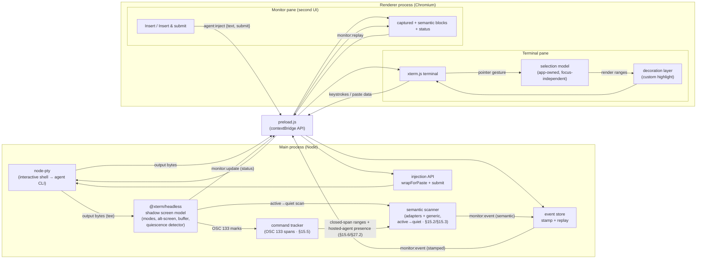

## 4. Architecture

Two processes, connected by Electron IPC. `node-pty` and the shadow terminal run in the **main process** (node-pty is a native module and must; the shadow lives beside it so monitoring and injection work no matter what the renderer is doing). The renderer hosts two panes: the **terminal pane** and the **monitor pane**.

### Data flows

**A. Output (PTY → UI, teed)**
`bash`/agent writes → PTY master emits `data` → main **(a)** forwards over IPC channel `pty:data` → preload → `term.write(bytes)`, and **(b)** writes the same bytes into the shadow terminal. The shadow is therefore always an accurate model of the screen the user sees, independent of the renderer.

**B. Keystrokes (UI → PTY)**
User types in `xterm.js` → `term.onData(cb)` fires → renderer calls `api.input(data)` → IPC `pty:input` → main calls `ptyProcess.write(data)`.

**C. Selection (app-owned, keyboard-driven)**
1. User drags over output. The app writes the range into an **application-owned selection model** (absolute buffer coordinates + extracted text), not the browser's native selection.
2. The app renders the persistent highlight itself via xterm.js **decorations**; xterm's native selection paints the *live drag* and is suppressed only once focus leaves (§7.1). The decoration persists regardless of where focus goes.
3. The selection is acted on by the keyboard alone (§7.7): **Copy** writes `model.text` to the clipboard; **Escape** while a selection is active clears it (§7.5.1); paste/select-all run their chords. The selection survives focus changes; only an explicit clear (Escape) removes it. (The former in-terminal Send/Capture/Clear toolbar was removed in v2.132; capture-to-todo now lives in the drawer Todo tab and the Artifacts view, §16/§20.2.)

**D. Monitor-pane actions (second UI → agent)** — *the new headline flow*
User clicks **Insert into agent** (or **Insert & submit**) on a captured block → monitor pane calls `api.inject({text, submit})` → IPC `agent:inject` → main reads the **live** bracketed-paste mode from the shadow (`shadow.modes.bracketedPasteMode`), wraps via `wrapForPaste`, writes to the PTY, and if `submit` is set follows with `\r` after a short settle delay (§9.3). This path never touches the renderer's xterm — it works even if the terminal pane is unfocused, scrolled away, or (later) in a different process.

**E. Monitor status (shadow → second UI)**
After PTY writes settle (debounced), main reads shadow state — `buffer.active.type` (normal/alternate), `modes.bracketedPasteMode` — and combines it with the quiescence detector's output-activity state (§8.3). When anything changed, it emits `monitor:update`. The monitor pane shows these as live indicators (e.g. "agent: working / quiet", "agent is full-screen", "paste mode on").

**F. Resize**
`FitAddon` computes `{cols, rows}` on window resize → renderer calls `api.resize(cols, rows)` → IPC `pty:resize` → main resizes **both** `ptyProcess` **and** the shadow terminal (they must never diverge, or captures will mis-wrap).

**G. Lifecycle**
On `ptyProcess.onExit` → main sends `pty:exit` → both panes show a notice. On window close → main kills the PTY and disposes the shadow.

**G2. Flow audit record (observe-only)** — *§25*
A main-process recorder taps the flow lifecycle, the TODO store, the surviving engine's run state, and OSC-133 command spans, and writes a per-run append-only YAML record under `~/.agent-terminal/audit/`. It is observe-only and best-effort — it injects nothing and never throws into the flow path. This overview omits it from the component diagram above (whose flow/TODO/loop sources are themselves not depicted there); its lifecycle is the §25.4 `stateDiagram-v2` and its event vocabulary is §25.5.

**H. Agent-semantic capture (shadow → event store → monitor)** — *§15.2/§15.3*
On the active→quiet transition (§8.3), the **semantic scanner** reads the shadow buffer from a marker watermark, dispatches the scan window to the per-agent adapters (or the generic heuristic fallback when none match), dedups regions by content, and emits each new region on `monitor:event` (`source: shadow-scan` / `heuristic`). Detection only — the scanner never acts on what it finds.

**I. Command-output capture (OSC 133 → command tracker → monitor)** — *§15.5*
The **command tracker** segments the stream into command spans from OSC 133 marks (`A` prompt-start, `B` command-start, `C` output-start, `D;exit` finished), keyed off the marks and independent of the §8.3 quiescence machinery. The spans are consumed **entirely in the main process**: closed-span output ranges gate the generic heuristic so command output is not mistaken for an agent prompt (§15.6), and the live spans drive hosted-agent presence (§27.2) and the shell-busy signal. (The former renderer-facing command-history channels — `monitor:commands` / `monitor:commandsChanged` / `monitor:captureCommandText` / `monitor:clearCommands` — were removed in v2.132 along with the Capture-selection button that was their only consumer; the tracker's own capture capability is retained and unit-tested.)

---

