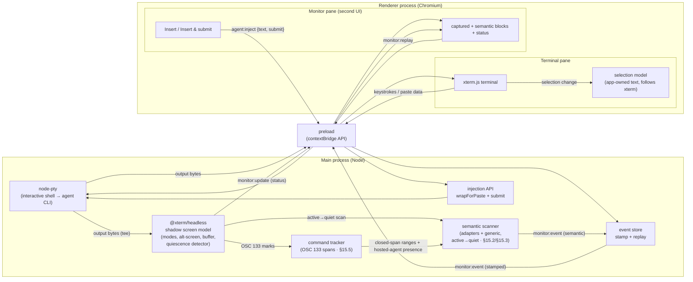

## 4. Architecture

Two processes, connected by Electron IPC. `node-pty` and the shadow terminal run in the **main process**: node-pty is a native module and must, and the shadow lives beside it so monitoring and injection work no matter what the renderer is doing. The renderer hosts the **terminal pane** and the **monitor pane**.

### Why it is shaped this way

- **One output stream, two consumers.** Every PTY byte goes to the renderer's xterm and to the shadow, so the shadow is always an accurate model of the screen the user sees, independent of the renderer (§8).
- **PTY and shadow resize together.** A resize that reaches one and not the other makes captures mis-wrap, so the main-process resize handler always moves both.
- **Injection never touches the renderer.** The monitor pane's actions go to main, which reads the live paste mode from the shadow (§9.3). This is what lets injection work while the terminal pane is unfocused, scrolled away, or (later) in another process.
- **The scanner and the command tracker are main-process only.** The scanner reads the shadow on the active→quiet transition (§8.3) and only detects — it never acts on what it finds (§15.2/§15.3). The OSC 133 command tracker's closed spans keep command output from being mistaken for an agent prompt (§15.6) and drive hosted-agent presence (§27.2).
- **The flow audit recorder is observe-only** (§25): it never injects and never throws into the flow path.

---
