## 18. Flow definitions (`flow.yaml`)

### 18.1 Shape & library (D10/D13/D14/D23)

- A flow definition is a **declarative YAML file** the app reads and watches. The **instantiated** definition for a run lives at `<worktree>/.agent-terminal/flow.yaml`; progression at `<worktree>/.agent-terminal/flow-state.yaml` (§19.1).
- **Library:** definitions are chosen from a merged library — **global** `~/.agent-terminal/flows/*.yaml` ∪ **per-repo** `<repo>/.agent-terminal/flows/*.yaml`; **repo entries win on name clash** (`flow:list`).
- **Global directory = the app-state home `A` (§23.4), i.e. `<A>/.agent-terminal/`.** The "global" flow definition/template lookup resolves relative to the **app-state home A** — **`APP_HOME_DIR` when it is an absolute path, else the per-user home F (`$HOME`, else the OS home)** (§23.4's `resolveAppHome`) — a fixed per-process anchor that does not track later cwd changes, **independent of the launch root L**. A configured absolute `APP_HOME_DIR` therefore **relocates** this tier; the `~/.agent-terminal/…` form written throughout §18.1/§18.7 is the **A = F default rendering** of this A-rooted anchor, never a hardcoded home that would bypass the override (§23.4). The local-first repo tier (`<repo>/.agent-terminal/flow.yaml`) already covers the repo the instance launched at; the global tier is the per-user fallback for a repo that has none, so it must never be re-anchored to L (which would shadow the user's `<A>/.agent-terminal/flow.yaml` rather than fall back to it).
- **Install-examples action — a user-invoked seed across a set of destinations (v2.134, was flow-home-only).** A Settings affordance seeds what the bundle carries into the places their readers discover them from. There are three **destinations**, and a destination is the unit the user consents to, the unit a conflict is reported under, and the unit a result is grouped by: the **flow home** (above); the app-owned **V2 loop-definition location** (§27.15); and the directory **Claude Code** — a separate process — loads **slash commands** from. Nothing the app reads out of its own bundle makes a command discoverable, so the files must physically land there.
  - **Global, never override-aware.** The V2 loop-definition destination is the **user-level** loops-v2 directory, not whatever `resolveLoopDefV2` would answer for the repo the app is pointed at. A repo carrying an override has deliberately taken ownership of what that override contains; reconciling it against a newly-seeded global definition is the user's business (§24.2.3 resolution order, unchanged). An install that landed inside one repo would leave every other repo — and the packaged app opened against none — unseeded.
  - **Non-destructive, per destination.** A file that is absent is created; a file present and byte-identical is skipped; a file present and differing is replaced **only** in a destination the user consented to. Consent in one destination never replaces files in another. Enumeration is tree-driven over the bundle, so a file added to the bundle later is seeded with no code change.
  - **Consent names the exact preview.** A successful preview returns an opaque `previewId`; apply carries that identity back with the per-destination decisions. Main consumes only the matching one-use authorization, so an older confirmation cannot act on a snapshot created by a newer preview.
  - **All-or-nothing is bounded to a pre-write check.** **Before the first write**, every destination is checked: its bundle tree is present (an absent tree is a mispackaged build, and is refused — never enumerated as "no files" and reported as a successful install of nothing), every planned file resolves inside its destination (the link-following refusal, CWE-59), and its container is writable. If any check fails, nothing is written anywhere. A failure appearing only *after* writing has begun is **not** rolled back: the result then names every file the action created or overwrote before failing, and nothing outside that list differs from its pre-action bytes. That is a reporting guarantee, not a transactional one.
  - **The bundle is copied as bytes.** A bundled asset need not be UTF-8 text; it is written byte-for-byte, so a binary asset is neither corrupted on the way out nor left permanently mismatched against the byte-compare that classifies it.
  - **A destination root the USER has symlinked is followed, not refused.** The three destination roots are derived by the app (the home dir, `CLAUDE_CONFIG_DIR`) and never read out of untrusted content, so a link the user placed at one — a dotfiles repo, a stow-style setup — is their own configuration. The tools that *read* those directories follow it, so refusing to write through it seeds nothing the reader will load, and grants no protection: whatever could plant the link can already write the directory. The write is confined to the **resolved** root, and a link *inside* it that escapes is still refused (CWE-22/59).
  - **The loops container confers no execution authority.** The user-level V2 loop-definition container holds def content the app seeds and reads and carries **no** execution-authority distinction — `loopExecAllowed` and the §27 bootstrap origin gate are both deleted, the schema's `ExecSideEffect` is unshipped, and shipping it requires deciding trust afresh (naming v2.129). The container guard is justified by what it still does — stopping a non-directory destination `<name>` (a symlink, dangling symlink or plain file the sweep would otherwise write a def through) or a non-writable container (CWE-59), while a symlink the **user** placed at the tier entry is followed as §18.1 policy, not refused — rather than by a privilege boundary.
  - The action **never** deletes, and never edits a `.gitignore` (§19.1). It is the explicit, user-invoked exemption to the no-silent-rewrite rule: it writes only where the user asked, and asks before replacing a file it did not create.

```mermaid
flowchart TD
  CLICK["User clicks Install examples"] --> PREVIEW["examples:preview — confine and classify, return an opaque previewId, retain a one-use source/target snapshot in main"]
  PREVIEW -->|"refused — ok: false"| PERR["Error surfaced, nothing written"]
  PREVIEW -->|"no destination differs"| APPLY["examples:apply {previewId, replace: []}"]
  PREVIEW -->|"one or more differ"| CONSENT["Consent step: one checkbox per CONFLICTING destination"]
  CONSENT -->|"dismissed"| NOOP["Nothing written"]
  CONSENT -->|"confirmed"| APPLY2["examples:apply {previewId, replace: consented ids}"]
  APPLY --> AUTH{"Matching pending one-use previewId, and replacements that were offered?"}
  APPLY2 --> AUTH
  AUTH -->|"no — stale, replayed, or not offered"| REFUSE
  AUTH -->|"yes"| RESOLVE{"Bundle trees present and every file confined to its destination?"}
  RESOLVE -->|"no"| REFUSE["ok: false — nothing written anywhere"]
  RESOLVE -->|"yes"| VERIFY{"Exact bundle/target snapshot unchanged?"}
  VERIFY -->|"no"| REFUSE
  VERIFY -->|"yes"| GATE{"Overwrite authorized and every container writable?"}
  GATE -->|"no"| REFUSE
  GATE -->|"yes"| WRITE["Recheck each snapshot, then write destination by destination"]
  WRITE -->|"a write fails partway"| PARTIAL["ok: false — NOT rolled back; names what already landed"]
  WRITE -->|"all writes land"| RESULT["Result groups created / overwritten / skipped by destination"]

  subgraph BUNDLE["Bundle (read-only)"]
    BF["example/flow"]
    BV["example/loops-v2/&lt;loop&gt;"]
    BC["example/commands"]
  end

  subgraph DEST["Destinations (write targets)"]
    DF["flow — ~/.agent-terminal &#40;§23.4&#41;"]
    DV["appLoops — user-config loops-v2 dir read by V2 resolver &#40;§27.15&#41;"]
    DC["commands — user-config commands dir &#40;Claude Code&#41;"]
  end

  WRITE --> DEST
  BF -->|"flow.yaml + .md templates &#40;§18.6&#41;"| DF
  BV -->|"whole tree"| DV
  BC -->|"whole tree"| DC
```



```yaml
name: feature-dev
steps:
  - id: groom
    kind: loop
    loop: groom-loop
    loop_namespace: app
    todo_template: ticket-grooming
    inputs:
      - name: ticket
        type: github-ticket
        required: true
  - id: plan
    kind: loop
    loop: plan-loop
    loop_namespace: app
    todo_template: plan-loop-review
  - id: implement
    kind: loop
    loop: impl-loop
    loop_namespace: app
    todo_template: impl-loop-review
```

The shipped flow binds all three steps to the app-owned §27 engine. Its V2 loop definitions declare the
groomed-ticket and plan artifact chain, and `plan-loop` owns the in-app pickup that creates the branch and
draft PR; the flow therefore carries no legacy `bootstrap: pickup` field and no synthetic action step.

### 18.2 Steps & kinds (D3/D7/D30)

- Every step is **typed**: `loop` (runs an agent-loop), `manual` (a human produces an artifact), `action` (a declared side-effect). **All kinds end in a gate.**
- **`loop`** binds a `loop:` LoopDef and may declare `bootstrap:` (§18.3) and `loop_namespace:` — the closed set `legacy` and `app`. **Absence binds `app`, the §27 engine (§27.15).** `legacy` is a recognized value that names no surviving engine: a step that declares it fails to load with a reason naming the retired namespace, while the rest of the flow still advances, reverts, undoes and terminates around it. **Only loop steps** can be **sent back for more work** (request-changes — §19.4/D7); manual/action steps are done/not-done.
- **`manual`** may bind `skill:`; the human decides when done.
- **`todo_template:`** (§18.6) may be bound by **any** step kind — the shipped flow binds one on each of its three `loop` steps.
- **`action`** declares a `command:` string run in the hosted terminal via the §9.3 path (subject to the running-process refusal of §19.3); e.g. `gh pr ready "$PR"`. No built-in typed-action catalog in v1.

### 18.3 Bootstrap is a per-step entry action (D15)

- `bootstrap: pickup` runs **on entry to the step that declares it** — which may be **any** step, including the first. A flow whose first step needs a PR bootstraps at the very start; a flow opening with a `manual` step does not. Bootstrap is therefore **not intrinsically a "flow start" action**.
- A §27-bound loop step **honours the flow-level `bootstrap` field**: it is satisfied by the step's bound V2 loop definition's own `pickup` contract, which the main-process §27 executor runs on entry, subject to its own conflict policy (§27.10). Where a step declares `bootstrap: pickup` and the bound definition carries no `pickup` contract, the step does not run — the operator is told why, with a route out. Def tiers carry no trust distinction, so no origin gate guards this (§27.8).
- Worked example: step 1 `manual` groom-ticket (no PR yet) → on entering step 2 `loop plan-loop` with `bootstrap: pickup`, the bound `plan-loop` definition's own `pickup` contract creates the branch and the draft PR (§27.10).

### 18.4 Typed step inputs (D29/D34)

- Each step declares its required **typed inputs**; when an input isn't already available the app prompts with the matching **picker**. v1 catalog (extensible registry): `github-ticket`, `pr`, `files`, `free-text`. Outputs are likewise typed; agent-loop may **create** outputs (new PRs) not known up front.

### 18.5 Authoring is separate (D20)

- Definitions are authored by the **flow-author skill** (§24, W19) or by hand. The app only lists/starts/drives them.

### 18.6 Skill & template references — reference, never inline (D37)

- `skill:` and `todo_template:` are **always references** (a registered name **or** a file path), never inline bodies — they can be large and shared, and inlining would bloat the YAML. Resolution mirrors §18.4/D14: a known registered name is used, otherwise the value is a file path (repo-relative against the worktree).
- `skill:` → a **Claude Code skill**; on step entry the app **injects the skill invocation** so the agent loads its playbook (distinct from the §18.5 flow-author skill, which runs once at config time).
- `todo_template:` → a **markdown-list** template (§21.2). Unlike `skill:`, it is **not** an auto-run entry action: it names the **default selection** of the **on-demand** template picker offered while the step is active (§4.1/§6). The picker lists every template co-located with the flow.yaml under `todo-templates/` (v2.58), so the human chooses and instantiates rather than the app auto-filling the list.

### 18.7 Flow catalog & per-worktree flow selection (A0)

This subsection extends §18.1 **additively**: it adds *selection over* the existing merged flow library, and changes nothing for a worktree that already resolves a definition. A worktree with a present local `flow.yaml`, and any existing single-flow worktree, is unchanged — the back-compat leg (§18.7.3) keeps local-first resolution. Each clause below is authored so a downstream slice (A1–A4 of Theme A's build plan, plus the §18.7.7 recovery slice A5) can cite it by number.

#### 18.7.1 Flow catalog (A1)

- **The catalog *is* §18.1's merged library** (`flow:list`, global ∪ per-repo, repo entries winning on name clash), viewed as an operator-selectable set. "Catalog" is only the operator-facing **name** for that selectable view — **not** a second listing mechanism and **not** a competing term. This subsection adds *selection over* the library and reuses its existing listing vocabulary.
- **Listing vocabulary is constrained here; on-disk layout is not.** The additive install arrangement a catalog of installable flows needs — e.g. a per-flow home co-locating its `todo-templates/` (§18.6) — is **A1's** to define, neither required nor precluded by §18.7. A1 defines the *layout*, not an exemption from confinement: a per-repo entry's co-located assets are untrusted repo-controlled content, so **every read the selection redirects to them is confined on the same per-tier basis as its `flow.yaml`** (§18.7.6, CWE-22), not only the `flow.yaml`. A1's install-time obligation extends to the entry **names** it installs: it constrains installable catalog names to the **same `isSafePathSegment` gate** the resolver enforces (§18.7.6) — narrowing the namespace, never widening the gate — so no installed name is one A2 later rejects as unselectable.

#### 18.7.2 Active-flow pointer (A2)

- **A per-worktree active-flow pointer records which catalog entry the worktree has selected.** It is named the **"active-flow pointer"** throughout — a **distinct concept** from §25.4's restart-surviving **audit run** pointer. (A *selection*, not necessarily what runs: under the back-compat leg (§18.7.3 rule 1) a present local `flow.yaml` still wins over the pointer's selection.)
- **It is written independently of run progression.** Setting the active-flow pointer can neither clobber nor be clobbered by a progression write, and neither a wholesale progression write nor a broken run-definition can resurrect a stale pointer (the §22.3.1 non-clobber guarantee, stated storage-agnostically). Its set/clear lifecycle is **independent of progression** — set at pick/seed, changed at re-pick, and **preserved** across a **Terminate** (which returns progression to its never-started beginning) and, equally, across a **Restart / undo** (which do **not** — they return progression to `in_progress`; the lifecycle bullet below fixes their differing effect on the §18.7.4 picker). The obligations this fixes for A2:
  - **The pointer's own disjoint file is mandatory — co-location is not admissible for this new state.** The pointer's set/clear lifecycle is independent of run progression, so CLAUDE.md / CODE-STANDARDS's **independent-lifecycle-state standard governs**: such state "is stored in its **own file — never as a field** of that document" (the `polish.yaml` / `armed-interrupt.yaml` precedent), satisfying the non-clobber invariant **structurally** because a wholesale progression write cannot touch it. The standard admits **no exception**, and it **explicitly rejects a hand-maintained field carry list**; the shipped §22.3.1 `title`'s co-location on `flow-state.yaml` is **legacy behavior the standard would flag today, not a sanctioned template** for new state. So A2 stores the pointer in its own disjoint file and does **not** co-locate it on the §19.1 `flow-state.yaml` via a field-scoped read-modify-write.
  - **Why the standard forbids co-location here — the hazard is live, not hypothetical.** The shipped `flowState.ts` progression write is **wholesale** (it re-emits only the enumerated progression fields and drops every other key), so a co-located pointer would be silently dropped by the next Terminate/Restart, breaking the preserve-across-reset guarantee below — and because any field-carry list is hand-maintained, a **future** progression field added to the write without also being carried would silently drop the pointer again (the `loopStateWriter`↔`agentLoopBridge` two-copies-of-one-gate drift shape CLAUDE.md warns against). The disjoint file removes this class by construction, which is exactly why the standard mandates it.
  - **RED-first pin (the standard's pin shape).** A2 pins it **RED-first**: a wholesale progression write — today's and any later one — leaves the disjoint pointer file **byte-for-byte untouched**, and clearing the pointer leaves the progression document **byte-for-byte unchanged**.
- **A deliberate run-lifecycle reset preserves it — but only Terminate re-enables the picker.** A **Terminate** (§25.5 `flow.terminated` — abandon a run, returning progression to its never-started beginning and discarding carried-over step inputs, §18.4) *and* a **Restart / undo** (§24.2.3) all **preserve the active-flow pointer**: the worktree keeps its chosen catalog flow, because the pointer is a *selection*, not run progression and not a carried-over step input. **This is the opposite disposition to §25.4's audit run pointer, which Terminate *clears*** — two different pointers, opposite dispositions on the same event. Their effect on the §18.7.4 picker differs by where each lands progression, and **conflating the three would let A2/A3 build a mid-run picker, contradicting §18.7.4**: only **Terminate** returns progression to its **never-started** beginning, so the picker **re-enables** with the selection intact and the operator can start the chosen flow or re-pick; **Restart** (re-enters step 0) and **undo** (re-opens the completed final step) both return progression to **`in_progress`** — a **begun** run — so the picker correctly stays **disabled**, the preserved selection **eligible to take effect** only at the **next** start reached through a Terminate, and then **subject to §18.7.3's precedence** — a present local `flow.yaml` still wins the back-compat leg, so the pointer's selection resolves only when no local definition shadows it.

#### 18.7.3 Resolver precedence (A2)

- **A run's definition resolves over three distinct sources, in order** — not one `flow.yaml` read three ways:
  1. a present **local** run-definition at `<worktree>/.agent-terminal/flow.yaml` wins (§18.1, **back-compat**);
  2. else the **catalog entry the active-flow pointer names**, resolved through §18.1's merged-library precedence (**repo entries win on name clash**) — the same single library determination A1 enumerates and A3's optional picker name-filter (§18.7.6) projects over, never a parallel repo-wins reimplementation;
  3. else the existing **global fallback** `~/.agent-terminal/flow.yaml` (§18.1 / §23.4), reached with **no reason surfaced** (the normal default).
- **The confinement tier follows the resolved entry's tier** (§18.7.6): a per-repo entry and a global entry are jailed against different grounds. A pointer confers no authority beyond the already-top-precedence local `flow.yaml`, so name-clash shadowing is consistent-with-existing, not a new trust boundary.
- **A resolved entry is then loaded exactly as §18.1 loads any `flow.yaml`** — the **confined resolved path** is what is opened, never a re-resolution of the raw name (CWE-367). A present, safe, confined name whose definition **content** is schema-invalid yields §18.1's **`error`** run state — the same outcome as a broken local `flow.yaml`, from which the picker stays reachable **while progression has never started** (§18.7.4) — **not** a degrade. A present-but-broken **local** `flow.yaml` still wins precedence, so a pointer never overrides one. The degrade taxonomy (§18.7.6) governs **pointer-selection** failures only; **"malformed"** names the pointer node alone, never definition content.

```mermaid
flowchart TD
  ACCESS["Definition resolution for a run"] --> LOCAL{"Local run-definition present at &lt;worktree&gt;/.agent-terminal/flow.yaml?"}
  LOCAL -->|"yes — back-compat"| USELOCAL["Use the local flow.yaml &#40;§18.1&#41;"]
  LOCAL -->|"no"| POINTER{"active-flow pointer set for this worktree?"}
  POINTER -->|"unset — normal default"| FALLBACK["Global fallback ~/.agent-terminal/flow.yaml &#40;§18.1 / §23.4&#41; — no reason surfaced"]
  POINTER -->|"names an entry"| SCALAR{"Scalar string node? &#40;CWE-20 field validation&#41;"}
  SCALAR -->|"no — malformed pointer node"| DEGRADE["Global fallback &#40;§18.1 / §23.4&#41; with a display-sanitized visible reason"]
  SCALAR -->|"yes"| SEGMENT{"Valid safe path segment? &#40;CWE-22&#41;"}
  SEGMENT -->|"no — unsafe segment"| DEGRADE
  SEGMENT -->|"yes"| MEMBER{"Names a live catalog entry &#40;flow:list merged library, repo wins on clash, §18.1&#41;?"}
  MEMBER -->|"no — unknown or removed"| DEGRADE
  MEMBER -->|"yes"| CONFINE{"Confined against the resolved entry's tier jail — a per-repo entry refuses a link planted at its own final segment &#40;CWE-59&#41;, a global entry jails against the app-derived root?"}
  CONFINE -->|"no — link or escape at final segment"| DEGRADE
  CONFINE -->|"yes"| USECATALOG["Use the named library entry &#40;§18.1&#41;"]
```

- **The run-start stickiness and degrade taxonomy govern the *pointer-catalog* leg (leg 2) — they are additive and do not alter §18.1's existing local-first live re-read (leg 1).** For a **pointer-selected catalog** definition, resolution and the degrade taxonomy are a **run-start disposition**: the precedence is evaluated when a run starts, and a begun run does not silently switch which **catalog source** supplies its definition — a per-repo catalog entry removed by a branch switch, or a global catalog file deleted mid-run, surfaces as the §18.1 **error** state (§18.7.4's mid-run masking), **never** a degrade-to-fallback (degrading a begun run would be the mid-flight swap §18.7.4 forbids, CWE-841). This **leaves leg-1 unchanged**: a worktree resolving a **local `flow.yaml`** keeps §18.1's shipped **live re-read** — `createFlowManager` re-reads the definition on every access, so a removed local definition falls through to the next tier and same-file edits rebuild live (the deliberate "a cached no-`flow.yaml` error no longer sticks" fix, `src/main/flow.ts`); §18.7 does **not** freeze that back-compat leg. The stickiness is the **new pointer-catalog selection's**, not a change to local-first resolution. **This stickiness must survive an app restart, so a begun run binds its resolved *source*, not just the catalog ID.** The pointer persists only the catalog ID; re-running the merged resolver on that bare ID after a relaunch could pick a **different tier** — a repo `<id>` added, or removed while a global `<id>` remains, flips the repo-wins-on-name-clash outcome — and silently swap a begun run's definition. So a begun pointer-catalog run persists a **run-scoped source binding** — a **validated closed tier** (an enum, per-repo *or* global, **not** a free-form path) plus the canonical catalog **ID** — and **resume re-resolves that ID within the exact stored tier and re-confines the resulting path before every open** (§18.7.6), surfacing the §18.1 **error** state when the entry is absent from that tier. The binding is **itself untrusted persisted state**, so resume **never consumes a persisted raw path**: a modified state file can at worst name a different closed tier or ID (both re-validated and re-confined), never redirect resume outside the tier's jailed ground. The mechanism (which field, in which store) is A2's, subject to §18.7.2's non-clobber discipline; §18.7 fixes only that resume is **deterministic, never a tier-swap, and never a raw-path open**. The diagram below depicts pointer-catalog run-start resolution; it is not re-run mid-flight.



#### 18.7.4 Picker (A3 owns the picker UI & the started-ness IPC seam; A2 owns the started-ness accessor over `createFlowStateStore` & the pointer-write gate)

- **The picker is a new operator affordance** — §22 has no existing flow selector (the §22.3 strip and §22.3.1 status bar read out the *current* flow). It is grounded in §22.4's layout-as-data / placement-agnostic widget model; its concrete placement and any §22.4 widget-enumeration amendment are **A3's**. §18.7 fixes the picker's *behavior*, not its structure.
- **The picker default — the selection when nothing has been picked.** The default **persists no active-flow pointer** (the pointer stays unset), so resolution falls to §18.7.3's precedence — a present local `flow.yaml`, else, with the pointer unset, the **silent global-fallback normal default** (§18.7.6). The picker forces **no** pre-selection and writes **no** pointer until the operator picks; any entry it highlights is a read-only reflection of what §18.7.3 currently resolves, never a written selection. This pins A4's stampless outcome deterministically: a pickup with **no** stamp (§18.7.5) leaves the pointer unset and resolves via §18.7.3 with **no** error — it neither fabricates a pointer nor forces a UI selection, so the reader, resolver, and picker implement one outcome and a stampless-pickup acceptance test is determinate.
- **Enabled while no run has started for the worktree; disabled once one has.** Started-ness is read from the worktree's **persisted §19.1 flow-state** — whether the flow has begun advancing through its steps. It is disabled once the flow-state records the flow has begun; disabling a begun run's picker is what enforces the invariant that **a run's definition cannot change mid-flight**, and the definition changes only at the next start (§18.7.3), never mid-advance. The obligations this fixes for A2/A3:
  - **Reuse the one store, but with a semantic accessor — not the collapsed `read()` and not the un-decoded `record` label.** Started-ness is read **reusing `createFlowStateStore`, never a bespoke second reader** of `flow-state.yaml` — but the accessor it exposes must compute the **semantic** outcome the gate needs, which today's surface does **not**: `read(): PersistedFlowState | null` **collapses** genuinely-absent, I/O-faulted, YAML-unparseable, **and schema-invalid** progression all to `null`, while the internal `loadDoc` labels **every** YAML mapping `record` **before** the schema `decode` runs (`src/main/flowState.ts` — `decode`/`decodeStrict` reject a malformed `step`/`status` that `loadDoc` has already called `record`). So the started-ness accessor must distinguish **three** cases and be derived from neither the collapsed `read()` nor the raw `record` label: **(i) genuinely-absent or title-only** progression (no persisted step) → **never-begun** (fail-open, picker enabled); **(ii) I/O / YAML-parse / schema-`decode`-invalid** progression → **indeterminate begun-ness** (fail-closed, below); **(iii) a valid decoded record** → read its `status` (`in_progress`/`done` ⇒ begun ⇒ disabled; `not_started` ⇒ fail-open). A2 adds this **one** accessor over the existing load so both consumers (below) classify the same seam.
  - **Indeterminate begun-ness (case ii) → fail-CLOSED; fail-open is scoped to the genuinely-never-begun (cases i & iii-not_started).** A genuinely-absent or **title-only** flow-state and a **valid decoded record whose status is `not_started`** are genuinely **never-begun** and **enable** the picker (fail-open toward recoverability — a worktree that never began is never stranded). The **indeterminate** case — an I/O-faulted, YAML-unparseable, **or schema-`decode`-invalid** progression (the accessor's case ii) — does **not** establish never-begun: the store collapses a document that corrupts **after** persisting `in_progress` the same way as one never written, and the flow machine hydrates that collapsed (null) read as **`not_started`**, so classifying it as not-begun would let a run that corrupts mid-flight re-enable its picker *and* rewrite its pointer, which the next start would then re-resolve into a **definition swap** — the CWE-841 invariant this gate exists to prevent. Indeterminate begun-ness therefore classifies **possibly-begun and both consumers fail CLOSED** (picker disabled, pointer-write rejected — the one-shared-predicate rule (both consumers classify one raw seam) keeps them from diverging). This does **not** strand a genuinely-never-begun-but-corrupt worktree: such a flow-state surfaces as the §18.1 **`error`** state, whose deterministic route out is the **§18.7.7** loop-less-error recovery affordance — recovery through a specified control, never through a gate relaxed into an unsafe swap.
  - **A `not_started` record reached by a first-step rollback (`revertStep`) is dispositioned as not-begun — deliberately, because it is genuinely re-startable, not mid-flight.** A first-step bootstrap failure calls `revertStep`, which persists **`not_started`** (`src/main/flow.ts` — "a first-step loop has no previous step; `not_started` is recoverable", and Start re-fires pickup, §27.10's rollback). This is a valid decoded `not_started` record, so the accessor's case (iii) treats it as **not-begun** and **enables** the picker / permits the pointer-write — **correctly**: the run has left `in_progress` and sits at `not_started`, so the next Start is a **fresh resolution point**, and re-picking before it is the picker's intended use, **not** a mid-flight definition swap. The invariant bars changing an **`in_progress`** run's definition; a rollback to `not_started` is exactly the recoverable re-start §27.10 designs for, so no durable "has ever started" history is preserved to disable the picker here — doing so would strand a legitimately re-startable worktree (never an unrecoverable state).
  - **Both consumers classify one raw seam through one shared predicate.** **Both** consumers of the started-ness — this picker-enable and the §18.7.6 pointer-write gate — cannot diverge on the fault case: the **main process** reads it through that one shared load vocabulary and projects the **raw durable started-ness** onto the §18.1 view, and both consumers classify *that* through one shared predicate they import (the seam in the bullet below), never by the renderer calling the main-only store or by pushing the §19.1 flow-state document's shape across IPC (Parnas information-hiding).
- **Reachable from the pre-run `error` / unresolved state.** A worktree that resolves no definition at all (no local `flow.yaml`, no set/valid pointer, no global fallback) **while its persisted progression has never started** keeps an enabled picker, so a first selection can escape a worktree that has a non-empty catalog but nothing resolvable — a state the UI would otherwise strand the operator in. Selecting an entry moves the worktree forward to a resolvable, not-yet-started run with a visible next action. A worktree whose catalog is itself **empty** (nothing to select and nothing resolvable) recovers through the §18.1 user-invoked **install-examples** action, which seeds the global fallback (and, once A1 lands its catalog install, the catalog) — the recovery floor is discharged by the global-fallback half alone (rule 3 resolves once `~/.agent-terminal/flow.yaml` exists), consistent with §18.7.1 leaving the catalog's install arrangement to A1.
- **A begun run whose resolving source is *later* lost** is a distinct, loop-less flow-load-error state — routine under leg-2 (§18.7.3) — that the picker correctly leaves **disabled**; recovering from it needs a dedicated affordance, specified as its **own required Theme A slice in §18.7.7**, not the picker.
- **Keying on the persisted §19.1 flow-state — not the load-maskable `FlowStateView.status` token — is load-bearing.** The §18.1 load-failure view reports a status of `error` while reading only the persisted title, so it **masks** an already-begun run as `error` whenever its resolving source is lost mid-run; a gate keyed on that display token would re-enable a begun run's picker and let its definition change mid-flight. The seam therefore carries the **raw durable started-ness state** over IPC — a field distinct from, and **never**, `FlowStateView.status` (A3's seam) — and the renderer picker-enable and the main-side pointer-write gate **each classify that raw state through one shared predicate both sides import**, not a pre-computed boolean one side reflects. This mirrors the `loopStatus.ts` human-needed precedent exactly — main and renderer both import `isHumanNeededStatus` over the shipped `status` — so the two decisions cannot drift into two per-slice copies (CLAUDE.md shared-semantics).
- **The same gate is re-checked at the main-side pointer-write — the write primitive A2 owns (§18.7.6), through which A3's picker and A4's seed both pass** (policy-at-operation). This one primitive:
  - **hard-fails the write if the started-ness accessor reports a begun run — or indeterminate begun-ness** — keyed on the semantic accessor stated above (case ii, I/O/YAML/schema-`decode`-invalid), not the load-maskable `FlowStateView.status`; an **indeterminate** flow-state **fails CLOSED and rejects the write** (a run that corrupts after it began must not have its pointer rewritten into a mid-flight swap), the same fail-closed the picker-enable takes (the one-shared-predicate rule (both consumers classify one raw seam)); only a genuinely-never-begun flow-state (absent/title-only, or a valid decoded `not_started` record) permits the write;
  - **acts on the worktree the operation names** — never re-derived from the app's ambient/current selection;
  - makes **no** run-state transition and adds **no** eager `flow-state` write when switching while no run has started, so nothing races the pointer write: step-0 input resolution (§18.4) is a step-entry action, entered only at the **next** start, so it targets the newly selected definition then;
  - reads the started-ness and writes the pointer with no interleaved start (single-main-process, run-to-completion IPC — so the check-then-write is not a TOCTOU, CWE-367), and does **not** read the observe-only §25 audit log.

#### 18.7.5 Pickup seeding (A4)

- **A freshly picked-up sub-ticket's worktree acquires its intended pointer.** Promotion (§27.10) stamps the chosen flow name into the sub-ticket; pickup reads it into the active-flow pointer. Absent a stamp, the **picker default** (§18.7.4 — no pointer persisted; resolution falls to §18.7.3) applies — so the reader is independently shippable.
- **The seed must be written *before* the fresh worktree's first `start()` — which requires a pre-start carrier of the ticket identity that the current pickup contract does not yet define (an A4 obligation A0 fixes here).** The write must land while the fresh worktree's flow-state is still **`missing`** — the genuinely-never-begun leg the §18.7.4 gate **permits** — so that the very first resolution (§18.7.3) reads the seeded selection; a seed attempted **after** `start()` would reach the §18.7.4 **begun-run hard-fail**. Today no such pre-start event exists: §27.10's in-app bootstrap `pickup` (branch/PR creation) fires as an entry action **after** `start()` has entered the step, and the app learns the ticket identity **only from the post-start flow input** (`flow.state().refs.ticket`, `src/main/index.ts`), so A4 has no defined moment at which to read the stamp and seed the pointer. A4 must therefore introduce an **observable pre-start operation that carries the ticket identity into the fresh worktree** — a defined actor and carrier supplying the ticket ID before the first `start()`, or a **single atomic pre-start selection-and-pickup boundary** — and seed the pointer there. §18.7 fixes the **contract** that operation must satisfy (pre-start, gate-permitted while `missing`, deterministic, read by the first resolution); the mechanism — like the promotion-side writer's slicing (below) — is **A4's** (design doc §4.4). Without it the pickup-seeding acceptance criterion is not implementable, so naming the required boundary is part of this contract, not deferred.
- **The stamp is a writer↔reader contract: one shared carrier for the flow name**, defined once and cited by both the promotion writer and the pickup reader — **not** a "label **or** body line" the two sides could read differently. Which carrier it is is **A4's**; that it is **one** definition is fixed here.
- **The promotion-side emitter is a required, not-yet-existing writer, homed in Theme A** (flow-selection plumbing) — today's §27.10 promotion stamps no flow name, so the stamp's write side is net-new work; §27.10 only locates where that writer's code sits. (A0, a spec slice, changes no §27 engine code.) How Theme A slices that writer relative to the reader is the build plan's to decide (design doc §4.4), not this clause's.
- **The stamp is a second untrusted origin for the same path-selecting value** — three write-side obligations, each its own gate so no one of them can be read as subsumed by another:
  - **Confine at use, regardless of provenance.** A pickup-seeded name is confined **at use regardless of provenance** — the identical §18.7.6 gate as a name read from the persisted pointer, with no trusted-seed bypass.
  - **Structured travel across the `gh` boundary** (CWE-78). Because promotion writes the name **across the `gh` subprocess boundary**, the seed **write** carries it as a **structured value** (an `argv` / label / `--body-file` field), **never concatenated into command text** — the emitter's write-side obligation, distinct from the read-side confine.
  - **Safe-segment validation before the `gh` boundary — total and carrier-independent** (CWE-88; CWE-74/116). Because a per-repo catalog name is **not** constrained to a safe segment (§18.7.6), a leading-hyphen name (`-x`, `--repo`) would be **reinterpreted as an option** even while travelling as a structured `argv` element, so the emitter **validates the name as a safe path segment (the same `isSafePathSegment` gate the read side uses, which bars a leading hyphen outright) before it crosses the `gh` argv boundary** (CWE-88 argument injection) — the **required, total, carrier-independent** write-side gate, firing *before* the later read-side confine. It is total **regardless of which carrier A4 picks** (§18.7.5's one shared carrier): a name carried as a **body line** crosses via `gh … --body-file` **stdin**, not an `argv` option slot, yet is bundled verbatim into `.agent-loop/pr-context.md` and read as prompt text by the work agent and the reviewer personas (an **LLM-prompt-injection** sink, CWE-74/CWE-116), so the safe-segment gate — which bounds the name to `[a-z0-9-]` — fires before **either** carrier, not only the option slot the CWE-88 case names; confine-at-use (§18.7.6) protects the later filesystem *read*, never this prompt sink. (An end-of-options `--` marker is at most defense-in-depth on a *positional* slot; it does **not** by itself protect a name carried as a flag's value — `gh … --flag <name>` — which would need the `--flag=value` equals-form, so `--` is **no substitute** for the safe-segment validation.)
- **On a rejected name, drop the stamp — never abort promotion.** When that gate **rejects** a name (a §18.1-legal but non-safe-segment name reachable via a hand-edited pointer chosen for promotion), the emitter **drops the stamp and lets promotion proceed** — pickup then applies the picker default (the stampless sub-ticket above) — and **never aborts** the §27.10/§27.13 promotion critical path, which is not-best-effort and resumable, so an abort would strand the epic fan-out on a bad name (CLAUDE.md best-effort-never-aborts, CWE-703/755).
- **On an I/O throw persisting the stamp, never strand the fan-out.** A non-rejection **I/O throw** on the stamp write itself — the `gh` subprocess failing — is dispositioned by whichever write-side slicing A4 chooses: folded into the promotion transaction it is covered by promotion's own resumability, or a separate best-effort adornment by that same never-abort standard — either way it never strands the fan-out, and the resulting stampless sub-ticket falls back to the picker default.

#### 18.7.6 Safety (A2 enforces; A3 owns the picker's display-sanitize, filter & unreadable-tier notice; A4's seed-write gates indexed from §18.7.5)

A **degrade** here means pointer-*selection* fails validation or confinement, so resolution lands on the global fallback **with a visible, display-sanitized reason** — distinct from an *unset* pointer, whose fallback is the silent normal default (§18.7.3). Every stage below fires **at use, regardless of provenance** — a pickup-seeded name gets the identical gate as a persisted one, no trusted-seed bypass.

- **One pointer identity.** The active-flow pointer is an untrusted, persisted, path-selecting value with a single identity: *one catalog-entry ID = one confined path segment selecting into the catalog*. **That ID is the canonical catalog-entry ID `flow:list` exposes** (A1's identity for the entry) — a safe path segment (this section's gate) that A2 resolves **through the shared catalog resolver**, **not** hardcoded to any on-disk filename: §18.7.1 leaves the catalog's **layout** to A1 (a flat `flows/<name>.yaml` *or* a per-flow-home `flows/<name>/flow.yaml` co-locating templates), so A0 fixes the pointer as **that ID** and A1's resolver maps ID→file — pinning it to a filename stem here would contradict §18.7.1's own layout-agnostic promise. It is **not** the `.yaml` filename (whose `.` fails the safe-segment gate) and **not** the flow definition's in-file `name:` field; A1 (listing) and A2 (resolution) key on that **one ID through the one resolver**, so the persisted value cannot drift between the candidate strings **and** cannot be pinned to a layout A1 has not settled. It **originates** at the picker (**A3**) and pickup-seeding (**A4**) and is **consumed** — read, validated, confined, resolved — by the resolver (**A2**), which owns its persistence and confinement contract; A3/A4 supply the value **through** A2's primitive, never a second write path.
- **Read-boundary field validation** (CWE-20). The persisted pointer is a scalar string; a non-string / non-scalar / malformed node is rejected field-locally at the read boundary and **degrades to the fallback**, never throws — a malformed field cannot brick definition resolution. The pointer-document **read itself is likewise total over a non-ENOENT errno** (EACCES/ELOOP/ENOTDIR on the pointer's own disjoint file or its parent), mapped to the same visible-reason degrade rather than propagated as a throw — mirroring §18.7.4's flow-state load; ENOENT is simply the unset pointer (the silent normal-default fallback, §18.7.3), not a degrade. The pointer's **mandatory disjoint file** (§18.7.2) makes this a read boundary of its own. **The pointer file's own path is confined before it is opened** (CWE-22/59/61) — because the disjoint pointer file sits under the worktree's repo-controlled `.agent-terminal` (the same §27 loop-state ground as `run-state.yaml` / `polish.yaml`), a symlink planted at its path is a **valid redirect**, *not* the symlink **loop** the ELOOP totality above catches, that would otherwise open an arbitrary file and, because a rejected scalar is echoed in the visible degrade reason, disclose its contents. So A2 **jails the pointer-file path under the worktree and opens only the confined result** — the same confinement-leaf discipline the §27 loop-state files already use (`appLoopState.ts`, CWE-22/59) — and a confinement escape (a planted redirect, or an errno thrown mid-`realpath`/`lstat`) **degrades visibly** exactly as the errno case does, never opening the redirected target. This confines the pointer's **storage path**; the **value** it holds is separately confined per the next bullet.
- **Per-tier confinement** (CWE-22/59). The name is gated as a **safe path segment** and then **jailed against the ground of the catalog tier it selects**, never joined to "any root": a **per-repo** entry (untrusted content) is jailed so a link planted at the jail's own final segment is refused (CWE-59); a **global** entry (the user's own ground) is jailed against the app-derived root. The single **"unsafe"** degrade category comprises both sub-checks — the segment gate and the per-tier jail — each routing to the degrade. **Any outcome other than confined-clean degrades identically** — a structural **reject** (segment or jail) *or* an errno **thrown** mid-`realpath`/`lstat` (EACCES/ELOOP/…, or `resolveJail` returning null on an absent parent) — so no exception from the jail walk reaches the resolver (CWE-703); the confinement check is as total as the read-boundary field validation's *never-throws*. **Both `flow:list` enumeration anchors the merged library walks** — the per-repo `<repo>/.agent-terminal/flows` (untrusted content) and the global `~/.agent-terminal/flows` (§23.4, the user's own ground) — are per-tier confined; the per-repo anchor is a §18.1 dependency this untrusted-name selection now makes load-bearing. The confinement enforcement mechanism is **A2's**; §18.7 states the behavior.
- **Enumeration-read totality of each tier's `flows` anchor** (CWE-703/755, empty-vs-unreadable). The enumeration read of each merged-library anchor is **likewise total over a non-ENOENT errno**: an anchor that is present-but-unreadable, a non-directory, or a symlink loop (EACCES/ENOTDIR/ELOOP on it or its parent) is one `src/main/dirEntries.ts` **raises rather than returning `[]`**. Leg-2's membership determination (§18.7.3) resolves through the **merged** library, but it **preserves precedence in the error path** rather than degrading on any throw: once a **confined repo match** (the higher-precedence tier) is found, the run **uses it** even when the **global** anchor throws — an unreadable *lower-precedence* tier is irrelevant to a pointer a *higher-precedence* tier already resolves — and the global-tier unreadability surfaces **only** as the separate picker notice (below), never as a degrade of that resolved run. Only when **no** repo match exists does leg-2 depend on **global** membership, so a global-anchor throw maps to the **same visible-reason degrade** as the pointer read above **for the pointer whose resolution actually needed that tier**, not for one the repo tier already satisfied — closing the picker/resolver mismatch where a valid repo `foo` is offered, selected, then degraded solely because the irrelevant global anchor threw. The picker's `flow:list` enumeration (below) likewise treats **each** unreadable tier as contributing **no** entries — never a propagated throw, so an unreadable `flows` dir of **either** ground cannot brick definition resolution or the picker while a pointer is set (CWE-703/755) — and, because catching that throw to `[]` is the same empty-vs-unreadable conflation `src/main/dirEntries.ts` exists to prevent, an unreadable tier is **surfaced to the operator, never silently equated with an empty one** (the picker's *rendering* of that per-tier notice is A3's, in the picker-display bullet below). ENOENT stays §18.1's absent-tier `[]` (the tier simply has no entries), not a degrade. The enforcement mechanism is **A2's**; §18.7 states the behavior.
- **Reconcile the segment charset by narrowing the namespace, never widening the gate.** The safe-segment gate is the repo's existing shared predicate `src/shared/pathSegment.ts::isSafePathSegment` (`/^[a-z0-9][a-z0-9-]*$/` — lowercase-alnum start, then lowercase-alnum or hyphen; no `.` or `..`, no `_`, no uppercase, no leading hyphen), which loop names already flow through; A2 **reuses** it rather than hand-rolling a parallel gate (CLAUDE.md shared-semantics). That gate is deliberately **narrower** than what §18.1 admits as a library-entry name — §18.1 constrains no name charset, and per-repo `flows/*.yaml` filenames are unconstrained — so a §18.1-legal but non-safe-segment name (`Feature.v2`, `my_flow`, a leading-dot name) degrades and is unselectable: a deliberate, safe over-rejection. So installed names and the gate **agree by construction**, A1 constrains *installable* catalog names to that **same `isSafePathSegment` gate** at install-time (never a wider `[A-Za-z0-9._-]`-style charset, which would install names A2 then rejects as unselectable); a downstream slice must **not** loosen the CWE-22 gate to satisfy §18.7.3's resolve-through-the-library promise. The security-correct direction is **narrow-the-namespace (install), never widen-the-gate (resolve)**.
- **Structured travel on the seed-write** (CWE-78). That the seed name crosses the promotion/`gh` boundary as a **structured value**, never concatenated into command text, is the promotion-side emitter's obligation **specified in §18.7.5** — indexed here (distinct from the read-side confine, which protects the later filesystem *read*, not this *write*), with §18.7.5 its single source.
- **Argument-safe seed-write** (CWE-88; CWE-74/116). That the emitter runs the same `isSafePathSegment` gate on the seed name **before** the `gh` boundary — the carrier-independent leading-hyphen-as-option defense and its body-line/`pr-context.md` prompt-sink sibling — is **specified in §18.7.5**; indexed here beside its CWE-78 sibling so a §18.7.6-driven review sees **both** seed-write gates, not only the structured-travel one, with §18.7.5 the single source of the rationale.
- **Sanitize the degrade reason** (**CWE-116/CWE-1007** at the primary display sink; **CWE-117** at the optional §25 audit-log leg — **normative**). An unknown / removed / unsafe / malformed-pointer name **degrades to the global fallback with a visible reason**, never a hard failure and never an unrecoverable state. Because that reason echoes the **rejected** name, it is **display-sanitized and length-bounded before it is shown** — control, bidi, and zero-width stripped, then truncated. The shared `stripStatusControlChars(…).slice(0, MAX)` treatment the failed-event `notify.failed` reason gets (§24.2.3 T4) removes control, bidi, ZWSP and BOM but **deliberately preserves the U+200C/U+200D shaping joiners** (`src/shared/controlChars.ts` — legitimate in a human title); a **catalog name** never legitimately carries those (its safe-segment gate is `[a-z0-9-]`), so this echoed-rejected-name sink **additionally strips U+200C/U+200D** — a stricter treatment than the title primitive, closing the CWE-1007 residual — before truncating, so an over-long or spoofing rejected name cannot reach the UI unbounded. **The resolver surfaces this sanitized reason over its §18.1 view (A2's seam) and the flow-selection UI (A3) renders it**, giving the "visible" half a named owner and an observable boundary a downstream e2e can bind to (as §18.7.4 does for durable started-ness). If a degrade is additionally recorded in the §25 audit log, that rejected name is a further untrusted write-sink and inherits §25's existing on-write discipline for an **event-field value** (the §25.7 untrusted-string YAML quoting, plus the failed-event control-char-strip/length-bound precedent above) — a degrade names no audit **file**, so §25.2's filename sanitize does not govern it. Whether A2 records the degrade at all is A2's (§25 is best-effort, observe-only); §18.7 fixes only that any such record is a governed sink.
- **Display-sanitize the picker's rendered names** (**normative**, independent of the filter below). The picker renders catalog entry names (per-repo `flows/*.yaml` filenames, which §18.1 does not constrain to safe segments), so those names are **display-sanitized and length-bounded before they are shown** — the same treatment the degrade reason gets — so a bidi / zero-width name cannot spoof the picker display **even where the filter below is declined**. This is a *display* strip, **not** the structural segment filter: neither substitutes for the other.
- **Filter the picker's name list** (**SHOULD**, non-normative hardening). The load-bearing CWE-22 floor is per-tier confine-at-use, which **alone** satisfies the safety AC. Beyond it, the catalog **SHOULD** surface to the picker only names for which the safe-segment gate holds — a **filter**, which a display strip does not provide (a strip leaves `../evil`, `Foo/bar`, `..`, `UPPER` selectable). When adopted it lands **main-side, before the names cross IPC** (never renderer-only, CWE-602), applied by **A3** as a projection over A1's single `flow:list` enumeration — never a second enumeration — so the picker's set is `flow:list`'s set minus the unsafe names. It narrows the sole "unsafe" degrade path to a hand-edited pointer or a pickup-seed.
- **Surface an unreadable-tier notice in the picker** (**normative** — the third A3 picker-display obligation, beside the display-sanitize and filter above). When a `flows` enumeration anchor of either tier is present-but-unreadable — the non-ENOENT throw `src/main/dirEntries.ts` raises rather than swallowing to `[]` (enumeration-read totality, above) — the picker **surfaces a display-sanitized, length-bounded per-tier notice that a `flows` directory could not be read** (the same treatment the degrade reason gets) alongside the reduced list, so an unreadable tier is **distinguished from an empty one, never silently equated** — keeping the never-brick floor while honoring the visible-reason discipline every other §18.7.6 failure follows. It is the picker's *rendering* of the unreadable-tier signal A2's enumeration raises, **not** the display-sanitize of existing names nor the name filter — neither substitutes for it.
- **The pointer's own persistence write** is a structured-value write — serialized via the YAML emitter, never string-concatenated into the persisted document (CWE-116) — the write-side parity of the read-side confine. (The at-use, provenance-independent gating that protects the read is stated once at the head of §18.7.6 and, for the seed, in §18.7.5.) On an **I/O throw** persisting the pointer (EACCES/ENOSPC/EROFS/EIO on the flow-state or the disjoint pointer file), the write is **surfaced with a reason and the optimistic selection rolls back to the prior in-memory selection captured before the optimistic write** — matching the §22.3.1 `setTitle` reject-then-roll-back precedent, which restores an in-memory prior value, **not** a fresh disk re-read that could itself fault (EACCES/ELOOP) under the same condition that failed the write — **never silently swallowed** (CWE-703): a swallowed throw would leave the picker showing a selection the disk never took, discovered only when the *old* definition resolves at the next start.

#### 18.7.7 Recovery from a begun run's lost resolving source (A5 — its own slice, none of A1–A4)

- **Theme A MUST provide a deterministic, operator-invokable recovery affordance reachable from the loop-less flow-load-error state.** Because leg-2 (§18.7.3) makes a lost per-repo source **routine** — an ordinary branch switch drops a begun run's per-repo catalog source under `<repo>/.agent-terminal/flows` (§18.7.6), not only the pre-existing "delete the global fallback" case — the never-unrecoverable floor for this state is **not** met at spec-freeze. The affordance — e.g. a flow-strip reload/`Retry` control, or a source-restore watcher that re-fires the flow-changed re-read — is surfaced over an **observable boundary a downstream e2e binds to** (as §18.7.4 does for durable started-ness). It is **orthogonal to A3's picker** (which stays correctly disabled for a begun run) and **maps to none of A1–A4**: it is its **own** required Theme A slice — **A5**, to be scheduled (no issue exists for it yet) — so a build plan cut only from A1–A4 (or the design doc's A0–A4 list) under-scopes it and ships the never-unrecoverable-state violation this subsection exists to prevent. Because A2's leg-2 per-repo selection is what *introduces* that reachable state and A5 is what *recovers* it, the never-unrecoverable floor is a **release** property, not a per-slice one: **A5 — or, failing that, an interim guard that keeps a deterministic recovery reachable from (or that withholds *catalog-entry* pointer selection into) the loop-less error state — MUST land no later than the same shippable increment that first enables catalog selection via the pointer**, so no released build reaches — **via the pointer** — the loop-less flow-load-error state without a deterministic UI route out. The withhold option must cover **both** tiers, not only per-repo: leg-2 (§18.7.3) resolves the pointer through the **merged** library, so the increment that first ships per-repo pointer selection also ships **global** catalog-entry selection (`~/.agent-terminal/flows/<name>.yaml`, a global file the pointer names, which §18.7.3 lists as **deletable mid-run** into the same loop-less state) — an A0-introduced losable-source set beyond the pre-existing singular global fallback — so withholding only the per-repo tier would leave that global-pointer path stranded. The floor is scoped to this **pointer-introduced** reachability; the pre-A0 vanilla global-fallback-delete case (§18.7.3 / v2.91/#26, next bullet) is outside A0's remit.
- **Why shipped behavior does not already discharge that floor.** The lost source surfaces as the §18.1 **error** state (the picker is correctly disabled and does not re-resolve, §18.7.3). That state is **loop-less** — the load-failure view reads only the persisted title and carries no loop — so the §22.3.1 status-bar **attention alert does not fire** (it is raised only while a loop reports human-needed, §22.3.1 / §24.2.3 T4), and with no alert the §27.12 work-turn recovery controls it would surface — the §22.3.1 `Retry` (re-run) and the §27.12c accept, both of which recover an *errored §27 work-turn* keyed on that loop view — are **not reachable in this state**; the flow strip renders the load-error with **no control**. The only shipped recovery is the definition **re-read-on-access** (the machine rebuilds when the source reappears), which fires **incidentally** on the next flow-changed push and **never from an operator control** — so a worktree that is idle when its source is lost and is then restored via an external editor has **no *deterministic* UI route out** (the shipped §22.3 control set omits a reset from a load-error, v2.91/#26).

---
