## 18. Flow definitions (`flow.yaml`)

### 18.1 Shape & library (D10/D13/D14/D23)

- A flow definition is a **declarative YAML file** the app reads and watches. The **instantiated** definition for a run lives at `<worktree>/.agent-terminal/flow.yaml`; progression at `<worktree>/.agent-terminal/flow-state.yaml` (§19.1).
- **Library:** definitions are chosen from a merged library — **global** `~/.config/agent-terminal/flows/*.yaml` ∪ **per-repo** `<repo>/.agent-terminal/flows/*.yaml`; **repo entries win on name clash** (`flow:list`).
- **Global directory = the per-user home `~/.agent-terminal/` (§23.4).** The "global" flow definition/template lookup resolves relative to the user's home (F = `$HOME`, else the OS home) — a fixed per-process anchor that does not track later cwd changes, **independent of the launch root L**. The local-first repo tier (`<repo>/.agent-terminal/flow.yaml`) already covers the repo the instance launched at; the global tier is the per-user fallback for a repo that has none, so it must never be re-anchored to L (which would shadow the user's `~/.agent-terminal/flow.yaml` rather than fall back to it).
- **Install-examples action — a user-invoked seed across a set of destinations (v2.134, was flow-home-only).** A Settings affordance seeds what the bundle carries into the places their readers discover them from. There are four **destinations**, and a destination is the unit the user consents to, the unit a conflict is reported under, and the unit a result is grouped by: the **flow home** (above); the **engine's loop-config location** (§24.2.3); and the two directories **Claude Code** — a separate process — loads **skills** and **slash commands** from. Nothing the app reads out of its own bundle makes a persona or a command discoverable, so the files must physically land there.
  - **Global, never override-aware.** The loops destination is the **user-level** loops directory, not whatever `resolveLoopDir` would answer for the repo the app is pointed at. A repo carrying an override has deliberately taken ownership of what that override contains; reconciling it against a newly-seeded global definition is the user's business (§24.2.3 resolution order, unchanged). An install that landed inside one repo would leave every other repo — and the packaged app opened against none — unseeded.
  - **Skills fan in.** A LoopDef names its personas by bare skill name and Claude Code discovers a skill only as `<skills root>/<skill name>/`, so each bundled skill is written **twice**: once under its own loop's directory at the loop-config destination (the §26.5 layout the engine reads), and once under the shared skills root. It is a copy-out, not a move.
  - **Non-destructive, per destination.** A file that is absent is created; a file present and byte-identical is skipped; a file present and differing is replaced **only** in a destination the user consented to. Consent in one destination never replaces files in another. Enumeration is tree-driven over the bundle, so a file added to the bundle later is seeded with no code change.
  - **All-or-nothing is bounded to a pre-write check.** **Before the first write**, every destination is checked: its bundle tree is present (an absent tree is a mispackaged build, and is refused — never enumerated as "no files" and reported as a successful install of nothing), every planned file resolves inside its destination (the link-following refusal, CWE-59), and its container is writable. If any check fails, nothing is written anywhere. A failure appearing only *after* writing has begun is **not** rolled back: the result then names every file the action created or overwrote before failing, and nothing outside that list differs from its pre-action bytes. That is a reporting guarantee, not a transactional one.
  - **The bundle is copied as bytes.** A bundled asset need not be UTF-8 text; it is written byte-for-byte, so a binary asset is neither corrupted on the way out nor left permanently mismatched against the byte-compare that classifies it.
  - **A destination root the USER has symlinked is followed, not refused.** The four destination roots are derived by the app (the home dir, `CLAUDE_CONFIG_DIR`) and never read out of untrusted content, so a link the user placed at one — a dotfiles repo, a stow-style setup — is their own configuration. The tools that *read* those directories follow it, so refusing to write through it seeds nothing the reader will load, and grants no protection: whatever could plant the link can already write the directory. The write is confined to the **resolved** root, and a link *inside* it that escapes is still refused (CWE-22/59).
  - **The loops container confers execution authority.** `loopExecAllowed` (§26.6) admits an `exec` action only from an `operator-config`-origin def, which is exactly a def read from the user-level loops directory. Seeding there is what makes the bundled `plan-loop`'s `exec` gate runnable, so the container guard on that destination protects an execution-authority boundary (CWE-829), not merely a config directory.
  - The action **never** deletes, and never edits a `.gitignore` (§19.1). It is the explicit, user-invoked exemption to the no-silent-rewrite rule: it writes only where the user asked, and asks before replacing a file it did not create.

```mermaid
flowchart TD
  CLICK["User clicks Install examples"] --> PREVIEW["examples:preview — confine, then classify each bundled file per destination"]
  PREVIEW -->|"refused — ok: false"| PERR["Error surfaced, nothing written"]
  PREVIEW -->|"no destination differs"| APPLY["examples:apply {replace: []}"]
  PREVIEW -->|"one or more differ"| CONSENT["Consent step: one checkbox per CONFLICTING destination"]
  CONSENT -->|"dismissed"| NOOP["Nothing written"]
  CONSENT -->|"confirmed"| APPLY2["examples:apply {replace: consented ids}"]
  APPLY --> GATE{"Bundle trees present, every file confined to its destination, every container writable?"}
  APPLY2 --> GATE
  GATE -->|"no"| REFUSE["ok: false — nothing written anywhere"]
  GATE -->|"yes"| WRITE["Write, destination by destination"]
  WRITE -->|"a write fails partway"| PARTIAL["ok: false — NOT rolled back; names what already landed"]
  WRITE -->|"all writes land"| RESULT["Result groups created / overwritten / skipped by destination"]

  subgraph BUNDLE["Bundle (read-only)"]
    BF["example/flow"]
    BL["example/loops/&lt;loop&gt;"]
    BC["example/commands"]
  end

  subgraph DEST["Destinations (write targets)"]
    DF["flow — ~/.agent-terminal &#40;§23.4&#41;"]
    DL["loops — user-config loops dir &#40;§24.2.3, never override-aware&#41;"]
    DS["skills — user-config skills dir &#40;Claude Code&#41;"]
    DC["commands — user-config commands dir &#40;Claude Code&#41;"]
  end

  WRITE --> DEST
  BF -->|"flow.yaml + .md templates &#40;§18.6&#41;"| DF
  BL -->|"whole tree"| DL
  BL -->|"skills/ fan in — written twice"| DS
  BC -->|"whole tree"| DC
```



```yaml
name: feature-dev
steps:
  - id: groom-ticket
    kind: manual
    skill: groom-ticket            # reference: skill name OR file path; injected on entry (§18.6)
    todo_template: ticket-grooming # reference: template name OR file path (§18.6/§21.2)
    inputs:  [{name: ticket, type: github-ticket, required: true}]   # §18.4
    outputs: [{name: ticket, type: github-ticket}]
  - id: plan
    kind: loop
    loop: plan-loop                # agent-loop LoopDef name
    bootstrap: pickup              # on ENTRY to this step: `agent-loop pickup <ticket>` → PR (§18.3)
    inputs:  [{name: ticket, type: github-ticket, required: true}]
    outputs: [{name: pr, type: pr}, {name: plan, type: files, paths: [plan.md]}]
  - id: implement
    kind: loop
    loop: impl-loop
    inputs:  [{name: pr, type: pr, required: true}]
    outputs: [{name: pr, type: pr}]
  - id: open-for-review
    kind: action
    command: gh pr ready "$PR"     # declared shell command, run in the hosted terminal (§18.2/D30)
    inputs:  [{name: pr, type: pr, required: true}]
    outputs: [{name: pr, type: pr}]
```

### 18.2 Steps & kinds (D3/D7/D30)

- Every step is **typed**: `loop` (runs an agent-loop), `manual` (a human produces an artifact), `action` (a declared side-effect). **All kinds end in a gate.**
- **`loop`** binds a `loop:` LoopDef and may declare `bootstrap:` (§18.3). **Only loop steps** can be **sent back for more work** (request-changes — §19.4/D7); manual/action steps are done/not-done.
- **`manual`** may bind `skill:` and `todo_template:` (§18.6); the human decides when done.
- **`action`** declares a `command:` string run in the hosted terminal via the §9.3 path (subject to the running-process refusal of §19.3); e.g. `gh pr ready "$PR"`. No built-in typed-action catalog in v1.

### 18.3 Bootstrap is a per-step entry action (D15)

- `bootstrap: pickup` runs `agent-loop pickup <input>` **on entry to the step that declares it** — which may be **any** step, including the first. A flow whose first step needs a PR bootstraps at the very start; a flow opening with a `manual` step does not. Bootstrap is therefore **not intrinsically a "flow start" action**.
- Worked example: step 1 `manual` groom-ticket (no PR yet) → on entering step 2 `loop plan-loop` with `bootstrap: pickup`, the app runs `agent-loop pickup <ticket>` to create the PR, then `agent-loop <pr> --loop plan-loop`; output may be a single PR (+ issues) or an epic of N PRs (§23.2).

### 18.4 Typed step inputs (D29/D34)

- Each step declares its required **typed inputs**; when an input isn't already available the app prompts with the matching **picker**. v1 catalog (extensible registry): `github-ticket`, `pr`, `files`, `free-text`. Outputs are likewise typed; agent-loop may **create** outputs (new PRs) not known up front.

### 18.5 Authoring is separate (D20)

- Definitions are authored by the **flow-author skill** (§24, W19) or by hand. The app only lists/starts/drives them.

### 18.6 Skill & template references — reference, never inline (D37)

- `skill:` and `todo_template:` are **always references** (a registered name **or** a file path), never inline bodies — they can be large and shared, and inlining would bloat the YAML. Resolution mirrors §18.4/D14: a known registered name is used, otherwise the value is a file path (repo-relative against the worktree).
- `skill:` → a **Claude Code skill**; on step entry the app **injects the skill invocation** so the agent loads its playbook (distinct from the §18.5 flow-author skill, which runs once at config time).
- `todo_template:` → a **markdown-list** template (§21.2). Unlike `skill:`, it is **not** an auto-run entry action: it names the **default selection** of the **on-demand** template picker offered while the step is active (§4.1/§6). The picker lists every template co-located with the flow.yaml under `todo-templates/` (v2.58), so the human chooses and instantiates rather than the app auto-filling the list.

---

