## 18. Flow definitions (`flow.yaml`)

### 18.1 Shape & library (D10/D13/D14/D23)

- A flow definition is a **declarative YAML file** the app reads and watches. Progression for a run lives at `<worktree>/.agent-terminal/flow-state.yaml` (§19.1). Which definition a worktree runs is resolved by §18.7.3: the operator's catalog pick, else a local `<worktree>/.agent-terminal/flow.yaml`, else the global fallback. A catalog pick is run **in place**; it is never copied into the worktree.
- **Flow-load `error`.** A worktree whose run definition cannot be resolved or loaded (no source, a schema-invalid definition, or a set-but-unusable active-flow pointer) shows the flow-load **`error`** state with a reason. A reason that echoes untrusted content is display-sanitized and length-bounded (§18.7.6). While progression has never started, the picker stays reachable from this state (§18.7.4).
- **Library:** definitions are chosen from a merged library, **global** `~/.agent-terminal/flows/` ∪ **per-repo** `<repo>/.agent-terminal/flows/`, with **repo entries winning on name clash**. The library is layout-neutral: a flat `flows/<id>.yaml` and a per-flow home `flows/<id>/flow.yaml` (co-locating its templates) are both members.
- **The global tier is anchored at the app-state home A (§23.4), never at the launch root.** `~/.agent-terminal/…` throughout §18 is the default rendering of `<A>/.agent-terminal/`, so a configured `APP_HOME_DIR` relocates it. The repo tier already covers the repo the instance launched in; re-anchoring the global tier to the launch root would shadow the user's own global fallback instead of falling back to it.
- **Install examples** is a Settings action that copies what the bundle carries (flows, the flow catalog, V2 loop definitions, Claude Code slash commands and reviewer sub-agents, and the Codex equivalents) into the places their readers discover them from, because nothing the app reads out of its own bundle makes a command or sub-agent discoverable to another process. It also offers to remove the leftovers of flows that no longer ship. The mechanism is `src/main/installExamples.ts` and `src/main/retiredExamples.ts`; the decisions it encodes:
  - **Global, never override-aware.** It writes the user-level directories, not whatever the repo-aware resolver would answer from the current cwd: a repo carrying an override has deliberately taken ownership of it, and an install landing inside one repo would leave every other repo unseeded.
  - **Consent is per destination and names the exact preview.** A differing file is replaced only in a destination the user ticked, and apply carries a one-use preview identity so a stale confirmation cannot act on a newer snapshot. Leftover removal is its own unchecked-by-default choice.
  - **All-or-nothing is bounded to a pre-write check.** Every destination is validated before the first write (an absent bundle tree is a mispackaged build and is refused, never reported as a successful install of nothing). A failure after writing has begun is not rolled back; the result names everything already written. That is a reporting guarantee, not a transaction.
  - **A destination root the user symlinked is followed.** The roots are app-derived, never read from untrusted content, and the tools that read them follow the link, so refusing would seed nothing and protect nothing. A link *inside* the root that escapes it is still refused (CWE-22/59).
  - **Codex reviewers are read-only by instruction only.** A Codex sub-agent inherits its parent's permissions and an agent file cannot narrow them, so a reviewer whose def lists a tool beyond Read/Grep/Glob/Bash is refused as mispackaged. Codex destinations are skipped, and reported as skipped, when the Codex home does not exist.
  - The action never deletes outside the leftovers it previewed and the user ticked, and never edits a `.gitignore` (§19.1): it is the explicit, user-invoked exemption to the no-silent-rewrite rule.
  - **The engine-capabilities guide is always replaced.** The build generates `engine-capabilities.md`, a Markdown guide for agents that author flows: every key and value the flow loader and the loop-definition loader accept, with what it does and when to choose it, where flows and loops live in each tier, the §27.8 lookup order, and the turn contract a loop's turns follow (the artifact marker line, the turn-done file and turn keys, the `loop-capabilities.yaml` keys, and where a `{…}` slot is expanded or rejected) with how briefs, recipes and charters become turns. The accepted flow and loop values have one shared definition: both loaders validate against it and the guide is generated from it, so the guide cannot describe a value the engine does not accept. The guide is never committed. Install examples writes it to `<A>/.agent-terminal/engine-capabilities.md`, beside the global fallback flow, so `APP_HOME_DIR` relocates it the same way. It is the one exception to per-destination consent: every install that runs replaces it whole, a stale or hand-edited copy included, and the preview lists it as always replaced with no choice to make. It never opens the confirmation dialog on its own; cancelling the dialog, or a refused pre-write check, leaves it untouched like every other target.

The setup popup's **Install/update examples** runs this same install, with the same replace question, from inside the popup (§29.3).

The shipped flows are in `example/flows/`. One of them, `repo-setup`, is the flow the setup popup's **Run setup loop** starts (§29).

### 18.2 Steps & kinds (D3/D7/D30)

- Every step is **typed**: `loop` (runs a loop) or `manual` (a human produces an artifact). Any other kind fails to load. **All kinds end in a gate.**
- **`loop`** binds a `loop:` definition and may declare `bootstrap:` (§18.3), `loop_namespace:` and `gate_authority:` (`human` default / `auto`, §27.9.1). An absent `loop_namespace` binds `app`, the §27 engine; `legacy` names no surviving engine, so a step declaring it fails to load with a reason while the rest of the flow still advances, reverts, undoes and terminates around it. **Only loop steps** can be **sent back for more work** (§19.4/D7); manual steps are done/not-done.
- **`manual`** may bind `skill:`; the human decides when done.
- **`todo_template:`** (§18.6) may be bound by any step kind.

### 18.3 Bootstrap is a per-step entry action (D15)

- `bootstrap: pickup` runs **on entry to the step that declares it**, which may be any step. A flow whose first step needs a PR bootstraps at the start; a flow opening with a `manual` step does not.
- A §27-bound loop step's bootstrap is satisfied by its loop definition's own `pickup` contract (§27.10). A step that declares `bootstrap: pickup` bound to a definition with no `pickup` contract does not run; the operator is told why, with a route out.

### 18.4 Typed step inputs (D29/D34)

- Each step declares its required **typed inputs**; when one is not already available the app prompts with the matching **picker** (`github-ticket`, `pr`, `files`, `free-text`). A loop may **create** outputs (new PRs) not known up front.
- A `pr` input can also name a pull request for a loop step to **adopt** (`pickup: { adopt: pr }`, §27.10): the run then works on that PR rather than on a ticket. Such a step's `pr` input must be required, and it is the flow's only `pr` input; a flow that breaks this, or another §27.10 adoption load rule, fails to load (§18.1 `error`), naming both sides.

### 18.5 Authoring is separate (D20)

- Definitions are authored by a skill or by hand. The app only lists, starts and drives them.

### 18.6 Skill & template references — reference, never inline (D37)

- `skill:` and `todo_template:` are **always references**, never inline bodies: they can be large and shared, and inlining would bloat the YAML.
- `skill:` names a **Claude Code skill** (a registered name **or** a file path, repo-relative against the worktree); on step entry the app injects the skill invocation so the agent loads its playbook.
- `todo_template:` names a **markdown-list** template (§21.2) by its file name, with or without `.md`, in the flow's own `todo-templates/`. A reference that leaves that folder, names a named pipe or a device rather than a regular file, or names a file larger than 256 KiB, does not resolve; there is no repository-relative path form and no global template folder. It is not an auto-run entry action: it is the **default selection** of the on-demand template picker, which lists every template under the flow's `todo-templates/`, so the human chooses and instantiates rather than the app auto-filling the list.

### 18.7 Flow catalog & per-worktree flow selection

**The flow a worktree runs is the operator's choice**, and the operator's pick wins over a present local `flow.yaml` (§18.7.3). A worktree where nobody has picked resolves the local `flow.yaml`, else the global fallback.

#### 18.7.1 Flow catalog

- **The catalog *is* §18.1's merged library**, viewed as an operator-selectable set — not a second listing mechanism.
- A per-repo entry's co-located assets (its `todo-templates/`) are untrusted repo content, so every read selection redirects to them is confined on the same per-tier basis as its `flow.yaml` (§18.7.6, CWE-22). Installable catalog names are constrained to the same safe-segment gate the resolver enforces, so no installed name is one the resolver rejects.

#### 18.7.2 Active-flow pointer

- **A per-worktree active-flow pointer records which catalog entry the worktree has selected** (distinct from §25.4's audit run pointer). When set, it is what the next run starts from (§18.7.3 leg 1); a set-but-unusable pointer refuses to run rather than falling back.
- **It lives in its own disjoint file** (`src/main/activeFlowPointer.ts`), never as a field of `flow-state.yaml`. Its set/clear lifecycle is independent of run progression, and the progression write is wholesale, so a co-located pointer would be dropped by the next Terminate or Restart — and any hand-maintained list of fields to carry across that write would drift the moment a new progression field is added. A separate file makes a progression write structurally unable to clobber or resurrect it.
- **Its writers are the picker's set and clear and held-run recovery's rebind** (§18.7.4), all through one gated write primitive. Nothing is written from a ticket (§18.7.5).
- **Terminate, Restart and undo all preserve the pointer**: it is a selection, not run progression. (This is the opposite of §25.4's audit run pointer, which Terminate clears.) Their effect on the picker differs by where each lands progression: Terminate and a first-step rollback return the run to never-started and re-enable the picker; Restart and undo land `in_progress` and keep it disabled (§18.7.4). The one Terminate that writes the pointer is held-run recovery's: re-binding onto a flow that lacks the run's current step ends the run, then sets the pointer to a chosen catalog entry or clears it for a chosen local/global default, so a stale pick cannot override the operator's explicit choice.

#### 18.7.3 Resolver precedence

- **The operator's pick wins.** A run's definition resolves over three sources, in order:
  1. **pointer set →** the catalog entry it names, through §18.1's merged-library precedence. A **set-but-unusable** pointer (malformed node, unsafe name, unknown entry, confinement failure, unreadable pointer or tier) **refuses to run** with the flow-load `error` and a sanitized reason. It **never** falls through to leg 2 or 3: falling back would run a definition the operator did not choose.
  2. **pointer unset →** a present local `<worktree>/.agent-terminal/flow.yaml`;
  3. **pointer unset, no local →** the global fallback `~/.agent-terminal/flow.yaml`.

  Legs 2–3 are the **default**, reached with no reason surfaced.
- **Confinement follows the resolved entry's tier** (§18.7.6), and the **confined resolved path** is what is opened, never a re-resolution of the raw name (CWE-367).
- **A begun run never switches source (CWE-841).** A catalog run (leg 1) binds its source at start as a closed tier enum plus the catalog ID, and resume re-resolves that ID within that tier and re-confines it before every open; a lost entry surfaces as the flow-load error, never a fall-through to another source. Persisting the tier, not just the ID, is what keeps a relaunch from silently picking a different tier when a repo entry of the same name appears or disappears; persisting a closed enum, not a path, means a tampered state file can at worst name another tier or ID, both re-validated. A non-catalog run (legs 2–3) keeps the live local↔global re-read but never consults the pointer for its lifetime. Which kind a run is gets recorded atomically with its transition to `in_progress`, so a crash between the two cannot leave a begun run that resume would re-resolve from scratch.

```mermaid
flowchart TD
  ACCESS["Definition resolution at run start &#40;never-started run&#41;"] --> POINTER{"Active-flow pointer set for this worktree?"}
  POINTER -->|"unset — the default"| LOCAL{"Local run-definition present at &lt;worktree&gt;/.agent-terminal/flow.yaml?"}
  LOCAL -->|"yes — leg 2"| USELOCAL["Use the local flow.yaml"]
  LOCAL -->|"no — leg 3"| FALLBACK["Global fallback ~/.agent-terminal/flow.yaml — no reason surfaced"]
  POINTER -->|"pointer file unreadable or oversized"| REFUSE["Refuse to run — flow-load error with a display-sanitized, length-bounded reason. No fallback. Picker stays reachable"]
  POINTER -->|"set — the operator's pick wins, leg 1"| SCALAR{"Scalar string node? &#40;CWE-20&#41;"}
  SCALAR -->|"no — malformed pointer node"| REFUSE
  SCALAR -->|"yes"| SEGMENT{"Valid safe path segment? &#40;CWE-22&#41;"}
  SEGMENT -->|"no — unsafe segment"| REFUSE
  SEGMENT -->|"yes"| MEMBER{"Names a live catalog entry &#40;merged library, repo wins on clash&#41;?"}
  MEMBER -->|"no — unknown, removed, or deciding tier unreadable"| REFUSE
  MEMBER -->|"yes"| CONFINE{"Confined against the resolved entry's tier jail? &#40;CWE-22/59&#41;"}
  CONFINE -->|"no — link, escape, or unresolvable"| REFUSE
  CONFINE -->|"yes"| USECATALOG["Use the named library entry"]
```

#### 18.7.4 Picker

- **The picker sets the selection; it never forces one.** With nothing picked it writes no pointer, so resolution takes §18.7.3's default chain; any entry it highlights only reflects the pointer. It also offers **"use the default (clear selection)"**, because once an operator has picked, nothing else returns the pointer to unset. The clear removes whatever occupies the pointer path (a planted directory included, without following a symlink), since such an occupant is a set-but-unusable pointer a pick cannot replace.
- **Enabled only while a run has never started.** The operator cannot change a begun run's *selection* (its source is fixed, §18.7.3); in-place edits to the selected source still rebuild live. The gate keys on a **durable has-started marker**, set at `flow:start` and cleared only by a reset to never-started (Terminate, or a first-step rollback), never on the displayed `status`: the flow-load-error view masks a begun run whose source was lost as `error`, so a gate on that token would re-enable a begun run's picker and allow a mid-flight definition swap.
- **Indeterminate begun-ness fails closed.** Started-ness is read through one accessor over the flow-state store that distinguishes never-begun (absent or title-only, or `not_started` with no marker → picker enabled), begun, and **indeterminate** (unreadable, unparseable or schema-invalid progression). The store would otherwise collapse a document corrupted after `in_progress` into "never written", which the flow machine hydrates as `not_started`; so on indeterminate begun-ness the picker, the pointer write **and** start/resolution all refuse until the progression is repaired (§18.7.7). The flow-state path is confined before it is read (CWE-22/59).
- **A first-step rollback resets the run to never-started**, marker included, because `not_started` offers no Terminate: a marker left behind would lock the selection with no route out. If the marker cannot be removed or the reset cannot be written, the rollback is refused and the run stays `in_progress`, where Terminate is offered. A rollback from a later step keeps the marker.
- **Main and renderer classify started-ness through one shared predicate.** Main carries the raw durable started-ness over IPC (never the `FlowStateView.status` token, never the flow-state document's shape), and both the renderer's picker-enable and main's pointer-write gate classify it through the same imported predicate, so the two cannot drift.
- **Reachable from the pre-run flow-load error**, so a re-pick or clear can escape an unusable selection. An empty catalog with nothing resolvable recovers through §18.1's install-examples.
- **A *held* begun run** (its run record missing or unreadable) is offered the picker as a recovery picker. A flow that has the run's current step **re-binds** the run there; one without it **ends the run as Terminate does**, after the same confirmation Terminate raises, then applies the choice as a selection. Main labels every offered flow as resume, end, or unavailable-with-reason, and refuses to end a held run without a confirmation given for the step it is now held at, so a listing that went stale can never end a run unconfirmed. A re-bind is refused while a loop turn is in flight. Indeterminate begun-ness is not "held": Terminate is its route out.
- **The pointer write re-checks the gate at the operation** (policy-at-operation): it hard-fails on a begun or indeterminate run, acts on the worktree the request names, and makes no run-state transition. Because the pointer and the progression are in different files, no check-then-write is atomic across instances, so every started-ness change (`flow:start`, Terminate, first-step rollback, held-run recovery, pointer write) takes one **cross-process worktree lock** (CWE-367). A lock held by a live or unidentifiable peer refuses with a visible reason; a lock root no instance can create runs the operation without the lock, an accepted residual since refusing would strand every worktree on that machine.

#### 18.7.5 Flow is bound at Start; pickup binds the ticket afterwards

- **The flow is bound at Start.** A worktree runs the flow its selection resolves to (§18.7.3) when the operator presses Start there.
- **Then pickup binds the ticket (§27.10) to that already-bound worktree.** Pickup never reads, writes or clears the active-flow pointer or the selection.
- **Promotion (§27.10 / §28.7) records no flow on sub-tickets.** A flow is never carried on, or derived from, a ticket.
- **A ticket is untrusted input and never selects the flow** (CWE-15/20). A ticket's title, body and labels are attacker-authorable (on a public repo, anyone can write them), so they never select the flow, the pointer, or any other path-selecting value. Reintroducing any ticket-borne selection requires a spec change that restores write-side gates for it, at least: structured travel of the value to `gh` (CWE-78); the `isSafePathSegment` check before it becomes an `argv` element, which refuses a leading `-` (CWE-88); the shared length bound (§18.7.6) enforced before the `gh` argv boundary (CWE-20/400); fencing a body-carried value as data at the prompt sink (CWE-74/116); on a rejected value, dropping it rather than aborting the operation it rides on (CWE-703/755); and an I/O failure persisting the value never stranding that operation (CWE-703/755).
- **The operator may choose a different flow for each ticket.** Continuing one ticket across worktrees is the operator's responsibility; the app does not carry the flow across.
- **Epic child worktrees follow the same rule** (§23.2).

#### 18.7.6 Safety

A **refusal** here means a *set* pointer fails validation, membership or confinement, so the worktree **refuses to run** with the flow-load `error` and a visible, display-sanitized reason, and **never** falls back (§18.7.3 leg 1). Every check fires **at use, regardless of provenance**: the pointer is repo-controlled content that can arrive through git (a clone, pull or branch switch) as well as from the picker or a hand edit, so no writer is exempt.

- **One pointer identity.** The pointer holds exactly one thing: the safe canonical catalog-entry ID the listing exposes — not a filename and not the definition's in-file `name:`. Listing and resolution key on that one ID through one resolver, so the persisted value cannot drift between candidate strings or be tied to an on-disk layout. Every app write reaches the file through one primitive.
- **Read-boundary field validation** (CWE-20/400/703). A non-scalar or malformed node, an oversized file (the read is size-capped before parsing, so a planted huge file cannot block the main process), and any non-ENOENT errno all refuse visibly; none throws. ENOENT is simply the unset pointer. The pointer file's own path is confined under the worktree before it is opened (CWE-22/59): a planted symlink there would otherwise open an arbitrary file and, because a rejected value is echoed in the refusal reason, disclose its contents.
- **Per-tier confinement** (CWE-22/59). The ID is gated as a safe path segment, then jailed against the ground of the tier it selects: a per-repo entry (untrusted) refuses a link planted at its own final segment; a global entry is jailed against the app-derived root. Any outcome other than confined-clean refuses, and the reason keeps `confinedPath.ts`'s distinction between `escapes` and `unresolvable`, because the two call for opposite fixes.
- **Enumeration-read totality** (CWE-703/755). An unreadable tier anchor is never treated as empty (`dirEntries.ts`). Precedence is preserved in the error path: a confined repo match is used even when the global anchor is unreadable, but an unreadable *repo* anchor refuses, because treating it as empty could select a global entry it outranks. The picker lists an unreadable tier as contributing no entries, with a notice (below).
- **Reconcile the segment charset by narrowing the namespace, never widening the gate.** The gate is the shared `isSafePathSegment`; an unsafe library name gets a safe canonical ID rather than a loosened gate (CWE-22). A **shared maximum** ID length of **64** (`MAX_CATALOG_ID_LENGTH`, beside the charset gate in `src/shared/pathSegment.ts`) bounds the ID, so an over-long hand edit is rejected at validation instead of failing as `ENAMETOOLONG` later. Assigning canonical IDs to unsafe names is not built yet (#163); until then such an entry is listed unavailable-with-reason, never dropped.
- **Sanitize the refusal reason** (CWE-116/1007; CWE-117 if it is ever audited). A reason that echoes a rejected name is stripped of control, bidi and zero-width characters, **including** the U+200C/U+200D joiners the title primitive deliberately keeps (a catalog ID never legitimately holds them), then length-bounded, and travels as the flow-load error the flow UI renders.
- **The display-sanitize treatment covers every untrusted echo** (the refusal reason, the unreadable-tier notice). The picker's own rows need none: each is a safe canonical ID, unambiguous by construction, which a display strip could not achieve.
- **The catalog *is* the library in full**: every library entry is listed. The ID→entry map is built once in main from the one enumeration, before names cross IPC (CWE-602). Confinement is a resolution-time refusal, not a membership filter: an entry whose path fails confinement is listed unavailable-with-reason. The only exception is a per-tier listing cap (`MAX_CATALOG_LIST_MEMBERS`, 256, CWE-400/770) with a visible truncation notice; the cap limits what the picker lists, never what the resolver accepts.
- **The catalog-listing seam carries the worktree it lists** (`flow:listCatalog` takes the `repoKey`), so a request in flight across a cwd change cannot return another worktree's catalog.
- **Surface an unreadable-tier notice in the picker**, sanitized, so an unreadable tier is never silently equated with an empty one.
- **The pointer write is a *first-run* writer**: an operator picks on a fresh worktree before its first Start, which may have no `.agent-terminal` directory, so the confined writer creates the full path. Its test deletes that root first; a fixture that pre-creates it proves nothing about first run.
- **The pointer write is a structured-value write** through the YAML emitter, never string concatenation (CWE-116). An I/O failure is surfaced and the picker rolls back to the selection captured before the optimistic write (not a disk re-read, which could fail the same way), never swallowed: a swallowed failure would show a selection the disk never took.

#### 18.7.7 Recovery from a begun run's lost resolving source

- **Required, not yet built: a deterministic operator control out of the loop-less flow-load-error state.** Leg 1 makes a lost source routine (a branch switch drops a begun run's per-repo catalog entry), and that state has no route out: the load-failure view carries no loop, so the status-bar attention alert and the §27.12 recovery controls never appear, and the only recovery is an incidental re-read when some later flow-changed push fires. The control (a reload/Retry on the flow strip, or a source-restore watcher) must be observable by an e2e. It must also cover the corrupt-*progression* case of §18.7.4 with a reset to a clean never-started progression, which restoring a definition source cannot repair. The picker stays disabled for a begun run; this control is separate from it.

---
