## 18. Flow definitions (`flow.yaml`)

### 18.1 Shape & library (D10/D13/D14/D23)

- A flow definition is a **declarative YAML file** the app reads and watches. The **instantiated** definition for a run lives at `<worktree>/.agent-terminal/flow.yaml`; progression at `<worktree>/.agent-terminal/flow-state.yaml` (§19.1).
- **Library:** definitions are chosen from a merged library — **global** `~/.config/agent-terminal/flows/*.yaml` ∪ **per-repo** `<repo>/.agent-terminal/flows/*.yaml`; **repo entries win on name clash** (`flow:list`).
- **Global directory = the per-user home `~/.agent-terminal/` (§23.4).** The "global" flow definition/template lookup resolves relative to the user's home (F = `$HOME`, else the OS home) — a fixed per-process anchor that does not track later cwd changes, **independent of the launch root L**. The local-first repo tier (`<repo>/.agent-terminal/flow.yaml`) already covers the repo the instance launched at; the global tier is the per-user fallback for a repo that has none, so it must never be re-anchored to L (which would shadow the user's `~/.agent-terminal/flow.yaml` rather than fall back to it).
- **Install-examples action — a user-invoked seed across a set of destinations (v2.134, was flow-home-only).** A Settings affordance seeds what the bundle carries into the places their readers discover them from. There are three **destinations**, and a destination is the unit the user consents to, the unit a conflict is reported under, and the unit a result is grouped by: the **flow home** (above); the app-owned **V2 loop-definition location** (§27.15); and the directory **Claude Code** — a separate process — loads **slash commands** from. Nothing the app reads out of its own bundle makes a command discoverable, so the files must physically land there.
  - **Global, never override-aware.** The V2 loop-definition destination is the **user-level** loops-v2 directory, not whatever `resolveLoopDefV2` would answer for the repo the app is pointed at. A repo carrying an override has deliberately taken ownership of what that override contains; reconciling it against a newly-seeded global definition is the user's business (§24.2.3 resolution order, unchanged). An install that landed inside one repo would leave every other repo — and the packaged app opened against none — unseeded.
  - **Non-destructive, per destination.** A file that is absent is created; a file present and byte-identical is skipped; a file present and differing is replaced **only** in a destination the user consented to. Consent in one destination never replaces files in another. Enumeration is tree-driven over the bundle, so a file added to the bundle later is seeded with no code change.
  - **Consent names the exact preview.** A successful preview returns an opaque `previewId`; apply carries that identity back with the per-destination decisions. Main consumes only the matching one-use authorization, so an older confirmation cannot act on a snapshot created by a newer preview.
  - **All-or-nothing is bounded to a pre-write check.** **Before the first write**, every destination is checked: its bundle tree is present (an absent tree is a mispackaged build, and is refused — never enumerated as "no files" and reported as a successful install of nothing), every planned file resolves inside its destination (the link-following refusal, CWE-59), and its container is writable. If any check fails, nothing is written anywhere. A failure appearing only *after* writing has begun is **not** rolled back: the result then names every file the action created or overwrote before failing, and nothing outside that list differs from its pre-action bytes. That is a reporting guarantee, not a transactional one.
  - **The bundle is copied as bytes.** A bundled asset need not be UTF-8 text; it is written byte-for-byte, so a binary asset is neither corrupted on the way out nor left permanently mismatched against the byte-compare that classifies it.
  - **A destination root the USER has symlinked is followed, not refused.** The three destination roots are derived by the app (the home dir, `CLAUDE_CONFIG_DIR`) and never read out of untrusted content, so a link the user placed at one — a dotfiles repo, a stow-style setup — is their own configuration. The tools that *read* those directories follow it, so refusing to write through it seeds nothing the reader will load, and grants no protection: whatever could plant the link can already write the directory. The write is confined to the **resolved** root, and a link *inside* it that escapes is still refused (CWE-22/59).
  - **The loops container confers no execution authority.** The user-level V2 loop-definition container holds def content the app seeds and reads and carries **no** execution-authority distinction — `loopExecAllowed` and the §27 bootstrap origin gate are both deleted, the schema's `ExecSideEffect` is unshipped, and shipping it requires deciding trust afresh (naming v2.129). The container guard is justified by what it still does — stopping a non-directory destination `<name>` (a symlink, dangling symlink or plain file the sweep would otherwise write a def through) or a non-writable container (CWE-59), while a symlink the **user** placed at the tier entry is followed as §18.1 policy, not refused — rather than by a privilege boundary.
  - The action **never** deletes, and never edits a `.gitignore` (§19.1). It is the explicit, user-invoked exemption to the no-silent-rewrite rule: it writes only where the user asked, and asks before replacing a file it did not create.

```mermaid
flowchart TD
  CLICK["User clicks Install examples"] --> PREVIEW["examples:preview — confine and classify, return an opaque previewId, retain a one-use source/target snapshot in main"]
  PREVIEW -->|"refused — ok: false"| PERR["Error surfaced, nothing written"]
  PREVIEW -->|"no destination differs"| APPLY["examples:apply {previewId, replace: []}"]
  PREVIEW -->|"one or more differ"| CONSENT["Consent step: one checkbox per CONFLICTING destination"]
  CONSENT -->|"dismissed"| NOOP["Nothing written"]
  CONSENT -->|"confirmed"| APPLY2["examples:apply {previewId, replace: consented ids}"]
  APPLY --> AUTH{"Matching pending one-use previewId, and replacements that were offered?"}
  APPLY2 --> AUTH
  AUTH -->|"no — stale, replayed, or not offered"| REFUSE
  AUTH -->|"yes"| RESOLVE{"Bundle trees present and every file confined to its destination?"}
  RESOLVE -->|"no"| REFUSE["ok: false — nothing written anywhere"]
  RESOLVE -->|"yes"| VERIFY{"Exact bundle/target snapshot unchanged?"}
  VERIFY -->|"no"| REFUSE
  VERIFY -->|"yes"| GATE{"Overwrite authorized and every container writable?"}
  GATE -->|"no"| REFUSE
  GATE -->|"yes"| WRITE["Recheck each snapshot, then write destination by destination"]
  WRITE -->|"a write fails partway"| PARTIAL["ok: false — NOT rolled back; names what already landed"]
  WRITE -->|"all writes land"| RESULT["Result groups created / overwritten / skipped by destination"]

  subgraph BUNDLE["Bundle (read-only)"]
    BF["example/flow"]
    BV["example/loops-v2/&lt;loop&gt;"]
    BC["example/commands"]
  end

  subgraph DEST["Destinations (write targets)"]
    DF["flow — ~/.agent-terminal &#40;§23.4&#41;"]
    DV["appLoops — user-config loops-v2 dir read by V2 resolver &#40;§27.15&#41;"]
    DC["commands — user-config commands dir &#40;Claude Code&#41;"]
  end

  WRITE --> DEST
  BF -->|"flow.yaml + .md templates &#40;§18.6&#41;"| DF
  BV -->|"whole tree"| DV
  BC -->|"whole tree"| DC
```



```yaml
name: feature-dev
steps:
  - id: groom
    kind: loop
    loop: groom-loop
    loop_namespace: app
    todo_template: ticket-grooming
    inputs:
      - name: ticket
        type: github-ticket
        required: true
  - id: plan
    kind: loop
    loop: plan-loop
    loop_namespace: app
    todo_template: plan-loop-review
  - id: implement
    kind: loop
    loop: impl-loop
    loop_namespace: app
    todo_template: impl-loop-review
```

The shipped flow binds all three steps to the app-owned §27 engine. Its V2 loop definitions declare the
groomed-ticket and plan artifact chain, and `plan-loop` owns the in-app pickup that creates the branch and
draft PR; the flow therefore carries no legacy `bootstrap: pickup` field and no synthetic action step.

### 18.2 Steps & kinds (D3/D7/D30)

- Every step is **typed**: `loop` (runs an agent-loop), `manual` (a human produces an artifact), `action` (a declared side-effect). **All kinds end in a gate.**
- **`loop`** binds a `loop:` LoopDef and may declare `bootstrap:` (§18.3) and `loop_namespace:` — the closed set `legacy` and `app`. **Absence binds `app`, the §27 engine (§27.15).** `legacy` is a recognized value that names no surviving engine: a step that declares it fails to load with a reason naming the retired namespace, while the rest of the flow still advances, reverts, undoes and terminates around it. **Only loop steps** can be **sent back for more work** (request-changes — §19.4/D7); manual/action steps are done/not-done.
- **`manual`** may bind `skill:`; the human decides when done.
- **`todo_template:`** (§18.6) may be bound by **any** step kind — the shipped flow binds one on each of its three `loop` steps.
- **`action`** declares a `command:` string run in the hosted terminal via the §9.3 path (subject to the running-process refusal of §19.3); e.g. `gh pr ready "$PR"`. No built-in typed-action catalog in v1.

### 18.3 Bootstrap is a per-step entry action (D15)

- `bootstrap: pickup` runs **on entry to the step that declares it** — which may be **any** step, including the first. A flow whose first step needs a PR bootstraps at the very start; a flow opening with a `manual` step does not. Bootstrap is therefore **not intrinsically a "flow start" action**.
- A §27-bound loop step **honours the flow-level `bootstrap` field**: it is satisfied by the step's bound V2 loop definition's own `pickup` contract, which the main-process §27 executor runs on entry, subject to its own conflict policy (§27.10). Where a step declares `bootstrap: pickup` and the bound definition carries no `pickup` contract, the step does not run — the operator is told why, with a route out. Def tiers carry no trust distinction, so no origin gate guards this (§27.8).
- Worked example: step 1 `manual` groom-ticket (no PR yet) → on entering step 2 `loop plan-loop` with `bootstrap: pickup`, the bound `plan-loop` definition's own `pickup` contract creates the branch and the draft PR (§27.10).

### 18.4 Typed step inputs (D29/D34)

- Each step declares its required **typed inputs**; when an input isn't already available the app prompts with the matching **picker**. v1 catalog (extensible registry): `github-ticket`, `pr`, `files`, `free-text`. Outputs are likewise typed; agent-loop may **create** outputs (new PRs) not known up front.

### 18.5 Authoring is separate (D20)

- Definitions are authored by the **flow-author skill** (§24, W19) or by hand. The app only lists/starts/drives them.

### 18.6 Skill & template references — reference, never inline (D37)

- `skill:` and `todo_template:` are **always references** (a registered name **or** a file path), never inline bodies — they can be large and shared, and inlining would bloat the YAML. Resolution mirrors §18.4/D14: a known registered name is used, otherwise the value is a file path (repo-relative against the worktree).
- `skill:` → a **Claude Code skill**; on step entry the app **injects the skill invocation** so the agent loads its playbook (distinct from the §18.5 flow-author skill, which runs once at config time).
- `todo_template:` → a **markdown-list** template (§21.2). Unlike `skill:`, it is **not** an auto-run entry action: it names the **default selection** of the **on-demand** template picker offered while the step is active (§4.1/§6). The picker lists every template co-located with the flow.yaml under `todo-templates/` (v2.58), so the human chooses and instantiates rather than the app auto-filling the list.

### 18.7 Flow catalog & per-worktree flow selection

This subsection extends §18.1 **additively**: it adds *selection over* the existing merged flow library, and changes nothing for a worktree that already resolves a definition. A worktree with a present local `flow.yaml`, and any existing single-flow worktree, is unchanged — the back-compat leg (§18.7.3) keeps local-first resolution. Each clause below is authored so a downstream slice (A1–A4 of Theme A's build plan) can cite it by number.

#### 18.7.1 Flow catalog (A1)

- **The catalog *is* §18.1's merged library** (`flow:list`, global ∪ per-repo, repo entries winning on name clash), viewed as an operator-selectable set. "Catalog" is only the operator-facing **name** for that selectable view — **not** a second listing mechanism and **not** a competing term. This subsection adds *selection over* the library and reuses its existing listing vocabulary.
- **Listing vocabulary is constrained here; on-disk layout is not.** The additive install arrangement a catalog of installable flows needs — e.g. a per-flow home co-locating its `todo-templates/` (§18.6) — is **A1's** to define, neither required nor precluded by §18.7.

#### 18.7.2 Active-flow pointer (A2)

- **A per-worktree active-flow pointer records which catalog entry the worktree runs.** It is named the **"active-flow pointer"** throughout — a **distinct concept** from §25.4's restart-surviving **audit run** pointer.
- **It is written independently of run progression.** Setting the active-flow pointer can neither clobber nor be clobbered by a progression write, and neither a wholesale progression write nor a broken run-definition can resurrect a stale pointer (the §22.3.1 non-clobber guarantee, stated storage-agnostically). **Where** it is stored — co-located on the §19.1 flow-state, or in its own disjoint file — is **A2's** decision; §18.7 fixes only this behavioral invariant.
- **A deliberate run-lifecycle reset preserves it.** A **Terminate** (§25.5 — abandon a run, returning progression to its never-started beginning and discarding carried-over step inputs, §18.4) or a **Restart / undo** (§24.2.3) **preserves the active-flow pointer**: the worktree keeps its chosen catalog flow, because the pointer is a *selection*, not run progression and not a carried-over step input. **This is the opposite disposition to §25.4's audit run pointer, which Terminate *clears*** — two different pointers, opposite dispositions on the same event. After a reset the picker re-enables (no begun run, §18.7.4) with the selection intact, so the operator can start the chosen flow or re-pick.

#### 18.7.3 Resolver precedence (A2)

- **A run's definition resolves over three distinct sources, in order** — not one `flow.yaml` read three ways:
  1. a present **local** run-definition at `<worktree>/.agent-terminal/flow.yaml` wins (§18.1, **back-compat**);
  2. else the **catalog entry the active-flow pointer names**, resolved through §18.1's merged-library precedence (**repo entries win on name clash**) — the same single library determination A1 enumerates and A3's picker-filter projects over, never a parallel repo-wins reimplementation;
  3. else the existing **global fallback** `~/.agent-terminal/flow.yaml` (§18.1 / §23.4), reached with **no reason surfaced** (the normal default).
- **The confinement tier follows the resolved entry's tier** (§18.7.6): a per-repo entry and a global entry are jailed against different grounds. A pointer confers no authority beyond the already-top-precedence local `flow.yaml`, so name-clash shadowing is consistent-with-existing, not a new trust boundary.
- **A resolved entry is then loaded exactly as §18.1 loads any `flow.yaml`.** A present, safe, confined name whose definition **content** is schema-invalid yields §18.1's **`error`** run state — the same outcome as a broken local `flow.yaml`, from which the picker stays reachable (§18.7.4) — **not** a degrade. A present-but-broken **local** `flow.yaml` still wins precedence, so a pointer never overrides one. The degrade taxonomy (§18.7.6) governs **pointer-selection** failures only; **"malformed"** names the pointer node alone, never definition content.

```mermaid
flowchart TD
  ACCESS["Definition resolution for a run"] --> LOCAL{"Local run-definition present at &lt;worktree&gt;/.agent-terminal/flow.yaml?"}
  LOCAL -->|"yes — back-compat"| USELOCAL["Use the local flow.yaml &#40;§18.1&#41;"]
  LOCAL -->|"no"| POINTER{"active-flow pointer set for this worktree?"}
  POINTER -->|"unset — normal default"| FALLBACK["Global fallback ~/.agent-terminal/flow.yaml &#40;§18.1 / §23.4&#41; — no reason surfaced"]
  POINTER -->|"names an entry"| SCALAR{"Scalar string node? &#40;CWE-20 field validation&#41;"}
  SCALAR -->|"no — malformed pointer node"| DEGRADE["Global fallback &#40;§18.1 / §23.4&#41; with a display-sanitized visible reason"]
  SCALAR -->|"yes"| SEGMENT{"Valid safe path segment? &#40;CWE-22&#41;"}
  SEGMENT -->|"no — unsafe segment"| DEGRADE
  SEGMENT -->|"yes"| MEMBER{"Names a live catalog entry &#40;flow:list merged library, repo wins on clash, §18.1&#41;?"}
  MEMBER -->|"no — unknown or removed"| DEGRADE
  MEMBER -->|"yes"| CONFINE{"Confined against the resolved entry's tier jail — a per-repo entry refuses a link planted at its own final segment &#40;CWE-59&#41;, a global entry jails against the app-derived root?"}
  CONFINE -->|"no — link or escape at final segment"| DEGRADE
  CONFINE -->|"yes"| USECATALOG["Use the named library entry &#40;§18.1&#41;. A resolved entry whose content is schema-invalid is loaded as any §18.1 flow.yaml and yields the §18.1 error state, not a degrade"]
```



#### 18.7.4 Picker (A3)

- **The picker is a new operator affordance** — §22 has no existing flow selector (the §22.3 strip and §22.3.1 status bar read out the *current* flow). It is grounded in §22.4's layout-as-data / placement-agnostic widget model; its concrete placement and any §22.4 widget-enumeration amendment are **A3's**. §18.7 fixes the picker's *behavior*, not its structure.
- **Enabled while no run has started for the worktree; disabled once one has.** Started-ness is read from the worktree's **persisted §19.1 flow-state** — whether the flow has begun advancing through its steps — enabled while that flow-state records **no** begun step (or has no record yet), disabled once it records the flow has begun. Disabling a begun run's picker is what enforces the invariant that **a run's definition cannot change mid-flight**.
- **Reachable from the pre-run `error` / unresolved state.** A worktree that resolves no definition at all (no local `flow.yaml`, no set/valid pointer, no global fallback) **while its persisted progression has never started** keeps an enabled picker, so a first selection can escape a worktree that has a non-empty catalog but nothing resolvable — a state the UI would otherwise strand the operator in. Selecting an entry moves the worktree forward to a resolvable, not-yet-started run with a visible next action.
- **Keying on the persisted §19.1 flow-state — not the load-maskable `FlowStateView.status` token — is load-bearing.** The §18.1 load-failure view reports a status of `error` while reading only the persisted title, so it **masks** an already-begun run as `error` whenever its resolving source is lost mid-run; a gate keyed on that display token would re-enable a begun run's picker and let its definition change mid-flight. The renderer's enabled-condition is a **reflection** of the same durable started-ness, surfaced over IPC as a **durable started-ness signal** (A3's seam), **never** `FlowStateView.status`.
- **The same gate is re-checked at the main-side pointer-write** (policy-at-operation): the write hard-fails if the persisted §19.1 flow-state records a begun run, and it acts on **the worktree the operation names** — never re-derived from the app's ambient/current selection. Switching while no run has started makes **no** run-state transition and adds **no** eager `flow-state` write to race the pointer write: step-0 input resolution (§18.4) is a step-entry action, entered only at the **next** start, so it targets the newly selected definition then. This gate does **not** read the observe-only §25 audit log.

#### 18.7.5 Pickup seeding (A4)

- **A freshly picked-up sub-ticket's worktree acquires its intended pointer.** Promotion (§27.10) stamps the chosen flow name into the sub-ticket; pickup reads it into the active-flow pointer. Absent a stamp, the picker default applies — so the reader is independently shippable.
- **The stamp is a writer↔reader contract: one shared carrier for the flow name**, defined once and cited by both the promotion writer and the pickup reader — **not** a "label **or** body line" the two sides could read differently. Which carrier it is is **A4's**; that it is **one** definition is fixed here.
- **The promotion-side emitter is a required, not-yet-existing writer, homed in Theme A** (flow-selection plumbing) — today's §27.10 promotion stamps no flow name. This plan narrows **A4** to a **reader-only** slice and splits the writer into its own Theme-A ticket that A4 depends on; §27.10 only locates where that writer's code sits. (A0, a spec slice, changes no §27 engine code.)
- **The stamp is a second untrusted origin for the same path-selecting value.** A pickup-seeded name is confined **at use regardless of provenance** — the identical §18.7.6 gate as a name read from the persisted pointer, with no trusted-seed bypass. And because promotion writes the name **across the `gh` subprocess boundary**, the seed **write** carries it as a **structured value** (an `argv` / label / `--body-file` field), **never concatenated into command text** (CWE-78) — the emitter's write-side obligation, distinct from the read-side confine.

#### 18.7.6 Safety (A2 enforces; A3 owns the picker-filter)

- **One pointer identity.** The active-flow pointer is an untrusted, persisted, path-selecting value with a single identity: *one catalog-entry name = one confined path segment selecting into the catalog*. It **originates** at the picker (**A3**) and pickup-seeding (**A4**) and is **consumed** — read, validated, confined, resolved — by the resolver (**A2**), which owns its persistence and confinement contract; A3/A4 supply the value **through** A2's primitive, never a second write path.
- **Read-boundary field validation** (CWE-20). The persisted pointer is a scalar string; a non-string / non-scalar / malformed node is rejected field-locally at the read boundary and **degrades to the fallback**, never throws — a malformed field cannot brick definition resolution.
- **Per-tier confinement** (CWE-22/59). The name is gated as a **safe path segment** and then **jailed against the ground of the catalog tier it selects**, never joined to "any root": a **per-repo** entry (untrusted content) is jailed so a link planted at the jail's own final segment is refused (CWE-59); a **global** entry (the user's own ground) is jailed against the app-derived root. The single **"unsafe"** degrade category comprises both sub-checks — the segment gate and the per-tier jail — each routing to the degrade. The enforcement mechanism is **A2's**; §18.7 states the behavior.
- **Structured travel on the seed-write** (CWE-78). The pickup seed's flow name crosses the promotion/`gh` boundary as a **structured value**, never concatenated into command text — the promotion-side emitter's obligation (§18.7.5), stated distinctly from the read-side confine because confine-at-use protects the later filesystem *read*, not this *write*.
- **Sanitize the degrade reason** (CWE-117/CWE-1007, **normative**). An unknown / removed / unsafe / malformed-pointer name **degrades to the global fallback with a visible reason**, never a hard failure and never an unrecoverable state. Because that reason echoes the **rejected** name, it is **display-sanitized before it is shown** (control / bidi / zero-width). If a degrade is additionally recorded in the §25 audit log, that rejected name is a further untrusted write-sink and inherits §25's existing on-write discipline for an **event-field value** (the §25.3 YAML-stream quoting and the failed-event control-char-strip/length-bound precedent) — a degrade names no audit **file**, so §25.2's filename sanitize does not govern it. Whether A2 records the degrade at all is A2's (§25 is best-effort, observe-only); §18.7 fixes only that any such record is a governed sink.
- **Display-sanitize the picker's rendered names** (**normative**, independent of the filter below). The picker renders catalog entry names (per-repo `flows/*.yaml` filenames, which §18.1 does not constrain to safe segments), so those names are **display-sanitized before they are shown** — the same treatment the degrade reason gets — so a bidi / zero-width name cannot spoof the picker display **even where the filter below is declined**. This is a *display* strip, **not** the structural segment filter: neither substitutes for the other.
- **Filter the picker's name list** (**SHOULD**, non-normative hardening). The load-bearing CWE-22 floor is per-tier confine-at-use, which **alone** satisfies the safety AC. Beyond it, the catalog **SHOULD** surface to the picker only names for which the safe-segment gate holds — a **filter**, which a display strip does not provide (a strip leaves `../evil`, `Foo/bar`, `..`, `UPPER` selectable). When adopted it lands **main-side, before the names cross IPC** (never renderer-only, CWE-602), applied by **A3** as a projection over A1's single `flow:list` enumeration — never a second enumeration — so the picker's set is `flow:list`'s set minus the unsafe names. It narrows the sole "unsafe" degrade path to a hand-edited pointer or a pickup-seed.
- **All stages fire at use regardless of provenance** — a pickup-seeded name gets the identical gate, no trusted-seed bypass. The pointer's **own persistence write** is likewise a structured-value write (serialized, never string-concatenated into the persisted document) — the write-side parity of the read-side confine.

---
