## 18. Flow definitions (`flow.yaml`)

### 18.1 Shape & library (D10/D13/D14/D23)

- A flow definition is a **declarative YAML file** the app reads and watches. The **local** run-definition source is `<worktree>/.agent-terminal/flow.yaml` (the legacy single-flow source, §18.7.3 leg 2 — consulted only when no flow is selected); progression for a run lives at `<worktree>/.agent-terminal/flow-state.yaml` (§19.1). **The flow a worktree runs is the operator's choice: a set active-flow pointer (§18.7.2) wins over a present local `flow.yaml`** (§18.7.3). **§18.7.3's pointer-catalog leg (leg 1) resolves and runs a catalog entry *in place* — there is no copy-to-`<worktree>/.agent-terminal/flow.yaml` step**: the worktree-local path is one source, not a required staging location for a resolved catalog definition, so downstream slices must **not** implement a copy-to-worktree instantiation for leg 1.
- **Flow-load `error`.** A worktree whose run definition cannot be resolved or loaded — no source at all, a schema-invalid definition, or a **set-but-unusable active-flow pointer** (§18.7.3) — shows the flow-load **`error`** state with a reason. A reason that echoes untrusted content (e.g. a rejected pointer value) is display-sanitized and length-bounded (§18.7.6). While progression has never started, the picker stays reachable from this state (§18.7.4).
- **Library:** definitions are chosen from a merged library — the entries **`flow:list`** enumerates under **global** `~/.agent-terminal/flows/` ∪ **per-repo** `<repo>/.agent-terminal/flows/`; **repo entries win on name clash**. The concrete on-disk layout — flat `flows/<id>.yaml` **or** a per-flow-home `flows/<id>/flow.yaml` (co-locating templates) — is **A1's to settle** (§18.7.1); the library is **layout-neutral**, so `flow:list` and the resolver enumerate the **same set** whichever A1 chooses (a nested entry belongs to the library exactly as a flat one does).
- **Global directory = the app-state home `A` (§23.4), i.e. `<A>/.agent-terminal/`.** The "global" flow definition/template lookup resolves relative to the **app-state home A** — **`APP_HOME_DIR` when it is an absolute path, else the per-user home F (`$HOME`, else the OS home)** (§23.4's `resolveAppHome`) — a fixed per-process anchor that does not track later cwd changes, **independent of the launch root L**. A configured absolute `APP_HOME_DIR` therefore **relocates** this tier; the `~/.agent-terminal/…` form written throughout §18.1/§18.7 is the **A = F default rendering** of this A-rooted anchor, never a hardcoded home that would bypass the override (§23.4). The repo tier (`<repo>/.agent-terminal/flow.yaml`, consulted before the global tier when no flow is selected, §18.7.3) already covers the repo the instance launched at; the global tier is the per-user fallback for a repo that has none, so it must never be re-anchored to L (which would shadow the user's `<A>/.agent-terminal/flow.yaml` rather than fall back to it).
- **Install-examples action — a user-invoked seed across a set of destinations (v2.134, was flow-home-only).** A Settings affordance seeds what the bundle carries into the places their readers discover them from. There are eight **destinations**, and a destination is the unit the user consents to, the unit a conflict is reported under, and the unit a result is grouped by: the **flow home** (above); the **selectable flow catalog** `<A>/.agent-terminal/flows/` (§18.7.1), a directory of per-flow-home entries whose `feature-dev-v3` entry single-sources the flow home's bytes; the app-owned **V2 loop-definition location** (§27.15); the directory **Claude Code** — a separate process — loads **slash commands** from; and the directory Claude Code loads **sub-agents** from, where every bundled loop's reviewer is installed as `<loop>--<persona>.md`, its charter as its instructions, with every tool unless its def lists the tools it may use (§27.4, v2.196, v2.198). Nothing the app reads out of its own bundle makes a command or a sub-agent discoverable, so the files must physically land there. The sub-agent files are generated from the bundled loop definitions rather than copied; two bundled flows that ship one loop's persona with a different charter or tool list are a mispackaged bundle and refused, since one sub-agent name cannot carry two charters. Three more destinations seed the same for **Codex** (v2.199), under its home `CODEX_HOME`, else `<home>/.codex`: the bundled loop definitions, copied whole to `<codex>/loops-v2/` as for the V2 loop-definition location; every bundled reviewer as a Codex custom agent `<codex>/agents/<loop>__<persona>.toml`, generated with the same refusal of disagreeing flows; and a Codex **skill** `<codex>/skills/agent-terminal-loops/SKILL.md` telling Codex where the loops are and that a round spawns each reviewer as its installed agent (§27.4) and gives it the engine's own reviewer hand-off word for word, never a charter, and never substitutes another agent.
- **Install examples offers to remove what the retired flows left (v2.212).** `feature-dev` and `feature-dev-v2` no longer ship, but an installation from an older build still holds their **leftovers**: their entries in the flow catalog, their folders in the V2 loop-definition location and in `<codex>/loops-v2/`, and the reviewer agents of the loops only they shipped (`plan-bundle-loop`, `plan-polish-loop`) in both agent directories. The preview lists every leftover it finds, each as one entry directly under its destination's root (a whole folder, or one agent file), and the consent step offers their removal behind **its own checkbox, unchecked by default**, separate from every per-destination replacement. Ticked, the install removes each listed leftover whole, whatever it now holds, once every write has landed, and reports each removal under its destination; unticked, nothing is removed. The install removes only what that preview listed (a leftover that appears afterwards stays), removes nothing when the install itself fails, removes a symbolic link at a leftover's name without following it, and skips a tool's leftovers when the tool is not installed. A run bound to a removed flow ends in the flow-load `error` (§18.7.4), from which the picker or a held-run rebind recovers it. Nothing that still ships is ever named a leftover. The global-fallback flow home now seeds from `feature-dev-v3`.
  - **Codex agent names.** A Codex agent name admits only lowercase letters, digits and underscores, so the Codex name is the Claude Code sub-agent name with every hyphen an underscore (`green-loop--impl-review-principal` is `green_loop__impl_review_principal`); a loop or persona name never holds an underscore or a doubled hyphen, so the mapping is one-to-one.
  - **Codex reviewers are read-only by instruction.** A Codex subagent runs with its parent's permissions and an agent file cannot narrow them, so the agent's `developer_instructions` are a fixed reviewer line forbidding it to create, edit or delete any file, then its charter; and a reviewer whose def lists a tool outside Read, Grep, Glob and Bash is a mispackaged bundle and refused, since the agent would carry more than its list. A reviewer whose def lists no tools has every tool (§27.4, v2.198) and is installed as such: the no-file-changes line is its only Codex guard, as the engine's hand-off is its Claude Code one.
  - **Codex destinations are installed only where Codex is.** When the Codex home does not exist, its three destinations are skipped, nothing is created there, and the result names every destination skipped this way and the directory found missing, so the report says why nothing landed rather than showing nothing. A Codex home that exists but is not a directory is refused. A Codex home that appears or disappears between preview and apply changes the install file set, which refuses the apply like any other change after preview. A relative `CODEX_HOME` is refused like a relative `CLAUDE_CONFIG_DIR`, whether or not the directory exists (CWE-829).
  - **Global, never override-aware.** The V2 loop-definition destination is the **user-level** loops-v2 directory, not whatever `resolveLoopDefV2` would answer for the repo the app is pointed at. A repo carrying an override has deliberately taken ownership of what that override contains; reconciling it against a newly-seeded global definition is the user's business (§24.2.3 resolution order, unchanged). An install that landed inside one repo would leave every other repo — and the packaged app opened against none — unseeded.
  - **Non-destructive, per destination.** A file that is absent is created; a file present and byte-identical is skipped; a file present and differing is replaced **only** in a destination the user consented to. Consent in one destination never replaces files in another. Enumeration is tree-driven over the bundle, so a file added to the bundle later is seeded with no code change.
  - **Consent names the exact preview.** A successful preview returns an opaque `previewId`; apply carries that identity back with the per-destination decisions. Main consumes only the matching one-use authorization, so an older confirmation cannot act on a snapshot created by a newer preview.
  - **All-or-nothing is bounded to a pre-write check.** **Before the first write**, every destination is checked: its bundle tree is present (an absent tree is a mispackaged build, and is refused — never enumerated as "no files" and reported as a successful install of nothing), every planned file resolves inside its destination (the link-following refusal, CWE-59), and its container is writable. If any check fails, nothing is written anywhere. A failure appearing only *after* writing has begun is **not** rolled back: the result then names every file the action created or overwrote before failing, and nothing outside that list differs from its pre-action bytes. That is a reporting guarantee, not a transactional one.
  - **The bundle is copied as bytes.** A bundled asset need not be UTF-8 text; it is written byte-for-byte, so a binary asset is neither corrupted on the way out nor left permanently mismatched against the byte-compare that classifies it.
  - **A destination root the USER has symlinked is followed, not refused.** The destination roots are derived by the app (the home dir, `CLAUDE_CONFIG_DIR`, `CODEX_HOME`) and never read out of untrusted content, so a link the user placed at one — a dotfiles repo, a stow-style setup — is their own configuration. The tools that *read* those directories follow it, so refusing to write through it seeds nothing the reader will load, and grants no protection: whatever could plant the link can already write the directory. The write is confined to the **resolved** root, and a link *inside* it that escapes is still refused (CWE-22/59).
  - **The loops container confers no execution authority.** The user-level V2 loop-definition container holds def content the app seeds and reads and carries **no** execution-authority distinction — `loopExecAllowed` and the §27 bootstrap origin gate are both deleted, the schema's `ExecSideEffect` is unshipped, and shipping it requires deciding trust afresh (naming v2.129). The container guard is justified by what it still does — stopping a non-directory destination `<name>` (a symlink, dangling symlink or plain file the sweep would otherwise write a def through) or a non-writable container (CWE-59), while a symlink the **user** placed at the tier entry is followed as §18.1 policy, not refused — rather than by a privilege boundary.
  - The action **never** deletes, and never edits a `.gitignore` (§19.1). It is the explicit, user-invoked exemption to the no-silent-rewrite rule: it writes only where the user asked, and asks before replacing a file it did not create.

```mermaid
flowchart TD
  CLICK["User clicks Install examples"] --> PREVIEW["examples:preview — skip each Codex destination when the Codex home is absent, confine and classify the rest, return an opaque previewId, retain a one-use source/target snapshot in main"]:::changed
  PREVIEW -->|"refused — ok: false"| PERR["Error surfaced, nothing written"]
  PREVIEW -->|"no destination differs"| APPLY["examples:apply {previewId, replace: []}"]
  PREVIEW -->|"one or more differ"| CONSENT["Consent step: one checkbox per CONFLICTING destination"]
  CONSENT -->|"dismissed"| NOOP["Nothing written"]
  CONSENT -->|"confirmed"| APPLY2["examples:apply {previewId, replace: consented ids}"]
  APPLY --> AUTH{"Matching pending one-use previewId, and replacements that were offered?"}
  APPLY2 --> AUTH
  AUTH -->|"no — stale, replayed, or not offered"| REFUSE
  AUTH -->|"yes"| RESOLVE{"Bundle trees present and every file confined to its destination?"}
  RESOLVE -->|"no"| REFUSE["ok: false — nothing written anywhere"]
  RESOLVE -->|"yes"| VERIFY{"Exact bundle/target snapshot unchanged?"}
  VERIFY -->|"no"| REFUSE
  VERIFY -->|"yes"| GATE{"Overwrite authorized and every container writable?"}
  GATE -->|"no"| REFUSE
  GATE -->|"yes"| WRITE["Recheck each snapshot, then write destination by destination"]
  WRITE -->|"a write fails partway"| PARTIAL["ok: false — NOT rolled back; names what already landed"]
  WRITE -->|"all writes land"| RESULT["Result groups created / overwritten / skipped by destination, and names each destination not installed with the root found missing"]:::changed

  subgraph BUNDLE["Bundle (read-only)"]
    BF["example/flows/&lt;id&gt;"]
    BV["example/loops-v2/&lt;loop&gt;"]
    BC["example/commands"]
    BS["example/codex-skills"]:::changed
  end

  subgraph DEST["Destinations (write targets)"]
    DF["flow — ~/.agent-terminal &#40;§23.4&#41;"]
    DFC["flowCatalog — ~/.agent-terminal/flows/ &#40;§18.7.1&#41;"]
    DV["appLoops — user-config loops-v2 dir read by V2 resolver &#40;§27.15&#41;"]
    DC["commands — user-config commands dir &#40;Claude Code&#41;"]
    DA["agents — user-config agents dir &#40;Claude Code, §27.4&#41;"]:::changed
    DXL["codexLoops — Codex home loops-v2 dir"]:::changed
    DXA["codexAgents — Codex home agents dir"]:::changed
    DXS["codexSkills — Codex home skills dir"]:::changed
  end

  WRITE --> DEST
  BF -->|"feature-dev-v3 flow.yaml + .md templates &#40;§18.6&#41;"| DF
  BF -->|"every entry: flow.yaml + templates &#40;§18.7.1&#41;"| DFC
  BV -->|"whole tree"| DV
  BC -->|"whole tree"| DC
  BV -->|"each reviewer, generated as a sub-agent"| DA
  BV -->|"whole tree"| DXL
  BV -->|"each reviewer, generated as a Codex agent"| DXA
  BS -->|"whole tree"| DXS

  classDef changed fill:#fff3b0,stroke:#b8860b,stroke-width:2px
```



```yaml
name: feature-dev
steps:
  - id: groom
    kind: loop
    loop: groom-loop
    loop_namespace: app
    todo_template: ticket-grooming
    inputs:
      - name: ticket
        type: github-ticket
        required: true
  - id: plan
    kind: loop
    loop: plan-loop
    loop_namespace: app
    todo_template: plan-loop-review
  - id: implement
    kind: loop
    loop: impl-loop
    loop_namespace: app
    todo_template: impl-loop-review
```

The shipped flow binds all three steps to the app-owned §27 engine. Its V2 loop definitions declare the
groomed-ticket and plan artifact chain, and `plan-loop` owns the in-app pickup that creates the branch and
draft PR; the flow therefore carries no legacy `bootstrap: pickup` field and no synthetic action step.

### 18.2 Steps & kinds (D3/D7/D30)

- Every step is **typed**: `loop` (runs an agent-loop), `manual` (a human produces an artifact), `action` (a declared side-effect). **All kinds end in a gate.**
- **`loop`** binds a `loop:` LoopDef and may declare `bootstrap:` (§18.3) and `loop_namespace:` — the closed set `legacy` and `app` — and `gate_authority:` — `human` (default) / `auto` (§27.9.1). **An absent `loop_namespace` binds `app`, the §27 engine (§27.15).** `legacy` is a recognized value that names no surviving engine: a step that declares it fails to load with a reason naming the retired namespace, while the rest of the flow still advances, reverts, undoes and terminates around it. **Only loop steps** can be **sent back for more work** (request-changes — §19.4/D7); manual/action steps are done/not-done.
- **`manual`** may bind `skill:`; the human decides when done.
- **`todo_template:`** (§18.6) may be bound by **any** step kind — the shipped flow binds one on each of its three `loop` steps.
- **`action`** declares a `command:` string run in the hosted terminal via the §9.3 path (subject to the running-process refusal of §19.3); e.g. `gh pr ready "$PR"`. No built-in typed-action catalog in v1.

### 18.3 Bootstrap is a per-step entry action (D15)

- `bootstrap: pickup` runs **on entry to the step that declares it** — which may be **any** step, including the first. A flow whose first step needs a PR bootstraps at the very start; a flow opening with a `manual` step does not. Bootstrap is therefore **not intrinsically a "flow start" action**.
- A §27-bound loop step **honours the flow-level `bootstrap` field**: it is satisfied by the step's bound V2 loop definition's own `pickup` contract, which the main-process §27 executor runs on entry, subject to its own conflict policy (§27.10). Where a step declares `bootstrap: pickup` and the bound definition carries no `pickup` contract, the step does not run — the operator is told why, with a route out. Def tiers carry no trust distinction, so no origin gate guards this (§27.8).
- Worked example: step 1 `manual` groom-ticket (no PR yet) → on entering step 2 `loop plan-loop` with `bootstrap: pickup`, the bound `plan-loop` definition's own `pickup` contract creates the branch and the draft PR (§27.10).

### 18.4 Typed step inputs (D29/D34)

- Each step declares its required **typed inputs**; when an input isn't already available the app prompts with the matching **picker**. v1 catalog (extensible registry): `github-ticket`, `pr`, `files`, `free-text`. Outputs are likewise typed; agent-loop may **create** outputs (new PRs) not known up front.

### 18.5 Authoring is separate (D20)

- Definitions are authored by the **flow-author skill** (§24, W19) or by hand. The app only lists/starts/drives them.

### 18.6 Skill & template references — reference, never inline (D37)

- `skill:` and `todo_template:` are **always references** (a registered name **or** a file path), never inline bodies — they can be large and shared, and inlining would bloat the YAML. Resolution mirrors §18.4/D14: a known registered name is used, otherwise the value is a file path (repo-relative against the worktree).
- `skill:` → a **Claude Code skill**; on step entry the app **injects the skill invocation** so the agent loads its playbook (distinct from the §18.5 flow-author skill, which runs once at config time).
- `todo_template:` → a **markdown-list** template (§21.2). Unlike `skill:`, it is **not** an auto-run entry action: it names the **default selection** of the **on-demand** template picker offered while the step is active (§4.1/§6). The picker lists every template co-located with the flow.yaml under `todo-templates/` (v2.58), so the human chooses and instantiates rather than the app auto-filling the list.

### 18.7 Flow catalog & per-worktree flow selection (A0)

This subsection adds *selection over* the existing merged flow library: **the flow a worktree runs is something the operator chooses**, and the operator's pick wins over a present local `flow.yaml` (§18.7.3). A worktree where nobody has picked anything (pointer unset) is unchanged — it resolves the local `flow.yaml`, else the global fallback, exactly as §18.1 did before selection existed. Each clause below is authored so a downstream slice (A1–A3 of Theme A's build plan, plus the §18.7.7 recovery slice A5; A4 was retired, §18.7.5) can cite it by number.

#### 18.7.1 Flow catalog (A1)

- **The catalog *is* §18.1's merged library** (`flow:list`, global ∪ per-repo, repo entries winning on name clash), viewed as an operator-selectable set. "Catalog" is only the operator-facing **name** for that selectable view — **not** a second listing mechanism and **not** a competing term. This subsection adds *selection over* the library and reuses its existing listing vocabulary.
- **Listing vocabulary is constrained here; on-disk layout is not.** The additive install arrangement a catalog of installable flows needs — e.g. a per-flow home co-locating its `todo-templates/` (§18.6) — is **A1's** to define, neither required nor precluded by §18.7. A1 defines the *layout*, not an exemption from confinement: a per-repo entry's co-located assets are untrusted repo-controlled content, so **every read the selection redirects to them is confined on the same per-tier basis as its `flow.yaml`** (§18.7.6, CWE-22), not only the `flow.yaml`. A1's install-time obligation extends to the entry **names** it installs: it constrains installable catalog names to the **same `isSafePathSegment` gate** the resolver enforces (§18.7.6) — narrowing the namespace, never widening the gate — so no installed name is one A2 later rejects as unselectable.

#### 18.7.2 Active-flow pointer (A2)

- **A per-worktree active-flow pointer records which catalog entry the worktree has selected.** It is named the **"active-flow pointer"** throughout — a **distinct concept** from §25.4's restart-surviving **audit run** pointer. When set, the pointer **is** what the next run starts from (§18.7.3 leg 1): a present local `flow.yaml` does not override it, and a set-but-unusable pointer refuses to run with the §18.1 flow-load error rather than falling back to another source.
- **It is written independently of run progression.** Setting the active-flow pointer can neither clobber nor be clobbered by a progression write, and neither a wholesale progression write nor a broken run-definition can resurrect a stale pointer (the §22.3.1 non-clobber guarantee, stated storage-agnostically). Its set/clear lifecycle is **independent of progression** — set at pick, changed at re-pick, and **preserved** across a **Terminate** (which returns progression to its never-started beginning) and, equally, across a **Restart / undo** (which do **not** — they return progression to `in_progress`; the lifecycle bullet below fixes their differing effect on the §18.7.4 picker). Its writers are the picker's set and clear ("use the default (clear selection)") and §18.7.4's held-run recovery rebind, all through A2's gated write primitive; nothing is written from a ticket. The obligations this fixes for A2:
  - **The pointer's own disjoint file is mandatory — co-location is not admissible for this new state.** The pointer's set/clear lifecycle is independent of run progression, so CLAUDE.md / CODE-STANDARDS's **independent-lifecycle-state standard governs**: such state "is stored in its **own file — never as a field** of that document" (the `polish.yaml` / `armed-interrupt.yaml` precedent), satisfying the non-clobber invariant **structurally** because a wholesale progression write cannot touch it. The standard admits **no exception**, and it **explicitly rejects a hand-maintained field carry list**; the shipped §22.3.1 `title`'s co-location on `flow-state.yaml` is **legacy behavior the standard would flag today, not a sanctioned template** for new state. So A2 stores the pointer in its own disjoint file and does **not** co-locate it on the §19.1 `flow-state.yaml` via a field-scoped read-modify-write.
  - **Why the standard forbids co-location here — the hazard is live, not hypothetical.** The shipped `flowState.ts` progression write is **wholesale** (it re-emits only the enumerated progression fields and drops every other key), so a co-located pointer would be silently dropped by the next Terminate/Restart, breaking the preserve-across-reset guarantee below — and because any field-carry list is hand-maintained, a **future** progression field added to the write without also being carried would silently drop the pointer again (the `loopStateWriter`↔`agentLoopBridge` two-copies-of-one-gate drift shape CLAUDE.md warns against). The disjoint file removes this class by construction, which is exactly why the standard mandates it.
  - **RED-first pin (the standard's pin shape).** A2 pins it **RED-first**: a wholesale progression write — today's and any later one — leaves the disjoint pointer file **byte-for-byte untouched**, and clearing the pointer leaves the progression document **byte-for-byte unchanged**.
- **A deliberate run-lifecycle reset preserves it — but only a reset to never-started (a Terminate, or a first-step rollback) re-enables the picker.** A **Terminate** (§25.5 `flow.terminated` — abandon a run, returning progression to its never-started beginning and discarding carried-over step inputs, §18.4) *and* a **Restart / undo** (§24.2.3) all **preserve the active-flow pointer**: the worktree keeps its chosen catalog flow, because the pointer is a *selection*, not run progression and not a carried-over step input. **This is the opposite disposition to §25.4's audit run pointer, which Terminate *clears*** — two different pointers, opposite dispositions on the same event. Their effect on the §18.7.4 picker differs by where each lands progression, and **conflating them would let A2/A3 build a mid-run picker, contradicting §18.7.4**. The gate is on the durable **has-started** signal (§18.7.4), not the momentary status: the picker re-enables **only** when a run-lifecycle reset clears that signal. **Terminate** clears it (returning progression to its never-started beginning), so the picker **re-enables** with the selection intact. **Restart** (re-enters step 0) and **undo** (re-opens the completed final step) land **`in_progress`** (a **begun** run) and keep the picker **disabled**; a **first-step `revertStep` rollback** (a failed step-0 bootstrap) **does** re-enable it: it resets the run to never-started exactly as a Terminate does — progression, carried-over inputs **and** the has-started marker all go — so the worktree is not left locked with no Terminate on offer (§18.7.4, v2.161). A rollback from a later step keeps the marker and the lock. A preserved selection thus takes effect at the next start reached from a **Terminate**, through §18.7.3's precedence — the pointer wins over a present local `flow.yaml`, and a selection that has since become unusable surfaces the §18.1 flow-load error with its reason (the picker is re-enabled, so the operator can pick again or clear the selection). **Held-run recovery's Terminate branch (A3, #134) is the one Terminate that writes the pointer:** when the operator re-binds a held begun run to a flow that has no step with the run's current step ID, the run is ended as a Terminate ends it and, inside the same worktree-lock scope as the rest of the recovery write, a chosen catalog flow **sets** the pointer while a chosen local `flow.yaml` or global fallback **clears** it (returned to unset, exactly as "use the default (clear selection)" does), so the next start runs the default — the local `flow.yaml` if present, else the global fallback — and a stale pick cannot override the operator's explicit choice (operator decision 2026-09-25). Recovery's resume branch (the chosen flow has that step) leaves the pointer unchanged.

#### 18.7.3 Resolver precedence (A2)

- **The operator's pick wins.** A run's definition resolves over three distinct sources, in order — not one `flow.yaml` read three ways:
  1. **active-flow pointer set → the catalog entry it names, always.** It is resolved through §18.1's merged-library precedence (**repo entries win on name clash**) — the same single library determination A1 enumerates and the picker (§18.7.6) presents via safe canonical IDs, never a parallel repo-wins reimplementation. A present local `flow.yaml` does **not** override a set pointer. A **set-but-unusable** pointer — malformed pointer node, unsafe name, unknown or removed entry, confinement/escape failure, unreadable pointer or tier (§18.7.6) — **refuses to run**: the worktree shows the §18.1 flow-load **`error`** with the display-sanitized, length-bounded reason (e.g. `Selected flow "x" was not found in the catalog`). It **never** falls through to leg 2 or leg 3. A set pointer is only ever evaluated for a never-started run (§18.7.4), so the picker is reachable from that error and the operator can pick again or "use the default (clear selection)";
  2. **pointer unset →** a present **local** run-definition at `<worktree>/.agent-terminal/flow.yaml` (§18.1);
  3. **pointer unset, no local →** the existing **global fallback** `~/.agent-terminal/flow.yaml` (§18.1 / §23.4).
  Legs 2–3 are the **default** — what "use the default (clear selection)" (§18.7.4) returns to — and are reached with **no reason surfaced**. A worktree where nobody has picked resolves exactly as §18.1 did before selection existed.
- **The confinement tier follows the resolved entry's tier** (§18.7.6): a per-repo entry and a global entry are jailed against different grounds. A per-repo catalog entry is repo-controlled content exactly as the local `flow.yaml` it outranks is, so letting the pointer select it adds no new trust boundary.
- **A resolved entry is then loaded exactly as §18.1 loads any `flow.yaml`** — the **confined resolved path** is what is opened, never a re-resolution of the raw name (CWE-367). A present, safe, confined name whose definition **content** is schema-invalid yields the same §18.1 **`error`** as a broken local `flow.yaml`, from which the picker stays reachable **while progression has never started** (§18.7.4). The pointer-failure taxonomy (§18.7.6) governs **pointer-selection** failures only; **"malformed"** names the pointer node alone, never definition content. Both end in the §18.1 error; neither falls back.

```mermaid
flowchart TD
  ACCESS["Definition resolution at run start &#40;never-started run&#41;"] --> POINTER{"Active-flow pointer set for this worktree?"}
  POINTER -->|"unset — the default"| LOCAL{"Local run-definition present at &lt;worktree&gt;/.agent-terminal/flow.yaml?"}
  LOCAL -->|"yes — leg 2"| USELOCAL["Use the local flow.yaml &#40;§18.1&#41;"]
  LOCAL -->|"no — leg 3"| FALLBACK["Global fallback ~/.agent-terminal/flow.yaml &#40;§18.1 / §23.4&#41; — no reason surfaced"]
  POINTER -->|"pointer file unreadable or oversized"| REFUSE["Refuse to run — §18.1 flow-load error with a display-sanitized, length-bounded reason. No fallback. Picker stays reachable &#40;§18.7.4&#41;"]
  POINTER -->|"set — the operator's pick wins, leg 1"| SCALAR{"Scalar string node? &#40;CWE-20 field validation&#41;"}
  SCALAR -->|"no — malformed pointer node"| REFUSE
  SCALAR -->|"yes"| SEGMENT{"Valid safe path segment? &#40;CWE-22&#41;"}
  SEGMENT -->|"no — unsafe segment"| REFUSE
  SEGMENT -->|"yes"| MEMBER{"Names a live catalog entry &#40;flow:list merged library, repo wins on clash, §18.1&#41;?"}
  MEMBER -->|"no — unknown, removed, or deciding tier unreadable"| REFUSE
  MEMBER -->|"yes"| CONFINE{"Confined against the resolved entry's tier jail — a per-repo entry refuses a link planted at its own final segment &#40;CWE-59&#41;, a global entry jails against the app-derived root?"}
  CONFINE -->|"no — link, escape, or unresolvable"| REFUSE
  CONFINE -->|"yes"| USECATALOG["Use the named library entry &#40;§18.1&#41;"]
```

- **Run-start stickiness governs the *pointer-catalog* leg (leg 1); the default chain (legs 2–3) keeps §18.1's live re-read.** For a **pointer-selected catalog** definition, resolution is a **run-start disposition**: the precedence is evaluated when a run starts, and a begun run does not silently switch which **catalog source** supplies its definition — a per-repo catalog entry removed by a branch switch, or a global catalog file deleted mid-run, surfaces as the §18.1 **error** state (§18.7.4's mid-run masking), **never** a fall-through to another source (that would be the mid-flight swap §18.7.4 forbids, CWE-841). A **non-catalog** begun run (legs 2–3) resolving a **local `flow.yaml`** keeps §18.1's shipped **live re-read** — `createFlowManager` re-reads the definition on every access, so a removed local definition falls through to the **global fallback** (leg 3 — the *pre-pointer* path, **skipping the leg-1 pointer**, which a begun run never activates mid-run) and same-file edits rebuild live (the deliberate "a cached no-`flow.yaml` error no longer sticks" fix, `src/main/flow.ts`); §18.7 does **not** freeze that default chain, and it introduces **no** new mid-run swap (the local→global fall-through is the pre-existing §18.1 behavior). The stickiness is the **pointer-catalog selection's**, not a change to the default chain. **This stickiness must survive an app restart, so a begun run binds its resolved *source*, not just the catalog ID.** The pointer persists only the catalog ID; re-running the merged resolver on that bare ID after a relaunch could pick a **different tier** — a repo `<id>` added, or removed while a global `<id>` remains, flips the repo-wins-on-name-clash outcome — and silently swap a begun run's definition. So a begun pointer-catalog run persists a **run-scoped source binding** — a **validated closed tier** (an enum, per-repo *or* global, **not** a free-form path) plus the canonical catalog **ID** — and **resume re-resolves that ID within the exact stored tier and re-confines the resulting path before every open** (§18.7.6), surfacing the §18.1 **error** state when the entry is absent from that tier. The binding is **itself untrusted persisted state**, so resume **never consumes a persisted raw path**: a modified state file can at worst name a different closed tier or ID (both re-validated and re-confined), never redirect resume outside the tier's jailed ground. The mechanism (which field, in which store) is A2's, subject to §18.7.2's non-clobber discipline; §18.7 fixes only that resume is **deterministic, never a tier-swap, and never a raw-path open**. **Every begun run records a durable run-start disposition that is *binary — catalog (leg 1) or non-catalog (leg 2 / leg 3)*** (plus one recovery-only value, `fallback`, written only when a held run is re-bound onto the global fallback and resolving that fallback alone, §18.7.4 / v2.164) — because a run started from leg 2 or leg 3 has *no* catalog binding, and without a durable disposition a restart (or a mid-run change) that re-runs the three-leg resolver could **activate the leg-1 pointer** for a run that never selected it. A **non-catalog** run keeps §18.1's shipped **live local↔global chain in full**: it uses a present local `flow.yaml`, **switches to a local `flow.yaml` added mid-run**, and falls back to the global fallback when the local is removed — the pre-pointer behavior, **unchanged and additive** — but it **never consults the pointer (leg 1)** for its lifetime, so no restart or mid-run change promotes it into a selection it never made. A **catalog** run (leg 1) carries the tier+ID binding and resumes through it. The disposition is **committed atomically with the progression transition to `in_progress`** — a crash after `status: in_progress` but before a *separate* disposition write must not leave a begun run with no recorded leg (resume would then re-run the three-leg resolver and could switch sources) — and any fresh-start / reset disposition update commits in that same transaction. So only a leg-1 run consults the pointer after it begins; a non-catalog run's local↔global resolution stays byte-for-byte §18.1's. The diagram below depicts run-start resolution for a never-started run; it is not re-run mid-flight.



#### 18.7.4 Picker (A3 owns the picker UI & the started-ness IPC seam; A2 owns the started-ness accessor over `createFlowStateStore` & the pointer-write gate)

- **The picker is a new operator affordance** — §22 has no existing flow selector (the §22.3 strip and §22.3.1 status bar read out the *current* flow). It is grounded in §22.4's layout-as-data / placement-agnostic widget model; its concrete placement and any §22.4 widget-enumeration amendment are **A3's** (v2.166: the rail block below the flow strip, recorded in §22.4). §18.7 fixes the picker's *behavior*, not its structure.
- **The picker default — the selection when nothing has been picked.** The default **persists no active-flow pointer** (the pointer stays unset), so resolution falls to §18.7.3's default chain — a present local `flow.yaml` (leg 2), else §18.7.3's **silent global-fallback normal default** (leg 3). The picker forces **no** pre-selection and writes **no** pointer until the operator picks; any entry it highlights is a read-only reflection of the pointer, never a written selection — and because a set pointer always wins (§18.7.3 leg 1), the highlighted entry is what resolves, or the worktree shows the §18.1 flow-load error with the reason it cannot. So an unset pointer resolves via §18.7.3 **deterministically** — the picker neither fabricates a pointer nor forces a UI selection. Determinate does **not** mean error-free: when the unset pointer resolves **no** definition at all (no local `flow.yaml` *and* no global fallback — e.g. a fresh install before install-examples), the result is the ordinary §18.1 **load error**, from which the picker stays reachable (below); the guarantee is a *deterministic unset-pointer disposition*, not a guaranteed successful load.
- **Restoring the unset/default selection is an operator action, not only an initial state.** §18.7.2 gives the pointer a **clear** lifecycle, but once an operator has picked, Terminate *preserves* the selection and re-picking only names another catalog entry — so without an affordance the pointer's `unset` state is unreachable after the first pick. The picker therefore offers an explicit **"use the default (clear selection)"** action that returns the pointer to **unset** (resolution then falls to §18.7.3's local/global default), gated by the **same started-ness gate** as any pointer write (permitted only while no run has begun). The clear removes whatever occupies the pointer path — a non-file such as a planted directory included, without following a symlink at or under it — because such an occupant is a set-but-unusable pointer (§18.7.3 leg 1) that a pick cannot replace, and leaving it would strand the worktree at the refusal; a removal that does not land is a failed clear with its reason (operator decision 2026-09-25). This completes the clear lifecycle §18.7.2 declares rather than leaving it write-only.
- **Enabled only while a run has *never started* for the worktree; disabled once one has started, until a reset to never-started (a Terminate, or a first-step rollback).** Started-ness is a **durable "has this run ever started" signal** in the persisted §19.1 flow-state (set at `flow:start`, surviving a later-step `revertStep` rollback, cleared by a run-lifecycle reset — a Terminate, or a first-step rollback, below) — **not** the momentary `status`, which a reset whose marker could not be removed leaves at `not_started` (below). It is disabled once a run has started; disabling a started run's picker enforces the narrower invariant that **the operator cannot change the active-flow *selection* mid-run** — the **selected source** is fixed for a begun run (a leg-1 catalog run's tier+ID; a non-catalog run's local↔global chain, §18.7.3), and the *selection* changes only at the next start. It does **not** freeze the definition's **content**: an in-place edit to the bound source rebuilds live (§18.1's `createFlowManager` re-read), and a non-catalog run's local↔global movement stays live — what the picker-disable bars is a **new selection**, never §18.1's live content re-read of the already-selected source. The obligations this fixes for A2/A3:
  - **Reuse the one store, but with a semantic accessor — not the collapsed `read()` and not the un-decoded `record` label.** Started-ness is read **reusing `createFlowStateStore`, never a bespoke second reader** of `flow-state.yaml` — but the accessor it exposes must compute the **semantic** outcome the gate needs, which today's surface does **not**: `read(): PersistedFlowState | null` **collapses** genuinely-absent, I/O-faulted, YAML-unparseable, **and schema-invalid** progression all to `null`, while the internal `loadDoc` labels **every** YAML mapping `record` **before** the schema `decode` runs (`src/main/flowState.ts` — `decode`/`decodeStrict` reject a malformed `step`/`status` that `loadDoc` has already called `record`). So the started-ness accessor must distinguish **three** cases and be derived from neither the collapsed `read()` nor the raw `record` label: **(i) genuinely-absent or title-only** progression (no persisted step) → **never-begun** (fail-open, picker enabled); **(ii) I/O / YAML-parse / schema-`decode`-invalid** progression → **indeterminate begun-ness** (fail-closed, below); **(iii) a valid decoded record** → read its `status` (`in_progress`/`done` ⇒ begun ⇒ disabled; `not_started` ⇒ fail-open). A2 adds this **one** accessor over the existing load so both consumers (below) classify the same seam. **The `flow-state.yaml` path is confined before the accessor reads it** (CWE-22/59/61): `createFlowStateStore` opens `<worktree>/.agent-terminal/flow-state.yaml` **directly** (`src/main/flowState.ts`), so a repo-planted symlink at that path would redirect this new safety-gate read to an arbitrary target — the identical redirect §18.7.6 already confines for the pointer file. So A2 jails the flow-state path under the worktree and opens only the confined result (a confinement escape degrades to the fail-closed indeterminate case, never an arbitrary open or a block on a planted target).
  - **Indeterminate begun-ness (case ii) → fail-CLOSED; fail-open is scoped to the genuinely-never-*started* (case i, and case iii `not_started` *only when the durable has-started marker is absent*).** A genuinely-absent or **title-only** flow-state, and a **valid decoded `not_started` record whose durable has-started marker is absent** (never-started — including a first-step `revertStep` rollback, see below), are genuinely **never-started** and **enable** the picker (fail-open toward recoverability — a worktree that never started is never stranded). A first-step rollback lands here, because it removes the marker. The **indeterminate** case — an I/O-faulted, YAML-unparseable, **or schema-`decode`-invalid** progression (the accessor's case ii) — does **not** establish never-begun: the store collapses a document that corrupts **after** persisting `in_progress` the same way as one never written, and the flow machine hydrates that collapsed (null) read as **`not_started`**, so classifying it as not-begun would let a run that corrupts mid-flight re-enable its picker *and* rewrite its pointer, which the next start would then re-resolve into a **definition swap** — the CWE-841 invariant this gate exists to prevent. Indeterminate begun-ness therefore classifies **possibly-begun and *three* consumers fail CLOSED — the picker, the pointer-write, *and* definition resolution/start** — kept from diverging by the one-shared-predicate rule (both consumers classify one raw seam). Fail-closing only the picker and pointer-write is **insufficient**: the flow machine hydrates a corrupt (null) progression as **`not_started`**, so `flow:start` (and any re-resolution) would otherwise re-evaluate the pointer and re-run the definition even while begun-ness is indeterminate — the swap this gate exists to prevent. So **resolution/start also refuses on indeterminate begun-ness**, until the progression is repaired. Recovery is **not** §18.7.7's: §18.7.7 restores a lost *definition source*, which cannot repair an unreadable/schema-invalid **progression document** (`flow-state.yaml`). This corrupt-progression state needs its **own operator-visible progression repair/reset path** — **A5's §18.7.7 scope is broadened to cover it** (a reset that returns the worktree to a clean never-started progression), so a genuinely-never-begun-but-corrupt worktree is recovered through a specified control, never through a gate relaxed into an unsafe swap.
  - **A first-step rollback (`revertStep`) returns the worktree to never-started, removing the has-started marker (v2.161 — this replaces the earlier "a reverted run stays locked until a Terminate" rule).** A first-step bootstrap failure rolls the run back to `not_started`, and the strip offers no Terminate on `not_started`, so a marker left behind would lock the selection with no route out. The rollback therefore resets the run as a Terminate does — progression to its beginning, the carried-over step inputs (§18.4) and the loop-back counts cleared, and the marker removed — and the picker unlocks by itself; `not_started` runs stay non-terminable. Like a Terminate, the reset is taken under the worktree lock below; a lock it cannot take refuses the rollback. The marker is removed **before** the reset: if it cannot be removed, or the reset itself cannot be written (the marker is then restored), the rollback is refused, the run stays `in_progress` (where Terminate is offered and retries the removal), and the failure is surfaced on the bootstrap-error path — and, where that path audits its rollbacks (the §27 pickup bootstrap), recorded in the §25 audit as a failed rollback, never as a rollback. This holds for a run that a `repeat` looped back to its first step (a `back_to` naming step 1) too: a first-step failure on a later pass resets the whole run, and the finished slices are discarded along with it — deliberately, by the same operator decision (v2.162). A rollback from a **later** step leaves the marker in place — that run is still begun — so the selection stays locked until a Terminate. The marker's set/clear lifecycle stays **independent of the progression document** (§18.7.2 — a disjoint file), so a wholesale progression write can neither drop nor resurrect it.
  - **Both consumers classify one raw seam through one shared predicate.** **Both** consumers of the started-ness — this picker-enable and the §18.7.6 pointer-write gate — cannot diverge on the fault case: the **main process** reads it through that one shared load vocabulary and projects the **raw durable started-ness** onto the §18.1 view, and both consumers classify *that* through one shared predicate they import (the seam in the bullet below), never by the renderer calling the main-only store or by pushing the §19.1 flow-state document's shape across IPC (Parnas information-hiding).
- **Reachable from the pre-run `error` / unresolved state.** A worktree whose resolution ends in the §18.1 flow-load error — a **set-but-unusable pointer** (§18.7.3 leg 1), or an unset pointer with no local `flow.yaml` and no global fallback — **while its persisted progression has never started** keeps an enabled picker, so a (re-)selection or "use the default (clear selection)" can escape a worktree whose pick has become unusable or that has a non-empty catalog but nothing resolvable — a state the UI would otherwise strand the operator in. Selecting an entry moves the worktree forward to a resolvable, not-yet-started run with a visible next action. A worktree whose catalog is itself **empty** (nothing to select and nothing resolvable) recovers through the §18.1 user-invoked **install-examples** action, which seeds the global fallback (and, once A1 lands its catalog install, the catalog) — the recovery floor is discharged by the global-fallback half alone (leg 3 resolves once `~/.agent-terminal/flow.yaml` exists and the pointer is unset), consistent with §18.7.1 leaving the catalog's install arrangement to A1.
- **A begun run whose resolving source is *later* lost** is a distinct, loop-less flow-load-error state — routine under leg 1 (§18.7.3) — that the picker correctly leaves **disabled**; recovering from it needs a dedicated affordance, specified as its **own required Theme A slice in §18.7.7**, not the picker. **Exception — a *held* begun run (v2.164, #134):** a begun run whose run record is **missing or unreadable** (v2.157) is offered the picker as a **recovery picker** on its flow-load-error view. Choosing a flow that has a step with the run's current step ID **re-binds** the run onto it at that step with its status unchanged, leaving the active-flow selection unchanged; choosing one without that step **ends the run as a Terminate ends it** and then applies the choice as a selection (a catalog entry is written to the pointer; the worktree's own `flow.yaml` or the global fallback clears it). **Each offered flow is labelled with which of the two it does, and ending the run is confirmed first (v2.165):** main computes, with the same check the re-bind applies, whether each offered flow resumes the run, ends it, or cannot be recovered onto (with the reason — a flow that cannot be loaded, or a catalog choice the selection written after ending the run would not reach, v2.167), and carries it in the listing, one entry per offered flow in the order the picker lists them; the picker renders its rows from that one list, showing an unrecoverable flow as unavailable with its reason. Choosing a flow that ends the run first raises the same confirmation the regular Terminate raises; cancelling changes nothing. The re-bind request states whether the operator confirmed ending the run and, if so, **the held step the confirmation was given for** (as the flow view shows it, v2.167); main **refuses** to end a held run without that confirmation, or when the run is now held at a different step (policy-at-operation), so a listing that went stale between display and choice can never end a run unconfirmed — a refused choice re-lists the flows. The check that the run is held and every write run under the worktree lock; a re-bind is refused while a loop turn is in flight for the worktree, naming Terminate as the alternative (v2.168). A worktree whose begun-ness is **indeterminate** (unreadable/unparseable/schema-invalid progression) is not held: it is refused the re-bind and keeps Terminate as its route out.
- **Keying on the persisted §19.1 flow-state — not the load-maskable `FlowStateView.status` token — is load-bearing.** The §18.1 load-failure view reports a status of `error` while reading only the persisted title, so it **masks** an already-begun run as `error` whenever its resolving source is lost mid-run; a gate keyed on that display token would re-enable a begun run's picker and let its definition change mid-flight. The seam therefore carries the **raw durable started-ness state** over IPC — a field distinct from, and **never**, `FlowStateView.status` (A3's seam) — and the renderer picker-enable and the main-side pointer-write gate **each classify that raw state through one shared predicate both sides import**, not a pre-computed boolean one side reflects. This mirrors the `loopStatus.ts` human-needed precedent exactly — main and renderer both import `isHumanNeededStatus` over the shipped `status` — so the two decisions cannot drift into two per-slice copies (CLAUDE.md shared-semantics).
- **The same gate is re-checked at the main-side pointer-write — the write primitive A2 owns (§18.7.6), through which every pointer write passes (the picker's set and clear, and held-run recovery's rebind)** (policy-at-operation). This one primitive:
  - **hard-fails the write if the started-ness accessor reports a begun run — or indeterminate begun-ness** — keyed on the semantic accessor stated above (case ii, I/O/YAML/schema-`decode`-invalid), not the load-maskable `FlowStateView.status`; an **indeterminate** flow-state **fails CLOSED and rejects the write** (a run that corrupts after it began must not have its pointer rewritten into a mid-flight swap), the same fail-closed the picker-enable takes (the one-shared-predicate rule (both consumers classify one raw seam)); only a genuinely-never-begun flow-state (absent/title-only, or a valid decoded `not_started` record) permits the write;
  - **acts on the worktree the operation names** — never re-derived from the app's ambient/current selection;
  - makes **no** run-state transition and adds **no** eager `flow-state` write when switching while no run has started, so nothing races the pointer write: step-0 input resolution (§18.4) is a step-entry action, entered only at the **next** start, so it targets the newly selected definition then;
  - reads the started-ness and writes the pointer with no interleaved start **within a single process** (run-to-completion IPC orders the check-then-write against this process's own `flow:start`). But single-process ordering is **not** sufficient across instances: §23.3 only **warns** — it does not exclude — a second instance targeting the same repo/branch, so that process can persist `in_progress` between this process's started-ness read and pointer write, re-selecting after a run begins (a genuine cross-process TOCTOU, CWE-367). A re-read-then-write **cannot** close this: the pointer and the progression live in **different files** (the §18.7.2 disjoint mandate makes them disjoint), so a compare-of-progression-then-write-pointer is **not atomic** — another instance can persist `in_progress` between the re-read and the pointer write. So the gate **requires a shared cross-process worktree lock** covering **both `flow:start` and the pointer write** (or another genuinely atomic transaction over the two), so no second instance can transition to `in_progress` while a pointer write is being decided; a single-process ordering or a two-file compare-and-write is **insufficient**. Every started-ness change takes the same lock — `flow:start`, Terminate, a first-step rollback, held-run recovery and the pointer write. A lock held by a live peer, or by a holder that cannot be identified, refuses the operation with a visible reason (for an unidentified holder, naming the lockfile to delete before retrying). A lock **no instance can take** — its root cannot be created or written — runs the operation without it: an accepted residual (v2.162), since refusing there would strand every worktree on that machine. It does **not** read the observe-only §25 audit log.

#### 18.7.5 Flow is bound at Start; pickup binds the ticket afterwards (A4 retired)

- **The flow is bound at Start.** A worktree runs the flow its selection resolves to (§18.7.3) when the operator presses Start there.
- **Then pickup binds the ticket (§27.10) to that already-bound worktree.** Pickup never reads, writes or clears the active-flow pointer or the selection.
- **Promotion (§27.10 / §28.7) records no flow on sub-tickets.** A flow is never carried on, or derived from, a ticket.
- **A ticket is untrusted input and never selects the flow** (CWE-15/20). A ticket's title, body and labels are attacker-authorable (on a public repo, anyone can write them), so they never select the flow, the pointer, or any other path-selecting value. Reintroducing any ticket-borne selection requires a spec change that restores write-side gates for it, at least: structured travel of the value to `gh` (CWE-78); the `isSafePathSegment` check before it becomes an `argv` element, which refuses a leading `-` (CWE-88); the shared length bound (§18.7.6) enforced before the `gh` argv boundary (CWE-20/400); fencing a body-carried value as data at the `.agent-loop/pr-context.md` prompt sink (CWE-74/116); on a rejected value, dropping it rather than aborting the operation it rides on (CWE-703/755); and an I/O failure persisting the value never stranding that operation (CWE-703/755). The #167 changelog entry records the same gates as the historical record of what was retired.
- **The operator may choose a different flow for each ticket.** Continuing one ticket across worktrees is the operator's responsibility; the app does not carry the flow across.
- **Epic child worktrees follow the same rule** (§23.2).
- This replaces the retired pickup-seeding clause (D63, operator decision 2026-09-29, #135 closed won't-do).

#### 18.7.6 Safety (A2 enforces; A3 owns the picker's display-sanitize, filter & unreadable-tier notice)

A **refusal** here means a *set* pointer's selection fails validation, membership, or confinement, so the worktree **refuses to run** and shows the §18.1 flow-load **`error`** with a visible, display-sanitized reason — it **never** falls back to the local `flow.yaml` or the global fallback (§18.7.3 leg 1). Because a set pointer is only evaluated for a never-started run, the picker stays reachable from the refusal (§18.7.4). This is distinct from an *unset* pointer, which resolves the silent default chain (§18.7.3 legs 2–3). Every stage below fires **at use, regardless of provenance**, and no writer is exempt: the pointer is repo-controlled content whose hostile origin is content arriving through git (a clone, pull or branch switch), alongside the picker and hand edits, so a value from any origin gets the identical gate.

- **One pointer identity.** The active-flow pointer is an untrusted, persisted, path-selecting value with a single identity: *one catalog-entry ID = one confined path segment selecting into the catalog*. **That ID is the canonical catalog-entry ID `flow:list` exposes** (A1's identity for the entry) — a safe path segment (this section's gate) that A2 resolves **through the shared catalog resolver**, **not** hardcoded to any on-disk filename: §18.7.1 leaves the catalog's **layout** to A1 (a flat `flows/<name>.yaml` *or* a per-flow-home `flows/<name>/flow.yaml` co-locating templates), so A0 fixes the pointer as **that ID** and A1's resolver maps ID→file — pinning it to a filename stem here would contradict §18.7.1's own layout-agnostic promise. It is **not** the `.yaml` filename (whose `.` fails the safe-segment gate) and **not** the flow definition's in-file `name:` field; A1 (listing) and A2 (resolution) key on that **one ID through the one resolver**, so the persisted value cannot drift between the candidate strings **and** cannot be pinned to a layout A1 has not settled. It **originates** at the picker (**A3**), held-run recovery's rebind (§18.7.4), a hand edit, and content arriving through git, and is **consumed** — read, validated, confined, resolved — by the resolver (**A2**), which owns its persistence and confinement contract; every app write reaches the file only **through** A2's primitive, never a second write path.
- **Read-boundary field validation** (CWE-20). The persisted pointer is a scalar string; a non-string / non-scalar / malformed node is rejected field-locally at the read boundary and **refuses with the §18.1 error**, never throws — a malformed field cannot brick definition resolution. **The read is byte-bounded** (CWE-400): the pointer document is a small scalar, but a repo can plant an arbitrarily large file at its path, so A2 reads it under a **size cap** and an oversized document takes the **same visible-refusal** path — the cap is enforced at the read, *before* `readFileSync`/YAML-parse and before the ID length bound (below), so a huge planted file cannot exhaust or block the Electron main process. (The confined flow-state read, §18.7.4, is byte-bounded the same way.) The pointer-document **read itself is likewise total over a non-ENOENT errno** (EACCES/ELOOP/ENOTDIR on the pointer's own disjoint file or its parent), mapped to the same visible-reason refusal rather than propagated as a throw — mirroring §18.7.4's flow-state load; ENOENT is simply the unset pointer (the silent default chain, §18.7.3 legs 2–3), not a refusal. The pointer's **mandatory disjoint file** (§18.7.2) makes this a read boundary of its own. **The pointer file's own path is confined before it is opened** (CWE-22/59/61) — because the disjoint pointer file sits under the worktree's repo-controlled `.agent-terminal` (the same §27 loop-state ground as `run-state.yaml` / `polish.yaml`), a symlink planted at its path is a **valid redirect**, *not* the symlink **loop** the ELOOP totality above catches, that would otherwise open an arbitrary file and, because a rejected scalar is echoed in the visible refusal reason, disclose its contents. So A2 **jails the pointer-file path under the worktree and opens only the confined result** — the same confinement-leaf discipline the §27 loop-state files already use (`appLoopState.ts`, CWE-22/59) — and a confinement escape (a planted redirect, or an errno thrown mid-`realpath`/`lstat`) **refuses visibly** exactly as the errno case does, never opening the redirected target. This confines the pointer's **storage path**; the **value** it holds is separately confined per the next bullet.
- **Per-tier confinement** (CWE-22/59). The name is gated as a **safe path segment** and then **jailed against the ground of the catalog tier it selects**, never joined to "any root": a **per-repo** entry (untrusted content) is jailed so a link planted at the jail's own final segment is refused (CWE-59); a **global** entry (the user's own ground) is jailed against the app-derived root. The **"unsafe"** category comprises both sub-checks — the segment gate and the per-tier jail — each routing to the refusal. **Any outcome other than confined-clean refuses** — a structural **reject** (segment or jail) *or* an errno **thrown** mid-`realpath`/`lstat` (EACCES/ELOOP/…, or `resolveJail` returning null on an absent parent) — so no exception from the jail walk reaches the resolver (CWE-703); the confinement check is as total as the read-boundary field validation's *never-throws*. **But the visible reason preserves *why* it was refused, not a single flattened "unsafe":** `src/main/confinedPath.ts`'s `PathRefusal` deliberately distinguishes **`escapes`** (a link or `..` leaving the jail — CWE-22/59) from **`unresolvable`** (a dangling link, or an unreadable / non-directory segment), because "a caller that reports a refusal to a human MUST distinguish them rather than blaming a link for a permission problem" (the two call for opposite fixes). Both refuse with the §18.1 error, and the display-sanitized reason (below) carries the `escapes`-vs-`unresolvable` cause. **Both `flow:list` enumeration anchors the merged library walks** — the per-repo `<repo>/.agent-terminal/flows` (untrusted content) and the global `~/.agent-terminal/flows` (§23.4, the user's own ground) — are per-tier confined; the per-repo anchor is a §18.1 dependency this untrusted-name selection now makes load-bearing. The confinement enforcement mechanism is **A2's**; §18.7 states the behavior.
- **Enumeration-read totality of each tier's `flows` anchor** (CWE-703/755, empty-vs-unreadable). The enumeration read of each merged-library anchor is **likewise total over a non-ENOENT errno**: an anchor that is present-but-unreadable, a non-directory, or a symlink loop (EACCES/ENOTDIR/ELOOP on it or its parent) is one `src/main/dirEntries.ts` **raises rather than returning `[]`**. Leg-1's membership determination (§18.7.3) resolves through the **merged** library, but it **preserves precedence in the error path** rather than refusing on any throw: once a **confined repo match** (the higher-precedence tier) is found, the run **uses it** even when the **global** anchor throws — an unreadable *lower-precedence* tier is irrelevant to a pointer a *higher-precedence* tier already resolves — and the global-tier unreadability surfaces **only** as the separate picker notice (below), never as a refusal of that resolved run. Only when **no** repo match exists does leg 1 depend on **global** membership, so a global-anchor throw maps to the **same visible-reason refusal** as the pointer read above **for the pointer whose resolution actually needed that tier**, not for one the repo tier already satisfied — closing the picker/resolver mismatch where a valid repo `foo` is offered, selected, then refused solely because the irrelevant global anchor threw. **The inverse — the *higher-precedence* repo anchor itself throwing before membership can be determined — must *refuse*, never be treated as empty:** if the repo `flows` read raises (EACCES/ENOTDIR/ELOOP) so it cannot be decided whether the pointer's ID is a repo entry, leg 1 **refuses with a visible reason**; treating an unreadable repo tier as `[]` and selecting a *lower*-precedence global entry could **mask a repo entry that outranks it** (a silent precedence inversion), and propagating the throw would violate the totality rule — so an unreadable repo tier is neither empty nor a throw, it is a refusal. The picker's `flow:list` enumeration (below) likewise treats **each** unreadable tier as contributing **no** entries — never a propagated throw, so an unreadable `flows` dir of **either** ground cannot brick definition resolution or the picker while a pointer is set (CWE-703/755) — and, because catching that throw to `[]` is the same empty-vs-unreadable conflation `src/main/dirEntries.ts` exists to prevent, an unreadable tier is **surfaced to the operator, never silently equated with an empty one** (the picker's *rendering* of that per-tier notice is A3's, in the picker-display bullet below). ENOENT stays §18.1's absent-tier `[]` (the tier simply has no entries), not a refusal. The enforcement mechanism is **A2's**; §18.7 states the behavior.
- **Reconcile the segment charset by narrowing the namespace, never widening the gate.** The safe-segment gate is the repo's existing shared predicate `src/shared/pathSegment.ts::isSafePathSegment` (`/^[a-z0-9][a-z0-9-]*$/` — lowercase-alnum start, then lowercase-alnum or hyphen; no `.` or `..`, no `_`, no uppercase, no leading hyphen), which loop names already flow through; A2 **reuses** it rather than hand-rolling a parallel gate (CLAUDE.md shared-semantics). The gate constrains the **pointer *value* — the safe canonical ID** (§18.7.6 catalog-membership), which is **always** a safe segment: for a library entry whose filesystem name is already safe the ID **is** that name, and for one whose name is not (`Feature.v2`, `my_flow`, an untrusted per-repo name) A1 assigns a safe canonical ID — so the unsafe **filesystem name** is never used raw as the pointer value and the entry stays **selectable** via its ID (catalog == library). What the gate **rejects** is a **hand-edited pointer value that is not a valid safe segment**, which refuses (§18.1 error). Installed names and the gate **agree by construction** — A1 constrains *installable* catalog names to that **same `isSafePathSegment` gate** at install-time (so an installed entry's ID is its name), and assigns canonical IDs to any unsafe *un-installed* per-repo names it enumerates; a downstream slice must **not** loosen the CWE-22 gate on the pointer value to satisfy §18.7.3's resolve-through-the-library promise. The security-correct direction is **narrow-the-namespace (install), never widen-the-gate (resolve)**. **A shared maximum length bounds the catalog ID beside the charset gate** (CWE-20): `isSafePathSegment` constrains only the **character pattern**, with **no length bound** (`src/shared/pathSegment.ts`), so an arbitrarily long hand-edited pointer would pass the segment gate and then fail as **`ENAMETOOLONG`** at A1/A2 filesystem use — and the picker displays and writes such a pointer (A3). So §18.7 fixes **one shared maximum** for a catalog ID as a **named exported constant co-located with `isSafePathSegment`** in `src/shared/pathSegment.ts` (the same module the charset gate lives in, so the two halves of "safe catalog ID" are one import, never three per-slice copies — CLAUDE.md shared-semantics), value **64** — a conservative bound well under `NAME_MAX` (255) with room for a `.yaml` suffix and path nesting. **A1 install** (narrowing the installable namespace) and **A2 pointer read/write and resolve** both **import that one constant** and enforce it wherever the segment gate fires — so an over-long ID is rejected at validation against a single shared limit, never deferred to a downstream `ENAMETOOLONG`, and A1/A2 cannot drift on the number.
- **Sanitize the refusal reason** (**CWE-116/CWE-1007** at the primary display sink; **CWE-117** at the optional §25 audit-log leg — **normative**). An unknown / removed / unsafe / malformed-pointer name **refuses to run with the §18.1 flow-load error and a visible reason** — never a fall-through to another source, and never an unrecoverable state (the run has never started, so the picker is reachable to re-pick or clear the selection, §18.7.4). Because that reason echoes the **rejected** name, it is **display-sanitized and length-bounded before it is shown** — control, bidi, and zero-width stripped, then truncated. The shared `stripStatusControlChars(…).slice(0, MAX)` treatment the failed-event `notify.failed` reason gets (§24.2.3 T4) removes control, bidi, ZWSP and BOM but **deliberately preserves the U+200C/U+200D shaping joiners** (`src/shared/controlChars.ts` — legitimate in a human title); a **catalog name** never legitimately carries those (its safe-segment gate is `[a-z0-9-]`), so this echoed-rejected-name sink **additionally strips U+200C/U+200D** — a stricter treatment than the title primitive, closing the CWE-1007 residual — before truncating, so an over-long or spoofing rejected name cannot reach the UI unbounded. **The resolver surfaces this sanitized reason as the §18.1 load-error reason (A2's seam — it travels as the load error, not as a separate field on a running view) and the flow UI renders it**, giving the "visible" half a named owner and an observable boundary a downstream e2e can bind to (as §18.7.4 does for durable started-ness). If a refusal is additionally recorded in the §25 audit log, that rejected name is a further untrusted write-sink and inherits §25's existing on-write discipline for an **event-field value** (the §25.7 untrusted-string YAML quoting, plus the failed-event control-char-strip/length-bound precedent above) — a refusal names no audit **file**, so §25.2's filename sanitize does not govern it. Whether A2 records the refusal at all is A2's (§25 is best-effort, observe-only); §18.7 fixes only that any such record is a governed sink.
- **The display-sanitize treatment covers every untrusted *echo*; the picker's own rows are safe by construction — a *safe canonical ID*, not a stripped name** (**normative**). The refusal reason (above) and the unreadable-tier notice (below) echo untrusted content — a rejected pointer value, a tier path — so both are **display-sanitized and length-bounded before they are shown** (the refusal-reason treatment defined above). The picker's own **selectable rows** need no strip: every row is a **safe canonical ID** (§18.7.6 catalog-membership below), `[a-z0-9-]` within the length bound, so it is unambiguous **by construction** — the canonical ID, not a display strip, is what makes picker rows safe, and a strip could not (a strip would leave a raw `../evil`, `Foo/bar`, `UPPER` name selectable and collapse distinct raw names to one). An entry whose *resolved path* fails confinement is still listed (catalog == library) but rendered **unavailable-with-reason** (that reason display-sanitized like any echo).
- **The catalog *is* the library in full — every library entry is selectable via a *safe canonical ID*; the catalog is never a subset** (**normative — MUST**). Per #131 the catalog **is** §18.1's merged `flow:list` library viewed as operator-selectable — **not a second set, not a competing term** — so **every** library entry is a catalog entry and the picker's set **equals** the library (the `flow:list` enumeration itself is **unchanged**). Reconciling that with the CWE-22 rule that the pointer is a **safe path segment**: **every catalog entry is addressed by a *safe canonical ID*** — where a library entry's name is already a safe segment within the length bound, the ID **is** that name; where it is not (`Feature.v2`, `UPPER`, an untrusted per-repo name), **A1 assigns a deterministic, collision-free safe canonical ID** so the entry stays selectable. *(v2.166: that assignment is not built yet — tracked in #163. Until it lands, the picker lists an unsafe-named entry **unavailable-with-reason**, so it is still shown and never silently dropped, but it cannot be selected.)* The pointer is therefore always a safe segment **and** no library entry is dropped. The **ID→entry map is built once, main-side, before names cross IPC** (never renderer-only, CWE-602) from the single `flow:list` enumeration — never a second enumeration — and both resolver and picker read it, so the pointer round-trips to exactly one entry. **Confinement is a resolution-time *refusal*, not a membership filter:** a safe-ID entry whose resolved path fails per-tier confinement (a planted symlink escaping the tier jail, CWE-22/59 — the charset check alone does not catch this) is **still a catalog member**, but **selecting it refuses to run with a visible reason** (§18.1 error) (the picker may render it **unavailable-with-reason**), never a silent drop and never a smaller set — preserving catalog == library *and* the refuse-with-visible-reason safety rule (§18.7.3 leg 1). The load-bearing CWE-22 floor remains per-tier confine-at-use at resolution; membership is not gated on it. **One bounded exception — the per-tier listing cap (CWE-400/770).** The picker's *listing* of a tier may be capped at a fixed member count (`MAX_CATALOG_LIST_MEMBERS`, 256), counted over directory entries only, so that a planted tier of unbounded size cannot drive unbounded per-entry probes or an unbounded IPC payload. A capped listing **MUST** show a visible per-tier truncation notice naming the cap, so the shortfall is never silent. The cap limits what the picker **lists**, never what the resolver **accepts**: a pointer naming an entry past the cap still resolves exactly as any other catalog entry.
- **The catalog-listing seam carries the worktree it lists** (resource-identity, CWE-else-ambient). The existing §6 `flow:list` payload is **`{sessionId}` only** (`docs/spec/06-ipc-contract.md`), but the per-repo tier depends on **which worktree/repo** supplies it; reusing that contract as-is forces main to derive the repo from **ambient cwd**, so an in-flight picker request could return **another worktree's** catalog after a cwd change (the resource-identity rule: every IPC payload names the resource it acts on, §6). So A3's listing seam **carries the `repoKey`/worktree identity** — whether by extending `flow:list` or adding a channel (A3's choice) — and main lists the worktree the operation **names**, never the ambient one.
- **Surface an unreadable-tier notice in the picker** (**normative** — the third A3 picker-display obligation, beside the display-sanitize and filter above). When a `flows` enumeration anchor of either tier is present-but-unreadable — the non-ENOENT throw `src/main/dirEntries.ts` raises rather than swallowing to `[]` (enumeration-read totality, above) — the picker **surfaces a display-sanitized, length-bounded per-tier notice that a `flows` directory could not be read** (the same treatment the refusal reason gets) alongside the reduced list, so an unreadable tier is **distinguished from an empty one, never silently equated** — keeping the never-brick floor while honoring the visible-reason discipline every other §18.7.6 failure follows. It is the picker's *rendering* of the unreadable-tier signal A2's enumeration raises, **not** the display-sanitize of existing names nor the name filter — neither substitutes for it.
- **The pointer's own persistence write is a *first-run* writer that creates the full path — pinned RED-first against an absent root.** Start-then-pickup requires it: the operator picks a flow on a fresh worktree **before its first Start**, and that worktree **may have no `.agent-terminal` directory at all**, yet the pick must still land — so the confined writer must **create the full pointer path** (the `.agent-terminal` parent and the disjoint file); a confined jail anchored on an *absent* parent returns null and would silently fail to write exactly the fresh worktrees selection is for (CLAUDE.md's first-run-writer defect). This carries the **same explicit absent-root pin A1 gets**, not generic coverage: A2's RED-first test **removes the worktree's `.agent-terminal` root first** and proves the confined writer creates the full path — a fixture that pre-creates the parent proves nothing about first run.
- **The pointer's own persistence write** is a structured-value write — serialized via the YAML emitter, never string-concatenated into the persisted document (CWE-116) — the write-side parity of the read-side confine. (The at-use, provenance-independent gating that protects the read is stated once at the head of §18.7.6.) On an **I/O throw** persisting the pointer (EACCES/ENOSPC/EROFS/EIO on the **disjoint pointer file or its parent** — never the `flow-state.yaml` progression document, which §18.7.2 forbids the pointer from touching), the write is **surfaced with a reason and the optimistic selection rolls back to the prior in-memory selection captured before the optimistic write** — matching the §22.3.1 `setTitle` reject-then-roll-back precedent, which restores an in-memory prior value, **not** a fresh disk re-read that could itself fault (EACCES/ELOOP) under the same condition that failed the write — **never silently swallowed** (CWE-703): a swallowed throw would leave the picker showing a selection the disk never took, discovered only when the *old* definition resolves at the next start.

#### 18.7.7 Recovery from a begun run's lost resolving source (A5 — its own slice, none of A1–A3)

- **Theme A MUST provide a deterministic, operator-invokable recovery affordance reachable from the loop-less flow-load-error state.** Because leg 1 (§18.7.3) makes a lost per-repo source **routine** — an ordinary branch switch drops a begun run's per-repo catalog source under `<repo>/.agent-terminal/flows` (§18.7.6), not only the pre-existing "delete the global fallback" case — the never-unrecoverable floor for this state is **not** met at spec-freeze. The affordance — e.g. a flow-strip reload/`Retry` control, or a source-restore watcher that re-fires the flow-changed re-read — is surfaced over an **observable boundary a downstream e2e binds to** (as §18.7.4 does for durable started-ness). **A5's scope also covers the corrupt-*progression* state, not only a lost definition *source*:** an unreadable/schema-invalid `flow-state.yaml` (§18.7.4's indeterminate begun-ness) fails the picker, the pointer-write, *and* resolution/start closed, and a source-restore watcher cannot repair a corrupt progression document — so A5 additionally provides an operator-visible **progression repair/reset** that returns the worktree to a clean never-started progression, the deterministic route out §18.7.4 cites for that state. It is **orthogonal to A3's picker** (which stays correctly disabled for a begun run — except the *held* run, a record missing or unreadable, which A3's recovery picker re-binds, §18.7.4 / v2.164) and **maps to none of A1–A3**: it is its **own** required Theme A slice — **A5**, to be scheduled (no issue exists for it yet) — so a build plan cut only from A1–A3 (or the design doc's A0–A3 list) under-scopes it and ships the never-unrecoverable-state violation this subsection exists to prevent. Because A2's leg-1 per-repo selection is what *introduces* that reachable state and A5 is what *recovers* it, the never-unrecoverable floor is a **release** property, not a per-slice one: **A5 — or, failing that, an interim guard that keeps a deterministic recovery reachable from (or that withholds *catalog-entry* pointer selection into) the loop-less error state — MUST land no later than the same shippable increment that first enables catalog selection via the pointer**, so no released build reaches — **via the pointer** — the loop-less flow-load-error state without a deterministic UI route out. The withhold option must cover **both** tiers, not only per-repo: leg 1 (§18.7.3) resolves the pointer through the **merged** library, so the increment that first ships per-repo pointer selection also ships **global** catalog-entry selection (a global catalog entry the pointer names, under `~/.agent-terminal/flows/` per A1's layout, which §18.7.3 lists as **deletable mid-run** into the same loop-less state) — an A0-introduced losable-source set beyond the pre-existing singular global fallback — so withholding only the per-repo tier would leave that global-pointer path stranded. The floor is scoped to this **pointer-introduced** reachability; the pre-A0 vanilla global-fallback-delete case (§18.7.3 / v2.91/#26, next bullet) is outside A0's remit.
- **Why shipped behavior does not already discharge that floor.** The lost source surfaces as the §18.1 **error** state (the picker is correctly disabled and does not re-resolve, §18.7.3 — the *held* run's recovery picker, §18.7.4 / v2.164, is a re-bind the operator chooses, not a re-resolve). That state is **loop-less** — the load-failure view reads only the persisted title and carries no loop — so the §22.3.1 status-bar **attention alert does not fire** (it is raised only while a loop reports human-needed, §22.3.1 / §24.2.3 T4), and with no alert the §27.12 work-turn recovery controls it would surface — the §22.3.1 `Retry` (re-run) and the §27.12c accept, both of which recover an *errored §27 work-turn* keyed on that loop view — are **not reachable in this state**; the flow strip renders the load-error with **no control**. The only shipped recovery is the definition **re-read-on-access** (the machine rebuilds when the source reappears), which fires **incidentally** on the next flow-changed push and **never from an operator control** — so a worktree that is idle when its source is lost and is then restored via an external editor has **no *deterministic* UI route out** (the shipped §22.3 control set omits a reset from a load-error, v2.91/#26).

---
