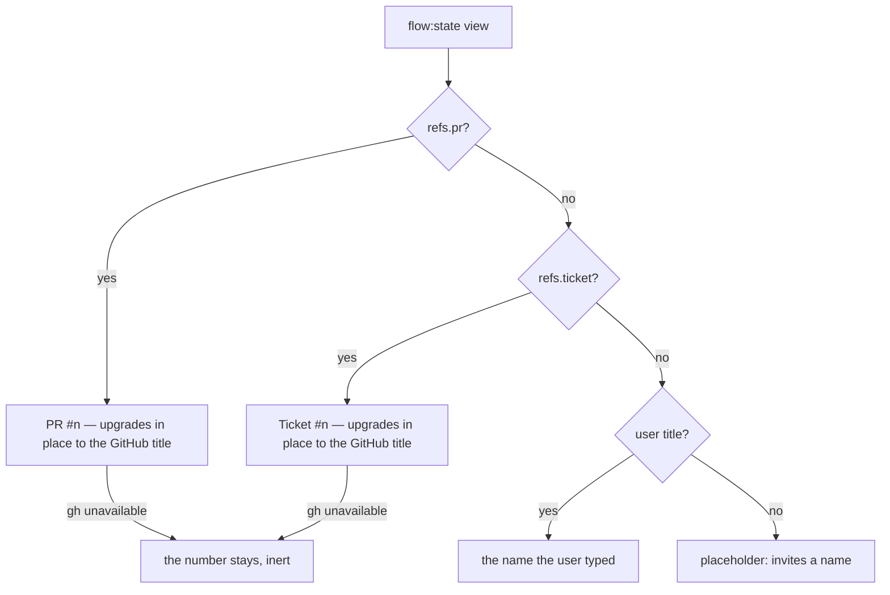
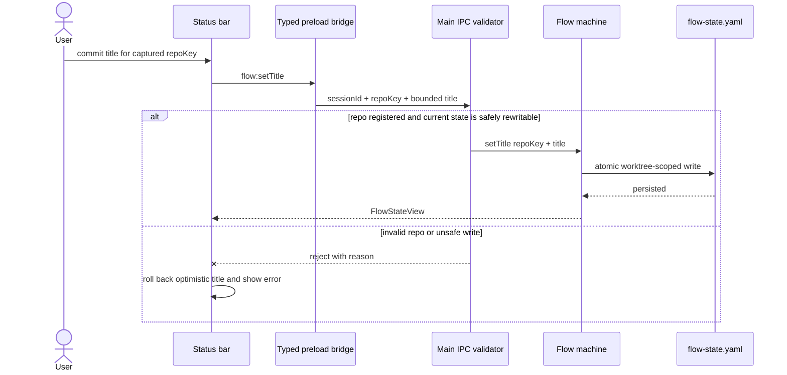

## 22. UI shell — views, overlay, status strip, layout

### 22.1 Three full-screen views (D26)

- **1 Terminal** (work with the agent), **2 Artifacts** (file tree + viewer, §20), and the **Settings** view (§7.7, reached via the gear / ⌘0). Hotkey switching; each view's state is preserved across switches. **Amended v2.132:** the originally-planned **view 3 Todos + Status** was removed — todos and captures live in the **drawer overlay** (§22.2) and status on the **rail status strip** (§22.3), so there is no standalone Todos view and no ⌘3 chord.

### 22.2 Tabbed quick-send overlay (D26/D40)

- A hotkey **overlay** pops over any view with two tabs — **`Todo | Capture`**: the Todo tab → pick a todo → send to the terminal; the Capture tab → "Capture last report" (§21.1) → Add-to-todo / Insert. This is the headline efficiency feature — curate-and-send without leaving the current view — and, since v2.132, the **only** home of the Todo/Capture widgets (the former view 3 that also hosted them was removed).

### 22.3 Status strip (D6/D27)

- A persistent slim strip shows, glanceably: **step position** (n/total + name), **gate state**, and **loop progress** (iteration, severity cycle, latest verdict + open-findings count) for loop steps. The strip is **hideable** ("deep work"); the full step timeline and the **gate controls** (a collapsible section) are one click away. Engine activity moved to the always-visible status bar in v2.133 (§22.3.1).
- **Deferred (OPEN-10):** the precise meaning of "deep work mode" — strip-hidden-only vs. collapse-to-terminal-only, and its toggle — is left to user testing; v1 ships a strip-visibility toggle on the Terminal view, not a separate mode.

#### 22.3.1 The status bar (v2.133)

A second, **always-visible** surface, pinned atop the active view in the always-visible main region — outside the rail, so hiding the strip ("deep work") can never suppress it. It is **not** hideable, not dismissable, and never collapses: it is the one place that answers *what am I working on, what is the engine doing, and does it need me?*

Three parts, all **coexisting** — the bar never suppresses one to show another:

1. **The title.** Precedence **PR → ticket → user-typed**. A ref shows its number immediately (it rides `flow:state`) and upgrades in place to the GitHub title (best-effort, §24.2.3 T7); on failure the number stays, and the control is **not** offered as operable until a URL actually resolves. A **user title** is typed in place, persists per worktree, and is **outranked but never discarded** when a ref supplies one — it returns if the refs go away.
2. **The engine activity.** The only phrase with a live producer is the bootstrap phrase (`Bootstrapping #<n>`, §27.10) + spinner; nothing is shown for the remainder of a turn — the strip carries no busy signal of its own.
3. **The attention state** (§24.2.3 T4) — the bar turns red while, and only while, the loop is blocked on a human. There is nothing to dismiss: it clears when the loop leaves the human-needed family. The alert **is** the control, so activating it opens the panel and lands focus on the first available target: a gate decision, the recovery **Retry** in the error state, or the panel's **Close** control as its stable entry point when neither action exists.

**The name belongs to the worktree, not to a flow.** A directory whose `flow.yaml` is missing or malformed is a flow **load-error** — which is *most directories* — and it has no PR and no ticket either, so the user title is the only name it can ever have. It is therefore nameable like any other: the name persists on `flow-state.yaml` independently of the progression, and a broken `flow.yaml` still cannot clobber a good on-disk progression, because naming writes **only** the name.

**Under space pressure** the bar sheds in a stated **order**, expressed as shrink factors rather than script: the **title** yields its width first, the **activity phrase** next, and the **alert last** — and the alert yields only its detail, so *"Loop needs you"* can never be pushed off the bar's edge. Nothing sheds to **zero**: the title and the phrase **floor** at a legible width and truncate with an ellipsis. Content shrunk to nothing is *removed from perception* rather than truncated, and a zero-width control stays in the tab order (WCAG 1.4.4 Resize Text, 1.4.10 Reflow, 2.4.11 Focus Not Obscured). The bar's height is therefore **constant**, and the terminal below it never needs a refit.

**Announcement:** the alert is assertive (the human is the blocker); the activity is polite (a phrase change must not interrupt what is being read). Both regions are **permanently mounted and never hidden** — a region pruned from the accessibility tree (by removal *or* by `display:none`) does not announce the content that arrives with it (WCAG 4.1.3). The title is not announced as news — it is a name.

### 22.4 Layout is data, not code (D17/D28/D36)

- The UI is built from **placement-agnostic widgets** (terminal, viewer, file tree, todos, capture, gate panel, status strip, overlay) positioned by a **layout config** at `~/.config/agent-terminal/layout.json`: which view holds which widgets, what the overlay shows, the hotkeys. **No runtime drag-dock** in v1 — changing layout = editing config, not rewriting widgets. This is a **first-class architectural constraint** (clean widget boundaries), not a nice-to-have.
- Hotkey defaults: **Ctrl/Cmd+1/2** (views) + **Ctrl/Cmd+9** (overlay) + **Ctrl/Cmd+0** (Settings), remappable via the config (⌘3 was retired with view 3, v2.132; the overlay/Settings chords moved off ⌘K / ⌘, to the digit set in v2.139, §24.1C).

---

