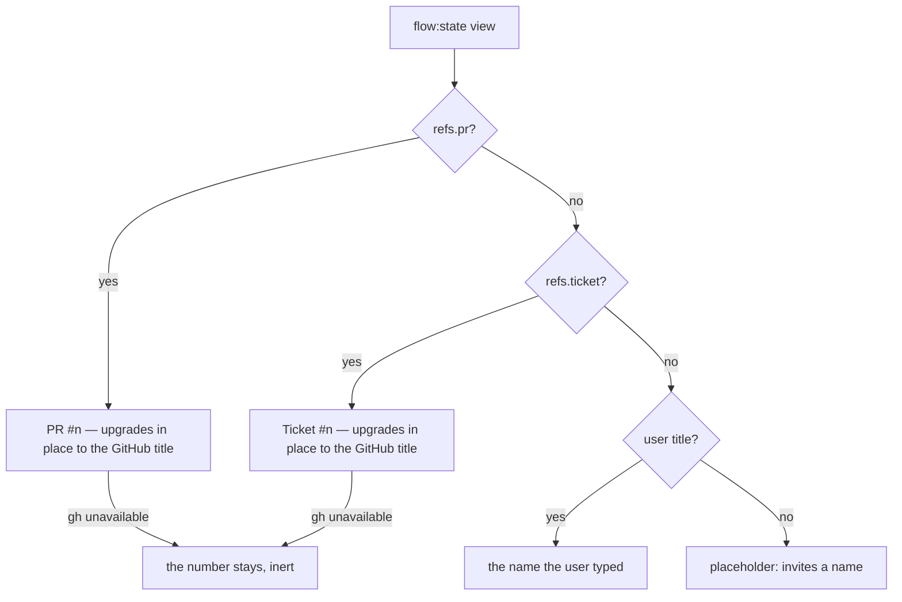

## 22. UI shell — views, overlay, status strip, layout

### 22.1 Full-screen views

- **Terminal** (work with the agent), **Artifacts** (file tree + viewer, §20) and **Settings** (§7.7). Each view keeps its state across switches. Todos and captures have no view of their own: they live in the quick-send overlay (§22.2), and status lives on the rail and the status bar (§22.3).

### 22.2 Tabbed quick-send overlay

- A hotkey overlay over any view, with two tabs — **Todo | Capture** (§16). Pick a todo and send it to the terminal, or capture the latest report and add its findings as todos, without leaving the current view. This curate-and-send loop is the headline efficiency feature, and the overlay is the only home of those two widgets.
- The overlay is **docked**, not floating over the terminal, so the terminal text it refers to stays visible beside it — the §16.8 cross-highlight depends on seeing both at once.

### 22.3 Status strip

- A compact read-out in the rail shows step position (n/total and name), gate state and loop progress. The full step timeline and the gate controls expand from it, one click away.
- With token counts shown (§27.16), the rail's step list carries each step's total, and the run total sits under it.

#### 22.3.1 The status bar

A second, **always-visible** surface, pinned atop the active view, outside the rail, so nothing done to the rail can suppress it. It is **not** hideable, not dismissable, and never collapses: it is the one place that answers *what am I working on, what is the engine doing, and does it need me?*

Three parts, all **coexisting** — the bar never suppresses one to show another:

1. **The title.** Precedence **PR → ticket → user-typed**. A ref shows its number immediately (it rides `flow:state`) and upgrades in place to the GitHub title (best-effort; see §24.2.3 for the repo-identity rule); on failure the number stays, and the control is **not** offered as operable until a URL actually resolves. A **user title** is typed in place, persists per worktree, and is **outranked but never discarded** when a ref supplies one — it returns if the refs go away.
2. **The engine activity.** The only phrase with a live producer is the bootstrap phrase (`Bootstrapping #<n>`, §27.10) + spinner; nothing is shown for the remainder of a turn — the strip carries no busy signal of its own.
3. **The attention state** (§24.2.3 T4) — the bar turns red while, and only while, the loop is blocked on a human. There is nothing to dismiss: it clears when the loop leaves the human-needed family, and an `auto` gate the engine is still deciding is not in it (§27.9.1 N9b.5(e)). The alert **is** the control, so activating it opens the panel and lands focus on the first available target: a gate decision, the recovery **Retry** in the error state, or the panel's **Close** control as its stable entry point when neither action exists.

Before the title, the bar also shows the setup check's **setup needed** button while the terminal's directory fails a setup condition (§29.1). It is the setup check's own control, not a fourth part of the bar.

**The name belongs to the worktree, not to a flow.** A directory whose `flow.yaml` is missing or malformed is a flow **load-error** — which is *most directories* — and it has no PR and no ticket either, so the user title is the only name it can ever have. It is therefore nameable like any other: the name persists on `flow-state.yaml` independently of the progression, and a broken `flow.yaml` still cannot clobber a good on-disk progression, because naming writes **only** the name.

**Under space pressure** the bar sheds in a stated **order**, expressed as shrink factors rather than script: the **title** yields its width first, the **activity phrase** next, and the **alert last** — and the alert yields only its detail, so *"Loop needs you"* can never be pushed off the bar's edge. Nothing sheds to **zero**: the title and the phrase **floor** at a legible width and truncate with an ellipsis. Content shrunk to nothing is *removed from perception* rather than truncated, and a zero-width control stays in the tab order (WCAG 1.4.4 Resize Text, 1.4.10 Reflow, 2.4.11 Focus Not Obscured). The bar's height is therefore **constant**, and the terminal below it never needs a refit.

**Announcement:** the alert is assertive (the human is the blocker); the activity is polite (a phrase change must not interrupt what is being read). Both regions are **permanently mounted and never hidden** — a region pruned from the accessibility tree (by removal *or* by `display:none`) does not announce the content that arrives with it (WCAG 4.1.3). The title is not announced as news — it is a name.

### 22.4 Layout is data, not code

- The UI is built from **placement-agnostic widgets** (terminal, viewer, file tree, todos, capture, gate panel, status strip, overlay, flow picker). A widget takes what it acts on from its inputs, never from where it happens to be mounted, so moving it changes where it renders, not what it does. This is an architectural constraint on every widget (UI-STANDARDS.md), not a feature: there is no layout config file and no runtime drag-dock — placement is set in the shell code.
- **The flow picker (§18.7.4)** sits in the rail directly below the flow status strip and acts on the worktree the strip is showing — it follows the strip's view, never an ambient worktree.
- Hotkeys are defaults the user can remap in Settings (§7.7).

### 22.5 A pressed control waits for its answer

A press that starts work the app must answer (an IPC round-trip, a dialog submit) holds that control, and the
controls related to it, until the answer arrives. Every renderer window does this, the controller included.
While held, a further press on any of them does nothing. The pressed control shows a spinner and reports itself
busy, and the held controls report themselves unavailable to assistive technology. Focus stays on the pressed
control. Otherwise a second press while the first is pending starts the same action, or a conflicting one,
again. An action whose answer arrives only as a later pushed state event is not held. How this is built is
UI-STANDARDS.md §1.4.

---
