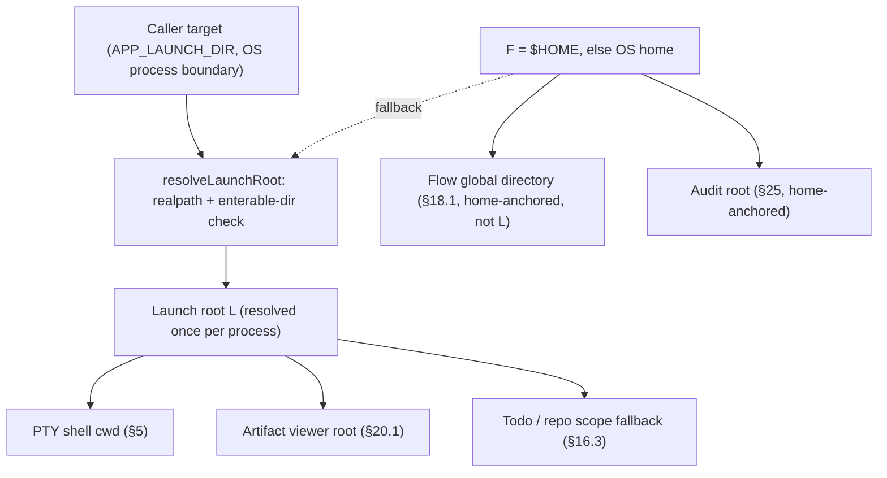
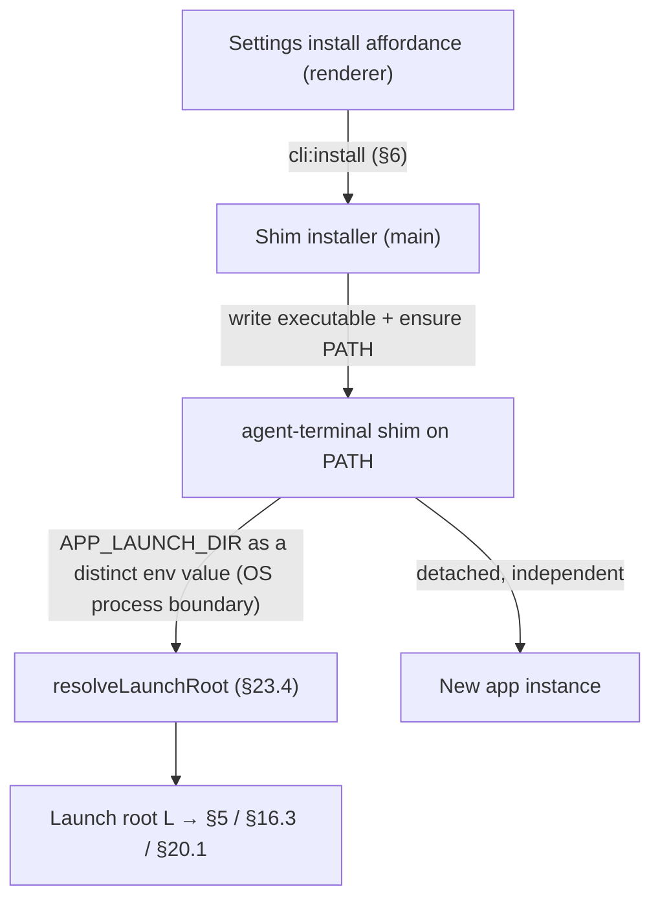

## 23. Multi-instance & epics

### 23.1 One flow per instance, many instances (D5)

- **One flow per app instance**; concurrency is achieved by **running many instances**, each driving its own terminal session, repo/branch/PR, and agent-loop chain. No in-app multi-flow dashboard.

### 23.2 Epics = N instances over N worktrees (D18/D22/D23/D63)

- When a loop step produces N PRs (an epic), each child PR runs in its **own git worktree** on its PR branch, under a flow the operator chooses when they press Start there (§18.7.5). There is no going back, so ancestry isn't tracked. The app **assists** (D22): for each child PR, `flow:openChild` creates the worktree and launches a new instance. It does not set that worktree's flow selection or flow-state. Per-flow state lives in the worktree (§19.1).
- The child's flow is **bound at Start**, when the operator Starts a run in that worktree, like any worktree (§18.7.5, D63). That run begins where an ordinary Start of the chosen flow begins.

### 23.3 Cross-instance guard (D21)

- Instances are independent, but if two target the **same repo+branch (or same PR)**, the second **warns** ("already managed elsewhere") to avoid clobbering agent-loop state.

### 23.4 Launch-root resolution (added v2.88)

So one instance can run per worktree/repo (§23.1), a launched instance roots at a **caller-supplied target directory** instead of always at `$HOME`. The target crosses the **OS process boundary** (a launch argument / environment variable / OS open-directory event — implementation's choice), never an IPC channel; per-process input keeps two concurrent OS-process instances independent.

- **Launch root L.** L is resolved **once per process** and is the single source of truth three spawn-cwd surfaces read: the PTY shell cwd (§5), the artifact-viewer fallback root (§20.1), and the todo/repo-scope fallback (§16.3). The three read this one value — they do **not** each re-resolve — so a behavior-preserving edit to one surface cannot desync it from the others. The flow **global** directory (§18.1) is **not** one of these surfaces: it is the **app-state home A** (see the app-global-anchors bullet), independent of L — the local-first repo tier already covers a launch-at-a-repo, so binding the global tier to L would shadow `~/.agent-terminal/flow.yaml` rather than fall back to it.
- **Resolution.** Given a target, L = the target resolved to an absolute **real path** (relative → absolute, symlink → canonical) when it is an **enterable directory**; otherwise L = **F**. **F** is the pre-existing no-target home value (`$HOME`, else the OS home dir) — unchanged by this section, and returned **verbatim** on fallback (never re-canonicalized), so the no-target and unusable-target paths are behavior-preserving.
- **Enterable directory.** The target is usable only when its real path exists, is a directory, and can be entered (traverse/execute permission). A target that does not exist, is a file, or cannot be entered (permission denied, broken symlink) is **unusable** → L = F; the instance still launches. Validation runs once and must not throw into the launch path.
- **Per-surface OSC-7 lifecycle.** The shell starts at L and tracks the shell thereafter (§5). The viewer root (§20.1) and todo/repo scope (§16.3) equal L **before the first OSC 7** and follow the reported cwd after it.
- **App-global anchors are home-rooted, not L-rooted.** The `.agent-terminal` **app-state anchors** — the flow **global** directory (§18.1) and the audit root (§25) — anchor at the **app-state home A**, and user-data plus config-dir lookups anchor at the per-user home (F); all are **independent of the launch target** and fixed for the life of the process. **A** = `APP_HOME_DIR` when it is an **absolute** path (a relative value has no single meaning from this process's cwd and is ignored — CWE-829), else F (`$HOME`, else the OS home dir); it is resolved **once** (`resolveAppHome`) and the flow-global and audit anchors read that one value, so a def read and its run's audit cannot land under different homes. `APP_HOME_DIR` moves **only** these `.agent-terminal` state anchors — not the launch root (`APP_LAUNCH_DIR`/L), not Claude Code's config root (`CLAUDE_CONFIG_DIR`, §24.2.3), and not the CLI-shim install home (§23.5, the user's real home). The app-state home is a fixed per-process anchor that does not track OSC 7. Re-rooting these by mutating the process-global `HOME` is **forbidden**: it would also re-root the child shell's env; `APP_HOME_DIR` is the sanctioned override precisely because it moves the state anchors without touching the shell's environment.
- **The launch directive does not leak to the child.** The per-process launch input is consumed once at startup by the resolver and is **stripped from the spawned shell's environment**, the symmetric guarantee to the `HOME`-mutation prohibition above: a nested instance launched from within an instance's own terminal does not inherit the parent's launch directory — with the directive stripped it resolves no target and roots at F unless the §23.5 CLI shim supplies its own target.

### 23.5 Launch shim — the `agent-terminal` CLI launcher (added v2.89, #25)

The §23.4 *producer*: an `agent-terminal [dir]` command on the user's PATH that opens a **new, independent** instance rooted at a directory (like `code .`), plus an in-app action that installs it. The shim is the launch-root producer; §23.4's `resolveLaunchRoot` is the consumer, **reused unchanged**.

- **Install action.** A Settings affordance invokes `cli:install` (§6); main writes a generated shim into the **most logical bin directory for this user on this machine** and ensures it is reachable from a new shell. **Location preference:** when a conventional user bin directory (`~/.local/bin`, then `~/bin`) is **already on the running PATH and writable by the user alone** — a candidate that is, **or whose ancestor below `home` (along its symlink-resolved real path) is, group- or other-writable is rejected** so another local user cannot rename it and substitute the on-PATH launcher (CWE-276/426, CWE-59) — the shim lands there and **no shell profile is edited**; the command works in new shells (and the current one) immediately, with no restart. When none qualifies — **or the preferred-dir write fails** — main falls back to a dedicated **`~/.agent-terminal/bin`** it creates and PATH-wires by adding a **marker-guarded block** to the user's existing shell profile(s). The dedicated dir and its app-owned parent are hardened owner-only (0o700, CWE-276/426); a **reused user dir is the user's own — never created or re-permissioned**. Install is **idempotent / reconcile-to-current-build**: a prior block is stripped from **every** candidate profile before the fresh one is appended only to the active shell's profile(s) (and stripped from all of them when the shim instead lands in an already-on-PATH dir), so reinstalling (including from a different build, after a default-shell change, or after switching to an on-PATH dir) re-points the command at the running build with **no duplicate or orphaned PATH/profile entries**. If it can neither write the shim nor put it on PATH it returns a **visible error and never reports success** — there is no "installed but not runnable" state.
- **Build-correct invocation.** The shim embeds this build's launch command — the Electron binary plus, in a dev build (`process.defaultApp`), the resolved main script; a packaged build needs no extra arg. So the installed command launches **this** build.
- **Target across the boundary.** The shim captures the invoking shell's cwd, resolves an optional argument against it (`agent-terminal ./sub` → *shellCwd*/sub, regardless of the launched process's own cwd; no argument → the shell's cwd, distinct from §23.4's no-target `$HOME`), and forwards a single value as **`APP_LAUNCH_DIR`** to the new instance. An unusable target is forwarded verbatim and falls back to F per §23.4.
- **Trust boundary (CWE-78).** The caller path crosses as a **distinct environment value, never spliced into a shell command line**, so shell metacharacters, spaces, or a leading `--` reach the resolver as one verbatim directory operand — never parsed as a launcher flag or evaluated as a shell token.
- **Detached, genuinely independent.** The new instance is launched detached and the shim returns immediately (the launching shell is not blocked, and the child outlives it). On macOS the build binary is exec'd **directly** so a genuinely **separate OS process** is created rather than the running instance being focused; Linux spawns a detached independent process. Either way any already-open instance stays open.

---

## 23.6 Separate controller (#217, #218)

A separately launched controller presents one pane per live terminal connection. Initial registration is mandatory: a responsive, closable terminal window displays start-controller and matching-build guidance without starting PTY/agent work. The controller publishes the accepted identity to registry subscribers before sending the version-1 `registered` confirmation. Only confirmation for the active attempt releases startup, once; connection establishment or writing registration bytes is insufficient. Pending attempts expire after two seconds and retry five seconds after failure (nominal start gaps 5–7 seconds, observed 5–8 seconds after rounding each measured attempt gap to the nearest millisecond; recovery within 10 seconds on a responsive system, excluding suspension/event-loop starvation). Closing cancels pending attempts and late confirmations cannot start work. Established-connection freeze detection is excluded. Identity is the resolved launch directory (§23.4) plus optional repository/worktree root captured at launch, fixed for the terminal lifetime. Equal paths do not merge terminals. Each pane activates only its connection’s original window, restoring and focusing it without PTY input, flow transitions, or gate decisions. The empty state explains launch order; panes reflow with the available width.

The controller’s close action minimizes its window and retains connections. Explicit Quit releases its connections while terminals continue. C1 removes ended connections automatically and provides accessible unavailable feedback for unconfirmed activation, without claiming that a timeout proves disconnection. A confirmed result survives a later disconnect; disconnect before confirmation returns unavailable. Initial waiting terminals register automatically when the controller appears. After established connection loss, automatic retries use the same bounded schedule as initial registration, without gating ongoing PTY/agent work. Controller restart rebuilds one live pane per reconnecting terminal; repeated loss cannot accumulate duplicate live representations, and live same-directory peers stay distinct. Reconnection preserves fixed launch identity and original activation targeting without restarting work, injecting input or changing human gates. Terminal closure cancels recovery and stale connection events cannot disturb the replacement. Retained errors and dismissal are completed in dependent #218 slices; recovery adds no persistent registry, notification replacement or remote control. Retained disconnected panes and dismissal are assigned to #218.

Both applications share a user-local endpoint rooted in the app-state home, with a bounded, versioned data protocol. Live connection identities, not path labels or process IDs, authorize routing. Renderer access is restricted to snapshots and activation through the shared IPC contract. Existing §19 gates and §24.2.3 T4 notifications keep their semantics. See README for installation and C1 lifecycle limits.
