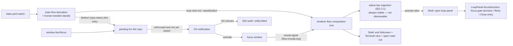

## 24. Build plan — UI-inwards

> **Build direction (supersedes the prior bottom-up W1–W19 plan).** We build the flow-management UI **from the skin inwards**: stand up the complete three-view shell (§22) first, with **every widget present and interactive**, then replace mocked backing with real subsystems phase by phase. The four widgets that already have shipped cores — **terminal** (§5–§9), **manual capture** (§15/§16/§21.1), **todos** (§16.3/§16.4/§21), and the **artifact viewer** (§20.2) — are reused **as-is behind the new skin**; everything else (flow runner, gates, status strip, step inputs, feedback compose, artifact discovery, GitHub bridge, multi-instance) is **mocked with fixtures** in Phase 1 and made real in later phases. The rationale: lock the look, feel, and widget boundaries (§22.4) before wiring deep machinery, so the visible product converges early and the §22.4 placement-agnostic-widget constraint is enforced from day one rather than retrofitted.
>
> **TDD applies unchanged (CLAUDE.md).** Design artifacts in §24.1A/B (mood studies, theme mockups) are non-code HTML and are outside the code-TDD rule. Everything built into the app in §24.1C and every later phase is code: RED-first, observable behavior, no emulator/PTY mocks. View switching, hotkeys, overlay open/close, theme toggle, and mocked-widget rendering are all observable at the DOM/e2e boundary and are tested there. Reuse of a shipped core behind the new skin starts with a **pinning test** asserting the core's existing observable behavior still holds through the new widget boundary.

### 24.1 Phase 1 — the three-view UI, mocked

> **Progress:** 24.1A Mood ✅ · 24.1B Options ✅ · 24.1C Implement ✅ — **Phase 1 is complete** (v2.36): the full three-view shell is the live UI with every widget present and interactive in both themes, the shipped cores (terminal, capture, todos) reused behind the skin, and the **artifact viewer** now real (markdown-it+mermaid / CodeMirror, §20.2). The §24.2.1 drawer-panel restorations are now **complete** (v2.45). What remains is **not Phase 1**: the §24.2 backlog of real flow machinery (status strip / gate / flow runner are intentionally still fixture-driven mocks). Design artifacts live in `design/` (`design/README.md` is the running log); mood studies in `design/mood/`, shell mockups in `design/shell/`.
>
> **Amended v2.132 — view 3 removed.** The Phase-1 build below describes a **three-view** shell whose **view 3** held the fixture-mocked **Todos + Review-gate** widgets. That view was later removed: the real Todo/Capture widgets live only in the drawer overlay (§22.2), and the fixture gate panel (`createGatePanel`/`SAMPLE_FLOW` in the former `src/renderer/src/flow.ts`) was superseded by the real §26 loop/gate panel and deleted. Read the "view 3 / gate panel" items in this section as **historical build record**; the live shell is view 1 Terminal, view 2 Artifacts, and the Settings view (⌘1/⌘2 + gear/⌘0; Quick-send drawer ⌘9).

Deliver the full §22 shell: **view 1 Terminal**, **view 2 Artifacts** (file tree + viewer), **view 3 Todos + Status**, the **`Todo | Capture` quick-send overlay** (§22.2), the **status strip** (§22.3), and **Ctrl/Cmd+1/2/3 + Ctrl/Cmd+K** hotkeys (§22.4) — in **both light and dark themes** with a toggle. State is preserved across view switches.

**Real (shipped cores, reused behind the new skin):**
- **Terminal** — the xterm pane and app-owned selection (§7), the PTY/shadow loop (§5/§8), injection (§9.3).
- **Capture** — manual single-slot "Capture last report" (`capture:last`, §21.1/§15/§16), finding → `todo:add`. Capture lives in the **docked drawer's Capture tab** (view 3 shows Todos + the gate, not capture — §24.1C).
- **Todos** — the todo data model, persistence, and interactions (§16.3/§16.4), select-and-send to the terminal. The Todo tab of the overlay and the todos widget in view 3 are the **same widget**.
- **Artifact viewer** — CodeMirror 6 + markdown-it + mermaid.js rendering, select-to-send / `todo:add` (§20.2), fed by **real git/fs discovery** (§20.1, v2.37) scoped to the session's live cwd.

**Mocked (widget present and interactive; fixture data behind it):**
- **Status strip** (§22.3) — step position n/total, gate state, agent activity, loop progress rendered from a fixture flow-state; hide/show real.
- **Gate panel + step timeline** (§19.2/§19.3) — controls render and are clickable; actions are stubbed (no real injection of loop slash-commands yet).
- **Flow runner / flow-state / agent-loop bridge** (§18.3/§19.1) — a hardcoded sample flow drives the timeline and strip; no `flow-state.yaml`, no `.agent-loop/state.yaml` watching.
- ~~**Artifacts file tree** (§20.1) — populated from the fixture set; no real discovery/provenance.~~ **Now real (v2.37):** `viewer:tree`/`viewer:read` discover the session's repo (curated = the superset of working-tree changes ∪ committed-in-PR files ∪ `.agent-loop/`, whole-repo on a checkbox) or, outside a repo, the cwd tree — with `changed`/`loop`/`pr` provenance tags. The **PR** provenance tag ships (v2.98, gh-resolved base); the LoopDef `artifacts:` declarations still wait on the agent-loop bridge (§24.2).
- **Feedback compose path** (§19.4) — the compose-with-agent affordance is present but stubbed; verbatim select-and-send works (it rides the real todo/capture send).

**Acceptance:** launch the app, switch views with hotkeys and persist state, toggle light/dark, open the overlay over any view and send a real todo / capture a real report, render a fixture artifact in the viewer and send a selection, drive a real agent in the terminal — all while the strip, timeline, and gate panel show coherent (mocked) flow state.

#### 24.1A Mood — ✅ done

Use the **`frontend-design`** skill to produce **mood studies** that fix the look-and-feel direction: a compact token system (palette as 4–6 named hex values, display/body/utility typefaces, layout concept, one signature element), grounded in this product's subject (a single-operator harness for driving coding agents). Output is a small set of non-code mood boards; **converge on one direction** before any mockups.

- [x] Four directions explored (`design/mood/`): Telemetry, Galley, Schematic, Galley · Lit.
- [x] **Chosen: Galley · Lit** (`design/mood/04-galley-lit.html`) — readable margin-proof model lit by a live cyan signal on a bright board; light + dark. **Rule:** saturated color is spent only on **signal** (cyan = where the work is / provenance link, §16.8) and **act** (red = request changes); everything else is quiet ink. Type: Fraunces / IBM Plex Sans / IBM Plex Mono. Tokens in `design/README.md`.

#### 24.1B Options — ✅ done

From the chosen mood, produce mockups of the full three-view shell + overlay + status strip, **each in light and dark**, then **converge to a single option** before implementation. Output is interactive HTML/CSS mockups (view switching, overlay, theme toggle; no app/backing wiring).

- [x] Three layouts explored (`design/shell/`), sharing placement-agnostic widgets via `design/shell/tokens.css` (§22.4 — only the frame differs): **Console** (slim strip on top), **Cockpit** (persistent left rail + drawer), **Reading room** (document-first).
- [x] **Converged on `design/shell/converged.html`** (Reading room dropped):
  - **Slim left chrome** — Console's minimal feel as a ~200px left rail (views nav + vertical flow + compact status + quick-send/theme); main area full-bleed.
  - **Docked, non-blurring quick-send** — the drawer is a real layout column (no scrim/blur), so the **terminal stays visible beside it**. This is required for **cross-highlight (§16.8)**: hovering a finding lights its source line in the terminal, both on screen at once. This amends the §22.2 "overlay pops over any view" framing for the Terminal view: quick-send **docks** rather than covers, specifically to preserve terminal↔capture cross-highlight.
  - ⌘1/2/3 views, ⌘K toggles the drawer; light + dark (theme applied in `<head>` to avoid FOUC).

#### 24.1C Implement — ✅ done (frame + cores + artifact viewer; §24.2.1 panel restorations follow-on)

Built **`design/shell/converged.html`** as the live renderer UI per the §24.1 real/mocked split, **both themes** with a toggle, RED-first throughout.

- [x] **Frame** — `src/renderer/index.html` is the rail · three views · docked drawer; tokens + layout folded into `styles.css`. `shell.ts` owns view switching, ⌘/Ctrl+1-3, ⌘/Ctrl+K, drawer dock/undock, and theme; `crossHighlight.ts` does §16.8. Both are organisms per `UI-STANDARDS.md` (typed factory, host-only DOM, injected theme seam) with DOM-level unit tests; the frame behaviours have e2e (view switch, dock/undock without scrim, ⌘K through a focused terminal, theme persists, terminal refit on dock).
- [x] **Real cores reused behind the skin** — terminal + selection (view 1); the action window's Capture/Todo tabs + status strip relocated to the docked drawer and rail, element-id contracts unchanged so their shipped behaviour (and e2e) still holds.
- [x] **`theme` added to `UiSettings`** (§16.6), validated + persisted; `<html data-theme>`.
- [x] **Splitter removed** (§16.6) — replaced by the docked drawer; module + tests deleted (`splitRatio` left in the contract, unused).
- [x] **Widget reskin** — the reused capture/todo/status widget CSS is on Galley · Lit tokens (both themes; no hardcoded colors outside the token blocks). A pixel-level polish pass with populated widgets is still worthwhile but not blocking.
- [x] **Fixture-driven mocked widgets** — `flow.ts` renders the flow timeline, rail gate/loop status, and the view-3 gate panel from one typed `SAMPLE_FLOW` fixture; the gate's Approve / Request-changes buttons are clickable **stubs** that reflect a verdict locally and notify a handler but inject nothing (§19.2/§19.3). DOM-unit-tested; gate-stub wiring has an e2e.
- [x] **Artifact viewer** — ✅ **done (v2.36), discovery made real (v2.37), since extended (v2.41–v2.44).** View 2 is the real viewer: `artifacts.ts` is a placement-agnostic organism (file tree + viewer, injected render seams + the two §16.2 sinks) fed by **real git/fs discovery** (`viewer:tree`/`viewer:read`, v2.37 — the fixture set is gone); `viewerRender.ts` lazily loads **markdown-it + mermaid** (markdown with rendered diagrams) and a read-only **CodeMirror 6** editor (highlighted code). A selection in either routes to **send-to-agent** (inject, no submit — §9.3) or **add-to-todo** (`captureToTodo`, §16.2), captured via `selectionchange`, and the sinks are disabled until there is a selection (v2.42). Subsequent §20.2 work: **changed-line markers** (v2.41), **viewport-driven changed-section navigation** (v2.42), a **full-screen mode** with a resizable tree popout (v2.43), a name-only tree filter that re-renders matching nodes, and **keyboard-accessible scrolling + reusable accessible show/hide** (v2.44). DOM-unit-tested (fakes for the libs) + full-loop e2e. Both themes via tokens.

> **Known limitation:** ⌘K is intercepted in the capture phase so a focused xterm can't swallow it; the chord still cannot be globally rebound per-OS yet. Three §15/§16 command-capture e2e fail in some environments (shell-integration dependent) — pre-existing, verified against the prior commit.

### 24.2 Backlog — functionality not yet assigned to a phase

Everything below is real backing logic that Phase 1 mocks or omits. Each becomes (or joins) a later phase; none is in Phase 1. Spec sections in parentheses.

- [ ] **Flow definition schema + loader** (§18.1) — `flow.yaml` JSON-Schema, parser/validator, library merge (global ∪ repo, repo wins).
- [ ] **Flow-progression state store** (§19.1) — `flow-state.yaml` read/write per worktree; transitions persist + reload.
- [ ] **agent-loop state bridge** (§19.1) — watch/parse `.agent-loop/state.yaml` → derived flow/gate/loop-progress.
- [ ] **Flow runner** (§18.3/§19.2) — start; per-step entry actions (`bootstrap: pickup`, `skill:` injection); user-driven advance with not-ready warning; per-kind behavior. Replaces the Phase 1 hardcoded sample flow.
- [ ] **Gate driver + running-process refusal** (§19.3) — inject loop slash-commands; refuse injection over a non-quiescent shell. Makes the Phase 1 gate panel real.
- [ ] **Typed step-input prompts** (§18.4) — resolve declared inputs; prompt with the right picker only when unsatisfied.
- [ ] **Feedback composer — compose-with-agent path** (§19.4) — select todos (+instructions) → compose-with-agent vs verbatim → gate driver. (Verbatim send already real in Phase 1.)
- [x] **Artifact discovery + provenance tree** (§20.1) — ✅ **done (v2.37):** `src/main/artifactTree.ts` discovers the real tree off the session cwd (git in a repo, fs walk outside one) and reads files for the viewer (`viewer:tree`/`viewer:read`), replacing the fixture set. `changed` + `loop` + `pr` provenance ship (the **PR** tag via the gh-resolved base, v2.98); the LoopDef `artifacts:` declarations (need the agent-loop bridge) remain deferred.
- [ ] **GitHub bridge** (§20.3) — prefer written artifacts; `gh` refresh; fallback to artifact when offline.
- [ ] **Todo templates** (§21.2) — markdown-list parse, named + file templates; headings ignored, sub-bullets folded.
- [ ] **Layout config system** (§22.4) — load `~/.config/agent-terminal/layout.json`; a config change relocates a widget with no widget-code change. (Phase 1 keeps widgets placement-agnostic but ships a hardcoded layout.)
- [ ] **Worktree + child-instance launcher** (§23.2) — `flow:openChild`; child launch seeds the expected `flow-state.yaml` at the right step.
- [ ] **Cross-instance guard** (§23.3) — second open on the same repo+branch (or PR) warns.
- [ ] **Flow-author skill** (§18.5) — separate deliverable; a skill, not app code.

#### 24.2.1 Drawer-panel functionality deferred by the mockup-exact panels — ✅ done (v2.45)

The §24.1 drawer panels were rebuilt to the converged mockup exactly (v2.32), which is intentionally leaner than the shipped §15/§16 components. These controls existed and work in the codebase's main process; they were dropped from the **renderer** and are the **next priority** to restore — re-skinned into the mockup's card / checkbox / linkbtn language, not the old chrome. The IPC + main-process backing for each still exists.

Todo panel:
- [x] **Send must not submit** (§9.3/§16.2) — ✅ **done (v2.35).** The **Send** pill injects with `submit: false`: it pastes the todo content into the agent's input box (no trailing `\r`) and **leaves it there for the user to edit or augment** before they submit it themselves, moving focus to the terminal (the old §16.2 *Insert*, not *Insert & submit*). One-line renderer fix (`todoTab.ts` → `doInject(t.text, false)`); the `agent:inject {submit}` path already supported it.
- [x] **Reorder** (§16.4) — ✅ **done (v2.45).** ↑/↓ buttons (keyboard/a11y path) + HTML5 drag, persisted via `todoReorder`; the full display order is sent so the flat done-inline list stays stable.
- [x] **Edit-in-place + a better edit UI** (§16.3) — ✅ **done (v2.45).** Editing via `todoUpdate` with a better affordance than the old textarea swap: the `.tx` becomes `contenteditable` in place (Save/Cancel + Enter/Escape, no box swap); the mid-edit repo-swap deferral is kept (a swap while editing surfaces a `.swap-blocked` notice, applied once the edit resolves).
- [x] **Manual add** (§16.4) — ✅ **done (v2.45).** A top add-row (`#todo-new` + Add) → `todoAdd {type:'manual'}` (empty/whitespace guarded).
- [x] **Delete — recoverable, two-step** (§16.4) — ✅ **done (v2.45).** Per-todo `todoDelete` via the `origin/main` (commit `c992fe7`, v2.27) design, re-skinned into the mockup row: `×` → inline **Confirm delete? / Cancel**; confirming **defers** the `todoDelete` and shows a **Deleted / Undo** row for `TODO_UNDO_MS`; Undo restores with no round-trip; the deferred delete captures the item's own `repoKey` so a mid-window repo swap still deletes from the right list.

Capture panel:
- [x] **Bulk triage** (§16.2) — ✅ **done (v2.45).** A `.chunk-check` checkbox per card + a pane toolbar: **Add to todo** (concatenates the checked chunks in appeared order, blank-line separated, into **one** todo) and **Dismiss selected**, re-skinned from the `c992fe7` (v2.27) `chunk-check` / `add-selected` / `dismiss-selected` into the card language. **Supersedes** the per-card "Add to todo" the mockup shipped and subsumes **Dismiss + Dismiss all**.
- [x] **Dismiss + Dismiss all** (§15.6) — ✅ **done (v2.45).** Toolbar **Dismiss selected** (`dismiss`) and **Dismiss all** (`dismissAll`); folded into **Bulk triage**.
- [x] **Add-to-todo Undo + in-flight cue** (§16.2) — ✅ **done (v2.45).** The bulk Add-to-todo opens an in-place **Added / Undo** window (`TODO_UNDO_MS`); while pending the contributing chunks read as **processed** (dimmed, checkbox disabled) until the window commits (chunks dismissed) or Undo reverts (the just-added todo is deleted, chunks stay) — the `c992fe7` "processed chunk" behaviour.
- [x] **Report prose / summary view** (§15.x) — ✅ **done (v2.45).** A report that carves no findings renders as an expandable `.report-prose` summary card (`
`) showing the report body — prose has a home without reintroducing the blob.

> **Retained from the old panels (not deferred):** the **double-click → terminal reveal** cross-highlight (§16.8) stays in the mockup-exact capture panel — now **resize-safe** (marker-anchored, id-keyed) after merging `origin/main`. **Dropped and not currently backlogged** (call out if wanted): command-history list + Clear-commands (§15.5/§15.6), type badges + timestamps + truncation markers (§15.6), "Mark as chrome" (§15.x `learnChrome`), Insert/Insert&submit on command-output and the Insert-without-submit todo action (§16.2), the collapsible Done section (§16.4).
>
> **Reference implementation:** the deferred Capture/Todo usability (bulk triage, undoable delete, processed-chunk cue) shipped working + tested on `origin/main` in commit `c992fe7`; it lives in git history as the starting point for re-skinning into the mockup, rather than a from-scratch rebuild.

#### 24.2.2 Manual-step tracer bullet — start → work → complete, status-strip-valid — planned

The first real §24.2 flow machinery, built as **tracer bullets** per the CLAUDE.md *Tracer-bullet development* requirement: a **walking skeleton** first (the whole `not_started → in_progress → done` arc, hand-drivable in the UI on day one), then **one layer deepened per slice** behind that unchanged arc. Each slice replaces exactly one mock/seam and leaves the app demoable. **Scope: the `manual` kind only** (§18.2) — `loop`/`action` kinds, the gate driver's agent-loop slash-commands (§19.3), typed input pickers (§18.4), request-changes/compose (§19.4), and epics (§23) are out. This promotes slices of the §24.2 items **Flow definition schema + loader** (§18.1), **Flow-progression state store** (§19.1), **Flow runner** (§18.3/§19.2), **Todo templates** (§21.2), and makes the **status strip** (§22.3) real for this path. Each item names its **fire** (user action) / **land** (observable UI) / **e2e** (the proof), RED-first throughout.

- [x] **S1 — Walking skeleton: start a manual step, advance it to done. ✅ done (v2.48).** The complete lifecycle spine across every layer: a **minimal single-`manual`-step definition** (`id`, `name`, `kind: manual`) from a **hardcoded constant in main** — *the one deliberate seam this slice carries, replaced in S2*; a real **workflow state machine** in `src/main/flow.ts` (`not_started --start--> in_progress --advance--> done`; `done` is terminal — advancing past the step's gate, §18.2, completes it and, with no next step, the flow); **IPC** `flow:state → {stepName, position, status}`, `flow:start`, `flow:advance` (§6) + `window.flow` (preload); the **status strip** (§22.3) shows `1/1 · <name>` + live status with a control that is **Start** in `not_started`, **Advance** in `in_progress`, gone in `done`. State is in-memory in main (persistence is S3). **Fire:** click Start, then Advance. **Land:** strip reads `not started` → `in progress` → `done`; the control follows; a second Advance is impossible. **e2e:** launch → `not started` → Start → `in progress` → Advance → `done`, no further control; under it a main unit test of the state machine (legal transitions only, `done` terminal) and a renderer DOM test that the strip/control render from `flow:state` and emit `flow:start`/`flow:advance`. **Retires:** the §24.1 fixture-driven status strip / flow state.
- [x] **S2 — The step definition comes from a real `flow.yaml`. ✅ done (v2.49).** Replaced S1's hardcoded constant with `src/main/flow.ts` `loadFlowDefinition(worktreeDir)` reading & validating `<worktree>/.agent-terminal/flow.yaml` (§18.1 minimal shape: `name` + one `kind: manual` step with `id`, `skill`, `todo_template`; parsed with `js-yaml`); `createFlowMachine(load)` sources the step name from it. Workflow, IPC, and UI are unchanged — only the definition's **source** became real (read once at the spawn cwd, §5/§20.1). A missing/malformed/invalid file is an inert `error` state (new `FlowStatus` member + optional `FlowStateView.error`), not a crash. **Fire:** open the app on a worktree whose `flow.yaml` names the step. **Land:** the strip shows the name from the file; a malformed/missing file shows the error with no control. **e2e:** seed a temp worktree's `flow.yaml` → strip text + drive to done; a no-file case → error state, no control, app still launches; under it `flow.ts` parse/validate integration tests against temp dirs (real fs, no mocks) and a renderer DOM error-render test. **Retired:** the hardcoded step definition.
- [x] **S3 — Progression persists across reload. ✅ done (v2.50).** `src/main/flowState.ts` `createFlowStateStore(worktreeDir)` writes/reads `<worktree>/.agent-terminal/flow-state.yaml` (§19.1, atomic; missing/corrupt → null); `createFlowMachine(load, store?)` resumes the persisted status on construction (only when the step id matches the current definition) and persists every `flow:start`/`flow:advance`; the store gitignored `flow-state.yaml` on first write — **removed in v2.93** (§19.1: the app never modifies the user's `.gitignore`). `flow:onStateChanged` is **deferred to S5** — it has no firing trigger until an external mutator exists, so wiring it now would be untested. **Fire:** Start the step, then relaunch the app. **Land:** the step is still `in progress` after relaunch (and `done` stays `done`). **e2e:** Start → in-progress → relaunch → still in-progress; advance → relaunch → still done; under it `flowState.ts` write/read integration tests + (post-v2.93) assertions that the store **creates no `.gitignore`** and leaves a pre-existing one byte-for-byte unchanged, and machine-resume tests. **Retired:** in-memory-only progression; **(v2.93)** the gitignore-on-first-use write.
- [x] **S4 — Step entry injects the skill; todos come from an on-demand template picker. ✅ done (v2.56–v2.58).** On entering the manual step (Start, re-entering on Restart) the only automatic action is **skill injection**: the `skill:` ref is injected as a `/<name>` invocation via §9.3, **subject to the §19.3 running-process refusal** — an open OSC-133 command span (shell not at a ready prompt) refuses injection and surfaces a one-shot `FlowStateView.notice` instead. **Todos are NOT auto-instantiated** (corrected in v2.58 per §6/§4.1 — the spec models instantiation as on-demand, overriding D37): while the step is **active**, the **todo overlay** (not the flow strip — v2.59, §9.1) shows a progressive-disclosure **picker** of the templates co-located with the flow.yaml under `<flowDir>/todo-templates/*.md` (`listTodoTemplates` → `TodoTemplateRef{ref,name}`, name = H1/humanized), defaulting to the step's bound `todo_template:`; choosing one runs `todoTemplate:instantiate` (load → `parseTodoTemplate` → `todoStore.add` per item, silent dedup, §21.2). The channels are on `window.monitor`; main gates the list to an in_progress step; the strip fires `FLOW_CHANGED_EVENT` so the overlay re-pulls the picker as the step activates. Seam: `createFlowMachine(…, onEnter?)` fires `onEnter(step)` (skill only) after a start/restart transition and merges its notice onto that transition view only. **Fire:** click Start, then pick a template. **Land:** Start injects the skill at the ready prompt and adds **no** todos; the picker lists the co-located templates by name and instantiates only the chosen one. **e2e:** Start → `/groomctl` typed, no todos → on-demand control adds them; a 2-template picker lists names, defaults to the bound ref, instantiates only the chosen list; a `cat`-busy shell → the refusal notice and no injection. **Retired:** the inert no-entry-action seam **and** (v2.58) the auto-instantiation of todos on entry.
- [x] **S5 — The working status is live and valid. ✅ done (v2.63).** `flow:state` derives the in-progress status from real signals — agent activity (active/quiet, §8.3) + todo completion (`n/m done`) + gate readiness (every todo done) — via the pure `deriveFlowView(view, todos, activity)` (non-`in_progress` passes through; input never mutated), rendered as the strip's `.flow-derived` line. The slice **lands `flow:onStateChanged` end-to-end** (deferred here from S3): the main→renderer **event channel** in `src/shared/ipc.ts` (§6), the **`window.flow.onStateChanged(cb)`** preload subscription returning an unsubscribe, and the **strip subscribing on mount to re-pull `flow:state`** — fired by main on count-changing todo mutations (`add`/`setStatus`/`delete`, `todoTemplate:instantiate`) and the §8.3 `active↔quiet` flip (off the shadow `onStatus`, which now stamps the latest activity). Advancing while not-ready **warns but proceeds** (§19.2): `flow:advance` reads pre-advance readiness and rides a one-shot `notice` on the `done` response when todos are still outstanding. **Fire:** check off a todo; run a command; click Advance with todos unchecked. **Land:** the `n/m` count moves as todos are checked **without a manual refresh** (proving the push path); the derived activity reflects the §8.3 signal; advancing not-ready shows the warning but still reaches `done`. **e2e:** Start → add todos → check one → the strip `n/m` moves on its own; advance with a todo outstanding → warning notice **and** still reaches Completed; under them a main unit test that `deriveFlowView` is a pure function of (flow-state, todos, activity), and a renderer test that an emitted `flow:onStateChanged` triggers a `flow:state` re-pull. **Retired:** the in-S3-deferred `flow:onStateChanged` wiring gap; the strip's status is derived from real signals, not a fixture.

#### 24.2.3 Loop steps, the agent-loop bridge & gates — planned

The next real §24.2 flow machinery, extending the §24.2.2 manual-step spine to the **`loop` kind** and the two-layer **agent-loop bridge** (§17.2/§19.1), built as **tracer bullets** in an **observe → assist → notify → drive** order: a read-only `state.yaml` mirror lands *before* the app injects anything, so the app cannot corrupt agent-loop state until it has earned the right to drive it. **Scope in:** multi-step flows; `loop` steps; the bridge that reads `<repo>/.agent-loop/state.yaml`; bootstrap entry with a typed-input prompt; awaiting-human detection; the three-option gate (approve / request-changes / impasse) driven by §9.3 injection. **Scope out (named, later phases):** the `action` kind (§18.2), epics / N-PR output (§23.2), the GitHub bridge (§20.3), the cross-instance guard (§23.3). **Grounded in the real engine:** the v4 `state.yaml` is `{schema_version, pr, branch, iteration, status, sessions}` — the **state machine lives in `status`** and "needs you" is the explicit `awaiting-*` family — and the **human options are declared per-gate in the LoopDef** (`human_options: [approve, request-changes, impasse]`), so the gate UI is data-driven and **impasse is first-class**. This promotes slices of the §24.2 items **Flow runner** (loop kind, §18.3/§19.2), **agent-loop state bridge** (§19.1), **Gate driver + running-process refusal** (§19.3), **Typed step-input prompts** (§18.4), and **Feedback composer** (§19.4). **Sequenced `T0 ∥ S5 → reconcile → T1 → …`:** **T0** is design-only (no code), so it **starts before §24.2.2 S5 lands** — it can proceed in parallel with S5 because it touches no flow code. **S5 is still a hard prerequisite for the code slices**, since it establishes the live-push `flow:onStateChanged` model that **T2** and **T4** reuse (without it a `state.yaml` mirror cannot update live). So once S5 lands there is an explicit **reconcile/analysis gate**: re-examine the shipped S5 (its final push contract + status derivation) against the T0 mockups and adjust either before any code slice begins. **T2, T4, T5, and T6 consume the T0 mockups at 100% fidelity** (the §24.1 skin-first principle + the mockup-fidelity rule). Each **code** slice (T1–T7) names its **fire / land / e2e**, RED-first throughout; **T0 is design-only** — artifacts, no tests, outside the code-TDD rule, like §24.1A/B. **T7** (added v2.94) is a later follow-on extending the same spine — it surfaces the ticket/PR a flow is working in the popout and re-requests stage-transition inputs on restart — not part of the original observe → assist → notify → drive sequence.

**T4 data flow (the "notify" slice):** one derivation (main classifies human-needed) feeds two delivery surfaces (the always-visible status bar's alert, §22.3.1, and the unfocused-only OS notification); the notification's activation lands the user on the read-out through the shipped `Shell` seams.

A distinct human-needed entry becomes **pending** for its repo. Pending is not signalled: it raises on the *first* moment the window is unfocused, which is usually the user leaving the app rather than the entry arriving (v2.128). A refused raise is recorded, never dropped.

**Delivery is gated on the app's code signature (macOS).** `UNUserNotificationCenter` authorizes an app only when its signature binds its `Info.plist` and its signing identifier is the bundle id; a linker-signed bundle is denied outright with `UNErrorDomain 1`. An ad-hoc `codesign --sign -` satisfies this — no Developer ID is required. Both the vendored `Electron.app` (`postinstall` → `scripts/sign-bundle.sh`) and the packaged app (`mac.identity: "-"`) are signed accordingly.

- [x] **T0 — UI design for the loop-step / gate surfaces (design-only, no code). ✅ done (reconciled v2.66).** Like §24.1A/B, the deliverables are **design artifacts** — mockups in `design/shell/` (updating `converged.html`), any new tokens in `tokens.css`, a `design/README.md` log entry — **outside the code-TDD rule**; the contract back to the code slices is that each surface T1–T6 builds **matches its T0 mockup at 100% fidelity**, and any state the mockup doesn't cover is **decided before** that slice, never invented mid-implementation. Evolves the Phase-1 fixture (`SAMPLE_FLOW` in `src/renderer/src/flow.ts`: a 4-step rail + Review gate + a loop block whose `severity`/`openFindings`/`lastVerdict` the real v4 schema lacks). **Surfaces (→ consuming slice):** (1) **multi-step station rail** (→T1) — N stations + a **loop-vs-manual** station distinction; (2) **loop-state mirror** (→T2) — the real v4 read-out (`status` **pill**, `iteration`, `pr #` link, `branch`) with a **generic status-pill** treatment since `status` is per-LoopDef and unbounded (reconciles §22.3); (3) **awaiting-human attention cue** (→T4) — placement, **re-fire per iteration cycle**, behavior under the hideable "deep-work" strip (§22.3 OPEN-10); (4) **gate decision panel** (→T5/T6) — **data-driven** from the gate's `human_options` (variable button set), the §19.4 **request-changes composer** (curate review-todo subset + free text + compose-with-agent vs submit-as-is), the **impasse** affordance, the §19.3 **refusal** notice (reuse S4's `.flow-notice`), and a cue distinguishing **approve→advance-flow** from **approve→loop-continues**; (5) **typed-input prompt** (→T3) — per-type pickers for the v1 catalog (`github-ticket`/`pr`/`files`/`free-text`), modal vs inline, surfaced on step entry. **Deliverable:** all five surfaces in **both light + dark** (Galley · Lit), a README log entry, and a **written list of the mockup-gap decisions taken**. No `src/` changes, no tests. **Unblocks:** T1–T6 by giving each its 100%-fidelity target. **Reconciled against the shipped S5 (v2.66):** the deliverables are `design/shell/loop-flow.html` (five surfaces, light + dark) + the `design/README.md` log; the reconcile gate confirmed S5's `flow:onStateChanged` push seam + `FlowDerived` and produced four shaping rulings for T1/T2 — (a) the loop mirror rides the **existing** push seam (no new plumbing); (b) the v4 mirror is a **separate `loop?` field parallel to `derived?`**, not nested, because loop state outlives the manual `in_progress` window; (c) the 3-tone status pill maps to the loop **`status`** string (T2), **not** S5's binary `activity`; (d) the fixture's `severity`/`openFindings`/`lastVerdict` are **kept as design slots** backed by an agent-loop exposure requirement to resolve in T2.
- [x] **T1 — Multi-step walking skeleton (`manual` only).** ✅ done (spec v2.67). The unchanged-arc slice — no new backing, just N steps. `loadFlowDefinition` accepts `steps: [...]` (>1); the machine tracks a current-step index and advances across steps (`done` only past the last); the §22.3 rail renders one station per step. **Fire:** open a 3-`manual`-step flow → Start → Advance ×3. **Land:** the rail walks `todo→active→done` per station, position reads `n/total`, the final Advance reaches `done` with the control gone. **e2e:** seed a 3-step `flow.yaml`, drive start→done asserting station classes; under it a machine unit test (index advances; `done` only past the last; illegal transitions throw). **Retires:** the single-step assumption baked into S1–S5 (the machine now walks N steps). The synthetic Not-started/Completed bookend rail of v2.52 is **kept**, generalized to bracket all N real steps (`FlowStateView.steps: string[]` carries every step name so the strip can render the middle stations).
- [x] **T2 — The `loop` kind + a read-only `state.yaml` mirror. ✅ done (v2.68).** The app **shows** agent-loop state at all times but **drives nothing** — the human runs every `agent-loop`/slash command by hand. Schema accepts `kind: loop` + `loop:`; a new `src/main/agentLoopBridge.ts` watches/parses `<repo>/.agent-loop/state.yaml` (checks `schema_version`; unknown version / missing / corrupt → `null`, never throws — mirrors §19.1) and reads the bound LoopDef's gate list; the strip/panel shows the **real v4 vocabulary** live (`status`, `iteration`, `pr #`, `branch`) carried on a **`loop?` field parallel to S5's `derived?`** (not nested — loop state outlives the manual `in_progress` window) and pushed over the **existing `flow:onStateChanged` seam** (no new plumbing). The mockup's `severity`/`openFindings`/`lastVerdict` are **kept as design slots, not dropped** — they exist in per-iteration review artifacts today but not in `state.yaml`, so this slice **surfaces an agent-loop exposure requirement**: aggregate them from artifacts into a queryable surface (or, for `lastVerdict`, extend the schema/engine to record the last human verdict) and wire them; until that lands they render empty/placeholder, never invented. The generic 3-tone status pill maps to the per-LoopDef **`status`** string, **not** S5's binary `activity`. Manually flow-advancing a loop step whose `status` is not an approved/terminal one **warns but proceeds** (§19.2). *(UI to design: the state mirror — `design/shell/loop-flow.html`.)* **Fire:** open a flow whose step 2 is `kind: loop`; update `state.yaml` by hand. **Land:** the panel reflects `status`/`iteration`/`pr` and updates as the file changes with the app injecting nothing; advancing the loop step early shows the not-ready warning. **e2e:** write a v4 `state.yaml` → panel shows status+iteration; rewrite it → panel updates; advance-early → warning; under it bridge integration tests over temp files (parse v4, watch-fires-change, unknown version → null, corrupt → null) + a pure derive unit test. **As built (v2.68–v2.69):** the rail shows a compact **Loop read-out** (3-tone pill + iter) that opens the **click-to-expand docked panel** (`createLoopPanel`, a 4th grid column matching `loop-flow.html`'s State section). **LoopDef gate-list resolution folded in (v2.70):** `src/main/loopDef.ts` `parseLoopDef` resolves the bound `loop:` name to the engine's real LoopDef yaml (repo `.agent-loop.yaml` `loops:` registry override, else `$CLAUDE_CONFIG_DIR/loops/<name>/<name>.yaml`) and reads its `gates[]` (`id` = status, `human_options`, `kind: terminal`). The panel now renders the **"gate options" row** from the current gate's `human_options`, and **readiness is gate-driven** — `ready` is true only at a **terminal** gate, so mid-work statuses (`impl-draft`) and every awaiting gate read not-ready (correcting the old `awaiting-human-*` prefix heuristic, which is kept only as the no-LoopDef fallback). **Still deferred to T5/T6:** the in-panel gate *decision* section (the actual approve / request-changes / impasse buttons + the §19.4 composer) — the gate UI proper. The `severity`/`openFindings`/`lastVerdict` slots stay **unbacked/unrendered** until the agent-loop exposure requirement lands (the panel notes where they will go).
- [x] **T3 — Bootstrap entry: prompt for the typed input, drive the loop into its start state. ✅ done (v2.71).** A loop step's declared typed input (§18.4, e.g. `{name: ticket, type: github-ticket, required: true}`) is resolved on entry — when unsatisfied the matching picker prompts; the value is **persisted in flow-state and threaded to later steps' inputs** (§18.1 output→input). Entry then injects the bootstrap (`agent-loop pickup <input>` → `agent-loop <pr> --loop <loop>`, §18.3) via §9.3, **subject to the §19.3 running-process refusal** (busy shell → one-shot notice, nothing typed). Fires on **Start of the first step** *and* on advancing into a later loop step. **Picks up the entry-on-advance deferral from T1 (explicit):** T1's machine fires the step's entry actions (`onEnter` — the §18.6 `skill` injection and now this bootstrap) **only on `start`/`restart` of the first step**; advancing from step *i* into step *i+1* deliberately does **not** re-enter, so a later step's `skill`/bootstrap never runs. T3 closes that gap — entry actions fire on **every** entry into a step, whether by Start, Restart, or **Advance into it** — and is the slice that wires it (the §22.3 e2e must drive an advance *into* a step that declares a `skill`/typed input and assert the injection fires, the converse of T1's "advance does not fire `onEnter`" test). From there, mechanics stay manual as in T2. **Fire:** start (or advance into) a loop step needing a ticket → enter the ID, at a ready shell vs. a `cat`-busy shell. **Land:** the ID is captured + persisted, `agent-loop pickup <id>` typed at the ready prompt, busy shell → refusal with nothing injected, the ID appears as the next step's input. **e2e:** two `_electron` runs (ready → command typed + input persisted; busy → refusal); under it an input-resolution unit test (unsatisfied → prompt; satisfied-from-prior-output → no prompt), a refusal gate test, a persistence round-trip. **As built (v2.71):** entry-on-advance landed in `createFlowMachine.advance` (`FlowEnterStep` → `(step, inputs)`); `bootstrap: pickup` + typed `inputs` in the loader; `flowEntryActions` returns a `prompt` when a required input is unsatisfied, else injects `agent-loop pickup <input>` (busy → refusal); flow-wide `inputs` map (persisted to `flow-state.yaml`, hydrated on construct, threaded across steps by name) with a new `provideInput(values)` that persists + re-enters; `FlowStateView.prompt?` + the `flow:provideInput` channel; a relocatable **`createFlowInputModal`** organism rendering `loop-flow.html`'s modal into `#flow-modal-host`, wired through a strip `onPrompt` seam whose prompt is **transition-driven** (a `flow:onStateChanged` refresh never closes an open modal). The second `agent-loop <pr> --loop <loop>` of the §18.3 worked example (the PR comes from agent-loop's runtime output, not a typed prompt) stays for the gate slices. The §18.4 catalog pickers beyond a free-text box (`pr`/`files` specifics) are not yet specialized — the modal renders a labelled text field per input regardless of `type`; specializing them is a later refinement.
- [x] **T4 — Detect "awaiting human" and notify. ✅ done (v2.72).** The bridge classifies `status` as human-needed by matching it against the LoopDef's gate ids / the `awaiting-*` family (explicit in v4 — not a heuristic); on entering such a status it fires S5's `flow:onStateChanged` and the UI raises a notification/attention cue. Because the loop re-enters a gate at `iteration+1` after each request-changes, the cue **re-fires per cycle**, not once. *(UI to design: the attention/notification surface.)* **Fire:** let agent-loop reach `awaiting-human-pr-approval`, then iterate it to the next awaiting state. **Land:** the cue appears with no manual refresh and re-appears on the next cycle. **e2e:** write `status: awaiting-*` → cue shows; bump iteration + re-enter awaiting → cue re-fires; under it a classifier unit test (which statuses are human-needed, driven by the LoopDef gates) + a renderer test that `flow:onStateChanged` raises the cue. **Corrected v2.128:** as shipped, the OS notification had never been delivered — the raise was consumed by the dedup whenever the entry arrived while the window was focused (the common case), and macOS refused every raise from the unsigned bundle regardless. See the v2.128 changelog; the fixes are the `pending`/`lastRaised` split with an `onFocusChanged` seam, ad-hoc bundle signing at both the dev and packaged ends, and the `notify.failed` audit event.
- [ ] **T5 — Approve gate → advance the flow.** At a human-review state, the gate UI renders the options from the current status's gate `human_options` (data-driven, not a hardcoded triplet). **Approve** injects `/agent-loop-approve` (§19.3 refusal), then reconciles from `state.yaml`. The **flow** advances only when the approved gate's `next_status_on_approve` is the loop's terminal/exit status — intermediate approvals keep the flow on the same step (the loop just moves on); that loop-status → "flow step complete" mapping is made explicit. **Fire:** at an `awaiting-*` state, click Approve at a ready shell. **Land:** `/agent-loop-approve` typed; state reconciles; a terminal gate advances the flow station, an intermediate gate keeps the step; busy shell → refusal. **e2e:** terminal-gate approve → flow advances; intermediate approve → same step, loop status moves; busy → refusal; under it a gate-option-derivation unit test (UI options come from the gate), a terminal-vs-intermediate advance-mapping test, a refusal test.
- [ ] **T6 — Request-changes & impasse, with feedback compose (§19.4).** The other two options, both of which **keep the flow on the step** and let the loop iterate. **Request-changes** curates a subset of review todos (+ optional free text) → **Compose-with-agent** (`flow:composeFeedback` writes the reason) **or** **Submit-as-is** (verbatim) → injects `/agent-loop-request-changes` (§19.3 refusal). **Impasse** injects `/agent-loop-impasse`. Neither advances the flow; the loop re-iterates and T4 re-notifies at the next gate. **Fire:** at a review state, pick two todos + a note → request changes; separately, declare impasse. **Land:** the composed/verbatim reason injected as `/agent-loop-request-changes …`; impasse injects `/agent-loop-impasse`; the flow stays put; busy shell → refusal. **e2e:** select todos → request-changes → reason in the PTY with the flow unchanged; impasse → command in the PTY; under it a composer unit test (selected todos + text → reason), gate-driver tests for both commands, a refusal test.
- [x] **T7 — The ticket + PR a flow is working surface in the popout; Restart re-requests stage-transition inputs. ✅ done (v2.94).** A later follow-on (not part of the original observe → assist → notify → drive sequence). **(1) Ticket/PR refs.** The view gains `refs?: {ticket?, pr?}` (`src/shared/ipc.ts`), resolved by the machine on active steps (not just loop steps), with visibility gated on flow progress per (3): the **ticket** is the value of the flow's `github-ticket`-typed input (§18.4), falling back to the loop's `linked_issues` when present (an optional state.yaml field the core v4 schema above does not enumerate; the mirror reads it opportunistically and degrades to `[]` when absent); the **pr** is the value of the flow's `pr`-typed input, falling back to the loop's `state.yaml` `pr`. The docked popout shows a **"Working on"** section — each ref's bare number immediately, then a title, truncated body, and a GitHub link once resolved; a non-loop step shows a compact **`Flow` refs read-out** that opens the same popout, re-pushed live over the §24.2.2 S5 seam. Ref detail is fetched **best-effort via `gh`** (`src/main/githubRefs.ts`, cached per `(repo, kind, number)`, never throws) over a new **`flow:githubRef`** channel; links open through **`app:openExternal`**, which hands the OS the **normalized** url only after an https + GitHub-host allow-list (CWE-601), shared by main and the renderer href sink (`src/shared/githubUrl.ts`). **(2) Restart clears resolved inputs.** `flow.restart()` wipes the persisted `inputs` before re-entering, so a step's required input (e.g. the ticket) is re-requested; `undo()` preserves them. **(3) The "Working on" display is gated on flow progress (v2.96).** Because `pr`/`linked_issues` and the mirror come from the read-only `state.yaml`, which a reset cannot write, the machine gates their visibility on the flow's own progress instead: a `github-ticket`/`pr` typed-input ref shows once a step requesting it is entered; the loop's `linked_issues` ticket, `state.yaml` `pr`, and the mirror show once a **loop step** is entered, staying for the run. A Terminate/Restart returns the flow to its first step, so the "Working on" display clears with no `state.yaml` write and returns only once the gating steps are re-entered (no persisted dismissal state; the same loop advancing never re-reveals it).

```mermaid
flowchart LR
  IN["github-ticket / pr typed inputs OR state.yaml linked_issues + pr &#40;visibility gated on flow progress&#41;"] --> M["main computeRefs &#40;§24.2.3 T7&#41;"]
  M -->|"flow:state refs"| RO["renderer read-out + docked popout"]
  M -->|"flow:state refs"| SB["status bar title &#40;§22.3.1&#41;"]
  RO -->|"flow:githubRef &#40;repoKey, kind, number&#41;"| GH["main githubRefs &#40;gh, cached, never throws&#41;"]
  SB -->|"flow:githubRef &#40;repoKey, kind, number&#41;"| GH
  GH -->|"title / body / url"| RO
  GH -->|"title / url"| SB
  RO -->|"click link: app:openExternal"| V["main allow-list &#40;https + GitHub host, CWE-601&#41;"]
  SB -->|"click link: app:openExternal"| V
  V --> OS["OS browser"]
```

Both renderer consumers carry the **repo** into the fetch *and* into the landing guard: the same ref *number* in another repo is another ref, so a fetch issued for repo A must never answer for repo B's identically-numbered PR (§22.3.1).

  **Fire:** open a flow on a manual step that carries a ticket (typed input) → the read-out opens the popout showing the ticket detail + link; separately, complete a flow then Restart. **Land:** the popout shows the ticket/PR title + truncated body + a working GitHub link once the flow has entered the step that surfaces each ref (a typed input on its requesting step; the loop's `linked_issues`/`pr` on a loop step, per (3)); after Restart the first step re-prompts for its input rather than reusing the prior value. **e2e:** a popout spec (manual step → refs surface) and a restart re-prompt spec; under them machine units (refs from input-first then `linked_issues` fallback, PR, omitted-when-empty, restart-clears-inputs), the `gh` resolver + the shared url allow-list units, the bridge `linked_issues` parse, the `flow:githubRef`/`app:openExternal` validators, and the popout refs-section + non-loop read-out DOM units.

---

