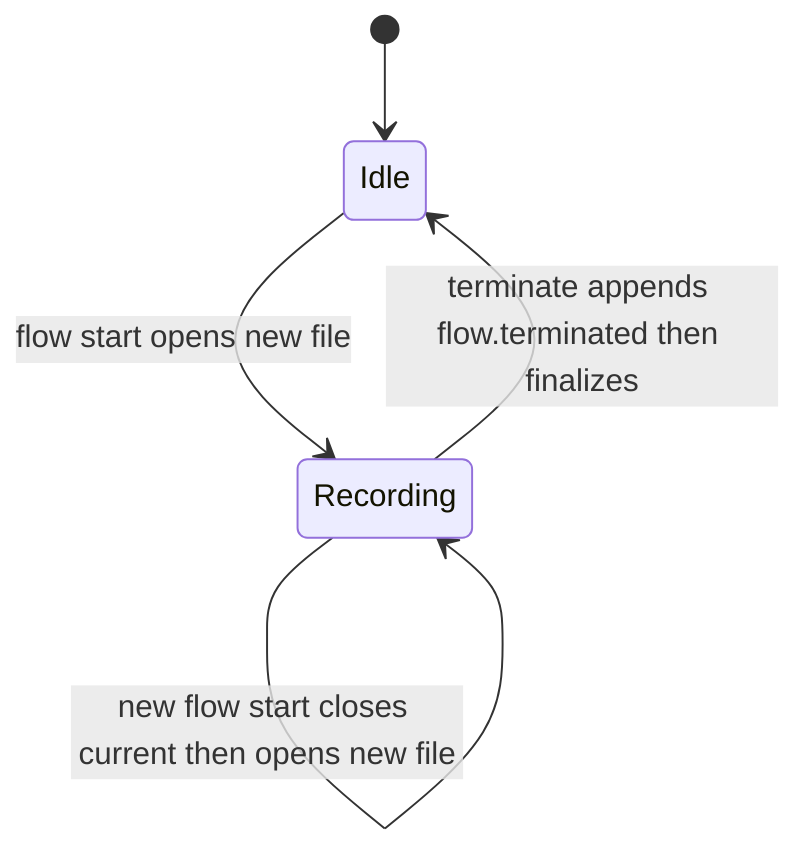

## 25. Flow audit record (per-run, append-only)

### 25.1 Goal & boundary (D-audit-1)

Each flow run writes a durable, human-auditable record from which a **complete timeline** of the run can be reconstructed: every lifecycle state change with its timestamp, the TODOs created and each of their state changes, and — added in Phase 2 (§25.5) — the loop inputs/outputs, the ticket and PR numbers involved, the loop status/iteration, and the commands the flow issued on the user's behalf.

**Boundary:** auditing is **observe-only** and **best-effort**. It injects nothing, blocks nothing, and **never throws into the flow path** — it only records what the flow lifecycle and the TODO store already produce (Phase 1) and what the surviving loop engine's run state already supplies (Phase 2). A failed audit write is logged and dropped; the flow proceeds unaffected (mirrors the §19.1 "never throws, degrade to null" discipline). **UI:** none this round — files only.

### 25.2 Storage layout (D-audit-2)

Audit root: `~/.agent-terminal/audit/`. One directory per repo, named by the repo **basename only**. One file per `flow:start`, named `<flowName>_<startTimestampZ>.yaml`, where the timestamp is ISO-8601 UTC to the second with `:` replaced by `-` (`2026-06-23T10-00-01Z`).

The repo basename and the flow name are each reduced to a filesystem-safe segment before they reach the path — characters outside `[A-Za-z0-9._-]` become `-` — so an untrusted `flow.yaml` `name:` (a repo is untrusted input) cannot traverse the audit tree (CWE-22). Basename collision across two same-named repos is an **accepted limitation** (§25.7).

```text
~/.agent-terminal/
  audit/
    agent-terminal/                         # repo basename
      feature-dev_2026-06-23T10-00-01Z.yaml # one run
      feature-dev_2026-06-25T14-12-00Z.yaml # a later re-run
```

### 25.3 File format — YAML multi-document stream (D-audit-3)

A **header document**, then one `---`-delimited document **per event**, appended in order. Appending an event is **O(1)** — one complete `---\n…\n` block written in a single append, never a rewrite of prior content. The "a reader never sees a partial event" guarantee rests on the per-event append being one write **plus the reconstructor discarding a trailing partial document** (possible only on a crash mid-append), *not* on atomic rename. The header is written when the file is opened.

```yaml
---
flow: feature-dev
repo: agent-terminal
repoPath: /Users/dylanbarrell/Documents/sourcecode/agent-terminal
started: 2026-06-23T10:00:01Z
---
ts: 2026-06-23T10:00:01Z
type: flow.started
step: plan
---
ts: 2026-06-23T10:02:11Z
type: todo.created
id: a1
text: Wire audit IPC
---
ts: 2026-06-23T10:05:00Z
type: todo.status
id: a1
from: active
to: in_progress
---
ts: 2026-06-23T10:30:00Z
type: step.entered
step: build
---
ts: 2026-06-23T11:00:00Z
type: flow.status
from: in_progress
to: done
---
ts: 2026-06-23T11:00:00Z
type: flow.completed
step: build
```

### 25.4 Lifecycle (D-audit-4)



- A fresh `flow:start` **opens a new file** for the run (header document + `flow.started`), **closing** any current run for that repo.
- `advance` / `restart` / `undo` **append** events to the current run's file — no rewrite of prior content.
- Reaching `done` records a `flow.completed` event but **keeps the file open**, so completing a flow and then going back (`undo` / `restart`) continues to append to the **same** file.
- The next `flow:start` **closes** the current run and opens a new file.
- A `flow:terminate` (#26) appends a `flow.terminated` event and **finalizes** the run — closing it and clearing the restart-surviving pointer — so the next `flow:start` opens a new file regardless of whether a run was open at terminate time. Best-effort like every other write (§25.7): it never blocks or rolls back the flow reset.
- The current-run pointer **survives an app restart**: after a restart mid-run, append-on-go-back targets the same run file rather than orphaning it and opening a new one. (How the pointer persists is an implementation choice.)
- TODO events (`todo.*`) are recorded **only while a run is open** for the repo; with no open run, a todo edit records nothing.

### 25.5 Event vocabulary (D-audit-5)

Every event carries an ISO-8601 UTC `ts`.

**Phase 1 — lifecycle + TODO timeline:**

- `flow.started` — entry step of the run (the header carries `flow`, `repo`, `repoPath`, `started`).
- `flow.status` — `{ from, to }` across `not_started` / `in_progress` / `done`.
- `step.entered` — a new step became active within a running flow.
- `flow.completed` — the terminal step was reached (the file stays open for append-on-go-back).
- `flow.terminated` — the run was deliberately abandoned (#26 Terminate); the timeline folds back to `not_started` and the run is finalized so the next start opens a new one.
- `todo.created` — `{ id, text }`.
- `todo.status` — `{ id, from, to }` across `active` / `in_progress` / `done`.
- `todo.text` — `{ id, text }` after an edit.
- `todo.deleted` — `{ id }`.

**Phase 2 — loop integration:** `input.resolved` `{ name, value }` (one per resolved step input), `ticket.assoc` `{ ticket }` (a `github-ticket` input resolving to a positive integer), `pr.assoc` `{ pr }` (from the loop engine's run state), `loop.status` `{ from, to }` and `loop.iteration` `{ n }` (diffed from the loop engine's run state on each observation; the first observation records the entry status with `from` empty), `command` `{ source, cmd, exit }` (a flow-injected bootstrap correlated with its OSC-133 command span), `outputs.snapshot` (`.agent-loop/` files `{ path, bytes }` + `pr`, taken on each loop status change). Every §27.9 gate-decision `command` entry an engine-decided gate operation writes (its decision and each effect-outcome entry) carries an engine-decided mark, and one without it is human-decided (a human decision's entry is unchanged); an `auto` halt records every reason that holds (§27.9.1 N9b.9).

### 25.6 Shared semantics & timeline reconstruction (D-audit-6)

Per the `src/shared/` rule (CLAUDE.md), the meanings main, the tests, and a future viewer must all agree on live in **one** shared definition reused by both sides rather than two drifting copies: the **event vocabulary** (types), the audit **file-path derivation**, the **start-opens / advance-appends** event classifier, the **serialize ↔ parse** pair (the on-disk format is the contract the writer and any reader must not drift on), and the **timeline reconstructor**. The reconstructor reads a run's stream — tolerating a trailing partial document — and yields the ordered, replayable timeline plus the folded final state (flow status/step, ticket, PR, loop status/iteration, resolved inputs, surviving TODOs, commands, output snapshots) — the "a complete timeline can be reconstructed" acceptance criterion. Module and function names are the implementor's choice.

### 25.7 Constraints & accepted limitations

- **Never throws into the flow path.** A failed audit write is logged and dropped; the flow is never affected.
- **Untrusted strings.** TODO text and the repo/flow names are escaped on write (YAML quoting) and path segments are sanitized (§25.2). Phase 2's `.agent-loop/` snapshot performs the §20.2 realpath check so a symlink cannot escape the repo (CWE-117).
- **Basename collision** across same-named repos is **accepted** — the run files co-mingle in one basename directory; the per-repo current-run pointer is keyed by the **full** repo path so each repo still tracks its own open run.
- **Explicit ID sourcing only** (Phase 2) — ticket/PR numbers come from resolved inputs only, never from branch-name or PR-body scraping, nor from any external state mirror.
- **Retention:** keep all, no pruning.

### 25.8 Build — tracer-bullet phases

Per the CLAUDE.md tracer-bullet rule, each slice is fired by an **existing UI control** (flow Start/Advance/Restart/Undo, todo edits) and proven by a **Playwright `_electron` e2e asserting the on-disk YAML**, with main-process integration and shared unit tests underneath. RED-first throughout.

- **Phase 0 — Spec (this section).** The contract the code implements.
- **Phase 1 — Lifecycle + TODO timeline.** The writer core plus every event the flow lifecycle and TODO store already produce (`flow.started` / `flow.status` / `step.entered` / `flow.completed` + `todo.*`). **Fire:** Start, then Advance/Restart/Undo; add/move/edit/delete a TODO while a flow is in progress. **Land:** the per-run file appears with `flow.started`; the lifecycle events accrue with timestamps; a new Start opens a new file; go-back after `done` appends to the same one; `todo.*` events accrue while a flow is active, nothing when none is. **e2e:** drive Start → Advance → done → Undo (same file), then Start again (new file); within an active flow, manipulate a TODO and assert its events.
- **Phase 2 — Loop integration + timeline reconstruction.** Everything sourced from the loop engine's run state (tickets, PRs, inputs, loop status/iteration, injected commands, output snapshots) plus the timeline reconstructor that proves the whole record is replayable. **Fire:** enter a loop step (the `state.yaml` mirror is observed), resolve a `github-ticket` input (the bootstrap injects `agent-loop pickup <input>`), and let the loop's `state.yaml` change. **Land:** `input.resolved` / `ticket.assoc` on resolution; `loop.status` / `loop.iteration` / `pr.assoc` + an `outputs.snapshot` on each status change; a `command` event once the injected bootstrap runs; the reconstructor folds a full run into its ordered timeline + final state. **e2e:** drive a loop step through `state.yaml` edits and assert the loop/input/ticket/PR/snapshot events on disk; the bootstrap-`command` correlation (OSC-133, §15.5) is proven through the real shadow with scripted bytes at the integration layer, with the full-PTY e2e covering it where shell integration is available.

---

