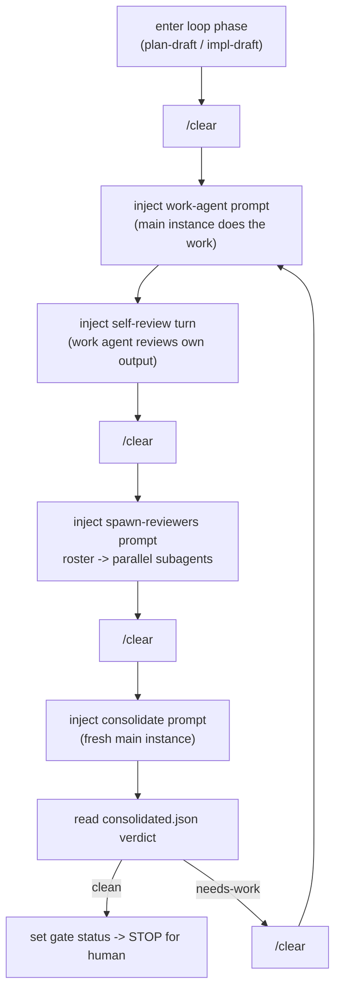
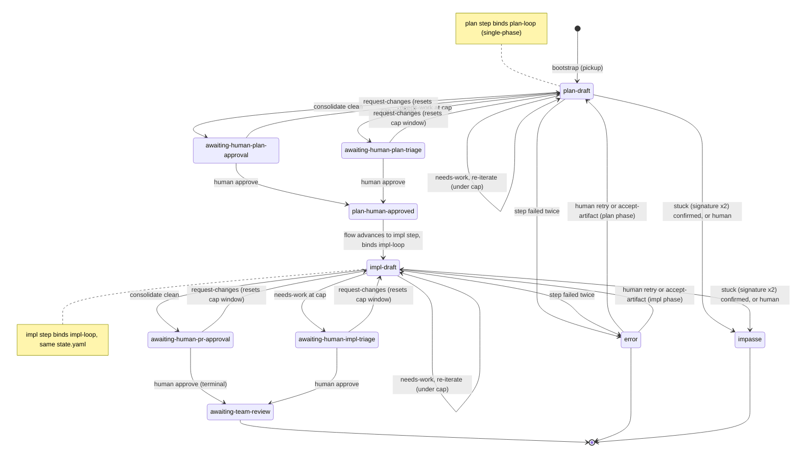

## 26. In-terminal loop engine, v2.99 — RETIRED, superseded by §27

> **Status: RETIRED as of v2.135, but still the contract for code that is still in the tree.** §27 is the live design. This section is kept, unedited, for exactly as long as the engine it describes still runs — it is **not** history, it is the specification of shipped code that has not been deleted yet.
>
> **Why it is still here.** The §27 engine is built alongside this one (§27.15) rather than replacing it turn by turn, so both engines exist in the tree until the N8 sweep. Roughly 800 `§26.x` citations in `src/` and `tests/` annotate the machinery below. Rewriting §27 over this section's numbers would leave every one of them resolving to a clause that had silently changed meaning — nine of the thirteen subsection numbers are reused by §27 for different concepts. The new engine therefore takes a **new number**, and every citation below stays true until the code it annotates is deleted.
>
> **How it goes away.** The N8 sweep (§27.15) deletes this section together with the code that implements it. Until then: **code still implementing what §27.14 retires is not a review finding** — cite the slice that removes it. When `src/` and `tests/` no longer cite `§26`, this section goes, and that grep is the mechanical evidence for the sweep.
>
> The original status note follows, unchanged.

> **Status:** requirements for the next build phase, drafted v2.99. Folds an operator interview into decisions **D41–D62**. **Supersedes the external-engine assumption of §17.2 / §19.1 / §24.2.3 for the `loop` step kind:** the app no longer shells out to the Go `agent-loop` binary to drive a loop — it **becomes** the engine, driving one hosted Claude Code instance by injection (§9.3) and `/clear`, and writing the same `.agent-loop/state.yaml` v4 contract the §24.2.3 mirror already reads. The read-only mirror (§24.2.3 T2) and awaiting-human notify (T4) **remain valid** — `state.yaml` is still the contract — now **written by the app** rather than observed from an external writer. The injected `agent-loop pickup` / `/agent-loop-*` commands of §24.2.3 T3/T5/T6 are **retired** for this path (§26.6/§26.9). On any conflict with §17–§25, this section wins for the in-app loop.

### 26.1 Goal & boundary (D41)

- Turn the app into the **agent-loop engine itself**. Where the external engine spawned many headless `claude -p` sessions (work-agent, parallel reviewer lanes, consolidator) coordinated by a Go state machine, the app drives **one interactive instance** the operator already watches, by composing prompts and `/clear` and injecting them through the §9.3 path. The loop's *meaning* — phases, gates, verdicts, severity, the `.agent-loop/` artifacts — is unchanged; only the *execution substrate* changes from N processes to one instance + subagents.
- **In scope:** the `plan` and `impl` loop shapes as defined by the **`plan-loop` and `impl-loop` LoopDefs** — two **single-phase** definitions (plan-loop has no impl phase; impl-loop inherits a ready PR from its predecessor) that a flow runs **in sequence**: the plan step binds `plan-loop`, the impl step binds `impl-loop`, and **one `state.yaml` carries the flow through both, one after the other** (§26.6). These are the validation targets — *not* `pe-loop` (the combined plan+impl def). The LoopDef YAMLs are the **canonical `github.com/dequelabs/loops` defs, copied verbatim into `example/loops/` as a committed snapshot** (refreshed from upstream by hand), so the build/test validates against the real defs without a submodule/auth dependency in CI. Also in scope: the full inject→detect→consolidate→gate cycle; the three human gate options; cost accounting from logs; in-app bootstrap (pickup); epic **sub-PR creation**.
- **Out of scope (v1):** the external Go binary (no longer invoked for the loop), per-process model/highway/warmer machinery, epic **instance auto-launch** (§26.9), `takeover`, and the per-phase plan-length guard.

### 26.2 The app is the orchestrator (D42)

- **The state machine and every "what to inject next" decision live in the app's main process**, not in the conversation. This is **forced**: `/clear` wipes the conversation, so any orchestration logic placed there would be destroyed at the first `/clear`. The orchestrator therefore reconstructs each step's context from **on-disk artifacts** (`pr-context.md`, `plan.md`, the prior `consolidated.json`, human notes) exactly as the external engine did.
- **Automatic, not human-paced** (D42): within a phase the orchestrator injects each actor turn and `/clear` on its own, advancing the state machine from the artifacts it reads back. The human is involved **only at gates** (§26.6) and on failure (§26.3). Each iteration's work-agent runs **fresh from the on-disk artifacts** — `/clear` (§26.3/D46) wipes the conversation at every actor boundary, so the "interactive instance the operator watches" carries **no context across iterations**; its only memory of prior rounds is the committed code, `plan.md`, the prior `consolidated.json`, and the human notes it re-reads (the same fresh-process property the external engine got from separate `claude -p` sessions).
- This **supersedes §17.2/D2 and §19.3 for the in-app loop**: those described *driving the external engine* by injecting its slash commands so there is "one execution context." Here the app **owns** the state, so a gate transition is an app state mutation (§26.6), not an injected command; single-context visibility is preserved through the status strip and loop panel rather than through terminal echo. Injection remains the substrate for the **actor turns** (work, spawn-reviewers, consolidate), which *are* typed into the instance via §9.3 and are subject to the §19.3 running-process refusal — **redefined for a hosted REPL**: because the interactive agent (Claude Code) is itself the foreground process for the entire run, "the shell is at a ready prompt" cannot mean *the shell* is idle. For this loop **"injectable" means the hosted instance is idle at its own input box** — observed through the completion signal of §26.3/D47a (a turn's done-signal has fired and the instance has gone quiescent), **not** raw `QUIET_MS` silence (which can falsely read a mid-turn model/subagent wait as idle, §8.3). The orchestrator injects only when the instance is injectable by that definition; an injection attempted while a turn is still in flight is refused exactly as §19.3 refuses a busy shell.
- **Human/orchestrator injection contention — accepted risk (v1).** The orchestrator auto-injects into the same instance the operator is watching, and v1 has **no hard interlock** preventing an operator keystroke from interleaving with an in-flight injected prompt (or vice-versa). During automatic iteration the operator is expected to keep hands off the keyboard (involvement is gate-only); a future version may add an explicit "orchestrator owns the prompt" lock. Recorded here so it is a known limitation, not a latent surprise.

### 26.3 The injection cycle, `/clear` cadence, completion & failure (D43–D48)

The orchestrator runs one **actor turn** at a time against the single instance. Each turn is: compose prompt → inject (§9.3) → wait for completion → read the produced artifact → decide the next turn.

- **work-agent = the main instance itself** (D43): the interactive Claude the operator watches does the plan/impl work in its real context, producing commits and `plan.md` — not a subagent.
- **self-review kept, data-driven** (D44): after the work turn — **where the bound LoopDef declares one for the active phase** (in the real defs self-review runs in the **impl phase only**) — the orchestrator injects a self-review turn in which the work agent critiques its own output against the **roster lenses the LoopDef names** (not a hardcoded triplet — `plan-loop` and `impl-loop` carry different rosters), reusing the work-agent's session (no `/clear` before it). It **skips when the diff is empty** or it has already run for this iteration, matching the engine. The self-review turn produces **no file artifact**; its completion is the §26.3/D47a done-signal (see below), not an artifact check.
- **reviewers = parallel subagents** (§26.4).
- **consolidator = a fresh `/clear` main-instance turn** (D45): `/clear`, then a prompt that reads every persona review under `reviews/<iter>/` and writes **`reviews/<iter>/consolidated.json`** — fresh context so the work-agent's context cannot bias the merge. The consolidate prompt is given the **`verdicts` contract from the bound LoopDef** (§26.5) so the merge is anchored, not improvised: it must apply the LoopDef's **canonical/synonym verdict normalization**, **severity ordering**, the **kept-vs-dismissed** split (each dismissed finding carries a `dismissal_reason`), and must emit a **synthetic `needs-work`** when a persona JSON is missing or malformed rather than silently dropping it. The output schema is the engine's `consolidated.json` (`verdict` ∈ {`clean`,`needs-work`}, `findings_kept[]`, `findings_dismissed[]`, `iteration`, `phase_reviewed`). The consolidator reads only the **persona** reviews (`review-<persona>.json`), never its own prior `consolidated.json`, so a re-run cannot read back its last verdict.
- **`/clear` cadence** (D46): a `/clear` sits at each actor boundary — **loop-step entry → the first work turn** (v2.123), work/self-review → reviewers, reviewers → consolidate, consolidate → next iteration's work. Subagents are fresh regardless; `/clear` resets the **main** instance's context and is also the **cost-metering boundary** `cache-analyze` splits on (§26.10).
- **Step completion = done-signal + artifact-confirmed, with a human override** (D47a): `QUIET_MS` silence (§8.3) is **not** a sufficient "done" signal here, and **OSC-133 command spans cannot help** — once the interactive agent is the shell's foreground process the shell emits a single command span for the whole session and never marks per-turn boundaries, so the app's `commandTracker` sees one span, not one per turn. A turn is therefore "done" only when **both**:
  - **(a) a real done-signal has fired.** The orchestrator instructs each injected turn to **write the `.agent-loop/turn-done` file, keyed to the turn, as its last action** — i.e. the agent *tells* the orchestrator it finished, rather than the orchestrator inferring it from silence. The signal is a **file, never a printed line** (v2.124): a hosted TUI agent reflows the injected prompt on echo, so any printable marker named in the prompt is echoed back and read as a completion. The instance must also be quiescent (§8.3) as a secondary guard. This is what "waits out spawned subagents" actually rests on: the main turn does not write its done-file until its `Task` children have returned.
  - **(b) the expected artifact exists and parses** where the turn produces one (`reviews/<persona>.json` is valid JSON against its `json_schema_ref`, `reviews/<iter>/consolidated.json` carries a `verdict`). **Artifact-less turns** — `/clear`, the D44 self-review, and the **impl-phase work turn** (whose product is commits/diff, not a fixed file) — confirm on the **done-signal alone** (the `.agent-loop/turn-done` file, keyed to the turn; the printable sentinel line was retired in v2.124, §26.3/D47a): `/clear` confirms when the instance returns to an empty-context idle prompt; self-review and the impl work turn on their turn-done file. The impl work turn's `workArtifact` is `""` (v2.126), so there is no additional file gate — completion is the turn-done file, full stop.
  - **(c) a UI "done" control.** The loop panel exposes a manual **"mark turn complete"** affordance so the operator can advance a turn the automatic signal missed (a slow or sentinel-less agent) without editing files — the human-in-the-loop escape hatch for the inherent imprecision of driving an opaque REPL. On a turn that stopped in **`error`** with its artifact actually present (a late done-signal the engine gave up on — e.g. a plan finished after the run erred), this same control **accepts** the artifact: it advances to the next turn through the exact chain a signalled completion takes (work→reviewers), **without re-running the turn**, so an accepted plan is never regenerated. Quiescence alone never advances the loop; only (a)+(b), or the explicit (c), does.
- **Failure & stall handling** (D48): completion is the done-signal + artifact (a)+(b) — **there is no wall-clock completion deadline**, so a turn that legitimately runs for many minutes (a large plan, a long build) advances the instant it signals, however long it took. Two distinct failure paths remain:
  - **Missing/invalid artifact on a done-signal** triggers **one** re-injection of the same turn (only when the instance is injectable per §26.2 — never typed over an in-flight turn); a second failure stops the loop in the **`error`** status.
  - **A genuinely frozen instance** is caught by a **stall watchdog**, not a deadline: it is deliberately long (default 20 min, `APP_TURN_TIMEOUT_MS`) and **reset on every §8.3 visible-content change** (the same signal quiescence keys off — `shadow.onActivity`), so it fires **only** when a turn's screen has produced no new content for the whole window. A streaming/repainting-with-progress turn keeps resetting it and never stalls; a truly hung one (or an instance that goes busy-and-silent, never becoming injectable) resolves to **`error`** rather than hanging forever. A stall **never retries** (re-injecting a frozen instance cannot help) and **never kills a working turn** — the escalation is the recovery cue, not a kill of live output.

  The **`error`** status is a **first-class app status** (§26.6) classified human-needed in `src/shared/loopStatus.ts` and recorded in the §25 audit, so the loop panel raises the attention cue with the failed step + reason surfaced, awaiting a human who **Retry**s (re-run the turn), **accepts** it via (c) (advance on the present artifact, no re-run), edits, or declares impasse. The orchestrator never silently advances past a failed turn, and — because there is no deadline racing a slow-but-working turn — a late done-signal that arrives while the turn is still in flight advances normally (the desync that once stranded a completed plan with its reviewers never started is closed by construction). **A persisted `error` is recoverable across a relaunch:** auto-resume (§26.11) never re-drives an `error` (it is human-owned), but it **reconstructs** the errored turn (from the same iteration-scoped artifact evidence that names which turn a run stopped at — `currentTurnByArtifacts`, single-phase defs only) so that after a cold reopen both Retry and accept act on the right turn rather than a dead panel. Reconstruction injects nothing; it only re-establishes the turn context the human's recovery controls need.

### 26.4 Reviewer fan-out as subagents (D49)

- The reviewer **roster** for the phase (from the LoopDef, §26.5) runs as **parallel subagents** of the single instance: the orchestrator injects **one** prompt — composed by main, naming each persona and its review skill ref — instructing the instance to spawn the personas as parallel `Task` subagents, each loading its `review-<phase>-<persona>` skill and writing `reviews/<iter>/review-<persona>.json`.
- **Subagent isolation replaces the engine's lanes/highways/warmer.** Each subagent is a fresh, isolated context (the independent-review property the external engine got from separate `claude -p` sessions) and they run in parallel (no serial `/clear` chain). There is **no warmer** — there is no chain of same-model processes re-reading shared context to amortize; each subagent reads the artifacts it needs.
- **Reviewer cost is captured in the subagent logs** (`~/.claude/projects/<slug>/<uuid>/subagents/agent-*.jsonl`), which **`cache-analyze`** (the existing token-accounting tool at `~/.claude/tools/cache-analyze`) aggregates into the spawning session's totals (§26.7). The app either **invokes `cache-analyze` as a helper** (it is a standalone tool, not engine code) or **reimplements its JSONL parsing in TS** — whichever is cleaner (§26.10). The `~/.claude/projects/.../subagents/agent-*.jsonl` layout is **Claude Code's private log format**: an external dependency the app does not control, so the parser tolerates layout drift (unknown/empty → cost omitted, never throws — the §26.10 unpriced-model discipline).

### 26.5 LoopDef-driven configuration (D50/D51)

- The engine is **data-driven from the bound LoopDef YAML**. The app already resolves and parses LoopDef **gates** in `loopDef.ts` (§24.2.3 T2/v2.70); this extends that reader to the **full set of fields the orchestrator depends on**:
  - **phases** (`id`, `entry_status`, `pre_fanout_actors`, `ordered_fanout`, `primary_work_actor`, `consolidator_actor`, `severity_floor_track`, `exit_predicate`, `post_clean_gate` / `post_needs_work_gate`) — the per-phase shape of the cycle;
  - the **gate set** and each gate's `human_options` (already read), plus each gate's `on_approve` / `on_request_changes` / `on_impasse` **action lists** and `next_status_on_*` (§26.6 executes these in-app);
  - the **reviewer roster** (per phase) for the fan-out (§26.4) and the self-review lenses (§26.3/D44);
  - **`verdicts`** — the orchestrator parses the **`persona`/`consolidated` synonym maps** and **`severities.order`** (the taxonomy `normalizeConsolidatedVerdict`/`isPersonaClean`/the §26.8 signature apply); the `consolidated.canonical` list is the **consolidator's** to apply (via its prompt, §26.3/D45) and is **not parsed** by the orchestrator until a use for it is built (v2.113, parity with the `resume_contract` precedent — the `phase2_bounce_rules` field once also named here was **retired v2.136** with the phase-2 mechanism, removed from the vendored defs);
  - **`artifacts`** (`path_pattern`, `producer`/`consumers`, `freshness`, `json_schema_ref`) — the real read/write paths and the schema the D47a "parses" check validates against, so paths are never hardcoded;
  - **`pickup_contract`** (`initial_status`, `initial_branch_tpl`, `initial_pr_body_ref`, `initial_labels`, `on_conflict`) — drives in-app bootstrap (§26.9);
  - **`resume_contract`** — the orchestrator parses **`mid_iter_safe`** (the flag resume consumes, §26.11); `required_artifacts`/`replay_actors`/`skip_actors` are the loop's declared per-actor-replay contract but are **not parsed** until that deferred feature is built (v2.111);
  - the prompt/context **recipes** (`prompts/work-{phase}.md` + the slot list).

  This **reimplements the recipe-assembly** the Go engine performed (template body + token substitution + artifact slots) in TS.
- **Loops in scope & their source:** the engine must run **`plan-loop` and `impl-loop`** (the §18.1 worked-example flow binds a `plan` step to `plan-loop` and an `implement` step to `impl-loop`); these are the validation targets, **the canonical `github.com/dequelabs/loops` defs copied verbatim into `example/loops/`** (a committed snapshot refreshed from upstream by hand — the real defs, not bespoke fixtures), so the parser is exercised against the real YAML and `parseLoopDef` resolves them via `CLAUDE_CONFIG_DIR` pointed at `example/`. `pe-loop` (combined plan+impl) is **not** a v1 target.
- **Fidelity (D51):** v1 keeps the **iteration-cap triage gate** (the per-loop `iteration - cap_baseline` window, §26.8 — `request-changes` and each rebind reset it; the retired `phase2_active` no longer routes) and the **fanout skip-optimization**. The skip reuses a persona's last-clean verdict from `persona_state` (§26.6) via a **per-phase footprint**: in the **impl** phase a persona is pruned when `last_clean_iter == iteration-1` **and** its `last_seen_files` set is unchanged; in the **plan** phase the footprint is the **`plan.md` digest** (`last_seen_plan_digest`), so a persona is pruned when the plan text it last reviewed clean is unchanged. v1 **omits the per-cycle severity-floor ladder** (`severity_floor_track`) — the consolidator's verdict is `clean` / `needs-work` against the LoopDef's default clean policy, without an escalating blocker floor (`severity_floor_track` is read but not enforced). **Accepted consequence (recorded):** without the rising floor, a persistent *minor* finding can hold the verdict at `needs-work` and lengthen a phase; the bound stop is the §26.8 iteration **cap → triage gate** (and the operator's gate options), not the floor. This is an accepted v1 simplification, not an oversight.

### 26.6 The state machine, gates & GitHub side-effects (D52/D53)

**One `state.yaml`, two LoopDefs in sequence.** The statuses and gates below are the v4 contract; the app now **writes** the file rather than reading an external writer's copy. The progression spans **two single-phase LoopDefs bound by the flow step machine**: the flow's **plan step binds `plan-loop`** (its terminal is `plan-human-approved`) and its **impl step binds `impl-loop`** (bootstrapped at `impl-draft`). A **single `state.yaml` carries the run through both, one after the other** — the `plan-human-approved → impl-draft` edge is **not** an intra-loop transition but the **flow advancing from the plan step to the impl step and binding the next LoopDef** (`bound_loop` flips in the same file). The status strings are the engine's exact v4 values (aliased below for mermaid).

**The app writes a larger contract than the §24.2.3 read set.** The §24.2.3 mirror reads `{schema_version, status, iteration, pr, branch, linked_issues}`; the orchestrator, now the **writer**, is responsible for the full `EngineState` **plus** the `LoopExtension` the engine persists. So "v4 unchanged" holds for the **schema** but not for the **app's write obligations** — it must write, in addition to the read set: `bound_loop` (which LoopDef governs the current phase), `sessions`, `impasse` (the `{consecutive_identical, last_findings_sig}` tracking §26.8 reads), `cap_baseline` (the §26.8 per-loop cap window origin the orchestrator reads and `request-changes`/rebind reset), `phase2_active` (retired — written defaulted-`false` for parity only, never read), `persona_state` (§26.5 skip-opt footprints), `severity_cycle_iter`, `iter_in_flight` / `resume_mid_iter` (§26.11 resume), `epic` / `auto_chain` (§26.9), `notes`, `terminated`, and `updated_at`. The new app-only **`error`** status (§26.3/D48) is written here too, together with its app-only **`error_reason`** (the human-readable reason the turn stopped, which the §24.2.3 mirror reads back to render the panel's `reason` row). `error_reason` is **conditional on `status: error`**: the writer deletes the key on every non-error write, and the mirror decodes it only at that status, so a stale key left by any other writer can never surface. `completed_loops` is **no longer written** — v2.126 made `iteration` a single monotonic counter across chained loops, which removed the cumulative-display apparatus that field fed; a prior writer's value survives the merge as an unmodelled field. **A write is whole-document and valid v4** (every field the engine schema requires is present, defaulted where the app does not use it) so the §24.2.3 mirror, the §25 audit, and any future re-handoff to the Go engine can all still read it; the app never emits a partial doc that a v4 reader would reject. **A write preserves by merge AND heals to whole-document:** the writer layers, low to high, the `LoopExtension` defaults, then the existing document, then the app-owned read set — so a field a prior writer (a later app slice, or the re-handoff engine) populated survives a status-only write (`persona_state`, `impasse`, …), a field a *partial* prior doc is missing is back-filled to its default rather than propagated as a gap, and every read-set member (`pr`/`branch`/`linked_issues`) is emitted uniformly present (defaulted, never conditionally dropped). (Open parity item to verify against the external `EngineState`/`LoopExtension` schema before a real re-handoff: the writer emits `epic` (as `epic.sub_issues`, L8) but writes `human_notes`/`auto_chain` where this obligation list names `notes` — reconcile the naming once the authoritative Go schema is confirmed; and `cap_baseline` is a new app-owned extension field the Go schema may not define — confirm it round-trips or is tolerated before a re-handoff.)

- **Gate options are data-driven** from the current status's gate `human_options` (`approve` / `request-changes` / `impasse`). The gate **decision** UI is **built in this section's slices on the §24.2.3 T0 design** (the `loop-flow.html` gate surface) — the fixture `createGatePanel` shell was removed in v2.132 (superseded by this real §26 gate panel), and §24.2.3 **T5/T6 were never implemented** (they are retired for this path, §26.12), so there is no shipped gate-decision handler to reuse; §26 builds it (the L5 slice, §26.13).
- **Gate transitions are app-internal** (D52): choosing an option executes the gate's `on_approve` / `on_request_changes` / `on_impasse` action list (from the LoopDef, §26.5) **in the app** — advance `status` to the gate's `next_status_on_*`, increment `iteration`, and run the **GitHub side-effects** — then the orchestrator continues (re-iterate) or stops (terminal). **`request-changes` resets the per-loop iteration-cap window** (the engine's `reset-cap` action writes `cap_baseline` = the critiqued iteration): the loop resumes autonomous iteration with the human's feedback as the starting point, and only re-STOPs at the triage gate once the window (`iteration - cap_baseline`) reaches the cap again — the same rule a chained loop starts under (each rebind opens its own window at `cap_baseline` = the prior loop's final iteration). This **retires the v1 `phase2_active` triage-routing mode**: a single `request-changes` no longer latches a permanent gate-every-`needs-work`-round state, and the *internal* cap window — not the monotonic run-wide `iteration` — is what the cap counts, so each chained loop gets its own full cap budget. `phase2_active` remains **written as a defaulted-`false` field** for whole-document v4 parity (the external `EngineState`/`LoopExtension` re-handoff, §26.6 below), but the app no longer reads it. `request-changes` also `clear`s `persona_state` (so every persona re-reviews next round) and appends `human-notes/{iter}.md`. There is **no `/agent-loop-approve` injection**; the app owns the transition. *(Superseded wholesale by §27's queued-human-interrupt model, which retires the cap and gates entirely — no code yet, v2.135.)*
- **GitHub side-effects run as out-of-band app `gh` calls** (D53), not terminal injection (like `githubRefs.ts`): **publish the PR body** from the consolidator's `pr-description.md` on impl approval; **manage draft/ready** (§26.8); **mirror status onto `agent-loop/*` labels**; **epic-promote** (§26.9). Because they are out of band they cannot be blocked by a busy shell and are best-effort (§26.11).
- **request-changes feedback** reuses §19.4: the human curates a review-todo subset + optional free text and either composes-with-agent or submits-as-is; the app writes the reason into `human-notes/{iter}.md`, which the next work-agent turn's recipe injects.

### 26.7 CI — run, don't block (D54)

- The impl phase **does not wait on CI**. The PR is flipped **non-draft at plan-approval** (`gh pr ready`); thereafter the work-agent's normal impl commits trigger GitHub checks **asynchronously**. At review time the consolidator reads **whatever CI state already exists** (best-effort `gh pr checks` snapshot, omitted if none) and never blocks on pending checks. The external engine's **config-driven CI waiter** (the `ghprchecks` actor that polls until checks reach a terminal state or a configured timeout elapses) is **removed** — the in-app loop never waits on CI.
- **Explicit override (recorded):** this deliberately goes **non-draft mid-impl to run CI**, which conflicts with the operator's standing global `[skip ci]`-on-draft discipline. For this loop the override is intentional and is documented here as such (the standard's "explicit user instruction overrides" clause).

### 26.8 Impasse (D55)

- **Detect-then-confirm, plus human-declared, plus a hard cap.** The orchestrator computes the consolidated finding **signature** each iteration — `SHA256` of the top-3 kept findings sorted by `(severity desc, message)`, the same computation the external engine used (an empty `FindingsKept` set yields an empty signature, which never matches). **Two identical signatures in a row flags the run as stuck** and **surfaces it for the human** (the loop panel raises the human-needed cue); the human confirms by choosing `impasse` at the gate — the engine's `signature×2` is a *stuck detector*, not an automatic terminal transition, and the app preserves that. The human may also choose `impasse` at any gate. **Because byte-identical finding wording rarely repeats across LLM iterations, signature×2 is a best-effort early-out, not the runaway backstop** — the real backstop is the **iteration cap**: a per-loop maximum (`exit_predicate.severity_cap`, sourced from the bound LoopDef, defaulting where the def is silent) counted over the **internal cap window** `iteration - cap_baseline`, at which a `needs-work` verdict routes to the **triage gate** (`awaiting-human-*-triage`, §26.6) for a human decision instead of auto-iterating. `cap_baseline` — the run-wide iteration the window opened at — is advanced (the window reset) at exactly two boundaries: a **`request-changes` gate decision** (`reset-cap` → `cap_baseline` = the critiqued iteration) and a **chained-loop rebind** (`cap_baseline` = the prior loop's final iteration), so each loop and each round of human feedback gets its own full cap budget rather than inheriting the monotonic run total. This **replaces the v1 `phase2_active` routing**, under which one `request-changes` forced the triage gate on every later `needs-work` round. Impasse is terminal until the human acts out of band and resumes (§26.10).

### 26.9 Bootstrap (pickup) & epics (D56/D57)

- **Bootstrap is reimplemented in-app** (D56), via `gh`/`git`, with **no dependency on the Go binary**, and is **driven by the bound LoopDef's `pickup_contract`** (§26.5) rather than hardcoded: on entering a flow's first loop step with a resolved `github-ticket` input, the app validates a clean tree, creates the branch (`pickup_contract.initial_branch_tpl`, e.g. `agent-loop/issue-{issue}`), wipes any stale `.agent-loop/`, writes an empty `[skip ci]` start commit, pushes `-u`, assigns the issue + applies `pickup_contract.initial_labels` (drop "ready", add "in_progress"), opens the **draft PR that `closes #n`** (body from `pickup_contract.initial_pr_body_ref`), and writes the initial `state.yaml` (`status` = `pickup_contract.initial_status`, normally `plan-draft`; `iteration: 1`) — the same end-state the external `agent-loop pickup` produced, replacing the §24.2.3 T3 injected `agent-loop pickup`. The `pickup_contract.on_conflict` policy governs re-entry on an existing branch.
- **`on_conflict: wipe-and-retry` is confirm-first** (v2.115): a re-pickup whose target branch already exists (local or remote) is a conflict. Under the vendored `wipe-and-retry` policy the app does **nothing destructive on detection** — it keeps the flow on the loop step and raises a **confirm dialog** naming the branch and stating that wiping **deletes it on `origin` and closes its PR**. On **Confirm** the app wipes the branch (detach, force-delete local, delete the remote head — which closes the PR) and re-runs the bootstrap cleanly to `plan-draft`; on **Cancel/dismiss** it wipes nothing and **rolls the flow back one step** (the same §26.9 rollback). An existing branch under any **other** `on_conflict` value is a hard error (the rollback + error-dialog path, not a wipe prompt). Confirm-first is deliberate: the wipe is destructive and outward-facing, so — unlike the external CLI's silent wipe — the operator authorizes each one. `resume-and-attach` (adopt an in-progress run rather than wipe) remains deferred: no vendored def declares it.
- **A pickup that cannot run never fails silently, and never strands the flow** (v2.114): the in-app bootstrap runs asynchronously after the loop step is entered, so a failure (a dirty tree, an unresolvable base, a conflicting branch, a rejected PR create) arrives after the transition returned. When it does, the app **rolls the flow back one step** — the half-entered loop step reverts to the previous step, still `in_progress`, re-running no entry actions and **preserving the resolved inputs** so the operator can fix the cause and re-advance (a first-step loop, with no previous step, reverts to `not_started`) — and **surfaces the reason in a blocking error dialog** pushed to the renderer (no `state.yaml` is written and no PR is opened, because the bootstrap aborted before either). This is the CLAUDE.md rule that a critical-path failure the operator cannot see or fix by clicking must never be swallowed: the pickup either lands `plan-draft` or it visibly rolls back with a stated cause.
- **Epics create sub-PRs only** (D57): when a plan is **classified an epic** — the signal is the **`classification: epic`** field the work-agent writes into `plan.md` (with the sub-ticket breakdown), not a state-machine status — epic-promote **reuses the current PR for sub-ticket-1 and creates the remaining N−1 sub-tickets/PRs** (out-of-band `gh`), records them in `state.yaml`'s `epic` / `linked_issues` (§26.6 write surface), and **does not auto-launch** child instances (the engine's `auto_chain` is out of scope, §26.1). The operator opens a loop per sub-PR by hand (the §23.2 worktree/instance machinery is not auto-driven in v1). Epic-promote is an out-of-band side-effect of the plan-approval gate (§26.6), not a node in the §26.6 state diagram.

### 26.10 Cost accounting (D58)

- Cost is recovered **from the session JSONL logs**, not from a per-process accountant. The app reads the main session's per-`/clear` token totals (input / cache-create / cache-read / output) and the spawned **subagent** logs — the same parsing **`cache-analyze`** (`~/.claude/tools/cache-analyze`) performs — and applies a **pricing table** (current Claude model prices, kept in `src/shared/` per the shared-semantics rule) to convert tokens to dollars. The token-parsing may be **delegated to `cache-analyze` invoked as a helper** or **reimplemented in TS** (§26.4), whichever is cleaner; either way the JSONL layout is Claude Code's private format and the parser degrades silently on drift. The **subagent logs are nested** (`<session-uuid>/subagents/agent-*.jsonl`), so the sweep is recursive: a flat read of the project dir silently omits the reviewer fan-out, the bulk of an iteration's cost.
- **The meter reports THIS RUN's cost, not the repo's.** The project dir accumulates every Claude Code session ever logged against the worktree — prior runs, and the operator's own interactive conversations. The sweep is therefore bounded below by the instant the **flow started** (persisted as `started_at` in `flow-state.yaml`, stamped when the flow starts or restarts and cleared when it is terminated), and a turn whose timestamp cannot be read is excluded once that bound exists. A flow that recorded no start sweeps unbounded rather than reporting `$0` — an unbounded number is wrong, but a silent zero hides that it is wrong.
- **A billed turn counts once.** Claude Code identifies an API call by `message.id` + `requestId`; resuming or forking a session replays the prior turns verbatim into the new session file. Summing every line multiplies the run's dollars by the number of resumes.
- **Unpriced model (defined):** a token total whose model id is **absent from the pricing table** (a new model, an aliased or `[1m]`-suffixed id, a non-Claude fallback) contributes **zero dollars** and is surfaced as **`unknown`** on the readout — the cost meter **never renders `NaN`** and never blocks. The pricing table is a checked-in default kept current by hand; an unknown id is a display gap, not an error. A model that consumed **no tokens** bills nothing and is therefore **never a gap**, whatever its id — Claude Code logs a `<synthetic>` model on API-error turns with every token field at zero, and reporting it as unpriced would append `+unknown` to a readout that is in fact complete.
- **Granularity:** per **iteration** (the main-session `/clear` segment + that iteration's reviewer-subagent logs) rolled up to **phase** and **whole-run** totals.
- **Surface:** the running cost shows on the status strip (§22.3) and is recorded per-step in the §25 audit YAML (a new cost event in the §25.5 vocabulary). It is **display-only** — it never gates or pauses the loop.

### 26.11 Resume & failure recovery (D59)

- **Auto-resume from `state.yaml`** (D59): on launch the orchestrator reads `<repo>/.agent-loop/state.yaml`; an in-flight run resumes at the recorded `status`/`iteration`. **Resume honors the bound LoopDef's `resume_contract`** (§26.5) rather than blindly re-injecting the current step: it derives which turns of the in-flight iteration already produced their output from **iteration-scoped turn-artifact presence** (a review for this iteration, the consolidated verdict — never `plan.md`, a single file rewritten in place), and honors the `mid_iter_safe` flag to decide whether the interrupted turn is safe to re-enter or must roll back to the iteration's last clean boundary. This prevents a crash mid-fan-out from re-spawning every reviewer or double-committing work. Where `mid_iter_safe` is false, resume rewinds to the iteration's start and re-runs from there. **Deferred (v2.111):** `replay_actors` / `skip_actors`-driven per-actor replay — the shipped resume drives off turn-artifact presence + `mid_iter_safe`, and those fields are re-added to the parsed contract when per-actor replay is built.
- Resume is also offered on **`cd` into the repo** — an OSC-7 `cwd:changed` (§20.1) into a directory whose `state.yaml` shows an interrupted run. This trigger is **best-effort**: while the hosted instance occupies the shell the cwd rarely changes mid-run, so it primarily catches entering a managed repo *before* an instance is launched there.
- The `error` status (§26.3) and `impasse` (§26.8) both persist in `state.yaml`, so a paused or stuck run survives restart and is presented for the human to act on.

### 26.12 Provider & integration (D60/D61/D62)

- **Provider: Claude only** (D60) — the hosted instance is Claude Code; the external engine's Codex adapter is out of scope.
- **Powers the flow `loop` step** (D61): a flow definition's `kind: loop` step (§18.2) runs **this in-app engine**, reusing the §24.2.3 loop panel, gate panel, and status strip and the `.agent-loop/` mirror. The Go `agent-loop` is **not invoked** for the loop.
- **Supersession map** (D62): §24.2.3 **T2 (read-only mirror)** and **T4 (awaiting-human notify)** remain — `state.yaml` is still the live contract, now written by the app. §24.2.3 **T3 (injected `agent-loop pickup`)**, **T5 / T6 (injected `/agent-loop-approve` / `-request-changes` / `-impasse`)** are **retired** for this path and replaced by in-app bootstrap (§26.9) and app-internal gate transitions (§26.6).

### 26.13 Build — tracer-bullet phases

Per the CLAUDE.md tracer-bullet rule, each slice spans main → `src/shared/ipc.ts` → preload → renderer, is fired from an **existing UI control** (the flow strip / loop panel / gate panel), and is proven by a **Playwright `_electron` e2e on a real PTY**, with main-process integration and shared unit tests underneath. RED-first throughout.

**Test seam (no LLM in e2e).** The orchestrator drives whatever agent program sits at the shell prompt; it does not embed an LLM. So e2e substitutes a **deterministic fake-agent on `PATH`** (the analogue of the engine's `fakeclaude` test double) that, on receiving an injected prompt, writes the expected artifact (`plan.md`, `reviews/<persona>.json`, `reviews/<iter>/consolidated.json`), **emits the completion sentinel the orchestrator waits on (§26.3/D47a)**, and goes quiescent. The fake-agent is **scriptable per turn** (which verdict, which footprints/signatures, write-nothing to drive the retry-then-`error` path), and for the cost slice it also **writes fake session-JSONL token logs at a test-controlled log root** (see L7) so the meter has tokens to price without a real LLM. The LoopDef parsing/validation runs against the **real `github.com/dequelabs/loops` defs copied into `example/loops/`** (§26.5), not bespoke fixtures. This proves the **inject → detect → read → advance** logic on a real PTY + real shell without an LLM's nondeterminism — honoring "no mocks for the PTY/emulator": the PTY and shell are real; only the agent program is a scripted stub.

- **L0 — Spec (this section).** The contract the code implements.
- **L1 — App owns `state.yaml`; bootstrap in-app.** Entering a flow `loop` step (the **plan step, binding `plan-loop`**) runs the app's pickup (gh/git, driven by the LoopDef `pickup_contract`, §26.9) and **writes** the initial whole-document `state.yaml` (`status: plan-draft`, `iteration: 1`, `bound_loop: plan-loop`). **Fire:** start a loop step with a ticket input. **Land:** branch + draft PR exist; `state.yaml` is app-written and valid v4; the T2 mirror renders `plan-draft`. **e2e:** start → assert `state.yaml` + draft PR (gh stubbed/recorded). **Replaces:** the §24.2.3 T3 injected `agent-loop pickup`.
- **L2 — One work-agent turn + completion detection. ✅ shipped (v2.102).** The orchestrator composes the `work-plan` prompt from the LoopDef recipe, injects it (only while the instance is injectable, §26.2), and advances on **the done-signal + `plan.md` present** (§26.3/D47a — never on `QUIET_MS` silence alone), retrying once then `error`; the loop panel's manual **"mark turn complete"** control is wired here too. **Fire:** continue from L1. **Land:** the work turn runs in the terminal; `plan.md` appears on the sentinel; the strip shows the iteration; a fake-agent that writes nothing (and emits no sentinel) drives the retry-then-`error` path. **e2e:** fake-agent writes `plan.md` + sentinel → advance; fake-agent no-op → `error` after one retry; the manual "mark complete" control advances a sentinel-less turn. **Done-signal is line-and/or-file** (`src/shared/loopTurn.ts` / `turnSentinel.ts` / `turnDoneFile.ts`); the line scanner matches a **full-line sentinel only** so the echoed injection cannot self-trigger; `error` is now human-needed in `src/shared/loopStatus.ts`; new `loopOrchestrator.ts` / `loopRecipe.ts`; `loopDef.ts` parses `phases`; `APP_TURN_TIMEOUT_MS` is the configurable **stall watchdog** window (§26.3/D48 — activity-gated, not a completion deadline).
- **L3 — Reviewer fan-out as subagents. ✅ shipped (v2.103).** The work turn's completion chains into the fan-out: the orchestrator resolves the phase roster from the bound LoopDef (`reviewerRosterForPhase`), injects the main-composed spawn-reviewers prompt (`composeSpawnReviewersPrompt` — no template file, §26.4), and advances only when **every** roster persona's `reviews/<iter>/<persona>.json` is present and parses (`allReviewsPresent`, the D47a(b) check over the whole fan-out); a partial fan-out retries once then `error` (§26.3/D48). The two turns run as sequential turns over the unchanged turn-runner, each with its own done-signal key (`work-<phase>` / `review-<phase>`). New `reviewArtifacts.ts`; `loopDef.ts` parses the roster catalog + per-phase `roster_override_id`. **Fire:** continue from L2. **Land:** the roster's persona JSONs appear and the fan-out turn records complete; a fake-agent that writes only five of six drives the retry-then-`error` path. **e2e:** fake-agent emits all persona JSONs → advance; omits one → `error` after one retry.
- **L4 — Consolidate + verdict-driven branch. ✅ shipped (v2.106).** When the fan-out completes, the orchestrator `/clear`s the instance (§26.3/D46) and injects the consolidate turn — a template-assembled prompt (`composeConsolidatePrompt` from `prompts/consolidate.md`, §26.5) given the LoopDef `verdicts` taxonomy via `{{CLEAN_POLICY}}` (§26.3/D45) — advancing only when `reviews/<iter>/consolidated.json` parses and carries a `verdict` (`consolidatedVerdict`, retry-then-`error` on a missing/malformed one). The verdict is normalized against the LoopDef taxonomy (`normalizeConsolidatedVerdict`, unknown → `needs-work`) and branched by `decideConsolidateOutcome` (§26.6): `clean` → the phase's `post_clean_gate` status (STOP); `needs-work` → the next iteration at the phase entry status + `/clear` + re-run work. New: `loopDef.ts` parses `verdicts` + phase `post_clean_gate`/`post_needs_work_gate`; `reviewArtifacts.ts` `consolidatedVerdict`; `loopRecipe.ts` `composeConsolidatePrompt`; `loopOrchestrator.ts` `decideConsolidateOutcome`; `index.ts` the `consolidate` turn kind + `/clear`-then-chain. **Deferred (recorded):** the CLR1 `/clear` before the fan-out and the data-driven self-review (D44) — a later fidelity slice; the `{{SEVERITY_FLOOR}}`/`{{CLEAN_POLICY}}` slots use the v1 no-rising-floor policy (§26.5). **Fire:** continue from L3. **Land:** `clean` stops at `awaiting-human-plan-approval`; `needs-work` re-iterates. **e2e:** a `clean` verdict stops at the gate (iteration unchanged, `/clear` received); a `needs-work` verdict re-iterates (iteration-2 `consolidated.json` appears, status stays `plan-draft`, `/clear` received).
- **L5 — Gate decision in-app + the gate side-effects. ✅ shipped (v2.107).** The docked loop panel renders a data-driven gate-decision button per `human_option` (on the §24.2.3 T0 design — T5/T6 were never built, §26.6), firing the one-way `flow:gateDecision` IPC. `loopDef.ts` parses each gate's `on_*` action lists + `next_status_on_*`; `gateActions.ts` `decideGateOutcome` translates the chosen option to a normalized outcome; `gateExecutor.ts` `executeGateOutcome` carries it out through injected ports — the state write, the gh side-effects out of band (`gateGithub.ts` `markPrReady`, best-effort D53), and the human note (`humanNotes.ts`). `loopStateWriter.ts` gains the gate write surface (`phase2Active`/`clearPersonaState`/`terminated`; `phase2Active` **retired v2.136** → `capBaseline`, the per-loop cap-window reset). The **`gh pr ready`** side-effect (PR non-draft at plan-approval) lands **here** — L8 does not repeat it. **Deferred (recorded):** the `epic-promote` (§26.9) action kind lands in L8; the `exec` (ticket-body publish) kind was parsed-then-dropped in v1 and is **now implemented (v2.122; runs only for an operator-authored def, with a `loops_deny_exec` opt-out — v2.129)**; the **`publish-body`** (the §26 out-of-band PR-body publish from `pr-description.md` on impl approval) and **`reset-severity-cycle`** action kinds remain parsed-then-dropped in v1 (`decideGateOutcome` models only the effects `gateExecutor` carries out; `reset-severity-cycle` only ever accompanies `terminate` in the vendored defs, where it is moot, §26.6/v2.112; the `clear-phase2` kind this bullet also listed was **retired v2.136** with the phase-2 mechanism); the §19.4 composer supplying the human-note text is a later slice (empty note → the decision label); the flow-level advance to the impl step rides the existing flow advance + L1 pickup off the terminal plan gate. **Fire:** click a gate option. **Land:** approve(plan) → terminates at `plan-human-approved` + **PR ready** (gh recorded); request-changes → `human-notes` written, `phase2_active` set (**retired v2.136** → resets the `cap_baseline` window instead), `persona_state` cleared, re-iterate; impasse → terminal at `impasse`. **e2e:** each option's transition + the recorded gh `pr ready` (approve) / its absence (request-changes, impasse). **Supersedes:** the retired §24.2.3 T5/T6 injected `/agent-loop-*` plan.
- **L6 — Full multi-iteration: skip-opt, phase-2 triage (retired v2.136 → cap-window reset), stuck-detect. ✅ shipped (v2.108).** Per-phase footprint persona pruning (`plan.md` digest for the plan phase, §26.5 — `personaSkip.ts` `prunablePersonas`/`recordCleanPersonas`, `reviewArtifacts.ts` `planDigest`/`carryForwardReviews`/`personaVerdict`, `loopDef.ts` `isPersonaClean`); the triage gate when `phase2_active` (**retired v2.136**; request-changes now resets the per-loop cap window instead of latching a permanent triage mode, §26.6) or at the iteration **cap** (`loopDef.ts` `exit_predicate` parse + `loopOrchestrator.ts` `decideConsolidateOutcome`, §26.6/§26.8); signature-×2 **stuck detection that surfaces for human confirmation** (not an automatic terminal transition, §26.8 — `findingSignature.ts` `findingSignature`/`nextImpasse`, `reviewArtifacts.ts` `consolidatedFindings`, `loopDef.ts` `verdicts.severities.order`). The §26.6 write surface grows `impasse` + `persona_state`, round-tripped through `loopStateWriter.ts` and the new `loopStateReader.ts` (the orchestrator-owned extension the §24.2.3 mirror slice excludes). **Deferred (recorded):** the impl-phase `last_seen_files` footprint wiring — the pure pruning logic is unit-tested, but the orchestrator confines skip-opt to the plan phase (where `plan.md` exists) so impl never wrongly prunes; the v1 no-rising-floor severity policy (B5) is unchanged. **Fire:** drive ≥2 iterations with a fake-agent emitting stable vs changing footprints/signatures. **Land:** unchanged-clean personas pruned (their reviews carried forward); identical signature twice → stuck STOPs at the triage gate; the cap and `phase2_active` route `needs-work` to triage (`phase2_active` **retired v2.136** — only the cap and stuck-detect route to triage now, §26.6). **e2e:** cap→triage; request-changes→cap-window-reset→needs-work→re-iterate (retired the prior phase-2→triage route, v2.136); identical findings ×2 → `impasse.consecutive_identical: 2` + triage; identical plan → the persona review is reused (`seen_iter` keeps the prior stamp), not re-run.
- **L7 — Cost meter. ✅ shipped (v2.109).** Dollars from the session + subagent logs via the pricing table (§26.10), with the **unpriced-model fallback** (`unknown`, never `NaN`); status-strip readout + a §25 audit cost event. New shared `pricing.ts` (`PRICING`/`priceTokens`/`formatCost`) + main `sessionLogSweep.ts`, named `costMeter.ts` when this shipped (`readSessionTokens`/`sessionLogDir`); the §26.6 write surface + `loopStateWriter.ts`/`loopStateReader.ts` round-trip a `cost` field; `advanceAfterConsolidate` prices at the iteration boundary (best-effort), persists it, and `auditRecorder.ts` `recordCost` appends the `loop.cost` §25.5 event; the strip reads it via `flow.ts` `readLoopCost` → `deriveLoopView` → `FlowLoopView.cost` → `flowStrip.ts` `.loop-cost`. **Test seam:** the fake-agent writes a **session-JSONL token fixture at a test-controlled log root** (`APP_SESSION_LOG_ROOT`) the meter reads, so cost is deterministic. **Fire:** complete an iteration. **Land:** the strip shows the priced cost from the fixture tokens; the audit YAML carries the per-iteration cost event. **e2e:** drive a clean-verdict iteration with a 1M-input-token fixture → the strip read-out shows `$3.00` and the `loop.cost` audit event carries `usd: 3`. **Deferred (recorded):** per-`/clear`-segment attribution (the meter records the run-cumulative total at each boundary — consecutive events diff to deltas); phase/whole-run roll-ups beyond the strip's running total; delegating parsing to the real `cache-analyze`.
- **L8 — CI run-don't-block, resume, epics. ✅ shipped (v2.110).** Three independent slices. **CI (§26.7):** `advanceAfterConsolidate` takes a best-effort, NON-BLOCKING `gh pr checks` snapshot at each iteration boundary and records a `loop.ci` §25.5 audit event — fire-and-forget, so a pending check never stalls the loop (the L5 `gh pr ready` still runs; the engine's polling ci-waiter is removed). New `ciChecks.ts`; `audit.ts`/`auditRecorder.ts` gain the `loop.ci` event. **Resume (§26.11):** on launch the orchestrator auto-resumes an interrupted run from the launch-root repo's `state.yaml`, honoring the bound LoopDef's `resume_contract` (`loopDef.ts` parses it; `loopStateReader.ts` exposes `bound_loop`). New `loopResume.ts` `decideResume` re-enters the earliest turn of the iteration whose artifact is missing (never re-running a completed turn), and rewinds to the iteration start when `mid_iter_safe` is false; a gate/terminal/error status is human-owned and not re-driven. **Epics (§26.9):** approving a plan classified `classification: epic` in `plan.md` reuses the current PR for sub-ticket-1 and creates the remaining N−1 sub-issues out of band, appending them to `linked_issues` + recording `epic.sub_issues` (new `epicPlan.ts`; `gateActions.ts` recognizes the `epic-promote` effect; `gateGithub.ts` `createSubIssue`; `gateExecutor.ts` runs it before the state write; `loopStateWriter.ts` round-trips `epic`). **Fire:** relaunch mid-run; complete an iteration on a non-draft PR; approve an epic plan. **Land:** the run resumes at its status/iteration honoring `mid_iter_safe`; checks are snapshotted without blocking; N−1 sub-issues created. **e2e:** resume round-trip on a real relaunch (no double-execution — resumes at consolidate, work/reviewers markers absent); a pending `gh pr checks` still reaches the gate on iteration 1 + a `loop.ci` event; an epic plan approved → 2 recorded `gh issue create` + `epic` in state.yaml. **Deferred (recorded):** the best-effort mid-session `cd`-into-repo resume trigger (§26.11/B11 no-interlock risk); `replay_actors`/`skip_actors`-driven per-actor replay (resume drives off turn-artifact presence + `mid_iter_safe`); the `exec` gate action was still parsed-then-dropped here and is **now implemented (v2.122)**.

---

