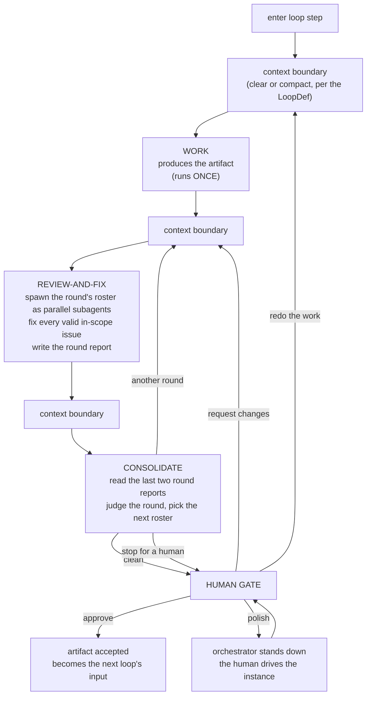
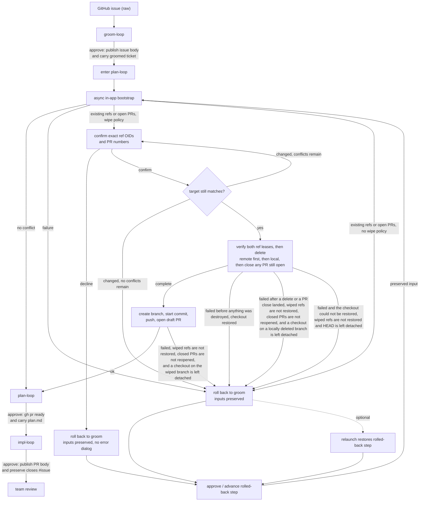
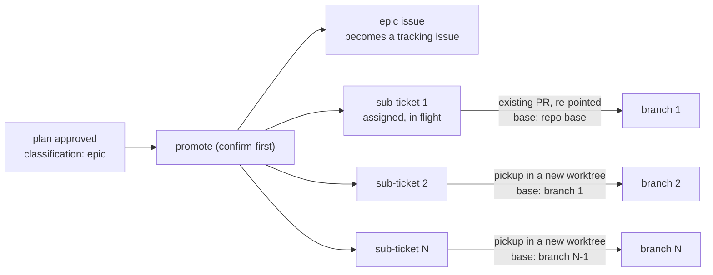

## 27. In-terminal loop engine — the live design

> **Status:** requirements, drafted **v2.135** from an operator interview. **This is the live loop design; §26 is deleted.** The v2.99 engine (decisions **D41–D62**) shipped as tracer bullets L1–L8; it worked, and it was **replaced rather than extended** because its cost and latency were symptoms of machinery the loop does not need. Its decisions are **retired** — where a D-number survives, it is restated here as an **N-decision**; where it does not appear here, it is **gone** (the retirement map is §27.14). The new decisions are **N1–N14**.
>
> **Why a new section number rather than a rewrite of §26.** The two engines **coexist in the tree** while this one is built (§27.15), so the spec must be able to describe both at once without ambiguity. Rewriting §26 in place would also have reused nine of its thirteen subsection numbers for different concepts, silently redirecting roughly 800 `§26.x` citations in `src/` and `tests/` — and every historical changelog entry from v2.99 to v2.132 — to clauses whose meaning had changed underneath them. A new number costs nothing and keeps every existing citation true. §26 is deleted, with the code it specifies, at the N8 sweep.
>
> **What still holds from the v2.99 design:** the app *is* the engine (it drives one hosted Claude Code instance by injection and context-boundary commands, rather than shelling out to the Go `agent-loop`); the orchestrator lives in the main process because `/clear` would destroy it anywhere else; "injectable" means the hosted instance is idle at its own input box; reviewers are parallel, isolated subagents; and the human is involved only at gates.
>
> **What is gone:** the `.agent-loop/state.yaml` **v4 contract** and every obligation to stay re-handoffable to the Go engine; the per-persona review **JSON artifacts** and the consolidator that merged them; the **re-run-the-work-agent** iteration model; the footprint **skip-optimization** and `persona_state`; **`phase2_active`** and the triage gates; the **severity-floor track**; the SHA256 **finding-signature** impasse detector; the **iteration cap**; and the **self-review** turn.
>
> **On any conflict with §17–§25, this section wins for the in-app loop.** The supersessions it asserts over §17.2, §19.1, §19.3, §19.4, §20.1, §22.3 and §24.2.3 are re-derived in §27.14 — they are **larger** than §26's, because the app now owns state the external engine used to own.

### 27.1 Goal & boundary (N1)

- Turn the app into the **loop engine itself**, driving one interactive Claude Code instance the operator already watches by composing prompts, injecting them (§9.3), and managing the instance's context between actors.
- **In scope:** three loops — **`groom-loop`**, **`plan-loop`**, **`impl-loop`** — which are the *same loop shape* over different data. Each produces an artifact that is the next one's input (§27.10). Also in scope: the review-and-fix cycle, the consolidator, the human gate, in-app bootstrap (pickup), epic sub-PR creation, and whole-run cost accounting.
- **Out of scope:** the external Go binary (never invoked); compatibility with its `state.yaml` v4 contract or its LoopDef schema; `takeover`; epic instance **auto-launch**.
- **Three loops, deliberately.** Building `groom-loop` as well as plan and impl is not scope creep — it is the **proof of generality**. Three defs on one engine make it structurally impossible to hardcode a plan/impl assumption into the orchestrator. `groom-loop` has no definition today; it is authored here.

### 27.2 The app is the orchestrator (N2)

- **The state machine and every "what to inject next" decision live in the app's main process**, not in the conversation. This is **forced**: clearing or compacting the instance's context destroys anything the conversation was holding, so orchestration placed there would not survive the first boundary. The orchestrator reconstructs each turn's context from **on-disk artifacts and its own state**.
- **Automatic, not human-paced.** Within a loop the orchestrator injects each actor turn and each context boundary on its own, advancing from what it reads back. The human is involved **only at the gate** (§27.9), on failure (§27.12), and whenever they choose to interrupt (§27.9).
- **"Injectable" means the hosted instance is idle at its own input box** — observed through the completion signal of §27.12 (a turn's done-signal has fired and the instance has gone quiescent), **not** raw `QUIET_MS` silence, which can falsely read a mid-turn model or subagent wait as idle (§8.3). Because the interactive agent is itself the shell's foreground process for the whole run, "the shell is at a ready prompt" cannot mean *the shell* is idle. The orchestrator injects only when the instance is injectable by that definition; an injection attempted while a turn is in flight is refused exactly as §19.3 refuses a busy shell.
- **Human/orchestrator injection contention — accepted risk.** The orchestrator auto-injects into the same instance the operator is watching, and there is **no hard interlock** preventing an operator keystroke from interleaving with an in-flight injected prompt. During automatic iteration the operator is expected to keep hands off the keyboard. The one place this is *inverted* is **polish mode** (§27.9), where the orchestrator explicitly stands down and the keyboard is the operator's.

### 27.3 The loop (N3)

The orchestrator runs one **actor turn** at a time against the single instance: compose prompt → inject (§9.3) → wait for completion → read what it produced → decide the next turn.

- **WORK runs exactly once (N3a).** The work turn produces the artifact — the groomed ticket, `plan.md`, the implementation. It is **not** re-entered on a consolidator verdict. The only thing that re-enters it is the human's explicit **redo** lever (§27.9). This is the largest structural change from the v2.99 design, where every `needs-work` verdict re-ran the work agent from disk.
- **REVIEW-AND-FIX is one turn, not two (N3b).** The main instance spawns the round's roster as **parallel `Task` subagents** (§27.4), receives their findings **into its own context as tool results**, fixes every valid in-scope issue itself, dismisses what is out of scope or invalid, and writes the **round report** (§27.5). Findings never round-trip through the filesystem to be re-read by a different actor — which is precisely what the app's injection ability is for, and what the v2.99 design paid for in tokens on every round.
- **CONSOLIDATE judges the round, it does not merge findings (§27.6).**
- **Context boundaries are data (§27.7)** — each is `clear`, or `compact` with a custom message, declared per boundary in the LoopDef.

### 27.4 Reviewers pull; the engine never pushes (N4)

**This is the decision the rewrite exists for.**

- A reviewer subagent is handed exactly two things: **the ticket** and **its charter** (the persona's standing instructions — what it is responsible for and how to go about it). It is handed **no diff, no code, no plan, no prior review, no consolidated findings, and no history**. It **pulls what it needs with tools.**
- The engine therefore pushes a **constant-sized** prompt at every reviewer, in every round, forever. A round's review cost is a function of **what each reviewer decides it needs to read**, never of the roster's shared context and never of how many rounds have already run. The cost curve of [#59](https://github.com/dylanb/agent-terminal/issues/59) — per-round cost rising with iteration depth — does not exist to be optimized away; it **should be absent by construction**. That is an **expectation of the design**, for the N7 meter to make observable (§27.11), not a criterion asserted in advance: a round may legitimately cost more than an earlier one when the consolidator picks it a larger roster (§27.6).
- It is also **more accurate**, not merely cheaper: a taint reviewer may need to read half the codebase to trace a flow, while an accessibility reviewer may need only the UI diff. A push model must send the union of what every persona might want; a pull model lets each fetch its own actual need.
- **Reviewers are isolated and parallel.** Each subagent is a fresh context (the independent-review property the external engine got from separate `claude -p` processes) and they run concurrently. There is **no warmer** and nothing to amortize — there is nothing shared to amortize *over*.
- **The roster for a round is chosen by the consolidator** (§27.6), from the catalog the LoopDef declares. **Round 1 runs every persona in the catalog.** A persona the LoopDef does not declare can never be invoked.
- **Reviewer cost is captured in the subagent logs** (`~/.claude/projects/<slug>/<uuid>/subagents/agent-*.jsonl`), which the meter sweeps (§27.11). That layout is Claude Code's private format — an external dependency the app does not control — so the parser tolerates drift (unknown or empty → omitted, never throws).

### 27.5 The round report (N5)

The round report is the **sole contract** between the fixer and the consolidator, and the **only durable record** of what a round did.

- **Format: Markdown with a prescribed structure.** Prescribed, so the engine can validate it is complete before advancing (§27.12) and the consolidator can rely on its shape; Markdown, so the human reads the same document at the gate that the consolidator judged.
- **It must account for every persona the round invoked** — including one that **failed or returned nothing**. The engine validates the report covers the round's roster (which it chose, so it knows). A report missing a persona is **malformed**, and takes the retry-then-`error` path of §27.12. A reviewer that quietly disappears is therefore not something the fixer can hide. A persona that **failed to run** is marked in its record distinctly from one that ran and found nothing (which carries the empty marker) and from one that raised a `needs a human` issue (a disposition, not a run-failure). The failed marker is spec-fixed vocabulary, single-sourced with the disposition set, recognized by exact string equality — never normalized (v2.137).
- For every issue raised it records: **the persona that raised it, the issue, its disposition** (`fixed` / `dismissed — out of scope` / `dismissed — invalid` / `needs a human`), **the reason**, and **what changed** if it was fixed.
- **Reports are versioned per iteration** and never overwritten. The versioned series is the forensic record — the equivalent of the per-iteration review artifacts the old engine wrote, in one document per round instead of N.
- **Reports live locally under `<repo>/.agent-terminal/loop/reports/<n>.md` and are never committed.** This is not merely tidiness: the impl-loop's reviewers **pull the diff with tools** (§27.4), so a committed report would appear *inside the diff they are reviewing*. Reports must stay out of the working tree's committed surface or the loop reviews its own commentary.
- **Accepted risk, recorded (N5a): the fixer marks its own homework.** The fixer decides which issues are valid, fixes them, and writes the report — and the consolidator sees **only that report**. Nothing in the loop can detect an issue the fixer declined to write down. This is the load-bearing assumption of the design: it is accepted in exchange for deleting the whole persona-artifact + merge-consolidator apparatus, and it is bounded by three things — the report must account for the full roster (above), the versioned reports are auditable after the fact, and the human gate is the backstop. It is stated here so it is a known limitation, not a latent surprise.

### 27.6 The consolidator (N6)

The consolidator is a fresh turn (its boundary is declared, §27.7) whose job is to **judge the round**, not to merge findings. It has three outputs.

**1. A verdict.** It reads **the last two round reports** — this round's and the previous one's — and nothing else. Two is exactly enough to see whether the loop is converging, and it is a **fixed window**, so the consolidator's own cost cannot grow with iteration depth either.

| verdict | what it means | what happens |
|---|---|---|
| `clean` | the round **changed nothing** — every issue raised was dismissed, and nothing needed fixing | stop at the human gate (§27.9) |
| `another round` | the round **fixed something**, so the artifact changed and needs fresh eyes on the new state | back to review-and-fix |
| `stop for a human` | the loop is **spinning** (something fixed last round is back), or a reviewer raised something the loop is not entitled to decide | stop at the human gate, with the reason |

- **The termination rule is: `clean` = the round changed nothing.** This is what makes memory-less reviewers and a memory-less fixer *correct* rather than merely cheap. **Scope is a function of the ticket, not of history.** A reviewer with no memory will re-raise the same out-of-scope observation every round, and a fixer with no memory will re-dismiss it for the same reason every round — and that is the system correctly **re-deriving a settled judgment**, not failing to converge. The loop terminates when a round produces no changes, which is precisely the statement "the artifact is stable under review."
- **A round in which a reviewer failed can never be `clean`.** The report says the persona failed (§27.5); the consolidator must not read a round with an unrun lens as settled. The remediation is fixed: a lens failing for the first time (not failed in the previous report) is re-reviewed in the next round's roster; the same lens failing again on that re-review routes to `stop for a human`. That is one automatic re-review per lens-failure episode, keyed on the two-report window — not a counter. A run where a *different* lens fails each round is bounded only by the human interrupt (§27.9), which is deliberate: a global counter is the machinery N6a retired (v2.138).
- **There is no iteration cap (N6a).** The old engine's cap existed to bound a loop whose termination rule was a counter. This loop's termination rule is a property of the artifact, and the backstop against a runaway is the **human interrupt** (§27.9), not a number. A cap would be exactly the sort of machinery this rewrite is removing.

**2. The next round's roster.** Having just read what the round did, the consolidator **chooses which personas run next** — from the LoopDef's catalog, with a stated reason. This **replaces the footprint skip-optimization outright**: instead of hashing `plan.md` and comparing `last_seen_files` sets to guess who can be pruned, the actor that just read the round's report decides who needs to look. It may also re-run the whole catalog when the artifact changed enough to warrant it.

**3. The interrupt check.** If the operator has armed the interrupt (§27.9), the consolidator routes to the human gate regardless of its verdict — and still states the verdict it would otherwise have reached, so the human arrives knowing whether the loop thought it was clean, progressing, or stuck.

### 27.7 Context boundaries — clear or compact (N7)

A `/clear` at every actor boundary is why nothing in the old loop amortized: every turn re-read everything it needed from disk. But an unconditional *compact* is equally wrong — the consolidator's judgment is worth less if it inherits the fixer's context and its rationalizations.

- The **boundary policy is data-driven from the LoopDef**: each actor boundary declares **`clear`**, or **`compact`** with a **custom compact message** naming exactly what must survive it.
- Different loops make different choices, and the engine has no opinion. It executes the boundary the def names, and confirms it (§27.12).
- The boundary is also the **cost-metering segment marker** (§27.11).

### 27.8 The LoopDef (N8)

- **The defs are owned by agent-terminal**, in a **new schema of its own design**. The `github.com/dequelabs/loops` defs are **not vendored, not parsed, and not a compatibility target** — they remain valid for the legacy Go engine, which this section no longer speaks to. This is the clean break: no dual-schema period, no upstream coordination, no re-vendoring dance.
- A def declares:
  - **`work`** — the work prompt recipe and the artifact it produces;
  - **`reviewers`** — the **catalog** of personas available to this loop, each with its **charter** (a reference, never an inline body — §18.6) and the tools it may use. Round 1 runs the whole catalog; thereafter the consolidator selects from it (§27.6);
  - **`consolidator`** — its prompt recipe;
  - **`boundaries`** — `clear` or `compact: <message>` for each actor boundary (§27.7);
  - **`report`** — the prescribed structure the round report must satisfy (§27.5);
  - **`gate`** — the human options available (§27.9) and their side-effects (§27.13);
  - **`pickup`** — the bootstrap contract (§27.10);
  - **`inputs` / `outputs`** — the artifact this loop consumes and the one it produces, which is what chains groom → plan → impl (§27.10).
- **Origin carries no trust distinction.** Def tiers — operator-config and repo — are resolved identically. The schema declares `ExecSideEffect`, the executable side-effect that would let a def name a program to run, but it is **unshipped**: nothing in this engine drives it. Shipping it requires deciding trust afresh (this reverses the v2.129 finding, which gated execution on a def's origin — see the changelog entry recording the reversal and its consequences).

### 27.9 The human gate (N9)

The gate is the **whole** human interface to a running loop. Its options are declared per-loop in the def and rendered data-driven.

- **Approve** — accept the artifact. It becomes the next loop's input (§27.10) and the loop's gate side-effects run (§27.13). Terminal for that loop.
- **Request changes** — the human types feedback; it joins the **next review-and-fix round** alongside the reviewers' findings (this reuses the §19.4 composer: curate a review-todo subset + free text, compose-with-agent or submit-as-is). The narrow, incremental lever.
- **Redo the work** — the human types an instruction that **re-enters the work turn**, whose **only** inputs are the **ticket**, the **plan**, and **that instruction**. No findings, no report history, no accumulated context. The deliberate clean-slate lever, for when the artifact is wrong in a way that iterating cannot fix.
- **Polish** — the **orchestrator stands down and releases the prompt.** The loop stops injecting; the operator converses with the live instance directly in the terminal, on the context it holds from the round it just finished; a separate **approve** control ends it. This is the one state where the §27.2 contention risk is inverted by design: the keyboard is the human's, and the orchestrator is the one that must not type.
- **Abandon is not a loop verdict.** Killing a run is the flow-level **Terminate** (§25.5 `flow.terminated`), which already exists. The loop's vocabulary stays about the work, not the lifecycle.

**The interrupt (N9a).** At any point during automatic iteration the operator may **arm an interrupt** ("hand back to me"). It is **queued, not immediate**: the round in flight finishes — reviewers return, fixes land, the report is written — and the **consolidator honors it at its next invocation** (§27.6), routing to the gate regardless of verdict. Nothing is ever killed mid-turn, so there is no such thing as a half-applied round. This is the loop's only bound on runaway iteration, and it is a human, not a counter.

### 27.10 Artifacts, chaining & bootstrap (N10)

**The three loops are the same shape over different data, chained by artifact.**

- **`groom-loop`** takes the raw GitHub issue and produces **the groomed ticket**. Its approve gate **publishes the groomed ticket back to the GitHub issue body** (§27.13).
- **`plan-loop`** takes the groomed ticket and produces **`plan.md`**.
- **`impl-loop`** takes the plan and produces **the implementation on the PR**. Its work turn's product is commits, not a file.
- **Bootstrap (pickup) stays a separate app action**, as today: on entering the first loop step that needs one, the app validates a clean tree, creates the branch **off the base the `pickup` contract resolves** (the repo's base branch, or the preceding slice's branch for an epic sub-ticket — below), writes an empty `[skip ci]` start commit, pushes, opens and persists the **draft PR that `closes #n`**, enters work, and then assigns the issue and applies labels best-effort — driven by the def's `pickup` contract, never hardcoded. **Groom does not absorb it.**
- **A pickup that cannot run never fails silently and never strands the flow.** It runs asynchronously after the loop step is entered, so a failure (dirty tree, unresolvable base, conflicting branch, rejected PR create) arrives after the transition returned. When it does, the app **rolls the flow back one step**, preserving the resolved inputs, and **surfaces the reason in a blocking error dialog**. A destructive re-pickup (an existing target branch under a wipe policy) is **confirm-first**: the app does nothing destructive on detection, names the exact local/remote ref object IDs and open PR numbers, revalidates that snapshot at the operation, and recreates the branch only after the exact wipe completes.
- **Loop state is app-owned**, under `<repo>/.agent-terminal/loop/`, in a schema of the app's choosing. **The `.agent-loop/state.yaml` v4 contract is gone** (§27.14) — there is no external writer to reconcile with, no re-handoff to the Go engine to preserve, and no reason to carry fields (`persona_state`, `phase2_active`, `severity_cycle_iter`, `impasse`, `completed_loops`) for machinery this design deleted.
**Epics fan out into a chain of self-contained sub-tickets.** A plan the work agent classifies an **epic** is planned once, as a whole, and then implemented one slice at a time in **parallel worktrees** — the operator opens the next slice while the previous one is still in review. The chain is what makes that possible, and it lives on **GitHub**, not in loop state: a slice is picked up in a fresh worktree whose loop state is empty, so everything its pickup needs is recoverable from the issue alone. App-owned loop state records only that the promotion already ran, so it cannot fire twice.

> **Superseded — promotion mechanics (P7b, §28.8).** The diagram's slice-1 treatment (`sub-ticket 1 assigned, in flight`; `existing PR, re-pointed`) is **not** what ships. Promotion creates **uniform sibling sub-tickets** (all carry `subticket` + `ready`, none assigned), **closes** the epic planning PR, and **terminates** the flow — the operator picks up slice 1 by hand like every other slice. The bullets below are corrected to match; the diagram is kept for history.

- **Promotion is confirm-first.** It creates public issues irreversibly, so on approving an epic plan the operator sees **every sub-ticket that will be created**, the epic tracking edit, and the **epic planning PR close** **before anything reaches GitHub**, and can back out having seen the split the agent chose.
- **The epic issue becomes a tracking issue.** Its body is **never overwritten** — it is the human's original intent contract — and it gains the checklist of its chain, **written once at promotion and not maintained thereafter**.
- **Every slice gets a sub-ticket, including the first.** N slices produce N sub-tickets, each carrying its **portion of the epic's acceptance criteria**, the **approved plan verbatim** with that slice's portion delimited within it, a link to the epic, and the **issue number of the slice before it**. The plan's slice-to-AC assignment is copied **as authored**: the app never parses the epic's acceptance criteria, and the plan gate is where a human judges whether the split is right and complete.
- **Slice 1 is a uniform sibling (P7b — §28.8).** Every sub-ticket, slice 1 included, is created the same way — carrying `subticket` + `ready`, **none assigned** — the epic planning PR is **closed** (not re-pointed onto slice 1), and promotion **terminates** the flow. The operator opens a fresh worktree and picks up slice 1 by hand like the rest, rather than the original PR being re-pointed to keep implementing it. The epic issue (now a tracking issue) survives its slices regardless.
- **Promotion is resumable.** Every artifact is recorded the instant it exists, so a promotion that fails partway **surfaces what did and did not land** and a retry creates **only what is missing** — never a duplicate, never a gap.
- **It does not auto-launch** child instances or worktrees. The operator opens a worktree and picks up the next slice **by hand**.

**Picking up a sub-ticket skips groom and plan.** A ticket marked an epic sub-ticket enters the flow at groom like any other; the app reconstructs the groomed-ticket and plan artifacts **from the ticket body as it stands** — a human's edits to it are honoured in full, because the body is the intent contract — and advances to the **impl** loop without running groom or plan. A body missing or malformed in a section the reconstruction needs **creates nothing and surfaces why**, rather than reconstructing half a state.

**Sub-ticket PRs stack.** Slice k's pickup bases its branch and its draft PR on **slice k−1's branch**, derived from k−1's issue number through the same `pickup` branch template that created it — a branch name recorded at promotion time would be a guess, since k−1 is usually not yet picked up. When that branch does not exist — k−1 was never picked up, or its branch has already merged and been deleted — pickup **falls back to the epic's own base and says so**, naming the slice it expected to stack on, rather than silently retargeting.

> **Explicit operator instruction, recorded.** The app applies **`agent-loop/ready`** to the sub-tickets it creates, alongside an `agent-loop/subticket` marker. This overrides the CLAUDE.md rule that only a human applies that label: **approving the epic plan is the human vetting act**, and it vets all N slices at once. The marker is what pickup keys on to reconstruct state; the ready label is what makes the chain pickable without a second per-slice gate.

### 27.11 Cost accounting (N11)

- **The meter reports the cost of the entire run — every token spent from flow start to flow terminate.** Not a per-iteration figure rolled up, and not the review turns alone: the work turn, every reviewer subagent, the consolidator, the human's polish conversation, and every retry are all the run's cost, because they are all money the run spent. This is a **refactor** of the existing meter (which prices per-iteration segments and rolls them up), not a reuse of it.
- Cost is recovered **from the session JSONL logs** — the main session's per-boundary token totals and the nested **subagent** logs (`<session-uuid>/subagents/agent-*.jsonl`) — priced through a checked-in table kept current by hand. The sweep is **recursive**: a flat read of the project dir silently omits the reviewer fan-out, which is the bulk of a round.
- **The sweep is bounded below by the instant the flow started** (`started_at` in `flow-state.yaml`) — the project dir accumulates every Claude Code session ever logged against the worktree, including the operator's own conversations. A flow that recorded no start sweeps unbounded rather than reporting `$0`: an unbounded number is wrong, but a silent zero **hides** that it is wrong. **Annotated at N8:** nothing writes `started_at` after the sweep — the field is retained only for decode tolerance on old `flow-state.yaml` files — so N7 (#92) must supply its own lower bound rather than relying on this premise.
- **A billed turn counts once.** Claude Code identifies an API call by `message.id` + `requestId`; resuming or forking a session replays prior turns verbatim into the new file. Summing every line multiplies the run's dollars by the number of resumes.
- **Unpriced model:** a token total whose model id is absent from the pricing table contributes **zero dollars** and surfaces as **`unknown`**. The meter **never renders `NaN`** and never blocks. A model that consumed **no tokens** bills nothing and is never a gap, whatever its id.
- **Every dollar is attributed, and the parts sum to the whole.** The run total is the headline, but each priced turn in the window also belongs either to a **round** — the segment §27.7's boundaries delimit around a review-and-fix turn — or to an **interval between rounds** (the work turn before round 1, the consolidator, the operator's polish conversation, an inspection while the loop awaits a human, a retry). A round's figure is that round's **own spend**, never the accumulated total at that point; it is bounded by the total; the rounds and the intervals **sum to** the total; and a **completed round's figure never moves afterwards**. Nothing in the window is unattributed, and nothing is counted twice. A per-round figure that silently reports the accumulated total is not a smaller error than a wrong total — it makes every per-round comparison meaningless while looking entirely plausible.
- **Surface:** the running total on the status strip (§22.3) and a cost event in the §25 audit. It is **display-only** — it never gates or pauses the loop. Its attribution is what makes this rewrite's cost claim **observable**: that per-round cost no longer grows with iteration depth is an **expectation of the design**, to be read off trustworthy numbers, **never a criterion the meter asserts**. A round may legitimately cost more than an earlier one — the consolidator picks a fresh roster each round (§27.6), so a round running more reviewers costs more with nothing wrong.

### 27.12 Completion, failure & resume (N12)

- **A turn is done only when both (a) a real done-signal has fired and (b) what it was supposed to produce exists and is well-formed.**
  - **(a) The done-signal is a file, never a printed line.** Each injected turn is instructed to write a turn-keyed done-file as its last action — the agent *tells* the orchestrator it finished, rather than the orchestrator inferring it from silence. A hosted TUI agent reflows the injected prompt on echo, so any printable marker named in the prompt is echoed back and read as a completion. The instance must also be quiescent (§8.3) as a secondary guard. This is what "waits out spawned subagents" rests on: the review-and-fix turn does not write its done-file until its `Task` children have returned.
  - **(b) The artifact check** is: the **round report** exists, parses against the def's prescribed structure, and **accounts for every persona in the round's roster** (§27.5); the **consolidator's** output carries a verdict and a next roster. A **context boundary** confirms by observing the instance return to an idle prompt in the expected state. The **impl work turn** produces commits rather than a file, and confirms on the done-signal alone.
  - **(c) A UI "done" control.** The loop panel exposes a manual **"mark turn complete"** affordance so the operator can advance a turn the automatic signal missed. On a turn that stopped in **`error`** with its artifact actually present, this control **accepts** the artifact and advances through the same chain a signalled completion takes, **without re-running the turn** — so an accepted round is never regenerated. It **never injects**. Quiescence alone never advances the loop.
- **A missing or malformed artifact on a done-signal** triggers **one** re-injection of the same turn (only while the instance is injectable); a second failure stops the loop in **`error`**.
- **There is no wall-clock completion deadline.** A turn that legitimately runs for many minutes advances the instant it signals. A genuinely frozen instance is caught by a **stall watchdog** — deliberately long, and **reset on every visible-content change** — so a streaming turn never stalls and a hung one resolves to `error` rather than hanging forever. A stall **never retries** (re-injecting a frozen instance cannot help) and **never kills a working turn**.
- **A failed reviewer subagent is the fixer's problem to handle in-context, not the engine's** — but it **cannot be hidden**, because the report must account for the persona (§27.5) and the consolidator must not call such a round clean (§27.6).
- **`error` is a first-class status**, classified human-needed and recorded in the §25 audit, surfacing the failed turn and its reason. The human **retries**, **accepts** the artifact via (c), edits, or terminates. The orchestrator never silently advances past a failed turn. A persisted `error` **survives a relaunch**: resume never re-drives it (it is human-owned) but reconstructs which turn stopped, so Retry and accept act on the right one.
- **Auto-resume.** On launch the orchestrator reads the loop state and resumes an in-flight run at its recorded round and turn, re-entering the **earliest turn of the round whose output is missing** and never re-running a completed one. A gate, terminal, or `error` status is human-owned and not re-driven.

### 27.13 GitHub side-effects (N13)

- Side-effects run as **out-of-band app `gh` calls**, never as terminal injection — so they cannot be blocked by a busy shell, and they are best-effort.
- **groom approve** → publish the groomed ticket to the **issue body**.
- **plan approve** → flip the PR **non-draft** (`gh pr ready`), so the implementation's commits trigger CI; **epic-promote** if the plan is classified an epic (§27.10) — the one side-effect that is **confirm-first and not best-effort**, because it creates public issues irreversibly and its partial failure is resumable rather than discardable.
- **impl approve** → publish the **PR body**; hand off to team review.
- **Throughout** → mirror loop status onto labels.
- **CI runs, it does not block (N13a).** The impl loop never waits on CI. The PR goes non-draft at plan approval and checks run asynchronously; a reviewer that cares about CI **pulls the check state with a tool** like it pulls everything else (§27.4). There is no CI-waiter actor. **Explicit override, recorded:** going non-draft mid-impl to run CI conflicts with the operator's standing `[skip ci]`-on-draft discipline; for this loop the override is intentional.

### 27.14 What this retires (N14 — the supersession map)

Re-derived, and **larger than §26's**, because the app now owns state the external engine used to own.

**"Retired" meant scheduled for deletion, not gone at the time this map was drawn.** Everything in the left column was, at that point, still in the tree, still specified by §26, and still running. The N8 sweep (§27.15) has since deleted it whole — §26 and the code it specified. The table below is the historical supersession record.

| retired | replaced by |
|---|---|
| **§17.2/D1 — two-layer ownership** (the app owns flow state; agent-loop owns loop state) | The app owns **both**. There is no external writer and no reconciliation. |
| **§17.2/D2 + §19.3 — gates driven by injecting `/agent-loop-*` slash commands** | Gate transitions are **app-internal** (§27.9). §19.3's **running-process refusal survives**, redefined by §27.2 for a hosted REPL. |
| **§19.1 — the agent-loop bridge** watching `.agent-loop/state.yaml` | The app **writes** its own loop state (§27.10). The read-only mirror and the awaiting-human notify (§24.2.3 T2/T4) **remain valid** as UI, re-pointed at the app-owned file. |
| **§19.1/§22.3 — "severity cycle" and "open-findings count"** on the status strip | Gone with the severity-floor track and the findings-merge consolidator. The strip carries **iteration and last verdict**. |
| **§19.4 — request-changes composer** | **Survives**, re-pointed: the composed feedback enters the **next review-and-fix round** (§27.9) instead of being injected as a slash command. |
| **§20.1 — artifact discovery over LoopDef `artifacts:` ∪ `.agent-loop/`** | Discovery re-points at `<repo>/.agent-terminal/loop/` (the round reports) ∪ the PR's changed files. |
| **§24.2.3 T3 — injected `agent-loop pickup`** | In-app bootstrap (§27.10). |
| **§24.2.3 T5/T6 — injected `/agent-loop-approve` / `-request-changes` / `-impasse`** | **Never implemented**; retired. The gate is built here (§27.9). |
| **the `.agent-loop/state.yaml` v4 schema + the Go-engine re-handoff obligation** | An app-owned loop state (§27.10). The Go engine can never take a run back; this is accepted. |
| **per-persona review JSON + the merge-consolidator** | The **round report** (§27.5) + the **judging consolidator** (§27.6). |
| **re-running the work agent on `needs-work`** | **Review-and-fix** (§27.3) — the fixer is the main instance, in the same turn as the reviewers it just heard from. |
| **skip-optimization, `persona_state`, footprints** | The **consolidator picks the next roster** (§27.6). |
| **`phase2_active`, the triage gates, `severity_floor_track`, the iteration cap** | The **human interrupt** (§27.9) and the termination rule (§27.6). |
| **the SHA256 finding-signature impasse detector** | The consolidator's **`stop for a human`** verdict, judged from the last two reports (§27.6). |
| **the self-review turn** | Gone. The fixer *is* the work agent, and it already sees the reviewers' findings in context. |
| **the CI-waiter actor** | Reviewers **pull** CI state (§27.13). |

### 27.15 Build — tracer-bullet phases

Per the CLAUDE.md tracer-bullet rule, each slice spans main → `src/shared/ipc.ts` → preload → renderer, is fired from an **existing UI control** (the flow strip / loop panel / gate panel), and is proven by a **Playwright `_electron` e2e on a real PTY**, with main-process integration and shared unit tests underneath. RED-first throughout.

**Test seam (no LLM in e2e).** The orchestrator drives whatever agent program sits at the shell prompt; it does not embed an LLM. e2e substitutes a **deterministic fake-agent on `PATH`** that, on receiving an injected prompt, writes the expected artifact (the round report, the consolidator's output), emits the **done-file** the orchestrator waits on, and goes quiescent. The fake-agent is **scriptable per turn** — which verdict, which roster it selects, which personas it reports as failed, write-nothing to drive the retry-then-`error` path — and for the cost slice it writes **session-JSONL token fixtures at a test-controlled log root**. The PTY and the shell are real; only the agent program is a scripted stub.

**The two engines coexist behind one app-side contract, and the old one is deleted in a single sweep (N8a).** This **reverses** the drafting-time intent to delete each piece of machinery in the slice that replaces it. That intent is incompatible with a working `main`: N1 replaces the def schema and the loop-state schema, which every actor of the §26 engine depends on, so a slice that deleted as it went would leave `main`'s loop broken from N1 until N5. The alternative — landing the whole epic on a long-lived branch — buys a working `main` at the cost of an eight-slice merge nobody reviews at the granularity it deserves. So instead:

- **The seam is the existing app-side contract, which is already engine-neutral.** `FlowLoopView` carries `status` as an **unbounded string** (§24.2.3 T2 — the strip maps it to a tone, never an enum) and `gateOptions` as a **`string[]` read from the def** (§19.4); `humanNeeded` is classified by the shared open predicate of `src/shared/loopStatus.ts`; `loopActivity`, `iteration`, `cost` and `errorReason` name no engine. **Both engines implement one `FlowLoopView` provider and one gate-decision executor**, chosen by the **schema of the def the flow step binds**. The renderer never learns there are two, and `src/shared/ipc.ts` takes only **additive widenings** — `GATE_DECISION_OPTIONS` gains `redo` and `polish` (§27.9), the `LoopActivity` phrase set gains the new actors' names.
- **Compatibility runs to the app boundary and no further.** The §27 engine is API-compatible with **agent-terminal** — the IPC contract, the loop panel, the flow state machine. It is compatible with **nothing** below that line: not the LoopDef schema, not `state.yaml` v4, not the persona artifacts, not any §26 concept. The seam exists to keep the renderer and the contract single; it is **never** a reason to preserve a retired concept in the new engine. A slice that finds itself widening the contract to carry a §26 idea has mis-cut the seam.
- **The old engine was never modified while it coexisted with §27, only routed around.** No §26 code was edited to accommodate §27; it kept reading its own defs, writing its own `state.yaml`, and driving its own flows, exactly as specified, until the N8 sweep deleted it whole.
- **N8 was a big-bang deletion, and it was mechanically checkable.** `grep -r '§26' src tests` returning **zero** is the completion evidence: the retired machinery is *gone from the tree*, not merely unreferenced. No burn-down test pinning the shrinking file set was built (a non-goal) — the grep result stands as the evidence on its own. The sweep was **reviewed with the operator**, not decided unilaterally.
- **The accepted cost, recorded.** Two engines and two test suites live in the tree for the epic's duration, and the deletion arrives as one large PR rather than eight small ones. That PR is a *deletion* reviewed against a grep, not a design reviewed against a spec, which is the trade being made.

> **Changelog — N1 (sub-ticket 1) departures ([#63](https://github.com/dylanb/agent-terminal/issues/63)).** N1 landed with the divergences below; recorded here because the spec wins or gets a changelog entry, and the base branch is this still-open spec PR.
> - **Engine selection is by the flow step's def *namespace*, not "the schema of the def the flow step binds".** The original phrasing above is circular — a §26 def resolves from an operator-machine-local dir and the three §27 loop names are the same names the shipped flow binds, so a bare name cannot select an engine without depending on what is installed. The flow step's binding names a **closed set** namespace (`legacy` selects §26, `app` selects §27; absence means `legacy`, so every flow file shipped today is unchanged), validated at flow-load like any repo-authored enum and **never joined into a path**; the declared def version is validated *after* resolution. Engine choice is thus a property of the reviewed flow file, not of the operator's machine.
> - **The seam this slice draws is the loop-view provider (read) plus a namespace guard at the §26 gate-decision executor.** The original text names one provider and one executor. This slice implements the §27 provider (which owns the whole view and reads no §26 loop state) and guards the *existing* §26 gate-decision executor so an `app`-bound step resolves no §26 def — the guard is at the operation, not merely the display-only rendering, so a same-named operator §26 def can never be fired for a §27 step. A distinct entry-selector and a gate-decision target-identity field are **not** added here (the §27 provider marks its view non-actionable, so the UI exposes no §27 gate decision to dispatch); either may land with a later slice if a §27 step gains an executable entry.
> - **N1's "Contract: none" is wrong.** This slice adds an app-owned flow-step contract (the `loop_namespace` closed set) and **additive** loop-view widenings: a new `actionable` flag (whether a view's gate options are clickable — the §27 run-less view is display-only), defined once in `src/shared/loopGate.ts` and imported by the provider and the panel.
> - **Two `src/shared/ipc.ts` relaxations land, not only additive widenings.** `FlowLoopView.iteration` becomes **optional** (absent = no round has run — a run-less §27 view has no honest round number, and a coalesce-to-zero would fabricate the identity the dedup key and the §25 audit key on); and `gateOptions`'s presence generalizes from status-scoped to *the options the producing engine's view should display* (the §26 provider keeps populating it status-scoped; the §27 provider fills it from the bound def for a run-less view). "No round has run" is expressed once in each shared vocabulary that carries it — the dedup identity (`occurrence.ts`) and the audit event vocabulary (`audit.ts`, which records no `loop.iteration` event for a view that has none).
> - **N5's "the one additive change §27 makes to `src/shared/ipc.ts`'s gate surface" is falsified.** The `actionable` flag above is a second additive change to the loop view; N5's gate-decision widening is no longer the only one.
> - **The name-primitive lift edits a §26 module.** "No §26 code is edited to accommodate §27" gains one exception: the engine-neutral single-safe-segment predicate is lifted out of `src/main/loopDef.ts` (a §26-owned module, deleted whole at N8) into `src/shared/pathSegment.ts`, which the surviving §27 parser and the §26 parser both import — behavior-preserving, so no §26-bound step's behavior or rendering changes.
> - **N8 sweep-time disposition of the namespace field.** After the sweep the legacy namespace does not exist; the field stays as a closed set of one and **absence is re-pointed at the surviving engine**. Its cost is named: an operator's §26 def of the same name stops being bound (surfaced once on the existing loop-error path), and an explicitly-`legacy` value becomes a surfaced resolve failure. Recorded here because a data default is invisible to the N8 grep.

> **Changelog — N3 (sub-ticket 3) departures ([#72](https://github.com/dylanb/agent-terminal/issues/72)).** N3 records the round report's concrete grammar here because it introduces a new on-disk format N4 also reads (the spec wins or gets a changelog entry, CLAUDE.md).
> - **The round-report grammar is single-sourced in `src/shared/roundReport.ts`**, imported by both the review-and-fix prompt composer (which tells the fixer what to write) and the well-formedness predicate `roundReportWellFormed` (which gates the turn's completion), so the two cannot drift. The prescribed structure is: one `## <section>` heading per def-declared `report.sections`; one `### <persona>` record per roster persona (present-vs-absent is the whole roster-accounting check — a zero-issue persona is present via its `### ` record carrying the `_no findings_` marker, distinct from being absent); and, for every recorded issue, the labelled lines `issue:`, `disposition:`, `reason:`, and — **only when the disposition is `fixed`** — `what-changed:`. The persona of an issue is the `### ` record it falls under. A single **canonical example** (`exampleRoundReport`) is the one anchor the prompt few-shot, the predicate happy-path test, and the fake-agent e2e all reference.
> - **The disposition set is the spec-fixed closed set `fixed` / `dismissed — out of scope` / `dismissed — invalid` / `needs a human`**, recognized by **exact string equality with only surrounding whitespace trimmed — never normalized**. It gets ONE runtime source (`DISPOSITIONS`) consumed by both the prompt composer and the predicate, mirroring `GATE_DECISION_OPTIONS`. Disposition *correctness* is out of scope; a well-formed report of all `needs a human` completes exactly as one of all `fixed`.
> - **Reports live at `<repo>/.agent-terminal/loop/reports/<n>.md`**, round-keyed and disjoint from the run-state file; the write-target (`roundReportRel`) and read-source (`roundReportFile`) come from one resolver so they cannot drift (writer↔reader-location). A finalized round's report is immutable; a within-round re-injection replaces the not-yet-finalized report in place.
> - **The loop view carries the round number in the existing optional `iteration` field** once a review-and-fix round has run (absent through the work turn), and the app-owned run-state gains an optional `round`. No new field, no §26 concept crosses the seam.
> - **The review-turn `accept` diverges from N2's work-turn accept at the completion gate.** It is an **override** of the well-formedness predicate — advance keeping the malformed report as the round's record, without re-running and without re-injecting (§27.12c) — not the artifact-present-required accept the work turn takes, so it is wired to its own branch.

> **Changelog — N5 (sub-ticket 2) departures ([#76](https://github.com/dylanb/agent-terminal/issues/76)).** N5's sub-ticket 2 builds request-changes and the §19.4 feedback composer, which never existed in the app (it was always "a later slice"). It records here how §27 delivers a composer §26 never implemented (the spec wins or gets a changelog entry, CLAUDE.md).
> - **request-changes is a two-step gate interaction, not a one-click dispatch.** Choosing it opens the feedback composer (`createFeedbackComposer`, a blocking dialog organism); the composer's **submit** carries the composed feedback on a **two-way** decision channel (`flow:appRequestChanges`, distinct from the one-way `flow:appGateDecision` that approve keeps). approve stays one-click. request-changes is a **composer-only affordance**: with no composer wired the button does not render, matching the gatebar's absent-injection convention (WCAG 4.1.2). Because delivery success is main-side state (the runner not mid-turn, the gate not raced out), the channel **replies whether the round started**: the composer **holds open until that reply lands** — closing only on success, and on a drop keeping the typed feedback and surfacing the reason so a retry needs no retyping. A drop is recorded as a `decision-dropped` audit (never a false-success exit 0); the operator never silently loses their input.
> - **The composed feedback re-enters the review-and-fix round at round+1, carrying it into the prompt alongside the reviewers' findings** (`AppLoopEngine.requestChanges` → `enterReview` → `composeReviewAndFixPrompt`'s optional `feedback`), over the def's **full catalog** (fresh eyes on the human-driven changes) — never the consolidator, never the work turn (redo is the separate work-turn lever, sub-ticket 3). It runs **no** gh side-effect and does **not** advance the flow: the loop returns to iterate. The feedback is persisted on the review run-state (`AppLoopRunState.feedback`, dropped when blank) so a relaunch mid-round reconstructs it and a Retry re-injects it rather than silently dropping the human's input.
> - **The two §19.4 modes — submit-as-is and compose-with-agent — are carried IN the composed feedback text, not on the wire.** §26's compose-with-agent wrote the reason *before* injecting a slash command; §27 has no slash command (§27.14), so the composer instead frames the material for the delivery mode (`frameFeedback`): `as-is` delivers the curated todos + free text verbatim; `compose` prefixes a synthesize-then-address instruction for the next round's fixer (the "agent" that composes). No wire field carries the mode — the framing rides inside the composed `feedback` the composer submits.

> **Changelog — N6 (sub-ticket 1) departures ([#78](https://github.com/dylanb/agent-terminal/issues/78)).** N6's sub-ticket 1 builds the artifact chain (§27.10 AC1). It records here the def-schema narrowing and the new persisted field, prompt block and audit phrase it introduces (the spec wins or gets a changelog entry, CLAUDE.md).
> - **The def schema narrows: `inputs`/`outputs` (§27.8) gain three refusals the section did not state.** A binding path carrying a **control character** is rejected — both as declared and as *composed after realpath*, because the repo-relative `rel` is interpolated into the agent-facing work prompt and a newline would leave the remainder standing as its own instruction (CWE-74); a path naming the **artifacts directory itself** rather than a file in it is rejected; and two bindings in the **same list** sharing an `id` are rejected, because that id is the key a persisted carry re-resolves through and a duplicate makes it ambiguous. One id shared *between* `inputs` and `outputs` stays legal — a loop that reads and rewrites one artifact declares it in both.
> - **The carry is a decision, recorded — not a re-derivation from disk.** A step's entry decides what chains into it from *why* the flow entered (`chain-advance` carries and records; `fresh-run` carries nothing, because no upstream loop ran this run; `re-entry` re-resolves what the entry already decided). That decision persists as **`chained_inputs`** on the run-state document (`AppLoopRunState.chainedInputs`), so a redo, a re-entry, a retry or a relaunch honours it rather than picking up whatever leftover sits at the binding. Absent reads as **carried nothing**, so recovery fails toward not carrying. Because run-state is one document per repo, the read is valid only when the document describes the step being entered.
> - **The work turn gains an `INPUTS` block, and §25 gains a chained-transition phrase.** The prompt names each carried artifact by id and repo-relative path (§27.10); the audit records `chained transition into <step>` with what carried and what was declared-but-unresolved, at a non-zero exit when the chain did not fully carry. An input that is present but **unreadable** is kept distinct from one never produced, and reaches the operator rather than reading as "no upstream ran".

> **Changelog — the epic model, replaced (operator decision).** §27.10 originally specified *"Epics create sub-PRs only"*: the current PR became sub-ticket 1 and the remaining N−1 sub-tickets were created as stubs recorded in loop state, with the operator opening a loop per sub-PR. That model is **withdrawn, not amended** — it was never implemented, so nothing is swept. It failed on two counts the replacement fixes: a stub sub-ticket carries no scope, so every slice after the first needed re-grooming and re-planning work the epic plan had already done; and recording the chain in **loop state** made it unreadable from the fresh worktree each slice is meant to be picked up in, which is the parallelism the model existed to enable. The replacement makes each sub-ticket self-contained on **GitHub** and stacks the branches. The build phases below continue past the **N8 sweep** deliberately: epic promotion exists on neither engine between the sweep and N9, which is accepted, not accidental.

- **N0 — Spec (this section).** The contract the code implements. Added as **§27**; §26 is marked retired and left standing. **No code.**
- **N1 — The def schema + the three defs.** Author `groom-loop`, `plan-loop`, `impl-loop` in the new schema (§27.8), owned by agent-terminal, with their reviewer catalogs and charters. Parse them with a **new parser**, alongside — never through — the §26 one. **Supersedes (deleted at N8):** the vendored `example/loops/` snapshot and the old schema's parser. **Contract:** none — the def's **gate options** already travel on the loop view as a data-driven `string[]` (§19.4), which is what makes the engine-neutral seam (above) demonstrable on the very first slice. The **reviewer catalog is parsed but not yet surfaced**; it reaches the UI at N4, where the consolidator selects from it and there is something to show. **Fire:** open a flow bound to a new def. **Land:** the loop panel renders that def's gate options; a step bound to a §26 def is unchanged. **e2e:** a flow step bound to each of the three defs resolves and renders its own gate options, and a §26-bound step still renders as it does today.
- **N2 — Work once, and the context boundaries.** The work turn (§27.3) + `clear`-or-`compact`-with-message boundaries driven by the def (§27.7), with done-file completion detection and the retry-then-`error` path (§27.12). **Fire:** start a loop step with a ticket. **Land:** the work turn runs; its artifact appears on the done-file; a fake-agent that writes nothing drives retry-then-`error`; the declared boundary is executed and confirmed.
- **N3 — Review-and-fix as one turn.** The main instance spawns the round's roster as parallel subagents (§27.4), fixes, and writes the **round report** (§27.5). The engine validates the report accounts for the full roster. **Fire:** continue from N2. **Land:** the report appears, versioned; a report omitting a persona is malformed → retry-then-`error`; a persona reported failed is carried, not hidden. **Supersedes (deleted at N8):** the per-persona review JSON artifacts and `reviewArtifacts.ts`'s merge surface.
- **N4 — The consolidator: verdict + next roster + interrupt.** Reads the last two reports (§27.6), emits the verdict and the next roster, honors an armed interrupt. Verdict-driven branch: `another round` → review-and-fix; `clean` / `stop for a human` → the gate. **Contract:** the loop view grows, additively, to carry the def's **reviewer catalog** and the roster the consolidator chose from it — deferred here from N1, because this is the first slice at which a roster is *selected* and the catalog is therefore worth showing. **Fire:** continue from N3. **Land:** a round that changed nothing → `clean` → gate; a round that fixed something → another round with the consolidator's chosen roster, and the loop panel shows which personas it picked out of the catalog; an armed interrupt → the gate with the would-be verdict stated. **Supersedes (deleted at N8):** `personaSkip.ts`, `findingSignature.ts`, the phase2/triage/severity-floor routing, and the iteration cap.
- **N5 — The human gate: approve / request-changes / redo / polish.** The four options (§27.9), data-driven, with their side-effects (§27.13). **Polish** stands the orchestrator down and hands over the prompt. **Redo** re-enters the work turn with **only** the ticket, the plan, and the human's instruction. **Fire:** click each option. **Land:** approve → the loop's side-effect runs and the artifact chains onward; request-changes → the feedback joins the next round; redo → the work turn re-runs on a clean slate; polish → the orchestrator injects nothing until the human approves. **Contract:** `GATE_DECISION_OPTIONS` widens by `redo` and `polish` — the one additive change §27 makes to `src/shared/ipc.ts`'s gate surface. **Supersedes (deleted at N8):** the §26 gate actions and the `state.yaml` v4 write surface.
- **N6 — Chaining: groom → plan → impl, and bootstrap.** The three loops in sequence over one flow, each consuming the previous artifact (§27.10); in-app pickup with its rollback and confirm-first wipe. **Fire:** run a flow from a raw issue. **Land:** groom's approve publishes the issue body; plan's approve flips the PR ready; impl's approve publishes the PR body. **e2e:** the full three-loop chain against the fake-agent, with `gh` recorded.
- **N7 — The whole-run cost meter.** A **whole-run meter for §27**, pricing **everything from flow start to terminate** (§27.11) — work, reviewers, consolidator, polish, retries — with the unpriced-model fallback intact, and **attributed** to each round and to the intervals between them. It is a *new* meter, not an edit to §26's retired per-iteration one; **how it obtains the primitives it needs — lift an engine-neutral one, fork one, or write new — is the impl agent's call**. Not yet built (no §27 equivalent ships at N8; tracked at #92). **Fire:** complete a run. **Land:** the strip and the audit carry the run's true total, and its per-round attribution is sound — each round's cost is that round's own spend, bounded by the accumulated total, the rounds and the intervals between them summing to it, and a completed round's figure never moving afterwards.
- **N8 — The sweep (N8a).** Delete the §26 engine — its code, its tests, its defs, its state schema — and **§26 itself**, then re-point every surviving §26.x citation across the spec and the repo (§8.3, §15.6, and the rest — `docs/n8-deletion-list.md` §E) to its §27 home. **Done means `grep -r '§26' src tests` returns nothing**, which is what makes "gone from the tree, not merely unreferenced" a check rather than a claim; no burn-down test pinning the shrinking file set was built (a non-goal) — the grep result is the evidence on its own. One PR, **decided with the operator, not unilaterally.**
- **N9 — Epic promotion: the plan fans out into a chain.** Approving a plan classified an epic raises the **confirm-first** preview and, on confirmation, creates one sub-ticket per slice (§27.10) — AC slice, plan verbatim with the slice delimited, epic link, preceding slice's issue number — turns the epic into a tracking issue, then **closes the epic planning PR and terminates the flow** (slice 1 is a uniform sibling picked up by hand — P7b, §28.8; not the earlier re-point design). Resumable and idempotent. **Fire:** approve an epic plan. **Land:** the preview names every sub-ticket before anything is created; on confirm the chain exists on GitHub and the epic carries its checklist; re-approving creates nothing further. **e2e:** the fake-agent writes an epic plan, with `gh` recorded.
- **N10 — Picking up a sub-ticket: reconstruct and skip to impl.** A ticket carrying the sub-ticket marker enters at groom; the app rebuilds the groomed-ticket and plan artifacts from the **body as it stands**, and the flow advances to **impl** without running groom or plan (§27.10). **Fire:** pick up a sub-ticket in a fresh worktree. **Land:** the flow lands at impl with both artifacts present and the operator's body edits honoured; a body malformed where the reconstruction reads it creates nothing and surfaces why.
- **N11 — Stacked bases.** Slice k's pickup bases its branch and draft PR on slice k−1's branch, derived from k−1's issue number through the `pickup` branch template, falling back to the epic's base **and saying so** when that branch is absent (§27.10). **Fire:** pick up slice 2 while slice 1 is in review. **Land:** the PR targets slice 1's branch; picking up slice 3 with no slice-2 branch bases on the epic's base and names the slice it expected to stack on.
