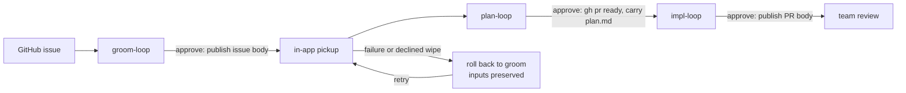

## 27. In-terminal loop engine — the live design

Its decisions are numbered **N1–N14**.

**On any conflict with §17–§25, this section wins for the in-app loop.**

### 27.1 Goal & boundary (N1)

- Turn the app into the **loop engine itself**, driving one interactive Claude Code instance the operator already watches by composing prompts, injecting them (§9.3), and managing the instance's context between actors.
- **In scope:** three loops — **`groom-loop`**, **`plan-loop`**, **`impl-loop`** — which are the *same loop shape* over different data. Each produces an artifact that is the next one's input (§27.10). Also in scope: the review-and-fix cycle, the consolidator, the human gate, in-app bootstrap (pickup), epic promotion, and whole-run cost accounting.
- **Out of scope:** the external Go `agent-loop` binary and its schemas (never invoked, never a compatibility target); `takeover`; epic instance **auto-launch**.
- **Three loops, deliberately.** Building `groom-loop` as well as plan and impl is not scope creep — it is the **proof of generality**. Three defs on one engine make it structurally impossible to hardcode a plan/impl assumption into the orchestrator.

### 27.2 The app is the orchestrator (N2)

- **The state machine and every "what to inject next" decision live in the app's main process**, not in the conversation. This is **forced**: clearing or compacting the instance's context destroys anything the conversation was holding, so orchestration placed there would not survive the first boundary. The orchestrator reconstructs each turn's context from **on-disk artifacts and its own state**.
- **Automatic, not human-paced.** Within a loop the orchestrator injects each actor turn and each context boundary on its own, advancing from what it reads back. The human is involved **only at the gate** (§27.9), on failure (§27.12), and whenever they choose to interrupt (§27.9).
- **"Injectable" means the hosted instance is idle at its own input box** — observed through the completion signal of §27.12 (a turn's done-signal has fired and the instance has gone quiescent), **not** raw `QUIET_MS` silence, which can falsely read a mid-turn model or subagent wait as idle (§8.3). Because the interactive agent is itself the shell's foreground process for the whole run, "the shell is at a ready prompt" cannot mean *the shell* is idle. The orchestrator injects only when the instance is injectable by that definition; an injection attempted while a turn is in flight is refused exactly as §19.3 refuses a busy shell.
- **No agent at the prompt: wait, then fail.** An agent is at the prompt when the running command line starts a listed agent program, or when the shell has shown no prompt of its own and run no command (the agent is the terminal's program). A command line starts a listed agent when any of its simple commands, after leading `NAME=value` settings, runs a program whose name (or the last part of its path) is in `APP_AGENT_COMMANDS`, `claude,codex` by default; quoted text is not split, so `echo "x; claude"` starts none (`src/main/agentCommand.ts`). A shell that has shown its prompt, from its first one on, with no listed agent running, is a bare shell, so a turn is never typed into a shell or another program such as an editor or a dev server. A listed agent at the prompt is *idle* when its output has been quiet (§8.3), otherwise *busy*. When a turn is ready to inject but no agent is at the prompt, the orchestrator never injects — the prompt would be typed into the shell. It waits for the operator to start an agent, for sixty seconds by default (`APP_AGENT_WAIT_MS` overrides it), and injects once that agent is injectable. The same wait applies when the agent leaves the prompt while a turn waits to be injected. If no agent has reached the prompt when the wait ends, the turn stops in `error` with the reason *no hosted agent at the prompt* (§27.12).
- **Human/orchestrator injection contention — accepted risk.** The orchestrator auto-injects into the same instance the operator is watching, and there is **no hard interlock** preventing an operator keystroke from interleaving with an in-flight injected prompt. During automatic iteration the operator is expected to keep hands off the keyboard. The one place this is *inverted* is **polish mode** (§27.9), where the orchestrator explicitly stands down and the keyboard is the operator's.

### 27.3 The loop (N3)

The orchestrator runs one **actor turn** at a time against the single instance: compose prompt → inject (§9.3) → wait for completion → read what it produced → decide the next turn.

```mermaid
flowchart TD
  START["enter loop step"] --> B0["context boundary<br/>(clear or compact, per the LoopDef)"]
  B0 --> WORK["WORK<br/>produces the artifact<br/>(runs ONCE)"]
  WORK --> B1["context boundary"]
  WORK -->|"no review rounds, human or undeclared step"| GATE
  WORK -->|"no review rounds, auto step"| ENGINE
  WORK -->|"goal leg ran its passes, so compact and start the next leg"| WORK
  WORK -->|"goal session blocked, so stop for a human"| GATE
  B1 --> RF["REVIEW-AND-FIX<br/>spawn the round's roster as parallel subagents<br/>fix every valid in-scope issue<br/>write the round report"]
  RF --> B2["context boundary"]
  B2 --> CONS["CONSOLIDATE<br/>read the last two round reports<br/>judge the round, pick the next roster"]
  CONS -->|"another round"| B1
  CONS -->|"clean, human or undeclared step"| GATE["HUMAN GATE"]
  CONS -->|"clean, auto step &#40;§27.9.1&#41;"| ENGINE["ENGINE APPROVE<br/>the same approve a human click runs"]
  ENGINE -->|"predicate holds"| DONE
  ENGINE -->|"halt reason &#40;N9b.6&#41;"| GATE
  CONS -->|"stop for a human"| GATE
  GATE -->|"request changes"| B1
  GATE -->|"redo the work"| B0
  GATE -->|"approve"| DONE["artifact accepted<br/>becomes the next loop's input"]
  GATE -->|"polish"| POLISH["orchestrator stands down<br/>the human drives the instance"]
  POLISH --> GATE
```

- **WORK runs exactly once (N3a).** The work turn produces the artifact — the groomed ticket, `plan.md`, the implementation. It is **not** re-entered on a consolidator verdict; the only thing that re-enters it is the human's explicit **redo** lever (§27.9).
- **REVIEW-AND-FIX is one turn, not two (N3b).** The main instance spawns the round's roster as **parallel `Task` subagents** (§27.4), receives their findings **into its own context as tool results**, fixes every valid in-scope issue itself, dismisses what is out of scope or invalid, and writes the **round report** (§27.5). Findings never round-trip through the filesystem to be re-read by a different actor — the app's injection ability is what makes that unnecessary. The fix rules the prompt carries all serve one aim, reaching a round that changes nothing: **each detail a fix adds is new surface the next round reviews.** So a finding that a mechanism a document specifies is wrong is fixed by replacing the mechanism with the contract it must meet and the test that proves it, never by elaborating it; a fix that would add a defence, state, outcome or field no acceptance criterion names, or another patch on a guard already patched several ways, is `needs a human`; behaviour no test environment exercises is recorded as an assumption with its real-run check rather than worked around; and a gap in test-support code (a fake or double of a real tool) is fixed only when a test the ticket needs relies on it, because a double can always be made more faithful and such fixes never run out.
- **The loop's brief reaches the work turn and every review-and-fix turn.** A def may declare a `brief` (§27.8): the standing instructions its work must meet. The boundary before review-and-fix (§27.7) usually clears the work turn's context, so without the brief the fixer would change the artifact knowing none of them. A step only the work turn takes, such as interviewing the operator, does not run again in a review-and-fix turn: a fix that needs the operator's decision is `needs a human`. The consolidator is not given the brief.
- **A loop may run no review rounds, and a goal work turn reviews its own work.** A def that declares no `consolidator` runs no review-and-fix rounds: its work turn reaches the gate as `clean`, so its gate cannot offer `request-changes`. A def may instead give its work a `goal`: the engine writes the work prompt to a file and submits the agent's `/goal` command naming it, and the session keeps working — reviewing its own work with the def's installed reviewer sub-agents (§27.4), handed the same hand-off and fix criterion as an engine round — until a check after each of its turns finds the condition holds. Claude Code and Codex both keep an active goal through a compaction, which is what lets a long goal run in **legs**: a def's `checkpoint` of review passes per leg makes the engine `/compact` and start the next leg, which resumes from the session's own notes.
- **The engine reads goal progress as JSON, never prose.** The session keeps a progress file the engine judges through the same shared predicate the session is told to run before it signals done (§27.12), and a separate notes file nothing parses. Progress files are keyed by a session id each fresh work turn draws and persists, so a Retry or relaunch keeps it and no earlier turn's progress can ever be read as this turn's. Only a `done` session is held to the work turn's completion check.
- **A blocked goal session stops for a human, who may resolve it in the session.** A session that cannot go on without the operator records what it needs; the turn reaches the gate as `stop for a human` with that text as the reason, so an `auto` step halts there (§27.9.1). If the operator resolves the block in the session and it signals done again while the turn is still at that gate, the turn resumes as on a Retry; a human decision taken at the gate first stands. This is the session's own signal, not a re-drive, so it holds after a relaunch too (N9b.8).
- **A goal session reviews only over a change, and re-reviews only what a fix concerns.** Work that changed nothing but its report and recorded test evidence runs no review, and a pass whose fixes changed nothing else ends the review — the same no-change rule as §27.6 `clean`, never a count of findings. Later passes run only the reviewers a fix concerns. Skipping a reviewer is the session's logged judgment, not an engine filter.
- **The fixer and the work agent question the design before a fix adds complexity.** Before a fix adds a special case, a flag, a workaround, a guard or a second copy of logic, they ask whether the design itself is the problem — a hand-parsed format that could be structured data, branches one rule would replace, a guard against a state the design could make impossible. A simpler design inside the ticket is made instead; one beyond it goes to a human. It is guidance, not a gate: nothing counts fixes across rounds (§27.6, N6a).
- **CONSOLIDATE judges the round, it does not merge findings (§27.6).**
- **Context boundaries are data (§27.7)** — each is `clear`, or `compact` with a custom message, declared per boundary in the LoopDef.

### 27.4 Reviewers pull; the engine never pushes (N4)

**This is the central design decision.**

- A reviewer subagent runs as the sub-agent installed for it (§18.1), whose own instructions are **its charter**, so it is never handed a charter to read. **The engine writes the reviewer hand-off** and the fixer passes it on word for word, so what a reviewer receives never depends on how the fixer phrases it. The hand-off names **the ticket** and, only where the loop has them, the **path** of the subject it grades and the **paths** of the inputs the step carried. It is handed **no diff, no code, no prior review, no consolidated findings, and no history**; it **pulls what it needs with tools**, and reads the test results the work recorded rather than re-running the suite. A subject is named by path, never content, so the prompt stays constant-sized. When there is a subject, the ticket is the **intent** it must honour, not the thing under review: the issue body can still hold text the artifact has since fixed, and a reviewer grading it would re-raise closed findings.
- The engine therefore pushes a **constant-sized** prompt at every reviewer, in every round, forever. A round's review cost is a function of **what each reviewer decides it needs to read**, never of the roster's shared context and never of how many rounds have already run. Per-round cost rising with iteration depth **should be absent by construction**. That is an **expectation of the design**, for the N7 meter to make observable (§27.11), not a criterion asserted in advance: a round may legitimately cost more than an earlier one when the consolidator picks it a larger roster (§27.6).
- It is also **more accurate**, not merely cheaper: a taint reviewer may need to read half the codebase to trace a flow, while an accessibility reviewer may need only the UI diff. A push model must send the union of what every persona might want; a pull model lets each fetch its own actual need.
- **A reviewer runs only as its installed sub-agent (operator decision).** Before a round is injected, the engine checks that every reviewer on the roster is installed with exactly the charter and tools this run resolved, and otherwise refuses the round with a recoverable error naming the fix. Sub-agent files are generated only from the bundled loops, so a run whose charters were edited cannot run its reviewers — strict, by operator decision. An agent session loads sub-agents only when it starts, so a reviewer reported `not loaded` stops the round at once: no retry could succeed without a restart.
- **The engine detects which agent the terminal hosts** (Claude Code or Codex) once per turn, so the reviewer check and the prompts name each reviewer the way that agent installed it (§18.1).
- **Reviewers are isolated and parallel.** Each subagent is a fresh context and they run concurrently. There is **no warmer** and nothing to amortize — there is nothing shared to amortize *over*.
- **The roster for a round is chosen by the consolidator** (§27.6), from the catalog the LoopDef declares. **Round 1 runs every persona in the catalog.** A persona the LoopDef does not declare can never be invoked.
- **Reviewer cost is captured in the subagent logs** (`~/.claude/projects/<slug>/<uuid>/subagents/agent-*.jsonl`), which the meter sweeps (§27.11). That layout is Claude Code's private format — an external dependency the app does not control — so the parser tolerates drift (unknown or empty → omitted, never throws).

### 27.5 The round report (N5)

The round report is the **sole contract** between the fixer and the consolidator, and the **only durable record** of what a round did.

- **Format: JSON with a prescribed structure.** Prescribed, so the engine can validate it is complete before advancing (§27.12) and the consolidator can rely on its shape; JSON, so the engine, the agent's own check and every other reader judge it through one shared predicate (`src/shared/roundReport.ts`), never a hand-written grammar. Its text fields are the prose the human reads at the gate.
- **It must account for every persona the round invoked** — including one that **failed or returned nothing**. The engine validates the report covers the round's roster (which it chose, so it knows). A report missing a persona is **malformed**, and takes the retry-then-`error` path of §27.12. A reviewer that quietly disappears is therefore not something the fixer can hide. A persona that **failed to run** has the status `failed`, distinct from one that ran and found nothing (status `ran`, no issues) and from one that raised a `needs a human` issue (a disposition, not a run-failure). The statuses `ran` / `failed` / `not loaded` are spec-fixed vocabulary, single-sourced with the disposition set, recognized by exact string equality — never normalized.
- For every issue raised it records: **the persona that raised it, the issue, its disposition** (`fixed` / `dismissed — out of scope` / `dismissed — invalid` / `needs a human`), **the reason**, and **what changed** if it was fixed.
- **Reports are versioned per iteration** and never overwritten. The versioned series is the forensic record.
- **Reports live locally under `<repo>/.agent-terminal/loop/reports/<n>.json` and are never committed.** This is not merely tidiness: the impl-loop's reviewers **pull the diff with tools** (§27.4), so a committed report would appear *inside the diff they are reviewing*. Reports must stay out of the working tree's committed surface or the loop reviews its own commentary.
- **Accepted risk, recorded (N5a): the fixer marks its own homework.** The fixer decides which issues are valid, fixes them, and writes the report — and the consolidator sees **only that report**. Nothing in the loop can detect an issue the fixer declined to write down. This is the load-bearing assumption of the design: it is accepted in exchange for having no per-persona artifacts or findings-merging step, and it is bounded by three things — the report must account for the full roster (above), the versioned reports are auditable after the fact, and the human gate is the backstop (except on an `auto` step, §27.9.1). It is stated here so it is a known limitation, not a latent surprise.

### 27.6 The consolidator (N6)

The consolidator is a fresh turn (its boundary is declared, §27.7) whose job is to **judge the round**, not to merge findings. It has three outputs.

**1. A verdict.** It reads **the last two round reports** — this round's and the previous one's — and nothing else. Two is exactly enough to see whether the loop is converging, and it is a **fixed window**, so the consolidator's own cost cannot grow with iteration depth either. It writes the verdict to `<repo>/.agent-terminal/loop/consolidate/<n>.json` as JSON: `verdict`, plus a `roster` list for `another round` and a `reason` for `stop for a human`.

| verdict | what it means | what happens |
|---|---|---|
| `clean` | the round **changed nothing** — every issue raised was dismissed, and nothing needed fixing | stop at the human gate (§27.9), or, on a step whose `gate_authority: auto` is honoured (§27.9.1 N9b.2), the engine approve (§27.9.1) |
| `another round` | the round **fixed something**, so the artifact changed and needs fresh eyes on the new state | back to review-and-fix |
| `stop for a human` | the loop is **spinning** (something fixed last round is back), or a reviewer raised something the loop is not entitled to decide | stop at the human gate, with the reason |

- **The termination rule is: `clean` = the round changed nothing.** This is what makes memory-less reviewers and a memory-less fixer *correct* rather than merely cheap. **Scope is a function of the ticket, not of history.** A reviewer with no memory will re-raise the same out-of-scope observation every round, and a fixer with no memory will re-dismiss it for the same reason every round — and that is the system correctly **re-deriving a settled judgment**, not failing to converge. The loop terminates when a round produces no changes, which is precisely the statement "the artifact is stable under review."
- **A round in which a reviewer failed can never be `clean`.** The report says the persona failed (§27.5); the consolidator must not read a round with an unrun lens as settled. The remediation is fixed: a lens failing for the first time (not failed in the previous report) is re-reviewed in the next round's roster; the same lens failing again on that re-review routes to `stop for a human`. That is one automatic re-review per lens-failure episode, keyed on the two-report window — not a counter. A run where a *different* lens fails each round is bounded only by the human interrupt (§27.9), which is deliberate: a global counter is exactly what N6a rules out.
- **There is no iteration cap (N6a).** This loop's termination rule is a property of the artifact, and the backstop against a runaway is the **human interrupt** (§27.9), not a number.

**2. The next round's roster.** Having just read what the round did, the consolidator **chooses which personas run next** — from the LoopDef's catalog, with a stated reason. The actor that just read the round's report is the one best placed to decide who needs to look, rather than a mechanical rule guessing who can be skipped. It may also re-run the whole catalog when the artifact changed enough to warrant it.

**3. The interrupt check.** If the operator has armed the interrupt (§27.9), the consolidator routes to the human gate regardless of its verdict — and still states the verdict it would otherwise have reached, so the human arrives knowing whether the loop thought it was clean, progressing, or stuck.

### 27.7 Context boundaries — clear or compact (N7)

A `/clear` at every actor boundary is why nothing in the old loop amortized: every turn re-read everything it needed from disk. But an unconditional *compact* is equally wrong — the consolidator's judgment is worth less if it inherits the fixer's context and its rationalizations.

- The **boundary policy is data-driven from the LoopDef**: each actor boundary declares **`clear`**, or **`compact`** with a **custom compact message** naming exactly what must survive it.
- Different loops make different choices, and the engine has no opinion. It executes the boundary the def names, and confirms it (§27.12).
- The boundary is also the **cost-metering segment marker** (§27.11).

### 27.8 The LoopDef (N8)

- **The defs are owned by agent-terminal**, in a **new schema of its own design**. The `github.com/dequelabs/loops` defs are **not vendored, not parsed, and not a compatibility target**. This is the clean break: no dual schema, no upstream coordination.
- A def declares:
  - **`brief`** (optional) — the standing instructions the work turn and every review-and-fix turn carry (§27.3), a reference confined like the recipes;
  - **`work`** — the work prompt recipe, the artifact it produces, and optionally a `goal` the turn works until and, with it, a `checkpoint` of review `passes` per leg (§27.3), and optionally a prompt-only `self_check` the agent runs on what it wrote (§29.6);
  - **`reviewers`** — the **catalog** of personas available to this loop, each with its **charter** (a reference, never an inline body — §18.6) and, optionally, the tools it may use; a reviewer whose def lists none has every tool, as every bundled reviewer does. Round 1 runs the whole catalog; thereafter the consolidator selects from it (§27.6);
  - **`consolidator`** — its prompt recipe. A def without one runs no review rounds (§27.3); a def that declares reviewers and no `work.goal` must declare one, and a def with a `work.goal` must not;
  - **`boundaries`** — `clear` or `compact: <message>` for each actor boundary (§27.7);
  - **`report`** — the prescribed structure the round report must satisfy (§27.5), and its **`polish`** policy: `fix` (the default) or `defer`. Under `defer` the review-and-fix turn dismisses a polish finding — one whose fix changes no runtime behavior, no test's ability to fail, and no contract another surface reads — as `dismissed — out of scope`, so a polish-only round changes nothing and is `clean` (§27.6). A loop may declare `defer` only when a later loop in its flow re-reviews the same diff with a catalog that fixes polish; the shipped per-slice loops (infra, red, green, refactor) defer to the integration-slice sweep; the fixer is told only that a later loop fixes polish, never which;
  - **`gate`** — the human options available (§27.9) and their side-effects (§27.13);
  - **`pickup`** — the bootstrap contract (§27.10);
  - **`inputs` / `outputs`** — the artifact this loop consumes and the one it produces, which is what chains groom → plan → impl (§27.10).
- **Origin carries no trust distinction**, `gate_authority: auto` included (§27.9.1 N9b.2). Def tiers — app-bundled (the defs shipped with the app), operator-config and repo — are resolved identically. The schema declares `ExecSideEffect`, the executable side-effect that would let a def name a program to run, but it is **unshipped**: nothing in this engine drives it. Shipping it requires deciding trust afresh.
- **Lookup order.** A loop name resolves from the repo's `.agent-loop.yaml` `loops:` override first, then the **running flow's own folder** (operator-config tier, then app-bundled), then the shared operator-config folder, then the shared app-bundled folder. A flow's own definitions outrank every shared one, so two flows that bind the same loop name can change independently. The bundle ships only per-flow folders, so Install examples (§18.1) never overwrites a shared definition an operator relies on. A definition, or the repo's `.agent-loop.yaml`, that exists but is a named pipe or a device, or is larger than its size limit (256 KiB for a definition, 64 KiB for the registry), is refused with a reason, never read, so repository content cannot block the main process on it or make it read without bound. A `.agent-loop.yaml` that is a link is followed.

### 27.9 The human gate (N9)

The gate is the **whole** human interface to a running loop. Its options are declared per-loop in the def and rendered data-driven. On a step whose `gate_authority: auto` is honoured (§27.9.1 N9b.2), the engine takes **Approve** when the step finishes clean (§27.9.1); every other option, and every N9b.6 halt, stays human.

- **Approve** — accept the artifact. It becomes the next loop's input (§27.10) and the loop's gate side-effects run (§27.13). Terminal for that loop.
- **Request changes** — the human types feedback; it joins the **next review-and-fix round** alongside the reviewers' findings (this reuses the §19.4 composer: curate a review-todo subset + free text, compose-with-agent or submit-as-is). The narrow, incremental lever.
- **Redo the work** — the human types an instruction that **re-enters the work turn**, whose **only** inputs are the **ticket**, the **plan**, and **that instruction**. No findings, no report history, no accumulated context. The deliberate clean-slate lever, for when the artifact is wrong in a way that iterating cannot fix.
- **Polish** — the **orchestrator stands down and releases the prompt.** The loop stops injecting; the operator converses with the live instance directly in the terminal, on the context it holds from the round it just finished; a separate **approve** control ends it. This is the one state where the §27.2 contention risk is inverted by design: the keyboard is the human's, and the orchestrator is the one that must not type.
- **Abandon is not a loop verdict.** Killing a run is the flow-level **Terminate** (§25.5 `flow.terminated`), which already exists. The loop's vocabulary stays about the work, not the lifecycle.

**The interrupt (N9a).** At any point during automatic iteration the operator may **arm an interrupt** ("hand back to me"). It is **queued, not immediate**: the round in flight finishes — reviewers return, fixes land, the report is written — and the **consolidator honors it at its next invocation** (§27.6), routing to the gate regardless of verdict. Nothing is ever killed mid-turn, so there is no such thing as a half-applied round. This is the loop's only bound on runaway iteration, and it is a human, not a counter.

#### 27.9.1 Gate authority — human / auto (N9b)

In N9b, **"run"** is the flow run bound at Start (§18.7) and **"loop run"** is one step's §27 loop run; every input in N9b.5(b) names which of the two it is scoped to.

**Trust model and boundaries (operator decision).** The coding agents a flow runs (the work, review, consolidator and repair turns) act for the operator, with the operator's authority. They are **trusted operators, inside the operator's trust boundary, not adversaries**, and so is **the run's own state**: its run-state, loop state, mirror files, pointers and records, before and after a relaunch. N9b defends no boundary against either. No clause guards against an agent rewriting a flow, def, test glob, flag or state file, none distrusts what the run itself persisted, and none distrusts the repo the run works in. Neither is repo-controlled content: a flow or def checked into the repo is honoured as the operator's own. **An adopted pull request (§27.10) is inside the boundary too (operator decision):** the reviewed PR's code and checked-in tree, its `.agent-terminal/` content included, are honoured as the operator's own, and the run executes them with no confirmation step, even for a fork. The app's run state under `.agent-terminal/loop/` is not part of that content: a PR's copy of it is never trusted as the run's record, so the adoption start refuses a PR head that tracks anything there (or replaces `.agent-terminal` with something other than a folder), and the fix-branch checkout never overwrites a git-ignored file the operator's tree holds. The app's other state files directly under `.agent-terminal/`, such as `flow-state.yaml`, `active-flow.yaml` and `run-disposition.yaml`, **are** the PR's content (operator decision, 2026-11-07). A PR that adds one where the operator's tree has none is honoured like its code, so it can set the flow's current step, its refs or its start, and the adoption start does not refuse it. The trust boundaries N9b defends are the ones it names: the **human-decided gate** (N9b.3–N9b.6: what routes to a human) and **ordinary robustness** (a malformed, missing or unreadable input fails closed rather than crashing or advancing). N9b's checks catch **mistakes** and hand control back to a human (a non-`clean` verdict, a failed check, a frozen-test change, a hang). A newly identified attack class that crosses one of the named boundaries is escalated to the operator for a decision. It is not silently hardened against, and it is not silently dismissed.

**Override scope.** `auto` is an explicit operator override, only on steps whose `auto` is honoured (N9b.2). It overrides the following: the §27.6 verdict table's `clean` → "stop at the human gate" row; §27.9's premise that every gate is human-decided; §28.8 item 1 (P8.1, "one human gate"); §19.2's human gate decision; and, on those steps, **the human gate as the backstop** that §27.5 N5a, §28.5.2(c) and §28.5.6 name. On such a step the approve runs the step's outward §27.13 side-effects with no human click. Only epic promotion stays confirm-first (N9b.6(k)). N9b.6 is outside the override.

- **N9b.1 — The field.** `gate_authority`, declared on a `loop` step in `flow.yaml` (§18.2), not on the LoopDef: one LoopDef is bound by many flows, and the authority is per-step. The value is the closed set `human` | `auto`. **Absent reads as `human`.** An unknown value fails the **whole flow load** (§18.1 `error`). The field on a non-`loop` step also fails the **whole flow load**.
- **N9b.2 — Where `auto` is honoured.** `auto` is honoured on every `loop` step that declares it, whatever tier supplies the flow (a global or per-repo catalog entry, a local `flow.yaml` or the global fallback, §18.7.3) and whatever tier supplies the LoopDef and the recipes and charters it references (app-bundled, operator-config or repo, §27.8). Letters (a) and (b) are retired and not reused.
  - **N9b.2(c) — read from the run's flow.** A step's authority is read from the flow bound at Start (§18.7). **A flow that changes during a run is outside N9b (operator decision; settled, not open for review).** N9b makes no promise about whether, or when, a change to the run's flow after Start changes a step's authority. That includes an edit that raises or lowers a step, a local `flow.yaml` that takes over resolution mid-run (§18.7.3), and a held-run re-bind onto another flow (§18.7.4). The implementation may read the authority whenever it finds simplest, and nothing has to test, guard, halt on or report such an edit. A reviewer who raises it has raised a settled decision, not a finding.
- **N9b.3 — `human` and undeclared are unchanged.** Throughout N9b, **"a run with an `auto` step"** means a run whose bound flow (N9b.2(c)) declares `auto` on at least one step. A step declaring `human` or declaring nothing behaves exactly as §27.9 states: every gate stop waits for a human decision, and nothing in N9b.4–N9b.9 applies to it except: it shows a set failed-effect marker, and its decision clears it (N9b.5(d)); and in a run with an `auto` step, its consolidation honours the run-scoped interrupt arm, so an arm made on another step of the run hands back at it (N9b.6(c)). Its human decision's §25 gate-decision entry is the one it writes today, unchanged, which N9b.9 reads as human-decided. A run with no `auto` step can set no failed-effect marker, so its gates are exactly §27.9's. No N9b.6 reason is shown at a human-decided gate, and none halts it.
- **N9b.4 — "Finishes clean".** An `auto` step *finishes clean* when the consolidator's verdict for the round that brought it to the gate is `clean` (§27.6) and neither N9b.6(a) nor N9b.6(b) holds. The **approve predicate** is: the step finishes clean **and** none of N9b.6(c)–(l) holds. N9b.6 is the single, closed home of every halt reason; every other clause cites its letter. Every loop end state has exactly one outcome: `clean` with no N9b.6 reason → `auto` advances; `another round` with no interrupt honoured → back to review-and-fix; `stop for a human` → halts at the gate with the verdict as its N9b.9 reason; any N9b.6 reason → `auto` halts, and the gate shows, and N9b.9 records, every reason that holds.
- **N9b.5 — The engine approve is the approve, evaluated at the operation.**
  - **N9b.5(a) — once, at the operation.** When an `auto` step reaches its gate, the engine evaluates the N9b.4 approve predicate **once, at the approve operation, over one snapshot** of its inputs.
  - **N9b.5(b) — the inputs.** The predicate reads: the consolidator's verdict and the round report's dispositions, as the engine parsed and validated them at their §27.12(b) artifact check in the step's loop run; every §27.12(c) acceptance (loop run); the loop status (loop run); the operator's interrupt arm (run, N9b.6(c)); the phase baseline commit (run: captured by an earlier step's §28.5.1 `commit` side-effect and read at a later step's approve, N9b.7(b)); and the failed-effect marker (run, N9b.5(d)). Each is read from where the run keeps it, its persisted state included, and survives a relaunch with that state (N9b.8). One that is missing or cannot be read is reason N9b.6(h).
  - **N9b.5(c) — the same approve.** If the predicate holds, the engine invokes **the same approve operation a human click invokes, with every effect it has** (§27.9 Approve, §27.13, §28.3, §28.4 among them) — not a parallel copy. Only the deciding party differs. The engine acts on an **outcome the approve operation returns that names each case** (`GateApproveOutcome`), never on one inferred from persisted state. Its outcomes that stop at a human are N9b.6(k)–(l); a human decision that landed first is N9b.5(e).
  - **N9b.5(d) — the failed-effect marker.** A side-effect, or the flow advance itself, that fails **after** the approve has persisted its accept (from that point a failure no longer aborts the decision, §27.13) is handled exactly as for a human approve; because no human saw it, the engine also sets the failed-effect marker. The next gate the run reaches, of either authority, shows the failure; if it is an **`auto`** gate it halts with reason N9b.6(i). A human gate decision at a gate that showed the failure clears the marker. A run that reaches no further gate ends with the failure shown and recorded (§25), never silently. The marker is persisted with the run's state, so it survives a relaunch (N9b.8); a marker that cannot be read is reason N9b.6(h).
  - **N9b.5(e) — one decider per gate, and what the gate reads as while the engine decides.** An engine approve and a human decision at the same gate are serialized at the approve operation: if any human decision attempt reached the gate first — even one that was dropped or failed — the engine stands down, writes no engine-decided entry, and the gate stays human-decided, so the engine never approves over a human who tried to decide. Between the `clean` verdict and the engine's decision, an `auto` gate is **not** human-needed. It becomes human-needed when an N9b.6 reason holds, when the engine stands down, when the approve stops at a human (N9b.6(k)–(l)), when the gate was reached before a relaunch (N9b.6(j)), or when the decision has not settled within `APP_AUTO_GATE_DECISION_MS`, so a hung git or `gh` call never leaves the gate silent. An invalid configured bound falls back to the default, so the bound always fires. At the bound, an unsettled pre-approve evaluation is a reason that holds and its later result is discarded; an unsettled approve is abandoned unless it already passed its pre-persist check — that check and the abandonment are one atomic decision, so the gate the human is shown always has exactly one decider. An approve that won the race persists its accept, and the hang is handled as a failure after the accept (N9b.5(d)).
  - **Human-needed is derived once, in main.** It is the `humanNeeded` field of the §6 `FlowLoopView`, and every human-needed surface (notification, awaiting-human alert, gate display, status tone) reads that field rather than re-deriving it from the status string; `src/shared/loopStatus.ts` is the status-string half of it.
- **N9b.6 — The halt reasons: one closed list.** Every case in which an `auto` step's gate is decided by a human, other than the §27.6 `stop for a human` routing (N9b.4) and the engine standing down for a human decision that landed first (N9b.5(e)). Each lands on the human gate **with its letter and reason visible there**, every reason that holds shown together, and each is a reason N9b.9 records. No other clause defines a halt. A reason whose evaluation cannot complete (an error, or a result that cannot be determined) **holds**: the approve predicate is true only when every pre-approve reason, (a)–(j), was evaluated and none holds; (k) and (l) are read only from the approve's returned outcome.

  *Pre-approve* — the engine does not invoke the approve:
  - **(a)** the round report records any issue with disposition `needs a human` (§27.5), checked by the engine against the report, not taken from the verdict;
  - **(b)** the loop ended in `error`, or **any turn of the loop run** (the work turn, or any round's review-and-fix, consolidator or repair turn) failed its §27.12(b) artifact check, every §28.5.3 completion clause included, and was accepted through the §27.12(c) manual control;
  - **(c)** an operator interrupt (§27.9 N9a): **either** the gate was reached by the consolidator honouring one, **or** one is armed when the approve operation runs. The approve-site halt **consumes** the one-shot interrupt exactly as the consolidator does, whatever other reasons hold, and it is recorded as the N9b.9 entry with reason (c), **not** as the consolidator's interrupt-honoured event. A consume that cannot clear `armed-interrupt.yaml` is shown at that gate, and a file still armed is honoured as an arm (it only routes to a human) until a clear succeeds. In a run with an `auto` step the arm is **run-scoped** on every step of the run, whatever that step's authority (N9b.3): an arm made for any step stays armed until consumed and is honoured by the next consolidation or approve operation of the run, whichever step it names;
  - **(d)**, **(f)**, **(g)** are retired letters and are not reused; run logs that carry (d) still parse;
  - **(e)** frozen check unavailable: the approve-time check could not run, or its result could not be recorded as the §28.5.1 flag (N9b.7(a), (c)–(d));
  - **(h)** a predicate input is missing or unreadable (N9b.5(b));
  - **(i)** a failed-effect marker from an earlier engine approve is set (N9b.5(d));
  - **(j)** relaunch: the gate was reached before a relaunch, and §27.12 resumed the run at it (N9b.8).

  *Approve outcome* — the engine invoked the approve and it stopped at a human:
  - **(k)** the approve raised the epic-promotion preview (§27.10, §28.7), or promotion returned `blocked`. The engine never confirms; the preview is recorded as engine-decided, and the confirm (or the human's resolution of `blocked`) as human-decided;
  - **(l)** the approve operation returned without persisting its accept, or threw or rejected, for any reason other than (k) or a human decision that landed first (N9b.5(e)) — a precondition refusal, a failed accept persist, or a caught throw. The **current** gate is human-decided, the failure is shown there, and the engine never re-attempts the approve. A failure after the accept persisted is N9b.5(d), not (l). A throw carries no named outcome, so the engine cannot tell whether the accept persisted and never reads persisted state to find out (N9b.5(c)): it is (l) **and** sets the failed-effect marker, so a failure after a persisted accept is still shown at the next gate, or at the run's end if none follows.

  `another round` with no interrupt honoured, and `stop for a human`, are not "clean" by N9b.4, so they keep their §27.6 routing and are not N9b.6 reasons; N9b.9 records a `stop for a human` halt on an `auto` step with that verdict as its reason.
- **N9b.7 — Frozen tests under `auto`: the engine runs the check at the approve and records it.** A frozen-tests detection under `auto` **does not halt**: the step that changed a RED test decided the change itself and logged it (§28.5.1), and the engine's record of the change is what the implementation approval presents, so nothing a step changed reaches the operator only through that step's own account. On a step whose loop carries a frozen check (the §28.5.3 GREEN and refactor clauses, or `work.frozen_check: true`), at the approve operation:
  - **N9b.7(a) — the globs** are read from `loop-capabilities.yaml` (§28.5.4) as it stands in the working tree; an unusable file is reason N9b.6(e).
  - **N9b.7(b) — the engine runs the check itself**, over the working tree at the approve against the phase baseline commit (for GREEN, the SHA captured at the RED approve), so it covers every test edit any review round made. The step advances only if that check **ran** and its result was recorded; what it detected does not decide the gate.
  - **N9b.7(c) — fail closed.** A check that cannot run is N9b.6(e). Its git reads run with optional locks disabled, so a read abandoned at the N9b.5(e) bound holds no index lock that would fail the human approve's commit.
  - **N9b.7(d) — recorded before the approve proceeds**, as the §28.5.1 flag (a clean result included, so every reader shows the current value) and in the RED test change record. A failed write is N9b.6(e). "Could not run" is never written to the flag; it is the N9b.6(e) gate and audit reason.

  On a step whose loop carries no frozen check, N9b.7 and reason N9b.6(e) do not apply.
- **N9b.8 — Relaunch: the run keeps its authority.** A run §27.12 resumes after a relaunch keeps its gate authority: N9b.2(c) reads it from the run's bound flow and N9b.5(b) reads every input from the run's persisted state, so its later `auto` gates are decided by the engine exactly as before the relaunch, and a failed-effect marker set before the relaunch is shown as N9b.5(d) states. A gate the run had already reached before the relaunch is **not re-driven** (§27.12 Auto-resume: a gate status is human-owned): an `auto` step found at its gate, including one after a `clean` verdict whose engine approve had not run, halts with reason N9b.6(j), and a human decides it.
- **N9b.9 — Audit.** Every gate decision's §25 audit entry tells **who decided**: an entry the engine decides under `auto` carries an engine-decided mark, and an entry without one is human-decided, so a human decision's entry is unchanged (N9b.3) and a timeline reader can tell which kind advanced each gate. Because the engine invokes the same approve operation (N9b.5(c)), the mark is added to the existing gate-decision record — on the decision and every effect-outcome entry it writes — never written as a parallel event, so no new §25.5 event type is needed and existing readers keep parsing. A halt the approve writes no entry for (any pre-approve halt, a `stop for a human` verdict on an `auto` step, a (k) `blocked`, an (l) other than a failed accept persist) is recorded as **one** engine-decided entry naming every letter that holds, or the verdict. The vocabulary and its anchored parsers are single-sourced in `src/shared/audit.ts`, so a detail that happens to contain the mark is never misread.
- **N9b.10 — A gate that stops for the operator asks the agent why.** Every gate stop that waits for a human decision injects one question into the hosted agent session — *why does this gate need me?* — naming the step and, for an `auto` halt, every reason that holds, rendered as the gate renders it. It asks the agent to state what the operator must decide and why the engine stopped, and to change no files. A halt on a **resumable stall** (§27.12) is the exception: the question names the turn's key and done-file and tells the agent that, if the turn is still under way (a quiet screen also means an agent waiting on a command or subagent it started), it answers and then finishes the turn and writes its done-file, which resumes the loop with no Retry. It is not a turn and changes no loop, gate or run state. It is asked **once per gate stop**, never for a gate re-read after a relaunch (whose session did not do the work), only when the instance is injectable (§27.2), and is withdrawn if the gate is decided or the run moves on first. It is best-effort: a question that cannot be delivered never aborts the halt or the gate.

### 27.10 Artifacts, chaining & bootstrap (N10)

**The three loops are the same shape over different data, chained by artifact.**

- **`groom-loop`** takes the raw GitHub issue and produces **the groomed ticket**. Its approve gate **publishes the groomed ticket back to the GitHub issue body** (§27.13).
- **`plan-loop`** takes the groomed ticket and produces **`plan.md`**.
- **`impl-loop`** takes the plan and produces **the implementation on the PR**. Its work turn's product is commits, not a file.
- **Bootstrap (pickup) is a separate app action**: on entering the first loop step that needs one, the app validates a clean tree, creates the branch **off the base the `pickup` contract resolves** (the repo's base branch, or the preceding slice's branch for an epic sub-ticket — below), writes an empty `[skip ci]` start commit, pushes, opens and persists the **draft PR that `closes #n`**, enters work, and then assigns the issue and applies labels best-effort — driven by the def's `pickup` contract, never hardcoded. **Groom does not absorb it.**
- **A pickup that cannot run never fails silently and never strands the flow.** It runs asynchronously after the loop step is entered, so a failure (dirty tree, unresolvable base, conflicting branch, rejected PR create) arrives after the transition returned. When it does, the app **rolls the flow back one step**, preserving the resolved inputs, and **surfaces the reason in a blocking error dialog**. A destructive re-pickup (an existing target branch under a wipe policy) is **confirm-first**: the app does nothing destructive on detection, names the exact local/remote ref object IDs and open PR numbers, revalidates that snapshot at the operation, and recreates the branch only after the exact wipe completes. A wipe that fails part-way does not restore wiped refs or reopen closed PRs; the flow rolls back with a visible next action instead.
- **Every turn after pickup runs on the branch pickup created.** Pickup's branch is the run's branch for the rest of the flow, since the steps after it declare no pickup of their own and work on whatever is checked out. Before injecting any turn (work, review-and-fix or consolidator, the boundary command included), the engine compares the checked-out branch with the one pickup recorded for the flow's ticket. If they differ, or HEAD is detached, it injects nothing and stops the turn in `error`, naming both branches, so the operator can check out the pickup branch and Retry. A run whose ticket has no completed pickup is not held to a branch, and a pickup record left by an earlier run does not count: once a run is started, restarted or terminated, the record holds turns only after that run's own pickup completes, or for a run resumed across a relaunch. If the pickup record exists but cannot be read or validated, or git cannot report the checked-out branch, the check fails closed: the turn stops in `error` with that read failure as its reason, never treated as "no pickup" or as a detached HEAD.
- **A pickup can adopt an existing pull request instead of a ticket** (`pickup: { adopt: pr }`, #304). The step's `pr` input (§18.4) names the PR, and the PR's GitHub closing references, never its title or body, name its tickets. A closing ticket counts only when it lives in the PR's base repository (origin) or its head repository.
  - **Every run on a PR is a new run** on its own **fix branch**, derived from the PR number and the run's start (`agent-terminal/review-pr-<N>-<startedAt>`), so a relaunch of the same run derives the same name and a later run never reuses an earlier one's branch, fix PR or comment.
  - **The start publishes nothing.** It requires a clean tree, reads the PR, fetches its head (`refs/pull/<N>/head`) and base from origin only, creates the fix branch at the fetched head without ever overwriting a local branch, checks it out, and records the PR, its head and base names, its head repository and fork flag, its acceptable tickets, the primary ticket, the fetched head and the merge-base with the base tip. There is no start commit, push, draft PR, assignment or label (operator decision: nothing is published before the human gate approves). A failure after the fix branch exists restores the branches and checkout to how they were before the start.
  - **Refusals** follow the rollback-and-dialog path above, with no branch created: a PR that is closed or merged, that closes no acceptable ticket, whose head or base branch or head repository is not one a pickup can record or is missing (a deleted fork), whose head tracks the app's run state (§27.9.1), or whose derived fix branch already exists locally.
  - **A PR closing more than one acceptable ticket** raises a blocking dialog, after the PR number is submitted and before any branch exists, that asks the operator to pick the **primary** ticket. The primary is the run's identity: its pickup record, its §25 `ticket.assoc` (with the ticket's repository) and the ticket the branch hold names. The start re-reads the PR before using the pick and rolls back, naming it, when it is no longer acceptable; a stale or un-offered answer is refused with the start still held; Cancel rolls the step back. A PR closing exactly one acceptable ticket asks nothing.
  - **What the run presents.** Every prompt and reviewer hand-off names the PR, names every acceptable ticket as intent with an instruction to read it and its comments through `gh` in its own repository, and names the change as the range from the recorded merge-base to the fix branch. They say that the PR's title and body are not intent, and that the run's own documents are only its declared inputs and outputs: any other file in the tree, `.agent-terminal/` included, is the reviewed PR's content.
  - **The branch hold** above applies to the fix branch: an adopting run's turns are held unless the fix branch recorded for the flow's PR is checked out, and the held reason names both branches and the primary with its repository.
  - **Load rules.** A flow with an adopting step fails to load, naming both sides, when: the step has no required `pr` input; the flow has any other `pr` input; another step adopts a PR or picks up a ticket; any step's gate declares `update-issue-body`, `mark-ready`, `publish-pr-body` or `promote`; the adopting step declares `gate_authority: auto` (adoption needs a human gate); or `publish-pr-review` is declared on another step's gate or names an artifact that is not one of the adopting step's outputs.
- **Loop state is app-owned**, under `<repo>/.agent-terminal/loop/`, in a schema of the app's choosing — there is no external writer to reconcile with.
- **A document several steps each write part of is assembled by the engine, never edited in place by an agent.** Each step writes its own whole section file (a binding's `sections_dir`), and the engine rebuilds the document from those files at fixed points before anyone reads it. A botched edit can therefore damage only that step's own small file, which it rewrites whole, and a step that runs again replaces only its own section. Section files and the assembled document derive from one resolver (`src/main/reportSections.ts`).

**Epics fan out into a chain of self-contained sub-tickets.** A plan the work agent classifies an **epic** is planned once, as a whole, and then implemented one slice at a time in **parallel worktrees** — the operator opens the next slice while the previous one is still in review. The chain is what makes that possible, and it lives on **GitHub**, not in loop state: a slice is picked up in a fresh worktree whose loop state is empty, so everything its pickup needs is recoverable from the issue alone. App-owned loop state records only that the promotion already ran, so it cannot fire twice.

- **Promotion is confirm-first.** It creates public issues irreversibly, so on approving an epic plan the operator sees **every sub-ticket that will be created**, the epic tracking edit, and the **epic planning PR close** **before anything reaches GitHub**, and can back out having seen the split the agent chose.
- **The epic issue becomes a tracking issue.** Its body is **never overwritten** — it is the human's original intent contract — and it gains the checklist of its chain, **written once at promotion and not maintained thereafter**.
- **Every slice gets a sub-ticket, including the first.** N slices produce N sub-tickets, each carrying its **portion of the epic's acceptance criteria**, the **approved plan verbatim** with that slice's portion delimited within it, a link to the epic, and the **issue number of the slice before it**. The plan's slice-to-AC assignment is copied **as authored**: the app never parses the epic's acceptance criteria, and the plan gate is where a human judges whether the split is right and complete.
- **Slice 1 is a uniform sibling (P7b — §28.8).** Every sub-ticket, slice 1 included, is created the same way — carrying `subticket` + `ready`, **none assigned** — the epic planning PR is **closed** (not re-pointed onto slice 1), and promotion **terminates** the flow. The operator opens a fresh worktree and picks up slice 1 by hand like the rest. The epic issue (now a tracking issue) survives its slices regardless.
- **Promotion is resumable.** Every artifact is recorded the instant it exists, so a promotion that fails partway **surfaces what did and did not land** and a retry creates **only what is missing** — never a duplicate, never a gap.
- **It does not auto-launch** child instances or worktrees. The operator opens a worktree and picks up the next slice **by hand**.

**Picking up a sub-ticket skips groom and plan.** A ticket marked an epic sub-ticket enters the flow at groom like any other; the app reconstructs the groomed-ticket and plan artifacts **from the ticket body as it stands** — a human's edits to it are honoured in full, because the body is the intent contract — and advances to the **impl** loop without running groom or plan. A body missing or malformed in a section the reconstruction needs **creates nothing and surfaces why**, rather than reconstructing half a state.

**Sub-ticket PRs stack.** Slice k's pickup bases its branch and its draft PR on **slice k−1's branch**, derived from k−1's issue number through the same `pickup` branch template that created it — a branch name recorded at promotion time would be a guess, since k−1 is usually not yet picked up. When that branch does not exist — k−1 was never picked up, or its branch has already merged and been deleted — pickup **falls back to the epic's own base and says so**, naming the slice it expected to stack on, rather than silently retargeting.

> **Explicit operator instruction, recorded.** The app applies **`agent-loop/ready`** to the sub-tickets it creates, alongside an `agent-loop/subticket` marker. This overrides the CLAUDE.md rule that only a human applies that label: **approving the epic plan is the human vetting act**, and it vets all N slices at once. The marker is what pickup keys on to reconstruct state; the ready label is what makes the chain pickable without a second per-slice gate.

### 27.11 Cost accounting (N11)

- **The meter reports the cost of the entire run — every token spent from flow start to flow terminate.** Not a per-iteration figure rolled up, and not the review turns alone: the work turn, every reviewer subagent, the consolidator, the human's polish conversation, and every retry are all the run's cost, because they are all money the run spent.
- Cost is recovered **from the session JSONL logs** — the main session's per-boundary token totals and the nested **subagent** logs (`<session-uuid>/subagents/agent-*.jsonl`) — priced through a checked-in table kept current by hand. The sweep is **recursive**: a flat read of the project dir silently omits the reviewer fan-out, which is the bulk of a round.
- **The sweep is bounded below by the instant the flow started** (`started_at` in `flow-state.yaml`) — the project dir accumulates every Claude Code session ever logged against the worktree, including the operator's own conversations. A flow that recorded no start sweeps unbounded rather than reporting `$0`: an unbounded number is wrong, but a silent zero **hides** that it is wrong. Start writes `started_at`; Restart and Undo keep it, and a reset to `not_started` clears it.
- **A billed turn counts once.** Claude Code identifies an API call by `message.id` + `requestId`; resuming or forking a session replays prior turns verbatim into the new file. Summing every line multiplies the run's dollars by the number of resumes.
- **Unpriced model:** a token total whose model id is absent from the pricing table contributes **zero dollars** and surfaces as **`unknown`**. The meter **never renders `NaN`** and never blocks. A model that consumed **no tokens** bills nothing and is never a gap, whatever its id.
- **Every dollar is attributed, and the parts sum to the whole.** The run total is the headline, but each priced turn in the window also belongs either to a **round** — the segment §27.7's boundaries delimit around a review-and-fix turn — or to an **interval between rounds** (the work turn before round 1, the consolidator, the operator's polish conversation, an inspection while the loop awaits a human, a retry). A round's figure is that round's **own spend**, never the accumulated total at that point; it is bounded by the total; the rounds and the intervals **sum to** the total; and a **completed round's figure never moves afterwards**. Nothing in the window is unattributed, and nothing is counted twice. A per-round figure that silently reports the accumulated total is not a smaller error than a wrong total — it makes every per-round comparison meaningless while looking entirely plausible.
- **Surface:** the running total on the status strip (§22.3) and a cost event in the §25 audit. It is **display-only** — it never gates or pauses the loop. Its attribution is what makes the design's cost claim **observable**: that per-round cost no longer grows with iteration depth is an **expectation of the design**, to be read off trustworthy numbers, **never a criterion the meter asserts**. A round may legitimately cost more than an earlier one — the consolidator picks a fresh roster each round (§27.6), so a round running more reviewers costs more with nothing wrong.

### 27.12 Completion, failure & resume (N12)

- **A turn is done only when both (a) a real done-signal has fired and (b) what it was supposed to produce exists and is well-formed.**
  - **(a) The done-signal is a file, never a printed line.** Each injected turn is instructed to write a turn-keyed done-file as its last action — the agent *tells* the orchestrator it finished, rather than the orchestrator inferring it from silence. A hosted TUI agent reflows the injected prompt on echo, so any printable marker named in the prompt is echoed back and read as a completion. The instance must also be quiescent (§8.3) as a secondary guard. This is what "waits out spawned subagents" rests on: the review-and-fix turn does not write its done-file until its `Task` children have returned.
  - **(b) The artifact check** is: the **round report** exists, parses against the def's prescribed structure, and **accounts for every persona in the round's roster** (§27.5); the **consolidator's** output carries a verdict and a next roster. A **context boundary** confirms by observing the instance return to an idle prompt in the expected state. The **impl work turn** produces commits rather than a file, and confirms on the done-signal alone.
  - **(c) A UI "done" control.** The loop panel exposes a manual **"mark turn complete"** affordance so the operator can advance a turn the automatic signal missed. On a turn that stopped in **`error`** with its artifact actually present, this control **accepts** the artifact and advances through the same chain a signalled completion takes, **without re-running the turn** — so an accepted round is never regenerated. It **never injects**. Quiescence alone never advances the loop.
- **A missing or malformed artifact on a done-signal** triggers **one** re-injection (only while the instance is injectable); a second failure stops the loop in **`error`**. A round report recording a reviewer as not loaded in this agent session (§27.4) is the exception: no retry can satisfy it, so it stops the loop in `error` at once. What is re-injected depends on what fell short:
  - A round report or consolidator verdict that is **on disk but malformed** gets a **repair** turn: the same turn key, a prompt that names each problem the format check found and asks for that file alone — no reviewer re-runs, no code changes, the recorded findings and judgment kept. A formatting slip costs a repair, not a round.
  - Anything else — a missing report or verdict, a refactor round whose phase result falls short, a work turn's artifact — re-injects the **same turn**.
- **The agent can run the engine's own check.** The review-and-fix, consolidator, repair and goal (§27.3) prompts, and every prompt that asks for a phase result (§28.5.5), hand the agent a command that runs the bundled checker (the app binary in plain-Node mode) against the same shared predicates the artifact check (b) uses, and tell it to fix the file until the checker passes before writing the done-file (in a goal session, before it records the goal done). "I checked it" and "the engine accepts it" are one predicate. Every file the engine gates on is JSON for this reason: a hand-written Markdown grammar kept producing a new valid edge case each round, which §27.6's spinning check cannot see because no finding repeats. Shortfalls and check output name what is wrong in fixed words and never repeat the file's text; a reviewer the engine names from a report (one that failed to run or is not loaded) is one the def's roster names.
- **There is no wall-clock completion deadline.** A turn that legitimately runs for many minutes advances the instant it signals. A genuinely frozen instance is caught by a **stall watchdog** — forty-five minutes by default (`APP_TURN_TIMEOUT_MS` overrides it), and **reset on every visible-content change** — so a streaming turn never stalls and a silent one resolves to `error` rather than hanging forever. Silence has two causes the engine cannot tell apart — a frozen instance, and an agent waiting on the human (a question, a permission prompt) — so a stall **summons the human** but is **not terminal**: a stall after the turn's prompt was injected stays **resumable**, and the turn's own done-signal, arriving later, returns it to `working` and runs the completion check (a) and (b) exactly as an unstalled turn's would (complete, retry once, or `error`). The operator's route out of a waiting agent is to answer it; the turn completes when the agent writes its done-file. On a resumable stall the loop panel tells the operator so, and how to nudge the agent. Retry, accept (c) and terminate stay available, and once the operator accepts the stalled turn or the flow is terminated (from the route-out or the flow strip), a later done-signal for it is ignored. A stall while the turn still waits to be injected is not resumable (no prompt was sent). A stall **never retries** (re-injecting helps neither cause) and **never kills a working turn**. Resumability is in-memory: a stall error that survives a relaunch is human-owned like any other `error`.
- **A failed reviewer subagent is the fixer's problem to handle in-context, not the engine's** — but it **cannot be hidden**, because the report must account for the persona (§27.5) and the consolidator must not call such a round clean (§27.6).
- **`error` is a first-class status**, classified human-needed and recorded in the §25 audit, surfacing the failed turn and its reason. The human **retries**, **accepts** the artifact via (c), edits, or terminates. The orchestrator never silently advances past a failed turn. A persisted `error` **survives a relaunch**: resume never re-drives it (it is human-owned) but reconstructs which turn stopped, so Retry and accept act on the right one.
- **Auto-resume.** On launch the orchestrator reads the loop state and resumes an in-flight run at its recorded round and turn, re-entering the **earliest turn of the round whose output is missing** and never re-running a completed one. A gate, terminal, or `error` status is human-owned and not re-driven.

### 27.13 GitHub side-effects (N13)

- Side-effects run as **out-of-band app `gh` calls**, never as terminal injection — so they cannot be blocked by a busy shell, and they are best-effort.
- **A failed approve at a human gate holds the gate for a retry.** At a `human` step, approve runs every declared side-effect **before** the accept persists, stopping at the first failure; the failure is surfaced and audited, nothing is accepted, and approving again re-runs all of it. Every side-effect a human gate declares is therefore idempotent (an empty commit is a no-op, a re-push succeeds, the `gh` edits leave an updated PR unchanged). At an `auto` gate the accept persists first and a failed side-effect is surfaced without stopping the advance (N9b.5(d)). A side-effect with **nothing to act on** (no PR or issue for the run) is skipped and surfaced, never a failure, so retrying is never the only way past it.
- **groom approve** → publish the groomed ticket to the **issue body**.
- **plan approve** → flip the PR **non-draft** (`gh pr ready`); **epic-promote** if the plan is classified an epic (§27.10) — the one side-effect that is **confirm-first and not best-effort**, because it creates public issues irreversibly and its partial failure is resumable rather than discardable.
- **impl approve** → publish the **PR body**; hand off to team review.
- **A side-effect acts on the PR and issue the run's own pickup opened, including after a relaunch.** The pickup is saved under the run's identity, and a relaunched app trusts it only while that same run is in progress; a pickup from an earlier run, or one that cannot be read or validated, is never trusted. A failed save or removal is surfaced and audited, never silent.
- **A run that should have a pickup but has none saved is held until the operator confirms its ticket and pull request.** A run resumed across a relaunch, past or at its pickup step with evidence the pickup began, gets a blocking dialog proposing the PR and ticket from the checked-out branch, GitHub and the pickup record, naming everything that does not line up. Until a confirm lands, every gate decision, advance, undo, typed input and route-out for that run is refused at the operation with the reason; Terminate stays available. A confirm is checked at the operation against the flow's ticket and the PR on GitHub. Without this hold, a relaunched run could publish to, or flip, a PR it never opened.
- **Throughout** → mirror loop status onto labels.
- **An adopting run (§27.10) publishes only through `publish-pr-review`** (`{kind: gh, action: publish-pr-review, artifact: <output id>}`, declared on the adopting step's human gate; its artifact is the run's report). `update-issue-body`, `mark-ready` and `publish-pr-body` refuse an adopted pickup at the operation, writing nothing; epic promotion (`promote`) is barred by the §27.10 load rules; the `commit` effect commits locally and does not push; label mirroring does not apply. `publish-pr-review` refuses a ticket run's pickup the same way.
  - **Check first, write nothing on a refusal.** Approve holds the gate with the reason, writing nothing, when: the run has no trusted adopted pickup; the report is missing, blank, not a regular file inside the repository, or identical to the file at that path in the PR's fetched head (so it was not this run's); the PR is now closed or merged, no longer closes every recorded ticket, or its head branch, head repository or fork flag differs from the record (a deleted fork's missing head repository included); a branch with the fix branch's name is on GitHub at a commit outside the local fix branch's history, or at an earlier commit of it while this run has no open fix PR from it (the reason then says to Terminate and start again); or any body it would send is over **65,536 characters** (JavaScript string length of the exact body), naming the body and its size. A head the PR's author moved or force-pushed after the start is not a refusal: the publish never rebases or merges, and GitHub shows any conflict on the fix PR.
  - **One outcome, decided from the facts at approval.** *Can push* means the PR is not a fork and the viewer's permission on its head repository is `ADMIN`, `MAINTAIN` or `WRITE`, read at approval, never at the start. *Fix commits* are the commits from the fetched head to the fix branch; uncommitted changes are never published, and a `commit` effect declared earlier on the same gate counts.

    | Facts | Outcome |
    |---|---|
    | can push, and fix commits | **fix PR**: push the fix branch (never forced: a remote branch is created when absent, or fast-forwarded when it is at an earlier commit of the fix branch and this run's fix PR from it is open, operator decision 2026-11-07), open a draft PR into the reviewed PR's head branch whose body is the report and whose title names #N, and post one run comment linking to it |
    | cannot push, and fix commits | **patch comment**: one run comment holding the report and the fixes as `git format-patch` output based on the fetched head, applicable with `git am` (one commit per fix commit with its message; one combined commit when a fix commit is a merge) |
    | no fix commits | **report comment**: one run comment holding the report |

  - **Idempotent across retries and relaunches.** The run comment carries a hidden marker keyed by the fix branch, and is found by that marker and by the `gh` user's login, so a comment another login wrote is never edited. Every write looks up before it creates: a remote already at the local head is not pushed again, this run's open fix PR (head the fix branch, base the reviewed PR's head branch, not a fork's) has its body replaced rather than a second opened, and the run comment is edited rather than posted twice. Approving again after a partial failure completes with one fix PR and one comment. A fix PR this run opened is left as it is when push permission is later lost, and the comment then carries the patch. The marked-comment upsert has one definition, shared with the test-proof summary comment (N13a). Bodies travel on stdin, never as a command-line argument, and every `gh` call names origin's host and the target repository.
  - **The relaunch confirm hold** below applies with the PR as the run's identity: the dialog shows the PR and the recorded primary with its repository, read-only, and a confirm re-checks at the operation that the PR is open, still closes the primary, and the fix branch is checked out. When the start's record no longer names this PR either, the primary cannot be recovered: the dialog says so and the confirm is refused, leaving Terminate and start again.
- **No test CI on an open PR (N13a).** GitHub Actions runs no vitest or e2e on an open PR; the suites run there only on the push to `main` a merge creates. A PR merges on its **test proof**: the `test-proof/vitest` and `test-proof/e2e` commit statuses `pnpm run test:proof` publishes on the PR head after a full local run (`docs/test-proof.md`). The impl loop never waits on checks; a reviewer that cares about them **pulls the `test-proof/*` statuses with a tool** like it pulls everything else (§27.4). There is no CI-waiter actor.
- **Finalize never merges.** The finalize gate's approve adds no side effect and never merges the PR; only human approval advances the flow to completion, and a failed audit publication cannot complete the work.
- **The flow audit report is published by readback.** The finalize recipe publishes the run's audit report (§25) into one marked section of the PR body through the installed agent runtime, preserving the rest of the body. Publication counts as done only when a readback of the whole remote body matches what was composed, so a failed write or readback stays a retryable failure, never a successful handoff.

### 27.15 Test seam

e2e drives the real PTY and shell with a **deterministic, per-turn-scriptable fake agent on `PATH`** in place of the coding agent: on an injected prompt it writes the expected artifact and the done-file and goes quiet, so every engine path (verdicts, rosters, failed reviewers, retry-then-`error`, cost fixtures) is reachable without an LLM.
