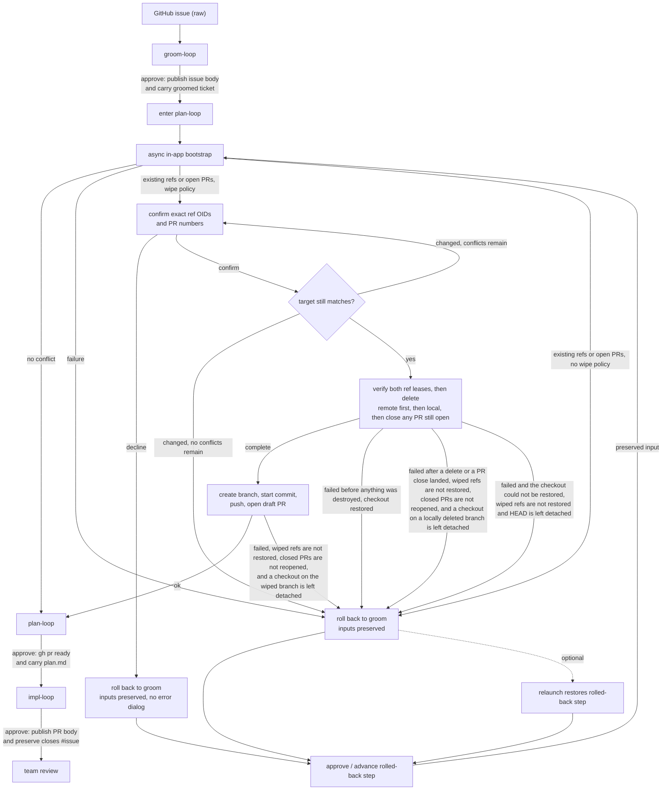
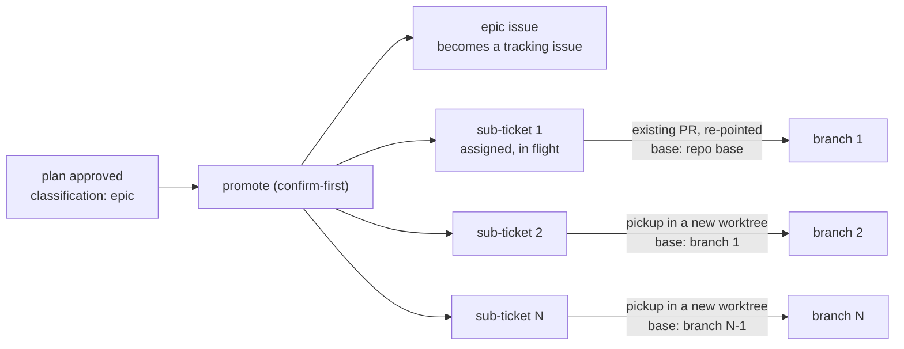

## 27. In-terminal loop engine — the live design

> **Status:** requirements, drafted **v2.135** from an operator interview. **This is the live loop design; §26 is deleted.** The v2.99 engine (decisions **D41–D62**) shipped as tracer bullets L1–L8; it worked, and it was **replaced rather than extended** because its cost and latency were symptoms of machinery the loop does not need. Its decisions are **retired** — where a D-number survives, it is restated here as an **N-decision**; where it does not appear here, it is **gone** (the retirement map is §27.14). The new decisions are **N1–N14**.
>
> **Why a new section number rather than a rewrite of §26.** The two engines **coexist in the tree** while this one is built (§27.15), so the spec must be able to describe both at once without ambiguity. Rewriting §26 in place would also have reused nine of its thirteen subsection numbers for different concepts, silently redirecting roughly 800 `§26.x` citations in `src/` and `tests/` — and every historical changelog entry from v2.99 to v2.132 — to clauses whose meaning had changed underneath them. A new number costs nothing and keeps every existing citation true. §26 is deleted, with the code it specifies, at the N8 sweep.
>
> **What still holds from the v2.99 design:** the app *is* the engine (it drives one hosted Claude Code instance by injection and context-boundary commands, rather than shelling out to the Go `agent-loop`); the orchestrator lives in the main process because `/clear` would destroy it anywhere else; "injectable" means the hosted instance is idle at its own input box; reviewers are parallel, isolated subagents; and the human is involved only at gates.
>
> **What is gone:** the `.agent-loop/state.yaml` **v4 contract** and every obligation to stay re-handoffable to the Go engine; the per-persona review **JSON artifacts** and the consolidator that merged them; the **re-run-the-work-agent** iteration model; the footprint **skip-optimization** and `persona_state`; **`phase2_active`** and the triage gates; the **severity-floor track**; the SHA256 **finding-signature** impasse detector; the **iteration cap**; and the **self-review** turn.
>
> **On any conflict with §17–§25, this section wins for the in-app loop.** The supersessions it asserts over §17.2, §19.1, §19.2, §19.3, §19.4, §20.1, §22.3 and §24.2.3 are re-derived in §27.14 — they are **larger** than §26's, because the app now owns state the external engine used to own.

### 27.1 Goal & boundary (N1)

- Turn the app into the **loop engine itself**, driving one interactive Claude Code instance the operator already watches by composing prompts, injecting them (§9.3), and managing the instance's context between actors.
- **In scope:** three loops — **`groom-loop`**, **`plan-loop`**, **`impl-loop`** — which are the *same loop shape* over different data. Each produces an artifact that is the next one's input (§27.10). Also in scope: the review-and-fix cycle, the consolidator, the human gate, in-app bootstrap (pickup), epic sub-PR creation, and whole-run cost accounting.
- **Out of scope:** the external Go binary (never invoked); compatibility with its `state.yaml` v4 contract or its LoopDef schema; `takeover`; epic instance **auto-launch**.
- **Three loops, deliberately.** Building `groom-loop` as well as plan and impl is not scope creep — it is the **proof of generality**. Three defs on one engine make it structurally impossible to hardcode a plan/impl assumption into the orchestrator. `groom-loop` has no definition today; it is authored here.

### 27.2 The app is the orchestrator (N2)

- **The state machine and every "what to inject next" decision live in the app's main process**, not in the conversation. This is **forced**: clearing or compacting the instance's context destroys anything the conversation was holding, so orchestration placed there would not survive the first boundary. The orchestrator reconstructs each turn's context from **on-disk artifacts and its own state**.
- **Automatic, not human-paced.** Within a loop the orchestrator injects each actor turn and each context boundary on its own, advancing from what it reads back. The human is involved **only at the gate** (§27.9), on failure (§27.12), and whenever they choose to interrupt (§27.9).
- **"Injectable" means the hosted instance is idle at its own input box** — observed through the completion signal of §27.12 (a turn's done-signal has fired and the instance has gone quiescent), **not** raw `QUIET_MS` silence, which can falsely read a mid-turn model or subagent wait as idle (§8.3). Because the interactive agent is itself the shell's foreground process for the whole run, "the shell is at a ready prompt" cannot mean *the shell* is idle. The orchestrator injects only when the instance is injectable by that definition; an injection attempted while a turn is in flight is refused exactly as §19.3 refuses a busy shell.
- **Human/orchestrator injection contention — accepted risk.** The orchestrator auto-injects into the same instance the operator is watching, and there is **no hard interlock** preventing an operator keystroke from interleaving with an in-flight injected prompt. During automatic iteration the operator is expected to keep hands off the keyboard. The one place this is *inverted* is **polish mode** (§27.9), where the orchestrator explicitly stands down and the keyboard is the operator's.

### 27.3 The loop (N3)

The orchestrator runs one **actor turn** at a time against the single instance: compose prompt → inject (§9.3) → wait for completion → read what it produced → decide the next turn.

```mermaid
flowchart TD
  START["enter loop step"] --> B0["context boundary<br/>(clear or compact, per the LoopDef)"]
  B0 --> WORK["WORK<br/>produces the artifact<br/>(runs ONCE)"]
  WORK --> B1["context boundary"]
  WORK -->|"no review rounds, human or undeclared step"| GATE
  WORK -->|"no review rounds, auto step"| ENGINE
  WORK -->|"goal leg ran its passes, so compact and start the next leg"| WORK
  WORK -->|"goal session blocked, so stop for a human"| GATE
  B1 --> RF["REVIEW-AND-FIX<br/>spawn the round's roster as parallel subagents<br/>fix every valid in-scope issue<br/>write the round report"]
  RF --> B2["context boundary"]
  B2 --> CONS["CONSOLIDATE<br/>read the last two round reports<br/>judge the round, pick the next roster"]
  CONS -->|"another round"| B1
  CONS -->|"clean, human or undeclared step"| GATE["HUMAN GATE"]
  CONS -->|"clean, auto step &#40;§27.9.1&#41;"| ENGINE["ENGINE APPROVE<br/>the same approve a human click runs"]
  ENGINE -->|"predicate holds"| DONE
  ENGINE -->|"halt reason &#40;N9b.6&#41;"| GATE
  CONS -->|"stop for a human"| GATE
  GATE -->|"request changes"| B1
  GATE -->|"redo the work"| B0
  GATE -->|"approve"| DONE["artifact accepted<br/>becomes the next loop's input"]
  GATE -->|"polish"| POLISH["orchestrator stands down<br/>the human drives the instance"]
  POLISH --> GATE
```

- **WORK runs exactly once (N3a).** The work turn produces the artifact — the groomed ticket, `plan.md`, the implementation. It is **not** re-entered on a consolidator verdict. The only thing that re-enters it is the human's explicit **redo** lever (§27.9). This is the largest structural change from the v2.99 design, where every `needs-work` verdict re-ran the work agent from disk.
- **REVIEW-AND-FIX is one turn, not two (N3b).** The main instance spawns the round's roster as **parallel `Task` subagents** (§27.4), receives their findings **into its own context as tool results**, fixes every valid in-scope issue itself, dismisses what is out of scope or invalid, and writes the **round report** (§27.5). When the subject is a file artifact (§27.4), a finding that a mechanism the document specifies is wrong is fixed by **replacing that mechanism with the contract it must meet and the test that proves it**, never by specifying it in more detail, and a fix that would add a defence against an adversary the ticket does not name, or a new state, outcome, or field that no acceptance criterion names, is `needs a human` rather than `fixed`. Behaviour no test environment in the repository exercises (the host OS when the tests run elsewhere, a real external tool the tests replace with a stand-in) is recorded under the document's `Assumptions` heading with the real-run check that verifies it, never elaborated into a workaround; and another hole in a guard the document already patches several ways is `needs a human` on the approach, never another patch (v2.188). Each detail a fix adds is new surface the next round reviews, so a fixer that corrects mechanism by elaborating it keeps the loop from reaching a no-change round. For every subject, a finding that test-support code (a fake, stand-in, or double of a real tool, and the fixtures and helpers around it) differs from the real tool, or that a branch of it has no test of its own, is `fixed` only when a test the ticket needs relies on that behaviour, so the gap would let that test pass over broken code or fail over correct code; otherwise it is `dismissed — invalid`, because a double can always be made more faithful and fixing such gaps never runs out (v2.191). Findings never round-trip through the filesystem to be re-read by a different actor — which is precisely what the app's injection ability is for, and what the v2.99 design paid for in tokens on every round.
- **The loop's brief reaches the work turn and every review-and-fix turn (v2.197).** A def may declare a `brief` (§27.8): the standing instructions its work must meet, such as the persona, the standards each reviewer grades against, and the rule that no acceptance criterion is deferred. The work prompt opens with it, ahead of the work recipe, and every review-and-fix prompt carries it as the instructions every fix must meet. The boundary before review-and-fix (§27.7) usually clears the work turn's context, so without the brief the fixer would change the artifact knowing none of them. A step in the brief that only the work turn takes, such as interviewing the operator, does not run again in a review-and-fix turn: a fix that needs the operator's decision is `needs a human`. The consolidator is not given the brief. A def that declares none composes both prompts from the rest of the def alone.
- **A loop may run no review rounds, and a goal work turn reviews its own work (v2.200).** A def that declares no `consolidator` runs no review-and-fix rounds: its work turn, once complete, reaches the gate as `clean`, and the run log records the work turn and no round. Its gate cannot offer `request-changes`, which re-enters a round. A def may give its work a `goal`, a one-line condition of at most 2000 characters, and then declares no consolidator. The engine writes the full work prompt to `.agent-terminal/loop/goal-prompt.md` and submits one command, `/goal`, whose condition names that file, the def's goal and the turn's done-signal, so the agent keeps working until a check after each of its turns finds the condition holds. The prompt tells the session to review its own work with the def's reviewers, spawned as their installed sub-agents (§27.4) and handed the same hand-off and fix criterion as an engine round, as often as its recipe says; the engine refuses the turn, as it refuses a round, while any of those sub-agents is missing. Claude Code and Codex both provide `/goal` and keep an active goal through a compaction.
- **A goal session keeps its progress in a file, runs in legs, and may stop as blocked (v2.201).** The goal prompt tells the session to keep two files and rewrite both after every review pass: `.agent-terminal/loop/goal-progress.<session>.json`, the JSON the engine reads (`leg`, `status` — `working`, `checkpoint`, `done` or `blocked` — `reviewPassesThisLeg`, and, when blocked, `blocked`: what it needs from the operator, as one string), and `.agent-terminal/loop/goal-notes.<session>.md`, its own notes on what it has done, what is still open and what comes next, which the engine never reads and the next leg resumes from. The session id is eight hex digits a fresh work turn draws anew and persists, so Retry and a relaunch keep it and no earlier turn's progress can ever be read as this turn's. The prompt hands the session the loop's own check for that file (§27.12's checker, kind `progress`, given the leg and whether the goal runs in legs), which runs the predicate the engine ends the leg by, and tells it to fix the file until the check prints `OK` before it writes the done-signal. A shortfall names what is wrong in fixed words, never the file's text. At the done-signal the engine reads that file: one that is missing, not well-formed, on another leg or still `working` falls short, with the usual retry and then `error` (§27.12). A def may give its goal a `checkpoint` of review `passes` per leg. A leg that runs them without the goal holding sets `checkpoint`: the engine records the checkpoint in the run log, submits `/compact` with a message naming the progress file, and once the agent is idle submits the next leg's `/goal`, whose prompt tells the session to resume from that file. The turn key stays the same and the leg is persisted, so Retry and a relaunch re-run the leg reached. A session that cannot go on without the operator sets `blocked` and says what it needs in `blocked`; its work turn reaches the gate with the verdict `stop for a human` and that text as the reason, so an `auto` step halts there (§27.9.1). Only a `done` session is held to the work turn's completion check, and a refactor goal session's check is the one a refactor round runs (§28.5.3) — the tests still pass, and a test file changed since RED raises the changed-tests flag — on the done-signal and on Accept alike. Accept takes the same reading: a progress file that falls short refuses the Accept with its reason, `checkpoint` starts the next leg, `blocked` reaches the gate as above, and only `done` goes on to the completion check. The finished leg's done-signal is cleared when the next leg is requested, since both legs share the turn key, and the run log records the `/compact` sent between legs as that work turn's boundary. A refactor goal session records its test result beside its progress, in `.agent-terminal/loop/refactor-result.<session>.json`, with the raw run beside it in `refactor-result.<session>.output.txt` (§28.5.5), for the same reason. A fresh work turn also clears the goal files earlier sessions left; that is housekeeping, and a failure to clear is recorded in the run log. An Accept that waits on a machine check reads the progress file again once the check returns and acts on what it then records, as above: it finishes the turn only on `done`. It acts only if the turn is still where it was: a done-signal that finished or moved the turn during the wait has already acted, and a second Accept during the wait is inert. The goal prompt holds only a `done` leg to the completion check, so a leg that checkpoints or blocks writes its done-signal once its progress file is written. Since every leg shares the turn key, Accept and Retry are inert while a turn is running, and a done-signal before the next leg's prompt has gone in is ignored, so neither one sent for a leg that has since moved on can act on the next. The goal prompt carries the def's polish policy (§27.8), and tells the session that a finding which only disagrees with a decision it made and logged inside its decision boundary is `dismissed — invalid`.
- **A goal session reviews only over a change, and re-reviews only what a fix concerns.** The goal prompt's review rules (`composeGoalReviewLines`) say: work that changed nothing but the step's report and its recorded test evidence runs no review at all, and a pass whose fixes changed nothing else — every finding dismissed, or the only edit the report or its test evidence — ends the review, so the reviewers are not spawned again. An edit to the plan, the groomed ticket, code or tests is a change. The first pass runs every reviewer; a later pass runs only the reviewers whose findings were fixed and any whose area the fixes touched, and every reviewer again only when a fix changes the acceptance criteria, the scope, the approach or the slices. A pass skips a reviewer whose lens the change cannot touch (accessibility when no user-interface file changed), and the session logs each skip with its reason in the review history; that is the only reason the first pass may leave a reviewer out. This is the session's judgment, not an engine filter: the roster the engine names is unchanged. Every bundled goal loop's `work.goal` ends its review on the same condition the prompt states (`GOAL_NO_CHANGE_CLAUSE`), never on a count of findings. The engine-driven review-and-fix rounds already end on a round that changed nothing (§27.6 `clean`) and are unchanged. The bundled implementation recipes record their test evidence before the first pass and again after any fix that changes code or tests, so no reviewer is handed pending evidence.
- **The fixer and the work agent question the design before a fix adds complexity (v2.202).** The review-and-fix prompt and the work prompt (and so every goal session) carry one shared instruction: before a fix adds a special case, a flag, a workaround, a guard or a second copy of logic, ask whether the design itself is the problem — a format parsed by hand that could be structured data checked by one shared predicate, branches one rule would replace, a guard against a state the design could make impossible, a mechanism bigger than the ticket needs. A simpler design that stays inside the ticket is made instead; one that reaches beyond the ticket goes to a human the way that turn raises a decision, never as a widened change; a patch that is still right says why where the fix is recorded. Code no fix touches is never redesigned, so the instruction does not override the materiality floor. It is guidance, not a gate: nothing counts fixes across rounds (§27.6, N6a).
- **CONSOLIDATE judges the round, it does not merge findings (§27.6).**
- **Context boundaries are data (§27.7)** — each is `clear`, or `compact` with a custom message, declared per boundary in the LoopDef.

### 27.4 Reviewers pull; the engine never pushes (N4)

**This is the decision the rewrite exists for.**

- A reviewer subagent runs as the Claude Code sub-agent installed for it (§18.1), named `<loop>--<persona>`, whose own instructions are **its charter** (the persona's standing instructions — what it is responsible for and how to go about it), so it is never handed a charter path or asked to read one; the review turn names each reviewer's `subagent_type`, and the fixer spawns exactly that type and never substitutes another (v2.196). **The engine writes the reviewer hand-off (v2.198)**: the review prompt carries the exact text each reviewer is given — which tells it not to run the full test suite or the end-to-end harness but to read the test results the work recorded, running only the targeted tests a specific finding needs — and the fixer passes it on word for word and adds nothing, so what a reviewer receives never depends on how the fixer phrases it. The hand-off names the ticket and how to read it, the subject or how to see the branch's change with git, the impl-slice a TDD-phase round covers, the carried inputs and the flow-document location, tells the reviewer to change no file, and asks for each finding as its file:line, the issue, its concrete consequence and the fix, without a severity rating. A bundled reviewer has every tool, so it can run whatever it needs to pull its own context. It is handed **the ticket** and, only where the loop has them, the **path** of the subject it grades and the **paths** of the inputs the step carried. It is handed **no diff, no code, no prior review, no consolidated findings, and no history**, and a plan only as the path of a subject or carried input — never a turn with neither. It **pulls what it needs with tools.** A loop whose work turn produces a **file artifact** (the groomed ticket, the plan) also **names that artifact's path** as the subject the reviewer grades — a path, never its content, so the prompt stays constant-sized. The ticket is then the **intent** the artifact must honour, not the thing under review: the issue body can still hold text the artifact has since fixed, and a reviewer that grades it re-raises findings already closed. A loop whose product is commits or a phase-result file names no subject. Every work and review turn is also told where the **flow documents** live — the groomed ticket, the plan and the RED/GREEN phase results, only under `<repo>/.agent-terminal/loop/artifacts/`, with a file of that kind elsewhere in the repo not one of this work's flow documents, though still work when the ticket names it as something to change — and that the code a loop produces is the working-tree diff and the repo's standards are read where they live (v2.189). The review turn names the inputs the step carried (§27.10) by path, as the work turn does, leaving out one that is already the subject, so a commit loop's reviewers grade against the plan rather than searching the repo for a file of that name.
- The engine therefore pushes a **constant-sized** prompt at every reviewer, in every round, forever. A round's review cost is a function of **what each reviewer decides it needs to read**, never of the roster's shared context and never of how many rounds have already run. The cost curve of [#59](https://github.com/dylanb/agent-terminal/issues/59) — per-round cost rising with iteration depth — does not exist to be optimized away; it **should be absent by construction**. That is an **expectation of the design**, for the N7 meter to make observable (§27.11), not a criterion asserted in advance: a round may legitimately cost more than an earlier one when the consolidator picks it a larger roster (§27.6).
- It is also **more accurate**, not merely cheaper: a taint reviewer may need to read half the codebase to trace a flow, while an accessibility reviewer may need only the UI diff. A push model must send the union of what every persona might want; a pull model lets each fetch its own actual need.
- **A reviewer runs only as its installed sub-agent (v2.196, operator decision 2026-10-16).** Before a review round is injected, the engine checks every reviewer on the round's roster: its sub-agent file is installed and carries exactly the charter and the tools this run resolved. Otherwise the round is refused with a recoverable error naming each problem and the fix — install the example loops again, restart the agent session so it loads them, then Retry. Sub-agent files are generated only when the example loops are installed, from the bundled loops, so a run whose charters were edited or overridden cannot run its reviewers (strict, by operator decision). An agent session loads sub-agents only when it starts, so one started before the install cannot spawn the type: the fixer records that reviewer with the status `not loaded`, and the engine stops the round at once, asking for a restart: the usual §27.12 retry could not succeed without one.
- **Each reviewer is named as the hosted agent installed it (v2.201).** The engine reads which agent the terminal hosts from what it is running — the foreground command the shell reported, and the command line of the terminal's foreground process, which is all there is to read when the shell has no command integration — and takes it as Codex when either runs `codex` (including through a launcher or package runner such as `npx` or `pnpm dlx`, and the npm package's entry script under `node`), otherwise Claude Code. It reads this once per turn, so the reviewer check and the prompts name the same agent. Under Codex the review turn and the goal prompt name each reviewer by its Codex agent name, `<loop>__<persona>` (§18.1 v2.199), and tell the fixer to spawn it in parallel as that installed agent and never a default one; the check above reads the Codex agent file, `<codex home>/agents/<name>.toml`, which must be exactly what installing the run's charter writes.
- **Reviewers are isolated and parallel.** Each subagent is a fresh context (the independent-review property the external engine got from separate `claude -p` processes) and they run concurrently. There is **no warmer** and nothing to amortize — there is nothing shared to amortize *over*.
- **The roster for a round is chosen by the consolidator** (§27.6), from the catalog the LoopDef declares. **Round 1 runs every persona in the catalog.** A persona the LoopDef does not declare can never be invoked.
- **Reviewer cost is captured in the subagent logs** (`~/.claude/projects/<slug>/<uuid>/subagents/agent-*.jsonl`), which the meter sweeps (§27.11). That layout is Claude Code's private format — an external dependency the app does not control — so the parser tolerates drift (unknown or empty → omitted, never throws).

### 27.5 The round report (N5)

The round report is the **sole contract** between the fixer and the consolidator, and the **only durable record** of what a round did.

- **Format: JSON with a prescribed structure (v2.202).** Prescribed, so the engine can validate it is complete before advancing (§27.12) and the consolidator can rely on its shape; JSON, so the engine, the agent's own check and every other reader judge it through one shared predicate over the platform parser, never a hand-written grammar. It holds a `sections` object with text for each def-declared section, and a `reviewers` list with one record per persona (`persona`, `status`, `issues`); each issue carries `issue`, `disposition`, `reason`, and `whatChanged` when fixed. Its text fields are the prose the human reads at the gate.
- **It must account for every persona the round invoked** — including one that **failed or returned nothing**. The engine validates the report covers the round's roster (which it chose, so it knows). A report missing a persona is **malformed**, and takes the retry-then-`error` path of §27.12. A reviewer that quietly disappears is therefore not something the fixer can hide. A persona that **failed to run** has the status `failed`, distinct from one that ran and found nothing (status `ran`, no issues) and from one that raised a `needs a human` issue (a disposition, not a run-failure). The statuses `ran` / `failed` / `not loaded` are spec-fixed vocabulary, single-sourced with the disposition set, recognized by exact string equality — never normalized (v2.137, v2.202).
- For every issue raised it records: **the persona that raised it, the issue, its disposition** (`fixed` / `dismissed — out of scope` / `dismissed — invalid` / `needs a human`), **the reason**, and **what changed** if it was fixed.
- **Reports are versioned per iteration** and never overwritten. The versioned series is the forensic record — the equivalent of the per-iteration review artifacts the old engine wrote, in one document per round instead of N.
- **Reports live locally under `<repo>/.agent-terminal/loop/reports/<n>.json` and are never committed.** This is not merely tidiness: the impl-loop's reviewers **pull the diff with tools** (§27.4), so a committed report would appear *inside the diff they are reviewing*. Reports must stay out of the working tree's committed surface or the loop reviews its own commentary.
- **Accepted risk, recorded (N5a): the fixer marks its own homework.** The fixer decides which issues are valid, fixes them, and writes the report — and the consolidator sees **only that report**. Nothing in the loop can detect an issue the fixer declined to write down. This is the load-bearing assumption of the design: it is accepted in exchange for deleting the whole persona-artifact + merge-consolidator apparatus, and it is bounded by three things — the report must account for the full roster (above), the versioned reports are auditable after the fact, and the human gate is the backstop (on a step whose `gate_authority: auto` is honoured, §27.9.1 N9b.2 and its override scope). It is stated here so it is a known limitation, not a latent surprise.

### 27.6 The consolidator (N6)

The consolidator is a fresh turn (its boundary is declared, §27.7) whose job is to **judge the round**, not to merge findings. It has three outputs.

**1. A verdict.** It reads **the last two round reports** — this round's and the previous one's — and nothing else. Two is exactly enough to see whether the loop is converging, and it is a **fixed window**, so the consolidator's own cost cannot grow with iteration depth either. It writes the verdict to `<repo>/.agent-terminal/loop/consolidate/<n>.json` as JSON: `verdict`, plus a `roster` list for `another round` and a `reason` for `stop for a human` (v2.202).

| verdict | what it means | what happens |
|---|---|---|
| `clean` | the round **changed nothing** — every issue raised was dismissed, and nothing needed fixing | stop at the human gate (§27.9), or, on a step whose `gate_authority: auto` is honoured (§27.9.1 N9b.2), the engine approve (§27.9.1) |
| `another round` | the round **fixed something**, so the artifact changed and needs fresh eyes on the new state | back to review-and-fix |
| `stop for a human` | the loop is **spinning** (something fixed last round is back), or a reviewer raised something the loop is not entitled to decide | stop at the human gate, with the reason |

- **The termination rule is: `clean` = the round changed nothing.** This is what makes memory-less reviewers and a memory-less fixer *correct* rather than merely cheap. **Scope is a function of the ticket, not of history.** A reviewer with no memory will re-raise the same out-of-scope observation every round, and a fixer with no memory will re-dismiss it for the same reason every round — and that is the system correctly **re-deriving a settled judgment**, not failing to converge. The loop terminates when a round produces no changes, which is precisely the statement "the artifact is stable under review."
- **A round in which a reviewer failed can never be `clean`.** The report says the persona failed (§27.5); the consolidator must not read a round with an unrun lens as settled. The remediation is fixed: a lens failing for the first time (not failed in the previous report) is re-reviewed in the next round's roster; the same lens failing again on that re-review routes to `stop for a human`. That is one automatic re-review per lens-failure episode, keyed on the two-report window — not a counter. A run where a *different* lens fails each round is bounded only by the human interrupt (§27.9), which is deliberate: a global counter is the machinery N6a retired (v2.138).
- **There is no iteration cap (N6a).** The old engine's cap existed to bound a loop whose termination rule was a counter. This loop's termination rule is a property of the artifact, and the backstop against a runaway is the **human interrupt** (§27.9), not a number. A cap would be exactly the sort of machinery this rewrite is removing.

**2. The next round's roster.** Having just read what the round did, the consolidator **chooses which personas run next** — from the LoopDef's catalog, with a stated reason. This **replaces the footprint skip-optimization outright**: instead of hashing `plan.md` and comparing `last_seen_files` sets to guess who can be pruned, the actor that just read the round's report decides who needs to look. It may also re-run the whole catalog when the artifact changed enough to warrant it.

**3. The interrupt check.** If the operator has armed the interrupt (§27.9), the consolidator routes to the human gate regardless of its verdict — and still states the verdict it would otherwise have reached, so the human arrives knowing whether the loop thought it was clean, progressing, or stuck.

### 27.7 Context boundaries — clear or compact (N7)

A `/clear` at every actor boundary is why nothing in the old loop amortized: every turn re-read everything it needed from disk. But an unconditional *compact* is equally wrong — the consolidator's judgment is worth less if it inherits the fixer's context and its rationalizations.

- The **boundary policy is data-driven from the LoopDef**: each actor boundary declares **`clear`**, or **`compact`** with a **custom compact message** naming exactly what must survive it.
- Different loops make different choices, and the engine has no opinion. It executes the boundary the def names, and confirms it (§27.12).
- The boundary is also the **cost-metering segment marker** (§27.11).

### 27.8 The LoopDef (N8)

- **The defs are owned by agent-terminal**, in a **new schema of its own design**. The `github.com/dequelabs/loops` defs are **not vendored, not parsed, and not a compatibility target** — they remain valid for the legacy Go engine, which this section no longer speaks to. This is the clean break: no dual-schema period, no upstream coordination, no re-vendoring dance.
- A def declares:
  - **`brief`** (optional) — the standing instructions the work turn and every review-and-fix turn carry (§27.3), a reference confined like the recipes;
  - **`work`** — the work prompt recipe, the artifact it produces, and optionally a `goal` the turn works until and, with it, a `checkpoint` of review `passes` per leg (§27.3);
  - **`reviewers`** — the **catalog** of personas available to this loop, each with its **charter** (a reference, never an inline body — §18.6) and, optionally, the tools it may use; a reviewer whose def lists none has every tool (v2.198), as every bundled reviewer does. Round 1 runs the whole catalog; thereafter the consolidator selects from it (§27.6);
  - **`consolidator`** — its prompt recipe. A def without one runs no review rounds (§27.3); a def that declares reviewers and no `work.goal` must declare one, and a def with a `work.goal` must not;
  - **`boundaries`** — `clear` or `compact: <message>` for each actor boundary (§27.7);
  - **`report`** — the prescribed structure the round report must satisfy (§27.5), and its **`polish`** policy: `fix` (the default) or `defer`. Under `defer` the review-and-fix turn dismisses a polish finding — one whose fix changes no runtime behavior, no test's ability to fail, and no contract another surface reads — as `dismissed — out of scope`, so a polish-only round changes nothing and is `clean` (§27.6). A loop may declare `defer` only when a later loop in its flow re-reviews the same diff with a catalog that fixes polish; the shipped per-slice loops (infra, red, green, refactor) defer to the integration-slice sweep, and `plan-bundle-loop` defers to `plan-polish-loop` (§28.8.1); the fixer is told only that a later loop fixes polish, never which;
  - **`gate`** — the human options available (§27.9) and their side-effects (§27.13);
  - **`pickup`** — the bootstrap contract (§27.10);
  - **`inputs` / `outputs`** — the artifact this loop consumes and the one it produces, which is what chains groom → plan → impl (§27.10).
- **Origin carries no trust distinction**, `gate_authority: auto` included (§27.9.1 N9b.2). Def tiers — app-bundled (the defs shipped with the app), operator-config and repo — are resolved identically. The schema declares `ExecSideEffect`, the executable side-effect that would let a def name a program to run, but it is **unshipped**: nothing in this engine drives it. Shipping it requires deciding trust afresh (this reverses the v2.129 finding, which gated execution on a def's origin — see the changelog entry recording the reversal and its consequences).
- **Lookup order, and a flow's own loop folder (v2.178).** A loop name resolves from the first of these that holds it: the repo's `.agent-loop.yaml` `loops:` override; the **running flow's own folder** in the operator-config tier, `<loops-v2>/<flow name>/<loop>/<loop>.yaml`; the running flow's own folder in the app-bundled tier; the shared operator-config folder `<loops-v2>/<loop>/`; then the shared app-bundled folder. The flow name is the `name:` of the flow definition the worktree runs (§18.7.3), and its folders are consulted only when it is a single safe path segment. A flow's own definitions, in either tier, therefore outrank every shared one, so two flows that bind the same loop name run their own definitions of it and one can change without changing the other. The bundle carries **only** per-flow folders — one per shipped flow (§18.7.1), each holding exactly the loops that flow binds, with no definition shared between flows — so Install examples (§18.1), which seeds the bundle's tree into `<loops-v2>/`, writes only flow folders and never a shared definition an operator (or an older build, which reads only the shared folder) relies on. A flow with no folder of its own falls back to the shared operator-config folder; a flow whose name is not a shipped flow has no bundled fallback. The AC 5 migration copies a definition resolved from the bundle into the same relative place in the operator-config tier (a flow folder for a flow-folder definition).

### 27.9 The human gate (N9)

The gate is the **whole** human interface to a running loop. Its options are declared per-loop in the def and rendered data-driven. On a step whose `gate_authority: auto` is honoured (§27.9.1 N9b.2), the engine takes **Approve** when the step finishes clean (§27.9.1); every other option, and every N9b.6 halt, stays human.

- **Approve** — accept the artifact. It becomes the next loop's input (§27.10) and the loop's gate side-effects run (§27.13). Terminal for that loop.
- **Request changes** — the human types feedback; it joins the **next review-and-fix round** alongside the reviewers' findings (this reuses the §19.4 composer: curate a review-todo subset + free text, compose-with-agent or submit-as-is). The narrow, incremental lever.
- **Redo the work** — the human types an instruction that **re-enters the work turn**, whose **only** inputs are the **ticket**, the **plan**, and **that instruction**. No findings, no report history, no accumulated context. The deliberate clean-slate lever, for when the artifact is wrong in a way that iterating cannot fix.
- **Polish** — the **orchestrator stands down and releases the prompt.** The loop stops injecting; the operator converses with the live instance directly in the terminal, on the context it holds from the round it just finished; a separate **approve** control ends it. This is the one state where the §27.2 contention risk is inverted by design: the keyboard is the human's, and the orchestrator is the one that must not type.
- **Abandon is not a loop verdict.** Killing a run is the flow-level **Terminate** (§25.5 `flow.terminated`), which already exists. The loop's vocabulary stays about the work, not the lifecycle.

**The interrupt (N9a).** At any point during automatic iteration the operator may **arm an interrupt** ("hand back to me"). It is **queued, not immediate**: the round in flight finishes — reviewers return, fixes land, the report is written — and the **consolidator honors it at its next invocation** (§27.6), routing to the gate regardless of verdict. Nothing is ever killed mid-turn, so there is no such thing as a half-applied round. This is the loop's only bound on runaway iteration, and it is a human, not a counter.

#### 27.9.1 Gate authority — human / auto (N9b)

In N9b, **"run"** is the flow run bound at Start (§18.7) and **"loop run"** is one step's §27 loop run; every input in N9b.5(b) names which of the two it is scoped to.

**Trust model and boundaries (operator decision, 2026-10-05; narrowed 2026-10-06, v2.184).** The coding agents a flow runs (the work, review, consolidator and repair turns) act for the operator, with the operator's authority. They are **trusted operators, inside the operator's trust boundary, not adversaries**, and so is **the run's own state**: its run-state, loop state, mirror files, pointers and records, before and after a relaunch. N9b defends no boundary against either. No clause guards against an agent rewriting a flow, def, test glob, flag or state file, none distrusts what the run itself persisted, and none distrusts the repo the run works in. Neither is repo-controlled content: a flow or def checked into the repo is honoured as the operator's own. The trust boundaries N9b defends are the ones it names: the **human-decided gate** (N9b.3–N9b.6: what routes to a human) and **ordinary robustness** (a malformed, missing or unreadable input fails closed rather than crashing or advancing). N9b's checks catch **mistakes** and hand control back to a human (a non-`clean` verdict, a failed check, a frozen-test change, a hang). A newly identified attack class that crosses one of the named boundaries is escalated to the operator for a decision. It is not silently hardened against, and it is not silently dismissed.

**Override scope.** `auto` is an explicit operator override, only on steps whose `auto` is honoured (N9b.2). It overrides the following: the §27.6 verdict table's `clean` → "stop at the human gate" row; §27.9's premise that every gate is human-decided; §28.8 item 1 (P8.1, "one human gate"); §19.2 "the flow **never auto-advances**" (superseded per §27.14); and, on those steps, **the human gate as the backstop** that §27.5 N5a, §28.5.2(c) and §28.5.6 name. On such a step the approve runs the step's outward §27.13 side-effects with no human click. Only epic promotion stays confirm-first (N9b.6(k)). N9b.6 is outside the override.

- **N9b.1 — The field.** `gate_authority`, declared on a `loop` step in `flow.yaml` (§18.2), not on the LoopDef: one LoopDef is bound by many flows, and the authority is per-step. The value is the closed set `human` | `auto`. **Absent reads as `human`.** An unknown value fails the **whole flow load** (§18.1 `error`). The field on a non-`loop` step also fails the **whole flow load**.
- **N9b.2 — Where `auto` is honoured.** `auto` is honoured on every `loop` step that declares it, whatever tier supplies the flow (a global or per-repo catalog entry, a local `flow.yaml` or the global fallback, §18.7.3) and whatever tier supplies the LoopDef and the recipes and charters it references (app-bundled, operator-config or repo, §27.8).
  - **N9b.2(a)** *retired (v2.184)*: the flow-source tier check is removed; the label is not reused.
  - **N9b.2(b)** *retired (v2.184)*: the def-tier check is removed; the label is not reused.
  - **N9b.2(c) — read from the run's flow.** A step's authority is read from the flow bound at Start (§18.7). **A flow that changes during a run is outside N9b (operator decision, 2026-10-06; settled, not open for review).** N9b makes no promise about whether, or when, a change to the run's flow after Start changes a step's authority. That includes an edit that raises or lowers a step, a local `flow.yaml` that takes over resolution mid-run (§18.7.3), and a held-run re-bind onto another flow (§18.7.4, v2.164). The implementation may read the authority whenever it finds simplest, and nothing has to test, guard, halt on or report such an edit. A reviewer who raises it has raised a settled decision, not a finding.
- **N9b.3 — `human` and undeclared are unchanged.** Throughout N9b, **"a run with an `auto` step"** means a run whose bound flow (N9b.2(c)) declares `auto` on at least one step. A step declaring `human` or declaring nothing behaves exactly as §27.9 states: every gate stop waits for a human decision, and nothing in N9b.4–N9b.9 applies to it except: it shows a set failed-effect marker, and its decision clears it (N9b.5(d)); and in a run with an `auto` step, its consolidation honours the run-scoped interrupt arm, so an arm made on another step of the run hands back at it (N9b.6(c)). Its human decision's §25 gate-decision entry is the one it writes today, unchanged, which N9b.9 reads as human-decided. A run with no `auto` step can set no failed-effect marker, so its gates are exactly §27.9's. No N9b.6 reason is shown at a human-decided gate, and none halts it.
- **N9b.4 — "Finishes clean".** An `auto` step *finishes clean* when the consolidator's verdict for the round that brought it to the gate is `clean` (§27.6) and neither N9b.6(a) nor N9b.6(b) holds. The **approve predicate** is: the step finishes clean **and** none of N9b.6(c)–(j) holds. N9b.6 is the single, closed home of every halt reason; every other clause cites its letter. Every loop end state has exactly one outcome. Several N9b.6 reasons can hold at once; the outcome is then the one halt, and the gate shows, and N9b.9 records, every reason that holds:

  | loop end state | outcome | decided by |
  |---|---|---|
  | verdict `clean`, no N9b.6 reason holds | `auto` advances | N9b.4, N9b.5 |
  | verdict `another round`, no interrupt honoured | continues: back to review-and-fix, never reaches the gate | §27.6 |
  | verdict `stop for a human` | halts at the human gate; N9b.9 records the verdict as the reason | §27.6 |
  | N9b.6(a) holds | `auto` halts | N9b.6(a) |
  | N9b.6(b) holds | `auto` halts | N9b.6(b) |
  | N9b.6(c) holds | `auto` halts | N9b.6(c) |
  | N9b.6(d) holds | `auto` halts | N9b.6(d) |
  | N9b.6(e) holds | `auto` halts | N9b.6(e) |
  | N9b.6(h) holds | `auto` halts | N9b.6(h) |
  | N9b.6(i) holds | `auto` halts | N9b.6(i) |
  | N9b.6(j) holds | `auto` halts | N9b.6(j) |
  | N9b.6(k) holds | `auto` halts | N9b.6(k) |
  | N9b.6(l) holds | `auto` halts | N9b.6(l) |
- **N9b.5 — The engine approve is the approve, evaluated at the operation.**
  - **N9b.5(a) — once, at the operation.** When an `auto` step reaches its gate, the engine evaluates the N9b.4 approve predicate **once, at the approve operation, over one snapshot** of its inputs.
  - **N9b.5(b) — the inputs.** The predicate reads: the consolidator's verdict and the round report's dispositions, as the engine parsed and validated them at their §27.12(b) artifact check in the step's loop run; every §27.12(c) acceptance (loop run); the loop status (loop run); the operator's interrupt arm (run, N9b.6(c)); the phase baseline commit (run: captured by an earlier step's §28.5.1 `commit` side-effect and read at a later step's approve, N9b.7(b)); and the failed-effect marker (run, N9b.5(d)). Each is read from where the run keeps it, its persisted state included, and survives a relaunch with that state (N9b.8). One that is missing or cannot be read is reason N9b.6(h).
  - **N9b.5(c) — the same approve.** If the predicate holds, the engine invokes **the same approve operation a human click invokes, with every effect it has** (§27.9 Approve, §27.13, §28.3, §28.4 among them). It is not a parallel copy, and this clause does not enumerate the effects. Only the deciding party differs. The engine acts on an **outcome the approve operation returns that names each case** (advanced, preview raised, `blocked`, refused, accept failed, stood down for a human decision), never on one inferred from persisted state. B1 ([#137](https://github.com/dylanb/agent-terminal/issues/137), changelog v2.186) names its cases `advanced` (carrying the effect failures recorded after the accept persisted, N9b.5(d)), `preview-raised`, `blocked`, `refused`, `accept-failed`, `abandoned` (the N9b.5(e) bound won), `run-ended` (the run ended before the claim), `refused-late` (a reason found holding at the claim) and `stood-down`; the type is `GateApproveOutcome` in `src/main/appGateDecision.ts`. Its outcomes that stop at a human are N9b.6(k)–(l); a human decision that landed first is N9b.5(e).
  - **N9b.5(d) — the failed-effect marker.** A side-effect, or the flow advance itself, that fails **after** the approve has persisted its accept (from that point a failure no longer aborts the decision, §27.13) is handled exactly as for a human approve; because no human saw it, the engine also sets the failed-effect marker. The next gate the run reaches, of either authority, shows the failure; if it is an **`auto`** gate it halts with reason N9b.6(i). A human gate decision at a gate that showed the failure clears the marker. A run that reaches no further gate ends with the failure shown and recorded (§25), never silently. The marker is persisted with the run's state, so it survives a relaunch (N9b.8); a marker that cannot be read is reason N9b.6(h).
  - **N9b.5(e) — one decider per gate, and what the gate reads as while the engine decides.** An engine approve and a human decision at the same gate are serialized at the approve operation: if a human decision attempt of any option has reached that gate before the engine approve's identity check, the engine stands down, whatever that attempt's outcome — one that was dropped or failed (a `decision-dropped` request-changes or redo, a polish whose entry could not be made) stands it down too, and the gate stays human-decided, so the engine never approves over a human who tried to decide. It invokes nothing further and writes no engine-decided entry, and the human decision, or the human's retry of it, stands. Between the `clean` verdict and the engine's decision, an `auto` gate is **not** human-needed (no awaiting-human alert or notification, §24.2.3 T4). It becomes human-needed when an N9b.6 reason holds, when the engine stands down for a human decision attempt (above), when the approve stops at a human (N9b.6(k)–(l)), when the gate was reached before a relaunch (N9b.6(j)), or when the engine's decision has not settled within a named bound, so a hung git or `gh` call never leaves the gate silent. The bound is `APP_AUTO_GATE_DECISION_MS`, default 300 000 ms (B1, changelog v2.186); a configured value above the largest delay a timer honours (2 147 483 647 ms) is clamped to it and a fractional one is rounded up; it is configured on operator ground only, and a configured value that is not a finite positive number falls back to the default, so the bound always fires. At that bound, a pre-approve evaluation (N9b.6(a)–(j), N9b.7) still unsettled is a reason whose evaluation cannot complete, which holds (N9b.6); it is abandoned, any child process it spawned is terminated best-effort without delaying the halt, and any result it produces later is discarded, never recorded (no N9b.7(d) flag write); no approve was invoked and no failed-effect marker is set. An approve still unsettled at that bound is **abandoned** unless it has already passed its pre-persist check: the approve operation checks, immediately before persisting its accept, that it was not abandoned, and that check and the abandonment are one atomic decision, so exactly one of them wins. An abandoned approve persists no accept and runs no effect, it is handled as N9b.6(l) handles a throw, and the gate the human is shown has one decider. An approve that passed the check first is not abandoned: its accept persists, so the gate is decided and is not shown as decidable; the hang is shown there as human-needed, the engine sets the failed-effect marker, and the approve's remaining effects and flow advance proceed as N9b.5(d) handles a failure after the accept persisted. That the engine is deciding is held in main-process memory. The gate's human-needed classification is derived once, in main, as the `humanNeeded` field of the §6 `FlowLoopView` (today `loopViewV2.ts`'s `atGate` term), and every human-needed surface (the §24.2.3 T4 notification, the awaiting-human alert, the renderer's gate display, and — on a view carrying `autoGate` (changelog v2.181 (3)) — the strip's and loop panel's human-needed status tone) reads that field, never re-deriving it from the status string; `src/shared/loopStatus.ts` stays the status-string half of it.
- **N9b.6 — The halt reasons: one closed list.** Every case in which an `auto` step's gate is decided by a human, other than the §27.6 `stop for a human` routing (N9b.4) and the engine standing down for a human decision that landed first (N9b.5(e)). Each lands on the human gate **with its letter and reason visible there**, every reason that holds shown together, and each is a reason N9b.9 records. No other clause defines a halt. A reason whose evaluation cannot complete (an error, or a result that cannot be determined) **holds**: the approve predicate is true only when every pre-approve reason, (a)–(j), was evaluated and none holds; (k) and (l) are read only from the approve's returned outcome.

  *Pre-approve* — the engine does not invoke the approve:
  - **(a)** the round report records any issue with disposition `needs a human` (§27.5), checked by the engine against the report, not taken from the verdict;
  - **(b)** the loop ended in `error`, or **any turn of the loop run** (the work turn, or any round's review-and-fix, consolidator or repair turn) failed its §27.12(b) artifact check, every §28.5.3 completion clause included, and was accepted through the §27.12(c) manual control;
  - **(c)** an operator interrupt (§27.9 N9a): **either** the gate was reached by the consolidator honouring one, **or** one is armed when the approve operation runs. The approve-site halt **consumes** the one-shot interrupt exactly as the consolidator does, whatever other reasons hold, and it is recorded as the N9b.9 entry with reason (c), **not** as the consolidator's interrupt-honoured event. A consume that cannot clear `armed-interrupt.yaml` is shown at that gate, and a file still armed is honoured as an arm (it only routes to a human) until a clear succeeds. In a run with an `auto` step the arm is **run-scoped** on every step of the run, whatever that step's authority (N9b.3): an arm made for any step stays armed until consumed and is honoured by the next consolidation or approve operation of the run, whichever step it names;
  - **(d)** frozen tests: the approve-time check ran and detected a frozen change (§28.5.1, N9b.7(b)); its detail names every changed test path, so the gate shows which tests changed (v2.204);
  - **(e)** frozen check unavailable: the approve-time check could not run, or its result could not be recorded as the §28.5.1 flag (N9b.7(a), (c)–(d));
  - **(f)** *retired (v2.184)*: the trusted-globs-commit comparison is removed; the letter is not reused;
  - **(g)** *retired (v2.184)*: no source makes `auto` read as `human`; the letter is not reused;
  - **(h)** a predicate input is missing or unreadable (N9b.5(b));
  - **(i)** a failed-effect marker from an earlier engine approve is set (N9b.5(d));
  - **(j)** relaunch: the gate was reached before a relaunch, and §27.12 resumed the run at it (N9b.8).

  *Approve outcome* — the engine invoked the approve and it stopped at a human:
  - **(k)** the approve raised the epic-promotion preview (§27.10, §28.7), or promotion returned `blocked`. The engine never confirms; the preview is recorded as engine-decided, and the confirm (or the human's resolution of `blocked`) as human-decided;
  - **(l)** the approve operation returned without persisting its accept, or threw or rejected before persisting it, for any reason other than (k) or a human decision that landed first (N9b.5(e)). That covers a precondition refusal (the run-state no longer matches the gate's identity, the def no longer resolves or fails the N9b.5(c) check, the def declares no `approve` option), a failed accept persist, which aborts the decision, and a throw or rejection the engine catches, which it treats as a returned failure, never as a still-pending approve. The **current** gate is human-decided, the failure or refusal is shown there, and the engine never re-attempts the approve. A failure after the accept persisted is N9b.5(d), not (l). A throw or rejection carries no named outcome, so the engine cannot tell whether the accept had persisted and never reads persisted state to find out (N9b.5(c)): it is (l) **and** sets the N9b.5(d) failed-effect marker, so a failure after a persisted accept is still shown at the next gate, or at the run's end if none follows. A current gate shown as the (l) halt shows that marker, so the human decision there clears it (N9b.5(d)). When the gate is no longer pending by the time the throw or rejection is caught (the accept persisted and the run moved on), there is no current gate to decide: the (l) halt is not shown as a decidable gate, and the marker alone carries the failure to the next gate or the run's end.

  `another round` with no interrupt honoured, and `stop for a human`, are not "clean" by N9b.4, so they keep their §27.6 routing and are not N9b.6 reasons; N9b.9 records a `stop for a human` halt on an `auto` step with that verdict as its reason.
- **N9b.7 — Frozen tests under `auto`: always halt, and the engine runs the check at the approve.** A frozen-tests detection under `auto` **always halts**; it never becomes a `needs a human` disposition, because a disposition is fixer-written and the fixer can decline to write one (§27.5 N5a), while §28.8 item 3 puts the disposition with "persona + human". On a step whose loop carries a frozen check (the §28.5.3 GREEN and refactor clauses), at the approve operation:
  - **N9b.7(a) — the globs.** `test_globs` are read from `loop-capabilities.yaml` (§28.5.4) as it stands in the working tree at the approve. A file that is missing, not a regular file, over the size bound, or fails to parse or validate is reason N9b.6(e).
  - **N9b.7(b) — the engine runs the check.** The engine runs the §28.5.1 frozen check itself, over the working tree as it stands at the approve, against the phase baseline commit: the baseline §28.5.1 names for that step's check (for GREEN, the SHA the RED step's `commit` side-effect captured at the RED approve) (N9b.5(b)). The step advances only if that check **ran and detected no frozen change** (a test only added is none, §28.5.1 v2.206); a detection is N9b.6(d). The run covers every test edit any review round made, including those after an earlier check, so no check can be "still pending" at the approve.
  - **N9b.7(c) — fail closed.** A check that cannot run is N9b.6(e): no baseline, a git failure, a refused read, or an unusable `loop-capabilities.yaml` (N9b.7(a)). The halt is keyed on the result of the check the engine just ran. Every git read here (the branch read and the diffs) runs with optional locks disabled (`GIT_OPTIONAL_LOCKS=0`), so a read abandoned at the N9b.5(e) bound holds no index lock that would fail the human approve's §28.3 commit.
  - **N9b.7(d) — recorded as the flag, before the approve proceeds.** A check that **ran** records its result as the §28.5.1 flag, a clean result (`paths` empty: "checked, none changed") included, so every reader of the flag (`regression-guard`, the human gate) shows the current value. A flag write that fails is N9b.6(e). "Could not run" is **not** written to the flag, which lists changed test-glob paths only; it is the N9b.6(e) gate and audit reason. The flag's vocabulary is unchanged, and §28.5.3's "a check that cannot run leaves the last recorded flag in place" stays true for both writers.

  On a step whose loop carries no frozen check, N9b.7 and reasons N9b.6(d)–(e) do not apply.
- **N9b.8 — Relaunch: the run keeps its authority.** A run §27.12 resumes after a relaunch keeps its gate authority: N9b.2(c) reads it from the run's bound flow and N9b.5(b) reads every input from the run's persisted state, so its later `auto` gates are decided by the engine exactly as before the relaunch, and a failed-effect marker set before the relaunch is shown as N9b.5(d) states. A gate the run had already reached before the relaunch is **not re-driven** (§27.12 Auto-resume: a gate status is human-owned): an `auto` step found at its gate, including one after a `clean` verdict whose engine approve had not run, halts with reason N9b.6(j), and a human decides it.
- **N9b.9 — Audit.** Every gate decision's §25 audit entry tells **who decided**: an entry the engine decides under `auto` carries an engine-decided mark, and an entry without one is human-decided, so a human decision's entry is the one written today, unchanged (N9b.3). An engine approve is never recorded as a human decision and a human approve never as an engine one, so a timeline reader can tell which kind advanced each gate. An `auto` halt is recorded with every N9b.6 letter that holds (or the `stop for a human` verdict, N9b.6); for N9b.6(k) the preview entry is engine-decided and the confirm human-decided. The entry that carries who decided is the existing gate-decision record: the §25.5 `command` event the approve operation already writes through `gateDecisionAuditCmd` (`src/shared/audit.ts`), the `decision`, `epic-promotion-preview` and `accept-failed` kinds included. Because the engine invokes that same operation (N9b.5(c)), the engine-decided mark is added to that record, never written as a parallel event beside it. **Every** `gateDecisionAuditCmd` entry an engine-decided operation writes carries the mark: the `decision` entry and each entry the approve writes for that decision (its `side-effect`, `side-effect-skipped`, `side-effect-failed` and other effect-outcome kinds), so no entry of an engine approve reads as human-decided. A halt the approve operation writes no entry for — any N9b.6(a)–(j) halt (the engine never invokes the approve), a `stop for a human` verdict on an `auto` step, a (k) `blocked` promotion (the §28.7 coordinator still writes its own marked `blocked` entry, changelog v2.181 (2)), or an (l) halt other than a failed accept persist (a precondition refusal, a throw or rejection, or an approve unsettled at the N9b.5(e) bound; a failed accept persist already writes its own `accept-failed` entry) — is recorded when the engine declines, as **one** engine-decided entry of that same `gateDecisionAuditCmd` record naming every letter that holds, or the verdict; the human's later decision at that gate is its own human-decided entry. B1's shape of that extension ([#137](https://github.com/dylanb/agent-terminal/issues/137), changelog v2.186), single-sourced with the rest of the §25 vocabulary in `src/shared/audit.ts`: the mark is the literal ` (engine-decided)` placed right after the entry's head (`§27 gate approve (engine-decided) …`, `§28 epic-promotion (engine-decided) …`), inside the `command` event's `cmd`, so no new §25.5 event type or field is added and existing readers keep parsing the stream; a halt is a `command` entry with exit `0` whose `cmd` is `§27 gate (engine-decided) halted: <letters> — <labels and details>`, the letters comma-separated in N9b.6 order, then `stop-for-a-human` when that verdict holds, all before the ` — `, never truncated, with the detail tail neutralized and bounded. Every reader classifies an entry through the shared anchored parsers (`gateDecisionDecider`, `gateDecisionKind`, `parseAutoHaltReasons`), never by substring, so a detail that happens to contain the mark or a halt slot is not misread.
- **N9b.10 — A gate that stops for the operator asks the agent why (v2.204).** Every gate stop that waits for a human decision — an `auto` gate the engine halts (any N9b.6 reason, or the `stop for a human` verdict) and every gate of a `human` or undeclared step (N9b.3) — injects one question into the hosted agent session: *why does this gate need me?* It names the step and, for an `auto` halt, every reason that holds with its letter, label and detail (for (d), the changed test paths, cut to the §18.7.6 path echo bound; `changed-tests.yaml` keeps them all), the same rendering the gate shows (`autoHaltReasonText`, `src/shared/gateAuthority.ts`); for a `human` or undeclared step it says the gate is the operator's by design. It asks the agent to put, at the top of its reply, what the operator must decide at this gate and why the engine stopped, citing those reasons, and to change no files. It is not a turn: it writes no done-file and changes no loop, gate or run state, and the gate stays the human's. One definition composes it (`composeGateQuestion`, `src/shared/gateQuestion.ts`). It is asked **once per gate stop**: not again when the view is re-read, and never for a gate re-read after a relaunch (N9b.8 (j)), whose agent session did not do the work. It reaches the agent only through the §9.3 injector when the instance is injectable (§27.2): asked while the agent is still busy it waits for the next injectable edge, a later stop replaces a waiting question, a human decision at the gate, a new loop run, a Retry or the run ending (Terminate, Stop) withdraws it, and with no agent hosted it is dropped (the gate still shows every reason). It is best-effort: a question that cannot be delivered never aborts the halt or the gate.

### 27.10 Artifacts, chaining & bootstrap (N10)

**The three loops are the same shape over different data, chained by artifact.**

- **`groom-loop`** takes the raw GitHub issue and produces **the groomed ticket**. Its approve gate **publishes the groomed ticket back to the GitHub issue body** (§27.13).
- **`plan-loop`** takes the groomed ticket and produces **`plan.md`**.
- **`impl-loop`** takes the plan and produces **the implementation on the PR**. Its work turn's product is commits, not a file.
- **Bootstrap (pickup) stays a separate app action**, as today: on entering the first loop step that needs one, the app validates a clean tree, creates the branch **off the base the `pickup` contract resolves** (the repo's base branch, or the preceding slice's branch for an epic sub-ticket — below), writes an empty `[skip ci]` start commit, pushes, opens and persists the **draft PR that `closes #n`**, enters work, and then assigns the issue and applies labels best-effort — driven by the def's `pickup` contract, never hardcoded. **Groom does not absorb it.**
- **A pickup that cannot run never fails silently and never strands the flow.** It runs asynchronously after the loop step is entered, so a failure (dirty tree, unresolvable base, conflicting branch, rejected PR create) arrives after the transition returned. When it does, the app **rolls the flow back one step**, preserving the resolved inputs, and **surfaces the reason in a blocking error dialog**. A destructive re-pickup (an existing target branch under a wipe policy) is **confirm-first**: the app does nothing destructive on detection, names the exact local/remote ref object IDs and open PR numbers, revalidates that snapshot at the operation, and recreates the branch only after the exact wipe completes.
- **Every turn after pickup runs on the branch pickup created.** Pickup's branch is the run's branch for the rest of the flow, since the steps after it declare no pickup of their own and work on whatever is checked out. Before injecting any turn (work, review-and-fix or consolidator, the boundary command included), the engine compares the checked-out branch with the one pickup recorded for the flow's ticket. If they differ, or HEAD is detached, it injects nothing and stops the turn in `error`, naming both branches, so the operator can check out the pickup branch and Retry. A run whose ticket has no completed pickup is not held to a branch, and a pickup record left by an earlier run does not count: once a run is started, restarted or terminated, the record holds turns only after that run's own pickup completes, or for a run resumed across a relaunch. If the pickup record exists but cannot be read or validated, or git cannot report the checked-out branch, the check fails closed: the turn stops in `error` with that read failure as its reason, never treated as "no pickup" or as a detached HEAD.
- **Loop state is app-owned**, under `<repo>/.agent-terminal/loop/`, in a schema of the app's choosing. **The `.agent-loop/state.yaml` v4 contract is gone** (§27.14) — there is no external writer to reconcile with, no re-handoff to the Go engine to preserve, and no reason to carry fields (`persona_state`, `phase2_active`, `severity_cycle_iter`, `impasse`, `completed_loops`) for machinery this design deleted.
- **A document several steps each write part of is assembled by the engine, never edited in place by an agent.** An input or output binding may name a `sections_dir` folder beside its `path` (inside the artifacts subtree, confined like the path); the key says folder because `report.sections` already names a round report's headings. Each step that outputs it writes **its own section file** in that folder, named for its flow step and the current impl-slice (`<step>.md`, `<step>.slice-<n>.md` for a later slice, the convention §28.4's phase results use), and the work prompt names that file. It rewrites the whole file each time it updates it and never patches it, and it never edits the assembled document. The engine rebuilds the document from the section files, ordered by slice and then by flow step order: before it hands the document to a turn as a carried input, when a work turn that outputs it completes, and at the approve of a step that outputs it, before any side-effect, so a section an approval session records after its done-signal still reaches it. A step that runs again replaces only its own section. No section file written yet leaves the document as it is. A document an agent wrote before its steps had section files is kept, ahead of the sections. A section that cannot be read, or leads outside its folder, writes no document and is surfaced to the operator, and the step still runs; so does a document path that leads outside its folder, and the document is written by replacing the file, never by writing through a link. The section files and the assembled document derive from one resolver (`src/main/reportSections.ts`). feature-dev-v3's `impl-report` is assembled this way, so a botched edit can damage only the step's own small file, which it rewrites whole.

**Epics fan out into a chain of self-contained sub-tickets.** A plan the work agent classifies an **epic** is planned once, as a whole, and then implemented one slice at a time in **parallel worktrees** — the operator opens the next slice while the previous one is still in review. The chain is what makes that possible, and it lives on **GitHub**, not in loop state: a slice is picked up in a fresh worktree whose loop state is empty, so everything its pickup needs is recoverable from the issue alone. App-owned loop state records only that the promotion already ran, so it cannot fire twice.

> **Superseded — promotion mechanics (P7b, §28.8).** The diagram's slice-1 treatment (`sub-ticket 1 assigned, in flight`; `existing PR, re-pointed`) is **not** what ships. Promotion creates **uniform sibling sub-tickets** (all carry `subticket` + `ready`, none assigned), **closes** the epic planning PR, and **terminates** the flow — the operator picks up slice 1 by hand like every other slice. The bullets below are corrected to match; the diagram is kept for history.

- **Promotion is confirm-first.** It creates public issues irreversibly, so on approving an epic plan the operator sees **every sub-ticket that will be created**, the epic tracking edit, and the **epic planning PR close** **before anything reaches GitHub**, and can back out having seen the split the agent chose.
- **The epic issue becomes a tracking issue.** Its body is **never overwritten** — it is the human's original intent contract — and it gains the checklist of its chain, **written once at promotion and not maintained thereafter**.
- **Every slice gets a sub-ticket, including the first.** N slices produce N sub-tickets, each carrying its **portion of the epic's acceptance criteria**, the **approved plan verbatim** with that slice's portion delimited within it, a link to the epic, and the **issue number of the slice before it**. The plan's slice-to-AC assignment is copied **as authored**: the app never parses the epic's acceptance criteria, and the plan gate is where a human judges whether the split is right and complete.
- **Slice 1 is a uniform sibling (P7b — §28.8).** Every sub-ticket, slice 1 included, is created the same way — carrying `subticket` + `ready`, **none assigned** — the epic planning PR is **closed** (not re-pointed onto slice 1), and promotion **terminates** the flow. The operator opens a fresh worktree and picks up slice 1 by hand like the rest, rather than the original PR being re-pointed to keep implementing it. The epic issue (now a tracking issue) survives its slices regardless.
- **Promotion is resumable.** Every artifact is recorded the instant it exists, so a promotion that fails partway **surfaces what did and did not land** and a retry creates **only what is missing** — never a duplicate, never a gap.
- **It does not auto-launch** child instances or worktrees. The operator opens a worktree and picks up the next slice **by hand**.

**Picking up a sub-ticket skips groom and plan.** A ticket marked an epic sub-ticket enters the flow at groom like any other; the app reconstructs the groomed-ticket and plan artifacts **from the ticket body as it stands** — a human's edits to it are honoured in full, because the body is the intent contract — and advances to the **impl** loop without running groom or plan. A body missing or malformed in a section the reconstruction needs **creates nothing and surfaces why**, rather than reconstructing half a state.

**Sub-ticket PRs stack.** Slice k's pickup bases its branch and its draft PR on **slice k−1's branch**, derived from k−1's issue number through the same `pickup` branch template that created it — a branch name recorded at promotion time would be a guess, since k−1 is usually not yet picked up. When that branch does not exist — k−1 was never picked up, or its branch has already merged and been deleted — pickup **falls back to the epic's own base and says so**, naming the slice it expected to stack on, rather than silently retargeting.

> **Explicit operator instruction, recorded.** The app applies **`agent-loop/ready`** to the sub-tickets it creates, alongside an `agent-loop/subticket` marker. This overrides the CLAUDE.md rule that only a human applies that label: **approving the epic plan is the human vetting act**, and it vets all N slices at once. The marker is what pickup keys on to reconstruct state; the ready label is what makes the chain pickable without a second per-slice gate.

### 27.11 Cost accounting (N11)

- **The meter reports the cost of the entire run — every token spent from flow start to flow terminate.** Not a per-iteration figure rolled up, and not the review turns alone: the work turn, every reviewer subagent, the consolidator, the human's polish conversation, and every retry are all the run's cost, because they are all money the run spent. This is a **refactor** of the existing meter (which prices per-iteration segments and rolls them up), not a reuse of it.
- Cost is recovered **from the session JSONL logs** — the main session's per-boundary token totals and the nested **subagent** logs (`<session-uuid>/subagents/agent-*.jsonl`) — priced through a checked-in table kept current by hand. The sweep is **recursive**: a flat read of the project dir silently omits the reviewer fan-out, which is the bulk of a round.
- **The sweep is bounded below by the instant the flow started** (`started_at` in `flow-state.yaml`) — the project dir accumulates every Claude Code session ever logged against the worktree, including the operator's own conversations. A flow that recorded no start sweeps unbounded rather than reporting `$0`: an unbounded number is wrong, but a silent zero **hides** that it is wrong. **Annotated at N8, amended v2.181:** Start writes `started_at` again (changelog v2.181 (5)); Restart and Undo keep it and a reset to `not_started` clears it, so N7 (#92) may use it as the run's lower bound. A `flow-state.yaml` written between N8 and v2.181 carries none, and a flow without one sweeps unbounded as above.
- **A billed turn counts once.** Claude Code identifies an API call by `message.id` + `requestId`; resuming or forking a session replays prior turns verbatim into the new file. Summing every line multiplies the run's dollars by the number of resumes.
- **Unpriced model:** a token total whose model id is absent from the pricing table contributes **zero dollars** and surfaces as **`unknown`**. The meter **never renders `NaN`** and never blocks. A model that consumed **no tokens** bills nothing and is never a gap, whatever its id.
- **Every dollar is attributed, and the parts sum to the whole.** The run total is the headline, but each priced turn in the window also belongs either to a **round** — the segment §27.7's boundaries delimit around a review-and-fix turn — or to an **interval between rounds** (the work turn before round 1, the consolidator, the operator's polish conversation, an inspection while the loop awaits a human, a retry). A round's figure is that round's **own spend**, never the accumulated total at that point; it is bounded by the total; the rounds and the intervals **sum to** the total; and a **completed round's figure never moves afterwards**. Nothing in the window is unattributed, and nothing is counted twice. A per-round figure that silently reports the accumulated total is not a smaller error than a wrong total — it makes every per-round comparison meaningless while looking entirely plausible.
- **Surface:** the running total on the status strip (§22.3) and a cost event in the §25 audit. It is **display-only** — it never gates or pauses the loop. Its attribution is what makes this rewrite's cost claim **observable**: that per-round cost no longer grows with iteration depth is an **expectation of the design**, to be read off trustworthy numbers, **never a criterion the meter asserts**. A round may legitimately cost more than an earlier one — the consolidator picks a fresh roster each round (§27.6), so a round running more reviewers costs more with nothing wrong.

### 27.12 Completion, failure & resume (N12)

- **A turn is done only when both (a) a real done-signal has fired and (b) what it was supposed to produce exists and is well-formed.**
  - **(a) The done-signal is a file, never a printed line.** Each injected turn is instructed to write a turn-keyed done-file as its last action — the agent *tells* the orchestrator it finished, rather than the orchestrator inferring it from silence. A hosted TUI agent reflows the injected prompt on echo, so any printable marker named in the prompt is echoed back and read as a completion. The instance must also be quiescent (§8.3) as a secondary guard. This is what "waits out spawned subagents" rests on: the review-and-fix turn does not write its done-file until its `Task` children have returned.
  - **(b) The artifact check** is: the **round report** exists, parses against the def's prescribed structure, and **accounts for every persona in the round's roster** (§27.5); the **consolidator's** output carries a verdict and a next roster. A **context boundary** confirms by observing the instance return to an idle prompt in the expected state. The **impl work turn** produces commits rather than a file, and confirms on the done-signal alone.
  - **(c) A UI "done" control.** The loop panel exposes a manual **"mark turn complete"** affordance so the operator can advance a turn the automatic signal missed. On a turn that stopped in **`error`** with its artifact actually present, this control **accepts** the artifact and advances through the same chain a signalled completion takes, **without re-running the turn** — so an accepted round is never regenerated. It **never injects**. Quiescence alone never advances the loop.
- **A missing or malformed artifact on a done-signal** triggers **one** re-injection (only while the instance is injectable); a second failure stops the loop in **`error`**. A round report recording a reviewer as not loaded in this agent session (§27.4) is the exception: no retry can satisfy it, so it stops the loop in `error` at once. What is re-injected depends on what fell short:
  - A round report or consolidator verdict that is **on disk but malformed** gets a **repair** turn: the same turn key, a prompt that names each problem the format check found and asks for that file alone — no reviewer re-runs, no code changes, the recorded findings and judgment kept. A formatting slip costs a repair, not a round.
  - Anything else — a missing report or verdict, a refactor round whose phase result falls short, a work turn's artifact — re-injects the **same turn**.
- **The agent can run the engine's own check.** The review-and-fix, consolidator, repair and goal (v2.201, for the progress file, §27.3) prompts, and every prompt that asks for a phase result (v2.202, §28.5.5: the RED, GREEN and refactor work turns, each refactor round, and each RED review round that has the fixer edit the result's intended failures), hand the agent a command that runs the bundled checker (the app binary in plain-Node mode) against the same shared predicates the artifact check (b) uses, and tell it to fix the file until the checker passes before writing the done-file (in a goal session, before it records the goal done). "I checked it" and "the engine accepts it" are one predicate. Every file the engine gates on is JSON for this reason (v2.202): a hand-written Markdown grammar kept producing a new valid edge case each round, which §27.6's spinning check cannot see because no finding repeats. Shortfalls and check output name what is wrong in fixed words and never repeat the file's text; a reviewer the engine names from a report (one that failed to run or is not loaded) is one the def's roster names.
- **There is no wall-clock completion deadline.** A turn that legitimately runs for many minutes advances the instant it signals. A genuinely frozen instance is caught by a **stall watchdog** — ten minutes by default (`APP_TURN_TIMEOUT_MS` overrides it), and **reset on every visible-content change** — so a streaming turn never stalls and a silent one resolves to `error` rather than hanging forever. Silence has two causes the engine cannot tell apart — a frozen instance, and an agent waiting on the human (a question, a permission prompt) — so a stall **summons the human** but is **not terminal**: a stall after the turn's prompt was injected stays **resumable**, and the turn's own done-signal, arriving later, returns it to `working` and runs the completion check (a) and (b) exactly as an unstalled turn's would (complete, retry once, or `error`). The operator's route out of a waiting agent is to answer it; the turn completes when the agent writes its done-file. On a resumable stall the loop panel says so (v2.201): it tells the operator to answer the agent if it is asking something, gives two lines to type to it, `Carry on with your instructions.` and `If you have finished, write the turn-done file now.`, and says the step carries on by itself once the agent writes its turn-done file. Retry, accept (c) and terminate stay available, and once the operator accepts the stalled turn or the flow is terminated (from the route-out or the flow strip), a later done-signal for it is ignored. A stall while the turn still waits to be injected is not resumable (no prompt was sent). A stall **never retries** (re-injecting helps neither cause) and **never kills a working turn**. Resumability is in-memory: a stall error that survives a relaunch is human-owned like any other `error`.
- **A failed reviewer subagent is the fixer's problem to handle in-context, not the engine's** — but it **cannot be hidden**, because the report must account for the persona (§27.5) and the consolidator must not call such a round clean (§27.6).
- **`error` is a first-class status**, classified human-needed and recorded in the §25 audit, surfacing the failed turn and its reason. The human **retries**, **accepts** the artifact via (c), edits, or terminates. The orchestrator never silently advances past a failed turn. A persisted `error` **survives a relaunch**: resume never re-drives it (it is human-owned) but reconstructs which turn stopped, so Retry and accept act on the right one.
- **Auto-resume.** On launch the orchestrator reads the loop state and resumes an in-flight run at its recorded round and turn, re-entering the **earliest turn of the round whose output is missing** and never re-running a completed one. A gate, terminal, or `error` status is human-owned and not re-driven.

### 27.13 GitHub side-effects (N13)

- Side-effects run as **out-of-band app `gh` calls**, never as terminal injection — so they cannot be blocked by a busy shell, and they are best-effort.
- **groom approve** → publish the groomed ticket to the **issue body**.
- **plan approve** → flip the PR **non-draft** (`gh pr ready`), so the implementation's commits trigger CI; **epic-promote** if the plan is classified an epic (§27.10) — the one side-effect that is **confirm-first and not best-effort**, because it creates public issues irreversibly and its partial failure is resumable rather than discardable.
- **impl approve** → publish the **PR body**; hand off to team review.
- **Throughout** → mirror loop status onto labels.
- **CI runs, it does not block (N13a).** The impl loop never waits on CI. The PR goes non-draft at plan approval and checks run asynchronously; a reviewer that cares about CI **pulls the check state with a tool** like it pulls everything else (§27.4). There is no CI-waiter actor. **Explicit override, recorded:** going non-draft mid-impl to run CI conflicts with the operator's standing `[skip ci]`-on-draft discipline; for this loop the override is intentional.

### 27.14 What this retires (N14 — the supersession map)

Re-derived, and **larger than §26's**, because the app now owns state the external engine used to own.

**"Retired" meant scheduled for deletion, not gone at the time this map was drawn.** Everything in the left column was, at that point, still in the tree, still specified by §26, and still running. The N8 sweep (§27.15) has since deleted it whole — §26 and the code it specified. The table below is the historical supersession record.

| retired | replaced by |
|---|---|
| **§17.2/D1 — two-layer ownership** (the app owns flow state; agent-loop owns loop state) | The app owns **both**. There is no external writer and no reconciliation. |
| **§17.2/D2 + §19.3 — gates driven by injecting `/agent-loop-*` slash commands** | Gate transitions are **app-internal** (§27.9). §19.3's **running-process refusal survives**, redefined by §27.2 for a hosted REPL. |
| **§19.1 — the agent-loop bridge** watching `.agent-loop/state.yaml` | The app **writes** its own loop state (§27.10). The read-only mirror and the awaiting-human notify (§24.2.3 T2/T4) **remain valid** as UI, re-pointed at the app-owned file, except that an `auto` gate is not human-needed while the engine decides it (§27.9.1 N9b.5(e)). |
| **§19.1/§22.3 — "severity cycle" and "open-findings count"** on the status strip | Gone with the severity-floor track and the findings-merge consolidator. The strip carries **iteration and last verdict**. |
| **§19.2 — "the flow never auto-advances"** | Survives as "no step advances without a gate decision, and that decision is a human's except on a step whose `gate_authority: auto` is honoured (§27.9.1 N9b.2), where the engine makes it" and nothing more: on a §27 loop step the gate decision (§27.9 Approve) advances the flow (§28.4); §19.2's manual "Advance to <next step>" control remains for non-loop steps. The override is "no human decides the gate", not "the flow advances". |
| **§19.4 — request-changes composer** | **Survives**, re-pointed: the composed feedback enters the **next review-and-fix round** (§27.9) instead of being injected as a slash command. |
| **§20.1 — artifact discovery over LoopDef `artifacts:` ∪ `.agent-loop/`** | Discovery re-points at `<repo>/.agent-terminal/loop/` (the round reports) ∪ the PR's changed files. |
| **§24.2.3 T3 — injected `agent-loop pickup`** | In-app bootstrap (§27.10). |
| **§24.2.3 T5/T6 — injected `/agent-loop-approve` / `-request-changes` / `-impasse`** | **Never implemented**; retired. The gate is built here (§27.9). |
| **the `.agent-loop/state.yaml` v4 schema + the Go-engine re-handoff obligation** | An app-owned loop state (§27.10). The Go engine can never take a run back; this is accepted. |
| **per-persona review JSON + the merge-consolidator** | The **round report** (§27.5) + the **judging consolidator** (§27.6). |
| **re-running the work agent on `needs-work`** | **Review-and-fix** (§27.3) — the fixer is the main instance, in the same turn as the reviewers it just heard from. |
| **skip-optimization, `persona_state`, footprints** | The **consolidator picks the next roster** (§27.6). |
| **`phase2_active`, the triage gates, `severity_floor_track`, the iteration cap** | The **human interrupt** (§27.9) and the termination rule (§27.6). |
| **the SHA256 finding-signature impasse detector** | The consolidator's **`stop for a human`** verdict, judged from the last two reports (§27.6). |
| **the self-review turn** | Gone. The fixer *is* the work agent, and it already sees the reviewers' findings in context. |
| **the CI-waiter actor** | Reviewers **pull** CI state (§27.13). |

### 27.15 Build — tracer-bullet phases

Per the CLAUDE.md tracer-bullet rule, each slice spans main → `src/shared/ipc.ts` → preload → renderer, is fired from an **existing UI control** (the flow strip / loop panel / gate panel), and is proven by a **Playwright `_electron` e2e on a real PTY**, with main-process integration and shared unit tests underneath. RED-first throughout.

**Test seam (no LLM in e2e).** The orchestrator drives whatever agent program sits at the shell prompt; it does not embed an LLM. e2e substitutes a **deterministic fake-agent on `PATH`** that, on receiving an injected prompt, writes the expected artifact (the round report, the consolidator's output), emits the **done-file** the orchestrator waits on, and goes quiescent. The fake-agent is **scriptable per turn** — which verdict, which roster it selects, which personas it reports as failed, write-nothing to drive the retry-then-`error` path — and for the cost slice it writes **session-JSONL token fixtures at a test-controlled log root**. The PTY and the shell are real; only the agent program is a scripted stub.

**The two engines coexist behind one app-side contract, and the old one is deleted in a single sweep (N8a).** This **reverses** the drafting-time intent to delete each piece of machinery in the slice that replaces it. That intent is incompatible with a working `main`: N1 replaces the def schema and the loop-state schema, which every actor of the §26 engine depends on, so a slice that deleted as it went would leave `main`'s loop broken from N1 until N5. The alternative — landing the whole epic on a long-lived branch — buys a working `main` at the cost of an eight-slice merge nobody reviews at the granularity it deserves. So instead:

- **The seam is the existing app-side contract, which is already engine-neutral.** `FlowLoopView` carries `status` as an **unbounded string** (§24.2.3 T2 — the strip maps it to a tone, never an enum, except, on a view carrying `autoGate`, the human-needed tone, which it reads from `humanNeeded`, §27.9.1 N9b.5(e)) and `gateOptions` as a **`string[]` read from the def** (§19.4); `humanNeeded` is derived once in main and read by every human-needed surface, with the shared open predicate of `src/shared/loopStatus.ts` as its status-string half (§27.9.1 N9b.5(e)); `loopActivity`, `iteration`, `cost` and `errorReason` name no engine. **Both engines implement one `FlowLoopView` provider and one gate-decision executor**, chosen by the **schema of the def the flow step binds**. The renderer never learns there are two, and `src/shared/ipc.ts` takes only **additive widenings** — `GATE_DECISION_OPTIONS` gains `redo` and `polish` (§27.9), the `LoopActivity` phrase set gains the new actors' names.
- **Compatibility runs to the app boundary and no further.** The §27 engine is API-compatible with **agent-terminal** — the IPC contract, the loop panel, the flow state machine. It is compatible with **nothing** below that line: not the LoopDef schema, not `state.yaml` v4, not the persona artifacts, not any §26 concept. The seam exists to keep the renderer and the contract single; it is **never** a reason to preserve a retired concept in the new engine. A slice that finds itself widening the contract to carry a §26 idea has mis-cut the seam.
- **The old engine was never modified while it coexisted with §27, only routed around.** No §26 code was edited to accommodate §27; it kept reading its own defs, writing its own `state.yaml`, and driving its own flows, exactly as specified, until the N8 sweep deleted it whole.
- **N8 was a big-bang deletion, and it was mechanically checkable.** `grep -r '§26' src tests` returning **zero** is the completion evidence: the retired machinery is *gone from the tree*, not merely unreferenced. No burn-down test pinning the shrinking file set was built (a non-goal) — the grep result stands as the evidence on its own. The sweep was **reviewed with the operator**, not decided unilaterally.
- **The accepted cost, recorded.** Two engines and two test suites live in the tree for the epic's duration, and the deletion arrives as one large PR rather than eight small ones. That PR is a *deletion* reviewed against a grep, not a design reviewed against a spec, which is the trade being made.

> **Changelog — N1 (sub-ticket 1) departures ([#63](https://github.com/dylanb/agent-terminal/issues/63)).** N1 landed with the divergences below; recorded here because the spec wins or gets a changelog entry, and the base branch is this still-open spec PR.
> - **Engine selection is by the flow step's def *namespace*, not "the schema of the def the flow step binds".** The original phrasing above is circular — a §26 def resolves from an operator-machine-local dir and the three §27 loop names are the same names the shipped flow binds, so a bare name cannot select an engine without depending on what is installed. The flow step's binding names a **closed set** namespace (`legacy` selects §26, `app` selects §27; absence means `legacy`, so every flow file shipped today is unchanged), validated at flow-load like any repo-authored enum and **never joined into a path**; the declared def version is validated *after* resolution. Engine choice is thus a property of the reviewed flow file, not of the operator's machine.
> - **The seam this slice draws is the loop-view provider (read) plus a namespace guard at the §26 gate-decision executor.** The original text names one provider and one executor. This slice implements the §27 provider (which owns the whole view and reads no §26 loop state) and guards the *existing* §26 gate-decision executor so an `app`-bound step resolves no §26 def — the guard is at the operation, not merely the display-only rendering, so a same-named operator §26 def can never be fired for a §27 step. A distinct entry-selector and a gate-decision target-identity field are **not** added here (the §27 provider marks its view non-actionable, so the UI exposes no §27 gate decision to dispatch); either may land with a later slice if a §27 step gains an executable entry.
> - **N1's "Contract: none" is wrong.** This slice adds an app-owned flow-step contract (the `loop_namespace` closed set) and **additive** loop-view widenings: a new `actionable` flag (whether a view's gate options are clickable — the §27 run-less view is display-only), defined once in `src/shared/loopGate.ts` and imported by the provider and the panel.
> - **Two `src/shared/ipc.ts` relaxations land, not only additive widenings.** `FlowLoopView.iteration` becomes **optional** (absent = no round has run — a run-less §27 view has no honest round number, and a coalesce-to-zero would fabricate the identity the dedup key and the §25 audit key on); and `gateOptions`'s presence generalizes from status-scoped to *the options the producing engine's view should display* (the §26 provider keeps populating it status-scoped; the §27 provider fills it from the bound def for a run-less view). "No round has run" is expressed once in each shared vocabulary that carries it — the dedup identity (`occurrence.ts`) and the audit event vocabulary (`audit.ts`, which records no `loop.iteration` event for a view that has none).
> - **N5's "the one additive change §27 makes to `src/shared/ipc.ts`'s gate surface" is falsified.** The `actionable` flag above is a second additive change to the loop view; N5's gate-decision widening is no longer the only one.
> - **The name-primitive lift edits a §26 module.** "No §26 code is edited to accommodate §27" gains one exception: the engine-neutral single-safe-segment predicate is lifted out of `src/main/loopDef.ts` (a §26-owned module, deleted whole at N8) into `src/shared/pathSegment.ts`, which the surviving §27 parser and the §26 parser both import — behavior-preserving, so no §26-bound step's behavior or rendering changes.
> - **N8 sweep-time disposition of the namespace field.** After the sweep the legacy namespace does not exist; the field stays as a closed set of one and **absence is re-pointed at the surviving engine**. Its cost is named: an operator's §26 def of the same name stops being bound (surfaced once on the existing loop-error path), and an explicitly-`legacy` value becomes a surfaced resolve failure. Recorded here because a data default is invisible to the N8 grep.

> **Changelog — N3 (sub-ticket 3) departures ([#72](https://github.com/dylanb/agent-terminal/issues/72)).** N3 records the round report's concrete grammar here because it introduces a new on-disk format N4 also reads (the spec wins or gets a changelog entry, CLAUDE.md).
> - **The round-report grammar is single-sourced in `src/shared/roundReport.ts`**, imported by both the review-and-fix prompt composer (which tells the fixer what to write) and the well-formedness predicate `roundReportWellFormed` (which gates the turn's completion), so the two cannot drift. The prescribed structure is: one `## <section>` heading per def-declared `report.sections`; one `### <persona>` record per roster persona (present-vs-absent is the whole roster-accounting check — a zero-issue persona is present via its `### ` record carrying the `_no findings_` marker, distinct from being absent); and, for every recorded issue, the labelled lines `issue:`, `disposition:`, `reason:`, and — **only when the disposition is `fixed`** — `what-changed:`. The persona of an issue is the `### ` record it falls under. A single **canonical example** (`exampleRoundReport`) is the one anchor the prompt few-shot, the predicate happy-path test, and the fake-agent e2e all reference.
> - **The disposition set is the spec-fixed closed set `fixed` / `dismissed — out of scope` / `dismissed — invalid` / `needs a human`**, recognized by **exact string equality with only surrounding whitespace trimmed — never normalized**. It gets ONE runtime source (`DISPOSITIONS`) consumed by both the prompt composer and the predicate, mirroring `GATE_DECISION_OPTIONS`. Disposition *correctness* is out of scope; a well-formed report of all `needs a human` completes exactly as one of all `fixed`.
> - **Reports live at `<repo>/.agent-terminal/loop/reports/<n>.md`**, round-keyed and disjoint from the run-state file; the write-target (`roundReportRel`) and read-source (`roundReportFile`) come from one resolver so they cannot drift (writer↔reader-location). A finalized round's report is immutable; a within-round re-injection replaces the not-yet-finalized report in place.
> - **The loop view carries the round number in the existing optional `iteration` field** once a review-and-fix round has run (absent through the work turn), and the app-owned run-state gains an optional `round`. No new field, no §26 concept crosses the seam.
> - **The review-turn `accept` diverges from N2's work-turn accept at the completion gate.** It is an **override** of the well-formedness predicate — advance keeping the malformed report as the round's record, without re-running and without re-injecting (§27.12c) — not the artifact-present-required accept the work turn takes, so it is wired to its own branch.

> **Changelog — N5 (sub-ticket 2) departures ([#76](https://github.com/dylanb/agent-terminal/issues/76)).** N5's sub-ticket 2 builds request-changes and the §19.4 feedback composer, which never existed in the app (it was always "a later slice"). It records here how §27 delivers a composer §26 never implemented (the spec wins or gets a changelog entry, CLAUDE.md).
> - **request-changes is a two-step gate interaction, not a one-click dispatch.** Choosing it opens the feedback composer (`createFeedbackComposer`, a blocking dialog organism); the composer's **submit** carries the composed feedback on a **two-way** decision channel (`flow:appRequestChanges`, distinct from the one-way `flow:appGateDecision` that approve keeps). approve stays one-click. request-changes is a **composer-only affordance**: with no composer wired the button does not render, matching the gatebar's absent-injection convention (WCAG 4.1.2). Because delivery success is main-side state (the runner not mid-turn, the gate not raced out), the channel **replies whether the round started**: the composer **holds open until that reply lands** — closing only on success, and on a drop keeping the typed feedback and surfacing the reason so a retry needs no retyping. A drop is recorded as a `decision-dropped` audit (never a false-success exit 0); the operator never silently loses their input.
> - **The composed feedback re-enters the review-and-fix round at round+1, carrying it into the prompt alongside the reviewers' findings** (`AppLoopEngine.requestChanges` → `enterReview` → `composeReviewAndFixPrompt`'s optional `feedback`), over the def's **full catalog** (fresh eyes on the human-driven changes) — never the consolidator, never the work turn (redo is the separate work-turn lever, sub-ticket 3). It runs **no** gh side-effect and does **not** advance the flow: the loop returns to iterate. The feedback is persisted on the review run-state (`AppLoopRunState.feedback`, dropped when blank) so a relaunch mid-round reconstructs it and a Retry re-injects it rather than silently dropping the human's input.
> - **The two §19.4 modes — submit-as-is and compose-with-agent — are carried IN the composed feedback text, not on the wire.** §26's compose-with-agent wrote the reason *before* injecting a slash command; §27 has no slash command (§27.14), so the composer instead frames the material for the delivery mode (`frameFeedback`): `as-is` delivers the curated todos + free text verbatim; `compose` prefixes a synthesize-then-address instruction for the next round's fixer (the "agent" that composes). No wire field carries the mode — the framing rides inside the composed `feedback` the composer submits.

> **Changelog — N6 (sub-ticket 1) departures ([#78](https://github.com/dylanb/agent-terminal/issues/78)).** N6's sub-ticket 1 builds the artifact chain (§27.10 AC1). It records here the def-schema narrowing and the new persisted field, prompt block and audit phrase it introduces (the spec wins or gets a changelog entry, CLAUDE.md).
> - **The def schema narrows: `inputs`/`outputs` (§27.8) gain three refusals the section did not state.** A binding path carrying a **control character** is rejected — both as declared and as *composed after realpath*, because the repo-relative `rel` is interpolated into the agent-facing work prompt and a newline would leave the remainder standing as its own instruction (CWE-74); a path naming the **artifacts directory itself** rather than a file in it is rejected; and two bindings in the **same list** sharing an `id` are rejected, because that id is the key a persisted carry re-resolves through and a duplicate makes it ambiguous. One id shared *between* `inputs` and `outputs` stays legal — a loop that reads and rewrites one artifact declares it in both.
> - **The carry is a decision, recorded — not a re-derivation from disk.** A step's entry decides what chains into it from *why* the flow entered (`chain-advance` carries and records; `fresh-run` carries nothing, because no upstream loop ran this run; `re-entry` re-resolves what the entry already decided). That decision persists as **`chained_inputs`** on the run-state document (`AppLoopRunState.chainedInputs`), so a redo, a re-entry, a retry or a relaunch honours it rather than picking up whatever leftover sits at the binding. Absent reads as **carried nothing**, so recovery fails toward not carrying. Because run-state is one document per repo, the read is valid only when the document describes the step being entered.
> - **The work turn gains an `INPUTS` block, and §25 gains a chained-transition phrase.** The prompt names each carried artifact by id and repo-relative path (§27.10); the audit records `chained transition into <step>` with what carried and what was declared-but-unresolved, at a non-zero exit when the chain did not fully carry. An input that is present but **unreadable** is kept distinct from one never produced, and reaches the operator rather than reading as "no upstream ran".

> **Changelog — the epic model, replaced (operator decision).** §27.10 originally specified *"Epics create sub-PRs only"*: the current PR became sub-ticket 1 and the remaining N−1 sub-tickets were created as stubs recorded in loop state, with the operator opening a loop per sub-PR. That model is **withdrawn, not amended** — it was never implemented, so nothing is swept. It failed on two counts the replacement fixes: a stub sub-ticket carries no scope, so every slice after the first needed re-grooming and re-planning work the epic plan had already done; and recording the chain in **loop state** made it unreadable from the fresh worktree each slice is meant to be picked up in, which is the parallelism the model existed to enable. The replacement makes each sub-ticket self-contained on **GitHub** and stacks the branches. The build phases below continue past the **N8 sweep** deliberately: epic promotion exists on neither engine between the sweep and N9, which is accepted, not accidental.

- **N0 — Spec (this section).** The contract the code implements. Added as **§27**; §26 is marked retired and left standing. **No code.**
- **N1 — The def schema + the three defs.** Author `groom-loop`, `plan-loop`, `impl-loop` in the new schema (§27.8), owned by agent-terminal, with their reviewer catalogs and charters. Parse them with a **new parser**, alongside — never through — the §26 one. **Supersedes (deleted at N8):** the vendored `example/loops/` snapshot and the old schema's parser. **Contract:** none — the def's **gate options** already travel on the loop view as a data-driven `string[]` (§19.4), which is what makes the engine-neutral seam (above) demonstrable on the very first slice. The **reviewer catalog is parsed but not yet surfaced**; it reaches the UI at N4, where the consolidator selects from it and there is something to show. **Fire:** open a flow bound to a new def. **Land:** the loop panel renders that def's gate options; a step bound to a §26 def is unchanged. **e2e:** a flow step bound to each of the three defs resolves and renders its own gate options, and a §26-bound step still renders as it does today.
- **N2 — Work once, and the context boundaries.** The work turn (§27.3) + `clear`-or-`compact`-with-message boundaries driven by the def (§27.7), with done-file completion detection and the retry-then-`error` path (§27.12). **Fire:** start a loop step with a ticket. **Land:** the work turn runs; its artifact appears on the done-file; a fake-agent that writes nothing drives retry-then-`error`; the declared boundary is executed and confirmed.
- **N3 — Review-and-fix as one turn.** The main instance spawns the round's roster as parallel subagents (§27.4), fixes, and writes the **round report** (§27.5). The engine validates the report accounts for the full roster. **Fire:** continue from N2. **Land:** the report appears, versioned; a report omitting a persona is malformed → retry-then-`error`; a persona reported failed is carried, not hidden. **Supersedes (deleted at N8):** the per-persona review JSON artifacts and `reviewArtifacts.ts`'s merge surface.
- **N4 — The consolidator: verdict + next roster + interrupt.** Reads the last two reports (§27.6), emits the verdict and the next roster, honors an armed interrupt. Verdict-driven branch: `another round` → review-and-fix; `clean` / `stop for a human` → the gate. **Contract:** the loop view grows, additively, to carry the def's **reviewer catalog** and the roster the consolidator chose from it — deferred here from N1, because this is the first slice at which a roster is *selected* and the catalog is therefore worth showing. **Fire:** continue from N3. **Land:** a round that changed nothing → `clean` → gate; a round that fixed something → another round with the consolidator's chosen roster, and the loop panel shows which personas it picked out of the catalog; an armed interrupt → the gate with the would-be verdict stated. **Supersedes (deleted at N8):** `personaSkip.ts`, `findingSignature.ts`, the phase2/triage/severity-floor routing, and the iteration cap.
- **N5 — The human gate: approve / request-changes / redo / polish.** The four options (§27.9), data-driven, with their side-effects (§27.13). **Polish** stands the orchestrator down and hands over the prompt. **Redo** re-enters the work turn with **only** the ticket, the plan, and the human's instruction. **Fire:** click each option. **Land:** approve → the loop's side-effect runs and the artifact chains onward; request-changes → the feedback joins the next round; redo → the work turn re-runs on a clean slate; polish → the orchestrator injects nothing until the human approves. **Contract:** `GATE_DECISION_OPTIONS` widens by `redo` and `polish` — the one additive change §27 makes to `src/shared/ipc.ts`'s gate surface. **Supersedes (deleted at N8):** the §26 gate actions and the `state.yaml` v4 write surface.
- **N6 — Chaining: groom → plan → impl, and bootstrap.** The three loops in sequence over one flow, each consuming the previous artifact (§27.10); in-app pickup with its rollback and confirm-first wipe. **Fire:** run a flow from a raw issue. **Land:** groom's approve publishes the issue body; plan's approve flips the PR ready; impl's approve publishes the PR body. **e2e:** the full three-loop chain against the fake-agent, with `gh` recorded.
- **N7 — The whole-run cost meter.** A **whole-run meter for §27**, pricing **everything from flow start to terminate** (§27.11) — work, reviewers, consolidator, polish, retries — with the unpriced-model fallback intact, and **attributed** to each round and to the intervals between them. It is a *new* meter, not an edit to §26's retired per-iteration one; **how it obtains the primitives it needs — lift an engine-neutral one, fork one, or write new — is the impl agent's call**. Not yet built (no §27 equivalent ships at N8; tracked at #92). **Fire:** complete a run. **Land:** the strip and the audit carry the run's true total, and its per-round attribution is sound — each round's cost is that round's own spend, bounded by the accumulated total, the rounds and the intervals between them summing to it, and a completed round's figure never moving afterwards.
- **N8 — The sweep (N8a).** Delete the §26 engine — its code, its tests, its defs, its state schema — and **§26 itself**, then re-point every surviving §26.x citation across the spec and the repo (§8.3, §15.6, and the rest — `docs/n8-deletion-list.md` §E) to its §27 home. **Done means `grep -r '§26' src tests` returns nothing**, which is what makes "gone from the tree, not merely unreferenced" a check rather than a claim; no burn-down test pinning the shrinking file set was built (a non-goal) — the grep result is the evidence on its own. One PR, **decided with the operator, not unilaterally.**
- **N9 — Epic promotion: the plan fans out into a chain.** Approving a plan classified an epic raises the **confirm-first** preview and, on confirmation, creates one sub-ticket per slice (§27.10) — AC slice, plan verbatim with the slice delimited, epic link, preceding slice's issue number — turns the epic into a tracking issue, then **closes the epic planning PR and terminates the flow** (slice 1 is a uniform sibling picked up by hand — P7b, §28.8; not the earlier re-point design). Resumable and idempotent. **Fire:** approve an epic plan. **Land:** the preview names every sub-ticket before anything is created; on confirm the chain exists on GitHub and the epic carries its checklist; re-approving creates nothing further. **e2e:** the fake-agent writes an epic plan, with `gh` recorded.
- **N10 — Picking up a sub-ticket: reconstruct and skip to impl.** A ticket carrying the sub-ticket marker enters at groom; the app rebuilds the groomed-ticket and plan artifacts from the **body as it stands**, and the flow advances to **impl** without running groom or plan (§27.10). **Fire:** pick up a sub-ticket in a fresh worktree. **Land:** the flow lands at impl with both artifacts present and the operator's body edits honoured; a body malformed where the reconstruction reads it creates nothing and surfaces why.
- **N11 — Stacked bases.** Slice k's pickup bases its branch and draft PR on slice k−1's branch, derived from k−1's issue number through the `pickup` branch template, falling back to the epic's base **and saying so** when that branch is absent (§27.10). **Fire:** pick up slice 2 while slice 1 is in review. **Land:** the PR targets slice 1's branch; picking up slice 3 with no slice-2 branch bases on the epic's base and names the slice it expected to stack on.
