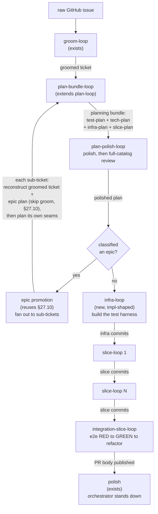
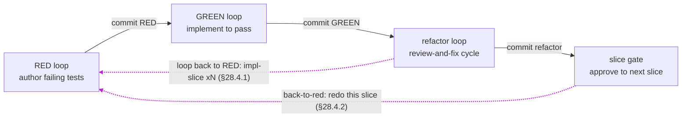

## 28. The full-TDD development process — a chain of §27 loops

> **Status:** requirements, drafted **v2.144** from the `plan.md` design. **This is the full-TDD development process expressed on the §27 engine — §27.1's proof-of-generality turned into payoff.** §27.1 built three loops (`groom` / `plan` / `impl`) as the *same loop shape* over different data so a plan/impl assumption could never be hardcoded into the orchestrator; this section spends that generality by chaining more links of the same shape. Decisions are **P1–P8**.
>
> **The process expressed here** — for the epic: create epic → tracer-bullet slices → sub-tickets; for each ticket: groom → plan-bundle → plan-polish → build the deterministic infrastructure → RED/GREEN slices → an integration slice → polish; for each slice, a commit between each phase: RED tests → GREEN implementation → review-and-refactor.
>
> **The engine core does not change.** The whole process is a **longer chain of the loop the engine already runs** (`work-once → review-and-fix → consolidate → human-gate`, §27.3) over a different artifact at each link (§27.10 chaining). §28 adds only three bounded engine changes (P3–P5) and a body of **content** — five reviewer charters and a handful of work recipes, authored in the same style as the charters already in `example/loops-v2/`.
>
> **On any conflict, §27 wins for the loop mechanics; §28 governs only the process built on top of them.** §28 asserts **no supersession** over §27 — it is purely additive: a new side-effect kind, a def chained as three phase-loops, new completion clauses on §27.12(b), and new def content. Where §28 needs a mechanic §27 already specifies (the loop shape, the round report §27.5, the gate §27.9, chaining §27.10, the fake-agent seam §27.15), it **cites** §27 rather than restating it. A change here that finds itself editing a §27 mechanic has mis-cut the boundary.

### 28.1 Goal & boundary (P1)

- Express a complete **test-driven development process** — epic decomposition, per-ticket planning, deterministic-infrastructure construction, RED→GREEN→refactor slicing, integration, and polish — **on the existing §27 loop engine**, with a `git commit` between each phase and machine-checkable completion for the phases where "the agent says it's done" is not good enough.
- **In scope:** the new loop chain (§28.2); three additive engine changes — a **`commit` side-effect** (P3), **phase-as-a-loop** (P4), and **machine completion predicates** (P5); five new reviewer charters and their work recipes (§28.6); the epic overlay (§28.7).
- **Out of scope:** any change to the §27 loop shape, the round report, the consolidator, the gate, or the chaining/bootstrap machinery — **with one sanctioned exception, the loop-back step primitive of §28.4.1** (the single additive flow-step directive that lets one per-ticket chain run impl-slice×N; it adds a repeatable step, it does not restructure the chaining/bootstrap machinery otherwise); the `ExecSideEffect` (§27.8, still unshipped — §28.5.4 explains why this design does not need it); per-verdict review vocabulary (the cousin work of [#102](https://github.com/dylanb/agent-terminal/issues/102), noted in §28.9).
- **Thesis (P1a): this is a longer chain, not a new engine.** §27.3's loop is artifact-agnostic by construction. RED, GREEN, and refactor are three more instances of it, chained by §27.10 hand-off; the planning steps collapse into two planning loops, plan-bundle then plan-polish (§28.8.1); the epic steps are §27.10 promotion. What is genuinely new is small and bounded, and it is enumerated in §28.10.

### 28.2 The loop chain (P2)

Each box is one instance of the §27.3 loop shape. Arrows are the §27.10 `inputs`/`outputs` artifact hand-offs — the same chaining that already turns groom → plan → impl, with more links.



Each **slice-loop** is itself three tiny chained loops — this is *phase-as-a-loop* (P4):



**Two levels of "slice", named to avoid collision (P2a).** The word *slice* appears at two granularities; every artifact must keep them distinct:

- **Epic-slice** = a **sub-ticket** — one unit of the epic plan's tracer-bullet decomposition, promoted to a self-contained, stacked sub-ticket via §27.10.
- **Impl-slice** = a **RED/GREEN unit** *inside* one sub-ticket's `slice-plan`.

### 28.3 Engine change #1 — the `commit` side-effect (P3)

The "commit between each phase" requirement is made first-class as a new **side-effect `kind`** alongside the §27.13 `gh` side-effects (`publish-pr-body`, `mark-ready`): a local **`git commit`** carrying the phase label (`RED: <slice>`, `GREEN: <slice>`, `refactor: <slice>`).

- It is **out-of-band** (§27.13) — an app operation, never terminal injection, so a busy shell cannot block it. Inter-phase commits are **best-effort**; the RED commit is the exception (below).
- It **carries the identity of what it commits** (the phase and slice), and the receiver never re-derives that target from ambient state (the §6 IPC payload-identity rule).
- It stages **only the phase's own paths** and **never** the user's `.gitignore` (CODE-STANDARDS). Firing it advances `HEAD` by **exactly one commit**; "clean" here means the working tree's **unstaged and untracked files are left in the same state they were in when the phase started** — the commit captures its own changes and never sweeps an operator's unrelated edits. A pre-existing `.gitignore` is byte-for-byte unchanged — the RED-first pin for P3.
- **How "the phase's own paths" is isolated:** the commit stages everything, then **excludes** two path sets. **(a)** The paths already dirty at **phase start** — a snapshot the phase lifecycle injects into the side-effect; **S3** captures it alongside the RED baseline SHA (§28.5.1), and until then it is **empty**, so every changed path counts as phase-produced (the staging is unchanged from the pre-S3 `git add -A`). Exclusion is **wholesale per path**: a file already dirty at phase start is left to the working tree even if the phase also changed it — the commit does not capture the phase's own later edit to such a file, so "the phase's own changes" means changes to files that were **clean** at phase start (the operator's edits win; the conservative choice against sweeping WIP, CWE-200). **(b)** The app's own engine/tooling dirs (`.agent-terminal/`, `.agent-loop/` — the `APP_STATE_DIRS` set the clean-tree gate shares, never a parallel copy). So operator WIP and loop/flow state can never land in a phase commit (CWE-200) and can never make the nothing-to-commit condition unreachable (CWE-754), independent of whether the operated repo gitignores them. Because the snapshot is a git-status listing of the **untrusted** operated repo, the exclusion uses **literal pathspecs** so a repo-controlled filename cannot be read as a magic pathspec (`:(exclude)`, `:/`) and steer the set (CWE-88).
- **The RED commit is blocking, not best-effort:** it is the baseline GREEN diffs against (§28.5.1) and the commit that puts the failing tests into the tree, so RED→GREEN advances only once it lands. On a commit failure the app **retries with `--no-verify`** — a repo pre-commit hook that runs tests will reject a *failing*-test commit, which is exactly the RED commit — and only if that retry also fails does the transition **block** on the §27.12 retry-then-`error` path (human-owned, resumable).
- **Nothing to commit is surfaced, not silent** (AC3): recorded as a distinct benign audit outcome (`side-effect-skipped`, never the failure token) **and** surfaced live to the operator as a notice that never reads as a failure and never blocks the gate's terminal accept/advance.

### 28.4 Engine change #2 — phase-as-a-loop (P4)

RED, GREEN, and refactor are **three separate single-work-turn loops, chained** (§27.10), **not** a new multi-work-turn loop with internal phase structure.

- This **reuses the §27.3 loop shape verbatim.** Each phase gets its own context boundaries, its own gate, its own `commit` (P3), and its own completion predicate (P5) *for free*, because each is an ordinary loop — rather than inventing "a loop with three work turns", a structure the orchestrator does not have and would need new machinery to run.
- **Consequence:** a slice-loop is a **sub-chain** (RED-loop → GREEN-loop → refactor-loop), and the per-ticket chain nests one sub-chain per impl-slice. The orchestrator already resumes a chain at the earliest turn whose output is missing (§27.12 auto-resume); nesting adds links, not concepts.
- **Recommended over** a phase sequence inside one loop, which would require new orchestrator state to track "which phase am I in" that the chain already expresses as "which loop am I in".

#### 28.4.1 The loop-back primitive — impl-slice×N (P4a)

§28.2 nests **one RED→GREEN→refactor sub-chain per impl-slice**, but the flow machine's `advance()` is a static `index+1` with a terminal `done`: it has no repeatable step, so a per-ticket chain delivered exactly **one** impl-slice per run. §28.10-S7 recorded that gap as a deferral — the [S7-deferral note] said true slice-loop×N "needs a loop-back/repeatable flow primitive **this section barred**". This subsection **lifts that specific deferral** by adding one — and only one — additive flow-step primitive; every other clause of §28.1's boundary (the loop shape, the round report, the consolidator, the gate, the bootstrap machinery) is unchanged.

**The primitive.** A step MAY carry a `repeat: { back_to, count_input }` directive. On `advance()` **off** that step, the machine reads the integer value of the `count_input` flow input — the **slice count**, resolved at runtime because the plan decides it, not the flow file — and while the step has looped back fewer than that many times, `index` jumps back to `back_to` (an **earlier** step) instead of advancing to the next; once the count is reached, `advance()` falls through as normal. The iteration count per repeat step is persisted in `flow-state.yaml` (`repeat_counts`), so a relaunch resumes the correct impl-slice rather than restarting the loop, and is cleared by `restart()`/`terminate()`.

**Bounded and fail-safe (CWE-20/770).** The count is UNTRUSTED — it derives from the plan artifact — so it is clamped to `[1, MAX_SLICES]` at the use site: an absent, non-integer, or sub-1 value falls to **1** (a single pass, no loop-back — the safe direction against a runaway loop), and an over-cap value clamps to `MAX_SLICES` (the cap keeps firing rather than being disabled). `back_to` must name an **earlier** step; a forward, unknown, or self target is a **load error** (a repeat is a loop-BACK, never a skip).

**What this delivers, and what still remains.** The primitive is the flow-machine mechanism §28.2's slice-loop×N needs, and the shipped `flow.yaml` now carries `repeat: { back_to: red, count_input: slices }` on its `refactor` step. It is **inert until the count is sourced**: until a planning step resolves the `slices` input from the slice-plan, the count defaults to 1 and the chain runs a single slice exactly as before — so nothing ships a half-working multi-slice chain. Running impl-slice×N **end-to-end** additionally requires the orchestrator to give each slice its own **turn/result-artifact identity** (`red-result` → `red-result.slice-N`) and per-slice frozen-baseline identity, so §27.12 auto-resume re-drives slice N's RED instead of matching slice 1's already-present result — the [per-slice-identity TODO] `appLoopState.ts` records. That, plus the slice-count sourcing, is the next slice; this one lands the primitive it rests on.

[S7-deferral note]: §28.10-S7 below.
[per-slice-identity TODO]: `TODO(dylanb) #123` in `appLoopState.ts`.

#### 28.4.2 The manual back-to-RED control — redo the current slice (P4b)

§28.4.1's loop-back is automatic and forward (advance the N planned slices). §28.4.2 adds the human
counterpart: at a phase gate, an operator who sees the agent stopped short sends the flow **back to the
current slice's RED step** to redo the work it missed. It **redoes the current impl-slice — it does not
consume or add one** — so it composes with the count-driven loop-back rather than fighting it: a mid-slice
reopen still finishes the plan on the same slice schedule.

**The flow transition.** `flow.reopenSlice()` jumps the flow's current step back to the slice's RED step —
the `back_to` target of the flow's repeat step (§28.4.1), the single source for "where the slice restarts"
— re-entering it (its entry actions re-run) while **preserving `repeat_counts` and the resolved inputs**.
It is a no-op guard, never a throw: inert unless in progress with a repeat step whose target is at or
before the current step (a reopen is backward-or-self, never a forward skip), so a stale gate click cannot
crash or skip the flow forward.

**The human control.** A one-way human gate decision, `back-to-red`, declared on **every phase gate**
(RED / GREEN / refactor / integration-slice), joins the §27.9 gate vocabulary in the
reopen-without-advancing family (beside `redo`/`polish`): it runs no side-effect and does not advance — it
invokes `reopenSlice()` and re-enters RED. Choosing it opens the request-changes composer framed for a
**slice brief**: optional free text plus any open review todos, saying what the slice must redo. The decision
rides the two-way `flow:appBackToRed` channel, so the composer holds open and keeps the brief when the
reopen does not land; an empty submit is a plain reopen.

**The slice brief.** A non-blank brief is written to `slice-brief.yaml` in the §27 loop area — its own file,
disjoint from `run-state.yaml`, which each phase rewrites — keyed to the current slice and the gate it came
from, **before** the reopen re-enters RED; a reopen that does not land clears it again. While the flow is on
that slice, every RED, GREEN and refactor turn is handed it: the work prompt states it as the redo the phase
must do its part of, and the review-and-fix fixer judges the round against it alongside the ticket.
Reviewers still receive only the ticket and their charter (§27.4). Approving refactor — the slice's last
phase — clears it, as does Terminate; a brief for another slice is never handed to a turn. The gate decision reopens the flow WITHOUT persisting an accept: the executor calls the
`reopenSlice` port and audits the decision, and the composition root runs `flow.reopenSlice()` inside a §25
transition so the backward re-entry lands in the run's audit record (a `step.entered` back at RED). A reopen
carries no distinct §25 `TransitionKind` — its audit diff is the whole observable, so it borrows the
backward-re-entry identity rather than widening the closed vocabulary with untestable ceremony.

**Scope of the reopen.** Like §28.4.1 this moves the FLOW; whether the re-entered RED work turn **re-runs
fresh** rather than resuming to its prior `red-result` depends on the same per-slice result-artifact
identity the [per-slice-identity TODO] tracks. Until that lands, a reopen re-enters RED but the phase
resumes its prior result.

### 28.5 Engine change #3 — machine completion predicates for any repo, any framework (P5)

This is the one genuinely hard piece. §27.12 already says a turn is done only when a real done-signal fired **and** the artifact it was to produce exists and is well-formed — but "the tests now fail for the right reason" and "the tests now pass" are artifacts a naive check would gate by running the test command and reading its exit code, which bakes in framework and build-system assumptions. §28 removes those assumptions by **splitting #3 into two predicates with very different portability stories**, and by reusing the §27.5 trust model rather than inventing a cross-framework test interpreter.

#### 28.5.1 Frozen-tests — fully portable, pure machine, zero framework knowledge

The check "no test file changed during GREEN" is pure git. It runs at GREEN-turn-done — **before** the GREEN commit — so it diffs the **working tree and untracked files** against the RED baseline, not commit-to-commit (`..HEAD` would be empty, since HEAD is still the RED commit and GREEN's edits are unstaged):

```
( git diff --name-only <RED-commit>  ∪  git ls-files --others --exclude-standard )  ∩  test_globs  ==  ∅
```

Git is universal (the engine already requires it for pickup, branches, and PRs — §27.10). The only repo-specific input is **`test_globs`** — a list of path globs matched against the changed set **with no knowledge of what a test is**. `<RED-commit>` is the SHA the RED loop's `commit` side-effect (P3) recorded in loop state; because it is this baseline, that commit is blocking rather than best-effort (§28.3). This half ships portably today; it is the same class of machine check as §27.5's "the report accounts for every persona" — **structural and tamper-evident, not semantic**.

> **S3 capture constraint (from the P3 impl review).** The RED-commit SHA MUST be read **inside the `commit` side-effect adapter**, chained synchronously right after `git commit` (widening its result to `{ outcome, sha }`), and recorded in loop state from there — **never** via a separate deferred `git rev-parse HEAD` in a later turn. The operated repo hosts a live coding agent in a PTY that **shares the working tree** (§28.3), so a deferred read could observe a commit the agent made in the window and poison the baseline.

**Detect-and-escalate, not a hard gate (P5a, operator decision — §28.8).** A detected test-glob change since the RED commit is **recorded as a flag** on the turn's artifact and does **not** fail the turn. The flag feeds the review round — the `regression-guard` persona (§28.6) judges whether the change was a legitimate RED correction or a weakening — and the human gate, which decides. Detection is machine and tamper-evident; **disposition is persona + human.** Under `auto`, the engine also runs this check at the approve and records a result that ran as this flag; a detection, an inability, or a failed flag write halts (§27.9.1 N9b.7, N9b.6(d)–(e)). A wrong RED test still has the `redo` lever (§27.9); freezing is deliberately not a hard block that could deadlock a slice.

#### 28.5.2 Ran / passed / failed-by-assertion — cannot be pure-machine cross-framework

The irreducible difficulty: **an exit code cannot distinguish an assertion failure from a compile failure.** `pytest`, `go test`, `cargo test`, and `vitest` all exit non-zero for both. A purely-machine, purely-portable predicate that told "valid RED" (ran, expectation unmet) from "invalid RED" (never compiled) would require shipping and maintaining an **output parser per runner** — exactly the machinery §27 exists to avoid. So §28 reuses the §27.5 round-report trust split, which faces this identical shape and refuses to solve it by machine:

**(a) The engine owns tamper-evident ground truth — portable, no framework knowledge:**

- `git diff` for frozen-tests (§28.5.1).
- The RED commit's diff **must add lines in `test_globs` files** — catching "you never wrote a failing test" machine-side, portably.
- The test command's **real exit code**, recovered *best-effort* from the tool/session log the cost meter already sweeps (§27.11) — that log is "an external dependency the app does not control" (§27.4), so the recovery **tolerates drift**. Where recoverable, the engine enforces the **unambiguous direction**: exit 0 ⇒ the agent may not claim RED; exit non-zero ⇒ the agent may not claim GREEN.

**(b) The agent owns framework interpretation.** It knows `pytest` from `vitest`, reads the raw output, and classifies it into a fixed, framework-neutral **outcome vocabulary** — the cousin of the §27.5 disposition set:

| outcome | means | RED requires | GREEN requires |
|---|---|---|---|
| `passed` | ran, all green | ✗ | ✓ |
| `failed-assertion` | ran, an expectation was unmet | ✓ | ✗ |
| `errored` | no clean assertion verdict — never ran (compile / import / collection error) or crashed mid-run (runtime error, non-assert panic, fixture failure) | ✗ | ✗ |
| `no-tests-selected` | the selector matched nothing | ✗ | ✗ |

The vocabulary is portable **by construction** — it names the *category* of outcome, not the runner. Every framework maps onto it:

| framework | `failed-assertion` looks like | `errored` looks like |
|---|---|---|
| vitest / jest | `AssertionError`, `expect` diff | `SyntaxError`, `Cannot find module` |
| pytest | `assert` failure, `E   assert` | `ERROR ... collection`, `ImportError` |
| go test | `--- FAIL` + assertion line | `build failed`, `undefined:` |
| cargo test | `assertion failed` (an `assert!` panic) | `error[E…]`, `could not compile`, a non-assertion panic |

**(c) The agent writes the outcome into a result file whose *shape* the engine validates** — exactly like the round report. The agent classifies (marks its own homework, §27.5's N5a risk); the engine bounds it with the exit-code direction from (a); the **raw captured output is versioned next to the classification**; and the `red-authenticity` reviewer plus the human gate are the backstop for a misclassified assertion-vs-compile (on a step whose `gate_authority: auto` is honoured, §27.9.1 N9b.2 and its override scope). This is the same three-part bound §27.5 already accepts — a structural machine check, a versioned auditable artifact, and the human gate.

#### 28.5.3 Completion clauses slot into §27.12(b) — not a parallel system

Each new turn type gains an artifact-check clause, exactly as the round report and the consolidator output do today (§27.12):

- **RED turn done** ⟺ `{diff added a test_glob file}` ∧ `{result file shape-valid}` ∧ `outcome == failed-assertion` ∧ `{exit ≠ 0 where recoverable}`.
- **GREEN turn done** ⟺ `{result file shape-valid}` ∧ `outcome == passed` ∧ `{exit == 0 where recoverable}` ∧ `{build outcome == built}`. **Frozen-tests runs here as detection, not a block (P5a):** a test-glob file changed since the RED commit is recorded as a flag and does **not** fail the turn; the flag feeds `regression-guard` and the human gate. **Every GREEN review-and-fix round re-records the flag when it completes** (on the done-signal and on the human accept alike), cumulative from the RED commit to the working tree, because those rounds edit tests too — a flag frozen at the work turn's value would hide every later change from `regression-guard` and the gate. The round's check never blocks it: a check that cannot run leaves the last recorded flag in place and is audited, and a failed flag write is audited.
- **refactor round done** ⟺ `{result file shape-valid}` ∧ `outcome == passed` ∧ `{exit == 0 where recoverable}`. Refactor keeps the tests green, so it carries the same recoverable exit-code direction as GREEN. A refactor may legitimately restructure a *fixture*, so the same changed-test flag is raised for `regression-guard` and the human rather than blocking.

**`built` is a separate axis from `phaseOutcome`:** it is not one of the four outcome values but the result of the configured `build_command` (§28.5.4) — `built` iff that command exits 0, recovered best-effort like the test exit code (§28.5.2a) and **vacuously satisfied where no `build_command` is configured**. It earns its place only for build steps the tests do not exercise — a production bundle or a typecheck; a compile error that breaks the tests already surfaces as `errored` in the test outcome.

A malformed result takes the existing **retry-then-`error`** path of §27.12; a persisted `error` is human-owned and survives a relaunch.

#### 28.5.4 Where the repo-specific knowledge lives — and why trust stays put (P5b)

Two things carry all repo-specific knowledge, and **neither is a program the engine executes:**

- **The engine never runs the test or build command. The agent does** — it already runs the build in today's impl work turn. So this does **not** reintroduce the §27.8 `ExecSideEffect` the spec ships-but-parks on trust grounds: there is **no engine-side shell interpolation** (no CWE-78 at the engine boundary) and **no per-def-origin trust decision to reopen**. The engine's job is capture + shape-validate only.
- **The "how to run it" is data referenced as *guidance* in the recipe** — a **standalone per-repo `loop-capabilities.yaml`** (operator decision — §28.8): `test_globs`, `test_command`, `build_command`, and an optional `select_template` for a slice's targeted subset. One file per repo; every loop def references it. Frameworks differ only in these *values*; the engine code is identical across every repo. An unusual runner just fills in different strings.

#### 28.5.5 Shared-semantics placement (P5c)

The outcome vocabulary is single-sourced in **`src/shared/phaseOutcome.ts`**, consumed by the prompt composer (tells the agent what to write), the completion predicate (validates the result file), and the tests — **exact-string, closed set, never normalized**, mirroring `DISPOSITIONS` and `GATE_DECISION_OPTIONS` (§27.5). The result-file grammar is single-sourced the way `roundReport.ts` is (§27 N3 changelog): **one writer** (the recipe), **one predicate**, **one canonical example** anchoring the prompt few-shot, the predicate happy-path test, and the fake-agent e2e. A recipe that instructs the agent to produce the result file is a *writer* in the shared-semantics contract (CODE-STANDARDS): its vocabulary derives from `phaseOutcome.ts`, and it embeds a canonical example asserted well-formed against the predicate. S0 fixes the **contract** — the vocabulary source, the shape-valid requirement, and the one-writer / one-predicate / one-example rule; the concrete result-file **grammar** (path, fields, version, raw-output bounds) is authored *with* its predicate in the slice that introduces it (S3/S4), exactly as `roundReport.ts`'s grammar lives beside its predicate rather than in §27's prose.

#### 28.5.6 Honest boundary and limits (P5d)

- **Frozen-tests is fully machine and fully portable; pass/fail *direction* is machine-bounded and portable; assertion-vs-compile *reason* is agent-classified and human-backstopped** (on a step whose `gate_authority: auto` is honoured, §27.9.1 N9b.2 and its override scope). That residue cannot be made pure-machine across all frameworks without shipping per-runner adapters; §27's answer to exactly this shape is classify-and-backstop, not interpret.
- A repo with **no machine-runnable tests** degrades to frozen-tests + agent classification + human gate (on a step whose `gate_authority: auto` is honoured, §27.9.1 N9b.2 and its override scope) — still coherent.
- **Flakiness** stays the human gate's problem, not this predicate's — which is the reason for the P8 timing decision: a targeted subset per GREEN turn, the full Podman e2e only at the integration gate and polish.

### 28.6 Personas — reuse, repurpose, create (P6)

The code-producing loops need almost nothing new — the 12 impl and 6 plan personas are already in `example/loops-v2/` at full fidelity. The new charters are all about **planning artifacts** and **phase discipline**.

**Per-loop catalog (P6a).**

| Loop | Work recipe (author) | Review catalog | New charters |
|---|---|---|---|
| **groom-loop** | exists | `intent` (exists) | none |
| **plan-bundle-loop** | new: author the four-file bundle | plan `principal`, `intent` + `tracer-slicer`; defers polish | `tracer-slicer` |
| **plan-polish-loop** | new: polish the plan in place (the plan-polish method, verbatim) | all 6 plan personas + 3 new; fixes polish | `test-architect`, `determinism` |
| **infra-loop** | new: build harness / fakes / fixtures | impl `tests`, `security`, `taint`, `reliability`, `maintainability`, `conventions`, `architecture` + `determinism` | (`determinism` shared) |
| **RED loop** | new: author failing tests | impl `tests`, `intent` + `red-authenticity` | `red-authenticity` |
| **GREEN loop** | new: implement to pass | the full impl-12 + `regression-guard` | `regression-guard` |
| **refactor loop** | none — it *is* review-and-fix | the full impl-12, maintainability-led | none |
| **integration-slice-loop** | new: wire end-to-end + e2e | the full impl-12 + `tracer-slicer` + accessibility emphasis | none new |

**The five new reviewer charters (P6b).** Each is authored in the structure of the ported charters — the shared fragments (`00-preamble`, `01a-stack-translation`, `07-depth-probes`) composed in, a lane statement, and signature depth probes — and each carries a distinctive **marker** the content-parity test pins (mirroring security → "Aperture", tests → "hermeticity"):

1. **`test-architect`** — marker **"AC-to-test bijection"**. Every acceptance criterion maps to a test that asserts *observable behavior* (return values, IPC payloads on a contract channel, DOM the user sees — never a private call or internal shape), at the right layer (unit / integration / e2e), in RED-first order, with injection seams naming *domain concepts* not mechanism shapes. This is the CLAUDE.md "tests exercise observable behavior" and "an injection seam exposes a domain concept" rules turned into a reviewer.
2. **`determinism`** — marker **"Scriptable-per-turn"**. The test infrastructure is hermetic — no wall-clock / `Math.random()` / network / real time; the fake-agent seam is scriptable per turn (§27.15); fixtures are stable and self-contained; a first-run writer's RED test deletes the target root first (the CLAUDE.md fresh-machine rule).
3. **`tracer-slicer`** — marker **"Thin-but-complete"**. The slice breakdown is genuinely tracer-bullet-shaped (TRACER-BULLET.md): each impl-slice is thin *but complete* (main → `ipc.ts` → preload → renderer → visible UI), RED-first with an `_electron` e2e, fireable from an existing UI control, with real backing; and there is a final integration slice. Rejects a "slice" that is a horizontal layer.
4. **`red-authenticity`** — marker **"Fails for the right reason"**. The RED tests fail by *assertion*, not by a missing import / compile error / collection error; the failure message describes the intended behavior; no RED test asserts implementation; the `errored`-vs-`failed-assertion` classification (§28.5.2) is correct. This is the human-judgment complement that makes "marks its own homework" (§28.5.2c) bounded.
5. **`regression-guard`** — marker **"No vacuous green"**. The GREEN implementation satisfies the *intent* of the RED tests, not merely their letter; no trivially-true test was slipped in to pass; in refactor, changes are behavior-preserving and no assertion was weakened. **It reads the machine's changed-test flag (§28.5.3) and recommends a course of action to the human at the gate** — legitimate RED correction vs. weakening. The machine proves *which* files changed; this persona judges *why*.

**New work recipes (P6c).** One `work.md` per new loop — author the test plan, author the infra plan, author the slice plan, build the infra, write the RED tests, implement the GREEN. Refactor needs none (it is the review-and-fix cycle). Each recipe references `loop-capabilities.yaml` (§28.5.4) as guidance, and — per §28.5.5 — a recipe that instructs the agent to write the outcome result file derives its vocabulary from `phaseOutcome.ts` and embeds a canonical example asserted well-formed against the predicate.

### 28.7 The epic level maps onto §27.10 (P7)

The three epic steps are §27.10's existing epic promotion:

1. **create epic** = groom + plan at epic scope, plan classified `epic`.
2. **create tracer-bullet slices** = the plan-bundle-loop's slice breakdown, reviewed by `tracer-slicer`, at **ticket granularity** (each epic-slice becomes a sub-ticket).
3. **create sub-tickets** = confirm-first promotion (§27.10): self-contained, stacked sub-tickets, each carrying its AC portion + the plan verbatim with the slice delimited, an epic link, and the preceding slice's issue number; `agent-loop/ready` + `agent-loop/subticket` applied (§27.10's recorded operator override — approving the epic plan is the human vetting act).

Each sub-ticket then runs the per-ticket chain (§28.2) — but, per §27.10, a picked-up sub-ticket **reconstructs the groomed ticket and the coarse epic plan from its body and skips groom and the epic plan**, rather than re-running them. What it *does* run is the plan-bundle-loop and plan-polish-loop (§28.8.1) scoped to **its own** test / infra / slice seams — the detailed planning the coarse epic plan could not yet know — then infra, its impl-slices, and integration. This keeps §28 additive over §27.10: the coarse plan is reconstructed-and-skipped exactly as §27.10 specifies; the per-slice detailed planning is new §28 work, not a re-run of groom or the epic plan. **Settled (P7a, decision — §28.8):** the epic plan owns only the **coarse** decomposition into sub-tickets; each sub-ticket runs its own test / infra / slice planning, because the epic plan cannot yet know each slice's test seams.

### 28.8 Decisions settled (P8)

1. **Gate granularity → two planning loops, `plan-bundle-loop` then `plan-polish-loop`** (amended v2.172, operator decision 2026-10-05; originally one loop). The per-ticket planning steps (test plan, tech plan, infra plan, slice breakdown) are authored by `plan-bundle-loop`, whose review checks only that the draft is complete and well-sliced (`principal`, `intent`, `tracer-slicer`) and defers polish (§27.8). Those charters leave to the implementation any mechanism defect the plan's own tests would catch once the code exists — if the plan specifies such a mechanism, the finding is that it does — and treat a defence against an unnamed adversary, a new state, outcome, or field no acceptance criterion names, or handling for an interaction between criteria none of them states as overreach that needs a human decision, never as work to add. Behaviour no test environment in the repository exercises goes into the plan's `Assumptions` list with its real-run check, and another hole in a guard the plan already patches several ways is a human decision on the approach (amended v2.188). `plan-polish-loop` then polishes the plan in place and runs the full plan catalog over the polished text; its review-and-fix cycle *is* the "review all the above, iterate" step, so a polish that needs another review gets it in that loop's own rounds — no flow loop-back is added. The polish report opens with a proportion verdict and lists **scope escalations** — anything the plan builds beyond its acceptance criteria (an abstraction, option, generalisation, new state or format, recovery path, or defence, or an adversary it assumes) that no acceptance criterion, ticket rule, or applicable spec or standards clause requires, or that a materially simpler mechanism would satisfy — beside the method's "needs your call" items; an `overbuilt` verdict, or any escalation or call not recorded as an operator decision, makes `plan-polish-loop`'s consolidator stop for a human ahead of every other verdict (amended v2.176), so neither a human gate nor an honoured `auto` gate is reached past an undecided one. Each loop has one human gate **by default**; a step whose `gate_authority: auto` is honoured (§27.9.1 N9b.2) is the §27.9.1 operator override (its "Override scope"). The publishing and promotion side-effects (mark the PR ready, §28.7 epic promotion) sit on `plan-polish-loop`'s gate alone, so they act on the polished plan. The §27.9 interrupt model lets the operator let both run and step in when needed.
2. **Epic planning → per sub-ticket** (P7a): the epic plan owns only the coarse decomposition; each sub-ticket plans its own seams.
3. **Frozen-tests → detect-and-escalate, not a hard gate** (P5a): the machine *detects* a changed test file and flags it to `regression-guard`, which recommends a course of action to the human at the gate — detection is machine, disposition is persona + human.
4. **Full-suite timing → targeted per turn, full e2e at gates.** RED/GREEN/refactor predicates run the slice's targeted + affected tests; the **full Podman `_electron` e2e** runs only at the integration-slice gate and final polish — matching CLAUDE.md's "full suite before *done*", where *done* is the ticket's end, not every micro-phase.
5. **Capabilities file → a standalone per-repo `loop-capabilities.yaml`** (§28.5.4), referenced by every loop def as data, never executed by the engine.
6. **Spec §28 first.** This section is written and lands **before** any of the engine changes it describes, mirroring §27's N0 ("the contract the code implements. No code."). Every downstream slice cites §28, and the spec wins on any conflict.
7. **Epic promotion mechanics → uniform siblings + terminate** (P7b, operator decision — **supersedes §27.10's slice-1 re-point**). Promotion creates every sub-ticket the same way — each carries `agent-loop/subticket` + `agent-loop/ready`, **none assigned** (before creating any sub-ticket, promotion creates whichever of those two labels the repository lacks; if one cannot be created it stops with nothing changed on GitHub and asks the operator to run `gh label create <label>` and approve again) — then **closes** the epic planning PR (rather than re-pointing it onto slice 1) and **terminates** the flow. The operator opens a fresh worktree and picks up slice 1 by hand like every other slice. §27.10's earlier "the current PR keeps implementing slice 1, re-pointed, assigned, ready-label-stripped" design is retired; the epic-as-tracking-issue and the resumable/idempotent chain are unchanged.

### 28.9 Relationship to [#102](https://github.com/dylanb/agent-terminal/issues/102)

Issue #102 (the deferred per-persona verdict / pr-description / handoff work) is a **cousin**: its per-persona verdict vocabulary and this section's `phaseOutcome` vocabulary are both closed, exact-string, shared-sourced sets in the §27.5 mold. If #102's verdicts land first, §28 builds on the same shared-vocabulary machinery rather than duplicating it. They are separate initiatives and separate themes; the overlap is noted so neither re-invents the vocabulary plumbing.

### 28.10 Build — tracer-bullet slices (S0–S8)

Per the CLAUDE.md tracer-bullet rule, each **UI-bearing** slice spans main → `src/shared/ipc.ts` → preload → renderer, is fired from an **existing** loop-panel / gate control, and is proven by a Playwright `_electron` e2e on a real PTY, with the §27.15 fake-agent seam extended to script the new outputs. A **foundational or content-only** slice — S0 (spec, no code), S1 (the pure-git / vocabulary foundation with no UI surface), S6 (charter/recipe content) — is proven at its own observable boundary instead: unit/integration over real git fixtures, or the content-parity test, RED-first, never forced through a renderer path it does not touch (the CLAUDE.md rule that the tracer-bullet shape is for UI-bearing work). One theme per PR; RED-first throughout. The fake-agent must gain: writing the **result file** (outcome classification), driving **git state** (add a test file for RED; touch/don't-touch a test file for the frozen check), and reporting a scripted **exit code** the log-sweep recovers.

- **S0 — Spec §28 (this section). No code.** The contract the downstream slices cite; the spec wins on any conflict. (Operator decision — §28.8.6.)
- **S1 — `phaseOutcome` vocabulary + portable frozen-tests detection.** `src/shared/phaseOutcome.ts` (the closed set) and the pure-git frozen-tests check in main (§28.5.1). RED-first over git fixtures; no UI. Foundation for everything below.
- **S2 — the `commit` side-effect (P3).** A loop turn commits; the loop panel shows the commit landed. **e2e:** fire a loop whose gate side-effect commits; assert `HEAD` advanced by one, tree clean, `.gitignore` untouched.
- **S3 — the RED loop + RED predicate (P4 + P5).** Completion requires `failed-assertion` + a test file added (§28.5.3). **e2e:** a fake-agent that writes a failing test + a well-formed result file → RED complete; a fake-agent that writes a *passing* test drives retry-then-`error`.
- **S4 — the GREEN loop + GREEN/frozen predicate.** Completion requires `passed` + build `built`, with frozen-tests **detected and flagged**, not blocked (§28.5.3, P5a). **e2e:** a clean green advances and commits; a fake-agent that touches a test file raises the changed-test flag.
- **S5 — the refactor loop.** Reuses review-and-fix (§27.3) with the softer frozen+green round predicate (§28.5.3).
- **S6 — the five new charters + the new work recipes.** Content, pinned by a content-parity test in the mold of `loopsV2ContentParity.test.ts` (identity marker, shared fragments, no dead tokens; the recipe↔predicate canonical example asserted well-formed).
- **S7 — the per-ticket chain end-to-end.** groom-loop → plan-bundle-loop → infra-loop → slice-loop×N → integration-slice-loop → polish, wired as one flow, proven by a fake-agent e2e with `gh` recorded; the full Podman e2e green at the integration gate.
- **S8 — the epic overlay.** plan-bundle classified `epic` → `tracer-slicer`-reviewed decomposition → §27.10 promotion → each sub-ticket runs the per-ticket chain.

### 28.11 What §28 adds to §27 (the additive-change map)

Everything §28 introduces is additive; nothing narrows an existing §27 contract. Recorded so the boundary is checkable.

| §28 addition | rests on | new surface |
|---|---|---|
| `commit` side-effect (P3) | §27.13 side-effect kinds | a new best-effort side-effect `kind`; no contract narrows |
| phase-as-a-loop (P4) | §27.3 loop shape, §27.10 chaining | new loop defs chained as sub-chains; no new orchestrator primitive |
| completion predicates (P5) | §27.12(b) artifact check | new per-turn artifact-check clauses; `phaseOutcome.ts` (closed set, §28.5.5) |
| `loop-capabilities.yaml` (P5b) | none — data only, engine never executes it | a per-repo data file referenced by defs |
| five charters + recipes (P6) | §27.4 pull model, §27.8 def catalog | new def content, pinned by content-parity tests |
| epic overlay (P7) | §27.10 promotion | reuses the promotion contract; adds an epic classification path |
