## 28. The full-TDD development process — a chain of §27 loops

The full test-driven development process, expressed as a longer chain of the loop the §27 engine already runs (`work-once → review-and-fix → consolidate → human-gate`, §27.3) over a different artifact at each link (§27.10 chaining). §27.1 built its loops as the same shape over different data precisely so that a process assumption could never be hardcoded into the orchestrator; §28 spends that generality. Decisions are **P1–P8**.

**On any conflict, §27 wins for the loop mechanics; §28 governs only the process built on top of them.** §28 is purely additive (§28.11): where it needs a §27 mechanic it cites it. A change here that finds itself editing a §27 mechanic has mis-cut the boundary.

### 28.1 Goal & boundary (P1)

- Express a complete **test-driven development process** (epic decomposition, per-ticket planning, deterministic-infrastructure construction, RED→GREEN→refactor slicing, integration, finalization) **on the existing §27 loop engine**, with a `git commit` between each phase and machine-checkable completion where "the agent says it's done" is not good enough.
- **In scope:** the loop chain (§28.2); three additive engine changes — a **`commit` side-effect** (P3), **phase-as-a-loop** (P4) and **machine completion predicates** (P5); the reviewer charters and work recipes (§28.6); the epic overlay (§28.7).
- **Out of scope:** any change to the §27 loop shape, round report, consolidator, gate or chaining machinery, **except the one loop-back step primitive of §28.4.1**; the `ExecSideEffect` (§27.8, unshipped — §28.5.4 explains why this design does not need it).
- **Thesis (P1a): a longer chain, not a new engine.** RED, GREEN and refactor are more instances of the §27.3 loop, chained by §27.10 hand-off; the epic steps are §27.10 promotion.

### 28.2 The loop chain (P2)

Each box is one instance of the §27.3 loop shape; arrows are §27.10 artifact hand-offs. The shipped chain is `example/flows/feature-dev-v3/flow.yaml`.

```mermaid
flowchart TD
  RAW["raw GitHub issue"] --> GROOM["groom: intent, then goal session"]
  GROOM --> GAPPROVE["groom-approve &#40;human&#41;"]
  GAPPROVE -->|"groomed ticket"| PLAN["plan-goal-loop<br/>draft, polish and review the planning bundle"]
  PLAN --> PAPPROVE["plan-approve &#40;human&#41;"]
  PAPPROVE --> EPICQ{"classified an epic?"}
  EPICQ -->|"yes"| PROMO["epic promotion &#40;§27.10&#41;<br/>fan out to sub-tickets"]
  EPICQ -->|"no"| INFRA["infra-loop<br/>test harness and deterministic capabilities"]
  INFRA --> SLICE["impl-slice: RED, GREEN, refactor<br/>repeated once per planned slice"]
  SLICE --> INTEG["integration-slice-loop<br/>end-to-end RED, GREEN, refactor"]
  INTEG --> IAPPROVE["impl-approve &#40;human&#41;"]
  IAPPROVE --> FINAL["finalize-loop<br/>prepare the PR for a human merge"]
```

Each impl-slice is three chained loops — *phase-as-a-loop* (P4):

```mermaid
flowchart LR
  RED["RED loop<br/>author failing tests"] -->|"commit RED"| GREEN["GREEN loop<br/>implement to pass"]
  GREEN -->|"commit GREEN"| REFAC["refactor loop<br/>review-and-fix cycle"]
  REFAC -->|"commit refactor"| NEXT["next slice, or integration"]
  REFAC -.->|"loop back per planned slice &#40;§28.4.1&#41;"| RED
  GREEN -.->|"back-to-red: redo this slice &#40;§28.4.2&#41;"| RED
```

**Two levels of "slice" (P2a)**, kept distinct in every artifact:

- **Epic-slice** = a **sub-ticket**: one unit of the epic plan's tracer-bullet decomposition, promoted via §27.10.
- **Impl-slice** = a **RED/GREEN unit** inside one ticket's slice plan.

### 28.3 Engine change #1 — the `commit` side-effect (P3)

"Commit between each phase" is a side-effect `kind` beside the §27.13 `gh` side-effects: a local `git commit` labelled with its phase (`RED: <slice>`, `GREEN: <slice>`, `refactor: <slice>`).

- It is **out-of-band** (§27.13), never terminal injection, so a busy shell cannot block it, and it carries the identity of what it commits rather than re-deriving it from ambient state.
- **It commits only the phase's own changes.** It excludes every path that was already dirty when the phase started (wholesale: the operator's edits win over the phase's later edit to the same file) and the app's own state directories (`APP_STATE_DIRS`, the set the clean-tree gate shares), so operator WIP and loop state can never land in a phase commit (CWE-200) or make "nothing to commit" unreachable (CWE-754). The dirty-path snapshot comes from the untrusted operated repo, so the exclusion uses literal pathspecs (CWE-88). It never touches `.gitignore`.
- **The RED commit is blocking**, not best-effort: it is the baseline GREEN diffs against (§28.5.1). A repo pre-commit hook that runs tests rejects exactly this failing-test commit, so a failure is retried with `--no-verify`, and only then blocks on the §27.12 retry-then-`error` path.
- **Every gate commit is pushed to the pickup's branch** (§27.13) through the pickup's hardened push path, fast-forward only, so a commit an earlier push missed still reaches the PR. A failed push is surfaced and audited: an `auto` gate still advances, a human gate holds for a retry.
- **Nothing to commit is surfaced, not silent**: a distinct benign audit outcome (`side-effect-skipped`) and a live notice that never reads as a failure or blocks the gate.

### 28.4 Engine change #2 — phase-as-a-loop (P4)

RED, GREEN and refactor are **three separate single-work-turn loops, chained** (§27.10), not one loop with internal phases. Each phase then gets its own context boundary, gate, `commit` (P3) and completion predicate (P5) for free, and "which phase am I in" is just "which loop am I in" — state the chain already expresses, where a multi-phase loop would need new orchestrator state.

#### 28.4.1 The loop-back primitive — impl-slice×N (P4a)

The flow machine's `advance()` is otherwise a static `index+1`, so a chain could deliver only one impl-slice per run. A step MAY carry `repeat: { back_to, count_input }`: advancing off it jumps back to `back_to` until it has looped `count_input` times. The count is decided by the plan, not the flow file, so it is resolved at runtime; it is persisted (`repeat_counts` in `flow-state.yaml`) so a relaunch resumes the right slice, and cleared by restart/terminate.

- **The count's source: `count_input` or `count_from` (#278).** A repeat declares exactly one of them; both, or neither, fails the flow to load naming the step. `count_from: { artifact, format, list }` takes the count from a list in the artifact a loop outputs under the id `artifact`. `format` is one of a closed set: `impl-slices`, the artifact's `## Impl-slices` block read by the plan rules below, or `json-list`, a JSON object whose `list` key holds the entries. `list` is required for `json-list` and forbidden for `impl-slices`; `artifact` and `list` must be non-empty strings. Every rule the flow file alone decides fails at load, and unknown keys under `repeat` and `count_from` are ignored. Until a list sets the count, a `count_from` group runs once. The one rule that needs the loops — `count_from.artifact` must be the exact id of an output some step's resolved loop declares, wherever that step sits — is one shared check run when Start is pressed and by `--validate-flow` (§23.5), not at load. A loop that does not resolve contributes no outputs. A failing Start binds and persists nothing and leaves the flow not started, with the display-safe reason, naming the repeat step and the artifact, as the strip's notice; `--validate-flow` prints it as its `<flow.yaml>: …` line and exits 1. A `count_input` repeat, and a flow with no repeat, are never checked.
- **A well-formed `json-list` file (#278).** One predicate (`src/shared/jsonList.ts`) decides it for the engine and the self-check alike. The file parses as JSON; its top level is an object; it has the `list` key as an own property (the last value wins when a key repeats); that key's value is an array of at least one entry; and each entry is an object whose `title` is a string, non-empty after trimming, holding no control character (Unicode `Cc`). Extra keys and duplicate titles are allowed. The rules are checked in that order, entries in position order, and the first one broken is the one reported, with the entry's position counted from 1 for an entry rule. The file is read through the bounded no-follow read at the loop-artifact bound (16 MiB), so an absent, oversized, non-regular or non-UTF-8 file sources nothing. A symlink at the `count_from` output's own name is refused too: the read takes the output's path with its folder resolved and its own name kept, or, for a `.slice-N` file, the name the work turn was told to write. When that folder resolves outside the artifacts folder, nothing is read and the output sources nothing. A writing agent checks its file with the same predicate before signalling done, through `agent-terminal --check-repeat-list <file> <list>` (§23.5), which passes exactly when the file is well-formed, so a source approve of it sources a count unless the list has fewer entries than the iteration the run is on (below). Unless `plan` is itself `count_from.artifact`, the `plan` output's `## Impl-slices` read follows a link at its own name, as before.
- **A `count_from` count is re-sourced at every source approve (#278):** the approve of any step whose loop outputs `count_from.artifact`, wherever that step sits in the flow. The approve reads that output where the step's work turn wrote it on the iteration the run is on (the `.slice-N` name when it is the loop's work artifact and N > 1), and records the list's entry count and titles in `flow-state.yaml` (`repeat_list`), the latest source approve that sources a count winning. A file that breaks a rule, or a list with fewer entries than the iteration the run is on, sources nothing, so the count already standing (or 1) stays. The record is cleared exactly when `repeat_counts` is, and a persisted `count` that is not a positive integer reads as no record. A failed re-source never blocks the advance: it records a `source-slices-failed` entry in the run's §25 record. In a `count_from` flow, a `plan` output still re-sources the `slices` input as below; it sets the list's count only when `plan` is itself `count_from.artifact`, and then both read the same file and agree.
- **Each repeated work turn names its entry (#278).** A source approve records the list's entry titles beside its count, in the same `flow-state.yaml` write, so a relaunch names the same entry. Each title is stored as it is shown: every control character, U+2028/U+2029, bidi override and zero-width character except ZWJ/ZWNJ becomes a space, the text is cut to its first 100 code points, and at most `MAX_SLICES` titles are kept. A persisted title is cleaned again when it is read, and a record whose `titles` are not a list of strings reads as no record. Every work turn of a step from `back_to` to the repeat step, goal-mode and retried turns included, carries one line `entry <k> of <N>: <title>`, where k is the iteration, N the standing count after the clamp, and the title the k-th one recorded. Review-and-fix, reviewer and consolidate turns carry none. A `count_input` repeat records its titles only when `count_input` is `slices`, from the `plan` re-source below, and names an entry only while that input still equals the recorded count. No line appears before a source approve sources a list, after the record is cleared, when a person supplies the `count_input` value (which clears it), or on an iteration with no recorded title.
- **Bounded and fail-safe (CWE-20/770).** The count derives from the plan artifact and is untrusted, so it is clamped to `[1, MAX_SLICES]` at the use site: an absent or invalid value falls to 1 (no loop-back, the safe direction), and an over-cap value clamps rather than disabling the cap. `back_to` must name an earlier step; anything else is a load error.
- **The count is re-sourced at every approve gate whose loop declares the `plan` output** (planning, and RED, since RED may split its own slice, §28.5.3), from the plan's `## Impl-slices` block. A malformed block, or one with fewer entries than the slice the run is on, sources nothing, so a plan a later step broke cannot cut the run short.
- **Open:** per-slice identity for turn results and the frozen baseline is incomplete (#123), so a re-entered RED can match a prior slice's artifacts.

#### 28.4.2 The manual back-to-RED control — redo the current slice (P4b)

The human counterpart to §28.4.1: at a phase gate, an operator who sees the agent stopped short sends the flow **back to the current slice's RED step**. It **redoes the current impl-slice; it does not consume or add one**, so it composes with the count-driven loop-back.

- `back-to-red` is a one-way gate decision on every phase gate, in the reopen-without-advancing family beside `redo`/`polish` (§27.9). It re-enters the slice's RED step (the repeat step's `back_to`, the one source for where a slice restarts) and preserves `repeat_counts` and resolved inputs. It is a no-op guard, never a throw, so a stale gate click cannot crash or skip the flow forward.
- It opens the request-changes composer framed as a **slice brief**. The brief lives in its own file (`slice-brief.yaml`, disjoint from `run-state.yaml`, which each phase rewrites), is handed to every RED, GREEN and refactor turn of that slice and to every turn of the loop at the step the control returns to, and is cleared when refactor is approved, when that return step is approved and its loop is no RED, GREEN or refactor phase, or when the run terminates. Reviewers still receive only the ticket and their charter (§27.4).
- The reopen is audited as a backward `step.entered` at RED rather than a new transition kind.

### 28.5 Engine change #3 — machine completion predicates for any repo, any framework (P5)

§27.12 already holds a turn done only when a done-signal fired **and** its artifact is well-formed. "The tests fail for the right reason" and "the tests pass" would naively be checked by running the test command and reading its exit code, which bakes in framework assumptions. §28 instead splits the check into two predicates with very different portability, and reuses the §27.5 trust model rather than building a cross-framework test interpreter.

#### 28.5.1 Frozen-tests — fully portable, pure machine, zero framework knowledge

"No test RED wrote was changed afterwards" is pure git: at turn-done, before the phase's commit, the working tree is diffed against the RED commit, and a test file (matched by `test_globs`, with no knowledge of what a test is) that had a line changed or removed, or was deleted or retyped, is a frozen change. **Adding tests is not**: GREEN may add the tests its own design needs. Whether an added test weakens another is not machine-visible; `regression-guard` grades it (§28.6). Git is the only dependency, and the engine already requires it.

The RED commit's SHA is read **inside the commit side-effect, synchronously after `git commit`**, never by a later `rev-parse HEAD`: the hosted agent shares the working tree, so a deferred read could pick up a commit the agent made in between and poison the baseline.

**Detect and record; the step decides (P5a, §28.8 item 3).** A frozen change is recorded as a flag, never a failure or a gate halt (§27.9.1 N9b.7). The GREEN, refactor and integration-slice steps may correct a wrong RED test themselves, logging each change under `### RED test changes` with why every acceptance criterion it checked is still checked; their reviewers grade it. A change that would leave an acceptance criterion untested is logged under `### Needs your call` and not applied. The engine keeps every detected change for the branch (`src/main/redTestChanges.ts`) and the implementation approval presents them once, marking any change no step explained **Unexplained**.

#### 28.5.2 Ran / passed / failed-by-assertion — cannot be pure-machine cross-framework

**An exit code cannot distinguish an assertion failure from a compile failure**: every common runner exits non-zero for both. Telling them apart by machine would mean an output parser per runner, exactly the machinery §27 exists to avoid. So §28 reuses the §27.5 split:

- **(a) The engine owns tamper-evident ground truth:** the frozen-tests diff; the requirement that RED's commit adds lines to a test file; and, recovered best-effort from the session log (§27.11), the test command's exit code in its unambiguous direction — exit 0 forbids claiming RED (except a verification-only RED, §28.5.3), non-zero forbids claiming GREEN.
- **(b) The agent owns framework interpretation**, classifying the run into the closed, framework-neutral outcome vocabulary of `src/shared/phaseOutcome.ts` (`passed`, `failed-assertion`, `errored`, `no-tests-selected`). The vocabulary names the category of outcome, not the runner, so every framework maps onto it.
- **(c) The engine validates the shape of the result**, keeps the raw output verbatim beside it, and the `red-authenticity` reviewer and the human gate backstop a misclassification. This is the same three-part bound §27.5 accepts: a structural machine check, an auditable artifact and the human gate.

#### 28.5.3 Completion clauses slot into §27.12(b) — not a parallel system

Each turn type gains an artifact-check clause, exactly as the round report does (§27.12). The predicates are `src/shared/phaseResult.ts`; the red-check report is `src/shared/redCheck.ts`.

- **RED turn done** ⟺ a test file was added ∧ the result is shape-valid ∧ (`failed-assertion` with a non-zero exit where recoverable ∨ verification-only) ∧ the red check passes where the repo declares one.
- **The red check.** A repo that declares `red_check_command` (§28.5.4) has the agent run it in the RED turn and every RED review round. The clause then passes only when every check the RED result declares in `intendedFailures` failed by assertion, and nothing else did: an undeclared failure is a test failing before its own check, and a declared one that did not fail is a check never seen failing. An operator accept cannot relax it. A repo that declares none is not blocked; each RED round carries a fixed warning and the run log records it. This repo's adapter is `scripts/red-check.mjs`; it runs only the tests the RED added or changed, so an e2e RED costs one targeted e2e run.
- **A slice already built is verified, not stopped.** An earlier slice's GREEN can build a later slice's behavior, leaving its RED nothing to see fail. That RED records a **verification-only** result (`passed`, `verificationOnly: true`, no declared failures), which only RED's completion accepts. The recipe and `red-authenticity` require each check to have been seen failing with the behavior broken in a scratch copy, never by weakening a test or breaking production code.
- **GREEN turn done** ⟺ shape-valid ∧ `passed` ∧ exit 0 where recoverable ∧ `built`. Frozen-tests runs here as detection (§28.5.1), and every GREEN review round re-records the flag cumulatively, because those rounds edit tests too.
- **refactor round done** ⟺ shape-valid ∧ `passed` ∧ exit 0 where recoverable, with the same changed-test flag.
- **A planned test edit belongs to RED.** An edit the plan already knows a slice needs is scheduled in that slice's RED, not left for GREEN to "correct"; `tracer-slicer` grades it.
- **An increment whose checks need another increment's GREEN is its own impl-slice**, because RED completes only when every check has been seen failing before the slice's production code exists. The plan splits at every such dependency (target ≤5 slices; only this split may exceed 5, and never 10 — more is an epic or an operator decision). A dependency the plan missed is split by RED itself, inside its decision boundary, up to `MAX_SLICES`; approving RED re-sources the slice count (§28.4.1).
- **`built`** is a separate axis: the configured `build_command` exits 0, vacuously true when none is configured. It earns its place only for build steps the tests do not exercise (a bundle, a typecheck).

A malformed result takes §27.12's retry-then-`error` path.

#### 28.5.4 Where the repo-specific knowledge lives — and why trust stays put (P5b)

- **The engine never runs the test or build command; the agent does.** So this needs no engine-side shell interpolation (no CWE-78 at the engine boundary) and reopens no def-origin trust decision; the engine only captures and shape-validates.
- **How to run things is data**, in one standalone per-repo `loop-capabilities.yaml` (§28.8 item 5): `test_globs`, `test_command`, `build_command`, an optional `select_template` and an optional `red_check_command`. Frameworks differ only in these values; the engine code is identical across repos.

#### 28.5.5 Shared-semantics placement (P5c)

The outcome vocabulary is single-sourced in `src/shared/phaseOutcome.ts` (closed, exact-string, never normalized) and the result grammar in `src/shared/phaseResult.ts`, consumed by the prompt composer, the completion predicate and the tests. A recipe that tells the agent to write a result file is a *writer* in the shared-semantics contract (CODE-STANDARDS): its vocabulary derives from that module and it embeds the canonical example.

**The result is JSON and the raw run is kept beside it** (`red-result.json` + `red-result.output.txt`). The engine requires the output file to exist and never parses it, so evidence never has to be escaped into the JSON and nothing in it can be read as a classification. The agent runs the same predicate as a command before signalling done (§27.12).

#### 28.5.6 Honest boundary and limits (P5d)

- Frozen-tests is fully machine and portable; pass/fail *direction* is machine-bounded; assertion-vs-compile *reason* is agent-classified and human-backstopped, unless the repo declares a `red_check_command`, whose adapter carries the repo's own per-runner knowledge. That residue cannot be made pure-machine across frameworks without per-runner adapters.
- A repo with **no machine-runnable tests** degrades to frozen-tests + agent classification + the human gate, which is still coherent.
- **Flakiness** stays the human gate's problem: each phase runs a targeted subset; the full Podman e2e runs at the integration gate and finalization (§28.8 item 4).

### 28.6 Personas — reuse, repurpose, create (P6)

The code-producing loops reuse the existing implementation personas; the charters §28 adds are about **planning artifacts** and **phase discipline**. Which loop reviews with which charters is the `charter/` directory of each loop under `example/loops-v2/`. Each §28 charter carries a distinctive marker:

1. **`test-architect`** ("AC-to-test bijection"): every acceptance criterion maps to a test of observable behavior at the right layer, RED-first, with injection seams naming domain concepts — the CLAUDE.md test rules turned into a reviewer.
2. **`determinism`** ("Scriptable-per-turn"): the test infrastructure is hermetic and the fake agent scriptable per turn; a first-run writer's test deletes the target root first.
3. **`tracer-slicer`** ("Thin-but-complete"): every impl-slice is a thin but complete vertical slice (TRACER-BULLET.md), with a final integration slice; a horizontal layer is a finding.
4. **`red-authenticity`** ("Fails for the right reason"): RED tests fail by assertion, not by a missing import or compile error, and the outcome classification is correct; a verification-only RED is graded as strictly. A RED test a correct implementation could fail is left to GREEN to correct when its own check fails now and no wrong implementation passes it. This is the human-judgment complement that bounds "marks its own homework" (§28.5.2c).
5. **`regression-guard`** ("No vacuous green"): GREEN satisfies the intent of the RED tests, not just their letter; it grades every logged RED test change as correction or weakening and every test GREEN added. The machine proves *which* files changed; this persona judges *why*.
6. **`ui`** ("Design-system-first", plan loops): a plan touching renderer UI has a `## Design system` section, schedules that work before its first use on a surface the operator can already see, uses tokens rather than one-off values, follows `UI-STANDARDS.md`, and accounts for WCAG 2.2 AA contrast, keyboard, focus and name/role/value. It does not grade visual taste.

**Work recipes (P6c).** Each phase loop's `prompts/work.md` references `loop-capabilities.yaml` as guidance; refactor needs none, since it *is* the review-and-fix cycle.

**Infra builds deterministic capabilities, proportionately (P6d).** Beyond the harness, `infra-loop` builds capabilities that steer implementers into consistent, testable code or let a machine catch what a reviewer would otherwise judge, cheapest mechanism first (a type, then a lint rule, a test, a script, a new tool). It builds one only when a slice of this ticket uses it; a **large** one (a new dependency, CI job, code outside the ticket, a rule existing code breaks, a standards edit) and every follow-up proposal are put to the operator first and recorded in `infra-capabilities.md`. Infra's charters are authored for infra, each looking for a missing capability in its own area, with `principal` arbitrating proportionality.

**The design system is planned first (P6e).** Both planners require the `## Design system` section above for renderer-UI work, scheduled in the earliest slices on an existing visible surface, because tokens or shared components nothing visible uses are still a horizontal layer.

### 28.7 The epic level maps onto §27.10 (P7)

The epic steps are §27.10's existing epic promotion:

1. **create epic** = groom + plan at epic scope, plan classified `epic`.
2. **create tracer-bullet slices** = the planning loop's slice breakdown at **ticket granularity**, reviewed by `tracer-slicer`.
3. **create sub-tickets** = confirm-first promotion (§27.10, §28.8 item 7): self-contained stacked sub-tickets, each carrying its AC portion, the plan with its slice delimited, an epic link and the preceding slice's issue number.

A picked-up sub-ticket **reconstructs the groomed ticket and the coarse epic plan from its body and skips groom and the epic plan** (§27.10), then runs its own planning for its own test / infra / slice seams, then infra, its impl-slices and integration. **The epic plan owns only the coarse decomposition (P7a)**, because it cannot yet know each slice's test seams.

### 28.8 Decisions settled (P8)

1. **Complexity is the operator's call, raised before planning commits to it.** Grooming settles the MVP (user, problem, outcome, success signal) with the operator in plain language, and raises the ticket's gaps, ambiguities, contradictions and any acceptance criterion the problem does not need, each with a recommendation. Planning lists **complexity drivers** and **scope escalations** (anything built beyond the acceptance criteria, or that a simpler mechanism would satisfy) with simpler alternatives. Both **propose and never apply**: every item stays as the ticket states it until the operator decides, recorded as `Operator decision (<date>): …`, and the step stops for a human while any item is undecided, ahead of every other verdict, so an `auto` gate is never passed over one. Reviewers ask for a missing entry, never for the change itself. Plan charters leave to the implementation any mechanism defect the plan's own tests would catch, treat defences against unnamed adversaries and criteria nobody stated as overreach for a human, and send behavior no test environment exercises to the plan's `Assumptions` with its real-run check. In `feature-dev-v3`, planning is one goal session (`plan-goal-loop`) that drafts, polishes and reviews the bundle until a pass changes nothing, collecting every undecided call under `## Needs your call` in `plan-report.md`; the human `plan-approve` step presents it and carries the publishing and promotion side-effects, so they act on the plan the operator approved.
2. **Epic planning → per sub-ticket** (P7a): the epic plan owns only the coarse decomposition; each sub-ticket plans its own seams.
3. **Frozen-tests → detect and record, not a hard gate** (P5a): the machine detects a changed test file; the step that changed it decides and logs it, its reviewers grade it, and the operator sees every change once, at the implementation approval. A change that leaves an acceptance criterion untested stays the operator's call.
4. **Full-suite timing → targeted per phase, full e2e at gates.** Phase predicates run the slice's targeted and affected tests; the full Podman `_electron` e2e runs at the integration-slice gate and finalization — CLAUDE.md's "full suite before *done*", where *done* is the ticket's end.
5. **Capabilities file → a standalone per-repo `loop-capabilities.yaml`** (§28.5.4), data referenced by every loop def, never executed by the engine.
6. **The spec is the contract.** Code cites §28, and the spec wins on any conflict.
7. **Epic promotion → uniform siblings + terminate** (P7b, operator decision). Promotion creates every sub-ticket the same way, each labelled `agent-loop/subticket` + `agent-loop/ready` and **none assigned**, creating either label first if the repository lacks it (and stopping with nothing changed if it cannot). It then **closes** the epic planning PR and **terminates** the flow; the operator picks up slice 1 in a fresh worktree like every other slice.

### 28.9 Relationship to [#102](https://github.com/dylanb/agent-terminal/issues/102)

#102's per-persona verdict vocabulary and `phaseOutcome` are both closed, exact-string, shared-sourced sets in the §27.5 mold; whichever lands second builds on the same vocabulary machinery rather than duplicating it.

### 28.10 Build — tracer-bullet slices (S0–S8)

The S-numbers cited in tests name the order §28 was built in; every slice has shipped. A UI-bearing slice is proven by a Playwright `_electron` e2e through an existing control; a foundational or content-only slice is proven at its own boundary (git fixtures; for charter and recipe content, the bundled flows' load-validity tests) rather than forced through a renderer path it does not touch.

### 28.11 What §28 adds to §27 (the additive-change map)

Everything §28 introduces is additive; nothing narrows an existing §27 contract.

| §28 addition | rests on | new surface |
|---|---|---|
| `commit` side-effect (P3) | §27.13 side-effect kinds | a new side-effect `kind` |
| phase-as-a-loop (P4) | §27.3 loop shape, §27.10 chaining | loop defs chained as sub-chains; the one `repeat` step primitive (§28.4.1) |
| completion predicates (P5) | §27.12(b) artifact check | per-turn artifact-check clauses; `phaseOutcome.ts` |
| `loop-capabilities.yaml` (P5b) | none — data only | a per-repo data file referenced by defs |
| charters + recipes (P6) | §27.4 pull model, §27.8 def catalog | def content |
| epic overlay (P7) | §27.10 promotion | an epic classification path |
