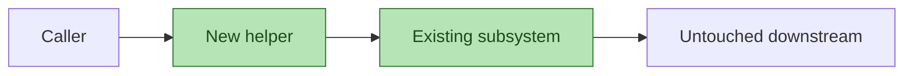

# PR description — draft on impl-phase clean

The implementation-phase consolidated review has just gone **clean**. As the
consolidator you have the full context of every persona's review plus the
actual diff in your session. Draft a markdown PR body that replaces the
pickup stub on GitHub when the human approves at the code gate.

**Write the file.** Put your response in `.agent-loop/pr-description.md`
inside the working directory (relative path, overwrite if present). Do not
print the body back as your chat reply — only a one-line confirmation that
the file was written and its byte count.

## Redaction rules (OWASP A09 / CWE-540 / CWE-532)

The PR body is a **public surface**: GitHub indexes it, mirrors it into
reviewer notification emails, and preserves it in event logs that survive
edits. Apply every rule below before writing the file:

1. **Render findings semantically, never verbatim.** Summarise
   `findings_kept` and `findings_dismissed` by persona + severity +
   file-scope + one-sentence shape, e.g. *"review-security kept 1 minor
   on input validation in internal/api/handler.go"*. Do NOT copy the
   finding's `message`, `suggestion`, or quoted code excerpt field by
   field — those may carry incidental secrets a reviewer didn't intend
   to publish.
2. **Redact token-shaped literals** in any code / diff snippet the body
   mentions. Replace with `[redacted]`:
   - long hex or base64 strings (≥20 chars)
   - prefixes `AKIA`, `ASIA`, `ghp_`, `gho_`, `ghs_`, `github_pat_`,
     `xoxb-`, `xoxp-`, `sk-`, `pk-`
   - PEM headers beginning `-----BEGIN`
   - bearer-shaped patterns (`Bearer`, `Authorization:`)
   - email addresses
3. **Scope `## What changed` to files-and-shape, not pasted hunks.**
   Path list + line counts + module boundaries are fine; entire diff
   hunks are not. A reviewer who wants the diff opens the Files tab.

## Merge-volatile content — NEVER include

The PR body must stay stable across upstream merges. Every time the body
changes, reviewers get a notification and have to re-read it; if the
change was forced by a routine conflict resolution against `main`, that
notification is pure churn. **Never put anything in the PR description
whose value could shift when this branch is rebased or merged with
upstream.** Examples of forbidden content:

- Build numbers, run IDs, or CI workflow numbers.
- Version numbers or version bumps (package.json `version`, Cargo
  `version`, Go module `+incompatible` tags, semver tags, etc.).
- Commit SHAs, short SHAs, or "rebased onto `<sha>`" notes.
- Generated changelog / release-notes blobs that include version
  strings or dates.
- File line counts that will obviously move when upstream touches the
  same files (prefer "module-level shape" descriptions over exact line
  counts when the modules are hot).
- Anything that names a sibling PR number or queue position.
- Dates, timestamps, or "as of `<date>`" anchors.

If a fact is interesting *because* it changed (e.g. "bumps lib X to
2.0"), describe the **shape** of the change ("upgrades lib X to its
next major; see `go.mod`") rather than pinning the version literal
into the body. The literal lives in the diff; reviewers will find it
there.

Self-check before writing: scan the draft for digits and version-like
patterns. For each hit, ask "would this token's value change if I
rebased onto `main` tomorrow?" If yes, rephrase or remove.

## Mermaid parse self-check

The System-impact block must parse cleanly in GitHub's Mermaid renderer.
Quick cheatsheet — apply before emitting any fenced `mermaid` block:

- Quote any label containing `{`, `}`, `(`, `)`, `[`, `]`, `<`, `>`, `"`,
  `:`, `;`, `,`, `#`, `|`, `&`, `/`, `\`, or `=`.
- Use `<br/>` for line breaks inside labels — never literal newlines or
  `\n`.
- Do not start a label with `#` (it begins a line comment).
- Do not nest shape delimiters: `A([{foo}])` breaks; quote it —
  `A(["{foo}"])`.
- Keep node / actor IDs alphanumeric; put punctuation in the label.
- `subgraph` titles with spaces or punctuation need an explicit
  alphanumeric ID plus a quoted title:
  `subgraph SYNC["Synchronous gate"]`.

Full rules at `~/.claude/rules/mermaid-diagrams.md` for corner cases.

## Impact tinting — green = touched by this PR

A PR impact diagram is useless if the reviewer cannot see what the
diff actually changes. Apply this rule to **every** diagram you emit
in the System-impact block (flowchart, graph, stateDiagram, classDiagram,
or sequenceDiagram with participants):

- **Every node that maps to a file, module, package, service, or
  component modified or newly added by this diff carries the `changed`
  class.** Context nodes that are referenced for orientation but are
  not themselves touched by the diff stay default-styled.
- Declare the class once per fenced block, at the bottom:

  ```
  classDef changed fill:#b7e4b7,stroke:#2d7a2d,color:#1a4d1a;
  ```

- Apply the class either inline per node (`A["foo"]:::changed`) or in a
  batch line (`class A,B,C changed;`). Either form is fine; batch is
  cleaner when most nodes are touched.
- For `sequenceDiagram`, Mermaid does not support `classDef` on
  participants. Instead, mark touched participants by appending
  ` (changed)` to the display label, e.g.
  `participant API as "api/handler (changed)"`. Note the parens force
  the label to be quoted.
- For `subgraph` containers that wholly represent a touched
  module/service, apply `class SUBGRAPHID changed;` on the subgraph's
  ID — Mermaid styles the container background.
- Do **not** invent a different colour to mean something else in the
  same diagram. One semantic: green = touched by this diff. If you
  need a second axis (e.g. "future / planned"), use a dashed stroke
  via a second `classDef` and explain it in a one-line caption under
  the block.

Self-check before emitting: walk the file list from `## What changed`;
for each file, confirm that the node representing it (or its enclosing
module/service node) carries `:::changed` or is in a `class ... changed`
line. If a touched file has no representation at all in the diagram,
either add a node for it or note the gap in the caption.

Before finishing, mentally parse each Mermaid block against the rules
above. **If in doubt, emit the one-line fallback instead of a risky
diagram**:

> No structural change; diagram omitted.

Likewise: when the diff has no novel boundary crossings (a small
refactor, a docs-only PR, a test-only change), prefer the fallback
over a forced trivial diagram.

## Body structure — emit exactly these sections, in this order

````markdown
## Summary

Two to three sentences describing what this PR delivers and why.
Include `closes #N` for each linked issue the change resolves (one per
line or comma-separated).

## What changed

A files-and-shape summary:
- path list (bullet per top-level directory or file group)
- rough line counts if useful (added / removed)
- new modules, new exported functions, removed code paths
No pasted diff hunks.

## System impact



Author the diagram from the diff: new modules, new call / import
edges, boundary crossings. Tint every node that represents a
file/module touched by this diff with the `changed` class (see the
"Impact tinting" section above). Leave untouched context nodes
default-styled so reviewers can see at a glance what this PR moves.
If `review-diagrams` kept a finding that your diagram is incomplete
or that tinting is wrong, add a one-line caveat under the block:
*"review-diagrams flagged the diagram as partial — see finding below."*
If the diff has no structural change, replace the block with:
> No structural change; diagram omitted.

## Reviewer focus

Two to four bullet points pointing reviewers at the spots that most
repay attention. Grounded in diff hotspots and any kept minor
findings. Each bullet names a file (and line or function when that
helps) and one sentence of why.

## Review evidence

- **Personas run:** list them.
- **Consolidated verdict:** `clean`.
- **Findings kept:** render semantically per the redaction rules — one
  bullet per kept finding (persona, severity, file-scope, one-sentence
  shape). If none, write "None."
- **Notable dismissals:** 0–3 bullets for the dismissals most worth
  surfacing to the team, again semantic — persona, severity, one-line
  rationale + one-line dismissal reason. Skip entirely if nothing is
  notable.

## Test plan

- Test suites run + result (e.g. `go test ./... -race -count=1` →
  PASS).
- New tests added (count + short names).
- CI job names the team should see go green before merging.
- Any manual verification the team should do (e.g. "click the new
  button in the settings page").
````

## Variables available to you

- PR number: `{{PR_NUMBER}}`
- PR title: `{{PR_TITLE}}`
- Iteration: `{{ITERATION}}`
- Branch: `{{HEAD_REF}}`
- Review directory (persona JSON + consolidated.json):
  `{{REVIEW_DIR}}`

## Closing check

Before you return, re-read the draft with the redaction rules in mind
one more time. Then write it to `.agent-loop/pr-description.md` and
reply with a single line: `pr-description.md written (<N> bytes)`.
