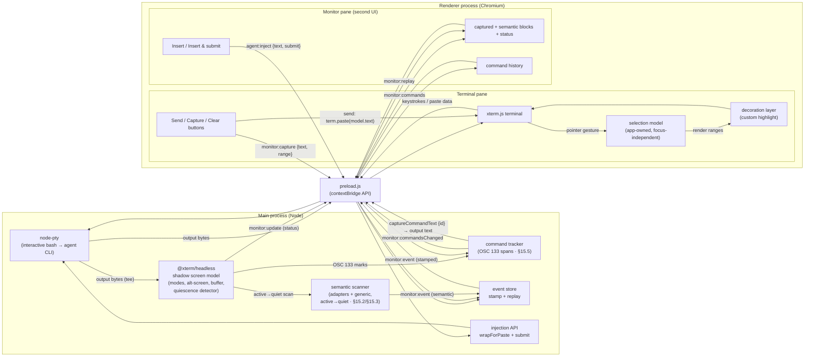

# Technical Specification — Agent Terminal: Foundation for a Coding-Agent Management Application

**Document status:** Draft v2.46
**Scope:** Foundation / "walking skeleton" build (shipped) + semantic/command capture (shipped, §15–§16) + the **task-flow management** phase (§17–§24): requirements drafted, and **Phase 1 — the three-view UI shell with real cores and fixture-mocked machinery (§24.1) — shipped**
**Target platforms:** Linux and macOS (Windows out of scope for this version)

---

## Table of contents

- [1. Purpose](#1-purpose)
- [2. Scope](#2-scope)
  - [In scope](#in-scope)
  - [Out of scope (this version)](#out-of-scope-this-version)
- [3. Technology stack](#3-technology-stack)
- [4. Architecture](#4-architecture)
  - [Data flows](#data-flows)
- [5. Spawning bash with the user's configuration](#5-spawning-bash-with-the-users-configuration)
- [6. IPC contract](#6-ipc-contract)
- [7. Renderer behavior and the app-owned selection subsystem](#7-renderer-behavior-and-the-app-owned-selection-subsystem)
  - [7.0 Why a custom selection mechanism](#70-why-a-custom-selection-mechanism)
  - [7.1 Base terminal setup](#71-base-terminal-setup)
  - [7.2 The selection model](#72-the-selection-model)
  - [7.3 Capturing the gesture (focus-independent)](#73-capturing-the-gesture-focus-independent)
  - [7.4 Rendering the highlight (our own, persistent)](#74-rendering-the-highlight-our-own-persistent)
  - [7.5 Sending selection as input (bracketed-paste aware)](#75-sending-selection-as-input-bracketed-paste-aware)
  - [7.5.1 Clear and lifecycle](#751-clear-and-lifecycle)
  - [7.5.2 Agent key bindings (added v2.8)](#752-agent-key-bindings-added-v28)
  - [7.6 Design decisions](#76-design-decisions)
- [8. The shadow screen model (output tee) — main process](#8-the-shadow-screen-model-output-tee--main-process)
  - [8.1 Why a shadow terminal, and why in main](#81-why-a-shadow-terminal-and-why-in-main)
  - [8.2 Implementation sketch](#82-implementation-sketch)
  - [8.3 Quiescence detection](#83-quiescence-detection)
  - [8.4 Capture events (skeleton scope)](#84-capture-events-skeleton-scope)
- [9. The monitor pane (second UI)](#9-the-monitor-pane-second-ui)
  - [9.1 Architectural rule](#91-architectural-rule)
  - [9.2 Skeleton UI](#92-skeleton-ui)
  - [9.3 The main-process injection API](#93-the-main-process-injection-api)
- [10. Project structure](#10-project-structure)
- [11. Build, run, and packaging](#11-build-run-and-packaging)
  - [Dependencies](#dependencies)
  - [The native-module gotcha](#the-native-module-gotcha)
  - [Run (dev)](#run-dev)
  - [Package](#package)
- [12. Acceptance criteria](#12-acceptance-criteria)
- [13. Future extensions (explicitly deferred)](#13-future-extensions-explicitly-deferred)
- [14. Risks and open questions](#14-risks-and-open-questions)
- [15. Next phase — semantic capture & command-output capture (requirements)](#15-next-phase--semantic-capture--command-output-capture-requirements)
  - [15.1 Goal & boundary](#151-goal--boundary)
  - [15.2 Trigger, data source, and scan scope](#152-trigger-data-source-and-scan-scope)
  - [15.3 Agent-semantic detection](#153-agent-semantic-detection)
  - [15.4 Event contract](#154-event-contract)
  - [15.5 Command-output capture (shell integration)](#155-command-output-capture-shell-integration)
  - [15.6 Monitor pane](#156-monitor-pane)
  - [15.7 Configuration & tuning](#157-configuration--tuning)
  - [15.8 Testing](#158-testing)
  - [15.9 Out of scope (this phase)](#159-out-of-scope-this-phase)
- [16. Action window — tabs, todo lists, and layout (v2.7)](#16-action-window--tabs-todo-lists-and-layout-v27)
  - [16.1 Tabs](#161-tabs)
  - [16.2 Injection model (supersedes the §9.2 / §15.6 "every block injects" posture)](#162-injection-model-supersedes-the-92--156-every-block-injects-posture)
  - [16.3 Todo data model, scope, and persistence](#163-todo-data-model-scope-and-persistence)
  - [16.4 Todo tab interactions](#164-todo-tab-interactions)
  - [16.5 Self-injection suppression (the capture fix — amends §15.3)](#165-self-injection-suppression-the-capture-fix--amends-153)
  - [16.6 Layout — resizable splitter & global UI settings](#166-layout--resizable-splitter--global-ui-settings)
  - [16.7 Out of scope (delta on §15.9)](#167-out-of-scope-delta-on-159)
  - [16.8 Cross-highlight between the terminal and the capture pane (v2.23)](#168-cross-highlight-between-the-terminal-and-the-capture-pane-v223)
- [17. Next phase — task-flow management (requirements)](#17-next-phase--task-flow-management-requirements)
  - [17.1 Goal & boundary](#171-goal--boundary)
  - [17.2 Two-layer ownership (D1/D2)](#172-two-layer-ownership-d1d2)
  - [17.3 Reuse map (D4)](#173-reuse-map-d4)
- [18. Flow definitions (`flow.yaml`)](#18-flow-definitions-flowyaml)
  - [18.1 Shape & library (D10/D13/D14/D23)](#181-shape--library-d10d13d14d23)
  - [18.2 Steps & kinds (D3/D7/D30)](#182-steps--kinds-d3d7d30)
  - [18.3 Bootstrap is a per-step entry action (D15)](#183-bootstrap-is-a-per-step-entry-action-d15)
  - [18.4 Typed step inputs (D29/D34)](#184-typed-step-inputs-d29d34)
  - [18.5 Authoring is separate (D20)](#185-authoring-is-separate-d20)
  - [18.6 Skill & template references — reference, never inline (D37)](#186-skill--template-references--reference-never-inline-d37)
- [19. Flow progression, gates & feedback](#19-flow-progression-gates--feedback)
  - [19.1 Flow-state & the agent-loop bridge (D1/D33)](#191-flow-state--the-agent-loop-bridge-d1d33)
  - [19.2 Advance is user-driven, with a not-ready warning (D31)](#192-advance-is-user-driven-with-a-not-ready-warning-d31)
  - [19.3 Gate driver & the running-process refusal (D2/D32)](#193-gate-driver--the-running-process-refusal-d2d32)
  - [19.4 Request-changes feedback (D7/D9/D11)](#194-request-changes-feedback-d7d9d11)
- [20. Artifacts & the built-in viewer](#20-artifacts--the-built-in-viewer)
  - [20.1 Discovery & provenance (D8)](#201-discovery--provenance-d8)
  - [20.2 Viewer (D25/D35)](#202-viewer-d25d35)
  - [20.3 GitHub as markdown (D19/D24)](#203-github-as-markdown-d19d24)
- [21. Manual capture & todo templates](#21-manual-capture--todo-templates)
  - [21.1 Manual single-slot capture (D39 — reconciles §15/§16)](#211-manual-single-slot-capture-d39--reconciles-1516)
  - [21.2 Todo templates (D12/D38)](#212-todo-templates-d12d38)
- [22. UI shell — views, overlay, status strip, layout](#22-ui-shell--views-overlay-status-strip-layout)
  - [22.1 Three full-screen views (D26)](#221-three-full-screen-views-d26)
  - [22.2 Tabbed quick-send overlay (D26/D40)](#222-tabbed-quick-send-overlay-d26d40)
  - [22.3 Status strip (D6/D27)](#223-status-strip-d6d27)
  - [22.4 Layout is data, not code (D17/D28/D36)](#224-layout-is-data-not-code-d17d28d36)
- [23. Multi-instance & epics](#23-multi-instance--epics)
  - [23.1 One flow per instance, many instances (D5)](#231-one-flow-per-instance-many-instances-d5)
  - [23.2 Epics = N instances over N worktrees (D18/D22/D23)](#232-epics--n-instances-over-n-worktrees-d18d22d23)
  - [23.3 Cross-instance guard (D21)](#233-cross-instance-guard-d21)
- [24. Phased build plan](#24-phased-build-plan)
  - [24.1 First slice (walking skeleton)](#241-first-slice-walking-skeleton)

---

> **Changelog v2.49:** **§24.2.2 S2 built — the step definition comes from a real `flow.yaml`.** The S1 hardcoded step seam is retired: `src/main/flow.ts` gains `loadFlowDefinition(worktreeDir)`, which reads & validates `<worktree>/.agent-terminal/flow.yaml` (§18.1 minimal shape — top-level `name` + one `kind: manual` step with `id` and optional `skill`/`todo_template`, parsed with `js-yaml`) and returns a validated `FlowDefinition` or a reason; `createFlowMachine(load)` now takes that result, sourcing the strip's step name from the file. Workflow, IPC, and UI are unchanged — only the definition's **source** is now real; the definition is read once at the spawn cwd (§5/§20.1). A **missing / malformed / schema-invalid** file is not a crash: it becomes an inert `error` state (new `FlowStatus` member + optional `FlowStateView.error`, §6) the strip renders as the reason with **no control** (`--danger`). RED-first: loader parse/validate integration tests against real temp dirs (valid, absent, malformed-YAML, schema-invalid — no fs mocks), a machine test (step name from the definition; lifecycle unchanged; error load is inert — neither throws nor leaves the error state), a renderer DOM test of the error render, and two full-loop `_electron` e2e (seed a temp worktree's `flow.yaml` → strip shows the step name and drives to done; no `flow.yaml` → strip shows the error with no control while the app still launches). State stays in-memory in main (persistence is S3).
> **Changelog v2.48:** **§24.2.2 S1 built — the walking-skeleton flow lifecycle.** The first tracer-bullet slice is real end-to-end: a single-step workflow state machine in `src/main/flow.ts` (`not_started --start--> in_progress --advance--> done`; `done` terminal, illegal transitions throw — so "a second Advance is impossible" is a machine invariant), its step a hardcoded constant (the one deliberate seam, replaced in S2). **§6** gains three renderer→main invoke channels — `flow:state` (`{sessionId} → {stepName, position, total, status}`), `flow:start`, `flow:advance` (each returns the resulting state so the strip re-renders from the response) — exposed as `window.flow` in the preload. The rail's **flow status strip** (§22.3) is now real (`flowStrip.ts`, a placement-agnostic organism): it shows `1/1 · <name>` + the live status and a single control that is **Start** in not_started, **Advance** in in_progress, and **gone** in done. This **retires the §24.1 fixture-driven flow timeline + rail status** (their render helpers and tests removed; the §19.3 Review-gate panel stays a fixture mock, out of S1 scope). RED-first throughout: a main unit test of the state machine (legal transitions only, `done` terminal), `isValidFlowRequest` validation, a renderer DOM test of the strip's render + control wiring, and a full-loop `_electron` e2e (launch → not started → Start → in progress → Advance → done, no further control). State is in-memory in main (persistence is S3).
> **Changelog v2.47:** **§24.2.2 added — the manual-step tracer-bullet plan.** The first real §24.2 flow-machinery feature is recorded as five vertical **tracer-bullet** slices: a walking-skeleton lifecycle (`not_started → in_progress → done`, hand-drivable in the UI) first, then one layer deepened per slice behind that unchanged arc — real `flow.yaml` source (S2, §18.1), persistence (S3, §19.1), entry actions instantiating the `todo_template` + injecting the `skill` (S4, §18.6/§21.2), and derived live status (S5, §22.3/§8.3). Each slice names its **fire / land / e2e** per the new CLAUDE.md *Tracer-bullet development* mandatory planning requirement (every §24.2 plan must be sliced back-to-front into UI-fireable increments). Plan only — no code yet.
> **Changelog v2.46:** **Multi-lane impl-review fixes (security · correctness · a11y · spec-hygiene).** **Security:** `repoKey` is validated at the renderer→main boundary (`isTodoBase` → `isSafeRepoKey`: absolute, no `..` segments) since it becomes a `todoStore` write path; `readArtifact` now resolves symlinks (`realpathSync`) and re-checks containment so an in-root link can't escape the discovery root (the lexical guard alone missed it). **Correctness:** add-to-todo's `repoKey` is seeded from `currentRepo()` on mount in the artifact-viewer and terminal-selection wiring (it previously no-oped until the first cross-repo `cd`, since `cwd:changed` fires only on a key change — mirrors `monitor.ts`); todo **reorder** now operates on the active run only and slots active ids back into their positions, so moving an active past an inline **done** row no longer shoves the done row; the capture bulk Add-to-todo aborts (no dismiss) if the add returns nothing, so source chunks aren't lost on a silent failure. **a11y:** focus follows the todo edit/delete/confirm transitions (to the editor, then Confirm, then Undo — WCAG 2.4.3) instead of dropping to `<body>`; the in-place editor is a labelled `role=textbox` (`aria-label`/`aria-multiline`); capture cards/checkboxes carry text-derived labels so bulk-triage items are distinguishable; Confirm-delete uses an outlined `--danger` token that clears 4.5:1 (WCAG 1.4.3) instead of white-on-`--attn`. **Spec/doc hygiene:** `CLAUDE.md` pin → v2.46; §6 `viewer:read` preload snippet uses `relPath` (not `path`); §16.4 reflects the contenteditable editor + the dropped Done section; §16.6/§6 `UiSettings` lists `theme`/`artifactTreeWidth`/`artifactFullscreenTreeWidth`; the dangling `§A11Y` changelog tag now points at §22.2. RED-first for every behavioral change (ipcValidation repoKey cases, the symlink-escape integration test, reorder-past-done, bulk-add silent-fail, focus moves, the textbox label, distinguishable checkbox labels, and the now-covered drag-reorder wiring). **Deferred as follow-ups (pre-existing, out of this PR's scope):** the `doInject` injection-seam DI refactor, deleting the dead `crossHighlight.ts` mechanism, the captureTab toolbar-host contract, and the `selection.ts` import-source tidy.
>
> **Changelog v2.45:** **§24.2.1 drawer-panel functionality restored, re-skinned into the mockup card/row language.** The capabilities dropped by the mockup-exact rebuild (their main-process IPC was always intact) are back in the renderer. **Todo panel:** **manual add** (a top add-row → `todoAdd {type:'manual'}`); **reorder** (↑/↓ buttons as the keyboard/a11y path + HTML5 drag → `todoReorder`, sending the full display order so the flat done-inline list stays stable); **edit-in-place** with a **better affordance than the old textarea-box swap** — the `.tx` becomes `contenteditable` in place (Save/Cancel + Enter/Escape), with the mid-edit repo-swap deferral kept (a swap while editing surfaces a `.swap-blocked` notice and applies once the edit resolves); and a **two-step undoable delete** (× → inline **Confirm delete? / Cancel** → a **deferred** `todoDelete` behind a **Deleted / Undo** row for `TODO_UNDO_MS`, capturing the item's own `repoKey` so a mid-window repo swap still deletes from the right list). **Capture panel:** **bulk triage** — each card carries a selection checkbox; a pane toolbar concatenates the checked chunks (appeared order, blank-line separated) into **one** todo via **Add to todo** (with an **Undo** window + a **processed-chunk cue**: contributing cards dim and disable their checkbox until the window commits, then the chunks are dismissed, or Undo deletes the just-added todo and leaves them), plus **Dismiss selected** and **Dismiss all** — this **supersedes** the per-card "Add to todo" the mockup shipped and **subsumes** Dismiss + Dismiss-all; and a **report prose fallback** — a report that carves no findings renders as an expandable `.report-prose` summary card (`<details>`) so its body has a home without reintroducing the blob. RED-first throughout: todoTab unit tests (manual add incl. empty-guard, reorder + boundary-disabled, contenteditable edit + Save/Cancel + deferred-swap, two-step delete + Undo with fake timers); captureTab unit tests (per-card checkbox + no per-card Add, bulk concat, processed cue, Undo deletes + leaves, window-elapse dismisses, Dismiss selected/all, report-prose `<details>`); the three superseded monitorPane per-card tests were rewritten to the bulk-triage contract; and full-loop e2e for manual-add-persists-across-reload, two-step-delete Confirm→Undo-keeps, and reorder-persists.
>
> **Changelog v2.44:** **Reusable accessible show/hide + quick-send closed on startup (§22.2 — accessibility).** Hidden content kept trapping keyboard focus — focusable controls inside panels hidden by `transform` (full-screen header/tree), a 0-width `overflow:hidden` column (closed drawer), or a `[hidden]` attribute defeated by a `display` rule (`.vnav`) all stayed in the tab order. **(1)** A single reusable mechanism in **`src/renderer/src/visibility.ts`** — `setShown(el, shown)` (drives `[hidden]`) and `setCollapsed(el, collapsed)` (drives `.is-collapsed`) — backed by **one enforcement point** in CSS: `[hidden] { display:none !important }` (so no `display` rule can resurrect a hidden, still-focusable subtree) and `.is-collapsed { visibility:hidden }` (inert but still animatable). Hiding now always removes a subtree from layout, the tab order, and the a11y tree. **(2)** The full-screen header/tree collapse via `setCollapsed` (keeps the slide; inert when off-screen); the changed-section nav (`.vnav`) and the drawer route through `setShown`. **(3)** The **quick-send drawer now starts closed** (`index.html` drops `drawer-open`; the shell syncs the drawer's `hidden` to its open state and toggles it on open/close), and is inert while closed. RED-first: `visibility.ts` unit tests; a shell unit test that closing marks the drawer `hidden` (+ inits hidden when the markup starts closed); and full-loop e2e using a `canFocus` probe — full-screen collapse keeps the header/tree out of the tab order (reachable once popped open), the drawer is closed-and-inert on startup (relaunched fresh) then focusable once opened, and the changed-section controls leave the tab order for a file with no changes. The §20.2 full-screen tests now assert the panels' `.is-collapsed`/`aria-expanded` (semantic state) rather than the old layout classes.
>
> **Changelog v2.43:** **Full-screen viewer mode (§20.2).** A toolbar button (`⛶`) maximises the artifact viewer: **all app chrome is hidden** (the left rail — including the status strip — and the quick-send drawer) via an `app.viewer-fullscreen` class, leaving the viewer to fill the window. Entering collapses the **viewer header** off the top and the **file tree** off the left; each is reopened by a **thin focusable edge strip** (`aria-expanded`) that pops it open and closed (click or Enter/Space). The tree popout is **drag- and keyboard-resizable** at its right edge, with its own persisted width (`UiSettings.artifactFullscreenTreeWidth`, kept separate from the slim split-view width) that **defaults to ≥30% of the viewport**. Exit is the same button in the revealed header, or **Escape**; switching views (⌘1/⌘3) also exits. **Keyboard accessibility** is end-to-end: the strips and toggle are real buttons, focus moves to the top strip on enter and back to the toggle on exit, and Escape always exits. Architecture: the **shell** owns the chrome class, Escape, and exit-on-view-change (`Shell.setViewerFullscreen` / `isViewerFullscreen`, `ShellDeps.onViewerFullscreenChange`); the **viewer organism** owns its in-subtree presentation, strips, button, and focus (`Artifacts.setFullscreen` / `isFullscreen`, `ArtifactsDeps.onRequestFullscreen`) — the two coordinate **through the contract** wired at the composition root, never by reaching across organisms. RED-first: shell unit tests (class toggle + signal, Escape exits, view-change exits), organism unit tests (toggle requested through the contract, enter collapses both with `aria-pressed`, strips toggle with `aria-expanded`, focus moves on enter/exit), and a full-loop e2e (button enters → rail+drawer hidden + both collapsed; strips reveal; Escape exits; keyboard path: Enter enters → focused strip opens header → in-header button exits). The popout's resizability adds: a `UiSettings.artifactFullscreenTreeWidth` round-trip+clamp unit test, organism unit tests (default ≥30% of the viewport, a persisted width applied over it, drag + arrow-key resize persisting through `onFullscreenWidthChange`), and an e2e (in full screen, the open tree's handle drags wider and the width survives a reload).
>
> **Changelog v2.42:** **Viewer toolbar: gated sinks + viewport-driven changed-section navigation (§20.2).** Two tweaks to the artifact viewer's action bar. **(1)** **Send to agent** and **Add to todo** are now **disabled until something is highlighted** in the viewer — they start disabled and toggle on `selectionchange` against the live in-viewer selection; each button's `mousedown` is `preventDefault`ed so focusing it no longer collapses the selection it acts on (the `lastSelection` fallback stays as belt-and-suspenders). **(2)** New **‹ prev / next ›** controls with a **current / total** readout step through the file's **changed sections** — the contiguous runs of `ViewerFile.changedLines` (collapsed to per-section start lines in the organism, pure). The readout and the prev/next targets are **driven by the live viewport**, not a stored cursor: **current** = the last section scrolled onto/past the screen (≤ the viewport bottom; reads `1` above all of them), **next** = the nearest section starting below the visible area, **prev** = the nearest one above it. A button disables **only when no section exists in that direction** — so a single change off-screen at open is reachable (the bug this fixes), and scrolling a change on/off screen updates the number on its own. The `CodeView` handle returned by the `renderCode` seam (`renderCodeInto`) carries `revealLine` (`EditorView.scrollIntoView`, centred; a reveal before the async build is replayed once it exists), `visibleLines()` (1-based range via `lineBlockAtHeight`), and `onViewportChange()` (scrollDOM `scroll` + `geometryChanged`). On open the view stays at the top; the controls hide for a file with no changes. RED-first: organism unit tests with a controllable fake viewport (viewport-relative stepping; single off-screen change reachable via `next`; current updates as changes scroll in; nav hidden when unchanged) and a full-loop e2e (200-line file, edits at lines 2 & 180 → `1 / 2` with `next` reaching the off-screen change → `2 / 2`, boundary-disabled, sinks disabled→enabled on select).
>
> **Changelog v2.41:** **Changed-line markers in the code viewer (§20.2).** A source file opened in the viewer now shows which of its lines differ from `HEAD` — **added or modified lines in their current-file position**, never deletions (this is not a diff; deleted lines have no current line to mark). **(1)** `readArtifact` (main) computes `ViewerFile.changedLines` (1-based) for **code files in a git repo**: it parses the `+` side of `git diff --no-color -U0 HEAD -- <path>` hunk headers (a `+c,0` pure-deletion hunk marks nothing), and treats an **untracked** file as entirely new (every content line). Markdown files, unchanged files, and files outside a repo carry no markers. **(2)** `renderCodeInto` (renderer) renders each changed line with **both** a gutter **stripe** and a line-background **tint**, via a static CodeMirror 6 extension (a `gutter` marker + a line `Decoration` `StateField`; the doc is read-only so the decoration set never shifts). Colors are `--changed`/`--changed-wash` tokens, tied to the existing `changed` provenance hue. RED-first: integration tests for the added/modified/untracked/unchanged/markdown/outside-repo cases, an organism unit test that the changed lines reach the render seam, and an e2e asserting exactly one tinted line + one gutter stripe for a single modified line.
>
> **Changelog v2.40:** Artifact tree file names are **no longer truncated** (§20.2) — the v2.39 ellipsis is dropped so names render in full; the pane already scrolls horizontally (mouse + keyboard) to reach a long name, and the per-row `title` + drag-resize remain. RED-first: an e2e with a long-named file asserts the name element isn't clipped.
>
> **Changelog v2.39:** **Artifact viewer tree usability (§20.2):** three additions. **(1) Full names discoverable** — each file/dir row carries a `title` (the full relative path) so a name truncated by the column is shown on hover. **(2) Keyboard navigation** — the tree is a WAI-ARIA `tree` (`role="treeitem"` rows, roving `tabindex`): ↑/↓ move between visible rows, →/← expand/collapse a directory (or move to first child / parent), Enter/Space open a file or toggle a directory, Home/End jump to ends. **(3) Resizable tree pane** — a `role="separator"` divider between the tree and the viewer is **drag**-resizable (and arrow-key nudge / double-click-to-reset), clamped 140–640px; the width persists in a new `UiSettings.artifactTreeWidth` (default 248, clamped in the store) applied on load. `index.html`/`styles.css` drive the width via a `--tree-w` grid column. RED-first: organism unit tests for title/keyboard/resize, a `UiSettings` round-trip+clamp unit test, and a full-loop e2e (drag → width changes → persists across reload → reset).
>
> **Changelog v2.38:** **Viewer cwd starts in sync with the terminal (§20.1 fix).** The viewer discovered against `process.cwd()` (the Electron process dir, e.g. the project root in dev) until the first OSC 7, so it opened in the wrong place and a missed/stale initial refresh could keep it there until the next `cd`. **(1)** The discovery fallback is now the **terminal's spawn dir** (`spawnCwd(env, home)` = `$HOME || home`, the same dir bash is spawned in, §5) — extracted from `buildSpawnConfig` and reused by the `viewer:tree`/`viewer:read` handlers — so the viewer starts where the terminal starts. **(2)** `artifacts.refresh()` now carries a **sequence token**: a slow in-flight discovery can no longer overwrite a newer one (the mount refresh vs. the `cwd:changed` refresh race). Cross-repo `cd` sync was already correct (repo-key-change broadcast → refresh) and is unchanged. RED-first: `spawnCwd` unit, an out-of-order-refresh unit, and a full-loop e2e launching with a controlled `HOME` that asserts the viewer shows that dir's file before any `cd`.
>
> **Changelog v2.37:** **Real artifact discovery — the viewer is connected to its context** (promotes the §24.2 "Artifact discovery + provenance tree" item; the v2.36 viewer shipped against a renderer-local fixture set, which read as fake/disconnected). **(1)** New `src/main/artifactTree.ts` — `discover(cwd, scope)` and `readArtifact(cwd, relPath)` over **real git + fs** (no mocks; integration-tested against a temp git repo, per CLAUDE.md). In a repo: **curated** (default) = working-tree changes (`git status`) ∪ the `.agent-loop/` directory; **repo** (a checkbox) = all tracked + untracked-not-ignored files (`git ls-files`); per-file provenance tags `changed`/`loop`; built into a **hierarchical** node tree. Outside a repo it is the **cwd's directory tree** (no scope/provenance), per the request. Reads are **path-escape-guarded** to the discovery root and skip binary/oversized files. **(2) §6** gains `viewer:tree {scope:'curated'|'repo'} → ArtifactTree` and `viewer:read {relPath} → ViewerFile | null`, validated at the trust boundary; new `ViewerApi` exposed as `window.viewer` (preload). **(3)** `artifacts.ts` reworked from the fixture to a **data-driven** organism: hierarchical collapsible tree, provenance tags, a **"Show all repo files"** checkbox (hidden outside a repo), search filter, and **re-discovery on `cwd:changed`** so a `cd` repoints the viewer. `SAMPLE_ARTIFACTS` removed. **(4) Deferred (still §24.2):** the **PR** provenance tag (gh bridge) and LoopDef `artifacts:` declarations (agent-loop bridge). RED-first throughout: discovery integration tests + reworked artifact-organism unit tests + two full-loop e2e (real repo: curated-vs-whole-repo, open + select → todo, CodeMirror; and the outside-a-repo whole-tree case).
>
> **Changelog v2.36:** **Artifact viewer built — §24.1 Phase 1 is complete.** View 2 was static fixture markup; it is now the real §20.2 viewer and the last open §24.1C item. **(1)** `src/renderer/src/artifacts.ts` — a placement-agnostic organism (UI-STANDARDS §1.2): a fixture-fed **file tree** (searchable, provenance-tagged groups) beside a **viewer**, with the heavy render stack and the two §16.2 sinks taken as **injected seams** so the organism is library-agnostic and DOM-unit-tested with fakes. Fed by a renderer-local **fixture artifact set** (`SAMPLE_ARTIFACTS`); real discovery + provenance (`viewer:tree`, §20.1) stays in the §24.2 backlog. **(2)** `src/renderer/src/viewerRender.ts` — the production seams, **lazily** loaded (dynamic import → separate Vite chunks, so mermaid's weight costs nothing until a diagram renders): **markdown-it** for markdown, **mermaid** for ```mermaid fences (malformed diagrams degrade to their source, never crash), and a read-only **CodeMirror 6** editor for code. **(3)** Select-to-send: a selection in either view routes to **send-to-agent** (inject, `submit:false` — editable, §9.3, via `doInject`) or **add-to-todo** (`captureToTodo`, §16.2) — the same two sinks as the terminal-pane selection; the selection is captured on `selectionchange` and re-read at click, because focusing an action button collapses the live DOM selection first. **(4)** Wiring: `index.html` view 2 is now just `#artifacts`; `index.ts` builds the organism with the real seams + a live repo key; `styles.css` styles the tree/viewer/markdown/mermaid/CodeMirror on Galley · Lit tokens (both themes); `codemirror`, `@codemirror/lang-javascript`, `markdown-it`, `mermaid` added as deps. RED-first: artifact-organism unit tests + a full-loop e2e (real markdown/mermaid SVG/CodeMirror, select → todo) written and watched fail first. The status strip, gate panel, and flow runner remain **fixture-driven mocks by design** (§24.2), so Phase 1 closes with its mocked widgets still mocked — that is the §24-plan boundary, not a gap.
>
> **Changelog v2.35:** The todo **Send** pill now injects with **`submit: false`** — it pastes the todo into the agent's input box (no trailing `\r`) and moves focus to the terminal so the user can **edit or augment** the text before submitting it themselves. The mockup-exact rebuild (v2.32) had shipped a single Send pill that submitted; this restores the §9.3 "`submit: false` is the default posture" / §16.2 *Insert* (not *Insert & submit*) behaviour for the todo path (`src/renderer/src/todoTab.ts`). RED-first: the todoTab unit test and the full-loop todo-Send e2e were updated to the no-submit contract (paste appears at the prompt, output only after the user presses Enter) and watched fail before the one-line fix. Tracked + closed as the first **§24.2.1 Todo-panel** item.
>
> **Changelog v2.34:** **Manual single-slot capture (v2.27, §21.1) is now implemented** — the v2.27 amendment had been specced but never built; the §24.1 panel rebuild only restyled the old auto-emit list. Now: a **"Capture last report"** button (`#capture-last`, in the Capture panel head) invokes **`capture:last`**, which runs detection on demand and replaces the pane's single report. **(1)** The scanner's `onQuiet` subscription is **optional**; the app omits it, so nothing auto-emits and the dedup/watermark/seal machinery lies **dormant** (kept in place with its tests, per the "keep it dormant" decision — not deleted). A new stateless `Scanner.captureLast()` reads the current buffer fresh (scrollback included), picks the **bottom-most `report` region** as the latest, and returns it with its `splitFindings` children. **(2)** `capture:last` returns **`MonitorEvent[]`** (the stored report + findings, `[]` when none) rather than the v2.27 sketch's `{report, findings} | null`, so the renderer renders a button-capture and a `monitor:replay` identically; the main handler drops the prior `report` event from the store (cascading findings) before adding the new one, so reload-replay stays single-slot. **(3)** `captureLast` **skips a candidate report that is just the echoed command line** (matched against the tracked command text, new `commandTexts` scanner dep): with the command OUTPUT gated by a closed span, the long echoed INPUT would otherwise be the only remaining candidate — the auto path's watermark used to seal past it. **(4)** Nothing auto-emits, so the **unread dot** is no longer raised by reports/findings; the `monitor:event` → `appendBlock` path stays wired for any live capture (manual selection) and `monitor:replay` still rehydrates the single stored report. Double-click → terminal row-range cross-highlight (§16.8) is unchanged. RED-first throughout.

> **Changelog v2.33:** Merged **origin/main** into the §24.1 branch. **Adopted:** the **resize-safe cross-highlight** (§16.8) — captures are now marker-anchored on the terminal side (xterm markers track reflow, so a window resize no longer stagnates the link), and the panes exchange capture **ids** (`app:capture-range-add/remove`, `app:reveal-capture/​reveal-terminal { id }`) via `pickRevealTarget`; the mockup-exact capture cards publish/​reveal on this contract (new `reveal.ts` + its tests came in with the merge). **Not adopted:** origin/main's **bulk-triage capture** (per-chunk checkboxes + Add-selected/Dismiss-selected toolbar) and **two-step undoable todo delete** — they are the pre-mockup chrome the §24.1 rebuild replaced; their capabilities are tracked in **§24.2.1** (Dismiss + Dismiss-all, Add-to-todo Undo, Delete). Those two upstream commits carried their own v2.27/v2.28 changelog numbers, which collided with this branch's; their content is captured here rather than renumbered.
>
> **Changelog v2.32:** **§24.1 drawer panels rebuilt to the converged mockup exactly** — the live Capture and Todo panels were structural carry-overs of the old §15/§16 components ("old UI with paint"); they now render the mockup's clean language: capture **findings** as `.t`/`.m`/`.linkbtn` cards under a source header, todos as a `.chk` checkbox-circle + `.body` + **Send** pill row. **Kept:** the double-click → terminal **row-range reveal** cross-highlight (§16.8). **Deferred to §24.2.1 as the next priority** (renderer dropped, main-process backing intact): todo **reorder / edit-in-place (with a better UI) / manual-add / delete** (§16.3/§16.4) and capture **Dismiss + Dismiss-all** (§15.6) and **Add-to-todo Undo** (§16.2). **Dropped, not backlogged:** command-history list (§15.5/§15.6), badges/timestamps/truncation (§15.6), Mark-as-chrome (§15.x), Insert/Insert&submit + Insert-without-submit (§16.2), Done section (§16.4). RED-first; tests for dropped behaviour removed, new structure pinned.
>
> **Changelog v2.31:** **§24.1C fixture-driven mocked widgets ✅** — `flow.ts` renders the flow timeline, rail gate/loop status, and the view-3 gate panel from one typed `SAMPLE_FLOW` fixture (replacing the static markup), with the gate's Approve / Request-changes buttons as clickable stubs that reflect a verdict but inject nothing (§19.2/§19.3). DOM-unit-tested + a gate-stub e2e. Remaining §24.1C polish: reskin the reused capture/todo/status widget internals to Galley · Lit tokens, and the real artifact viewer (§20.2).
>
> **Changelog v2.30:** **§24.1C Implement ✅** — the converged shell is the live renderer UI. `src/renderer/index.html` is now the rail · three views · docked drawer frame; the reused cores keep their element-id contracts and were relocated behind the new skin (terminal + selection → view 1; the action window's Capture/Todo tabs + status strip → the docked drawer and rail). New code, all RED-first: `shell.ts` (view switch, ⌘/Ctrl+1-3 and ⌘/Ctrl+K, drawer dock/undock, theme) and `crossHighlight.ts` (§16.8). **Decisions/changes:** (1) the old resizable **splitter (§16.6) was removed** — its module/tests deleted — and replaced by the docked drawer; `splitRatio` stays in `UiSettings` but is unused. (2) **View 3 = Todos + Review gate** (per the approved mockup), and **capture lives only in the drawer**, superseding the earlier §24.1 prose that put a capture widget in view 3. (3) `theme` added to `UiSettings` (§16.6), persisted; applied to `<html data-theme>`. (4) The shell intercepts its chords in the **capture phase** so xterm can't swallow ⌘K/⌘1-3 while the terminal is focused; the drawer broadcasts a `window` resize on dock/undock so the terminal **refits** (§7.1). **Gaps:** the reused capture/todo/status widgets are functional but **not yet reskinned** to Galley · Lit (tokens applied to the frame; widget internals are follow-on); the mocked flow timeline, rail gate/loop lines, and view-3 gate buttons are **static fixtures** (no flow-state object, actions stubbed) — the remainder of §24.1's "mocked" list. Three §15/§16 command-capture e2e are **pre-existing failures in this environment** (verified against the prior commit), not introduced here.
>
> **Changelog v2.29:** Marked **§24.1 Phase 1 progress** and recorded the design decisions. **24.1A Mood ✅** — chose **Galley · Lit** of four explored directions (`design/mood/`): a readable margin-proof model lit by a live cyan signal, light + dark, with saturated color spent only on *signal* (cyan = where/provenance, §16.8) and *act* (red = request changes). **24.1B Options ✅** — of three explored shell layouts (`design/shell/`, sharing widgets via `tokens.css` per §22.4) converged on **`design/shell/converged.html`** (slim left chrome + full-bleed main + a **docked, non-blurring** quick-send drawer); Reading-room dropped. The docked drawer **amends §22.2** for the Terminal view: quick-send *docks beside* the terminal rather than popping over it, so terminal↔capture **cross-highlight (§16.8)** works with both visible at once. **24.1C Implement** is next (build `converged.html` as real UI, RED-first). Design log: `design/README.md`.
>
> **Changelog v2.28:** Replaced the **§24 phased build plan** — dropped the bottom-up **W1–W19** ordering for a **UI-inwards** plan. **Phase 1 (§24.1)** stands up the complete three-view shell (§22) with every widget present and interactive, in **both light and dark themes**: **terminal, manual capture, todos, and the artifact viewer are reused as-is behind the new skin**; the status strip, gate panel, step timeline, flow runner, artifact discovery, and feedback-compose path are **mocked with fixtures**. Phase 1 runs as three design steps via the **`frontend-design`** skill — **§24.1A Mood** (converge on one look-and-feel direction), **§24.1B Options** (three light+dark mockups → converge to one), **§24.1C Implement** (build the chosen mockup as the live app, widgets kept placement-agnostic per §22.4, RED-first). **§24.2** is the backlog: every real subsystem Phase 1 mocks or omits (flow schema/loader, flow-state store, agent-loop bridge, flow runner, gate driver, step inputs, compose-with-agent, artifact discovery, GitHub bridge, todo templates, layout-config load, worktree launcher, cross-instance guard, flow-author skill), each tagged with its spec section and not yet assigned to a phase.
>
> **Changelog v2.27:** Folded the **task-flow management** design into the spec as **§17–§24** (the app's next phase: turning the terminal-host into a single-operator harness for driving a coding task end-to-end over the `agent-loop` engine), and **reconciled capture (§15/§16) to a manual, single-slot model**. **(1) New normative sections** §17 overview & two-layer ownership · §18 flow definitions (`flow.yaml`) · §19 progression, gates & request-changes feedback · §20 artifacts & the built-in viewer · §21 manual capture + todo templates · §22 UI shell (3 views, tabbed quick-send overlay, status strip, layout config) · §23 multi-instance & epics · §24 phased build plan. The decisions behind them (D1–D40) live in the rationale companion `flow-management-requirements.md`; **the spec is authoritative on any conflict.** **(2) Capture is now manual + single-slot (§15.1/§15.2/§16.1/§16.2 amended).** The scanner no longer **emits** reports/findings on the `active→quiet` transition; instead a **"Capture last report"** button runs report-detection **on demand** against the current shadow buffer (`capture:last`, §6) and the pane holds **one** captured report at a time — each capture **replaces** the prior one. The auto-emit wiring and the growing newest-first list + Dismiss-all/dedup/retraction UI are retired; report→findings splitting (§15.7 `splitFindings`) and the `/tmp/scanner.log` trace are kept. Command-output capture (`monitor:captureCommandText`) is unchanged. **(3) §6** gains `capture:last`, `flow:*`, `viewer:*`, and `todoTemplate:*` channels.
>
> **Changelog v2.26:** Cut **tool-call furniture out of captured reports** (§15.x) — the next layer of live-capture noise after the v2.24/v2.25 shredding fixes. Two causes, both general (not PR-review-specific). **(1) The Claude classifier had gone dark.** It hard-coded the tool/diff bullet as `⏺` (U+23FA), but Claude Code now renders it as `●` (U+25CF), so `claudeCode.ts` matched **nothing**, claimed **nothing**, and every `● Bash(…)` call + its `⎿` output fell through to the glyph-agnostic baseline and got folded into the prose report as one giant blob (confirmed via the capture-trace log: **zero `CLAIM` rows** across a tool-heavy scan). The classifier now matches **either bullet** (`/^[●⏺]/`), restoring the `isClaimed` carve-out for all output types — tool calls and diffs are excised from reports again. **(2) Tool/diff events were rendered as capture cards.** Once claimed they emit as typed `tool-use`/`diff` events; the capture pane was rendering them as their own blocks (with an *Add to todo* action), so the report-body noise just became card noise. The pane now **never renders `tool-use`/`diff` blocks** — they exist only to carve their rows out of reports, and are not to-do candidates. (Events are still emitted, so the false-positive budget and any future consumer are unaffected; the pre-existing badge test was repointed from `tool-use` to `command-output`.) Net: a tool-heavy agent turn yields a clean report (+ findings) instead of a blob plus a stack of tool cards. **Known residual (deferred):** a bare narration bullet (`● Let me verify…`) and orphaned expand-notices (`… +N lines (ctrl+o to expand)`, `Read 1 file (ctrl+o to expand)`) not under a claimed head still reach the baseline; they typically fall under `reportMinChars` and emit nothing, so the structural narration/notice stripper is held pending live confirmation.
>
> **Changelog v2.25:** Fixed **a streamed report splitting into one capture per quiet pause** (§15.3) — the second half of the live-capture shredding (v2.24 fixed the scrollback half). Root cause: Claude Code keeps its **rule-framed input composer** (`────` / `❯` / `────` / mode strip) pinned at the viewport bottom **while it is still streaming** (the strip reads `esc to interrupt`), so `completedTurnFrontier` saw a turn-complete composer on every quiet pause and sealed everything above it — shredding one streamed report into a chunk per pause (or, when a chunk fell under `reportMinChars`, dropping it outright). The v2.22 assumption *composer-at-bottom ⇒ turn done* is false during streaming. Fix in `computeSealRow`: the **bottom-most detected unit now takes priority over the composer witness** — a content unit stays PROVISIONAL even with a composer below it (it can still grow), so the report re-gathers from its start each pause and merges via positional dedup. The witness now only advances the frontier past **trailing chrome** when there is *no* content unit above it (e.g. an empty/idle composer). Confirmed against a real captured session via the scanner's capture-trace log (`SCANNER_DEBUG`): the witness was firing `witnessed=N` on ~13 consecutive scans, one per streamed paragraph. Regression test streams a report with the composer redrawn below it at every pause and asserts **one** merged capture, not a chunk per pause.
>
> **Changelog v2.24:** Fixed **a report taller than the viewport splitting into one capture per screenful** (§15.3) — the live capture bug where one logical report (e.g. a long multi-lane PR review) arrived as many small `report` blocks, each starting mid-paragraph at a screen boundary and stamped with a different capture time, with findings scattered across the fragments. Root cause: v2.22 conflated **immutable** with **sealed**. The stability frontier (`computeSealRow`) carried a `Math.max(…, baseY − 1, …)` floor that force-advanced the watermark to the **viewport top every scan**, so the instant a streaming report's head scrolled into scrollback it was sealed; the next quiet scan opened below it and re-gathered the continuation as a brand-new report with a fresh start-row (no positional match ⇒ no merge). Scrolled-off rows **are** immutable, but a provisional report still has to be re-gathered **from its true start** to merge — and its start-marker stays valid in scrollback until trimmed, so re-scanning into scrollback is safe and bounded. The `baseY − 1` floor is removed: the seal target stays `bottomUnitStart − 1`, kept monotonic only against the prior watermark, so a report whose head is in scrollback remains re-scannable and merges whole; trim is still handled by `planScan` (`watermark.line < 0` ⇒ re-scan from top, `truncated`). The bug was invisible to the suite because every scanner test fit inside the 24-row viewport (`baseY` stayed `0`, the floor inert); added a regression that streams a report **taller than the viewport** across a pause and asserts **one** merged capture.
>
> **Changelog v2.23:** Added **cross-highlight between the terminal and the capture pane** (§16.8) so a capture and its on-screen source can be found from either side. Scan-emitted events now carry their **on-screen span** in `MonitorEvent.range` (absolute buffer rows + `baseY`, built from the detected region) — the link between a capture and the terminal rows it came from. **Each finding carries its own span** (its line range within the report mapped back to absolute rows), so an individual chunk highlights on its own rather than only the whole report. Two directions, both over the existing decoupled **window-event bus** (so neither pane imports the other, §9.1): **double-clicking a terminal row** word-selects in xterm and dispatches `app:reveal-capture {row}`; the pane scrolls the covering block into view and gives it an amber **revealed** outline for `REVEAL_HIGHLIGHT_MS` (10 s). **Double-clicking a capture block** dispatches `app:reveal-terminal {range}`; the terminal pane `scrollToLine`s to the span and draws a self-clearing amber reveal decoration (kept separate from the blue selection decoration) over those rows for the same 10 s. Both highlights are best-effort provenance: a row trimmed out of scrollback simply reveals nothing.
>
> **Changelog v2.22:** Reframed the watermark from "furthest **emitted** row" to a **stability frontier** — the highest row *proven immutable* (§15.3). This is the mutation-observation model: the shadow already mirrors the terminal with high fidelity, and a terminal can only mutate the **viewport** — once a line scrolls into **scrollback** (`row < baseY`) it can no longer be cursor-addressed, so it is frozen forever. Each scan seals up to the frontier and opens strictly past it; a row is sealed when it is in scrollback **or** witnessed done by the **turn-complete composer** below it (`composerTop ≤ endRow`). The bottom-most unit with no witness stays **provisional** — re-scanned, not sealed — so a report paused mid-stream **merges** with its continuation instead of splitting into head + fragment (reversing v2.21's split). Re-examination of the provisional unit is now **positional**: each capture keeps a start-marker, and a re-detected region on that same row *is* that unit — identical ⇒ skip, clean word-boundary growth ⇒ retract + replace, any other in-place rewrite (an elapsed/progress token, reflow) ⇒ keep the first stable capture. This replaces v2.20's fragile `commonPrefixLen ≥ APP_REPORT_MIN_CHARS` heuristic with the mutation fact "these rows were rewritten"; content-key dedup (exact + prefix-retraction) is retained as the backstop for when a marker trims out of scrollback and position is lost, and truncation is flagged from trimmed markers. Net: completed reports seal and are never re-scanned (no wholesale duplication), a paused report is one capture (no split), and a report whose captured rows are later rewritten is corrected rather than frozen stale.
>
> **Changelog v2.21:** Made capture **positionally monotonic** — the durable cure for wholesale duplicate captures (§15.3). The scanner used to re-scan the whole viewport every quiet tick (`startRow = min(watermark, baseY)`) and lean entirely on *content* dedup to suppress repeats. But a long report that scrolls, reflows, or carries an embedded value that updates produces **different gathered text** each tick — defeating exact/prefix/tail-mutation matching — so the same report (and all its findings) re-emitted over and over. Now the watermark is a true **processed-through** mark: each scan starts **strictly past the highest row already emitted**, and a captured region's rows are **never revisited**. The baseline's walk-up (which re-gathered streamed reports from scrollback) is removed — it would re-read processed rows — so a report that streams across a quiet **pause** is now captured as its head plus a separate continuation rather than re-gathered whole (no duplication, no retraction; a report written in one burst is still one capture). Content dedup (exact + prefix-retraction + v2.20 tail-mutation) is retained only as a safety net for the scrollback-trim corner, where the positional reference is lost. Net: once a paragraph's position is captured it is marked done and the scanner never goes back to it — matching the operator's mental model.
>
> **Changelog v2.20:** Fixed **the inverted baseline re-capturing the same report every quiet tick** (§15.3) — duplicate captures piling up. The v2.17 baseline gathers a free-form prose run, so any line that sits **contiguous** with a report (no rule/marker/span boundary above it) and **mutates** — a progress/elapsed line, or composer text folded in — changes the run's text on each quiet transition. That is not a clean word-boundary *append*, so v2.13's prefix-retraction misses it, and the text differs from the exact dedup key, so a fresh `report` is emitted every tick. Added **tail-mutation dedup**: a candidate `report` that shares a **full report's worth of leading text** (`commonPrefixLen ≥ APP_REPORT_MIN_CHARS`) with an existing capture but is **not** a clean append is treated as the same live-updating report with churning trailing furniture — the stable first capture is kept and the candidate dropped. Genuine growth is unaffected (a clean append still retracts the partial and keeps the fuller capture), and the rule is **reports only** — classifier blocks (tool-use/diff) carry stable structured text and continue to dedup exactly. Root-caused by reproducing against the real shadow: an identical in-place repaint already deduped correctly (exact key), but a contiguous *changing* tail produced one capture per tick.
>
> **Changelog v2.19:** Fixed **Add to todo / manual add silently no-op on startup** (§16.3). Todo actions guard on the pane's `currentRepoKey`, which was only ever set by the live `cwd:changed` broadcast. But `cwd:changed` fires **only when the repo key changes** (null → key on the shell's *first* OSC 7), and that first broadcast is emitted before the renderer subscribes — `webContents.send` to a not-yet-listening renderer is dropped. The key never changes again within one repo, so it was never re-broadcast and `currentRepoKey` stayed `null` forever: every todo action quietly did nothing until the user happened to `cd` across a repo boundary. Added a **`monitor:currentRepo` query** (renderer → main, returns `{cwd, repoKey} | null`) that the pane calls **on mount**, mirroring `monitor:replay` for events: the live subscription handles cwd changes *after* mount, the query handles the initial repo learned *before* mount, so the repo key is delivered regardless of ordering. Root-caused via the test gap — the Capture-tab **Add to todo button had no test** (only the terminal-pane selection path and the Todo tab's manual-add were covered), and every existing test injected `cwd:changed` by hand, so the real startup race was never exercised. Added a DOM test that clicks the button with the repo known *only* via the mount-time query.
>
> **Changelog v2.18:** Simplified bottom-chrome geometry so **permission prompts** are suppressed by structure, not pattern-matching (§15.x). A Claude permission prompt is framed by **full-width horizontal rules** exactly like the composer (the `❯` selector renders *inside* the frame), and is structurally distinct from a content summary/table (which uses **corners + verticals**, never a bare full-width rule) — so the two never collide. `composerTop` now applies the simple rule: **everything from the top rule of the bottom-most rule *pair* down to the screen bottom is chrome**, however tall the prompt's option/help tail. This drops the fragile `BOTTOM_BAND` ("bottom rule must sit within 3 rows of the last content") that let a tall prompt tail slip through and get captured. A *pair* is required, so a lone full-width separator inside a report (with the real composer pair below it) is never mistaken for the frame; capture anything genuinely wanted from inside the bottom region **manually** (§7.5). Net: the realistic rule-framed permission prompt is now chrome (the unrealistic corner-box `PERMISSION_BOX` fixture is repurposed to assert the opposite — a corner box is *content*).
>
> **Changelog v2.17:** **Inverted the detection architecture** (§15.3) so capture no longer keys on agent glyphs at all — the durable fix for the `⏺`-vs-`●` bug class that v2.14–v2.16 patched one glyph at a time. Before, a per-agent adapter was *selected* for a window and *decided whether to capture*; when its hardcoded bullet didn't match (theme/version drift) the window was claimed and dropped → zero capture. Now a **glyph-agnostic baseline always runs and owns the capture decision**: substantial **new non-chrome prose** at a quiet transition becomes a `report` (+ findings), re-gathered across streaming scans by walking up over contiguous prose (dedup/retraction collapse the growth). The Claude adapter is demoted to a **classifier (enrichment)**: it recognizes only `⏺ Name(args)` tool calls and `±` diffs, emits them as `tool-use`/`diff`, and the scanner **carves their rows out** of the baseline — it can type content but never suppress capture. **Adapter selection/`matches()` is gone**: every classifier runs, then the baseline runs, each scan, so no window can be claimed-and-silenced. **A box is content, not chrome** (Claude frames real summaries and tables in boxes): box detection was removed from chrome; instead the baseline treats *wordless* lines (blank, or pure frame/rule/separator — keyed on "has a word", not on box glyphs) as paragraph separators, so a box's frame neither splits nor pollutes the summary inside it while the composer's full-width single-glyph rules (no corners/verticals) remain chrome via `composerTop`. Consequences: the Claude classifier toggle (§15.7) now gates only enrichment; report `source` is `heuristic`; a captured report's text includes its raw leading bullet; and a permission prompt long enough to clear `APP_REPORT_MIN_CHARS` is now captured as content (acceptable — boxes are content; dismiss or Mark-as-chrome it). The §15.x chrome machinery (composer geometry, learned markers, continuation) is unchanged and still the only suppression path.
>
> **Changelog v2.16:** Made report capture **independent of the agent's bullet glyph** (§15.x). Claude Code renders the assistant/tool bullet differently across versions/themes (e.g. `●` vs the hardcoded `⏺`), and a report with no recognized bullet — or a window the Claude adapter *claims* via the verdict-table box rule or composer chrome — produced **no capture at all**, because the claimed window starved the bullet-agnostic generic fallback. The scanner now runs that **fallback as a safety net**: when the selected specific adapter recognizes nothing in a window it claimed, the generic heuristic (which keys on *substantial new non-chrome prose*, not a glyph) captures it; the fallback is ticked every scan so its stable-line state stays warm. To keep the fallback from surfacing furniture, chrome detection became **continuation-aware** (`chromeRows`): a chrome head (`❯ /command`) consumes the indented lines beneath it (its `⎿` results), while a `⎿` under a *non-chrome* `⏺` tool head stays content — continuation keys on the block head, not the glyph. `composerTop` now anchors on the **last non-blank row** so a partly-filled viewport or a fresh resize can't hide the composer's bottom rule. Residual: a report whose bullet the specific adapter *does* recognize alongside other content it captures won't trigger the safety net; and the per-agent progress tree (`├`/`│`/`⎿ Done`) is captured until the user **marks it as chrome** (§15.x / v2.14).
>
> **Changelog v2.15:** Fixed a **report-capture regression**: a long `⏺` prose report that **streams across quiet scans** and contains **indented sub-bullets** (e.g. a multi-lane PR review) was captured only up to its first scan — the tail (often the conclusion) was lost, and once v2.14 made the adapter claim any chrome window the generic fallback could no longer rescue it. Root cause: `anchorReportStart` (§15.3 / v2.12) stopped its upward walk to the originating `⏺` at **any indented line**, conflating a report's own sub-bullets/wrapped lines with a tool/diff block. It now stops only at a **real boundary** — a box border, a tool-call bullet, or a `⎿` tool/diff continuation — so it walks through prose indentation and re-anchors the whole report (content-dedup + retraction then collapse the partial into the grown capture). Known residual: if the `⏺` head has scrolled entirely out of scrollback, the report is still not re-anchored (the head is unreachable); the common in-buffer case is fixed.
>
> **Changelog v2.14:** Added **§15.x — chrome elimination**: the scanner now strips agent-UI **furniture** (the input composer, the status/mode strip, the spinner, slash-command echoes) from capture, **structurally** rather than by hard-coded glyphs, because the chrome is user-themeable. Two theme-independent signals, computed in the scanner and exposed to adapters as `AdapterContext.isChrome(row)`: **(1) geometry** — the composer is a region framed by **full-width horizontal rules** (generalized: *any* single non-alphanumeric glyph repeated across ≥half the width, so `─`/`═`/`---` all read as a frame) and **pinned to the bottom of the viewport**; everything from its top rule to the last row is chrome (`composerTop`). The bottom rule must sit flush to the viewport bottom, so a stray rule scrolled up in the transcript is never mistaken for the frame. **(2) signature** — a line whose **leading symbol token** is a profile **marker** is chrome wherever it appears (caret echoes, the spinner, the mode strip); `⎿` is deliberately *not* a marker (it rides `⏺` tool/diff blocks as content). Both the Claude adapter and the generic fallback skip `isChrome` rows (the Claude adapter also stops report-body gathering at one, and `matches()` now claims any window containing chrome so the greedy fallback never captures it). The marker profile is **seeded** with the stock Claude set and **grown by the user**: a new **"Mark as chrome"** control on every capture block sends **`monitor:learnChrome {sessionId, eventId, sample}`** (§6); main learns the sample's leading glyphs into a persisted profile (`userData/chrome-profile.json`, defaults ∪ learned), feeds them to the scanner live, and retracts the marked block via `monitor:eventRemoved` (§15.3). Net effect: the composer (however large, including `[Pasted text #N]`), the `✻ … for …` spinner, the `⏵⏵`/auto-update strip, and `❯ /command` echoes are no longer captured — and a user can teach any custom theme's furniture with one click.
>
> **Changelog v2.13:** Made scanner content-dedup **prefix-aware**, with **retraction** of superseded captures (§15.3). Anchoring a streamed report (v2.12) re-emits the *grown* report on the later scan, but the earlier **partial** — emitted before the tail arrived — is not an exact duplicate, so it survived as a second capture. The scanner now dedups against already-captured content by **exact and exact-prefix** match: a new region whose normalized text is a **prefix-subset** of one already captured is dropped (the second exact duplicate is dropped as before); a new region that **supersedes** earlier captures (their text is an exact prefix of it, at a word boundary) is emitted and the earlier ones are **retracted**. Prefix matching is type-scoped and whitespace-collapsed, and applies to top-level regions only (findings ride on their parent). Retraction is delivered via a new scanner `remove(id)` callback wired in main to drop the event from the store (cascading to its findings) and emit a new **`monitor:eventRemoved {sessionId, eventId}`** channel (§6); the pane drops the superseded block (its findings cascade with it). Net effect: a report that streams across quiet scans now yields **one** capture — the complete one — not a partial plus a full.
>
> **Changelog v2.12:** Fixed the **Claude Code adapter dropping a report's tail** when the report streams across more than one quiet scan (§15.3 / §8.3). A prose report's `⏺` head is printed once; when the agent pauses (>`QUIET_MS`) mid-report and resumes, the next quiet scan's window opens **below** the head — once it has scrolled above the viewport fold — so the tail arrives as a **headless, flush-left continuation**. The adapter recognized a report only by a `⏺` **inside** the window, so the continuation (often the conclusion) was never captured; the input box redrawn at the bottom keeps the adapter *selected* (its `matches` sees the box chrome), so the generic fallback never rescued it. The adapter now **anchors** such a continuation: it walks up from the window start over flush-left prose to the originating prose `⏺` and re-gathers the whole report (content-dedup drops the unchanged no-ops; the grown report re-emits). The walk stops at any chrome/tool boundary (box border, indented tool/diff line) or a tool-call bullet, so only genuine prose continuations re-anchor.
>
> **Changelog v2.11:** Made **Capture selection** the single capture-to-todo surface and removed the **per-command Capture button** (§16.2 / §15.5). The command-history list is now compact and read-only; capturing command output is done from the terminal pane's Capture-selection button — with a selection it adds the selected text, with **no selection** it captures the **latest command's output** and adds that. The renderer→main `monitor:captureCommand` (which materialized a `command-output` Capture-tab block) is **replaced** by an invoke `monitor:captureCommandText {sessionId, commandId} → {text, truncated} | null` (§6) that returns the output text; the renderer adds it via `todo:add` and signals `app:todos-changed`. `command-output` remains a reserved `MonitorEventType` (no producer now, like `completion`); its Capture-tab rendering branch is retained.
>
> **Changelog v2.10:** Fixed the **todo count not refreshing** after a **Capture selection** (§16.2). The Capture-selection add happens in the terminal pane (it owns the selection; §9.1), so the action window — which holds the repo-scoped count/list — never saw it and the count lagged. The terminal pane now dispatches a decoupled `app:todos-changed` window event after the add (same window-event bus as `app:focus-terminal`); the action window listens and re-pulls `todo:list`, so the count updates immediately. The add awaits `todo:add` before signalling, so the re-pull sees the new item.
>
> **Changelog v2.9:** Two action-window fixes (§16.2). **Add to todo** is now **undoable**: clicking it appends the todo and shows an **in-place Undo** on the source block for `TODO_UNDO_MS` (60 000 ms); the block is dismissed/removed only when that window elapses, and Undo within it deletes the just-added todo (by its own `repoKey`) and restores the block — the source is never dismissed on undo. **Clear commands** now drops only **finished** commands, keeping any **still-running** one (`commandTracker.clear()` skips `running` spans); the renderer no longer optimistically wipes — main drops the finished spans and the pane re-renders via `monitor:commandsChanged`.
>
> **Changelog v2.8:** Added **§7.5.2 — agent key bindings**. Editor-style chords in the terminal pane are translated to the byte sequences Claude Code / readline expect, so the agent's input box behaves like an editor instead of submitting on every Return: **Shift+Enter** and **Alt/Option+Enter** send `ESC CR` (`\x1b\r`, the Meta+Enter "insert newline" form — xterm.js 5.5 has no kitty-keyboard protocol, so the CSI-u form would leak as literal text); **Alt/Option+←/→** send the readline word-motion forms `ESC b` / `ESC f`; **Alt/Option+Backspace** sends `ESC DEL` (`\x1b\x7f`, backward-kill-word). Plain Enter still submits (bare `CR`). DOM events report macOS Option as `altKey`, so one rule set covers both platforms; the chords are intercepted *before* xterm's defaults so word motions reach a stock bash readline (which doesn't bind `\e[1;3D`) and Option behaves as Meta on macOS without `macOptionIsMeta`. Lives in the renderer's single `attachCustomKeyEventHandler` alongside the §7.5.1 Escape rule. Detection-only spirit unchanged — this is input ergonomics, not autonomy.

> **Changelog v2.7:** Reworked the **action window** (monitor pane) into a tabbed UI with a persistent, repo-scoped **Todo list**, and fixed self-capture. **§15.3 / §16.5** the scanner now **suppresses self-injected text** from re-capture: text the app injects (either inject path) is echoed back — and, for long pastes, rendered by the agent as a `[Pasted text #N +k lines]` placeholder, so exact-byte dedup can't catch it — so emission is gated on an **injection signal** (an injection watermark + a short time window seeded by the inject path) rather than byte-matching; the agent's *reply* to injected text is still captured. **§9.2 / §16** the pane gains two tabs — **Capture** (live detection, session-scoped, as before) and **Todo** (persistent, repo-scoped). Semantic captures (`report`/`finding`) lose their inject buttons for **Add to todo** + **Dismiss**; manual selection capture (§7.5) now goes **straight to the Todo list**; command history keeps **Insert / Insert & submit** and gains **Clear commands** (`monitor:clearCommands`). **Inject focus rule:** **Insert** moves focus to the terminal; **Insert & submit** keeps focus in the action window. **§16 (new) — Todo lists:** todo items (Insert / Insert & submit / in-place Edit / drag-or-button reorder) persist to `.agent-terminal/todos.json` **inside the repo**, keyed by **git repo root** (non-repo dirs key on the directory); `cd` swaps the displayed list silently (cwd tracked via a new **OSC 7** emission in the shell-integration script), and a swap is **blocked while a todo edit is open**. Completing a todo **marks it done and filters it out** into a collapsible Done section (capped via `APP_MAX_DONE_TODOS`, oldest pruned); done items re-copy back to active. **§6** gains `todo:*` channels (list/add/update/reorder/setStatus/delete), `cwd:changed`, `monitor:clearCommands`, and `ui:getSettings`/`ui:setSettings` for **global** UI prefs (split ratio, last tab). **§9.2 / §16.6** the terminal↔action-window divider is a **resizable splitter** (drag, min widths, double-click reset, keyboard `role="separator"`), its ratio persisted globally. First on-disk persistence in the app (todos in-repo; UI prefs in userData) — §15.9's "in-memory only" now holds for *captures* only. Detection-only, no autonomy, as before.

> **Changelog v2.6:** Refocused agent-semantic capture on **reports**, removed the false-positive-prone permission/question heuristics, and added dismissal + newest-first ordering. **§15.4** the `MonitorEventType` union drops `permission-prompt` and `agent-question` (their detectors false-positived on report prose and on code/diff lines sitting in scrollback) and gains `report` (an agent report group) and `finding` (one individually-actionable item inside a report); `MonitorEvent` gains `parentId: string | null` linking a finding to its report. **§15.3** the Claude Code adapter now recognizes ⏺ **prose reports** (boxes are chrome — scanned past, never emitted) and the generic heuristic surfaces a substantial block of *new* content at a quiet transition as a `report`; both split a report into findings — one per top-level list item and one per non-list paragraph (shared `splitFindings`) — emitting findings only when there are ≥2. Report emission is gated by `APP_REPORT_MIN_CHARS` (§15.7, default 120); the alt buffer emits nothing this phase. **§6** gains two renderer→main channels, `monitor:dismiss` (`{sessionId, eventId}` — removes the event from the store, cascading to a report's findings, so a reloaded pane's replay won't resurrect it) and `monitor:dismissAll` (`{sessionId}`). **§15.6** the monitor pane renders a report as a group with its findings nested and individually injectable, every block/group/finding carries a dismiss control (a report's dismiss cascades), there is a Dismiss-all action, and blocks **and** command history are shown newest-first. The scanner emit path returns the stamped event id so findings link to their parent. Detection-only, no autonomy, as before.
> **Changelog v2.5:** Built §15 — semantic capture & command-output capture — now implemented and automated, not just specified. Amendments from building it: **§15.4** previously read "no new renderer-direction IPC channels"; building command-output capture required two, so the clause is **amended** to admit `monitor:commands` (invoke `{sessionId} → CommandSummary[]`, the sole command-history data path) and `monitor:captureCommand` (`{sessionId, commandId}`, fail-closed materialization of a command block) — same renderer→main class as the already-shipped `monitor:replay` (A1). **§6** gains those two channels; `monitor:event` now carries the widened `type`/`source` unions and a `truncated` field; `monitor:update` is clarified as **status-only** (it does *not* carry commands — the pane re-pulls `monitor:commands` on each update tick for liveness). **§5** gains the opt-out shell-integration hook: the session sources an app-owned script via `PROMPT_COMMAND` *after* the user's startup files (env seam, never `--rcfile`), emitting OSC 133 marks; disable with `APP_SHELL_INTEGRATION=0` or a non-bash `APP_SHELL`; an rc that overwrites `PROMPT_COMMAND` disables command capture (spec-sanctioned absence). **§15.1** `completion` stays in the type union but no detector emits it this phase (minimum scope). Trim truncation is stamped scan-wide, not per-region (conservative, A2). All adapter/heuristic thresholds and resource caps resolve through an env-overridable config seam (§15.7) — no magic numbers. Detection-only, no autonomy, as specified. **Review pass:** command history is now live off the marks via a third channel, `monitor:commandsChanged` (§6 / §15.4) — no longer gated on the quiescence tick; the §4 diagram and §10 structure now reflect the §15 modules; the monitor pane renders each stored event exactly once (replay/live dedupe) and the status live region no longer re-announces the quiet counter every second (WCAG 4.1.3) with per-command Capture buttons individually labeled (WCAG 2.4.6/4.1.2).
> **Changelog v2.4:** Review-driven reconciliation pass (no scope change). Contract: documented the `monitor:replay` invoke channel and `monitor.onExit` in §6 — both shipped in the skeleton but were missing from the table. Security: the renderer Send path now strips the `ESC[201~` breakout marker via a shared `stripPasteBreakout` guard (the pinned `@xterm/xterm` `paste()` does **not** strip it, contrary to the old §7.5 wording); the window denies navigation/window-open and honors `ELECTRON_RENDERER_URL` only in dev builds; renderer→main IPC payloads are validated before reaching the PTY. Reliability: early PTY output is buffered until the renderer subscribes (§8.1); all per-window IPC listeners are torn down on close; the GUI-launch PATH probe now **merges** with the inherited env instead of replacing it (§5); shadow writes/resizes after `dispose()` are no-ops. Docs: §10/§11 updated to the electron-vite/TypeScript layout; the §4 diagram now routes capture through main's event store and Send through `term.paste()`. §12 annotations corrected to match the tests that now exist. A11y: xterm `screenReaderMode` on; landmarks, a status live region, and contrast fixes.
> **Changelog v2.3:** Drafted the requirements for the **next build phase** as §15: the semantic-capture pipeline (previously only sketched in §13.1) and a new sibling capability, **command-output capture** via OSC 133 shell-integration marks. §15 is requirements only — it does not change the walking-skeleton scope or the §12 acceptance criteria. Notable design commitments: scan on the §8.3 `active → quiet` transition with a scrollback watermark and explicit truncation marking; per-agent adapters + generic heuristics, detection-only (no autonomy); `MonitorEvent` `type`/`source` unions widen (the §8.4 schema absorbs this, as designed); command segmentation via OSC 133 (never prompt-regex), which will require an opt-out shell-integration hook amending §5 when built.
> **Changelog v2.2:** Hardening pass from review. Selection model stamps `baseY` + buffer-type at gesture time and extraction is crash-guarded against alt-buffer edge cases (§7.2–§7.3); window resize is debounced to avoid PTY/renderer/shadow width races during output bursts (§7.1); `SUBMIT_DELAY_MS` is a setting (not a constant) with an echo-confirmation upgrade path (§9.3); GUI-launch environment caveat documented (§5); monitor-pane terminology pinned — a shared-renderer DOM component in this version, main-process-mediated by rule (§9).
> **Changelog v2.1:** Added **quiescence detection** to the shadow-model subsystem (§8.3): the main process tracks whether the agent's output stream is **active** or **quiet** and publishes transitions on `monitor:update`. The monitor pane gains a working/quiet activity indicator. This is the skeleton's first (deliberately primitive) monitoring heuristic and the trigger hook the future semantic-capture pipeline will attach to.
> **Changelog v2.0:** Reframed around the actual product: an application that **hosts and manages coding agents** (Claude Code, Codex, etc.) running in the terminal. Two items previously deferred are now core, because the product depends on them: (1) a **teed output pipeline** — PTY output is mirrored into a main-process headless screen model that powers output monitoring/capture and live terminal-mode tracking; (2) a minimal **agent monitor pane** (the "second UI") that displays captured output and injects input back into the agent in response to user actions. Injection is now a **main-process, renderer-independent** API (bracketed-paste aware via the shadow model), because the monitor pane must not depend on the terminal renderer. Selection (§7) gains a "Capture to monitor" action. See §4, §8, §9.
> **Changelog v1.2:** Selection injection is **bracketed-paste aware** — sent via `term.paste()`, honoring the foreground app's bracketed-paste mode (required for Codex/Claude Code/REPLs). See §7.5.
> **Changelog v1.1:** Selection is an **application-owned selection model** — rendered by the app and independent of browser focus / native selection. See §4 flow C and §7.

---

## 1. Purpose

Build the minimal working foundation of an application for **running, monitoring, and steering coding agents** that live in a terminal. The user runs an agent CLI (Claude Code, Codex, aider, …) inside a hosted bash session; the application watches the agent's output, captures relevant pieces of it into a second UI, and lets the user act on what they see there — with those actions flowing back into the agent as terminal input.

The foundation must prove this **full loop** end-to-end, in its smallest form:

1. Run an interactive **bash** session (the agent's host) using the user's own bash configuration, attached to a real PTY.
2. Render the live terminal inside a **web UI** (the user can run the agent hands-on, exactly as in a native terminal).
3. **Tee** all PTY output into a main-process **shadow screen model** that tracks the live screen state, terminal modes, and output activity (quiescence) — the substrate for all monitoring and capture.
4. Let the user **select any region** of terminal output and either **send it back to the agent** or **capture it into the monitor pane**.
5. Show captured output in a **monitor pane** (the second UI) whose actions — *insert into agent*, *insert & submit* — inject text into the agent's input through a renderer-independent, bracketed-paste-aware path.

Automated/semantic capture (recognizing agent questions, tool calls, diffs, etc.) is **out of scope** here; the skeleton proves the plumbing those features will ride on. Manual capture (user-selected regions) stands in for it.

---

## 2. Scope

### In scope
- Spawn one interactive bash process attached to a real pseudoterminal (PTY). Agents are launched by the user *inside* this session (e.g. typing `claude`).
- Honor the user's default bash startup files (`.bashrc` / `.bash_profile` / `.profile`) per platform convention.
- Stream PTY output to an `xterm.js` terminal in the UI; stream user keystrokes back to the PTY.
- **Tee PTY output** into a main-process `@xterm/headless` shadow terminal: live screen model, bracketed-paste-mode tracking, alternate-screen detection.
- **Quiescence detection** (§8.3): track whether the agent's output stream is **active** or **quiet** and publish transitions to the monitor pane — the "agent is probably waiting for you" signal, and the trigger the future semantic pipeline will scan on.
- Full color (256-color / truecolor) and correct resize/reflow behavior (renderer and shadow stay in lockstep).
- Mouse text selection in the terminal (app-owned, focus-independent model).
- A "Send selection to terminal" button (paste-injects the selection back into the foreground app).
- A "Capture selection" button that snapshots the selection into the **monitor pane**.
- A minimal **monitor pane**: lists captured blocks and live session status (working/quiet activity, alt-screen and bracketed-paste indicators); each block offers **Insert into agent** and **Insert & submit** actions.
- A main-process **injection API** (`agent:inject`) used by the monitor pane: wraps text per the *live* bracketed-paste mode read from the shadow model, optionally appends a submit (`\r`).
- Graceful handling of shell exit and window close.

### Out of scope (this version)
- **Semantic/automatic capture** — heuristics that recognize agent prompts, questions, tool-use blocks, diffs, or status regions. (The shadow model is the substrate for this; the heuristics come later.)
- Running the monitor pane as a separate process/web app (`WebContentsView`); in the skeleton it is a pane in the same renderer, but it is **architecturally constrained** to talk only to main-process APIs so it can be moved out later without change (§9.1).
- Multiple concurrent agent sessions / tabs / split panes. (IPC payloads carry a `sessionId` from day one so channels don't need redesign — §6.)
- SSH, remote sessions, or non-bash shells.
- Windows support.
- Persistence of captures, scrollback export, theming UI, settings screens.

---

## 3. Technology stack

| Concern | Choice | Rationale |
|---|---|---|
| Desktop shell | **Electron** | Renderer is a full Chromium page — the monitor pane (and any future richer agent UI) is plain web code; most prior art; uniform rendering across Linux/macOS. |
| Terminal renderer | **@xterm/xterm** + **@xterm/addon-fit** | Industry-standard web terminal (VS Code, Hyper); exposes the selection/buffer/decoration APIs we need. |
| Shadow screen model | **@xterm/headless** | Same VT parser as the renderer, running in the main process. Gives buffer access (capture), `modes` (bracketed paste), and `buffer.active.type` (alt-screen detection) with zero DOM. **Pin to the same xterm core version as the renderer** so both parsers agree. |
| PTY / shell host | **node-pty** | Cross-platform PTY bindings (Linux/macOS/Windows); the same layer VS Code uses. Runs in Electron's main process. |
| Language | TypeScript (recommended) or JavaScript | TS recommended — the IPC contract and capture-event schema benefit most. |
| Packaging | **electron-builder** | Cross-platform installers; handles native-module rebuild. |

> **Alternative:** The architecture maps onto **Tauri 2 + portable-pty** (Rust backend) if a smaller binary is preferred later — but note the shadow screen model would then need a Rust-side VT parser (e.g. `vt100`/`wezterm-term`) instead of `@xterm/headless`. The frontend (xterm.js, selection, monitor pane) is identical. This spec assumes Electron.

---

## 4. Architecture

Two processes, connected by Electron IPC. `node-pty` and the shadow terminal run in the **main process** (node-pty is a native module and must; the shadow lives beside it so monitoring and injection work no matter what the renderer is doing). The renderer hosts two panes: the **terminal pane** and the **monitor pane**.



### Data flows

**A. Output (PTY → UI, teed)**
`bash`/agent writes → PTY master emits `data` → main **(a)** forwards over IPC channel `pty:data` → preload → `term.write(bytes)`, and **(b)** writes the same bytes into the shadow terminal. The shadow is therefore always an accurate model of the screen the user sees, independent of the renderer.

**B. Keystrokes (UI → PTY)**
User types in `xterm.js` → `term.onData(cb)` fires → renderer calls `api.input(data)` → IPC `pty:input` → main calls `ptyProcess.write(data)`.

**C. Selection (capture and re-injection)**
1. User drags over output. The app writes the range into an **application-owned selection model** (absolute buffer coordinates + extracted text), not the browser's native selection.
2. The app renders the highlight itself via xterm.js **decorations**; xterm's native selection highlight is suppressed. The highlight persists regardless of where focus goes.
3. **Send selection** injects `model.text` via `term.paste()` (bracketed-paste aware) back into the foreground app. **Capture selection** sends the text + range over `monitor:capture`; main stamps it and broadcasts it to the monitor pane as a captured block. The selection survives both actions; only an explicit clear removes it.

**D. Monitor-pane actions (second UI → agent)** — *the new headline flow*
User clicks **Insert into agent** (or **Insert & submit**) on a captured block → monitor pane calls `api.inject({text, submit})` → IPC `agent:inject` → main reads the **live** bracketed-paste mode from the shadow (`shadow.modes.bracketedPasteMode`), wraps via `wrapForPaste`, writes to the PTY, and if `submit` is set follows with `\r` after a short settle delay (§9.3). This path never touches the renderer's xterm — it works even if the terminal pane is unfocused, scrolled away, or (later) in a different process.

**E. Monitor status (shadow → second UI)**
After PTY writes settle (debounced), main reads shadow state — `buffer.active.type` (normal/alternate), `modes.bracketedPasteMode` — and combines it with the quiescence detector's output-activity state (§8.3). When anything changed, it emits `monitor:update`. The monitor pane shows these as live indicators (e.g. "agent: working / quiet", "agent is full-screen", "paste mode on").

**F. Resize**
`FitAddon` computes `{cols, rows}` on window resize → renderer calls `api.resize(cols, rows)` → IPC `pty:resize` → main resizes **both** `ptyProcess` **and** the shadow terminal (they must never diverge, or captures will mis-wrap).

**G. Lifecycle**
On `ptyProcess.onExit` → main sends `pty:exit` → both panes show a notice. On window close → main kills the PTY and disposes the shadow.

**H. Agent-semantic capture (shadow → event store → monitor)** — *§15.2/§15.3*
On the active→quiet transition (§8.3), the **semantic scanner** reads the shadow buffer from a marker watermark, dispatches the scan window to the per-agent adapters (or the generic heuristic fallback when none match), dedups regions by content, and emits each new region on `monitor:event` (`source: shadow-scan` / `heuristic`). Detection only — the scanner never acts on what it finds.

**I. Command-output capture (OSC 133 → command tracker → monitor)** — *§15.5*
The **command tracker** segments the stream into command spans from OSC 133 marks (`A` prompt-start, `B` command-start, `C` output-start, `D;exit` finished), keyed off the marks and independent of the §8.3 quiescence machinery. When a span opens or closes it fires `monitor:commandsChanged`; the monitor pane re-pulls the compact, read-only history via `monitor:commands`. **Capturing** a command's output is done from the terminal pane's Capture-selection button when nothing is selected: it invokes `monitor:captureCommandText {id}`, which returns that span's output **text** (fail-closed `null` on an unknown/trimmed id), and the renderer adds it straight to the Todo list (§16.2) — there is no per-row Capture button and no `command-output` Capture-tab block. Closed-span output ranges also gate the generic heuristic so command output is not mistaken for an agent prompt (§15.6).

---

## 5. Spawning bash with the user's configuration

This is the requirement most easily gotten subtly wrong.

A PTY-attached bash detects an interactive session automatically (it has a controlling TTY). The remaining question is **which startup files load**, which depends on login vs. non-login — and the convention differs by platform:

- **Linux:** native terminals launch a **non-login interactive** shell, which sources `~/.bashrc`.
- **macOS:** Terminal.app/iTerm launch a **login** shell, which sources `~/.bash_profile` (then `~/.bash_login` / `~/.profile`).

To match what the user already experiences in their native terminal, branch on platform:

```js
const os = require('os');
const isMac = process.platform === 'darwin';

// User said "bash" specifically. Allow override via env for flexibility.
const shellPath = process.env.APP_SHELL || 'bash';
const shellArgs = isMac ? ['-l'] : [];   // login on macOS, plain interactive on Linux

const ptyProcess = pty.spawn(shellPath, shellArgs, {
  name: 'xterm-256color',                // sets TERM; matches xterm.js capabilities
  cols: 80,
  rows: 24,
  cwd: process.env.HOME || os.homedir(),
  env: {
    ...process.env,
    TERM: 'xterm-256color',
    COLORTERM: 'truecolor',
  },
});
```

**Notes / gotchas**
- `name: 'xterm-256color'` makes `node-pty` advertise the right terminfo; without it, color and key handling degrade.
- macOS ships bash 3.2 at `/bin/bash`. If the user installed a modern bash via Homebrew it lives at `/opt/homebrew/bin/bash` (Apple Silicon) or `/usr/local/bin/bash` (Intel). Expose `APP_SHELL` so they can point at it.
- Do **not** pass `--rcfile` or `--noprofile`; that would defeat "use the user's default configuration."
- The locale-dependent vars (`LANG`, `LC_*`) are inherited via `...process.env`, which keeps Unicode/emoji rendering correct.
- **GUI launches start with a barren environment.** When the app is opened from Launchpad or a Linux `.desktop` file rather than a terminal, Electron's `process.env` lacks the user's interactive `PATH` (nvm/asdf shims, `~/.local/bin`, Homebrew) — and agent CLIs are typically npm-installed onto exactly those paths. macOS is covered: the `-l` login shell re-evaluates the profile inside the PTY. On Linux the non-login shell sources `~/.bashrc`, which rebuilds `PATH` for most nvm/asdf setups — but `PATH` set only in `~/.profile` (login-only) will be missing. **Verify that `claude`/`codex` resolve in a GUI-launched session on Linux**; if not, probe once at startup with `bash -lc 'echo $PATH'` and seed the PTY env with the result. (Launching from a terminal has the inverse issue — a pre-polluted inherited env — which is acceptable: it matches what a nested shell would see.)
- **Shell-integration hook (§15.5, added v2.5).** To segment command output, the spawn env gets `APP_TERM_INTEGRATION=<app-owned script path>` and `PROMPT_COMMAND=source "$APP_TERM_INTEGRATION"`. `PROMPT_COMMAND` is bash's only **post-rc** env seam, so the script loads *after* the user's startup files — preserving the "use the user's own configuration" rule above (still no `--rcfile`/`--noprofile`). The script installs OSC 133 marks (`A`/`B` via PS1, `C` via PS0, `D;exit` via a precmd), self-heals each prompt, and degrades silently if a foreign/non-bash shell inherits the env without the file. Opt out with `APP_SHELL_INTEGRATION=0` or a non-bash `APP_SHELL`. Known, accepted limit: an rc that *overwrites* (not appends to) `PROMPT_COMMAND` removes the hook — command capture then becomes unavailable, with no heuristic fallback this phase.
- **Why bash at all (not the agent directly):** the user's shell config provides their PATH, credentials helpers, and aliases that agent CLIs depend on; and a shell lets the user choose/restart/switch agents within one session. Direct-spawn of an agent binary is a possible later optimization, not the foundation.
- **Agent CLIs care about the terminal they see.** Claude Code, Codex, etc. read `TERM`, the window size, and color support to choose their rendering. The settings above (xterm-256color, truecolor, live resize) are what they expect. Note: Claude Code renders into the **normal** buffer (scrolling transcript); Codex's TUI uses the **alternate screen**. Both cases are handled by this design — see the alt-screen notes in §7.4 and §8.2.

---

## 6. IPC contract

Use `contextIsolation: true`, `nodeIntegration: false`, and a preload script exposing a narrow, typed surface. No raw `ipcRenderer` in the renderer.

All payloads carry a `sessionId` (a single fixed id in this version). This costs nothing now and means multi-session support later is additive, not a channel redesign.

| Channel | Direction | Payload | Meaning |
|---|---|---|---|
| `pty:data` | main → renderer | `{sessionId, data: string}` | Output bytes to write to xterm. |
| `pty:input` | renderer → main | `{sessionId, data: string}` | Keystrokes or selection-send to write to the PTY. |
| `pty:resize` | renderer → main | `{sessionId, cols, rows}` | Resize the PTY **and** the shadow terminal. |
| `pty:exit` | main → renderer | `{sessionId, code: number}` | Shell exited. |
| `monitor:capture` | renderer → main | `{sessionId, text, range, source: 'selection'}` | User captured a region; main stamps `{id, capturedAt}` and broadcasts it back on `monitor:event`. |
| `monitor:event` | main → renderer | `{sessionId, event}` | Manual captures, semantic events, and command-output blocks. `event = {id, type, source, text, range, parentId, truncated, capturedAt}`; `type`/`source` are the §15.4 unions, `parentId` links a finding to its report (§15.4 / v2.6). **Amended v2.27 (§21/D39):** reports/findings no longer arrive on this push channel — they are pulled on demand via `capture:last`. The channel remains for any non-report event use. |
| `monitor:eventRemoved` | main → renderer | `{sessionId, eventId}` | The scanner retracted a prior semantic event because a later capture supersedes it (its text is an exact prefix of the newer one — §15.3 / v2.13); the pane drops the block, cascading to a report's findings. **Retired v2.27 (§21/D39):** single-slot capture replaces in place, so cross-transition retraction is no longer used. |
| `monitor:update` | main → renderer | `{sessionId, altScreen: boolean, bracketedPaste: boolean, agentState: 'active'\|'quiet', quietSince: number\|null}` | Debounced shadow-state and activity changes (live status indicators). **Status-only** — it carries no command data; the pane re-pulls `monitor:commands` on each tick for liveness (§15.4). |
| `monitor:replay` | renderer → main (invoke) | `() → MonitorEvent[]` | A (re)loaded monitor pane requests the captures stamped so far (§8.4). |
| `monitor:currentRepo` | renderer → main (invoke) | `{sessionId} → {cwd, repoKey} \| null` | The agent's current repo, queried on mount so the pane learns the key even when it missed the live `cwd:changed` broadcast (§16.3, v2.19). |
| `monitor:commands` | renderer → main (invoke) | `{sessionId} → CommandSummary[]` | The sole command-history data path (§15.4 / §15.5); re-invoked on each `monitor:update` tick and `monitor:commandsChanged` signal. |
| `monitor:commandsChanged` | main → renderer | `{sessionId}` | A command span opened or closed (OSC 133). Signal-only — the pane re-pulls `monitor:commands`. Keeps history live off the marks, independent of §8.3 quiescence (§15.5, added v2.5). |
| `monitor:captureCommandText` | renderer → main | invoke `{sessionId, commandId} → {text, truncated} \| null` | A command's output **text**, for adding straight to a todo (§16.2). **Fail-closed**: an unknown/stale/trimmed id returns `null`. (Replaced `monitor:captureCommand`, which materialized a Capture-tab block, when the per-entry Capture button was removed — v2.11.) |
| `monitor:dismiss` | renderer → main | `{sessionId, eventId}` | Remove a captured event from the store; dismissing a report cascades to its findings, so a reloaded pane's replay won't resurrect it (§15.6 / v2.6). |
| `monitor:dismissAll` | renderer → main | `{sessionId}` | Clear every captured event from the store (Dismiss-all; §15.6 / v2.6). **Retired v2.27 (§21/D39):** no capture list to clear under single-slot capture. |
| `monitor:learnChrome` | renderer → main | `{sessionId, eventId, sample}` | **Mark as chrome** (§15.x / v2.14): learn the block's leading glyphs as chrome markers (persisted), then retract the capture via `monitor:eventRemoved` (cascading to findings). |
| `agent:inject` | renderer → main | `{sessionId, text, submit: boolean}` | Action-window action: paste-wrap per live mode, write to PTY, optionally submit. Focus follows the §16.2 rule (renderer-side): Insert → terminal, Insert & submit → stays. |
| `monitor:clearCommands` | renderer → main | `{sessionId}` | Clear **finished** commands from the history, keeping any still-running one (§16.2); fires `monitor:commandsChanged` so the pane re-renders. |
| `todo:list` | renderer → main (invoke) | `{sessionId, repoKey} → TodoItem[]` | Current repo's todos (active + done), order-sorted (§16.3). |
| `todo:add` | renderer → main (invoke) | `{sessionId, repoKey, text, source?} → TodoItem[]` | Append a todo (manual or Add-to-todo); returns the fresh list (§16.4). |
| `todo:update` | renderer → main (invoke) | `{sessionId, repoKey, id, text} → TodoItem[]` | Save an in-place edit (§16.4). |
| `todo:reorder` | renderer → main (invoke) | `{sessionId, repoKey, orderedIds} → TodoItem[]` | Persist a new active-list order (drag / up-down; §16.4). |
| `todo:setStatus` | renderer → main (invoke) | `{sessionId, repoKey, id, status} → TodoItem[]` | Mark done (on inject) or re-activate a done item (§16.4). |
| `todo:delete` | renderer → main (invoke) | `{sessionId, repoKey, id} → TodoItem[]` | Remove a todo (§16.4). |
| `cwd:changed` | main → renderer | `{sessionId, repoKey, cwd}` | The agent's repo key changed (OSC 7 → §16.3); the pane re-pulls `todo:list`, blocking a swap mid-edit (§16.3). |
| `ui:getSettings` | renderer → main (invoke) | `() → UiSettings` | Global UI prefs — `{splitRatio, lastTab, theme, artifactTreeWidth, artifactFullscreenTreeWidth?}` (§16.6). |
| `ui:setSettings` | renderer → main | `{settings: Partial<UiSettings>}` | Persist global UI prefs to userData (§16.6). |
| `capture:last` | renderer → main (invoke) | `{sessionId} → MonitorEvent[]` | **(v2.27, §21/D39; shape v2.34)** Run report-detection (§15.3) **on demand** against the current shadow buffer and return the single latest report **followed by its findings** as stored `MonitorEvent`s — `[]` when none. Mirrors `monitor:replay`'s shape so the pane renders a button-capture and a replay identically; the handler replaces any prior `report` in the store first (single-slot). Skips a candidate that is just the echoed command line. Command-output capture stays on `monitor:captureCommandText`. |
| `flow:list` | renderer → main (invoke) | `{sessionId} → FlowDef[]` | **(v2.27, §18)** The merged flow-definition library (global ∪ per-repo, repo wins on name clash — §18.4). |
| `flow:start` | renderer → main (invoke) | `{sessionId, flowName, inputs} → FlowState` | **(v2.27, §19)** Instantiate the chosen definition, begin step 1, run its entry actions (incl. `bootstrap: pickup` if declared — §18.3). |
| `flow:state` | renderer → main (invoke) | `{sessionId} → FlowState \| null` | **(v2.27, §19)** Current step, per-step status, gate state, derived loop progress (§19.1). |
| `flow:advance` | renderer → main (invoke) | `{sessionId} → FlowState` | **(v2.27, §19.2)** User-driven advance to the next step. Warns (does not block) if the current gate is unsatisfied (`ready: false` in the result). |
| `flow:gate` | renderer → main | `{sessionId, action: 'approve'\|'request-changes'\|'impasse', reason?}` | **(v2.27, §19.3)** Drive an agent-loop gate by **injecting** the matching slash command (§19.3); refuses while a process is running (§19.3/D32). |
| `flow:composeFeedback` | renderer → main (invoke) | `{sessionId, todoIds, instructions?, mode: 'compose'\|'verbatim'} → string` | **(v2.27, §19.4)** Build request-changes feedback from selected review todos (+ optional instructions): agent-composed or submitted verbatim (D9/D11). |
| `flow:openChild` | renderer → main (invoke) | `{sessionId, prRef, atStep} → {worktree, launched}` | **(v2.27, §23)** Create a git worktree for an epic child PR and launch a new instance, seeding its flow-state at the right step (D22). |
| `flow:onStateChanged` | main → renderer | `{sessionId}` | **(v2.27, §19)** Flow-state or agent-loop state changed (file-watch); the pane re-pulls `flow:state`. |
| `viewer:tree` | renderer → main (invoke) | `{sessionId, scope: 'curated'\|'repo'} → ArtifactTree` | **(v2.27/§20.1; built v2.37)** Hierarchical, provenance-tagged tree off the session cwd: curated (working-tree changes ∪ `.agent-loop/`) or whole repo, tagged `changed`/`loop` (`pr` deferred — D8); `ArtifactTree` wraps `nodes` + `root` + `isRepo` + `scope`, so outside a repo it returns the cwd tree with `isRepo:false`. |
| `viewer:read` | renderer → main (invoke) | `{sessionId, relPath} → ViewerFile \| null` | **(v2.27/§20.2; built v2.37)** File content for the viewer (markdown / code), classified by extension; null on missing/binary/oversized/path-escape. **(v2.41)** `ViewerFile.changedLines` carries the code file's lines that differ from `HEAD` (added/modified, 1-based; absent when none). |
| `viewer:ghRefresh` | renderer → main (invoke) | `{sessionId, ref} → {path}` | **(v2.27, §20.3)** Refresh a ticket/PR markdown via the `gh` CLI from main and update the cached artifact (D24). |
| `todoTemplate:list` | renderer → main (invoke) | `{sessionId} → TodoTemplateRef[]` | **(v2.27, §21.2)** Global todo-template library (D12). |
| `todoTemplate:instantiate` | renderer → main (invoke) | `{sessionId, repoKey, ref} → TodoItem[]` | **(v2.27, §21.2)** Parse a markdown-list template (named or file path — D37/D38) into todos and append them. |

> Captures are routed **through main** (rather than renderer-internally, which would be simpler today) so the monitor pane has no dependency on the terminal pane. When the monitor pane later becomes a separate `WebContentsView`/web app, and when captures start originating from the shadow model instead of user selection, nothing about this contract changes.

**preload.js**
```js
const { contextBridge, ipcRenderer } = require('electron');

contextBridge.exposeInMainWorld('term', {
  onData:   (cb) => ipcRenderer.on('pty:data', (_e, m) => cb(m.data)),
  onExit:   (cb) => ipcRenderer.on('pty:exit', (_e, m) => cb(m)),
  input:    (data) => ipcRenderer.send('pty:input',  { sessionId: SID, data }),
  resize:   (size) => ipcRenderer.send('pty:resize', { sessionId: SID, ...size }),
});

contextBridge.exposeInMainWorld('monitor', {
  capture:  (block) => ipcRenderer.send('monitor:capture', { sessionId: SID, ...block }),
  onEvent:  (cb) => ipcRenderer.on('monitor:event',  (_e, m) => cb(m.event)),
  onUpdate: (cb) => ipcRenderer.on('monitor:update', (_e, m) => cb(m)),
  onExit:   (cb) => ipcRenderer.on('pty:exit',       (_e, m) => cb(m)), // session alive/exited (§9.2)
  replay:   () => ipcRenderer.invoke('monitor:replay'),
  commands: () => ipcRenderer.invoke('monitor:commands', { sessionId: SID }),
  captureCommandText: (commandId) => ipcRenderer.invoke('monitor:captureCommandText', { sessionId: SID, commandId }),
  clearCommands: () => ipcRenderer.send('monitor:clearCommands', { sessionId: SID }),
  inject:   (req) => ipcRenderer.send('agent:inject', { sessionId: SID, ...req }),
  // Todo (§16) — repoKey threaded so an in-flight edit always targets its own repo
  todoList:   (repoKey) => ipcRenderer.invoke('todo:list',   { sessionId: SID, repoKey }),
  todoAdd:    (repoKey, text, source) => ipcRenderer.invoke('todo:add', { sessionId: SID, repoKey, text, source }),
  todoUpdate: (repoKey, id, text) => ipcRenderer.invoke('todo:update', { sessionId: SID, repoKey, id, text }),
  todoReorder:(repoKey, orderedIds) => ipcRenderer.invoke('todo:reorder', { sessionId: SID, repoKey, orderedIds }),
  todoSetStatus:(repoKey, id, status) => ipcRenderer.invoke('todo:setStatus', { sessionId: SID, repoKey, id, status }),
  todoDelete: (repoKey, id) => ipcRenderer.invoke('todo:delete', { sessionId: SID, repoKey, id }),
  onCwdChanged: (cb) => ipcRenderer.on('cwd:changed', (_e, m) => cb(m)),
  getSettings: () => ipcRenderer.invoke('ui:getSettings'),
  setSettings: (settings) => ipcRenderer.send('ui:setSettings', { settings }),
  captureLast: () => ipcRenderer.invoke('capture:last', { sessionId: SID }), // v2.27, §21
});

// v2.27 (§17–§24): task-flow management exposes two further namespaces, same narrow/typed pattern.
contextBridge.exposeInMainWorld('flow', {
  list:    () => ipcRenderer.invoke('flow:list', { sessionId: SID }),
  start:   (flowName, inputs) => ipcRenderer.invoke('flow:start', { sessionId: SID, flowName, inputs }),
  state:   () => ipcRenderer.invoke('flow:state', { sessionId: SID }),
  advance: () => ipcRenderer.invoke('flow:advance', { sessionId: SID }),
  gate:    (action, reason) => ipcRenderer.send('flow:gate', { sessionId: SID, action, reason }),
  composeFeedback: (todoIds, instructions, mode) => ipcRenderer.invoke('flow:composeFeedback', { sessionId: SID, todoIds, instructions, mode }),
  openChild: (prRef, atStep) => ipcRenderer.invoke('flow:openChild', { sessionId: SID, prRef, atStep }),
  onStateChanged: (cb) => ipcRenderer.on('flow:onStateChanged', (_e, m) => cb(m)),
  templateList: () => ipcRenderer.invoke('todoTemplate:list', { sessionId: SID }),
  templateInstantiate: (repoKey, ref) => ipcRenderer.invoke('todoTemplate:instantiate', { sessionId: SID, repoKey, ref }),
});
contextBridge.exposeInMainWorld('viewer', {
  tree: (scope) => ipcRenderer.invoke('viewer:tree', { sessionId: SID, scope }),
  read: (relPath) => ipcRenderer.invoke('viewer:read', { sessionId: SID, relPath }),
  ghRefresh: (ref) => ipcRenderer.invoke('viewer:ghRefresh', { sessionId: SID, ref }),
});
```

---

## 7. Renderer behavior and the app-owned selection subsystem

### 7.0 Why a custom selection mechanism

xterm.js's built-in selection is the browser's native selection: it is tied to DOM focus and is cleared whenever focus moves elsewhere or the user clicks another element. For this app the selection must instead be a **first-class application state** that:

- **survives focus changes** — clicking the Send/Capture buttons, typing in the terminal, or clicking into the monitor pane must not erase it;
- is **owned, rendered, and cleared by the app**, so it can later be created/inspected/manipulated programmatically (e.g. the monitor pane highlighting the region a capture came from), not just by mouse;
- can outlive any single gesture and, eventually, allow more than one persistent highlight.

The mechanism below delivers this. It keeps an app-owned model in buffer coordinates, **renders the highlight itself** using xterm.js decorations, and **suppresses xterm's native selection highlight** so the two never conflict. The drag *gesture* is still detected through xterm (so we inherit its correct cell hit-testing and wrapped-line handling), but the *selection state* is entirely ours and is never auto-cleared on blur.

> **Recommended (Option A — below):** app-owned model + decoration rendering, gesture sourced from xterm. Lowest risk, reuses xterm's hit-testing.
> **Option B (deferred, §11):** a transparent pointer-capture overlay with our own pixel→cell mapping and drag state, depending on xterm for *nothing*. Needed when we must select on the **alternate screen buffer** (full-screen TUIs — which includes Codex's TUI, so this lands sooner than v1.2 assumed), support multiple simultaneous selections, or define gestures xterm doesn't provide.

### 7.1 Base terminal setup

```js
import { Terminal } from '@xterm/xterm';
import { FitAddon } from '@xterm/addon-fit';
import '@xterm/xterm/css/xterm.css';

const term = new Terminal({
  fontFamily: 'monospace',
  fontSize: 14,
  cursorBlink: true,
  scrollback: 5000,
  allowProposedApi: true,                 // buffer/marker/decoration access
  theme: {
    // Hide xterm's NATIVE selection highlight — the app draws its own.
    selectionBackground: 'rgba(0,0,0,0)',
    selectionInactiveBackground: 'rgba(0,0,0,0)',
  },
});
const fit = new FitAddon();
term.loadAddon(fit);
term.open(document.getElementById('terminal'));
fit.fit();

// PTY wiring
window.term.onData((data) => term.write(data));
term.onData((data) => window.term.input(data));         // keystrokes out
window.term.onExit(({ code }) => term.write(`\r\n[process exited: ${code}]\r\n`));

// Resize — debounced: a drag-resize during an agent output burst can otherwise leave
// the PTY, renderer, and shadow wrapping lines at different widths (§14).
const sendResize = () => { fit.fit(); window.term.resize({ cols: term.cols, rows: term.rows }); };
let resizeTimer = null;
window.addEventListener('resize', () => {
  clearTimeout(resizeTimer);
  resizeTimer = setTimeout(sendResize, 80);
});
sendResize();
```

### 7.2 The selection model

A single source of truth, in **absolute buffer coordinates** (row index into the full buffer including scrollback), plus the extracted text. One persistent selection for this version; the shape generalizes to an array later.

```js
const selection = {
  active: false,
  start: null,    // { x, y }  absolute buffer coords, inclusive
  end:   null,    // { x, y }  absolute buffer coords, inclusive
  text:  '',
  baseY: 0,            // buffer.active.baseY at gesture time — coordinate-era stamp (§7.3)
  bufferType: 'normal', // buffer the gesture happened on: 'normal' | 'alternate'
  decorations: [], // IDecoration[] currently drawn
};
```

### 7.3 Capturing the gesture (focus-independent)

We drive the model from xterm's drag, but we deliberately **ignore the "selection cleared" signal** that fires on blur — that is exactly the browser-focus coupling we are removing. Only a non-empty selection updates the model; clearing is explicit (§7.5.1).

```js
term.onSelectionChange(() => {
  let range, text;
  try {
    range = term.getSelectionPosition();       // IBufferRange | undefined (absolute buffer coords)
    text  = term.getSelection();
  } catch {
    return;   // alt-buffer / mid-swap extraction edge cases must never crash the renderer
  }
  if (!range || text.length === 0) return;     // IGNORE blur-clears: focus independence

  selection.active = true;
  selection.start = { x: range.start.x, y: range.start.y };
  selection.end   = { x: range.end.x,   y: range.end.y };
  selection.text  = text;                              // extracted NOW — the durable payload
  selection.baseY = term.buffer.active.baseY;          // coordinate-era stamp
  selection.bufferType = term.buffer.active.type;      // 'normal' | 'alternate'
  renderSelection();                           // re-draw our own highlight live during drag
});
```

> **Verify on integration:** confirm whether `getSelectionPosition()` returns *absolute* buffer rows (including scrollback) or viewport-relative rows in your pinned xterm.js version, and convert once in this function if needed. Everything downstream assumes absolute rows. Also verify that `getSelection()` / `getSelectionPosition()` behave sanely on the **alternate buffer** and across a normal↔alt swap mid-gesture — historical xterm.js versions have had surprises here; the `try/catch` above is the backstop, not the plan.

> **Coordinate drift under output bursts:** absolute rows are stable only until scrollback overflows — once rows trim off the top (a noisy agent can do this *between* the drag and a later Send/Capture click, or even mid-drag), every stored index points at different content. This is why the model treats the **text extracted at gesture time** as the durable payload — coordinates are never used to re-extract text at click time — and stamps `baseY`/`bufferType` so consumers can tell which coordinate era a range belongs to. (The rendered highlight is unaffected: decorations are marker-anchored and move with their lines, dying naturally when trimmed — §7.4.)

### 7.4 Rendering the highlight (our own, persistent)

Render the selection as xterm.js **decorations** — one per line (not one tall decoration; multi-row backgrounds render incorrectly, xterm.js #4855). A decoration is anchored to a `marker` (a buffer line that scrolls with content), so the highlight stays glued to the right text as output scrolls, and persists across focus changes because it is part of the terminal's render layer, not the DOM selection.

```js
const SEL_COLOR = 'rgba(80, 140, 255, 0.35)';  // translucent so text stays legible

function clearDecorations() {
  for (const d of selection.decorations) d.dispose();
  selection.decorations = [];
}

// Convert an absolute buffer row to a marker at that row.
function markerAtRow(absRow) {
  const buf = term.buffer.active;
  const cursorAbs = buf.baseY + buf.cursorY;
  return term.registerMarker(absRow - cursorAbs);   // offset relative to cursor row
}

function renderSelection() {
  clearDecorations();
  if (!selection.active) return;

  const cols = term.cols;
  const { start, end } = selection;

  for (let row = start.y; row <= end.y; row++) {
    const x     = row === start.y ? start.x : 0;
    const xEnd  = row === end.y   ? end.x   : cols;
    const width = Math.max(1, xEnd - x);

    const marker = markerAtRow(row);
    if (!marker) continue;                         // off-buffer / trimmed
    const deco = term.registerDecoration({ marker, x, width, height: 1 });
    if (!deco) continue;                           // undefined on ALT buffer — see caveat
    deco.onRender((el) => { el.style.backgroundColor = SEL_COLOR; });
    selection.decorations.push(deco);
  }
}

// Re-anchor highlight when the user scrolls the viewport.
term.onScroll(() => renderSelection());
```

> **Alt-buffer caveat:** `registerDecoration()` returns `undefined` while the **alternate screen buffer** is active. Claude Code transcripts live on the normal buffer, so selection + highlight work there. Codex's TUI (and vim/htop) run on the alt buffer: the drag still populates the model and **capture still works** (text extraction doesn't need decorations), but the in-terminal highlight won't draw until Option B (§11). The monitor pane's `altScreen` indicator (§9) tells the user which regime they're in.

### 7.5 Sending selection as input (bracketed-paste aware)

"Send to terminal" must behave like a **paste**, not a stream of keystrokes, because the hosted agents (Claude Code, Codex) — and modern bash/zsh themselves — turn on **bracketed paste mode** and rely on it. In that mode the running program asks the terminal to fence pasted text between two markers:

```
ESC[200~   <the pasted text>   ESC[201~
```

The program turns the mode on/off with `ESC[?2004h` / `ESC[?2004l`; we never decide it — we only honor whatever the foreground app currently wants. When the markers are present, the app knows the block was pasted and (a) inserts a multi-line selection as one editable block **without running each line**, and (b) routes it to its input box instead of treating newlines as "submit." Without the markers, a multi-line selection pasted into Claude Code or a REPL gets the first line executed and the rest mangled — the exact bug this prevents.

xterm.js already tracks the mode and does the wrapping, newline normalization, and security sanitization for us. The rule: **inject via `term.paste()`, not a raw write.** `paste()` fires the normal data event, so it flows through the same `onData → pty:input` path already wired in §7.1.

```js
// Single renderer-side injection point. Honors the foreground app's bracketed-paste mode.
function injectText(text) {
  if (!text) return;
  // term.paste():
  //   - wraps in ESC[200~ … ESC[201~ IFF term.modes.bracketedPasteMode is on,
  //   - normalizes newlines,
  //   - strips any embedded ESC[201~ so pasted text can't "break out" of paste mode,
  //   - emits via onData -> forwarded to the PTY by our §7.1 wiring.
  term.paste(text);
}

function cleanSelectionText() {
  let text = selection.text.replace(/[ \t]+$/gm, '');   // trim per-line cell padding
  return text.replace(/\r?\n$/, '');                     // drop one trailing newline (don't auto-submit)
}

// Send selection back into the foreground app.
document.getElementById('send-selection').addEventListener('click', () => {
  injectText(cleanSelectionText());
  // selection intentionally NOT cleared, focus NOT forced back.
});

// Capture selection into the monitor pane (flows through main — §6).
document.getElementById('capture-selection').addEventListener('click', () => {
  if (!selection.active) return;
  window.monitor.capture({
    text: cleanSelectionText(),
    range: { start: selection.start, end: selection.end,
             baseY: selection.baseY, bufferType: selection.bufferType },
    source: 'selection',
  });
  // selection intentionally NOT cleared — the user may capture AND send.
});
```

> **Why two injection paths exist:** the renderer path uses `term.paste()`, which reads the live mode and sanitizes for free. The **monitor pane** (and any future programmatic actor) must not depend on the renderer's xterm instance, so it uses the main-process injection API (§9.3), which reads the same mode from the **shadow** terminal and applies the equivalent `wrapForPaste` sanitization. Both paths are mode-honoring; neither caches the mode.

**Escape hatch:** if a user lands in an odd session (some SSH hops, a REPL that lies about supporting paste), set the terminal option `ignoreBracketedPasteMode: true` to force raw sending. Note the default matters — defaulting to *ignore* is a known footgun that breaks multi-line paste into zsh/Claude Code, so leave bracketed paste **honored** by default (and mirror any override into the main-process injector so the two paths never disagree).

### 7.5.1 Clear and lifecycle

```js
// Explicit clear — the ONLY way the selection goes away.
function clearSelection() {
  selection.active = false;
  selection.start = selection.end = null;
  selection.text = '';
  clearDecorations();
  term.clearSelection();          // also drop xterm's (hidden) native selection
}
document.getElementById('clear-selection').addEventListener('click', clearSelection);
term.attachCustomKeyEventHandler((e) => {
  if (e.type === 'keydown' && e.key === 'Escape') { clearSelection(); return false; }
  return true;
});
```

> **Escape-key caveat for agents:** Claude Code and other TUIs bind Escape themselves (interrupt/back). Swallowing it globally for "clear selection" conflicts with driving the agent. Rule: Escape clears the selection **only when a selection is active**; otherwise it passes through to the PTY (`return true`). Revisit the binding once agents are the daily workload.

`index.html` (§10) therefore has **Send selection**, **Capture selection**, and **Clear selection** buttons.

### 7.5.2 Agent key bindings (added v2.8)

The terminal pane translates a small set of editor-style chords into the exact byte sequences a coding agent's input box (Claude Code) and `readline` expect, so the prompt behaves like an editor rather than submitting on every Return. The mapping is a pure function (`keyEventToBytes`, `src/renderer/src/keymap.ts`); the bytes **are** the contract:

| Chord | Bytes sent | Meaning |
| --- | --- | --- |
| **Shift+Enter**, **Alt/Option+Enter** | `\x1b\r` (ESC + CR) | Insert a newline **without** submitting (Meta+Enter "newline" form). |
| Plain **Enter** | — (passed through → bare `\r`) | Submit the line. |
| **Alt/Option+Left** | `\x1bb` (meta-b) | Move backward one word. |
| **Alt/Option+Right** | `\x1bf` (meta-f) | Move forward one word. |
| **Alt/Option+Backspace** | `\x1b\x7f` (ESC + DEL) | Delete the previous word (backward-kill-word). |

Design constraints:

- **Why ESC+CR for newline, not CSI-u.** `@xterm/xterm` 5.5 does not implement the kitty keyboard protocol, so the agent never negotiates CSI-u mode; the `\x1b[13;2u` form would arrive as literal text in the prompt. `ESC CR` is the portable Meta+Enter form Claude Code reads as "insert newline."
- **Why the meta (ESC-prefixed) word forms.** `\eb`/`\ef`/`\e\x7f` are bound by default in stock bash `readline` **and** understood by Claude Code without any `inputrc` configuration; the CSI modifier forms (`\e[1;3D`) are not bound by stock readline. Intercepting *before* xterm's defaults is therefore an improvement on Linux (where xterm would emit the unbound CSI form) as well as on macOS (where Option is not Meta unless `macOptionIsMeta` is set — we avoid relying on that platform flag).
- **Chords that also hold Ctrl or Meta are not hijacked** — they pass through to the agent/TUI.
- **One handler.** xterm permits a single `attachCustomKeyEventHandler`; the keymap shares it with the §7.5.1 Escape rule (Escape is resolved first, then `handleTerminalKey` sends the mapped bytes via the §6 input path and suppresses xterm's default, also calling `preventDefault` so the hidden textarea doesn't double-edit).

### 7.6 Design decisions

- **The model — not the DOM — is the source of truth.** This is what makes the selection independent of browser focus. Native xterm selection is suppressed visually and never read at send time.
- **Ignore empty `onSelectionChange` events.** They are the blur-clears we are decoupling from. A new non-empty drag replaces the model; only §7.5.1 clears it.
- **Per-line, height-1 decorations** styled via `onRender` with an `rgba` tint. Avoids the multi-row-background bug and keeps underlying text legible. (`IDecorationOptions.backgroundColor` only accepts opaque `#RRGGBB`, so translucency is applied on the element instead.)
- **Trim trailing whitespace, drop one trailing newline** before sending or capturing — avoids stray padding and prevents auto-submitting the command.
- **Send as a paste, honoring bracketed-paste mode.** Required for multi-line selections to land correctly in Claude Code/Codex/REPLs instead of part-executing. We never force the mode on or off; we honor the running app's choice (with `ignoreBracketedPasteMode` as a manual override).
- **Capture and send are independent, non-destructive actions** on the same selection. Capture is the manual stand-in for the future semantic capture pipeline; it exercises the identical `monitor:capture → monitor:event` plumbing.

---

## 8. The shadow screen model (output tee) — main process

This is the foundation of all agent monitoring. Every byte the PTY emits is written to **two** consumers: the renderer's xterm (what the user sees) and a main-process `@xterm/headless` terminal (what the application *knows*).

### 8.1 Why a shadow terminal, and why in main

- **Capture needs a screen model, not a byte stream.** Agent output is full of cursor movement, line rewrites (spinners, progress), and color codes. Grepping raw bytes is hopeless; reading rows out of a maintained screen grid is trivial. `@xterm/headless` is the same parser as the renderer, so the two views can never disagree about what's on screen.
- **Injection needs live mode state without the renderer.** `shadow.modes.bracketedPasteMode` tells the main-process injector exactly how to wrap text at the moment of injection (§9.3). No IPC round-trip to the renderer, no cached/stale mode.
- **Alt-screen detection is free.** `shadow.buffer.active.type === 'alternate'` distinguishes scrolling-transcript agents (Claude Code) from full-screen TUI agents (Codex) — which changes both what capture means and what selection can render (§7.4).
- **Main-process placement** means monitoring and injection keep working regardless of renderer state, and later survive the monitor pane moving to a separate process, or the renderer being remote.

### 8.2 Implementation sketch

```js
// main process
const { Terminal: ShadowTerminal } = require('@xterm/headless');

const shadow = new ShadowTerminal({
  cols: 80, rows: 24,
  scrollback: 5000,            // match the renderer
  allowProposedApi: true,
});

let lastStatus = { altScreen: false, bracketedPaste: false, agentState: 'quiet' };
let settleTimer = null;

ptyProcess.onData((data) => {
  win.webContents.send('pty:data', { sessionId: SID, data });  // render path
  shadow.write(data);                                          // tee
  noteOutputActivity();                                        // quiescence detector (§8.3)
  clearTimeout(settleTimer);
  settleTimer = setTimeout(publishStatus, 80);                 // debounce: agents redraw in bursts
});

function publishStatus() {
  const status = {
    altScreen: shadow.buffer.active.type === 'alternate',
    bracketedPaste: shadow.modes.bracketedPasteMode,
    agentState,                                                // 'active' | 'quiet' (§8.3)
  };
  if (status.altScreen !== lastStatus.altScreen ||
      status.bracketedPaste !== lastStatus.bracketedPaste ||
      status.agentState !== lastStatus.agentState) {
    lastStatus = status;
    win.webContents.send('monitor:update', { sessionId: SID, ...status, quietSince });
  }
}

// Resize: PTY and shadow move together (pty:resize handler).
function onResize({ cols, rows }) {
  ptyProcess.resize(cols, rows);
  shadow.resize(cols, rows);
}
```

**Notes**
- `shadow.write()` is asynchronous (parsed on a queue). For *status events* the debounce above is enough. Anything that must read the buffer **after** specific bytes are parsed should use the write callback: `shadow.write(data, () => { /* buffer is current */ })`. The injector (§9.3) reads modes at injection time, after the queue has long settled, so this rarely matters in practice — but never read the buffer synchronously right after a `write()` and assume it's current.
- **Version-pin** `@xterm/headless` to the same core version as `@xterm/xterm`. Two parsers at different versions can disagree on edge-case sequences, and capture correctness depends on agreement.
- Throughput: writing every chunk twice is cheap (headless has no renderer); this is the same pattern VS Code uses for its terminal process model. Not a concern at interactive rates.
- **Reading captured text out of the shadow** (used later by semantic capture; available now for debugging): walk `shadow.buffer.active` rows via `getLine(y).translateToString(true)`, or attach `@xterm/addon-serialize` for formatted snapshots. The skeleton's capture comes from user selection in the renderer, but the shadow is the source the automated pipeline will read from — keep it accurate from day one.

### 8.3 Quiescence detection

The first monitoring heuristic, deliberately primitive: the agent's output stream is **`active`** while bytes are arriving and flips to **`quiet`** once nothing has arrived for `QUIET_MS`. Quiet is the skeleton's "the agent is probably waiting for you" signal — surfaced in the monitor pane now, and the **trigger hook** the future semantic pipeline attaches to (scan the shadow buffer on the `active → quiet` transition, not per output chunk).

```js
const QUIET_MS = 1000;        // no output for this long => 'quiet'; tune per agent (§14)
let agentState = 'quiet';     // 'active' | 'quiet'
let quietSince = null;        // epoch ms of the last active->quiet transition (null while active)
let quietTimer = null;

function noteOutputActivity() {
  if (agentState !== 'active') {
    agentState = 'active';
    quietSince = null;
    publishStatus();          // flip to 'working' immediately — don't wait for the settle debounce
  }
  clearTimeout(quietTimer);
  quietTimer = setTimeout(() => {
    agentState = 'quiet';
    quietSince = Date.now();
    publishStatus();          // the active->quiet transition: future semantic-scan trigger
  }, QUIET_MS);
}
```

**Semantics and design decisions**
- **Two timescales, two jobs.** The 80 ms settle debounce (§8.2) smooths redraw bursts before *reading* shadow state; the 1000 ms quiescence threshold is a *semantic* judgment that the agent has stopped talking. Keep them separate — merging them either makes status laggy or quiescence trigger-happy.
- **Quiet means "no output," not "waiting for input."** An agent can be thinking or waiting on the network without printing (false quiet), and a TUI that repaints periodically while idle (a clock, an animation) never goes quiet (false active). In practice the signal is good for the primary workload: Claude Code animates a spinner *while working* (correctly `active`) and stops writing when idle at its input box (correctly `quiet`) — but verify per agent and treat `quiet` as a strong hint, not proof.
- **It tracks the agent, not the user.** User keystrokes don't reset the timer directly; the echo/redraw they provoke does. A session sitting at a quiet prompt stays `quiet` even as the user types — correct, since the question being answered is "has the agent stopped producing output."
- **Transitions, not levels, are the API.** Consumers (the status strip now, the semantic scanner later) subscribe to changes via `monitor:update`; nothing polls `agentState`.
- **Planned refinement (deferred): screen-stability quiescence.** If false-actives from no-op repaints show up, upgrade the detector to hash the shadow's visible buffer after each settle and only count output that *changed the screen* as activity. The shadow model makes this cheap; the `noteOutputActivity` seam is where it slots in.

### 8.4 Capture events (skeleton scope)

In this version, capture events originate from the user's selection (`monitor:capture`, §6/§7.5). Main assigns `{id, capturedAt}` and rebroadcasts on `monitor:event`. The event shape is deliberately the one the future semantic pipeline will emit:

```ts
interface MonitorEvent {
  id: string;
  sessionId: string;
  type: 'capture';            // later: 'agent-question' | 'tool-use' | 'diff' | ...
  source: 'selection';        // later: 'heuristic' | 'shadow-scan' | ...
  text: string;
  range: { start: Cell; end: Cell; baseY: number;
           bufferType: 'normal'|'alternate' } | null;  // provenance only (§7.3) — never re-extract from these
  capturedAt: string;         // ISO timestamp, stamped by main
}
```

Main keeps the session's event list in memory (no persistence this version) and replays it to a (re)loaded monitor pane on request.

---

## 9. The monitor pane (second UI)

The right-hand pane. In the full product this is where the application surfaces what the agent is doing and offers actions; in the skeleton it is deliberately minimal but **real**: it renders genuinely captured content and its actions genuinely drive the agent.

**Terminology, pinned:** in *this version* the monitor pane is a **shared-renderer DOM component** — "second UI" names its role, not a process boundary. Its isolation is architectural, not physical: every interaction is mediated by the main process (§9.1), which is precisely what makes the later move to a separate process (§13.2) a relocation rather than a rewrite. Wherever this document says "(later) in a different process," it refers to that deferred move.

### 9.1 Architectural rule

The monitor pane **talks only to main-process APIs** (`window.monitor.*` — §6). It never reads the renderer xterm, the selection model, or any terminal-pane state directly, even though they share a document in this version. This keeps it trivially relocatable to a `WebContentsView` / separate web app later — the stated product direction — with zero contract change.

### 9.2 Skeleton UI

- **Status strip:** session alive/exited; **activity indicator** — `working` (output flowing) / `quiet` (no output ≥ 1 s), with a "quiet for _N_ s" counter derived from `quietSince`; `altScreen` indicator ("agent is full-screen"); `bracketedPaste` indicator. Driven by `monitor:update`.
- **Captured blocks list:** each `monitor:event` of type `capture` appends a block showing its text (monospace, scrollable if long) and timestamp.
- **Per-block actions:**
  - **Insert into agent** → `monitor.inject({ text, submit: false })` — places the text in the agent's input box as one editable block; nothing runs.
  - **Insert & submit** → `monitor.inject({ text, submit: true })` — same, then submits.
- Layout: terminal pane and monitor pane side by side (CSS flex, terminal keeps whole-cell sizing for `FitAddon`).

**Amended v2.7 (action window — see §16):** the monitor pane is now a **tabbed action window** — a **Capture** tab (the live-detection view above + §15) and a persistent, repo-scoped **Todo** tab (§16.3). Semantic captures (`report`/`finding`) replace their inject buttons with **Add to todo** + **Dismiss**; manual selection capture (§7.5) routes **straight to the Todo list**; command history keeps **Insert / Insert & submit** and gains **Clear commands**. Injection follows the **focus rule** (Insert → terminal, Insert & submit → stays; §16.2). The terminal↔action-window divider is a **resizable splitter** with a globally-persisted ratio (§16.6).

### 9.3 The main-process injection API

The single injection point for everything that doesn't go through the renderer's xterm. Reads the live mode from the shadow; mirrors `term.paste()`'s sanitization.

```js
// main process
ipcMain.on('agent:inject', (_e, { sessionId, text, submit }) => injectToAgent(text, { submit }));

function wrapForPaste(text, bracketed) {
  const body = text.replace(/\r?\n/g, '\r')              // newlines -> CR (what a terminal sends)
                   .replace(/\x1b\[201~/g, '');          // strip end-marker (paste-mode breakout guard)
  return bracketed ? `\x1b[200~${body}\x1b[201~` : body;
}

// A setting, not a constant: a hardcoded 50 ms races on loaded machines and in CI (§14).
const SUBMIT_DELAY_MS = Number(process.env.APP_SUBMIT_DELAY_MS) || 50;

function injectToAgent(text, { submit = false } = {}) {
  if (!text) return;
  const bracketed = shadow.modes.bracketedPasteMode;     // LIVE read at injection time — never cached
  ptyProcess.write(wrapForPaste(text, bracketed));
  if (submit) setTimeout(() => ptyProcess.write('\r'), SUBMIT_DELAY_MS);
}
```

**Design decisions**
- **Mode is read at injection time from the shadow** — the same "never cache it" rule as the renderer path (§7.5), satisfied without renderer involvement.
- **Submit is `\r` after a settle delay**, not embedded in the paste. Inside bracketed-paste markers a trailing newline is *content*, not submission; the CR must arrive after the end marker, and agents need a beat to process the paste before receiving it. The race is real: if the agent is still draining the pasted block when the CR lands, the submission is silently swallowed — which is why the delay is **a setting (`APP_SUBMIT_DELAY_MS`) from day one**, not a constant to dig out later when CI flakes. The robust upgrade (deferred, but the seam is here): **echo confirmation** — after writing the paste, watch the shadow model until the pasted text appears on screen (or output activity settles, §8.3) before sending the CR, with the timeout as fallback. Verify against Claude Code and Codex and revisit (§12).
- **`submit: false` is the default posture.** Same philosophy as §7.5: nothing runs without an explicit user choice. "Insert & submit" is the deliberate, separately-labeled action.
- **Sanitization is not optional.** Captured text comes from agent output and could contain `ESC[201~`; stripping it is the breakout guard, in both this helper and `term.paste()`.

---

## 10. Project structure

Built with **electron-vite** (TypeScript, `strict`), three tsconfig projects (main/preload share the node project; renderer is the web project). The IPC contract is a shared module both sides import.

```
agent-terminal/
├── package.json
├── electron.vite.config.ts
├── src/
│   ├── main/            # window + node-pty lifecycle + shadow terminal + IPC + injection API (§5, §8, §9.3)
│   │   ├── index.ts     # window, IPC wiring, output gate, navigation guards
│   │   ├── pty.ts  shadow.ts  quiescence.ts  inject.ts  eventStore.ts
│   │   ├── outputGate.ts  sessionIpc.ts  ipcValidation.ts  rendererTarget.ts  windowGuards.ts
│   │   ├── scanner.ts  commandTracker.ts  extraction.ts  spanTypes.ts  runtimeConfig.ts  shellIntegration.ts  findings.ts  # §15
│   │   ├── adapters/    # types.ts, claudeCode.ts, generic.ts — per-agent semantic detection (§15.3)
│   │   └── assets/      # shell-integration.bash — sourced PROMPT_COMMAND OSC-133 marks (§15.5)
│   ├── preload/index.ts # contextBridge: term + monitor namespaces (§6)
│   ├── renderer/
│   │   ├── index.html   # two-pane layout: <main> #terminal + toolbar | <aside> #monitor (status, command-history, blocks)
│   │   └── src/         # terminal.ts, selection.ts, selectionModel.ts, monitor.ts, styles.css (§7, §9)
│   └── shared/ipc.ts    # the typed IPC contract — single source of truth (§6)
├── tests/               # unit + integration (vitest) + e2e (playwright _electron)
└── out/ , dist/         # electron-vite build + electron-builder output
```

**Minimal `index.html` layout**
```html
<div id="app">
  <div id="terminal-pane">
    <div id="toolbar">
      <button id="send-selection">Send selection</button>
      <button id="capture-selection">Capture selection</button>
      <button id="clear-selection">Clear selection</button>
    </div>
    <div id="terminal"></div>
  </div>
  <div id="monitor">
    <div id="monitor-status"></div>
    <div id="command-history"></div>
    <div id="monitor-blocks"></div>
  </div>
</div>
```
CSS: panes side by side via flex; `#terminal` fills its pane's remaining height and stays sized to whole character cells so `FitAddon` reflows cleanly; the monitor pane scrolls independently.

---

## 11. Build, run, and packaging

### Dependencies
```
npm i @xterm/xterm @xterm/headless @xterm/addon-fit node-pty
npm i -D electron electron-builder @electron/rebuild
```
(Pin `@xterm/xterm` and `@xterm/headless` to the same version — §8.2.)

### The native-module gotcha
`node-pty` is a native addon and must be compiled against **Electron's** Node ABI, not the system Node. After install (and after any Electron version bump), run:
```
npx electron-rebuild -f -w node-pty
```
electron-builder triggers this during packaging; for `electron .` dev runs you must do it manually once.

### Run (dev)
```
npm run rebuild   # electron-rebuild for node-pty (also runs on postinstall)
npm run dev       # electron-vite dev (renderer HMR)
```

### Package
`electron-builder` targets: macOS `dmg`/`zip` and Linux `AppImage`/`deb`. Note that `node-pty` ships as a native binary per platform, so build on (or cross-build for) each target OS.

---

## 12. Acceptance criteria

The foundation is "done" when all of the following pass on both Linux and macOS:

> **Verification status (2026-06-12):** a checked box means the criterion is proven by the automated suite (38 vitest unit/integration tests + 8 Playwright `_electron` e2e tests, `tests/e2e/app.spec.ts`) — on **Linux only**; the macOS pass is pending across the board. Unchecked boxes note exactly what remains: most are the agent-in-the-loop criteria, which require a manual session with real Claude Code / an alt-screen TUI via `npm run dev`.

**Terminal hosting (unchanged from v1.x)**
- [x] Launching the app opens a window with an interactive bash prompt. *(e2e)*
- [ ] The user's **own** prompt, aliases, and functions work (proves their startup files loaded). *(implemented — no `--rcfile`/`--noprofile`, platform login-shell rules per §5 — but only a manual check in a real user environment proves it)*
- [ ] Typing commands and seeing output works; `vim`/`htop`/`less` render and respond to keys. *(plain commands e2e-verified; full-screen apps manual)*
- [ ] 256-color and truecolor output display correctly. *(terminal identity — `TERM`/`COLORTERM` — e2e-verified; actual color rendering is a manual visual check)*
- [x] Resizing the window reflows the terminal and `tput cols` reports the new width. *(e2e)*

**Selection (unchanged behavior + capture)**
- [x] Dragging to select output shows the app's own highlight (custom translucent decoration, not native xterm highlight). *(e2e, including absolute-coordinate placement after 100 lines of scrollback)*
- [x] **Focus independence:** the highlight remains after clicking any button, typing in the terminal, or focusing the monitor pane. It disappears **only** on Clear / Escape-with-active-selection / starting a new selection. *(e2e: monitor-click persistence + Clear; Escape-clears and Escape-passthrough now e2e too)*
- [x] Clicking **Send selection** inserts exactly the selected text (whitespace-trimmed, no trailing newline) at the prompt; the selection stays highlighted. *(e2e: Send pastes an editable command line and the highlight persists; trim/newline logic unit-tested via `cleanSelectionText`)*
- [ ] The highlight stays glued to its text when the buffer scrolls. *(implemented — marker-anchored decorations + `onScroll` re-render; no automated assertion yet)*

**Agent hosting + monitor loop (new — the product-defining criteria)**
- [ ] Running **Claude Code** (`claude`) inside the session works: it renders correctly, accepts input, and the monitor status strip shows `bracketedPaste: on` while it runs. *(manual — real agent required)*
- [x] Running an **alt-screen TUI** (Codex TUI, or `htop` as a stand-in) flips the monitor's `altScreen` indicator on, and back off on exit. *(e2e via `ESC[?1049h/l`; spot-check with a real TUI manually)*
- [ ] **Quiescence:** while Claude Code is generating output the monitor shows **working**; within ~1 s of it finishing and idling at its input box the indicator flips to **quiet** (and the quiet-for counter starts); submitting a new message flips it back to **working**. *(mechanism e2e-verified with bash output bursts; the Claude Code-specific behavior and `QUIET_MS` tuning (§14) are manual)*
- [ ] **Capture:** selecting a region of agent output and clicking **Capture selection** makes the block appear in the monitor pane with its text and timestamp. Capture works on the alt buffer too (even though the in-terminal highlight may not draw there — known §7.4 limitation). *(normal-buffer capture e2e-verified; alt-buffer capture untested)*
- [ ] **Insert into agent:** with Claude Code running, clicking **Insert into agent** on a captured multi-line block places the whole block in Claude Code's input box as one editable unit, **without running anything** — including when the terminal pane is not focused. *(mechanics e2e-verified against bash, including injection with the terminal pane unfocused; the Claude Code input box is manual)*
- [ ] **Insert & submit:** the same block lands and is submitted; Claude Code receives it as a single message. *(same: bash path e2e-verified; Claude Code manual)*
- [x] **Mode honoring:** the same insert against a session with bracketed paste off (plain bash prompt with the mode disabled) arrives as raw input — no stray `ESC[200~` markers visible. *(e2e, both directions: `?2004l` → no markers, `?2004h` → fenced)*
- [x] Injected text containing the literal sequence `ESC[201~` does not break out of paste mode (sanitization works on both paths). *(main path e2e-verified end-to-end; the shared `stripPasteBreakout` guard is unit-tested and applied on both the main `wrapForPaste` and renderer `term.paste()` paths; the Send-button path is e2e-verified)*

**Lifecycle**
- [ ] Exiting the shell (`exit`) shows the exit notice in both panes; closing the window terminates the bash process (no orphaned PTY) and disposes the shadow terminal. *(exit notices in both panes e2e-verified; PTY-kill/shadow-dispose on window close implemented but not asserted by a test)*

---

## 13. Future extensions (explicitly deferred)

These shape choices above (the shadow model, the event schema, the `sessionId` field, main-process injection) but are not built now:

1. **Semantic capture pipeline.** Replace/augment manual capture with shadow-side detection: recognize agent questions, permission prompts, tool-use blocks, diffs, and completion summaries, and emit them as typed `monitor:event`s (`type: 'agent-question'`, etc.). Likely per-agent adapters (Claude Code's transcript layout differs from Codex's TUI) plus generic heuristics (stable top/bottom rows = status), triggered by the `active → quiet` transition the §8.3 quiescence detector already emits — including its screen-stability refinement if no-op repaints prove noisy. The §8.4 event schema is designed to absorb this. **Requirements now drafted in §15** (together with command-output capture).
2. **Richer monitor UI / out-of-process pane.** Move the monitor pane to a `WebContentsView` or separate web app; add structured rendering of typed events (answer buttons for agent questions, diff viewers, approve/deny actions). The §9.1 rule means this is a relocation, not a rewrite.
3. **Multiple agent sessions.** A `SessionManager` in main owning N (pty + shadow) pairs; the `sessionId` already in every payload becomes meaningful; the monitor pane grows a session list.
4. **Option B — full pointer-capture selection (alt-buffer + multi-select).** A transparent overlay above the terminal captures pointer events directly, maps pixels to cells, and maintains its own drag state. Required to *highlight* selections on the alternate screen buffer (Codex TUI, vim) and to support multiple simultaneous highlights. The §7 model/text/clear contract stays the same; only gesture capture and rendering change, so Option A code ports forward. **Priority raised** vs. v1.2: alt-screen agents are now a primary workload, not an edge case.
5. **Per-agent submit profiles.** Codify how each agent CLI accepts injected input and submission (paste-then-CR timing, multi-line semantics, interrupt keys) as small adapter configs consumed by the §9.3 injector.
6. **Capture persistence and export.**

> **v2.27:** items 2 (richer monitor UI / out-of-process pane) and 3 (multiple sessions) are now subsumed by the **task-flow management** phase — see **§17–§24**. That phase reuses §13's seams (shadow model, event schema, `sessionId`, main-process injection, the §9.1 relocation rule) rather than discarding them.

---

## 14. Risks and open questions

- **`node-pty` rebuilds** are the most common setup failure; document the `electron-rebuild` step prominently for contributors.
- **bash version on macOS** (3.2 vs. Homebrew) changes behavior; the `APP_SHELL` override mitigates this.
- **Submit timing (`SUBMIT_DELAY_MS`).** The CR after a paste must arrive after the agent has processed the paste; too fast and the CR is swallowed mid-drain (worse under load and in CI), too slow and the UX feels laggy. 50 ms is a starting guess and configurable from day one (`APP_SUBMIT_DELAY_MS`); the durable fix is shadow-side echo confirmation (§9.3); expect both to land in per-agent profiles (§13.5).
- **Submit key assumptions.** `\r` submits in Claude Code's input box; other agents may differ (some TUIs want `\n`, some need the input box focused first). Another driver for per-agent profiles.
- **Shadow/renderer divergence.** Two VT parsers see the same bytes; if their versions differ they can disagree on edge cases, silently corrupting captures. Mitigation: version-pin `@xterm/headless` to `@xterm/xterm` (§8.2) and add a debug command that diffs the two buffers.
- **Resize races during output bursts.** A drag-resize while the agent is streaming can leave the PTY emitting lines wrapped at the old width while the renderer/shadow are already at the new width (or vice versa), corrupting line wrapping in the headless grid. Mitigations: debounce renderer resize ~80 ms before `fit()` + IPC (§7.1), and always resize PTY and shadow together in one handler (§8.2). Residual mismatch self-heals on the agent's next full repaint; the buffer-diff debug command (above) catches anything persistent.
- **Shadow write asynchrony.** `shadow.write()` parses on a queue; reads that must reflect specific bytes need the write callback (§8.2). The status debounce and injection-time mode reads are safe; future semantic-capture code must respect this.
- **Heavy agent redraw rates.** Agents repaint spinners/progress many times per second; the 80 ms settle debounce keeps `monitor:update` quiet, and the §8.3 quiescence transition gives the future semantic pipeline its scan trigger (scan on quiescence, never per chunk).
- **Quiescence is a heuristic.** `quiet` = "no output for `QUIET_MS`," not "awaiting input": agents can think or wait on the network silently (false quiet), and idle TUIs that repaint periodically never go quiet (false active). Validate `QUIET_MS = 1000` against Claude Code and Codex; expect it to join the per-agent profiles (§13.5), and reach for the screen-stability refinement (§8.3) if no-op repaints cause false actives.
- **Auto-execute on send/insert** — both injection paths default to *no* submission (paste only, no trailing newline). "Insert & submit" is the explicit, separately-labeled exception. Confirm this split matches user expectations once real agent workflows exist.
- **Bracketed-paste mode detection** — read live at injection time on both paths (`term.paste()` in the renderer; `shadow.modes` in main). Never cache it; it flips as agents start/exit. If `ignoreBracketedPasteMode` is exposed as a user toggle it must apply to **both** paths or they'll behave differently.
- **Sessions that mishandle paste markers** — some SSH hops or REPLs don't support bracketed paste; expose `ignoreBracketedPasteMode` as a user toggle. Keep the default as *honor* the mode — defaulting to ignore is a known footgun that breaks multi-line paste into zsh/Claude Code.
- **End-marker injection** — pasted/captured text containing `ESC[201~` could break out of paste mode; `term.paste()` strips it and `wrapForPaste` (§9.3) must too. Captured agent output makes this a *live* concern, not theoretical.
- **Escape-key contention** — Escape is both "clear selection" and a key agents use (interrupt in Claude Code). The §7.5.1 rule (only swallow when a selection is active) is a compromise; watch for friction.
- **Selection of wrapped lines** — verify trimmed multi-row selections inject as the user expects (xterm joins wrapped rows; long pasted commands should remain a single logical line).
- **`getSelectionPosition()` coordinate base** — confirm absolute-buffer vs. viewport-relative rows in the pinned xterm.js version (§7.3) and convert once if needed; everything downstream assumes absolute rows.
- **Decorations are normal-buffer only** — the custom highlight will not draw inside full-screen TUIs (Codex) until Option B (§13.4) lands. Capture and injection are unaffected; only the visual highlight is. Separately, text *extraction* on the alt buffer (and across a normal↔alt swap mid-gesture) must be verified against the pinned xterm.js version; the §7.3 `try/catch` keeps any edge case from crashing the renderer.
- **GUI-launched environment** — apps started from Launchpad / `.desktop` files inherit a minimal `process.env`, so agent CLIs on nvm/asdf-managed paths may not resolve inside the session. macOS is covered by the login shell; on Linux, verify `~/.bashrc` rebuilds `PATH`, with a one-time `bash -lc 'echo $PATH'` probe as the fallback (§5).
- **Marker lifetime** — markers (and their decorations) are disposed when their line is trimmed from scrollback; a selection scrolled far past `scrollback` will silently lose its highlight. Expected behavior; note it if users report "disappearing" highlights.
- **Capture provenance on a scrolling buffer** — absolute coordinates shift *live* once scrollback overflows and rows trim, which a noisy agent can cause between the drag and the click (or mid-drag). The model therefore extracts text at gesture time (the durable payload) and stamps `baseY`/`bufferType` as a coordinate-era marker (§7.3); treat `range` as best-effort provenance and never re-extract content from stored coordinates.

---

## 15. Next phase — semantic capture & command-output capture (requirements)

> **Status:** requirements for the next build phase, drafted v2.3. Nothing in this section changes the walking-skeleton scope or the §12 acceptance criteria. It elaborates §13.1 (semantic capture) and adds a sibling capability (command-output capture) that shares the same event plumbing.

### 15.1 Goal & boundary

- **Amended v2.27 (capture is manual + single-slot — §21/D39):** the recognition logic below still stands, but it is **no longer driven automatically**. Reports/findings are **not emitted on the `active→quiet` transition**; instead the user clicks **"Capture last report"** and the scanner runs **once, on demand**, against the current shadow buffer, returning the single latest report (`capture:last`, §6) which **replaces** any prior capture. Everywhere §15 says "emit on the quiet transition," read "detect on demand when the button is pressed." Detection, `splitFindings`, the chrome/classifier model, scrollback/watermark extraction, and the `SCANNER_DEBUG` trace are all retained; only the *trigger* and the *list/dismiss UI* change. The rest of §15 is preserved for the detection contract it specifies.
- Automatically recognize meaningful regions of **agent output** — tool-use blocks, diffs, and (the primary target) **agent reports** — and surface them as typed blocks in the monitor pane, replacing the need for the user to manually select and capture them. **Amended v2.6:** permission-prompt / agent-question detection is **removed** — it false-positived on report prose and on code/diff lines that merely contain `?` or "do you want" while sitting in scrollback. A `report` is surfaced as a group whose **findings** (one per top-level list item, one per non-list paragraph) are individually actionable while remaining a single grouped finding (§15.3/§15.6).
- Additionally, capture **ordinary command output** (e.g. `ls`, `git status`) as cleanly-delimited, on-demand capturable units (§15.5) — a segmentation problem, solved by shell-integration marks, not a recognition problem.
- Manual selection capture (§7.5) remains and is unchanged; both new capture families are additive alongside it.
- **Detection only, no autonomy:** the pipeline emits events; it never acts on them (no auto-answer, no auto-submit). Actions remain the user's, via the per-block actions (post-v2.7: Add-to-todo for semantic captures, Insert / Insert & submit for command history and todos — §16.2).
- **Self-injection suppression (v2.7, §16.5):** text the app injects (either inject path — §7.5, §9.3) is echoed back and must **not** be re-emitted as a `report`/`finding`. Byte-matching is insufficient (long pastes echo as a `[Pasted text #N +k lines]` placeholder); the scanner instead gates emission on an injection signal seeded by the inject path. The agent's *reply* to the injected text is still captured.
- **Deferral (v2.5):** `completion` stays in the `MonitorEventType` union (§15.4) but **no detector emits it this phase** — completion-summary recognition is deferred; the type is reserved so adding it later is additive, not a contract change.

### 15.2 Trigger, data source, and scan scope

- Agent-semantic scanning runs **only on the `active → quiet` quiescence transition** (§8.3) — never per output chunk, never on a polling timer. The transition callback the detector already exposes is the attachment point. **Amended v2.27 (§21/D39):** scanning is instead triggered **on demand** by the **"Capture last report"** action (`capture:last`, §6). The quiescence transition is no longer the scan trigger for reports/findings (it still drives the live status indicators of `monitor:update`, and command spans still key off OSC-133 marks). The scan still reads the same public shadow read-path under the same watermark/trim/wrapped-line rules; it just runs when the button is pressed rather than on every quiet gap.
- The scanner reads **only the shadow model's public read path** (buffer rows via `getLine(y).translateToString(true)` or equivalent) — never the renderer's xterm, never the raw byte stream — and runs entirely in the **main process**: it must keep working when the renderer is unfocused, reloaded, or (later) out-of-process.
- Reads must respect shadow write asynchrony (§8.2): a scan must observe a buffer that reflects all bytes written before the quiet transition (write callback or equivalent settling guarantee).
- **Scan scope is the full buffer including scrollback, with a watermark.** The scanner tracks the absolute row it last scanned up to and processes everything from there to the current end on each quiet transition. This is what makes long reports that have scrolled off the viewport capturable in full (they sit contiguously in scrollback by the time the quiet transition fires), and it is the natural basis for dedup. Visible-region stability heuristics (§15.3) may inform *detection*, but *extraction* always reads scrollback.
- **Trim-loss is detected, never silent.** Scrollback is a ring (`scrollback: 5000`, pinned to the renderer's — §8.2): content trimmed past the watermark between scans is unrecoverable. The scanner must notice the trim (baseY shift / trim events) and stamp the resulting event `truncated: true` rather than emitting a partial capture that looks complete. *Deferred mitigation if truncation shows up in practice:* an activity-based checkpoint — when sustained output exceeds a set fraction of scrollback without a quiet gap, run an interim extraction pass. Raising only the shadow's scrollback is **not** an acceptable mitigation: shadow and renderer scrollback stay pinned together or coordinate provenance (§7.3) breaks.
- **Wrapped-line fidelity:** each wrapped row is a separate buffer line; extraction joins rows flagged `isWrapped` so captured text has its original logical lines, not hard breaks at the terminal width (same behavior as `getSelection()` on the manual path).

### 15.3 Agent-semantic detection

- **Inverted architecture (v2.17):** capture is decided by a **glyph-agnostic baseline**, not by per-agent glyph patterns. Per-agent adapters are demoted to **enrichment that can never gate capture**:
  - The **baseline** (always runs, every scan): captures contiguous runs of substantial **new non-chrome prose** as `report`s. A row is prose unless it is chrome (§15.x), inside a finished command-output span (§15.6), or claimed by a classifier (below). Wordless lines (blank, or a pure frame/rule/separator) are paragraph separators — a **box is content, not chrome** (Claude frames real summaries in boxes), so a box's text is captured while its frame doesn't pollute it. When the window opens mid-prose (a report streaming across scans, §8.3) the run is **walked up** past the window start to re-gather the whole report; content-dedup + retraction (§15.3 / v2.13) collapse the partial into the grown capture. It keys on **no agent glyph**, so a themed/version-changed bullet (`⏺`→`●`) can never cost a capture.
  - A per-agent **classifier** (enrichment) for **Claude Code**: recognizes the structured blocks Claude draws deterministically — `⏺ Name(args)` tool calls and `±` diffs — and emits them as `tool-use` / `diff` events. The scanner **carves their rows out** of the baseline so the same text isn't also folded into a report. A classifier can only *type* content; it can never suppress capture (at worst its glyphs don't match and the baseline still captures the prose). Disabling it (§15.7) drops only the enrichment.
  - **No adapter selection / fingerprinting.** Every classifier runs, then the baseline runs, every scan. There is no "pick one adapter," so a window can never be claimed-and-dropped. (The alt buffer still emits nothing — §15.9.)
- **Findings (v2.6):** the baseline splits a report's text into findings via the shared `splitFindings` — one finding per top-level list item (sub-bullets/wrapped lines stay with their item) and one per non-list paragraph — and emit them as `finding` events linked to the report by `parentId`. Findings are emitted only when there are ≥2 (a single-segment report stands alone). Report emission is gated by a minimum size, `APP_REPORT_MIN_CHARS` (§15.7), so trivial one-liners and short command output stay below threshold.
- **Alt-screen agents** (Codex TUI): the scanner must not crash or mis-capture. **Amended v2.6:** with permission/question detection removed, the alt buffer emits nothing this phase (precise alt-screen region parsing remains out of scope — §13.4 / §15.9).
- **Deduplication:** the same region must not re-emit an event on every subsequent quiet transition while it remains unchanged; recognition state must survive scrollback trimming without re-firing. Dedup is keyed at the **report (parent) level** — findings ride on their parent, so an unchanged report and all its findings are skipped wholesale, and identical finding text across different reports never collides. **Amended v2.27 (§21/D39):** with capture now manual and **single-slot** (each "Capture last report" **replaces** the prior capture), cross-transition dedup/retraction is **no longer load-bearing** — there is at most one captured report and re-clicking simply re-detects the current latest report. The dedup machinery (and `monitor:eventRemoved` retraction) is **retired** from the capture path; the detector need only return *the* latest report on demand.
- **Quiescence refinement (conditional):** if no-op repaints (idle spinners, clocks) cause false `active` flips that starve or spam the scanner, implement the §8.3 screen-stability refinement — hash the visible shadow buffer after settle and count only screen-changing output as activity. This slots into the existing `noteOutputActivity` seam.

### 15.4 Event contract

- Events are emitted on the existing `monitor:event` channel using the §8.4 `MonitorEvent` shape — the part the schema was designed to absorb. The contract must not break existing consumers:
  - `type` is `'capture' | 'report' | 'finding' | 'tool-use' | 'diff' | 'completion' | 'command-output'`. **Amended v2.6:** `permission-prompt` and `agent-question` were **removed** (false-positive-prone); `report` and `finding` were added.
  - `source` widens to `'selection' | 'shadow-scan' | 'shell-integration'` (and `'heuristic'` if adapter vs generic provenance is distinguished).
  - A `truncated: boolean` field marks trim-loss (§15.2); a `parentId: string | null` field links a `finding` to its `report` (**v2.6**).
  - `text` is the durable payload, extracted at scan time; `range` remains best-effort provenance, never re-extracted from (§7.3 rule applies unchanged). `id`/`capturedAt` stamped by main; every payload carries `sessionId`.
- Events append to the existing in-memory event store and are included in replay, so a reloaded monitor pane sees semantic, command, and manual captures in one ordered history.
- ~~No new renderer-direction IPC channels; the §6 contract gains only the widened unions and fields.~~ **Amended v2.5:** building command-output capture required two renderer→main channels, `monitor:commands` and `monitor:captureCommand` (§6), in the same class as the already-shipped `monitor:replay`, plus one main→renderer signal channel, `monitor:commandsChanged` (a command span opened/closed; the pane re-pulls `monitor:commands`), so history stays live off the OSC-133 marks rather than the §8.3 quiescence tick. Everything else holds: the widened `type`/`source` unions and `truncated` field live in `src/shared/ipc.ts` (strict-typed, no `any`), and `monitor:update` stays status-only (it does **not** carry commands).

### 15.5 Command-output capture (shell integration)

- **Segmentation via OSC 133 shell-integration marks** (FinalTerm/iTerm2/VS Code convention): `OSC 133;A` prompt start, `B` command start, `C` output start, `D;exitcode` finished. The shadow parses these with a registered OSC handler (`parser.registerOscHandler(133, …)` — public xterm API, available in `@xterm/headless`), yielding deterministic boundaries: command text, full output span, exit code. **Never prompt-regex heuristics** — user prompts are too variable, and agents print prompt-looking text constantly.
- Output rows between `C` and `D` are extracted from scrollback under the same watermark / truncation / wrapped-line rules as §15.2.
- **Opt-out shell-integration injection (amends §5 when built):** bash does not emit OSC 133 on its own; the hosted session sources a small integration script (`PROMPT_COMMAND`/`PS0` hooks) *after* the user's own startup files — env-var hook, **not** `--rcfile`/`--noprofile`, preserving §5's "user's own configuration" rule. Documented and disableable (e.g. `APP_SHELL_INTEGRATION=0`). Marks are invisible in the renderer (xterm ignores unhandled OSC). When marks are absent (user execs another shell, SSHes away, opt-out), command-output capture is simply unavailable — no heuristic fallback this phase; agent-semantic capture is unaffected.
- **Capture-on-demand, not block-per-command:** every completed command is *capturable*, but plain commands must not each spam a monitor block (`ls; cd; git status` would bury real agent events). The monitor pane shows a compact, read-only command history (command + exit chip). **Amended v2.11:** capturing a command's output sends it **straight to the Todo list** (the latest command's output, via the terminal pane's Capture-selection button when nothing is selected — §16.2), not a Capture-tab block; the per-row Capture button and the `command-output` block materialization were removed.
- **Boundary cases:** a command still running at scan time (no `D` yet) is an open span, capturable as "output so far." Command capture keys off marks, not quiet transitions — it is independent of the §8.3 quiescence machinery, and the tracker fires `monitor:commandsChanged` (§6) on each span open/close so the pane's history refreshes without waiting for an `active→quiet` flip.
- **Composition with agent capture:** an agent CLI launched as a command is itself one OSC-delimited span, telling the scanner exactly which scrollback region belongs to the agent session. The two capture families compose.

### 15.6 Monitor pane

- Typed events render with a visible type badge; unknown future types render as a generic block, never dropped.
- Semantic and command blocks get the same Insert / Insert & submit actions as manual captures (same `agent:inject` path, same sanitization — §9.3). **Amended v2.7 (§16.2):** semantic captures (`report`/`finding`) **no longer inject** — they offer **Add to todo** + **Dismiss**; command-history entries keep Insert / Insert & submit and gain **Clear commands**; injecting happens from the Todo tab (§16.4).
- **Reports (v2.6):** a `report` renders as a group with whole-report actions; its `finding` children nest inside in natural order. A report with no findings shows its full text inline. **Amended v2.7:** the per-item action is **Add to todo** (a finding adds that finding; the report group adds the whole report — §16.2), not inject.
- **Dismissal (v2.6):** every block, report group, and finding carries a dismiss control. Dismissing a report cascades to its findings; a **Dismiss-all** action clears the pane. Dismissal removes the event from main's store (`monitor:dismiss` / `monitor:dismissAll` — §6) so a reloaded pane's replay does not resurrect it. In-memory only — persistence remains out of scope (§15.9). **Amended v2.27 (§21/D39):** the Capture tab no longer holds a *list*, so per-block Dismiss / Dismiss-all are **retired** — there is one captured report (with its findings) or none, and the next capture **replaces** it. The remaining per-finding action is **Add to todo** (§16.2).
- **Ordering (v2.6):** captured blocks **and** command history are shown newest-first; findings keep natural order within their report group. **Amended v2.27:** "newest-first list" applies to **command history** only; the captured report is a single slot, findings in natural order.
- The pane continues to talk only to `window.monitor.*` (§9.1) — no new coupling to the terminal pane.
- Event volume stays readable via the dedup (§15.3) and capture-on-demand (§15.5) rules, not UI-side throttling.

### 15.7 Configuration & tuning

- `QUIET_MS` and adapter-specific thresholds become **per-agent profile values** (§13.5 seam), env-overridable like `APP_SUBMIT_DELAY_MS`; no new magic numbers. The report-size gate is `APP_REPORT_MIN_CHARS` (default 120, **v2.6**); the self-injection suppression window is `APP_SELF_INJECT_WINDOW_MS` (default 30 000, **v2.7**, §16.5).
- Adapters individually disableable (escape hatch when a heuristic misfires on a new agent version).

### 15.8 Testing

- Adapter and heuristic tests drive the **real `@xterm/headless` shadow** with scripted byte streams (recorded from real Claude Code / Codex sessions where possible) and assert on **emitted events** — type, text, dedup, truncation — never on internal parsing steps or which detector matched.
- Command-capture tests feed scripted streams containing OSC 133 marks and assert command text, output, exit code, and open-span behavior.
- Quiescence-trigger integration tests assert scans fire on the transition and not per chunk (injectable timers).
- E2E: scripted output makes a semantic block appear in the monitor pane and Insert & submit drives the shell from it; real bash with the integration script sourced runs `ls` and its output is captured and re-injectable.
- **False-positive budget:** a plain bash session running ordinary commands produces zero *agent-semantic* events (regression suite of "boring" transcripts); those commands produce command-history entries (§15.5) instead.

### 15.9 Out of scope (this phase)

- Acting on events automatically (answer buttons, approve/deny — §13.2 richer UI).
- Persistence/export of **captures** (§13.6) — still out of scope. **Amended v2.7:** **todos** and **global UI prefs** *do* persist (§16.3 / §16.6); captures (reports/findings/command history) remain in-memory and session-scoped.
- Multi-session routing (schema already carries `sessionId`; no manager built).
- ML/LLM-based classification — heuristics and adapters only, keeping behavior deterministic and testable.
- Heuristic (mark-less) command segmentation; precise alt-screen region parsing (§13.4 / Option B).

---

## 16. Action window — tabs, todo lists, and layout (v2.7)

> Builds on §9 (monitor pane) and §15 (capture). The monitor pane becomes the **action window**: a tabbed surface whose **Capture** tab is the §15 live-detection view and whose **Todo** tab is a persistent, repo-scoped work queue. Everything still obeys §9.1 — the pane talks only to `window.monitor.*` / main-process APIs, never to the terminal pane or its xterm/selection state.

### 16.1 Tabs

- Two tabs: **Capture** (live detection — reports, findings, command history; session-scoped, §15) and **Todo** (persistent, repo-scoped — §16.3).
- The Capture tab shows an **unread dot** when a new `monitor:event` arrives while another tab is active; the Todo tab shows the **active-todo count**.
- The last-selected tab is remembered **globally** (`UiSettings.lastTab`, §16.6), not per repo.
- **Amended v2.27 (§21/§22, D39/D40):** the Capture tab becomes **manual single-slot** — a **"Capture last report"** button plus the one current captured report (findings individually Add-to-todo-able); no growing list, no unread dot driven by auto-emit (nothing auto-emits). In the **task-flow UI** (§22) these same two tabs (`Todo | Capture`) are the body of the **quick-send overlay** and of the Todos+Status view — placement-agnostic widgets positioned by layout config (§22.4).

### 16.2 Injection model (supersedes the §9.2 / §15.6 "every block injects" posture)

- **Semantic captures** (`report`, `finding`): **no inject**. Each offers **Add to todo** (item-level — a finding adds that finding; a report group adds the whole report) and **Dismiss**. Add-to-todo appends a todo and then shows an **in-place Undo** on the block for `TODO_UNDO_MS` (60 000 ms). The block is **dismissed and removed only when that window elapses** (committing the add); clicking **Undo** within the window **deletes the just-added todo** (`todo:delete`, by the new item's own `repoKey`) and restores the block's **Add to todo** action — the source is **never dismissed on undo**. **Amended v2.27 (§21/D39):** the captured report comes from the manual **"Capture last report"** action (`capture:last`, §6), is **single-slot** (a new capture replaces it), and **Dismiss** is dropped (replace, don't dismiss). **Add to todo + Undo** are unchanged; the Add-to-todo path is what feeds curated **review todos** into the request-changes feedback composer (§19.4).
- **Manual selection capture** (§7.5): routes **straight to the Todo list** — it does not appear in the Capture tab. Because this add happens in the terminal pane (which owns the selection; §9.1), it signals the action window via a decoupled `app:todos-changed` window event (same bus as `app:focus-terminal`) so the repo-scoped **todo count/list refreshes immediately**; without it the count would lag until the next re-pull.
- **Command history**: a compact, read-only list (command + exit chip), newest-first, plus a **Clear commands** action (`monitor:clearCommands`, §6). There is **no per-entry button** — command capture moved to the terminal pane's **Capture selection** button (below). Clear commands drops only **finished** commands; a **still-running** command (and any in-flight command-start) survives until it finishes. The renderer does not optimistically wipe — main drops the finished spans and the pane re-renders via `monitor:commandsChanged`, so a running command is never momentarily hidden.
- **Capture (terminal pane, §7.5)** is the single capture surface → **straight to the Todo list**, never a Capture-tab block: with an active selection it adds the **selected text**; with **no selection** it captures the **latest command's output** (via `monitor:captureCommandText`, §6) and adds that. Either way it refreshes the action window via the `app:todos-changed` signal (above).
- **Todo items**: **Insert / Insert & submit** (§16.4).
- **Focus rule:** **Insert** moves focus to the terminal pane (the user finishes/submits in the agent); **Insert & submit** leaves focus in the action window (fire-and-forget — keep curating). Applies to command-history and todo inject alike. Renderer-side focus only — the §9.3 injection path and contract are unchanged.

### 16.3 Todo data model, scope, and persistence

- `TodoItem = { id, repoKey, text, status: 'active' | 'done', order, createdAt, source?: { type, eventId? } }`, strict-typed in `src/shared/ipc.ts` (no `any`).
- **Scope = git repo root.** The store is keyed by the **git repo root** of the agent's cwd; any subdirectory of the same repo shares one list. A non-repo cwd keys on the directory itself.
- **Persistence = in-repo file.** Each list persists to `.agent-terminal/todos.json` at the repo root (non-repo: at that directory). The app **does not** modify `.gitignore` — committing the file is the user's choice. This is the app's first on-disk persistence; writes are atomic, and a missing/corrupt file degrades to an empty list (never a throw).
- **cwd tracking = OSC 7.** The shell-integration script (§15.5) additionally emits **OSC 7** (`file://…` cwd) on each prompt; a main-process cwd tracker parses it from the shadow (`shadow.onOsc`), resolves the repo key, and broadcasts `cwd:changed` (§6) only when the key changes.
- **Swap on cd is silent** (no header / notice). **Exception — mid-edit:** while a todo edit is open, a repo change is **blocked** (the displayed list does not swap) until the edit is saved or cancelled. Todo mutations carry their target `repoKey`, so an in-flight edit always writes to the repo it belongs to regardless of cwd.

### 16.4 Todo tab interactions

- **Active list** (status `active`), newest **appended to the bottom**. **Manual add** creates a fresh todo from typed text.
- **Reorder** via a **drag handle** *and* **up/down buttons** (keyboard / a11y); the new order persists (`todo:reorder`).
- **Edit in place:** the row's text becomes **`contenteditable` in place** (no textarea-box swap) with Save/Cancel + Enter-commits/Escape-cancels; Save persists (`todo:update`). Edits are **todo-only** — independent of any source capture. *(Amended §24.2.1/v2.45: replaced the original auto-growing-textarea affordance.)*
- **Completion:** toggling the checkbox sets the item `done`. *(Amended §24.2.1/v2.32+v2.45: done todos render **inline (dimmed)** in the one flat list — the original collapsible **Done** section and its `APP_MAX_DONE_TODOS` cap were dropped, not backlogged.)*

### 16.5 Self-injection suppression (the capture fix — amends §15.3)

- Text the app injects (both the §9.3 monitor path and the §7.5 Send-selection path) is echoed back into the session and must **not** be re-captured as a `report`/`finding`. Exact-byte dedup is insufficient: the agent renders long pasted input as a `[Pasted text #N +k lines]` placeholder, so the echoed bytes differ from the injected bytes.
- The inject paths seed a **suppression signal** — an injection watermark (buffer position at inject time) plus a short time window — that the scanner consults at the next quiet transition to exclude the echoed user-input region from emission. The agent's **reply** to the injected text is **not** suppressed (it is genuine new agent output).
- **Chosen signal (implemented):** the inject path (`onInject`, seeded at paste time *before* the echo returns, so the cursor still sits at the pre-echo row) registers a **shadow marker** at the cursor row — exactly where the echoed input renders — paired with a timestamp. On the next quiet scan the scanner suppresses any detected region whose `[startRow, endRow]` **contains** a live, unexpired watermark (and remembers its dedup key so it never re-emits). The agent's reply renders at rows *below* the echo, so its region does not contain the watermark and is emitted. The watermark retires when its row trims out of scrollback (`marker.line < 0`) or the window lapses; window default `APP_SELF_INJECT_WINDOW_MS` (§15.7, 30 000 ms) must exceed the active→quiet gap of the agent's reply.
- The contract fixed here is **behavioral: injected input is never re-emitted; the agent's response still is.** *Recorded gap (per §12):* the watermark→reply row separation and the window default are tuned against scripted/bash echo; the real Claude Code `[Pasted text #N]` placeholder + reply layout is verified in the §F e2e (plan PR5) — flagged with a `TODO(dylan)` at the wiring site until then.

### 16.6 Layout — resizable splitter & global UI settings

- The terminal pane and action window are separated by a **draggable vertical splitter** that sets their width ratio. **Min widths** on both panes; **double-click** resets to the default ratio; the divider is a focusable `role="separator"` (`aria-valuenow` / `aria-valuemin` / `aria-valuemax`) movable with ←/→.
- The split ratio and last tab are **global UI preferences** — `UiSettings = { splitRatio: number, lastTab: 'capture' | 'todo', theme: 'light' | 'dark', artifactTreeWidth: number, artifactFullscreenTreeWidth?: number }` (grown over v2.30/v2.39/v2.43; `src/shared/ipc.ts` is the source of truth) — persisted to `app.getPath('userData')/ui-settings.json`, the one piece of state outside the repo (it is app-wide, not per-repo). Channels: `ui:getSettings` (invoke), `ui:setSettings` (§6).

### 16.7 Out of scope (delta on §15.9)

- Captures (reports / findings / command history) stay **in-memory / session-scoped** — only todos and UI prefs persist.
- Todo sync across machines, todo export, and reconciling a committed `.agent-terminal/todos.json` across branches/merges — deferred.
- Multi-session routing, ML classification, alt-screen region parsing — still deferred (§15.9).

### 16.8 Cross-highlight between the terminal and the capture pane (v2.23)

The capture pane and the terminal carry the **same content** at different stations, so a user who sees one should be able to jump to the other. Both directions are driven by a **double-click** and ride the decoupled `window`-event bus (the same mechanism as `app:focus-terminal`, §16.2), so the monitor pane never imports terminal modules and stays relocatable (§9.1).

- **The coordinate, marker-anchored (v2.28).** A scan-emitted event carries its on-screen span in `MonitorEvent.range` (a `SelectionRange`: absolute buffer rows from the detected region, plus `baseY`/`bufferType`). Absolute rows are **scan-time** coordinates, and a window resize **reflows** the transcript — lines re-wrap, so those rows then name different content. So the **terminal pane owns the coordinates**: when the capture pane renders a ranged block/finding it publishes the span (`app:capture-range-add { id, range }`) and the terminal **anchors an xterm marker** to its first and last rows; markers track their buffer lines through scroll **and** reflow (the §7.4 guarantee), so the link survives resizes. When a block is dropped the pane publishes `app:capture-range-remove { id }` and the markers are disposed. **A report and each of its findings carry their own span** (the report text has one line per buffer row, so a finding's line range maps straight back to absolute rows); **manual captures** carry the selection range they were made from. The capture pane itself holds **no coordinates** — it deals only in capture **ids** — so it stays relocatable (§9.1).
- **Terminal → capture** (`app:reveal-capture { id }`): a double-click word-selects in xterm; the terminal pane reads the selected row (`getSelectionPosition().start.y`, absolute) and resolves it against the markers' **live** lines to the **most specific** capture whose span covers it — a **finding** in preference to its enclosing report (`pickRevealTarget`) — then dispatches that **id**. The capture pane **scrolls it into view** and gives it a **revealed** outline for `REVEAL_HIGHLIGHT_MS` (10 s); a row no capture covers, or an id no longer rendered, reveals nothing.
- **Capture → terminal** (`app:reveal-terminal { id }`): double-clicking a **finding** dispatches that chunk's **id** (and stops there, so it does not bubble up to reveal the whole report); double-clicking elsewhere in a report dispatches the report's id. The terminal reads that capture's **current marker rows**, `scrollToLine`s to them, and draws a **self-clearing amber reveal decoration** over them — distinct from the blue selection highlight, and on its own decoration list so clearing one never wipes the other — for the same 10 s. A capture with no range (a manual capture made without a stored span) anchors no marker and asks for nothing.
- **Best-effort.** Like all `SelectionRange` provenance (§7.3/§8.4) these coordinates are never used to re-extract content; a marker trimmed out of scrollback disposes itself, so a capture whose rows have scrolled away before the reveal simply highlights nothing.

> **§24.1 note:** the mockup-exact capture panel (v2.32) renders findings as flat `.finding` cards, not report-nested ones, and publishes/​reveals exactly as above; a double-click on a finding card dispatches `app:reveal-terminal { id }`, and the terminal resolves a double-clicked row back to the covering card's id.

---

## 17. Next phase — task-flow management (requirements)

> **Status:** requirements for the next build phase, drafted v2.27. Folds the design captured in the rationale companion `flow-management-requirements.md` (decisions **D1–D40**). It builds a **management layer** on top of the §1–§16 terminal host and the external **`agent-loop`** engine (config-driven loops with phases, gates, verdicts; state in `.agent-loop/state.yaml`). Like §15, nothing here changes the shipped §12 acceptance criteria until promoted; **on any conflict with the companion doc, the spec wins.**

### 17.1 Goal & boundary

- Turn the terminal host into a **single-operator harness** that drives one coding task **from input artifact to merged PR**. The app adds **flow** orchestration, **artifact** review, **todo/feedback** curation, and a **fast 3-view UI**; it does **not** reimplement `agent-loop`.
- A **flow** starts from an input artifact (document(s) or a GitHub ticket) and is an ordered list of **steps**, each producing output artifacts and ending in a **gate** — a human "ready to transition" decision (D3).
- **Configuration is authored outside the app** — by a Claude Code skill or by hand (§18.5/D20). The app **runs** definitions; there is no in-app flow-authoring UI.

### 17.2 Two-layer ownership (D1/D2)

- **The app owns flow-progression state** (`flow-state.yaml`); **agent-loop owns its per-step loop state** (`.agent-loop/state.yaml`). The app keeps the two in sync: it drives a gate, then re-reads loop state (§19.1).
- **Gates are driven by injection, not a private API** (D2): the app types `/agent-loop-approve`, `/agent-loop-request-changes`, `/agent-loop-impasse`, … into the hosted terminal via the §9.3 path. The agent executes the transition; the app reconciles from `state.yaml`. One execution context, visible to the user.

### 17.3 Reuse map (D4)

- **Reused as-is/lightly:** PTY (§5), shadow + quiescence (§8), injection (§9.3), scanner **report-detection** (§15), todo store (§16), OSC-133 command tracker, the `sessionId` convention, the §9.1 relocation rule.
- **Reshaped:** monitor pane → **Todo + Capture tabs** in the quick-send overlay / Todos+Status view (§22); capture → **manual single-slot** (§21.1); status indicators → the **status strip** (§22.3).
- **New:** flow engine, artifact viewer + file tree, todo templates, feedback composer, 3-view shell + overlay + layout config, `gh` bridge, worktree/child-instance launcher, cross-instance guard.

---

## 18. Flow definitions (`flow.yaml`)

### 18.1 Shape & library (D10/D13/D14/D23)

- A flow definition is a **declarative YAML file** the app reads and watches. The **instantiated** definition for a run lives at `<worktree>/.agent-terminal/flow.yaml`; progression at `<worktree>/.agent-terminal/flow-state.yaml` (§19.1).
- **Library:** definitions are chosen from a merged library — **global** `~/.config/agent-terminal/flows/*.yaml` ∪ **per-repo** `<repo>/.agent-terminal/flows/*.yaml`; **repo entries win on name clash** (`flow:list`).

```yaml
name: feature-dev
steps:
  - id: groom-ticket
    kind: manual
    skill: groom-ticket            # reference: skill name OR file path; injected on entry (§18.6)
    todo_template: ticket-grooming # reference: template name OR file path (§18.6/§21.2)
    inputs:  [{name: ticket, type: github-ticket, required: true}]   # §18.4
    outputs: [{name: ticket, type: github-ticket}]
  - id: plan
    kind: loop
    loop: plan-loop                # agent-loop LoopDef name
    bootstrap: pickup              # on ENTRY to this step: `agent-loop pickup <ticket>` → PR (§18.3)
    inputs:  [{name: ticket, type: github-ticket, required: true}]
    outputs: [{name: pr, type: pr}, {name: plan, type: files, paths: [plan.md]}]
  - id: implement
    kind: loop
    loop: impl-loop
    inputs:  [{name: pr, type: pr, required: true}]
    outputs: [{name: pr, type: pr}]
  - id: open-for-review
    kind: action
    command: gh pr ready "$PR"     # declared shell command, run in the hosted terminal (§18.2/D30)
    inputs:  [{name: pr, type: pr, required: true}]
    outputs: [{name: pr, type: pr}]
```

### 18.2 Steps & kinds (D3/D7/D30)

- Every step is **typed**: `loop` (runs an agent-loop), `manual` (a human produces an artifact), `action` (a declared side-effect). **All kinds end in a gate.**
- **`loop`** binds a `loop:` LoopDef and may declare `bootstrap:` (§18.3). **Only loop steps** can be **sent back for more work** (request-changes — §19.4/D7); manual/action steps are done/not-done.
- **`manual`** may bind `skill:` and `todo_template:` (§18.6); the human decides when done.
- **`action`** declares a `command:` string run in the hosted terminal via the §9.3 path (subject to the running-process refusal of §19.3); e.g. `gh pr ready "$PR"`. No built-in typed-action catalog in v1.

### 18.3 Bootstrap is a per-step entry action (D15)

- `bootstrap: pickup` runs `agent-loop pickup <input>` **on entry to the step that declares it** — which may be **any** step, including the first. A flow whose first step needs a PR bootstraps at the very start; a flow opening with a `manual` step does not. Bootstrap is therefore **not intrinsically a "flow start" action**.
- Worked example: step 1 `manual` groom-ticket (no PR yet) → on entering step 2 `loop plan-loop` with `bootstrap: pickup`, the app runs `agent-loop pickup <ticket>` to create the PR, then `agent-loop <pr> --loop plan-loop`; output may be a single PR (+ issues) or an epic of N PRs (§23.2).

### 18.4 Typed step inputs (D29/D34)

- Each step declares its required **typed inputs**; when an input isn't already available the app prompts with the matching **picker**. v1 catalog (extensible registry): `github-ticket`, `pr`, `files`, `free-text`. Outputs are likewise typed; agent-loop may **create** outputs (new PRs) not known up front.

### 18.5 Authoring is separate (D20)

- Definitions are authored by the **flow-author skill** (§24, W19) or by hand. The app only lists/starts/drives them.

### 18.6 Skill & template references — reference, never inline (D37)

- `skill:` and `todo_template:` are **always references** (a registered name **or** a file path), never inline bodies — they can be large and shared, and inlining would bloat the YAML. Resolution mirrors §18.4/D14: a known registered name is used, otherwise the value is a file path (repo-relative against the worktree).
- `skill:` → a **Claude Code skill**; on step entry the app **injects the skill invocation** so the agent loads its playbook (distinct from the §18.5 flow-author skill, which runs once at config time).
- `todo_template:` → a **markdown-list** template (§21.2).

---

## 19. Flow progression, gates & feedback

### 19.1 Flow-state & the agent-loop bridge (D1/D33)

- `flow-state.yaml` records the current step, per-step status, and gate state. A main-process **bridge** watches/parses `.agent-loop/state.yaml` and derives **loop progress** (iteration, severity cycle, latest verdict, open-findings count) for the status strip (§22.3); changes fire `flow:onStateChanged` and the pane re-pulls `flow:state`.
- **VCS:** `flow-state.yaml` and the app-owned `.agent-terminal/` progression are **gitignored by default** (the app writes the ignore entry on first use); the user may **opt to commit** so progression travels with a branch.

### 19.2 Advance is user-driven, with a not-ready warning (D31)

- The flow **never auto-advances**. The app detects whether the current step's gate is satisfied and surfaces an **"Advance to <next step>"** control (status strip). Advancing on an unsatisfied gate **warns** ("not ready — <reason>") but **proceeds** (human override). `flow:advance` returns the new state with a `ready` flag; on entry it runs the next step's entry actions (§18.3/§18.6).

### 19.3 Gate driver & the running-process refusal (D2/D32)

- Gate actions inject the matching agent-loop slash command (`approve` / `request-changes` / `impasse`), then reconcile via the bridge (§19.1).
- **Injection refuses while a foreground process is running** — the shell is not at a ready prompt (detected via §8.3 quiescence / OSC-133 marks). The app **stops and tells the user what to do** ("agent is busy — wait or interrupt, then retry") rather than typing over a live process. The same rule governs `action` commands (§18.2) and `bootstrap` (§18.3).

### 19.4 Request-changes feedback (D7/D9/D11)

- Only loop steps take request-changes. At the gate the user **selects which review todos** to include (a curated subset — sourced via §21.1 capture → Add-to-todo), optionally **adds free-text instructions**, and chooses **"Compose with agent"** (selected todos + instructions → agent writes the reason → inject `/agent-loop-request-changes`) **or "Submit todos as-is"** (verbatim). `flow:composeFeedback` builds the reason; the gate driver (§19.3) injects it.

---

## 20. Artifacts & the built-in viewer

### 20.1 Discovery & provenance (D8)

- Default review/search set = **agent-loop artifacts** (from the LoopDef `artifacts:` declarations ∪ `.agent-loop/`) ∪ **everything in the current PR** (changed files). A checkbox expands to **any file in the repo**, with **provenance tags**: changed-in-working-tree, part-of-agent-loop, part-of-PR. `viewer:tree` returns the tagged tree; the file tree is searchable and hierarchical.

### 20.2 Viewer (D25/D35)

- Renders **code** (read-only, syntax-highlighted), **markdown with Mermaid** blocks, and **standalone Mermaid** charts. Tech: **CodeMirror 6** (code; strong text-selection for select-to-send), **markdown-it**, **mermaid.js**. No dedicated diff/image/PDF view in v1.
- **Changed-line markers (v2.41):** a source file in a git repo marks the lines that **differ from `HEAD`** — added or modified lines in their **current-file position** (not a diff: no deleted-line rows). Each marked line gets **both** a gutter **stripe** and a line-background **tint** (`--changed`/`--changed-wash`). An **untracked** file marks every line; markdown, unchanged files, and files outside a repo carry none. The set is computed in main (`ViewerFile.changedLines`, from `git diff -U0 HEAD`) and painted by a static CodeMirror extension.
- **Select-to-send:** a selection in the viewer can be **sent to the agent** (inject, §9.3) or **added to a todo** — the same two sinks as the terminal-pane selection (§16.2). The two sink buttons are **disabled until something is highlighted** (v2.42); a button's `mousedown` is `preventDefault`ed so focusing it does not collapse the live selection it acts on.
- **Changed-section navigation (v2.42):** alongside the sink buttons, **‹ prev / next ›** controls with a **current / total** readout step through the file's changed sections — the contiguous runs of `changedLines`. The readout and targets are **viewport-driven**: *current* is the last section scrolled onto/past the screen, *next/prev* jump to the nearest section below/above the visible area, and a control disables only when no section exists in that direction (so a change off-screen at open is reachable, and scrolling updates the number on its own). The code render seam returns a `CodeView` handle (`revealLine` / `visibleLines` / `onViewportChange`) the organism reads; the controls hide when the file has no changes.
- **File tree (v2.39):** a WAI-ARIA `tree` — **keyboard-navigable** (↑/↓ rows, →/← expand·collapse / parent·child, Enter·Space open·toggle, Home/End). File names render **in full, never truncated** (v2.40); the pane scrolls horizontally to reach a long name, and each row also carries its full path as a `title`. The tree/viewer split is **drag-resizable** at the edge (also arrow-key nudge, double-click reset; clamped 140–640px), persisted in `UiSettings.artifactTreeWidth` (§16.6).
- **Full-screen mode (v2.43):** a toolbar button (`⛶`, `aria-pressed`) maximises the viewer — **all app chrome is hidden** (left rail incl. the status strip, and the quick-send drawer) via `app.viewer-fullscreen`, and the viewer fills the window. On enter, the **viewer header** slides off the top and the **file tree** slides off the left, each reachable by a **thin edge strip** (a focusable button with `aria-expanded`) that pops it open and closed. The tree popout is **drag-resizable** at its right edge (also arrow-key nudge), with its **own remembered width** (`UiSettings.artifactFullscreenTreeWidth`, separate from the slim split-view width) that **defaults to ≥30% of the viewport** so it opens usefully wide. Exit via the same button in the (revealed) header or **Escape**; switching views also exits. The shell owns the chrome state, ESC, and exit-on-view-change; the viewer organism owns its header/tree slide, the strips, the toggle button, and focus (moved to the top strip on enter, back to the toggle on exit) — coordinated through the contract (`Shell.setViewerFullscreen` ↔ `ShellDeps.onViewerFullscreenChange` ↔ `Artifacts.setFullscreen` / `ArtifactsDeps.onRequestFullscreen`), no DOM reach-across.

### 20.3 GitHub as markdown (D19/D24)

- GitHub tickets and PR bodies are **markdown artifacts** shown in the viewer. The app **prefers agent/loop-written artifacts** (e.g. `pr-context.md`, `ticket.md`) and offers **"Refresh from GitHub"** (`gh` CLI from main, `viewer:ghRefresh`) to pull live state on demand and update the cached markdown.

---

## 21. Manual capture & todo templates

### 21.1 Manual single-slot capture (D39 — reconciles §15/§16)

- Capture is **completely manual**: a **"Capture last report"** button runs report-detection (§15.3) **on demand** against the current shadow buffer (`capture:last`, §6); the pane holds **one** captured report — each capture **replaces** the prior.
- The captured report still **splits into findings** (§15.7 `splitFindings`), each individually **Add-to-todo**-able; the whole report can be added wholesale. **No auto-emit, no growing list, no Dismiss-all / dedup / retraction** (retired — §15.1/§15.2/§15.3/§15.6/§16.1/§16.2 amendments). Report-detection logic and the `SCANNER_DEBUG` `/tmp/scanner.log` trace are kept.
- This is the engine of **review-todo curation**: capture last report → add the relevant findings as todos → curate the subset at the request-changes gate (§19.4).

### 21.2 Todo templates (D12/D38)

- Templates are **markdown lists** — named global templates in `~/.config/agent-terminal/todo-templates/`, or external files referenced by a step (§18.6). `todoTemplate:instantiate` maps each **top-level list item** to one **active** todo (`[ ]`/`[x]` marker ignored); **nested sub-bullets and wrapped lines fold into their item**; **headings/prose are ignored** (so a template can carry a title + instructions). Reuses the flat todo model (§16.3) — no new on-disk schema; instantiation just emits `todo:add`.

---

## 22. UI shell — views, overlay, status strip, layout

### 22.1 Three full-screen views (D26)

- **1 Terminal** (work with the agent), **2 Artifacts** (file tree + viewer, §20), **3 Todos + Status** (§21 + §22.3). Hotkey switching; each view's state is preserved across switches.

### 22.2 Tabbed quick-send overlay (D26/D40)

- A hotkey **overlay** pops over any view with two tabs — **`Todo | Capture`**: the Todo tab → pick a todo → send to the terminal; the Capture tab → "Capture last report" (§21.1) → Add-to-todo / Insert. The same two widgets are the body of view 3. This is the headline efficiency feature — curate-and-send without leaving the current view.

### 22.3 Status strip (D6/D27)

- A persistent slim strip shows, glanceably: **step position** (n/total + name), **gate state**, **agent activity** (active/quiet, §8.3), and **loop progress** (iteration, severity cycle, latest verdict + open-findings count) for loop steps. The strip is **hideable** ("deep work"); the full step timeline and the **gate controls** (a collapsible section) are one click away.
- **Deferred (OPEN-10):** the precise meaning of "deep work mode" — strip-hidden-only vs. collapse-to-terminal-only, and its toggle — is left to user testing; v1 ships a strip-visibility toggle on the Terminal view, not a separate mode.

### 22.4 Layout is data, not code (D17/D28/D36)

- The UI is built from **placement-agnostic widgets** (terminal, viewer, file tree, todos, capture, gate panel, status strip, overlay) positioned by a **layout config** at `~/.config/agent-terminal/layout.json`: which view holds which widgets, what the overlay shows, the hotkeys. **No runtime drag-dock** in v1 — changing layout = editing config, not rewriting widgets. This is a **first-class architectural constraint** (clean widget boundaries), not a nice-to-have.
- Hotkey defaults: **Ctrl/Cmd+1/2/3** (views) + **Ctrl/Cmd+K** (overlay), remappable via the config.

---

## 23. Multi-instance & epics

### 23.1 One flow per instance, many instances (D5)

- **One flow per app instance**; concurrency is achieved by **running many instances**, each driving its own terminal session, repo/branch/PR, and agent-loop chain. No in-app multi-flow dashboard.

### 23.2 Epics = N instances over N worktrees (D18/D22/D23)

- When a loop step produces N PRs (an epic), **all steps of the flow run on each PR** — each PR becomes its **own flow** in its **own git worktree** on its PR branch. There is no going back, so ancestry isn't tracked. The app **assists**: for each child PR it creates the worktree and launches a new instance, **seeding that worktree's flow-state** at the correct step (`flow:openChild`). Per-flow state lives in the worktree (§19.1).

### 23.3 Cross-instance guard (D21)

- Instances are independent, but if two target the **same repo+branch (or same PR)**, the second **warns** ("already managed elsewhere") to avoid clobbering agent-loop state.

---

## 24. Build plan — UI-inwards

> **Build direction (supersedes the prior bottom-up W1–W19 plan).** We build the flow-management UI **from the skin inwards**: stand up the complete three-view shell (§22) first, with **every widget present and interactive**, then replace mocked backing with real subsystems phase by phase. The four widgets that already have shipped cores — **terminal** (§5–§9), **manual capture** (§15/§16/§21.1), **todos** (§16.3/§16.4/§21), and the **artifact viewer** (§20.2) — are reused **as-is behind the new skin**; everything else (flow runner, gates, status strip, step inputs, feedback compose, artifact discovery, GitHub bridge, multi-instance) is **mocked with fixtures** in Phase 1 and made real in later phases. The rationale: lock the look, feel, and widget boundaries (§22.4) before wiring deep machinery, so the visible product converges early and the §22.4 placement-agnostic-widget constraint is enforced from day one rather than retrofitted.
>
> **TDD applies unchanged (CLAUDE.md).** Design artifacts in §24.1A/B (mood studies, theme mockups) are non-code HTML and are outside the code-TDD rule. Everything built into the app in §24.1C and every later phase is code: RED-first, observable behavior, no emulator/PTY mocks. View switching, hotkeys, overlay open/close, theme toggle, and mocked-widget rendering are all observable at the DOM/e2e boundary and are tested there. Reuse of a shipped core behind the new skin starts with a **pinning test** asserting the core's existing observable behavior still holds through the new widget boundary.

### 24.1 Phase 1 — the three-view UI, mocked

> **Progress:** 24.1A Mood ✅ · 24.1B Options ✅ · 24.1C Implement ✅ — **Phase 1 is complete** (v2.36): the full three-view shell is the live UI with every widget present and interactive in both themes, the shipped cores (terminal, capture, todos) reused behind the skin, and the **artifact viewer** now real (markdown-it+mermaid / CodeMirror, §20.2). The §24.2.1 drawer-panel restorations are now **complete** (v2.45). What remains is **not Phase 1**: the §24.2 backlog of real flow machinery (status strip / gate / flow runner are intentionally still fixture-driven mocks). Design artifacts live in `design/` (`design/README.md` is the running log); mood studies in `design/mood/`, shell mockups in `design/shell/`.

Deliver the full §22 shell: **view 1 Terminal**, **view 2 Artifacts** (file tree + viewer), **view 3 Todos + Status**, the **`Todo | Capture` quick-send overlay** (§22.2), the **status strip** (§22.3), and **Ctrl/Cmd+1/2/3 + Ctrl/Cmd+K** hotkeys (§22.4) — in **both light and dark themes** with a toggle. State is preserved across view switches.

**Real (shipped cores, reused behind the new skin):**
- **Terminal** — the xterm pane and app-owned selection (§7), the PTY/shadow loop (§5/§8), injection (§9.3).
- **Capture** — manual single-slot "Capture last report" (`capture:last`, §21.1/§15/§16), finding → `todo:add`. Capture lives in the **docked drawer's Capture tab** (view 3 shows Todos + the gate, not capture — §24.1C).
- **Todos** — the todo data model, persistence, and interactions (§16.3/§16.4), select-and-send to the terminal. The Todo tab of the overlay and the todos widget in view 3 are the **same widget**.
- **Artifact viewer** — CodeMirror 6 + markdown-it + mermaid.js rendering, select-to-send / `todo:add` (§20.2), fed by **real git/fs discovery** (§20.1, v2.37) scoped to the session's live cwd.

**Mocked (widget present and interactive; fixture data behind it):**
- **Status strip** (§22.3) — step position n/total, gate state, agent activity, loop progress rendered from a fixture flow-state; hide/show real.
- **Gate panel + step timeline** (§19.2/§19.3) — controls render and are clickable; actions are stubbed (no real injection of loop slash-commands yet).
- **Flow runner / flow-state / agent-loop bridge** (§18.3/§19.1) — a hardcoded sample flow drives the timeline and strip; no `flow-state.yaml`, no `.agent-loop/state.yaml` watching.
- ~~**Artifacts file tree** (§20.1) — populated from the fixture set; no real discovery/provenance.~~ **Now real (v2.37):** `viewer:tree`/`viewer:read` discover the session's repo (curated = working-tree changes ∪ `.agent-loop/`, whole-repo on a checkbox) or, outside a repo, the cwd tree — with `changed`/`loop` provenance tags. The **PR** provenance tag and the LoopDef `artifacts:` declarations still wait on the gh / agent-loop bridges (§24.2).
- **Feedback compose path** (§19.4) — the compose-with-agent affordance is present but stubbed; verbatim select-and-send works (it rides the real todo/capture send).

**Acceptance:** launch the app, switch views with hotkeys and persist state, toggle light/dark, open the overlay over any view and send a real todo / capture a real report, render a fixture artifact in the viewer and send a selection, drive a real agent in the terminal — all while the strip, timeline, and gate panel show coherent (mocked) flow state.

#### 24.1A Mood — ✅ done

Use the **`frontend-design`** skill to produce **mood studies** that fix the look-and-feel direction: a compact token system (palette as 4–6 named hex values, display/body/utility typefaces, layout concept, one signature element), grounded in this product's subject (a single-operator harness for driving coding agents). Output is a small set of non-code mood boards; **converge on one direction** before any mockups.

- [x] Four directions explored (`design/mood/`): Telemetry, Galley, Schematic, Galley · Lit.
- [x] **Chosen: Galley · Lit** (`design/mood/04-galley-lit.html`) — readable margin-proof model lit by a live cyan signal on a bright board; light + dark. **Rule:** saturated color is spent only on **signal** (cyan = where the work is / provenance link, §16.8) and **act** (red = request changes); everything else is quiet ink. Type: Fraunces / IBM Plex Sans / IBM Plex Mono. Tokens in `design/README.md`.

#### 24.1B Options — ✅ done

From the chosen mood, produce mockups of the full three-view shell + overlay + status strip, **each in light and dark**, then **converge to a single option** before implementation. Output is interactive HTML/CSS mockups (view switching, overlay, theme toggle; no app/backing wiring).

- [x] Three layouts explored (`design/shell/`), sharing placement-agnostic widgets via `design/shell/tokens.css` (§22.4 — only the frame differs): **Console** (slim strip on top), **Cockpit** (persistent left rail + drawer), **Reading room** (document-first).
- [x] **Converged on `design/shell/converged.html`** (Reading room dropped):
  - **Slim left chrome** — Console's minimal feel as a ~200px left rail (views nav + vertical flow + compact status + quick-send/theme); main area full-bleed.
  - **Docked, non-blurring quick-send** — the drawer is a real layout column (no scrim/blur), so the **terminal stays visible beside it**. This is required for **cross-highlight (§16.8)**: hovering a finding lights its source line in the terminal, both on screen at once. This amends the §22.2 "overlay pops over any view" framing for the Terminal view: quick-send **docks** rather than covers, specifically to preserve terminal↔capture cross-highlight.
  - ⌘1/2/3 views, ⌘K toggles the drawer; light + dark (theme applied in `<head>` to avoid FOUC).

#### 24.1C Implement — ✅ done (frame + cores + artifact viewer; §24.2.1 panel restorations follow-on)

Built **`design/shell/converged.html`** as the live renderer UI per the §24.1 real/mocked split, **both themes** with a toggle, RED-first throughout.

- [x] **Frame** — `src/renderer/index.html` is the rail · three views · docked drawer; tokens + layout folded into `styles.css`. `shell.ts` owns view switching, ⌘/Ctrl+1-3, ⌘/Ctrl+K, drawer dock/undock, and theme; `crossHighlight.ts` does §16.8. Both are organisms per `UI-STANDARDS.md` (typed factory, host-only DOM, injected theme seam) with DOM-level unit tests; the frame behaviours have e2e (view switch, dock/undock without scrim, ⌘K through a focused terminal, theme persists, terminal refit on dock).
- [x] **Real cores reused behind the skin** — terminal + selection (view 1); the action window's Capture/Todo tabs + status strip relocated to the docked drawer and rail, element-id contracts unchanged so their shipped behaviour (and e2e) still holds.
- [x] **`theme` added to `UiSettings`** (§16.6), validated + persisted; `<html data-theme>`.
- [x] **Splitter removed** (§16.6) — replaced by the docked drawer; module + tests deleted (`splitRatio` left in the contract, unused).
- [x] **Widget reskin** — the reused capture/todo/status widget CSS is on Galley · Lit tokens (both themes; no hardcoded colors outside the token blocks). A pixel-level polish pass with populated widgets is still worthwhile but not blocking.
- [x] **Fixture-driven mocked widgets** — `flow.ts` renders the flow timeline, rail gate/loop status, and the view-3 gate panel from one typed `SAMPLE_FLOW` fixture; the gate's Approve / Request-changes buttons are clickable **stubs** that reflect a verdict locally and notify a handler but inject nothing (§19.2/§19.3). DOM-unit-tested; gate-stub wiring has an e2e.
- [x] **Artifact viewer** — ✅ **done (v2.36), discovery made real (v2.37), since extended (v2.41–v2.44).** View 2 is the real viewer: `artifacts.ts` is a placement-agnostic organism (file tree + viewer, injected render seams + the two §16.2 sinks) fed by **real git/fs discovery** (`viewer:tree`/`viewer:read`, v2.37 — the fixture set is gone); `viewerRender.ts` lazily loads **markdown-it + mermaid** (markdown with rendered diagrams) and a read-only **CodeMirror 6** editor (highlighted code). A selection in either routes to **send-to-agent** (inject, no submit — §9.3) or **add-to-todo** (`captureToTodo`, §16.2), captured via `selectionchange`, and the sinks are disabled until there is a selection (v2.42). Subsequent §20.2 work: **changed-line markers** (v2.41), **viewport-driven changed-section navigation** (v2.42), a **full-screen mode** with a resizable tree popout (v2.43), a name-only tree filter that re-renders matching nodes, and **keyboard-accessible scrolling + reusable accessible show/hide** (v2.44). DOM-unit-tested (fakes for the libs) + full-loop e2e. Both themes via tokens.

> **Known limitation:** ⌘K is intercepted in the capture phase so a focused xterm can't swallow it; the chord still cannot be globally rebound per-OS yet. Three §15/§16 command-capture e2e fail in some environments (shell-integration dependent) — pre-existing, verified against the prior commit.

### 24.2 Backlog — functionality not yet assigned to a phase

Everything below is real backing logic that Phase 1 mocks or omits. Each becomes (or joins) a later phase; none is in Phase 1. Spec sections in parentheses.

- [ ] **Flow definition schema + loader** (§18.1) — `flow.yaml` JSON-Schema, parser/validator, library merge (global ∪ repo, repo wins).
- [ ] **Flow-progression state store** (§19.1) — `flow-state.yaml` read/write per worktree; transitions persist + reload.
- [ ] **agent-loop state bridge** (§19.1) — watch/parse `.agent-loop/state.yaml` → derived flow/gate/loop-progress.
- [ ] **Flow runner** (§18.3/§19.2) — start; per-step entry actions (`bootstrap: pickup`, `skill:` injection); user-driven advance with not-ready warning; per-kind behavior. Replaces the Phase 1 hardcoded sample flow.
- [ ] **Gate driver + running-process refusal** (§19.3) — inject loop slash-commands; refuse injection over a non-quiescent shell. Makes the Phase 1 gate panel real.
- [ ] **Typed step-input prompts** (§18.4) — resolve declared inputs; prompt with the right picker only when unsatisfied.
- [ ] **Feedback composer — compose-with-agent path** (§19.4) — select todos (+instructions) → compose-with-agent vs verbatim → gate driver. (Verbatim send already real in Phase 1.)
- [x] **Artifact discovery + provenance tree** (§20.1) — ✅ **done (v2.37):** `src/main/artifactTree.ts` discovers the real tree off the session cwd (git in a repo, fs walk outside one) and reads files for the viewer (`viewer:tree`/`viewer:read`), replacing the fixture set. `changed` + `loop` provenance ship; the **PR** tag (needs the gh bridge) and LoopDef `artifacts:` declarations (need the agent-loop bridge) remain deferred.
- [ ] **GitHub bridge** (§20.3) — prefer written artifacts; `gh` refresh; fallback to artifact when offline.
- [ ] **Todo templates** (§21.2) — markdown-list parse, named + file templates; headings ignored, sub-bullets folded.
- [ ] **Layout config system** (§22.4) — load `~/.config/agent-terminal/layout.json`; a config change relocates a widget with no widget-code change. (Phase 1 keeps widgets placement-agnostic but ships a hardcoded layout.)
- [ ] **Worktree + child-instance launcher** (§23.2) — `flow:openChild`; child launch seeds the expected `flow-state.yaml` at the right step.
- [ ] **Cross-instance guard** (§23.3) — second open on the same repo+branch (or PR) warns.
- [ ] **Flow-author skill** (§18.5) — separate deliverable; a skill, not app code.

#### 24.2.1 Drawer-panel functionality deferred by the mockup-exact panels — ✅ done (v2.45)

The §24.1 drawer panels were rebuilt to the converged mockup exactly (v2.32), which is intentionally leaner than the shipped §15/§16 components. These controls existed and work in the codebase's main process; they were dropped from the **renderer** and are the **next priority** to restore — re-skinned into the mockup's card / checkbox / linkbtn language, not the old chrome. The IPC + main-process backing for each still exists.

Todo panel:
- [x] **Send must not submit** (§9.3/§16.2) — ✅ **done (v2.35).** The **Send** pill injects with `submit: false`: it pastes the todo content into the agent's input box (no trailing `\r`) and **leaves it there for the user to edit or augment** before they submit it themselves, moving focus to the terminal (the old §16.2 *Insert*, not *Insert & submit*). One-line renderer fix (`todoTab.ts` → `doInject(t.text, false)`); the `agent:inject {submit}` path already supported it.
- [x] **Reorder** (§16.4) — ✅ **done (v2.45).** ↑/↓ buttons (keyboard/a11y path) + HTML5 drag, persisted via `todoReorder`; the full display order is sent so the flat done-inline list stays stable.
- [x] **Edit-in-place + a better edit UI** (§16.3) — ✅ **done (v2.45).** Editing via `todoUpdate` with a better affordance than the old textarea swap: the `.tx` becomes `contenteditable` in place (Save/Cancel + Enter/Escape, no box swap); the mid-edit repo-swap deferral is kept (a swap while editing surfaces a `.swap-blocked` notice, applied once the edit resolves).
- [x] **Manual add** (§16.4) — ✅ **done (v2.45).** A top add-row (`#todo-new` + Add) → `todoAdd {type:'manual'}` (empty/whitespace guarded).
- [x] **Delete — recoverable, two-step** (§16.4) — ✅ **done (v2.45).** Per-todo `todoDelete` via the `origin/main` (commit `c992fe7`, v2.27) design, re-skinned into the mockup row: `×` → inline **Confirm delete? / Cancel**; confirming **defers** the `todoDelete` and shows a **Deleted / Undo** row for `TODO_UNDO_MS`; Undo restores with no round-trip; the deferred delete captures the item's own `repoKey` so a mid-window repo swap still deletes from the right list.

Capture panel:
- [x] **Bulk triage** (§16.2) — ✅ **done (v2.45).** A `.chunk-check` checkbox per card + a pane toolbar: **Add to todo** (concatenates the checked chunks in appeared order, blank-line separated, into **one** todo) and **Dismiss selected**, re-skinned from the `c992fe7` (v2.27) `chunk-check` / `add-selected` / `dismiss-selected` into the card language. **Supersedes** the per-card "Add to todo" the mockup shipped and subsumes **Dismiss + Dismiss all**.
- [x] **Dismiss + Dismiss all** (§15.6) — ✅ **done (v2.45).** Toolbar **Dismiss selected** (`dismiss`) and **Dismiss all** (`dismissAll`); folded into **Bulk triage**.
- [x] **Add-to-todo Undo + in-flight cue** (§16.2) — ✅ **done (v2.45).** The bulk Add-to-todo opens an in-place **Added / Undo** window (`TODO_UNDO_MS`); while pending the contributing chunks read as **processed** (dimmed, checkbox disabled) until the window commits (chunks dismissed) or Undo reverts (the just-added todo is deleted, chunks stay) — the `c992fe7` "processed chunk" behaviour.
- [x] **Report prose / summary view** (§15.x) — ✅ **done (v2.45).** A report that carves no findings renders as an expandable `.report-prose` summary card (`<details>`) showing the report body — prose has a home without reintroducing the blob.

> **Retained from the old panels (not deferred):** the **double-click → terminal reveal** cross-highlight (§16.8) stays in the mockup-exact capture panel — now **resize-safe** (marker-anchored, id-keyed) after merging `origin/main`. **Dropped and not currently backlogged** (call out if wanted): command-history list + Clear-commands (§15.5/§15.6), type badges + timestamps + truncation markers (§15.6), "Mark as chrome" (§15.x `learnChrome`), Insert/Insert&submit on command-output and the Insert-without-submit todo action (§16.2), the collapsible Done section (§16.4).
>
> **Reference implementation:** the deferred Capture/Todo usability (bulk triage, undoable delete, processed-chunk cue) shipped working + tested on `origin/main` in commit `c992fe7`; it lives in git history as the starting point for re-skinning into the mockup, rather than a from-scratch rebuild.

#### 24.2.2 Manual-step tracer bullet — start → work → complete, status-strip-valid — planned

The first real §24.2 flow machinery, built as **tracer bullets** per the CLAUDE.md *Tracer-bullet development* requirement: a **walking skeleton** first (the whole `not_started → in_progress → done` arc, hand-drivable in the UI on day one), then **one layer deepened per slice** behind that unchanged arc. Each slice replaces exactly one mock/seam and leaves the app demoable. **Scope: the `manual` kind only** (§18.2) — `loop`/`action` kinds, the gate driver's agent-loop slash-commands (§19.3), typed input pickers (§18.4), request-changes/compose (§19.4), and epics (§23) are out. This promotes slices of the §24.2 items **Flow definition schema + loader** (§18.1), **Flow-progression state store** (§19.1), **Flow runner** (§18.3/§19.2), **Todo templates** (§21.2), and makes the **status strip** (§22.3) real for this path. Each item names its **fire** (user action) / **land** (observable UI) / **e2e** (the proof), RED-first throughout.

- [x] **S1 — Walking skeleton: start a manual step, advance it to done. ✅ done (v2.48).** The complete lifecycle spine across every layer: a **minimal single-`manual`-step definition** (`id`, `name`, `kind: manual`) from a **hardcoded constant in main** — *the one deliberate seam this slice carries, replaced in S2*; a real **workflow state machine** in `src/main/flow.ts` (`not_started --start--> in_progress --advance--> done`; `done` is terminal — advancing past the step's gate, §18.2, completes it and, with no next step, the flow); **IPC** `flow:state → {stepName, position, status}`, `flow:start`, `flow:advance` (§6) + `window.flow` (preload); the **status strip** (§22.3) shows `1/1 · <name>` + live status with a control that is **Start** in `not_started`, **Advance** in `in_progress`, gone in `done`. State is in-memory in main (persistence is S3). **Fire:** click Start, then Advance. **Land:** strip reads `not started` → `in progress` → `done`; the control follows; a second Advance is impossible. **e2e:** launch → `not started` → Start → `in progress` → Advance → `done`, no further control; under it a main unit test of the state machine (legal transitions only, `done` terminal) and a renderer DOM test that the strip/control render from `flow:state` and emit `flow:start`/`flow:advance`. **Retires:** the §24.1 fixture-driven status strip / flow state.
- [x] **S2 — The step definition comes from a real `flow.yaml`. ✅ done (v2.49).** Replaced S1's hardcoded constant with `src/main/flow.ts` `loadFlowDefinition(worktreeDir)` reading & validating `<worktree>/.agent-terminal/flow.yaml` (§18.1 minimal shape: `name` + one `kind: manual` step with `id`, `skill`, `todo_template`; parsed with `js-yaml`); `createFlowMachine(load)` sources the step name from it. Workflow, IPC, and UI are unchanged — only the definition's **source** became real (read once at the spawn cwd, §5/§20.1). A missing/malformed/invalid file is an inert `error` state (new `FlowStatus` member + optional `FlowStateView.error`), not a crash. **Fire:** open the app on a worktree whose `flow.yaml` names the step. **Land:** the strip shows the name from the file; a malformed/missing file shows the error with no control. **e2e:** seed a temp worktree's `flow.yaml` → strip text + drive to done; a no-file case → error state, no control, app still launches; under it `flow.ts` parse/validate integration tests against temp dirs (real fs, no mocks) and a renderer DOM error-render test. **Retired:** the hardcoded step definition.
- [ ] **S3 — Progression persists across reload.** `src/main/flowState.ts` writes/reads `<worktree>/.agent-terminal/flow-state.yaml` (§19.1); `flow:state` derives from disk, `flow:start`/`flow:advance` persist, `flow:onStateChanged` fires so the pane re-pulls; gitignore-on-first-use written (§19.1). **Fire:** Start the step, then relaunch the app. **Land:** the step is still `in progress` after relaunch (and `done` stays `done`). **e2e:** Start → in-progress → relaunch → still in-progress; advance → relaunch → still done; under it `flowState.ts` write/read integration tests + the gitignore assertion. **Retires:** in-memory-only progression.
- [ ] **S4 — Entry actions fire on start: todos from the template, skill into the terminal.** On the `not_started → in_progress` transition the flow runner (§18.3/§18.6) runs the manual step's entry actions: resolve `todo_template:` → `todoTemplate:instantiate` emits real todos (§21.2, reusing the shipped todo core §16.3); resolve `skill:` → inject the skill invocation via §9.3, **subject to the §19.3 running-process refusal** (refuse over a non-quiescent shell and tell the user). **Fire:** click Start. **Land:** the Todos widget fills from the template file; the terminal shows the injected skill command at a ready prompt. **e2e:** Start → todos appear from the template → the skill text was typed into the real PTY; a busy-shell case → the refusal message and no injection. **Retires:** nothing new — wires two shipped cores into the real runner.
- [ ] **S5 — The working status is live and valid.** `flow:state` derives the in-progress status from real signals — agent activity (active/quiet, §8.3) + todo completion (`n/m done`) + gate readiness — recomputed with `flow:onStateChanged` firing on todo and activity changes; advancing while not-ready **warns but proceeds** (§19.2 human override). **Fire:** check off a todo; run a command; click Advance with todos unchecked. **Land:** the `n/m` count moves as todos are checked; activity reads `active`→`quiet` around the command; advancing not-ready shows the warning but still reaches `done`. **e2e:** check todos → count moves; run a command → active→quiet; advance-not-ready → warning + still completes; under it a main unit test that derived status is a pure function of (flow-state, todo state, activity). **Retires:** the fixture activity/progress in the strip.
