# Technical Specification — Agent Terminal: Foundation for a Coding-Agent Management Application

**Document status:** Draft v2.135
**Scope:** Foundation / "walking skeleton" build (shipped) + semantic/command capture (shipped, §15–§16) + the **task-flow management** phase (§17–§24): requirements drafted, and **Phase 1 — the three-view UI shell with real cores and fixture-mocked machinery (§24.1) — shipped** + the **in-terminal loop engine**, which is **being replaced, not extended**: **§26 (v2.99, tracer bullets L1–L8) shipped, works, and is RETIRED-BUT-RUNNING**; **§27 (v2.135) is the live design** and is built alongside it. §26 is superseded because its cost and latency are symptoms of machinery the loop does not need. The §27 loop: reviewers are handed **only the ticket and their charter** and pull what they need with tools (so per-round cost never grows with round depth); the **work turn runs once**; **review-and-fix is a single turn** in which the main instance hears its reviewers and fixes what they raise; the **consolidator judges the round** from the last two round reports and picks the next roster; and the same shape runs **groom → plan → impl**, each artifact feeding the next. The two engines **coexist behind one engine-neutral app-side contract** until the **N8 sweep** deletes §26 whole (§27.15)
**Target platforms:** Linux and macOS (Windows out of scope for this version)

---

## Table of contents

- [1. Purpose](#1-purpose)
- [2. Scope](#2-scope)
  - [In scope](#in-scope)
  - [Out of scope (this version)](#out-of-scope-this-version)
- [3. Technology stack](#3-technology-stack)
- [4. Architecture](#4-architecture)
  - [Data flows](#data-flows)
- [5. Spawning the shell with the user's configuration](#5-spawning-the-shell-with-the-users-configuration)
- [6. IPC contract](#6-ipc-contract)
- [7. Renderer behavior and the app-owned selection subsystem](#7-renderer-behavior-and-the-app-owned-selection-subsystem)
  - [7.0 Why a custom selection mechanism](#70-why-a-custom-selection-mechanism)
  - [7.1 Base terminal setup](#71-base-terminal-setup)
  - [7.2 The selection model](#72-the-selection-model)
  - [7.3 Capturing the gesture (focus-independent)](#73-capturing-the-gesture-focus-independent)
  - [7.4 Rendering the highlight (our own, persistent)](#74-rendering-the-highlight-our-own-persistent)
  - [7.5 Sending selection as input (bracketed-paste aware)](#75-sending-selection-as-input-bracketed-paste-aware)
  - [7.5.1 Clear and lifecycle](#751-clear-and-lifecycle)
  - [7.5.2 Agent key bindings (added v2.8)](#752-agent-key-bindings-added-v28)
  - [7.6 Design decisions](#76-design-decisions)
  - [7.8 Dropping files onto the terminal (added v2.85)](#78-dropping-files-onto-the-terminal-added-v285)
- [8. The shadow screen model (output tee) — main process](#8-the-shadow-screen-model-output-tee--main-process)
  - [8.1 Why a shadow terminal, and why in main](#81-why-a-shadow-terminal-and-why-in-main)
  - [8.2 Implementation sketch](#82-implementation-sketch)
  - [8.3 Quiescence detection](#83-quiescence-detection)
  - [8.4 Capture events (skeleton scope)](#84-capture-events-skeleton-scope)
- [9. The monitor pane (second UI)](#9-the-monitor-pane-second-ui)
  - [9.1 Architectural rule](#91-architectural-rule)
  - [9.2 Skeleton UI](#92-skeleton-ui)
  - [9.3 The main-process injection API](#93-the-main-process-injection-api)
- [10. Project structure](#10-project-structure)
- [11. Build, run, and packaging](#11-build-run-and-packaging)
  - [Dependencies](#dependencies)
  - [The native-module gotcha](#the-native-module-gotcha)
  - [Run (dev)](#run-dev)
  - [Package](#package)
- [12. Acceptance criteria](#12-acceptance-criteria)
- [13. Future extensions (explicitly deferred)](#13-future-extensions-explicitly-deferred)
- [14. Risks and open questions](#14-risks-and-open-questions)
- [15. Next phase — semantic capture & command-output capture (requirements)](#15-next-phase--semantic-capture--command-output-capture-requirements)
  - [15.1 Goal & boundary](#151-goal--boundary)
  - [15.2 Trigger, data source, and scan scope](#152-trigger-data-source-and-scan-scope)
  - [15.3 Agent-semantic detection](#153-agent-semantic-detection)
  - [15.4 Event contract](#154-event-contract)
  - [15.5 Command-output capture (shell integration)](#155-command-output-capture-shell-integration)
  - [15.6 Monitor pane](#156-monitor-pane)
  - [15.7 Configuration & tuning](#157-configuration--tuning)
  - [15.8 Testing](#158-testing)
  - [15.9 Out of scope (this phase)](#159-out-of-scope-this-phase)
- [16. Action window — tabs, todo lists, and layout (v2.7)](#16-action-window--tabs-todo-lists-and-layout-v27)
  - [16.1 Tabs](#161-tabs)
  - [16.2 Injection model (supersedes the §9.2 / §15.6 "every block injects" posture)](#162-injection-model-supersedes-the-92--156-every-block-injects-posture)
  - [16.3 Todo data model, scope, and persistence](#163-todo-data-model-scope-and-persistence)
  - [16.4 Todo tab interactions](#164-todo-tab-interactions)
  - [16.5 Self-injection suppression (the capture fix — amends §15.3)](#165-self-injection-suppression-the-capture-fix--amends-153)
  - [16.6 Layout — resizable splitter & global UI settings](#166-layout--resizable-splitter--global-ui-settings)
  - [16.7 Out of scope (delta on §15.9)](#167-out-of-scope-delta-on-159)
  - [16.8 Cross-highlight between the terminal and the capture pane (v2.23)](#168-cross-highlight-between-the-terminal-and-the-capture-pane-v223)
- [17. Next phase — task-flow management (requirements)](#17-next-phase--task-flow-management-requirements)
  - [17.1 Goal & boundary](#171-goal--boundary)
  - [17.2 Two-layer ownership (D1/D2)](#172-two-layer-ownership-d1d2)
  - [17.3 Reuse map (D4)](#173-reuse-map-d4)
- [18. Flow definitions (`flow.yaml`)](#18-flow-definitions-flowyaml)
  - [18.1 Shape & library (D10/D13/D14/D23)](#181-shape--library-d10d13d14d23)
  - [18.2 Steps & kinds (D3/D7/D30)](#182-steps--kinds-d3d7d30)
  - [18.3 Bootstrap is a per-step entry action (D15)](#183-bootstrap-is-a-per-step-entry-action-d15)
  - [18.4 Typed step inputs (D29/D34)](#184-typed-step-inputs-d29d34)
  - [18.5 Authoring is separate (D20)](#185-authoring-is-separate-d20)
  - [18.6 Skill & template references — reference, never inline (D37)](#186-skill--template-references--reference-never-inline-d37)
- [19. Flow progression, gates & feedback](#19-flow-progression-gates--feedback)
  - [19.1 Flow-state & the agent-loop bridge (D1/D33)](#191-flow-state--the-agent-loop-bridge-d1d33)
  - [19.2 Advance is user-driven, with a not-ready warning (D31)](#192-advance-is-user-driven-with-a-not-ready-warning-d31)
  - [19.3 Gate driver & the running-process refusal (D2/D32)](#193-gate-driver--the-running-process-refusal-d2d32)
  - [19.4 Request-changes feedback (D7/D9/D11)](#194-request-changes-feedback-d7d9d11)
- [20. Artifacts & the built-in viewer](#20-artifacts--the-built-in-viewer)
  - [20.1 Discovery & provenance (D8)](#201-discovery--provenance-d8)
  - [20.2 Viewer (D25/D35)](#202-viewer-d25d35)
  - [20.3 GitHub as markdown (D19/D24)](#203-github-as-markdown-d19d24)
- [21. Manual capture & todo templates](#21-manual-capture--todo-templates)
  - [21.1 Manual single-slot capture (D39 — reconciles §15/§16)](#211-manual-single-slot-capture-d39--reconciles-1516)
  - [21.2 Todo templates (D12/D38)](#212-todo-templates-d12d38)
- [22. UI shell — views, overlay, status strip, layout](#22-ui-shell--views-overlay-status-strip-layout)
  - [22.1 Three full-screen views (D26)](#221-three-full-screen-views-d26)
  - [22.2 Tabbed quick-send overlay (D26/D40)](#222-tabbed-quick-send-overlay-d26d40)
  - [22.3 Status strip (D6/D27)](#223-status-strip-d6d27)
  - [22.4 Layout is data, not code (D17/D28/D36)](#224-layout-is-data-not-code-d17d28d36)
- [23. Multi-instance & epics](#23-multi-instance--epics)
  - [23.1 One flow per instance, many instances (D5)](#231-one-flow-per-instance-many-instances-d5)
  - [23.2 Epics = N instances over N worktrees (D18/D22/D23)](#232-epics--n-instances-over-n-worktrees-d18d22d23)
  - [23.3 Cross-instance guard (D21)](#233-cross-instance-guard-d21)
  - [23.4 Launch-root resolution (added v2.88)](#234-launch-root-resolution-added-v288)
  - [23.5 Launch shim — the agent-terminal CLI launcher (added v2.89, #25)](#235-launch-shim--the-agent-terminal-cli-launcher-added-v289-25)
- [24. Phased build plan](#24-phased-build-plan)
  - [24.1 First slice (walking skeleton)](#241-first-slice-walking-skeleton)
- [25. Flow audit record (per-run, append-only)](#25-flow-audit-record-per-run-append-only)
- [26. In-terminal loop engine, v2.99 — RETIRED, superseded by §27](#26-in-terminal-loop-engine-v299--retired-superseded-by-27)
- [27. In-terminal loop engine — the live design](#27-in-terminal-loop-engine--the-live-design)

---

> **Changelog v2.135:** **The loop engine is replaced, not extended — the new design lands as §27, and §26 is retired-but-still-running.** The v2.99 loop (D41–D62, shipped as L1–L8) works, and is superseded because its dollar cost and wall-clock latency are **symptoms** of machinery the loop does not need. Drafted from an operator interview as **N1–N14**; the spec lands **before** any code is written, because building a new engine against a spec that still describes the old one is precisely the churn the rewrite exists to stop. **(0) Why §27 and not a rewrite of §26.** The two engines **coexist in the tree** while the new one is built (§27.15), so the spec has to describe both at once. Rewriting in place would also have reused **nine of §26's thirteen subsection numbers for different concepts** — silently redirecting roughly **800 `§26.x` citations** in `src/`/`tests/`, and every changelog entry from v2.99 to v2.132, at clauses whose meaning had changed underneath them. A new number costs nothing and keeps every existing citation true; §26 is deleted, with its code, at the N8 sweep. **(1) Reviewers pull; the engine never pushes (§27.4).** A reviewer subagent is handed **the ticket and its charter, and nothing else** — no diff, no plan, no prior reviews, no history — and pulls what it needs with tools. A taint lens may read half the codebase; an accessibility lens may pull only the UI diff. The prompt the engine pushes is **constant-sized**, so a round's review cost is a function of what each reviewer actually needs, never of accumulated history. This is what closes [#59](https://github.com/dylanb/agent-terminal/issues/59) — the cost curve it reports does not exist to be optimized; it is **absent by construction** — and #59 is closed in favor of an epic for the rebuild, since its non-goals forbid most of this. **(2) The work turn runs once (§27.3).** Nothing re-enters it but the human's explicit **redo** lever (ticket + plan + the typed instruction, nothing else). **(3) Review-and-fix is one turn.** The main instance spawns the round's roster as parallel subagents, receives their findings **into its own context as tool results** (they are never written to files and re-read by another actor), fixes every valid in-scope issue, dismisses the rest, and writes **one round report** — prescribed-structure Markdown, versioned per round, local and uncommitted (a committed report would appear inside the diff the impl reviewers pull). **(4) The consolidator judges the round, it does not merge findings (§27.6).** It reads **the last two reports** — a fixed window, so its own cost cannot grow either — and emits `clean` / `another round` / `stop for a human`, **plus the next round's roster**. **Clean = the round changed nothing**: because scope is a function of the ticket rather than of history, a memory-less reviewer re-raising an out-of-scope item and a memory-less fixer re-dismissing it are *re-deriving a settled judgment*, not failing to converge — so "the artifact is stable under review" is the termination rule. **(5) One shape, three loops (§27.10):** `groom-loop` (new — it has no def today) → `plan-loop` → `impl-loop`, each producing the next one's input; three defs on one engine make it structurally impossible to hardcode a plan/impl assumption. The defs are **owned by agent-terminal** in a new schema; `dequelabs/loops` is left alone for the legacy Go engine. **(6) Retired (§27.14):** the `.agent-loop/state.yaml` **v4 contract** and the Go-engine re-handoff obligation; the **per-persona review JSONs** and the merge-consolidator; **re-running the work agent** on `needs-work`; the footprint **skip-optimization** and `persona_state` (replaced by the consolidator choosing the roster); **`phase2_active`** + the triage gates; the **severity-floor track**; the SHA256 **finding-signature** impasse detector; the **iteration cap** (replaced by a **queued human interrupt**, honored at the next consolidate — never mid-turn); the **self-review** turn; and the **CI waiter** (a reviewer that cares about checks pulls them like anything else). **(7) Accepted risk, recorded (§27.5/N5a):** the fixer decides what is valid, fixes it, and writes the report — and the consolidator sees only that report, so **the fixer marks its own homework**. Nothing in the loop can catch an issue it declined to write down. Bounded by three things: the report must account for **every persona in the round's roster** (including one that failed — and a round with a failed reviewer can never be `clean`), the versioned reports are auditable, and the human gate is the backstop. **(8) The gate is the whole human interface (§27.9):** approve / request-changes → the next round / **redo** → a clean-slate work turn / **polish** → the orchestrator stands down and hands the operator the keyboard. Abandon is not a loop verdict — it is the flow-level Terminate. **(9) The cost meter is refactored, not reused (§27.11):** it must price the **entire run from flow start to terminate** — work, every reviewer subagent, the consolidator, the polish conversation, retries — and it is the evidence for the claim this rewrite makes. **Build (§27.15):** N0 (this spec) → the def schema + three defs → work-once + boundaries → review-and-fix → consolidator → gate → chaining + bootstrap → the whole-run meter → the sweep. **(10) Coexistence, and one big-bang deletion (N8a) — a reversal of the drafting-time intent to delete per slice.** Deleting as we went is incompatible with a working `main`: N1 replaces the def and loop-state schemas that every §26 actor depends on, so `main`'s loop would be broken from N1 until N5. Instead both engines run behind the **existing app-side contract, which is already engine-neutral** — `FlowLoopView.status` is an unbounded string, `gateOptions` is a `string[]` read from the def, `humanNeeded` is a shared open predicate — so the two engines are **two implementations of one `FlowLoopView` provider and one gate-decision executor**, selected by the schema of the def a flow step binds. The renderer never learns there are two, and `src/shared/ipc.ts` takes only **additive widenings**. Compatibility runs to the **app boundary and no further**: nothing below it — the def schema, `state.yaml` v4, the persona artifacts — is preserved, and no §26 code is edited to accommodate §27. **N8 deletes §26 whole, and `grep -r '§26' src tests` returning nothing is the evidence**; a burn-down test pins the shrinking file set until then. The sweep is reviewed with the operator, not decided unilaterally. **No code yet.**
>
> **Changelog v2.134:** **§18.1 — the install-examples action goes from one destination to four (#41).** The bundled `plan-loop`/`impl-loop` definitions (§26.5) existed under `example/` but nothing put them where the engine reads, so a flow's loop step failed as a configuration error on a fresh machine; the persona skills and the bundled slash command had the same problem against Claude Code's own discovery directories. The user-invoked action now seeds a **destination set** — the flow home, the engine's loop-config location (§24.2.3), and the directories Claude Code loads **skills** and **commands** from — where a destination is the unit of consent, of conflict reporting, and of result grouping. **(1) Contract (§6).** `examples:preview` returns one entry per destination as a discriminated union (a clean destination carries no files and asks no decision); `examples:apply` takes `replace: InstallDestinationId[]` instead of a single `overwrite` boolean, so consenting in one destination never replaces files in another; the result groups `created`/`overwritten`/`skipped` by destination, making two destinations that share a file name separately attributable. `INSTALL_DESTINATION_IDS` in `src/shared/ipc.ts` is the single definition of destination identity, consumed by the main-process grouping, the renderer's consent step, and the request validator (which rejects an unknown id rather than ignoring it). **(2) Globality.** The loops destination is the **named user-config branch**, never `resolveLoopDir`'s precedence-aware answer — an installer wired to the latter seeds whichever repo the app is pointed at and leaves every other one unseeded. The named user-config loops branch is extracted from `loopDef.ts` into `src/main/userConfig.ts` as `userConfigLoopsDir` and consumed by both the resolver's no-override leg and the installer, so the write target and the read source cannot drift (CLAUDE.md writer↔reader rule + its precedence-aware corollary). The `skills` and `commands` roots derive from that same config root, so one `CLAUDE_CONFIG_DIR` redirect covers all three and a green test run can never write into the developer's real `~/.claude`. **(3) Skills fan in.** A LoopDef names personas by bare skill name and Claude Code discovers a skill only as `<skills root>/<skill name>/`, so each bundled skill is written twice — under its loop's directory (the §26.5 layout the engine reads) and under the shared skills root. **(4) Safety.** **Before the first write**, every destination is checked: its bundle tree is present (an absent tree is a mispackaged build and is refused, never enumerated as "no files" and reported as a successful install of nothing), every planned file resolves inside its destination (the CWE-59 link-following refusal, which now guards all four destinations rather than the flow home alone), and every container the write will enter — nested ones included — is writable. A detectable failure leaves nothing written anywhere, and the refusal names the cause the user must act on (a link that escapes vs. a path that cannot be resolved at all). A failure that lands mid-write is not rolled back; the result names exactly what was already created or overwritten. The bundle is copied as bytes, so a non-UTF-8 asset is neither corrupted nor left permanently mismatched against the compare that classifies it. The loops container confers §26.6 `exec` authority on the defs it receives (`operator-config` origin, CWE-829), so its guard protects an execution-authority boundary. **(5) Reachability.** `example/loops` and `example/commands` join `example/flow` as bundled assets, each with a build-time copy computed through the same runtime resolver that reads it back, and each shipped by `electron-builder.yml` `extraResources` to the packaged resolver's path. Enumeration is tree-driven, so a definition or command added to the bundle later is seeded with no code change. **(6) UI.** The overwrite prompt becomes a consent step with one checkbox per **conflicting** destination; the flat comma-joined result line becomes a per-destination grouped panel (the install set runs to ~70 entries), with the summary alone riding the `role=status` live region (WCAG SC 4.1.3) and 24×24 CSS px checkbox targets. **RED-first** at every layer: `userConfig` + resolver + build-placement pins (including one that installs **with a repo-local override present**, the only fixture that can distinguish a global install from an override-aware one), main-process integration over real temp directories (per-destination consent, the container guard once per destination, the mid-write reporting obligation, no `.gitignore`, preview writes nothing), post-install loop resolution + actor-turn composition, preload + validator units, renderer DOM units, and the Playwright `_electron` tracer bullet driving the real control with `CLAUDE_CONFIG_DIR` redirected.
>
> **Changelog v2.133:** **The attention cue becomes a permanent status bar (§22.3.1).** The red bar was a *cue*: present only while the loop was blocked on a human, collapsed to zero height otherwise, and dismissable with a ✕. It is now a **status bar that is always visible** and that *enters* an attention state — one surface, three coexisting parts. **(1) It always names the work.** Title precedence is **PR → ticket → user-typed**, one shared rule (`src/shared/statusBar.ts`, `deriveStatusBar`) so the renderer and any future producer cannot drift, in the manner of `occurrence.ts`/`loopStatus.ts`/`loopActivity.ts`. That module also owns `normalizeTitle` — the single predicate for what a persisted name IS (trim, bound, blank ⇒ no name) — imported by the machine, the on-disk store AND the renderer's optimistic paint, so a writer and a reader of one file cannot disagree about what landed. A ref's number rides `flow:state` synchronously and shows at once; its title is upgraded in place from the best-effort `flow:githubRef` (§24.2.3 T7) and, on failure, the number simply stays — and the control is **not offered as operable** until a URL actually resolves, so no button ever swallows a click it cannot act on (WCAG 4.1.2). **The name belongs to the worktree, not to a flow:** a directory whose `flow.yaml` is missing or malformed — *most directories* — has no PR and no ticket either, so the user title is the only name it can ever have, and it is nameable like any other. The name persists on `.agent-terminal/flow-state.yaml` independently of the progression (a broken `flow.yaml` still cannot clobber a good one: naming writes **only** the name), and is **outranked but never discarded** when a ref appears. **(2) The engine's activity moves out of the rail.** `.flow-activity` is deleted from the flow strip; the phrase + braille spinner (§26 / `loopActivity.ts`) now show **only** on the status bar — and the spinner's glyph and keyframes ship in the renderer's own stylesheet, which they never did: they existed only in the `design/` mock the app does not load, so the spinner had never actually rendered. One busy surface, one place. The strip hands the bar its model on **both** the structural render and the passive in-place patch — a patch that skipped the bar would freeze it on the run's first phrase — and that hand-off is a **required** dep, so a layout that wires the strip without feeding the bar does not compile. **(3) Nothing is dismissable.** The ✕ is gone: the attention state clears when, and only when, the loop leaves the human-needed family. The alert **is** the control, exposed on the organism's own contract (`onAlertActivate`, `aria-controls`) rather than sniffed out of its DOM by the shell — so it still routes when the bar is relocated — and activating it *opens* (never toggles) the docked loop panel **and lands focus on the panel action — the gate decision, recovery Retry, or stable panel entry when neither exists**; closing returns focus to whichever control opened it. **(4) The truncation ladder is an ORDER, and it floors.** All three parts coexist; under space pressure the title yields its width first, the activity phrase next, and the alert last — expressed as *distinct* shrink factors, because equal ones make flex distribute the overflow **proportionally** (Flexbox §9.7), shedding title and phrase together rather than in sequence. Nothing sheds to zero: the title and phrase **floor** at a legible width and ellipsize, and the alert yields only its detail, so *"Loop needs you"* can never be pushed off the bar's edge (WCAG 1.4.4 / 1.4.10 / 2.4.11). The bar's height is constant, so the terminal below never refits. **(5) The live region splits.** The bar itself is no longer a live region: the alert is `role=alert`/assertive (the human is the blocker) and the activity `role=status`/polite — WCAG 4.1.3. Both are **permanently mounted and never hidden**, by removal *or* by `display:none`: a region pruned from the accessibility tree does not announce the content that arrives with it. The alert carries **no** `aria-label` — its own visible text is its accessible name, so the name cannot diverge from the tokens a speech-input user sees (`iter`, `PR #n`), WCAG 2.5.3 label-in-name — and the repo-supplied loop `status` is stripped of control characters before it reaches that human-facing sink (CWE-117). **(6) Identity travels with the write.** `flow:setTitle` and `flow:githubRef` both carry the **repo they act on**, captured when the editor opened or the ref painted — never re-derived from the cwd at commit time, which moves while the editor is open and would land the name in a different worktree, destroying its title (CLAUDE.md). **Contract:** `FlowStateView.userTitle` (read) + `flow:setTitle` (write, bounded by `TITLE_MAX`); `PersistedFlowState.title`, plus `readTitle`/`writeTitle` on the store; `FlowStateStore.write` now **throws** rather than silently refusing (`atomicWriteFileSync` returns `false`, writing nothing, when the container is a symlink — a refusal the caller could not see was a name the user believed was saved). **Supersedes:** the §24.2.3 T4 cue's dismissal model and per-occurrence re-fire-after-dismiss; the occurrence identity itself survives, now guarding only against re-announcing unchanged alert text.
>
> **Changelog v2.132:** **Removed the in-terminal selection toolbar and the CMD-3 Todos/Review-gate mock view, plus the renderer command-history IPC they were the last consumer of.** Two vestigial UI surfaces are deleted. **(1) The selection toolbar (§7).** The `#toolbar` with **Send selection**, **Capture selection**, and **Clear selection** buttons is removed from the terminal view. The app-owned selection subsystem (§7) is unchanged — selection is now driven entirely by the keyboard: **Copy** via the keymap (§7.7), **Clear** via **Escape while a selection is active** (§7.5.1, already the primary path), and paste/select-all via their chords. Capture-to-todo from a selection is retired as a terminal-pane affordance; todos are curated in the drawer's Todo tab (§16, manual add / template) and the Artifacts view's add-to-todo (§20.2). `captureToTodo` (§16.2) narrows to a **text-only** helper — its no-selection "latest command output" branch is removed with the button that was its only caller. **(2) The CMD-3 view (§24.1 / §19.3).** The `data-viewpane="3"` pane — a **fixture-mocked** Todos list beside the **mocked Review-gate** widget (§19.3, `createGatePanel`/`SAMPLE_FLOW`) — is removed entirely, along with its `⌘3`/Ctrl+3 nav chord (`viewTodos` leaves the keymap, §7.7). It was never the real todo surface (that is the drawer Todo tab, §16.3, unchanged) and the gate mock was superseded by the real §26 loop/gate panel. `⌘1`/`⌘2` (Terminal/Artifacts) and the gear/`⌘,` Settings view are untouched; there is no `⌘3` gap to renumber. **(3) Orphaned command-history IPC (§15.4/§15.5).** With the Capture-selection button gone, the renderer command-history/command-capture channels have no consumer, so **`monitor:commands`**, **`monitor:commandsChanged`**, **`monitor:captureCommandText`**, and **`monitor:clearCommands`** (§6) are removed together with their preload bridges, main handlers, validators, and `MonitorApi` methods. The **main-process `commandTracker` (§15.5) is unchanged** — it still segments OSC-133 spans and feeds hosted-agent presence (§26.2), shell-busy, and the §15.6 scanner heuristic; only its renderer-facing exposure is dropped. `command-output` remains a live monitor event type (the Insert-at-cursor capture card, §16.2). No change to the surviving `src/shared/ipc.ts` contract beyond these removals. RED-first: unit updates (`captureToTodo` text-only; `ipcValidation` drops the three request validators; `keymap`/`shell`/`keyboardSettings`/`loopReveal` drop `viewTodos`/view-3), and e2e updates (a regression test asserts the selection toolbar is absent; the todo persistence/repo-scope and Send-from-todo tests re-sourced through the drawer's manual add; the view-switch and reveal tests re-pointed at view 2; the gate-panel e2e removed).
>

> **Changelog v2.131:** **Third review round — convergence: only MINOR residue, no correctness or security defect survived.** The eleven personas re-ran against the v2.130 tree targeting the round-2 fixes; everything they surfaced was a doc/a11y polish item, and the fixes hold. **(1) A stale wire doc-comment (caught by five lanes).** v2.130 narrowed `LoopActivity` to `{phrase}` in the TYPE, but `FlowStateView.loopActivity`'s doc-comment in `src/shared/ipc.ts` still described "a phrase + a `busy` flag" — the IPC contract's own documentation named a field that no longer exists. Corrected. **(2) A defense-in-depth TOCTOU on the exec artifact path.** `artifactPath` validated the resolved path but returned the LEXICAL `<repo>/.agent-loop/<pattern>`, so a repo swapping `.agent-loop` for a symlink between the check and `gh` opening the `--body-file` could redirect the read (CWE-367). It now returns the symlink-resolved path (via `confinedRealPath`, replacing `escapesConfinement`), symmetric with `resolveLoopDefPath` — `gh` receives a symlink-free path a later swap cannot redirect. **(3) A bare currency announcement the atomic-live-region fix exposed.** With the strip host now `aria-atomic="false"` (v2.130), a cost-boundary push announces only the changed `.loop-cost` node, whose visible text is a bare figure (`$1.23`) — a screen reader read "one dollar twenty-three" with no context (WCAG SC 1.3.1). The cost node now carries an `aria-label` (`cost $1.23`, kept in sync on patch), the label its sibling `.loop-iter` keeps in its own text. **(4) Spec prose drift on the headline feature.** §26.3(b) still said the impl work turn confirms "on its SENTINEL plus a new commit on HEAD" and self-review "on its sentinel" — but the printable sentinel line was retired in v2.124 and completion is the `.agent-loop/turn-done` file; the prose now matches (and notes the impl work turn's `workArtifact` is `""`, v2.126, so there is no additional file gate). **Test:** the §24.2.3 T7 e2e gains an explicit assertion that entering a display-only loop step raises no error dialog — pinning the v2.130 regression fix at its observable boundary. **Dismissed after probing:** none — the three test-lane items were coverage observations, two now addressed and one recorded below. **Recorded gaps:** (a) the two-repo error-reconstruction clobber remains covered only at the `shouldReconstructErrorTurn` decision seam, not a dedicated e2e (v2.130); (b) the composition-root `landFocus` wiring into the three dialogs (`src/renderer/src/index.ts`) is covered at the factory-forwarding and `modalShell` mechanism layers but has no e2e driving a real detached-opener focus landing — an e2e that detaches a live dialog's opener mid-open is disproportionate to the SC 2.4.3 residue it would guard.
>
> **Changelog v2.130:** **Second review round — the round-1 fixes were themselves reviewed, and one had shipped a real UI regression the e2e caught.** The eleven personas re-ran against the v2.129 tree, targeting the fixes. **(1) A false-positive error dialog broke six e2e tests (found by the Podman e2e, invisible to unit/integration).** v2.129's fix (5) turned `resumeLoopForStep`'s silent early-returns into a blocking `flow:onLoopError`. But entering a loop step with only a fixture `state.yaml` and no resumable def is a **legitimate display-only scenario** (the §24.2.3 T2/T4/T7 tests do exactly this), so the dialog was raised over normal operation and its scrim intercepted every click. A loop step that cannot resume is not unrecoverable — the flow stays operable via Terminate/Restart — so the "nothing to resume" outcomes are now **audited no-ops** (§25, observable but non-blocking); only a `writeLoopState` throw mid-rebind, which interrupts a transition that WAS going to run, still surfaces. This is the robustness dual made concrete: the previous fix let an inessential surfacing abort a working path. **(2) The `exec` symlink confinement still had a hole.** v2.129's `escapesBySymlink` realpath'd `.agent-loop` **itself**, so a repo that commits `.agent-loop` as a symlink out adopted the target as the confinement root (CWE-59). The dir is now computed as `realpath(repoDir)/.agent-loop` **without** following a `.agent-loop` link, and the target's real path (longest existing prefix resolved) must stay under it. **(3) `costMeter.ts` was a binary file to git.** The per-message dedup key embedded a raw NUL separator, so git classified the source binary and dropped it from every diff — the same defect v2.112 fixed in `findingSignature.ts`, recurred in the §26.10 cost work. The NUL is now spelled `\x00` (byte-identical at runtime), and a test asserts the source carries no raw control bytes. **(4) The flow strip's activity fix was defeated by an atomic live region.** `role=status` is implicitly `aria-atomic=true`, so patching one text node still re-announced the whole strip (WCAG SC 4.1.3). The strip now marks its host `aria-atomic="false"`, so every in-place patch (status/iteration/cost/phrase) announces only what changed. **(5) The SC 2.4.3 focus-restore seam was inert.** v2.129 added `modalShell`'s `onFocusLost` but no caller supplied it, so a detached opener still dropped focus to `<body>`. It is now wired at the composition root — `errorDialog`, `confirmDialog`, and `flowInputModal` forward the same cross-organism fallback the attention cue uses (`focusLoopReadout()` else `focusView('1')`). **(6) The cd-into-repo error recovery was still one-shot across repos.** v2.129's `canResumeRepo` cured the DRIVING resume, but the `error`-reconstruction path (which injects nothing — it only tells the panel's Retry/mark-complete which turn to act on) shared the same one-shot `resumedRepos` gate while `activeTurn` is a single never-cleared slot: cd A→B→A with both repos stranded in `error` left A's Retry pointing at B's turn and inert. Reconstruction now uses the pure `shouldReconstructErrorTurn(repoDir, activeTurnRepo, turnInFlight)` — not one-shot, re-pointing the slot at whichever error repo the operator returns to, and never clobbering a turn actually in flight. **(7) Cleanups.** `LoopActivity.busy` was only ever `true` (its false branches unreachable), so it is removed — the descriptor's presence alone means "busy"; the wire type narrows to `{phrase}`. The §26.6 status diagram gains the missing `awaiting-human-plan-triage --> plan-draft` request-changes edge (symmetric with the impl side). Two mechanism-narrating comments trimmed. **Dismissed after probing:** `readLoopExecAllowed` vs `loopExecAllowed` as a reach-for-the-wrong-one footgun — the inner function's own doc-comment already states it is not the security control and names `loopExecAllowed`, and no production caller uses it directly. **Evidence:** unit+integration 1757 passing / 1 skipped; the Podman e2e back to 139 passing (the six §24.2.3 regressions green again). **Recorded gap:** the two-repo error-reconstruction clobber is covered at the pure-decision seam (`shouldReconstructErrorTurn`) but not by a dedicated e2e (an e2e standing up two repos both stranded in `error` and cd-ing between them is disproportionate); the single-repo cd-resume path retains its existing e2e.
>
> **Changelog v2.129:** **Multi-persona review of the §26 branch — an arbitrary-code-execution hole in the `exec` gate, a permanently-dead resume guard, an override that re-ran the turn it was meant to skip, and a packaging change that foreclosed a notarized release.** An eleven-persona review round graded the branch; these are the findings that survived verification. **(1) `exec` ran a program named by the repo under review (BLOCKER; principal, security and taint lanes independently).** v2.122 justified the opt-out default on the premise that the LoopDef is "(operator-authored/vendored)". `resolveLoopDefPath` falsifies it: a repo's own `.agent-loop.yaml` `loops:` override resolves the def to a file **inside the repo**, so the def — and therefore `on_approve[].args.argv`, whose `argv[0]` is the **program** — is attacker content. `execFile` prevents shell-metacharacter splicing (CWE-78) but constrains nothing about *which* program runs (CWE-829): cloning a repo and clicking **Approve** at its plan gate ran whatever it chose, with the user's `gh`/`git` credentials. The one guard, `readLoopExecAllowed`, reads `loops_deny_exec` from **the same untrusted file** and fails open — a control whose deny bit lives in the document it guards is not a control. Fix: `LoopDef` now carries its **`origin`** (`operator-config` | `repo`), and the new `loopExecAllowed(def, repoDir, loopName)` is the decision every caller asks — a repo-supplied def **never** execs, and the repo's `loops_deny_exec` may only subtract from an operator-authored one. The opt-out policy is unchanged; its premise is now true. **(2) `artifactPath` confined by string prefix and followed symlinks (CWE-59).** Its own doc-comment claimed "the same confinement as the `.agent-loop.yaml` loops override" — which re-checks `realpathSync`; this omitted it. A `.agent-loop/ticket.md` symlinked to `~/.ssh/id_rsa` passed the prefix test and `gh issue edit --body-file` published the target's bytes. It now resolves through symlinks (falling back to the parent when the file does not exist yet) and refuses a `path_pattern` still carrying an unexpanded `{slot}` — the templated `human-notes/{iter}.md` previously resolved to a literal `{iter}` directory, defeating `interpolateExecArgv`'s "skip unless fully resolved" guard. **(3) The cd-into-repo resume was dead after the session's first turn.** `resumeLoop` vetoed on `activeTurn !== null`, and `activeTurn` is assigned by every turn-starter and **never** cleared — so §26.11's recovery path (5669cba, this branch's own fix) was a permanent no-op for every repo once any turn had run. The admission is now the pure `loopResume.canResumeRepo(repoDir, resumed, turnInFlight)`, reading whether a turn is *actually* in flight (`turnRunner.state()`), never a slot that outlives it. **(4) The D47a(c) manual override re-injected the turn it was meant to advance past.** `markComplete()` delegated to the done-signal path, so with the artifact absent it called `fail()`, saw `attempts < MAX_ATTEMPTS`, and **re-injected the whole prompt**. A done-signal is the agent's claim (one retry is right); mark-complete is the operator's. It now stops in `error` (§26.3/D48) — visible, recoverable through Retry — and never injects. **(5) `resumeLoopForStep` swallowed three failures on a path the human no longer watches.** Since the gate approve auto-advances the flow, an unparseable def / no run to rebind / a phase-less def each returned `void`, parking the flow on a loop step with no turn, no Retry and no error. The branching moved to the pure `loopRebind.planStepResume`, which returns the reason; the host raises it on `flow:onLoopError`, and the throwing `writeLoopState` is caught rather than propagating into the PTY data pump. **(6) The packaging half of v2.128 is reverted.** `mac.identity: "-"` pinned ad-hoc signing for **release** builds (an explicit `identity` wins over `CSC_LINK`), and `hardenedRuntime: false` — required only *because* of the ad-hoc identity — is exactly what notarization and Gatekeeper demand. As committed the project could not produce a notarizable artifact, and the shipped app ran without library validation or the DYLD protections. A release signs with a real Developer ID (which binds the `Info.plist` too); **dev-mode notifications come from `scripts/sign-bundle.sh` alone**, which no longer passes `--deep` (Apple documents it as unsuitable for signing, TN3161 — only the top-level signature binds the plist, so reaching inside discarded the nested frameworks' real signatures for nothing) and now derives the bundle id from `electron-builder.yml`'s `appId` rather than spelling it a second time. Re-verified empirically: 10/10 deliveries across an A-B-A-B and five repeat launches, with `codesign --verify --deep --strict` clean. **(7) Contract + a11y corrections.** `linked_issues` entries are filtered to **positive integers** — `-1` reached `gh issue edit` as an option token, not an operand (CWE-88). `error_reason` is decoded **only at `status: error`**, matching what both contract surfaces already promised. `state.yaml` is written through an `O_EXCL` temp file at mode `0600`, so a planted `state.yaml.tmp` symlink is refused rather than written through (CWE-59/276). The `.ldl` live region survives the transition into `error` — it was being rebuilt, so the reason and Retry existed *before* the region registered and the failure was announced to nobody (WCAG SC 4.1.3); the flow strip's activity phrase likewise patches in place instead of re-announcing the whole strip; and `errorDialog` takes `role="alertdialog"` (WAI-ARIA APG), the role for an urgent message the user did not ask for. `modalShell` restores focus only to a **connected** opener, reporting the loss otherwise (SC 2.4.3). **Spec parity:** the §26.6 write-obligation list drops `completed_loops` (removed in v2.126) and gains `error_reason`; the §26.3 flowchart shows the loop-step-entry `/clear` (v2.123); the §26.6 status diagram spells `awaiting-human-plan-approval` / `awaiting-human-pr-approval` as the defs do, and its `ERR -->` edges name the accept-artifact recovery alongside Retry; and D47a's prose no longer describes the printable sentinel line retired in v2.124. **Dismissed after probing:** the claim that two async producers sharing one confirm-dialog instance drop the displaced dialog's `onCancel` — `confirmDialog` already cancels it, pinned by test; and the request to split the branch into four PRs (process, not code). **Deferred (recorded):** extracting the §26 turn-sequencing chain out of `createWindow` into `createLoopOrchestrator(deps)` — already a recorded v2.112 deferral, unchanged; and `src/shared/loopActivity.ts` baking UI copy into the wire contract (`{phrase}`), which the renderer consumes verbatim (the redundant `busy` field was removed in v2.130).
>
> **Changelog v2.128:** **§24.2.3 T4 — the OS attention notification had never once been delivered, for two independent reasons.** An operator reported it "never worked." It never did. **(1) The raise was swallowed exactly when it mattered.** `loopNotifier.observe` recorded the occurrence into its dedup map *before* testing `isFocused()`, so a human-needed entry first seen while the window was focused was marked signalled and could never raise again for that `(repo, status, iteration)` — and `observe` runs only when the loop moves, so nothing re-evaluated the decision when the user later left the app. Since this app *hosts* the agent, the window is focused at the instant the turn stops for the human in the common case: the notification was structurally guaranteed to be silent precisely for the user who walked away. The notifier now separates **`pending`** (the repo's current human-needed entry) from **`lastRaised`** (what the OS was asked to show); a raise skipped for focus stays pending, and a new **`onFocusChanged`** dep — a domain seam over the window's focus, wired to `blur`/`focus` at the composition root — re-runs the decision so leaving the app raises it. Dedup, per-repo identity (§16.3), and clear-on-non-human are unchanged. **(2) macOS refused every raise, silently.** `UNUserNotificationCenter` authorizes an app only when its code signature **binds its `Info.plist`** and its signing identifier is the bundle id. Electron ships `Electron.app` carrying only the linker's ad-hoc signature (`Identifier=Electron`, `Info.plist=not bound`), and `electron-builder` with no signing identity **skips signing entirely**, so the packaged app inherited the same. Every `Notification.show()` therefore failed with `UNErrorDomain 1`, and because the glue never subscribed to the notification's **`failed`** event, a rejected raise was indistinguishable from one never attempted. Empirically isolated as a 2×2 (bundle id and app location held constant, signature varied): linker-signed → denied; ad-hoc **re-signed** → delivered. **No Developer ID is needed** — `codesign --sign -` suffices, because it binds the plist. Fixed at both ends: `scripts/sign-bundle.sh` (idempotent, darwin-only, never fails an install) re-signs the vendored `Electron.app` from `postinstall` so `pnpm run dev` can notify, and `electron-builder.yml` sets `mac.identity: "-"` with `hardenedRuntime: false` (under an ad-hoc identity the hardened runtime enforces library validation, which rejects the pre-signed Electron framework's differing Team ID). A refused raise is now recorded as a new §25 audit event **`notify.failed`** — `{ts, type, reason}`, the OS's untrusted reason bounded and control-stripped by `notifyFailedEvent` exactly as `loopEvents` strips a status (CWE-117) — and it is deliberately **not** folded into `RunTimeline`'s state: a rejected raise is an event about the delivery surface, not about the run. RED-first: notifier tests over a real `state.yaml` pinning raise-on-leaving-the-app, no-re-raise-of-an-already-raised entry, and never-raise-for-an-entry-resolved-while-focused; recorder tests for `notify.failed` (appended, control-stripped, nothing when no run is open); and darwin-only integration tests driving `sign-bundle.sh` against a real minimal `.app`, asserting the exact `Identifier=` / `Info.plist` pair macOS reads. **Recorded gap (§12-style, narrowing v2.76's):** the Electron `Notification` surface and the `blur`/`focus` subscription at the composition root remain without an e2e — the Linux e2e display cannot blur a window and surface OS notifications. The *decision* is fully covered at the notifier's own seam; the packaging signature is verified by `codesign --verify --deep --strict` on a real `electron-builder --dir` output rather than by the vitest/Playwright stack, which cannot observe a macOS code signature.
>
> **Changelog v2.127:** **§26.10 — the cost meter measured the wrong thing four ways and rendered it unreadably.** An operator's strip read `iter $4104.09` above `1 +unknown`. Every part of that was wrong. **(1) Scope: the meter reported the repo's LIFETIME spend, not the run's.** `readSessionTokens` summed every `*.jsonl` in `~/.claude/projects/<encoded-repo>/`, a directory that accumulates every Claude Code session ever run against the worktree — including the operator's own interactive conversations, which visibly inflated the loop's meter while they were merely *discussing* it. §26.10 says "the run's token totals," so the sweep now takes a lower bound: `flow-state.yaml` gains a `started_at` (epoch ms), stamped by `createFlowMachine.start()`/`restart()` (a new injected `now()` clock seam), cleared by `terminate()`, preserved across every within-run transition, and read by `iterationCost` as the instant to sweep from. A turn whose `timestamp` is missing or unparseable cannot be placed in the run and is excluded once a bound is given; a flow with no recorded start (persisted before this field) sweeps unbounded rather than silently reporting `$0`. **(2) Double-counting: a resumed or forked session replays its predecessor's turns verbatim into the new session file**, and the flat sum counted each replay as a fresh billed call — 4,402 of 7,990 usage lines in the reported log were duplicates, a 2.4× inflation. A turn is now counted ONCE per `message.id`+`requestId`, the identity the API bills it under. **(3) Under-counting: the reviewer subagents were invisible.** §26 puts their logs at `<session-uuid>/subagents/agent-*.jsonl`, but `readdirSync` was flat, so the entire persona fan-out — the bulk of an iteration — contributed nothing ($505.50 unseen in the reported log). The sweep now recurses. **(4) `+unknown` on a complete readout.** Claude Code logs a `<synthetic>` model on API-error turns with every token field at zero; `priceTokens` named it in `unpricedModels`, appending `+unknown` to a readout with no gap. A model that consumed no tokens bills nothing and is never a pricing gap, whatever its id. The genuinely-missing `claude-sonnet-4-6` was added to `PRICING`. **(5) Display.** `.loopstat .v` is a flex row in a 200px rail; its values could shrink below their content width and wrap *inside themselves*, interleaving `iter N` and the dollars into the two unreadable columns the operator saw. Values now `white-space:nowrap; flex-shrink:0` and the row wraps whole items (`flex-wrap:wrap`). Proven RED-first at every layer: `priceTokens` (zero-token model is not a gap; a real unpriced model still is), `readSessionTokens` (dedup across replayed files; distinct turns with one shared identity field still counted; unidentifiable turns still counted; nested subagent logs read; the `since` bound inclusive at the instant, excluding stale and untimestamped turns), `flowState` (`started_at` round-trip; ill-typed/non-positive dropped), `createFlowMachine` (stamped on start, preserved on advance, cleared on terminate, re-stamped on restart). The L7 `_electron` e2e now writes a fixture reproducing all four log shapes — a pre-flow session ($15), this run's work turn replayed twice under one billing identity ($3.00), a nested reviewer subagent ($1.50), and a zero-token `<synthetic>` turn — and asserts the strip reads exactly `$4.50` with no `+unknown`, the audit event carries `usd: 4.5`, and a deliberately-widened `$4104.09 +unknown` renders on one line.
>
> **Changelog v2.126:** **§26.3/D47a + §26 D42a — the impl-loop turn model: the work turn's completion artifact comes from the LoopDef (impl completes on the turn-done file alone), and the run's iteration is a single MONOTONIC counter across chained loops (ai-deque parity), fixing the two gaps v2.125 recorded.** The v2.125 real-agent chain run surfaced two impl-loop defects. **(1) The work turn's completion artifact was hardcoded to `.agent-loop/plan.md`.** For the plan loop that is correct — its work turn PRODUCES `plan.md` (the def's `plan` artifact carries `producer: work-agent`). For the impl loop `plan.md` is a pre-authored **input** (`producer: ""`, read-only), so gating the impl work turn on it was meaningless: the file always pre-exists, so the guard protected nothing, and the injected instruction wrongly told the impl agent to "verify plan.md before signalling done." The impl work turn's real deliverable is code/commits, not an `.agent-loop/` file. Fix: the completion artifact is now a per-loop property `def.workArtifact`, derived once in `loopDef.ts` from the `plan` artifact's producer — `.agent-loop/plan.md` when the loop produces the plan, `""` when it consumes it as an input (keyed ONLY off the `plan` artifact, so a scratch file the work agent also writes — impl-loop `notes.md` — is never mistaken for the deliverable). `""` means the work turn completes on the `turn-done` **file alone** (the runner still requires the done-signal; there is simply no additional file gate). **One shared definition** drives BOTH the injected instruction (`composeWorkPrompt` takes `workArtifact` from the host) and the runner's gate (`artifactPresentFor` reads the same `def.workArtifact`), so the "verify before done" instruction and the completion check can never desync (CLAUDE.md shared-semantics). **(2) Iteration is now monotonic across the whole run, not reset-to-1-per-loop with a cumulative display.** v2.123 (Slice 4) reset the internal `iteration` to 1 on a `resume --loop` rebind and computed a separate CUMULATIVE display value by summing a persisted `completed_loops` chain. But the reviews directory is keyed on the raw iteration (`reviews/<iter>/`), so a reset-to-1 impl loop wrote `reviews/1/` **over** the plan loop's `reviews/1/` (the collision v2.125 recorded). Reading the ai-deque agent-loop engine (`AdvanceBoundary` resets `SeverityCycleIter`/sessions/persona-state on a boundary but deliberately NOT `Iteration`) settled the model: **`iteration` is a single monotonic counter for the entire run** — the successor loop carries it forward (`resumeRebindWrite` now writes `prior.iteration + 1`, not `1`), so impl continues at `reviews/2/…` and never collides, the displayed value is the raw counter verbatim (the running total, no summation), and what resets per loop is the *derived* per-loop state (the freshExtension write still resets phase2/persona_state/impasse/severity_cycle — "the loops know what to track"). The whole cumulative-display apparatus is therefore removed as dead: `src/shared/loopIteration.ts` (`cumulativeIteration`/`CompletedLoop`), the `completed_loops` read/write in `loopStateReader`/`loopStateWriter`, and the `readLoopCompleted`/`FlowReadLoopCompleted` plumbing through `flow.ts`; `deriveLoopView` folds `loop.iteration` verbatim. (A prior writer's `completed_loops` is still preserved by the merge as an unmodelled field — the app just no longer produces or reads it.) Proven RED-first: `loopDef` workArtifact derivation (produced → `plan.md`; external input / no artifacts → `""`), `composeWorkPrompt` (verify clause present with an artifact, absent without — keyed off the appended clause's unique phrase, since the impl template legitimately names `plan.md` as its input), `resumeRebindWrite` (monotonic `+1`, no `completed_loops`), `deriveLoopView` (raw counter verbatim). The host path is covered by the extended chain `_electron` e2e: approve at the plan gate → the run rebinds to impl-loop at `iteration: 2` (monotonic, not 1), the strip shows `iter 2`, the impl work turn completes on the `turn-done` file alone (no `plan.md` deliverable gate) and the run advances into the impl reviewer fan-out (`review-impl` reaches the agent). **Recorded gap (unchanged from ai-deque):** the work prompt's "if iteration > 1, read `reviews/{prev_iter}/consolidated.json`" clause is gated on a bare `iteration > 1`, so the impl loop's first turn (now at run-iteration 2) will read the plan loop's last `consolidated.json` as its "previous iteration." ai-deque ships this same behavior (the prior-review read is not phase/loop-scoped); a phase-entry-iteration guard is deferred as its own effort.
>
> **Changelog v2.125:** **§26.11/§26 D42a — resume/error-recovery is re-run on cd-into-repo, not only at launch (a stranded-run recoverability fix).** `resumeLoop` ran exactly once, at launch, against `launchRoot` (the §23.4 spawn cwd) — a "recorded v1 gap" for the mid-session `cd` case. So when an operator launched the app in one place and then `cd`'d into a repo whose run was stranded in `error` (e.g. the D42a chain's impl turn erroring), the errored turn was never reconstructed: the loop panel showed the mirror's `error` state with its Retry / mark-turn-complete controls, but both handlers require the reconstructed `activeTurn` (`activeTurn && turn.repoDir === repoKey`), so **both buttons did nothing** — an unrecoverable-through-the-UI state (CLAUDE.md). Fix: the `cwdTracker.onChange` handler now calls `resumeLoop(repoKey)` for the repo just entered, keyed to the SAME `repoKey` the flow and the recovery handlers use, so the reconstructed `activeTurn.repoDir` matches. It is idempotent (the existing `activeTurn`/`resumedRepos` guards), the `error` reconstruction path injects nothing, and a mid-work auto-drive that finds no hosted agent safe-stops (§26.2, the Slice-A landing) rather than leaking into a bare shell — so extending the trigger beyond launch is safe (the §26.11/B11 no-interlock concern that deferred it is now mitigated). Proven RED-first by a Playwright `_electron` e2e that launches OUTSIDE a repo stranded in `error`, `cd`s in, and clicks Retry: the work turn re-drives (its execution marker appears) and the run leaves `error` — RED (launch-root-only resume) leaves it stranded with Retry a no-op. **Not fixed here (recorded, next):** the impl-loop's own turn model — a real-agent run of the chain showed the impl WORK turn's completion is gated on `.agent-loop/plan.md` (a plan-loop artifact the plan step already wrote), so it completes without the agent implementing anything, and the plan loop's `reviews/<iter>/` collide with the impl loop's reset-to-1 iteration. Driving the impl loop correctly (an impl-appropriate work-completion artifact + per-loop artifact isolation) is its own tracer effort.
>
> **Changelog v2.124:** **§26.3/D47a — the printable done-signal sentinel LINE is retired; per-turn completion is the `.agent-loop/turn-done` FILE only (a correctness fix for a premature-turn-completion bug against a real TUI agent).** First real-agent run of the D42a chain surfaced it: on approve→resume, the app injected `/clear`, then the impl work prompt, then — within seconds, while Claude was still working — the reviewers prompt. Cause: `doneSignalInstruction` told the agent to "print this line, alone on its own line: `<<<agent-loop:turn-done:<turnKey>>>>`", so the injected prompt CONTAINED the exact sentinel. The line-scanner (`turnSentinel.ts`), fed every PTY byte and armed the instant the prompt was injected, was designed to be echo-safe by matching only a sentinel ALONE on a complete line — true for a plain terminal echo (the sentinel stays mid-line inside the instruction). But a full-screen TUI (Claude Code) **reflows the pasted prompt on echo**, wrapping that long instruction line so the sentinel fragment landed alone on a rendered line → the scanner matched the echo → the work turn was falsely completed → the reviewers turn fired prematurely. (The fake-agent e2e never caught it: a line-oriented REPL with plain, un-reflowed echo.) This is the same v2.117/v2.121-class break — detection validated against the line fake-agent, not a TUI — but now causing a FALSE POSITIVE, not just a miss. v2.121 had already made the file the required, authoritative signal and the line "best-effort"; since the line is not merely unreliable but actively hazardous with real agents, it is **removed entirely**. `doneSignalInstruction` now names no printable marker at all — it instructs only the `turn-done` file write (contents = the turn key), keeps the artifact-verify clause, and states plainly that printed output is ignored; the injected prompt therefore contains nothing the scanner could match. `turnSentinel.ts` (+ its `SENTINEL_DEBUG` trace) and `turnDoneSentinel` are deleted; `index.ts` drops the `createSentinelWatcher`/`arm`/`feed` wiring (the `turn-done` file watch, key-matched to the active turn, is unchanged and remains the sole completion trigger). Proven RED-first: the `loopTurn` contract test asserts the instruction names the file + turn id and NO `<<<` sentinel and tells the agent not to print; a Playwright `_electron` e2e drives a work turn that writes `plan.md` (so the artifact check would pass) AND prints the retired sentinel alone on a line but writes NO `turn-done` file — under the old scanner the reviewers fan-out would start, under the fix the reviews dir stays absent. **One dependent fix the retirement surfaced:** the `turn-done` file watch was armed ONLY in `startWorkTurn` (in the normal chain it persists to serve the reviewers/consolidate turns, reading the live `activeTurn` and key-matching), so a chain that STARTS mid-run — §26.11 resume straight into the consolidate (or reviewers) turn — had no file watch, and completion had silently depended on the printed line. With the line gone, the existing "resume at the consolidate turn" e2e caught it (the resumed consolidate wrote its artifact but never advanced to the gate). Fix: `armTurnDoneWatch` is factored out and called by every turn-starter (`startWorkTurn`/`startReviewersTurn`/`startConsolidateTurn`) and by the §26.3/D48 error reconstruction, so every injected turn — first or resumed — has the file as its completion trigger. Full suite green (unit/int + e2e). No other §26 behavior changed — every turn already wrote the file.
>
> **Changelog v2.123:** **§26 D42a — flow chaining across loop steps is implemented (`agent-loop resume --loop`): a success terminal auto-advances the flow, entering a non-pickup loop step resumes the run under the next loop, every loop-step entry starts with `/clear`, and the displayed iteration is cumulative across the chain.** D42a (v2.100) specified that a single `state.yaml` drives a flow through its loop definitions **in sequence** — two single-phase loops chained by the flow step machine — but the chaining was undriven: approving a plan gate terminated the plan loop and stopped, and the operator had no path forward through the UI (the motivating defect — an operator approved a plan and nothing advanced). Four tracer-bullet slices build it. **(1) Auto-advance on a success terminal.** When a gate decision reaches a SUCCESS terminal (an `approve` whose action list terminates the loop — the new pure `gateActions.shouldAdvanceFlowOnGate`), the host auto-advances the enclosing flow one step (`autoAdvanceFlow`, guarded on `in_progress`, run inside `inTransition`, gated on the gate state-write succeeding). Impasse and `error` are human-owned FAILURE terminals and never advance; an `approve` at an intermediate (non-terminal) gate advancing a phase WITHIN a loop does not advance the flow. **(2) Resume into a non-pickup loop step.** A loop step WITHOUT `bootstrap: pickup` does not create a run — it RESUMES the existing one under the step's loop (the `resume --loop` semantics): `flowEntryActions` calls a `resumeLoop` port on entry (out-of-band like pickup, never busy-gated), which rebinds `state.yaml` to the new loop via the pure `loopRebind.resumeRebindWrite` — the new loop's first-phase entry status, iteration reset to 1, internal counters (phase2/persona_state/impasse/severity_cycle) reset to a new-run baseline, but the SAME PR/branch/linked-issues carried — then drives the new loop's first work turn. The reset is a new `loopStateWriter` `freshExtension` write that skips the prior-doc merge and lays the LoopExtension defaults (every other write still merges to preserve engine state). A no-op when there is no run to resume. **(3) `/clear` on every loop-step entry.** The actor-boundary `/clear` (§26.3/D46) now precedes the FIRST work turn of every loop-step entry — the freshly-bootstrapped plan step included (previously only inter-turn boundaries and re-iterations cleared) — so each loop starts from a clean agent context (e.g. the human's grooming conversation is cleared before the plan work begins). **(4) Cumulative displayed iteration.** Each loop keeps its OWN internal iteration counter (reset to 1 on resume), but the user-visible count must CLIMB across the chain, never drop back to 1 when a successor loop begins. The rebind records the loop it succeeded (name + final iteration) into a `completed_loops` chain in `state.yaml`; the new shared `src/shared/loopIteration.ts` `cumulativeIteration(completed, current)` = the sum of every completed loop's final iteration + the current loop's internal iteration; `deriveLoopView` folds it onto the wire `FlowLoopView.iteration` (the raw per-loop counter stays the orchestrator's — it drives the gate write — only the displayed value is cumulative), plumbed like the §26.10 cost readout. `loopStateReader`/`loopStateWriter` gain a `completedLoops` field (dropping legacy/ill-typed entries). **Schema note:** `completed_loops` was written as `[]` and read nowhere before this; the spec had no shape for it, so this defines its entry as `{loop, iterations}` (a spec extension, not a contract break). Proven RED-first at every reachable layer: `shouldAdvanceFlowOnGate` (advance only on approve-terminal), `freshExtension` reset + carried read set, `resumeRebindWrite` rebind + completed-chain append, the `flowEntryActions` resume branch, `cumulativeIteration`, `readLoopExtension`/`writeLoopState` `completed_loops`, and `deriveLoopView` cumulative fold. The full host click→advance→resume path is covered by Playwright `_electron` e2e: approve at the plan gate → the strip's active station moves to the implement step, `state.yaml` rebinds to impl-loop at `impl-draft` (iteration 1) carrying the plan PR/branch/issue, the actor-boundary `/clear` fires, the impl loop's own work prompt reaches the agent, no new branch is created, and the strip shows the cumulative `iter 2`; impasse does NOT advance; the freshly-bootstrapped plan work turn is itself preceded by `/clear`.
>
> **Changelog v2.122:** **§26.6 — the `exec` gate action is implemented (ADR-0015 adapter side-effect), allowed by default with a per-loop opt-out.** The plan-loop's plan-approval gate carries `exec: [gh, issue, edit, {{state.linked_issues[0]}}, --body-file, {{artifact.ticket-body}}]` — the ticket-body publish that updates the GitHub issue when a plan is approved. Since L5 (v2.107) this action was **parsed-then-dropped**, so approving a plan transitioned the loop and readied the PR but never updated the ticket — the motivating defect (an operator approved via the UI and the GitHub ticket did not change). It is now carried out. **Policy — opt-out, not opt-in.** `exec` runs an arbitrary argv from the (operator-authored/vendored) LoopDef, so it is gated, but the default is **allowed for every loop**; a repo opts a loop OUT via `.agent-loop.yaml` `loops_deny_exec: {<loop>: true}`. `readLoopExecAllowed` (loopDef.ts) fails **open** (allowed) on any missing/unreadable/unparseable config. (This supersedes the earlier `loops_allow_exec` opt-in framing recorded in v2.107/v2.110 — the decision is opt-out.) **Mechanism.** `gateActions.decideGateOutcome` now models `exec` as `{kind:'exec', argv}` (a malformed/absent argv drops the action); `gateExec.ts` holds the pure `interpolateExecArgv` (fills `{{state.linked_issues[N]}}` from the run's linked issues and `{{artifact.<id>}}` from the LoopDef `artifacts` map — an argv that does not FULLY resolve is skipped, never a half-filled `gh`) and the real `createRealGateExec` port (execFile, no shell — every resolved value crosses as a distinct argv element, CWE-78; §26.11 best-effort — a run failure is swallowed, the state transition still lands); `gateExecutor.executeGateOutcome` runs each resolved exec out of band when `ctx.execAllowed`. `loopDef.ts` parses the `artifacts` slot map and exposes `artifactPath(def, repoDir, id)`, which confines the resolved path under `<repo>/.agent-loop/` (CWE-22). Proven RED-first at the unit/integration layer (`readLoopExecAllowed` opt-out semantics + fail-open; `artifactPath` resolution + traversal refusal; `interpolateExecArgv` resolve/skip; `decideGateOutcome` exec modeling; `executeGateOutcome` runs/skips/swallows). The host click→publish path is covered by Playwright `_electron` e2e (approve → fake gh records `issue edit 176 --body-file …/ticket.md`; a `loops_deny_exec` repo → no `issue edit`) — pending a network able to pull the harness base image.
>
> **Changelog v2.121:** **§26.3/D47a/D46 — the per-turn done-signal is made robust against a real TUI agent: the file is the primary signal, the detection state is latched until the next prompt, and the agent must verify its artifact before signalling.** Debugging a stuck consolidator exposed that the done-signal LINE detector (`turnSentinel.ts`, exact ANSI-stripped whole-line match of `<<<agent-loop:turn-done:<turnKey>>>>`) is unreliable against a full-screen TUI agent (Claude Code): a TUI renders "printed" text by cursor-addressing and frame redraws, largely without the `\n` boundaries the matcher splits on, so the sentinel is rarely isolated as its own line (observed rendered as `<<…>>`) — the same class of assumption-break as the v2.117 §8.3 fix (both were validated only against the line-oriented fake-agent). Three changes. **(1) Lean on the file (§26.3/D47a).** `doneSignalInstruction` is reworded so writing `.agent-loop/turn-done` is the REQUIRED, "this is what completes the turn" step done via a tool call, and the printed line is explicitly optional/best-effort ("a full-screen terminal UI may mangle it"). **(2) Verify the artifact before signalling (§26.3).** The instruction now takes the turn's completion artifact and prepends a mandatory "re-read `<artifact>` and confirm it exists and parses; if missing/empty/malformed you are NOT finished — write it and re-read; do NOT signal until verified" clause, wired for each turn to exactly the file the orchestrator checks (work→`plan.md`, reviewers→each persona JSON, consolidate→`reviews/{iter}/consolidated.json`). This closes the "the agent thinks it wrote the file but did not" failure where a done-signal fired against a missing artifact → retry → error. The runner's `inject` dep gains a `{preamble}` flag so the host tells the /clear apart from the turn prompt. **(3) Latch the detection state until the next prompt (§26.3/D46).** The completed turn's done-signal state — the armed sentinel target AND the `turn-done` file — is now reset at ONE point only: the next turn's prompt inject, which (via the D46 /clear gating) lands only after /clear fired and the agent re-quiesced. Concretely: `turnDoneFile` splits into `readTurnDone` (read, no delete) + `clearTurnDone`; the host arms the sentinel and clears the file together on a non-preamble inject and does neither on the /clear preamble; `cancelTimer` no longer disarms on completion; and `watchTurnDone` reads without deleting and fires `onDoneSignal` only when the file's key matches the active turn (so a not-yet-cleared prior-turn file can't complete a different in-flight turn during the deferred-settle window). Nothing resets the state during the /clear transition, so a signal racing the boundary is no longer lost. Plus an opt-in `SENTINEL_DEBUG` raw-byte trace (mirrors `SCANNER_DEBUG`) to capture exactly how a real agent emits the sentinel. Proven RED-first at the unit layer: `turnDoneFile` read-without-delete + separate clear, the `loopTurn` footer (file primary + artifact-verify + file-before-line), `resolveSentinelDebugPath` gating. The host latch/key-match wiring and the file-only-completion path are covered by Playwright `_electron` e2e (pending a network able to pull the harness base image).
>

> **Changelog v2.120:** **§26.2/§26.3/§26.6/§26.9 — loop-mechanics visibility + failure surfacing, and the actor-boundary `/clear` is quiescence-gated (a context-loss bug fix).** Three changes make the loop's out-of-band machinery legible and safe. **(1) The `/clear` race (correctness bug, §26.3/D46).** The actor-boundary `/clear` was injected the instant the previous turn's done-signal FILE appeared — but a written done-signal file is not §8.3 quiescence, so `/clear` raced the still-streaming agent, was swallowed, and the follow-on turn prompt was lost (context corruption). The fix reuses the ONE injection gate that already owns quiescence — the turn runner: a CHAINED turn (any turn after the first) now re-arms the quiescence window (`shadow.noteSettle` → `detector.noteOutputActivity`, which manufactures a fresh active→quiet edge even when the agent already settled, so no hang) and defers until that fresh settle rather than injecting on the stale post-done-signal quiet; and `/clear` becomes a gated per-turn **preamble** — the runner injects it on the first settle, re-arms, then injects the turn prompt only after `/clear` drains. `clearContext` (the un-gated inject-then-mark-active) is deleted; all four boundary sites route the `/clear` through the runner as a preamble. This hardens EVERY follow-on injection (including the no-`/clear` work→reviewers boundary, which shared the same transient-quiet race), not only `/clear`. The INITIAL post-pickup turn (runner state `idle`) still injects immediately against the already-at-rest agent. **(2) Every not-yet-surfaced failure raises the error dialog (§26.3/§26.6/D48).** A new `flow:onLoopError` push (alongside `flow:onBootstrapError`, so pickup-time and run-time failures keep distinct dialog titles) routes the five turn-runner errors (no hosted agent, compose-null, missing artifact ×retry, both stalls) — previously only a `state.yaml` `error` write — to the blocking error dialog; the panel's error pill + Retry are unchanged (the dialog only informs). It fires only on a LIVE transition into `error`, so §26.11 relaunch reconstruction never re-pops it. The previously **silent** gate state-write failure (a thrown `writeState` that left the loop stranded with no trace) now reports through a new `GateExecDeps.onWriteFailed` → the same dialog + an audit line; the executor still never re-iterates against unpersisted state and never rejects. **(3) A loop-activity readout (§26 / §24.2.2 S5).** The strip now shows what the mechanics are doing NOW — a phrase + an animated braille spinner (`Bootstrapping #40`, `Waiting for the agent`, `Working`, `Running reviewers`, `Consolidating reviews`) — so a silently-stalled or failed run is visible. A new top-level `FlowStateView.loopActivity {phrase, busy}` (top-level, not under `loop`, because a bootstrap runs before `state.yaml` exists) is derived fresh on every view from a new shared `src/shared/loopActivity.ts` (the kind→phrase vocabulary + the `deriveLoopActivity` decider — one definition for the main producer and the renderer/tests, per the shared-semantics rule). The spinner is a decorative (`aria-hidden`) atom animating via `tokens.css` (frozen under `prefers-reduced-motion`); the phrase rides `role=status`. The runner's `inject` dep gained a `{preamble}` flag so the host distinguishes the `/clear` from the turn prompt (the readout stays "Waiting for the agent" through `/clear`, flips to the turn phrase when the prompt lands). Proven RED-first at every reachable layer: turn-runner unit tests (chained re-arm + settle wait; the `/clear` gated preamble ordered before the prompt; the initial turn still immediate), a `shadow.noteSettle` integration test (a fresh active→quiet edge from an already-quiet screen — the no-hang guarantee), `gateExecutor` write-failure surfacing, the `loopActivity` vocabulary + decider unit tests, and spinner + strip DOM tests. The `flow:onLoopError` main→renderer wiring and the full-loop `/clear`-survival + activity-visibility behaviours are covered by Playwright `_electron` e2e (pending a network able to pull the harness base image; the existing reviewers→consolidate / needs-work-reiterate chain e2e already prove the follow-on prompt survives the gated `/clear`). No §26 contract behaviour changed for a well-behaved run beyond the new visible readout.
>

> **Changelog v2.119:** **§26.3/D48 — a turn stranded in `error` with its artifact present can be accepted and advanced without re-running, and a persisted `error` is reconstructed on relaunch.** The v2.118 stall fix stops a *live* turn from being stranded, but a run already sitting in `error` on disk (e.g. from before that fix) was a dead end across a relaunch: auto-resume (§26.11) is deliberately human-owned for `error` (`decideResume` → `none`), so nothing reconstructed the errored turn — `activeTurn` was null, and both the panel's **Retry** and **"mark turn complete"** acted on nothing (Retry a no-op; mark-complete a no-op because it only advanced an *in-flight* turn). The only "recovery" was hand-editing `state.yaml` — an unrecoverable-through-the-UI state (CLAUDE.md). Two changes close it. **(1) Reconstruction on resume:** for a persisted `error`, `resumeLoop` now rebuilds the errored turn's `activeTurn` (no injection, never re-driven) from the same iteration-scoped artifact evidence resume already uses — the new pure `currentTurnByArtifacts` (extracted from `decideResume`, so the two cannot disagree) names which turn a run stopped at (earliest turn whose artifact is missing; plan.md is not an artifact, so a work turn that wrote plan.md but errored still maps to `work`). Single-phase defs only — the vendored plan-loop/impl-loop are single-phase; a multi-phase error's phase is ambiguous from `state.yaml` alone (recorded gap). **(2) Accept-and-advance:** the panel's existing "mark turn complete" control, on an `error` whose errored turn's artifact IS present, now **accepts** it — clears `error` → phase entry status and chains to the next turn through the SAME path a signalled completion takes (`chainAfter`, extracted from `onComplete` so accept and auto-completion share one definition), **without re-injecting** — so a finished plan advances to the reviewers instead of being regenerated. `artifactPresentFor` is lifted out of the turn-runner dep so the accept gate uses the exact same artifact check; `clearErrorToEntry` is shared by Retry and accept. No turn-runner state-machine change — recovery is host orchestration. Proven RED-first: `currentTurnByArtifacts` unit tests, and a Playwright `_electron` e2e that drives a work turn to `error` with plan.md on disk (plan-only + a short stall window), **relaunches cold** into the stranded repo, clicks "mark turn complete", and asserts the reviewers fan-out runs, the run leaves `error`, and the work turn's execution marker is unchanged (the plan was accepted, not re-run) — RED with the accept path bypassed (reviewers never start). Changelog closes the D48 recovery loop opened by v2.118.
>
> **Changelog v2.118:** **§26.3/D48 — the turn completion deadline is replaced by an activity-gated stall watchdog, closing a desync that stranded a completed turn.** The turn runner armed a **wall-clock** completion timeout (`APP_TURN_TIMEOUT_MS`, 120 s default) that fired regardless of what the instance was doing. Against a real hosted agent a legitimately long turn — a large plan, a slow build — blew past 120 s while still working; the timeout drove the run to `error`, and the agent's *later* done-signal was then dropped by the runner's `state !== 'in-flight'` guard, so `onComplete` never fired and the **reviewers never started** (the operator saw a finished plan and a silently stalled loop, exactly the §8.3-adjacent failure mode: a turn that did its work but the engine had already given up on it). The deadline also **did nothing to the instance** — it never stopped Claude, only desynced the engine from it — so it was pure downside. The fix removes the wall-clock kill entirely: **completion is the done-signal + artifact (D47a), however long the turn takes**, so a late signal that arrives while the turn is still in flight advances normally. In its place is a **stall watchdog**: deliberately long (default 20 min, same `APP_TURN_TIMEOUT_MS` env), **reset on every §8.3 visible-content-change edge** via a new `shadow.onActivity` hook wired to `turnRunner.noteActivity()`. A streaming or progressing turn keeps resetting it and never stalls; only a **genuinely frozen** screen (no new content for the whole window) — or a busy-and-silent instance that never becomes injectable — resolves to the recoverable `error` status (Retry). A stall **never retries** (re-injecting a frozen instance cannot help) and **never kills a working turn**. The one remaining retry-once path is a **missing/invalid artifact on a done-signal** (unchanged). `turnCompletionTimeoutMs` → `stallTimeoutMs` (default 120 000 → 1 200 000); `TurnRunner.onTimeout()` → `onStall()` + new `noteActivity()`. Proven RED-first at every layer: `shadow.onActivity` fires per content edge but not on an identical repaint; the turn runner errors directly on `onStall` (no re-inject) and re-arms on `noteActivity` only while in flight; and a Playwright `_electron` e2e drives a fake-agent that **streams changing lines for ~9 s past a 3 s stall window** before writing `plan.md` + signalling — under the fix the work→reviewers chain advances (the per-persona review JSON appears), and the RED (activity reset unwired) reproduced the live bug precisely: `plan.md` appears but the reviewers never start. A companion e2e proves a genuinely silent turn still stalls into a recoverable `error`.
>
> **Changelog v2.117:** **§8.3 — screen-stability quiescence shipped (the deferred refinement), fixing a full-screen TUI agent pinned `active` forever.** Byte-presence quiescence equated "bytes arriving" with "agent working" — true for a line-oriented process that goes silent between turns (exactly what the e2e fake-agent is: a `read`-loop REPL), **false** for an Ink/ncurses TUI (Claude Code, Codex) that repaints its frame on a timer even while idle at its input box. Against a real hosted agent the detector never reached `quiet`, so the monitor strip was pinned "working" and — worse — `classifyHostedAgent` returned `busy` forever, so the §26.2 injection gate **deferred every turn** and the work-plan prompt was **never injected** (the operator saw the loop reach `plan-draft` and then nothing happen, no error). The whole injection model had only ever been validated against the one agent shape that doesn't exhibit the bug. The fix is the screen-stability refinement §8.3 had already recorded as deferred: `shadow.write` now compares the just-parsed **visible viewport text** to the prior one and notes activity to the quiescence detector **only when the screen changed**, so an identical idle repaint is `quiet` while a spinner/stream is `active`. `quiescence.ts` is unchanged (it still debounces "activity noted" → `quiet` after `QUIET_MS`; the shadow decides what counts as activity — the seam §8.3 named). The only observable timing shift: the `active` flip now lands one parse-callback tick later than byte-presence did (the buffer must be parsed before its text can be compared) — imperceptible, and `quiet` timing is unchanged. Proven RED-first at the shadow's observable boundary (`onStatus` `agentState`): a new integration test drives real `@xterm/headless` with an unchanged alt-screen frame repainting faster than `QUIET_MS` and asserts it reaches `quiet` mid-repaint (RED under byte-presence), plus a guard that a changing spinner frame stays `active`. Root-caused live: the installed `~/.local/bin` launcher had drifted to a stale build, and once the current build ran, a real Claude Code session foregrounded never left "working" — the reproduction the e2e fake-agent (line-oriented, genuinely silent when idle) structurally could not surface.
>
> **Changelog v2.116:** **§26.3/§26.6/§26.9 — review-round hardening of the async-pickup + retry paths.** Six fixes from a multi-persona review of the §26.9 work, no new user-facing surface: **(1)** the fire-and-forget pickup completion now guards on the live flow position — a new pure `decidePickupAction(result, stillOnStep)` returns `stale` when the operator terminated or navigated the flow off the bootstrap step while pickup ran, so a stale success can no longer inject a work turn against an abandoned flow (the never-strand rule applied to the completion path). **(2)** the resolved pickup branch (templated from the untrusted repo-local `initial_branch_tpl`) is validated against a safe git-ref pattern before it reaches any git argv, closing an argument-injection hole (a `--upload-pack=…`-style value parsed as a git option, CWE-88→78). **(3)** the §26.6 `stateDiagram-v2` gains the `error → plan-draft` / `error → impl-draft` **retry** recovery edges — the D48 Retry control makes `error` recoverable, so it is no longer drawn terminal-only. **(4)** `confirmDialog` now fires a displaced dialog's `onCancel` when a new dialog replaces an open, unanswered one, so a bootstrap-conflict confirm sharing the Terminate dialog instance cannot be silently displaced and leave the flow un-rolled-back. **(5)** the §26.2 presence predicate is extracted as `hostedAgentPresent(spans)` and unit-tested (including the zero-span "agent is the PTY program" branch). **(6)** the two bootstrap push-channel keys are renamed `flowOnBootstrapError`/`flowOnBootstrapConflict` to match the `flowOnStateChanged` key↔value mirroring. All proven RED-first (decider + branch-safety unit tests, `confirmDialog` displacement DOM test, `hostedAgentPresent` unit tests, and an e2e that clicks Retry and observes the run leave `error` and re-inject). No §26 contract behavior changed for a well-behaved run.
>
> **Changelog v2.115:** **§26.9 — `on_conflict: wipe-and-retry` implemented, confirm-first.** The deferred `pickup_contract.on_conflict` policy is built. A re-pickup whose target branch already exists (the vendored plan-loop/impl-loop both declare `wipe-and-retry`) is now detected and resolved through a **confirmation dialog** rather than failing. Because the wipe is **destructive and outward-facing** — it deletes the branch on `origin`, which closes its PR — the app does **nothing on detection**: `runPickup` returns a new `{ok:false, conflict:{branch}}` result (no branch touched, no `state.yaml`), main keeps the flow on the loop step and pushes `flow:onBootstrapConflict`, and the renderer raises a confirm dialog naming the branch + the consequence. **Confirm** → `flow:resolveBootstrapConflict {wipe:true}` re-fires the same pickup job with the wipe enabled (detach HEAD, `git branch -D`, `git push origin --delete` — each best-effort so a one-sided leftover is idempotent), landing `plan-draft`; **Cancel/dismiss** → `{wipe:false}` wipes nothing and rolls the flow back one step (the Slice-B rollback). An existing branch under any other `on_conflict` value stays a hard error. Supporting change: `modalShell` gains an optional `onClose` (fires on a user dismiss — Escape/scrim/close — but not on programmatic `render(null)`/`dispose`), and `confirmDialog` gains an `onCancel` built on it, so the dialog can tell main to roll back on every decline path, not just the Cancel button. Proven RED-first at every layer: `loopPickup` conflict/wipe/policy unit tests, `modalShell` onClose + `confirmDialog` onCancel DOM tests, and two Playwright `_electron` e2e (a `FAKE_GIT_BRANCH_EXISTS` switch on the fake git) — Confirm wipes + bootstraps to `plan-draft` with the flow held on the loop step; Cancel wipes nothing, writes no `state.yaml`, and rolls back to the previous step. `resume-and-attach` stays deferred (no vendored def declares it — implementing it would be untestable speculation). No other §26 contract behavior changed.
>
> **Changelog v2.114:** **§26.9 — a failed in-app pickup surfaces + rolls back instead of failing silently (Slice B).** The in-app bootstrap (§26.9) runs asynchronously after its loop step is entered, so a failure — a dirty tree (the `isCleanTree` abort), an unresolvable base, a conflicting branch, or a rejected PR create — landed after the flow had already advanced into the loop step, and the old code only recorded an `exit 1` audit line: the operator saw nothing and the flow sat stranded on a half-entered loop step with no `state.yaml`. Now the failure path **rolls the flow back one step** and **surfaces the reason in a blocking error dialog**. New pieces: a `FlowMachine.revertStep(fromStepId)` transition (in_progress at `fromStepId` → in_progress at the previous step, no entry-action re-run, inputs preserved; a first-step loop → `not_started`; a no-op guard, never a throw, so a stale async call after the operator moved on is inert); a `flow:onBootstrapError` push carrying the human-readable `reason`; and a `createErrorDialog` organism (a blocking alert composing `modalShell`, single Dismiss, no destructive action). `runPickupForStep`'s `{ok:false}` branch calls `revertStep(step.id)`, pushes `flow:onBootstrapError`, and re-pushes the rolled-back state. This is the CLAUDE.md "never silently swallow a critical-path failure the operator cannot recover from through the UI" rule applied to the bootstrap. Proven RED-first at every layer: `flowMachine` revertStep unit tests, `errorDialog` DOM tests, and a Playwright `_electron` e2e that drives a dirty-tree pickup (a `FAKE_GIT_DIRTY` switch on the fake git) and asserts the error dialog with the reason, the rollback to the previous step, and no `state.yaml`/PR. No other §26 contract behavior changed. **Deferred (unchanged):** the `pickup_contract.on_conflict` re-entry policy (an existing-branch conflict still reaches this same visible-rollback path; auto wipe-and-retry / resume-and-attach is its own slice).
>
> **Changelog v2.113:** **§26 — third 11-persona review round: dead-schema cleanup, gate-option single source, two robustness/a11y fixes (all behavior-preserving).** A full roster re-review of the §26 branch found 10 lanes clean; the surviving valid, non-scope-creep findings are addressed here. **(1) Gate-option single source (§26.6):** the closed set `approve`/`request-changes`/`impasse` was re-spelled in four places (`gateActions.GateOption`, the `index.ts` handler param, `ipcValidation` runtime literals, the renderer cast) while `GateDecisionOption` sat in `src/shared/ipc.ts` used only there — the shared-semantics drift risk the CLAUDE.md rule targets. A new runtime `GATE_DECISION_OPTIONS` const now drives **both** the derived `GateDecisionOption` type and the §6 validator's membership check; `gateActions`, the main handler, and the renderer all reference the one type, so main/renderer/wire cannot drift on the set. **(2) Dead LoopDef schema dropped (§26.11 precedent, from v2.111):** `LoopVerdicts.consolidatedCanonical` and `LoopPhase.onPhase2Active` were parsed but read nowhere — normalization runs off the synonym map, and needs-work triage routes off the RUNTIME `phase2Active` flag, never the per-phase predicate. Both are removed (parity with the v2.111 `resume_contract` cleanup); a `TODO(loop-engine)` records that the per-phase `on_phase2_active` override is re-added when an asymmetric def needs it. `PickupContract.initialPrBodyRef` is **kept** with a `TODO(loop-engine)` at the hardcoded pickup-PR body (§26.9), treated exactly like its sibling `on_conflict` — spec-mandated, its resolver is a deferred slice. To complete the parity, §26.5's `verdicts` bullet is reconciled to say `consolidated.canonical`/`phase2_bounce_rules` are the consolidator's to apply and are not parsed by the orchestrator (mirroring how v2.111 edited the `resume_contract` bullet, not just the changelog). **(3) Gate-decision write no longer risks an unhandled rejection:** `executeGateOutcome`'s `state.yaml` write was un-guarded, so a disk-write failure rejected the promise at a `void …then()` call site with no `.catch` — an unhandled rejection in main. The write is now wrapped so a failure leaves the loop where it is (no re-iterate against unpersisted state) and never rejects, matching the never-throw discipline of `runPickup`. **(4) WCAG 4.1.3 over-announce:** the docked loop panel's `patchInPlace` rewrote the `aria-live` status/iteration text nodes on every passive push (cost/refs-only), making screen readers re-announce unchanged content; the assignments are now guarded on a real change. Plus three comment-rule fixes (stale single-field enumeration in `loopStateReader`'s header; two mechanism-narration comments in `loopOrchestrator`/`ciChecks`). No §26 contract behavior changed. **Considered and declined:** deduping the two `execFile`-to-Promise `run()` wrappers + `EXEC_TIMEOUT_MS` (AHA — rule-of-two, and the `ciChecks` variant intentionally ignores the exit code); the `append-human-note` cosmetic-arg drop and the `markTurnComplete` guard reuse (contracts lane flagged both as non-findings). **Deferred (unchanged from v2.112):** `publish-body`; the `createLoopOrchestrator(deps)` factory extraction.
>
> **Changelog v2.112:** **§26.6 — reconciled the gate action-kind surface (multi-persona review round).** Three corrections from an 11-persona review of the §26 branch, all behavior-preserving. **(1) Unmodeled gate action kinds made honest:** `gateActions.decideGateOutcome` promoted `clear-phase2` and `reset-severity-cycle` to modeled `GateEffect`s that `gateExecutor.executeGateOutcome` never consumed — a silent no-op surface; and `publish-body` (which the impl-loop approve gate emits, and §26's out-of-band gh side-effect list intends: publish the PR body from `pr-description.md` on impl approval) was dropped as an unknown kind but, unlike `exec`, was undocumented. `GateEffect` is now narrowed to only the kinds the executor carries out (`mark-pr-ready`/`set-phase2`/`clear-persona-state`/`append-human-note`/`epic-promote`/`terminate`); `clear-phase2`/`reset-severity-cycle`/`publish-body` join `exec` as **recognized-in-the-LoopDef, parsed-then-dropped** in the app's v1 (in the vendored defs `clear-phase2`/`reset-severity-cycle` only ever accompany `terminate`, where they are moot — dropping them is behavior-identical). The actual `publish-body` side-effect (a `gh pr edit --body-file` at impl approval) is a recorded deferral, not yet built. **(2) `state.yaml` `pr` sentinel round-trip:** the §26.6 writer serializes a null PR as the whole-document-valid `0`, but the §24.2.3 mirror decoded it as the literal `0`, surfacing a bogus "PR #0" reference; the mirror now decodes `0`/non-positive back to null (GitHub PR numbers are ≥1), making the null round-trip lossless. **(3) `findingSignature.ts` kept text:** its §26.8 delimiters were embedded as raw NUL/SOH bytes, so git classified the `.ts` as binary and dropped it from every diff; they are now spelled as `\x00`/`\x01` escapes — byte-identical at runtime (same SHA256), reviewable in the diff. Plus WCAG fixes to the docked gate panel (the decision buttons get a labelled `role="group"`; the abbreviated "changes" button gets an unabbreviated accessible name; the inert-without-a-service "mark turn complete" control is gated on its injected service) and two AHA dedups (one shared `numberFromGithubUrl` gh-stdout parser in `src/shared/githubUrl.ts`; a shared review-path/verdict reader in `reviewArtifacts.ts`). No §26 contract behavior changed. **Deferred (recorded):** the `publish-body` PR-body-publish side-effect (its own tracer slice); the `createLoopOrchestrator(deps)` factory extraction of the turn-sequencing chain currently living in `createWindow` (flagged by the principal + maintainability lanes; the architecture lane rated the module boundaries clean — a pure refactor of working, e2e-covered code deferred to a dedicated slice).
>
> **Changelog v2.111:** **§26.11 — dropped the parsed-but-unconsumed `resume_contract` fields.** `loopDef.ts`'s `ResumeContract` carried `required_artifacts`/`replay_actors`/`skip_actors` parsed for contract fidelity but never read: the shipped resume (§26.11) derives which turns of the in-flight iteration already produced output from **iteration-scoped turn-artifact presence** (`decideResume` in `loopResume.ts`), not from a declared artifact list, and per-actor replay was deferred (v2.110). Carrying the three fields through parse + type + fake + test was speculative surface with no behavior behind it, so `ResumeContract` is narrowed to the one consumed field, **`mid_iter_safe`**; `toResumeContract` parses only it; the example `plan-loop`/`impl-loop` `resume_contract` blocks drop the three dead keys (they were no-ops the parser ignored). No behavior change — resume already ran off turn-artifact presence + `mid_iter_safe`. **Deferred (unchanged):** `replay_actors`/`skip_actors`-driven per-actor replay is re-added to the parsed contract when that feature is actually built (`TODO(loop-engine)` in `loopDef.ts`, §26.11).
>
> **Changelog v2.110:** **§26 L8 implemented — CI run-don't-block, resume, epic-promote.** The eighth (final) §26.13 tracer bullet ships as three independent slices. **(1) CI run-don't-block (§26.7):** the impl loop never waits on CI — at each iteration boundary `advanceAfterConsolidate` takes a **best-effort, NON-BLOCKING** `gh pr checks` snapshot of the non-draft PR and records a per-iteration `loop.ci` §25.5 audit event, **fire-and-forget** (the loop has already advanced — gate STOP or re-iterate — by the time gh returns, so a pending check can never stall it; the engine's polling `ci-waiter` is removed). New `ciChecks.ts` (`parseCiChecks` + `createRealCiChecks`: the `bucket` counts, degrading to null/omit on drift or no checks, parsing stdout regardless of gh's non-zero exit on pending); `audit.ts` gains the `loop.ci` event + `reconstructTimeline` `ci` list; `auditRecorder.recordCi` appends it. **(2) Resume (§26.11):** on launch the orchestrator auto-resumes an interrupted run from the launch-root repo's `state.yaml`, honoring the bound LoopDef's **`resume_contract`** rather than blindly re-injecting. New `loopResume.ts` `decideResume` is the pure core: a gate/terminal/error status is human-owned (not re-driven — the §24.2.3 mirror presents it); a mid-work status re-enters the **earliest turn of the iteration whose artifact is missing** — keyed to iteration-scoped downstream artifacts (no review for this iteration nor consolidated verdict yet → work; a partial fan-out → reviewers; all reviews present but consolidated absent → consolidate; all present → the post-consolidate branch only). `plan.md`'s bare presence is deliberately NOT a work-completion signal: it is a single file rewritten in place, not iteration-stamped, so a re-iteration crash cannot let a stale prior-iteration plan skip the work turn. So a crash mid-fan-out never re-spawns every reviewer or re-runs completed work, and `mid_iter_safe: false` rewinds to the iteration start. `loopDef.ts` parses `resume_contract` (`required_artifacts`/`replay_actors`/`skip_actors`/`mid_iter_safe`); `loopStateReader.ts` exposes `bound_loop` (which LoopDef governs the run). **(3) Epic-promote (§26.9):** approving a plan the work-agent classified `classification: epic` in `plan.md` reuses the current PR for sub-ticket-1 and creates the remaining **N-1 sub-issues** out of band (`gh issue create`), appending them to `linked_issues` and recording `epic.sub_issues` in `state.yaml` — best-effort (a failed create is skipped, never aborts the terminal transition). New `epicPlan.ts` parses the plan.md frontmatter classification (tolerant → not-an-epic on drift); `gateActions.ts` recognizes the previously-dropped `epic-promote` effect; `gateGithub.ts` gains `createSubIssue`; `gateExecutor.ts` runs epic-promote (via injected `readEpicPlan` + `createSubIssue` ports) before the state write; `loopStateWriter.ts` round-trips `epic.sub_issues`. Proven by three Playwright `_electron` e2e on a real PTY + fake-agent: an epic plan (3 sub-tickets) approved → 2 `gh issue create` + `epic` recorded (non-epic → none); a clean iteration with a pending `gh pr checks` still reaches its gate on iteration 1 (no block) + a `loop.ci` event; an interrupted run (plan.md + all reviews present, consolidated absent) resumes on launch at the consolidate turn — reaching the plan-approval gate with the work/reviewers execution markers absent (no double-execution). **Deferred (recorded):** the best-effort mid-session **`cd`-into-repo** resume trigger (§26.11 — once the hosted instance occupies the shell the cwd rarely changes, and injecting a resumed turn into a bare bash prompt before an agent is launched is the §26.11/B11 no-interlock risk); the `resume_contract` `replay_actors`/`skip_actors`-driven per-actor replay (the shipped resume drives off turn-artifact presence + `mid_iter_safe`); the `exec` gate action (ticket-body publish, requires `loops_allow_exec`) is still parsed-then-dropped.
>
> **Changelog v2.109:** **§26 L7 implemented — the cost meter.** The seventh §26.13 tracer bullet ships: completing an iteration recovers the run's token totals from Claude Code's session JSONL logs, prices them, surfaces the dollars on the §22.3 status-strip loop read-out, and records a §25 per-iteration cost event — display-only, never gating the loop. **Pricing (shared, §26.10):** new `src/shared/pricing.ts` holds the checked-in per-Mtoken `PRICING` table plus `priceTokens` (sums the priced models' dollars; a model absent from the table contributes zero and is named in `unpricedModels`) and `formatCost` (the readout string: `$X.XX`, `unknown` when all-unpriced, `$X.XX +unknown` when partial) — the **unpriced-model fallback** so the meter never renders `$NaN`. One definition backs the main-process meter and the renderer strip (src/shared rule). **Token recovery (§26.10):** new `src/main/costMeter.ts` `readSessionTokens` sums per-model `input`/`cache_creation`/`cache_read`/`output` tokens from every `*.jsonl` under the log dir (the main session's per-`/clear` segments plus the reviewer-subagent logs), degrading silently on Claude Code's private-format drift; `sessionLogDir` resolves `~/.claude/projects/<encoded-repo>/` with an `APP_SESSION_LOG_ROOT` override (the L7 test seam). **Persistence + surface:** the §26.6 write surface grows a `cost` field round-tripped through `loopStateWriter.ts`/`loopStateReader.ts` (preserved across later cost-less writes by the merge); `advanceAfterConsolidate` prices the tokens at each iteration boundary (best-effort → `$0` on any error, never aborting the loop), persists the cost, and calls the new `auditRecorder.ts` `recordCost` (a `loop.cost` event added to the §25.5 vocabulary + `reconstructTimeline`); the strip reads it via a new `flow.ts` `readLoopCost` port → `deriveLoopView` → `FlowLoopView.cost` → `flowStrip.ts` `.loop-cost` span (patched in place on a background push). Proven by Playwright `_electron` e2e on a real PTY + fake-agent writing a deterministic session-JSONL fixture (1,000,000 claude-sonnet-5 input tokens = $3.00): completing a clean-verdict iteration shows `$3.00` on the strip read-out and records the `loop.cost` audit event (`iteration: 1`, `usd: 3`). **Deferred (recorded):** genuine per-`/clear`-segment cost attribution — the meter reads the run-cumulative token total at each iteration boundary and records that (consecutive `loop.cost` events diff to per-iteration deltas), rather than segmenting the JSONL by `/clear`; the §26.10 phase/whole-run roll-ups beyond the strip's running total, and delegating token parsing to the real `cache-analyze` helper, are also unbuilt in v1.

> **Changelog v2.108:** **§26 L6 implemented — full multi-iteration: skip-opt, phase-2/at-cap triage, stuck-detect.** The sixth §26.13 tracer bullet ships, turning the single-iteration L4 branch into a real multi-iteration loop with three §26.5/§26.6/§26.8 behaviors. **(1) Triage routing (§26.6/§26.8):** `loopDef.ts` now parses each phase's `exit_predicate` (`on_phase2_active`, `severity_cap` → iteration cap); `loopOrchestrator.ts` `decideConsolidateOutcome` takes a `ConsolidateInputs` context and routes a `needs-work` verdict to the phase's `post_needs_work_gate` (the `awaiting-human-*-triage` STOP) once phase-2 is active, the iteration cap is reached, or the run is stuck — else it auto-iterates. A triage condition with no named triage gate falls back to re-iteration. **(2) Stuck detection (§26.8):** new `findingSignature.ts` computes the SHA256 of the top-3 kept findings sorted by (severity desc, message) — an empty kept set yields the empty signature, which never matches — and `nextImpasse` advances the running `impasse.{consecutive_identical,last_findings_sig}`; two identical signatures in a row flag stuck, which routes to the triage gate (surfacing the human-needed cue) rather than terminating (the human confirms `impasse` at the gate). `reviewArtifacts.ts` `consolidatedFindings` reads `findings_kept`; `loopDef.ts` parses `verdicts.severities.order`. **(3) Skip-opt (§26.5):** new `personaSkip.ts` prunes a persona that reviewed clean on iteration-1 with an unchanged footprint (plan-phase = the `plan.md` digest via `reviewArtifacts.ts` `planDigest`; impl-phase file-set is a recorded v1 gap), reusing its last-clean review (`carryForwardReviews`); a fully-pruned roster skips the fan-out and consolidates the carried-forward set. `loopDef.ts` `isPersonaClean` classifies each persona verdict against the persona taxonomy; `personaVerdict` reads it. The §26.6 write surface grows: `loopStateWriter.ts`/`loopStateReader.ts` now round-trip `impasse` and `persona_state` (a new `loopStateReader.ts` reads the orchestrator-owned extension the §24.2.3 mirror slice deliberately excludes). Proven by Playwright `_electron` e2e on a real PTY + fake-agent: cap→triage at iteration 2; request-changes→phase-2→next-needs-work→triage; identical findings ×2 → `impasse.consecutive_identical: 2` + triage; an identical plan across two iterations → the persona review is carried forward (`seen_iter` keeps the prior stamp) rather than re-run. **Deferred (recorded):** the impl-phase `last_seen_files` footprint wiring (the pure pruning logic is unit-tested; the orchestrator confines skip-opt to the plan phase where `plan.md` exists, so impl never wrongly prunes); the v1 no-rising-floor severity policy (§26.5, B5) is unchanged.
>
> **Changelog v2.107:** **§26 L5 implemented — in-app gate decision + gate side-effects.** The fifth §26.13 tracer bullet ships: at an awaiting-human gate the docked loop panel now renders a **data-driven gate-decision button per `human_option`** (built on the §24.2.3 T0 `loop-flow.html` gate surface — T5/T6 were never built, so there was nothing to reuse, §26.6), each firing the new one-way **`flow:gateDecision`** IPC. The app then executes that option's LoopDef `on_*` action list **in-app** (D52 — no `/agent-loop-*` injection): `loopDef.ts` parses each gate's `on_approve`/`on_request_changes`/`on_impasse` action lists + `next_status_on_*`; `gateActions.ts` `decideGateOutcome` is the pure translation to a normalized outcome (`nextStatus`, `terminate`, `reiterate`, recognized `effects`); `gateExecutor.ts` `executeGateOutcome` carries it out through injected domain ports — the state write, the gh side-effects **out of band** (`gateGithub.ts` `markPrReady` → `gh pr ready`, best-effort §26.11/D53), and the human note (`humanNotes.ts` → `.agent-loop/human-notes/{iter}.md`). `loopStateWriter.ts` gains the §26.6 gate write surface (`phase2Active`/`clearPersonaState`/`terminated`, layered over the preserved prior doc). **approve** marks the PR ready (§26.7 — non-draft mid-impl to run CI) and terminates at `plan-human-approved`; **request-changes** writes the note, sets `phase2_active`, clears `persona_state`, and re-iterates the work turn at the next iteration; **impasse** writes the note and terminates at `impasse` (§26.8). Proven by Playwright `_electron` e2e on a real PTY with the fake-agent + fake `gh`: each option's state.yaml transition + the recorded gh `pr ready` (approve) / its absence (request-changes, impasse). **Deferred (recorded):** `epic-promote` (§26.9, L8) and `exec` (the `gh issue edit` ticket-body publish, requires `loops_allow_exec` + the consolidator's `ticket-body` artifact) action kinds are parsed-then-dropped by `decideGateOutcome` in v1; the §19.4 feedback composer that supplies the human-note **text** is a later slice, so an empty note defaults to the decision label; the flow-level advance to the impl step (bind `impl-loop`, re-bootstrap `impl-draft`) rides the existing §24.2.2 flow advance + L1 pickup off the terminal plan gate, not a new path here.
>
> **Changelog v2.106:** **§26 L4 implemented — consolidate turn + verdict-driven branch.** The fourth §26.13 tracer bullet ships: when the reviewer fan-out (L3) completes, the orchestrator `/clear`s the hosted instance (§26.3/D46 — a fresh main-instance context so the work-agent's context cannot bias the merge) and chains into the **consolidate turn** — a template-assembled prompt from the bound LoopDef's `prompts/consolidate.md` (§26.5 recipe: body + `{{ITERATION}}`/`{{PHASE}}`/`{{REVIEW_DIR}}`/`{{CLEAN_POLICY}}`/`{{SEVERITY_FLOOR}}` substitution + the appended done-signal), given the LoopDef **`verdicts` taxonomy** (§26.3/D45) via the clean-policy slot. The turn advances only when `reviews/<iter>/consolidated.json` exists, parses, and carries a `verdict` (`consolidatedVerdict`, the D47a(b) check); a missing/malformed one retries once then `error` (§26.3/D48), like every turn. The read verdict is **normalized against the LoopDef taxonomy** (`normalizeConsolidatedVerdict` — synonym → canonical, unknown → `needs-work`, the strict-rule fallback) and drives the branch (`decideConsolidateOutcome`, §26.6): **`clean`** writes the phase's **`post_clean_gate`** status (`awaiting-human-plan-approval`) and **STOPs** for the human; **`needs-work`** writes the next iteration at the phase entry status, `/clear`s again, and re-runs the work turn. New: `loopDef.ts` parses `verdicts` + the phase's `post_clean_gate`/`post_needs_work_gate`; `reviewArtifacts.ts` gains `consolidatedVerdict`; `loopRecipe.ts` gains `composeConsolidatePrompt` (sharing a template-assembly helper with the work prompt); `loopOrchestrator.ts` gains `decideConsolidateOutcome`; `index.ts` adds the `consolidate` turn kind and the `/clear`-then-chain wiring. No new IPC/preload/renderer surface — the branch surfaces through the existing state mirror + audit + (on failure) the `error` status. Proven by Playwright `_electron` e2e on a real PTY with the fake-agent: `clean` verdict stops at `awaiting-human-plan-approval` (iteration unchanged, `/clear` received); `needs-work` re-iterates (iteration 2's `reviews/2/consolidated.json` appears, status stays `plan-draft`, `/clear` received). **Remaining §26.3 fidelity gaps (deferred, recorded):** the `/clear` before the reviewer fan-out (CLR1 in the §26.3 flowchart) and the data-driven **self-review** turn (D44) are still unimplemented — L4 lands the two `/clear`s its own boundaries need (reviewers→consolidate, consolidate→re-iterate); CLR1 + self-review belong together in a later fidelity slice. The `{{CLEAN_POLICY}}`/`{{SEVERITY_FLOOR}}` slots use the v1 no-rising-floor policy (§26.5: `severity_floor_track` read, not enforced).
>
> **Changelog v2.105:** **§26 L1–L3 second review round — refinements to the v2.104 fixes.** A second 12-persona pass over the v2.104 hardening caught defects in the fixes themselves, each re-fixed RED-first: (1) the `loopStateWriter` merge used `?? defaultExtension()` (strictly either/or), so a *partial* prior doc was propagated with its gaps; it now **layers defaults under the prior doc under the app-owned read set**, healing a partial doc back to whole-document v4 while still preserving engine-owned fields; (2) the read set was emitted inconsistently (`pr` always present but `branch`/`linked_issues` conditionally dropped) — all read-set members are now **uniformly present/defaulted** (§26.6); (3) the charset-confinement (v2.101) covered phase/persona names but not the **loop name**, which selects the config-dir the def + its injected prompts are read from — `resolveLoopDefPath` now refuses a loop name that is not a single safe path segment (CWE-22), closing the traversal the new `composeWorkPrompt` sink would otherwise reach; (4) the loop panel's live region was non-atomic, so a `patchInPlace` value change announced a context-free value — each state row is now `aria-atomic` (WCAG 4.1.3); (5) the D48 retry fix's *arming* half had no regression test (a mutation deleting it stayed green) — the deferred-retry test now asserts the deadline is re-armed; (6) an orphaned doc-comment (re-introduced in `loopStateWriter` by the v2.101 edit) was re-anchored.
>
> **Changelog v2.104:** **§26 L1–L3 review hardening (multi-specialist review round).** A 12-persona review of PR #36 drove a set of fixes to the shipped L1–L3 code, each landed RED-first: (1) **`loopStateWriter` preserves by merge** (§26.6) — a write now overlays only the app-owned read set onto the existing whole document and defaults the `LoopExtension` surface only when no prior doc exists, so a status-only write can no longer reset engine-owned fields (`persona_state`, `impasse`, …) a later slice or a re-handoff populated; (2) **the turn-runner's retry no longer hangs** (§26.3/D48) — a retry that defers because the instance is not injectable is now bounded by the completion deadline (only on a retry, never on a turn's first/happy-path wait, which stays unbounded to avoid racing quiescence-detection latency), so a never-injectable instance resolves to `error` instead of waiting forever; (3) **LoopDef phase ids and roster actor names are charset-validated** before they become filesystem path components (`prompts/work-{id}.md`, `reviews/{iter}/{actor}.json`) — a `..`/separator-laden name from the untrusted repo-local override is dropped at parse time (CWE-22 defense in depth, matching the existing override-path containment check); (4) **the loop panel's live state region is `aria-live=polite`** so a mark-complete/orchestrator status change is announced to assistive tech (WCAG 4.1.3); (5) **the done-signal FILE path is now proven independently** by a file-only e2e fake-agent mode (writes `.agent-loop/turn-done` with no sentinel line), closing the coverage gap where every completing agent emitted both signals. Recorded for follow-up (valid, out of this round's scope): extract a `createLoopController` factory from `createWindow`; the `work` artifact check is `plan.md`-specific (the only phase wired in L1–L3); the `EngineState` field-name parity (`human_notes`/`epic`) to verify against the authoritative Go schema; and four dormant gate `prompt_template_ref` targets absent from the vendored `example/loops` snapshot (used from L5).
>
> **Changelog v2.103:** **§26 L3 implemented — reviewer fan-out as subagents.** The third §26.13 tracer bullet ships: when the work turn completes (L2), the orchestrator chains into the **reviewer fan-out** (§26.4) — it resolves the phase's roster from the bound LoopDef (the §26.5 roster catalog: the phase's `roster_override_id`, else `default_roster_id`, resolved to its `ordered_actors`, in `loopDef.ts` via `reviewerRosterForPhase`), composes **one** spawn-reviewers prompt naming each persona and its iteration-scoped output path `reviews/<iter>/<persona>.json` (composed by main, **no template file** — `composeSpawnReviewersPrompt` in `loopRecipe.ts`), injects it, and advances only when **every** roster persona's review JSON is present and parses (`reviewArtifacts.ts` `allReviewsPresent` — the §26.3/D47a(b) artifact-confirmed check, applied to the whole fan-out). A missing or malformed persona JSON is a partial fan-out: the turn **retries once, then writes the app-only `error` status** (§26.3/D48), exactly as the work turn does. The two turns run as **sequential turns over the same turn-runner** (`loopOrchestrator.ts` unchanged — the work turn's `onComplete` requests the reviewers turn; each turn carries its own done-signal key, `work-<phase>` then `review-<phase>`, so the echoed prompt of one cannot self-trigger the other). New module `reviewArtifacts.ts`; `loopDef.ts` extended to parse the roster catalog (`rosters` + `default_roster_id`) and each phase's `roster_override_id`; `loopRecipe.ts` extended with the spawn-reviewers composer. No new IPC/preload/renderer surface — the fan-out is automatic chaining and surfaces through the existing state mirror + audit + (on failure) the `error` status the loop panel already raises. Proven by Playwright `_electron` e2e on a real PTY with the deterministic **fake-agent on `PATH`**: work turn → fan-out writes all six plan-loop persona JSONs → advance; a fan-out that writes only five → `error` after one retry.
>
> **Changelog v2.102:** **§26 L2 implemented — one work-agent turn + completion detection.** The second §26.13 tracer bullet ships: after pickup writes `plan-draft` (L1) the orchestrator composes the bound LoopDef's `work-{phase}` prompt from the recipe (template body + token substitution + an appended **done-signal instruction**, `loopRecipe.ts`), injects it into the hosted instance **only while injectable** (§26.2: quiescent at its input box — never over an in-flight turn), and advances on a **done-signal + the turn artifact present** (`plan.md`), **never on `QUIET_MS` alone** (§26.3/D47a). The done-signal is detected two ways (D47a's "line and/or file"): a **sentinel line** the agent prints (scanned off the live PTY stream by `turnSentinel.ts`) **or** a `.agent-loop/turn-done` **file** it writes (`turnDoneFile.ts`); the shared contract (`src/shared/loopTurn.ts`) is the single definition the orchestrator emits, the detectors match, and the e2e fake-agent reproduces. **Echo-safety (learned in build):** the injected prompt necessarily contains the literal sentinel inside its "print this line: …" instruction and the PTY echoes the injection, so the scanner matches **only a full line whose trimmed content IS the sentinel**, never a mid-line occurrence — the agent emits it alone on a line, the instruction does not. A missing artifact or absent done-signal **retries the turn once, then writes the app-only `error` status** (§26.3/D48), now classified **human-needed** in `src/shared/loopStatus.ts` so the loop panel raises the attention cue. The loop panel gains the manual **"mark turn complete"** control (§26.3/D47a c — `flow:markTurnComplete`) for a turn whose automatic signal was missed. New modules: `loopOrchestrator.ts` (the turn-runner state machine over domain ports), `loopRecipe.ts`, `turnSentinel.ts`, `turnDoneFile.ts`, `src/shared/loopTurn.ts`; `loopDef.ts` extended to parse `phases` (id + entry_status); a configurable `APP_TURN_TIMEOUT_MS` (§15.7). Proven by Playwright `_electron` e2e on a real PTY with a deterministic **fake-agent on `PATH`** (the §26.13 seam): writes `plan.md` + emits the done-signal → advance; writes nothing → `error` after one retry; writes the artifact but no signal → the manual control advances it.
>
> **Changelog v2.101:** **§26 L1 implemented — the app owns `state.yaml`; in-app bootstrap (pickup).** The first §26.13 tracer bullet ships: entering a `bootstrap: pickup` loop step now runs pickup **in the app** (out-of-band `git`/`gh`, driven by the bound LoopDef's `pickup_contract`) and **writes** the initial whole-document valid-v4 `.agent-loop/state.yaml` (`status: plan-draft`, `iteration: 1`, `bound_loop: plan-loop`); the §24.2.3 T2 mirror renders it live. This **retires the §24.2.3 T3 injected `agent-loop pickup`** (and its §25.5 OSC-133 bootstrap-command correlator, now deleted): pickup is no longer terminal injection, so it is **not gated by a busy shell** (§26.2/§26.6) and is recorded as an audit `command` event with source `pickup`. New modules: `loopStateWriter.ts` (whole-document v4 writer; never touches `.gitignore`), `loopPickup.ts` (runner over injected `git`/`gh` **domain ports** + execFile-backed real ports, CWE-78-safe argv), and `loopDef.ts` extended to parse `pickup_contract` (label slots resolved against `config_bindings`). **Sourcing decision (supersedes v2.100's "dependency, not vendored"):** the canonical `plan-loop`/`impl-loop` defs are **copied verbatim into `example/loops/` as a committed snapshot** (refreshed from upstream by hand) so CI validates against the real defs without a submodule/auth dependency — at the cost of a manual refresh discipline. §26.1/§26.5/§26.13 updated accordingly. Proven by a Playwright `_electron` e2e on a real PTY with fake `gh`/`git` on `PATH` (state.yaml written + draft PR recorded + mirror renders plan-draft).
>
> **Changelog v2.100:** **§26 corrections — reconciled against the real engine (`github.com/dequelabs/loops`) and the shipped app code.** A review of §26 against the external Go engine and the §24.2.3 read-side code corrected a set of substrate-claim errors and under-specifications. **Architecture made explicit (D42a):** a flow's plan phase binds the **`plan-loop`** LoopDef and its impl phase binds the **`impl-loop`** LoopDef; a **single `state.yaml` drives the flow through both definitions in sequence, one after the other** — the §26.6 machine is two single-phase loops chained by the flow step machine, not one combined loop. **Status contract:** the diagram now uses the **exact v4 status strings** (`awaiting-human-plan-approve` / `awaiting-human-pr-approve` / …, aliased in mermaid), and the app-only **`error`** status (step-failed-twice) is a **first-class status** wired through `src/shared/loopStatus.ts` and the §25 audit vocabulary — so "v4 unchanged" is qualified: the app now **writes** a contract larger than the §24.2.3 read set (`EngineState` + `LoopExtension`: `persona_state`, `phase2_active`, impasse tracking, `sessions`, `iter_in_flight`, …), and §26.6 specifies exactly which fields it writes. **LoopDefs are sourced from the `github.com/dequelabs/loops` dependency** (`plan-loop`, `impl-loop`); §26.5's parse list is expanded to the fields the orchestrator actually needs (`verdicts`, `artifacts`, `pickup_contract`, `resume_contract`). **Completion & injection (D47a):** per-turn completion uses a **real done-signal** (the orchestrator instructs each turn to emit a sentinel / writes are confirmed) **plus a UI "done" control** — quiescence/`QUIET_MS` alone never advances (OSC-133 spans cannot mark per-turn boundaries inside a hosted REPL); §26.2 redefines "injectable" as *the hosted instance idle at its input box*; each artifact-less turn (`/clear`, self-review, impl work-turn) gets an explicit signal. **Cost:** `cache-analyze` is cited at its real location **`~/.claude/tools/cache-analyze`** (and may be invoked as a Go helper from TS or reimplemented, whichever is cleaner); an **unpriced-model fallback** is defined; the L7 e2e gets a **cost test seam** (fake session-JSONL fixtures). **Fidelity:** self-review is **data-driven** (impl-only per the real defs); the impasse path is **detect-then-confirm** with a defined iteration **cap**; `phase2_active` is correctly described as **request-changes-activated**; epic-promote **reuses the current PR + creates N−1** sub-tickets, classified from `plan.md`; resume honors the **`resume_contract`**; the consolidator is given the **`verdicts` taxonomy** + output path. **Accepted as-is (recorded):** the dropped per-cycle severity floor (B5), mid-impl non-draft for CI (B10), and the lack of a human/orchestrator injection interlock (B11, noted as accepted risk). **Prose:** "reuse the gate panel" → **build** it (T5/T6 are unbuilt); reimplementation framing made honest; the config-driven CI waiter no longer described as a hardcoded 20-minute wait; `gh pr ready` assigned to a single slice (L5).
>
> **Changelog v2.99 (the §26 series v2.99–v2.110 was v2.98–v2.109 on the feat/internal-loop branch; renumbered +1 in the origin/main merge to sit above main's v2.98 artifact-tree entry):** **§26 — in-terminal loop engine (requirements).** New section drafting the operator-decided pivot: the app **becomes** the agent-loop engine instead of shelling out to the external Go `agent-loop` binary. One hosted Claude Code instance is driven by the app's main process (the orchestrator) through §9.3 injection and `/clear`; the loop's reviewer personas run as **parallel subagents** of that instance (subagent isolation replaces the engine's lanes/highways/warmer); the consolidator is a fresh `/clear` main-instance turn; verdicts and progression are read back from the **same `.agent-loop/state.yaml` v4 + `reviews/<iter>/*.json` contract** the §24.2.3 mirror already consumes — now **written by the app**. Cost is recovered from the session JSONL logs (`cache-analyze` token totals + an added pricing table), surfaced display-only on the status strip and in the §25 audit. **Supersedes for the `loop` step kind:** §24.2.3 T3/T5/T6's injected `agent-loop pickup` / `/agent-loop-*` gate commands are retired — bootstrap (pickup) is reimplemented in-app via gh/git, and gate transitions + GitHub side-effects (publish PR body, draft/ready, labels, epic-promote) run as **out-of-band app `gh` calls**, not terminal injection. CI is **run-don't-block** (PR non-draft from plan-approval; commits trigger checks async; the consolidator reads whatever CI state exists, never waiting) — an explicit, intentional override of the operator's global `[skip ci]`-on-draft discipline for this loop. Engine config is **data-driven from any LoopDef YAML** (validated against `plan-loop` + `impl-loop`). Decisions **D41–D62**; build is a tracer-bullet phase ladder (§26.13).
>
> **Changelog v2.98:** **The artifact tree shows committed-but-in-PR files, and the code viewer marks changed lines relative to the PR base (§20.1/§20.2).** The curated tree was built from `git status` alone, so a file **committed** on the branch dropped out the moment it was committed — the review set emptied itself as work progressed, contradicting §20.1's own "everything in the current PR" definition. Curated discovery is now the **superset**: working-tree changes (`changed`) ∪ files the branch commits over its **PR base** (`pr`) ∪ agent-loop files, and a file can carry both tags. The `pr` provenance and its `PR` tag already existed in the contract/renderer (`ArtifactProvenance`, `artifacts.ts`); this fills the missing `discover()` producer. Correspondingly, the viewer's **changed-line markers** now diff the working tree against the **PR base** (the merge-base with the base branch) rather than `HEAD`, so a line committed on the branch highlights even when the working tree is clean vs `HEAD` — one `git diff -U0 <base>` captures the committed-in-PR ∪ uncommitted superset. **Base resolution keeps the network off the synchronous path.** The synchronous discovery path resolves the base from **local refs only** — the repo default branch (`origin/HEAD`, else local `main`/`master`), a bounded local git call like the rest of discovery, never a network round-trip — so a first discover can't stall on the network, and reverts to none when nothing resolves (curated then reverts to working-tree ∪ loop, changed-lines to vs-`HEAD`). The branch's **real PR base** (`gh pr view --json baseRefName`, which may target a non-default branch) is refined **off-thread** by `warmBaseRef` and re-points the per-branch-memoized base, firing `viewer:onChanged` so the tree re-pulls only when the real base differs from the local one; a failed/absent `gh` lookup leaves the local base intact (it never caches a failure). Injected seams name the domain concept, never `gh` (`DiscoverDeps.baseRef` = the base branch; `WarmDeps.prBaseName` = the branch's PR base name). No `src/shared/ipc.ts` contract shape change. RED-first: artifactTree integration tests over real git (a committed-in-PR file lists tagged `pr`; a file both committed-in-PR and further edited carries `pr`+`changed`; base-branch files untagged; no-base → working-tree ∪ loop only; changed-lines mark committed-in-PR lines and the committed ∪ uncommitted superset; no-base falls back to vs-`HEAD`; the synchronous base resolves via `origin/HEAD` with no network; `warmBaseRef` refines the base to the real gh base and reports the change; a failed gh lookup is never cached), a `createBaseWarmer` unit (fires the re-pull only when the base changed, best-effort on failure), a renderer unit pinning the `PR` tag render, and a Playwright `_electron` e2e (on a feature branch a committed file shows tagged `PR` with base-relative changed lines, resolved via the local-`main` fallback).
>
> **Changelog v2.97 (was v2.96 on the fix/ignore-recap-on-capture branch; renumbered in the origin/main merge to sit above main's v2.96 §24.2.3 T7 Working-on-gating entry):** **"Capture last report" ignores Claude Code's `※ recap:` line, via the agent's classifier (§21.1/§15.3/§6).** Claude Code prints a one-line `※ recap:` turn summary below its real output (toggled by its own `/config`); the glyph-agnostic baseline (§15.3) detects it as an ordinary `report`, and being bottom-most it won `captureLast`'s "latest report" selection over the substantive report above it. The recap marker is **Claude-Code-specific knowledge, so it lives in that agent's classifier, not the agnostic scanner core**: the `Adapter` contract (§15.3) gains an optional **`isMetaSummary(text)`** predicate — "is this region one of *my* agent's end-of-turn meta-summaries, not the latest report?" — which the Claude Code adapter answers for a region whose text begins with the `※ recap:` marker. `captureLast` now **skips a candidate that any active adapter flags as a meta-summary** — a second capture-selection filter alongside the existing echoed-command-line skip (v2.34) — so capture falls through to the real report above the recap, or returns `[]` when the recap was the only candidate. Because the knowledge is adapter-gated, the skip applies **only when the Claude Code adapter is active** (§15.3 wiring); with no such adapter the core carries no recap knowledge and the line is an ordinary report. The match is **anchored to the region start** so a report that merely names "recap" mid-prose is unaffected, and the **`※` mark is required** so a user's own prose opening with "recap:" still captures. **Detection (§15.3) is unchanged** — the recap line remains a detectable region; only the on-demand "latest report" *selection* skips it (the auto path stays dormant, §21.1). No `src/shared/ipc.ts` contract change. RED-first: scanner integration tests (with the Claude adapter: skip the recap and capture the report above it; recap-only → none; an indented recap-only → none; without the Claude adapter: the recap is captured as an ordinary report; a mid-prose "recap" mention kept; a bare "recap:" without the `※` mark kept — mutation-verified against dropping the predicate from the adapter *and* against re-hardcoding the skip in the core).
>
> **Changelog v2.96 (was v2.95 on this branch; renumbered in the origin/main merge to sit above main's v2.95 shell-exit/monitor-persistence entry):** **§24.2.3 T7 — the "Working on" ticket/PR display is gated on flow progress, so Terminate/Restart clear it.** v2.94 resolved the display's loop-derived fields — the PR and the `linked_issues` ticket fallback — and the loop **mirror** directly from the read-only `state.yaml` on **every** view. So after a **Terminate** (→ `not_started`) or **Restart** (→ `in_progress`, inputs cleared per v2.94), the prior run's PR/ticket **lingered**: the reset cleared the flow's typed `inputs`, but `state.yaml` is mirrored read-only (the app never writes it, §24.2.3 T2), so its `pr`/`linked_issues` re-resolved straight back into the view and the display never cleared. **Operator decision:** the refs/mirror a flow surfaces belong to a loop it has actually **engaged**, so their visibility is gated on the flow's own **progress** — not on the mutable, read-only `state.yaml`. The machine derives visibility from the steps entered so far (the current step index over the flow definition): a `github-ticket`/`pr` **typed input** surfaces its ref only once a step **requesting** that input has been entered; the loop's **`linked_issues`** ticket, its `state.yaml` **`pr`**, and the loop **mirror** surface only once a **loop step** has been entered, and stay for the rest of the run. A reset returns the flow to its first step (`not_started` has entered nothing), so the display **clears with no `state.yaml` write** and stays clear until the flow re-enters the gating steps — and because visibility now tracks the flow rather than the file, the same running loop merely advancing its `iteration`/`status` no longer re-reveals anything, with **no persisted dismissal state** required. No `src/shared/ipc.ts` contract change; the `state.yaml` files stay read-only. RED-first: machine units (a typed-input ref gated on entering its requesting step; `linked_issues`/`pr`/mirror gated on entering a loop step; the gate closed at `not_started` even when the first step is itself a loop step; sticky onto a later manual step; the most-recently-entered loop step's LoopDef driving the mirror across two distinct loops; terminate/restart clear and re-reveal only on re-entering a loop step; a same-loop advance never re-reveals after a reset), and Playwright `_electron` e2e (loop refs appear only once the loop step is entered; Terminate clears though `state.yaml` is untouched; Restart clears until the loop step is re-entered, then reflects a fresh `state.yaml`).
>
> **Changelog v2.95 (was v2.94 on the feat/quit-and-restore branch; renumbered in the origin/main merge to sit above main's v2.94 §24.2.3 T7 ticket/PR-popout entry):** **The hosted shell IS the session — the app terminates when it exits, and monitor capture events persist per launch-directory across any termination.** Two coupled behaviors. **(1) Quit on shell exit (§5/§9.2):** previously a shell exit only fired `pty:exit` and the app stayed open with the §9.2 status strip's session chip flipped to "exited"; now the PTY `onExit` handler closes the window, which runs the existing teardown and then `window-all-closed` quits — so ending the shell (`exit`, Ctrl-D, or the process dying) terminates the whole app. The one exception is a **startup failure**: a shell that exits in less than `startupExitGraceMs` after spawn (default 1000 ms, `APP_STARTUP_EXIT_GRACE_MS`; an uptime of exactly the grace terminates) keeps the window open so the exit diagnostic stays visible (the pure `shouldTerminateOnShellExit(uptimeMs, graceMs)` decides; `src/main/shellExit.ts`). The renderer's reaction to `pty:exit` (the `[process exited: N]` write, §6, and the strip's "exited" state, §9.2) is left in place but is now **transient** — it may flash during teardown and is no longer a resting state the user dwells in. **(2) Monitor events survive restart (§8.4):** the monitor event store (`src/main/eventStore.ts`) gained an injected persistence concept (`load()`/`save(events)`, per the CLAUDE.md injection-seam rule — a domain concept, not raw `fs`), backed by `src/main/monitorEventsFile.ts` writing `<launchRoot>/.agent-terminal/monitor-events.json` (atomic tmp+rename, owner-only `0o600` since captured output may carry secrets; the app never modifies the user's `.gitignore` (§19.1 no-gitignore-writes, v2.93), so whether to ignore or commit `.agent-terminal/` is the user's choice; missing/corrupt → empty list, never a throw, mirroring the todoStore §16.3). Because that file is an **untrusted** source (a cloned repo can ship one), the load/write path is hardened on four axes: each loaded element is **validated to the §15.4 `MonitorEvent` shape and malformed entries dropped** before it can seed the store and replay into the monitor pane (CWE-502/CWE-20); the file is **refused above a size cap** so a giant planted file cannot stall the synchronous startup read (CWE-400); the write goes to an **unpredictable temp name created exclusively** (`randomUUID` suffix + `wx`) and the `.agent-terminal` **container directory is refused if it is a symlink** (on both load and save), so neither a pre-planted symlink at the temp path nor a symlinked container directory can redirect the read or write out of the launch root onto a path of the cloned repo's choosing (CWE-59 link following; the residual is only a concurrent-local-process TOCTOU, CWE-367); and **inject-able events (`command-output`, §16.2) are dropped on restore** through the shared `src/shared/injectableEvents.ts` predicate the renderer also uses, so the file cannot seed a card whose Insert-at-cursor affordance writes attacker bytes to the live PTY (CWE-78, the untrusted-data-never-syntax rule). The store is seeded from the file on construct and re-saved after **every** mutation (add/remove/clear), so what survives is **independent of how the prior instance terminated** — clean quit, window close, or crash — never a flush-at-exit hook. Restore reaches the pane through the **existing** `monitor:replay` path (§9), so there is no renderer/IPC/preload change. Keyed on the **launch directory** (§23.4), so events restore only when the app reopens in the same directory; **todos and flow progression already persist per-`repoKey`/worktree** (§16.3/§19.1) and so already restore under the same condition. **Scope (operator decisions):** terminal scrollback, command history, and the live shell (its child processes, in-shell env, unwritten history, any running agent) are **out of scope** and not restored — a relaunch spawns a **fresh shell** in the same directory with a clean terminal; the dead shell cannot be resurrected, only the curated pane state is. No `src/shared/ipc.ts` contract shape change. RED-first: eventStore persistence units (replay-on-construct, each mutation survives a fresh store over the same backing, removal/clear reflected after relaunch) + a real-fs `monitorEventsFile` integration suite (save/load round-trip, missing/corrupt → empty, never creates or modifies a `.gitignore`, over-cap file → empty, a symlink planted at the temp path is refused (the `wx` exclusive create, forced via the temp-path seam) and a symlinked `.agent-terminal` container directory is refused on both load and save, a file-restored `command-output` event is dropped, cross-directory isolation) + an `isInjectableEventType` unit suite, under a Playwright `_electron` e2e that **terminates the whole app via the shell-exit path** (typing `exit`, not a reload) and relaunches in the same `APP_LAUNCH_DIR`, asserting the captured findings rebuilt the store and replayed; the §5 shell-exit e2e is updated to the new contract (typing `exit` → the app closes).
>
> **Changelog v2.94 (was v2.90; renumbered in the origin/main merge to sit above main's v2.93 entry):** **§24.2.3 T7 — the ticket + PR a flow is working surface in the popout; Restart re-requests stage-transition inputs.** Two related flow refinements. **(1) Ticket/PR refs (T7).** A flow's view gains **`refs?: { ticket?: number; pr?: number }`** (`src/shared/ipc.ts`), resolved synchronously by the machine on **every active step, not just loop steps** (the prior `loop` mirror was loop-steps-only): the **ticket** is the value of the flow's `github-ticket`-typed input (§18.4, name-agnostic — resolved from whichever input declares that type), falling back to the loop's **`linked_issues`** (newly mirrored on `AgentLoopState`); the **pr** is the loop's `state.yaml` `pr`. The docked popout (`loopPanel`) renders a **"Working on"** section showing each ref's bare number immediately and filling in a **title, truncated body, and a GitHub link** once resolved; on a non-loop step the rail shows a compact **`Flow` refs read-out** that opens the same popout (a `state.yaml` change re-pushes it live over the existing §24.2.2 S5 seam). Ref detail is fetched **best-effort via `gh`** in a new `src/main/githubRefs.ts` (cached per `(repo, kind, number)`, **never throws** — no `gh`/non-GitHub repo/offline → bare number) reached by a new **`flow:githubRef`** invoke channel; links open through a new **`app:openExternal`** channel that validates the url to **https + a GitHub host** before the OS sees it (CWE-601), so a compromised renderer cannot open a local-scheme or foreign url. **(2) Restart clears resolved inputs.** `flow.restart()` now **wipes the persisted `inputs`** before re-entering the first step, so a step's required input (e.g. the `plan` step's ticket) is **re-requested on the restarted run** rather than silently reused — `undo()` (the single-step inverse) still preserves them. No change to the `state.yaml` *files* (still read-only mirrored, never written). RED-first throughout: machine refs + restart-clears-inputs units, the `gh` resolver + url allow-list units, the bridge `linked_issues` parse, the `flow:githubRef`/`app:openExternal` validators, the popout refs-section + non-loop read-out DOM units, and Playwright `_electron` e2e for both the refs popout (on a manual step) and the restart re-prompt.
>
> **Changelog v2.93:** **The app never modifies the user's `.gitignore` (§19.1/§25).** `flowState.ts` appended `.agent-terminal/flow-state.yaml` to `<repo>/.gitignore` on first write, and `auditRecorder.ts` appended `.agent-terminal/audit-pointer.yaml` on first run — both via a naive exact-line check that didn't recognize a broader `.agent-terminal/` rule already covering the path, so a repo that ignores the whole directory got a redundant per-file entry re-appended on every run. **Operator decision (overrides the v2.50 §19.1 "gitignore on first use" choice):** no code in the production system modifies `.gitignore`. Both `ensureGitignored` helpers are removed; the stores still write their app-owned files into `<repo>/.agent-terminal/`, but whether to ignore or commit that directory is entirely the user's choice — matching the todoStore (§16.3), which already never touched `.gitignore`. Codified as a CLAUDE.md standard. No `src/shared/ipc.ts` contract change. RED-first: the flowState and auditRecorder integration suites' gitignore-on-first-use / idempotence / existing-file assertions are replaced with assertions that a write **creates no `.gitignore`** and leaves a pre-existing one **byte-for-byte unchanged**.
>
> **Changelog v2.92:** **The flow GLOBAL directory is the per-user home, NOT the launch root L (§18.1/§23.4).** v2.88/§23.4 collapsed four `$HOME` fallbacks into the one launch-root chokepoint L — and swept the flow **global** flow-definition directory in with the three cwd surfaces (shell cwd §5, viewer root §20.1, todo/repo scope §16.3). That was wrong for the global tier: the flow definition already resolves **local-first then global** (§18.1), so the local tier covers the repo an instance launched at, and anchoring the *global* tier to L meant a global flow at `~/.agent-terminal/flow.yaml` was **shadowed** by — never falling back behind — the launch directory. An instance launched at a repo with no `flow.yaml` (the §23.5 CLI shim's normal case) reported `no flow.yaml found at .agent-terminal/flow.yaml` while the user's `~/.agent-terminal/flow.yaml` sat unconsulted. **Operator decision (overrides the v2.88 "global = L" choice):** the flow global directory is now the per-user home (F = `$HOME`, else OS home), a fixed per-process anchor **independent of L** — joining the audit root (§25), user-data, and config-dir as a home-rooted app-global anchor rather than an L surface. L now feeds **three** cwd surfaces, not four. **Seam:** `resolveLaunchSurfaces(env, osHome)` returns `{ launchRoot, flowGlobalDir }` from one composition root, so the cwd surfaces and the flow global dir cannot silently re-merge; `index.ts` consumes both. No `src/shared/ipc.ts` contract change. RED-first: a `resolveLaunchSurfaces` unit suite (flow global = home even with a usable target ≠ home; OS-home fallback when `$HOME` unset), the §23.4 main-process integration suite reworked so the three cwd surfaces share L while the global flow resolves under home (a competing flow under L must NOT win), and the §23.4 Playwright `_electron` e2e rewritten so a launch-at-target with a competing local flow under L shows L's *local* flow at launch but the *home* global flow after `cd` into a no-flow repo.
>
> **Changelog v2.91 (#26) (was v2.88, then v2.89, then v2.90; renumbered in the origin/main merge to sit above main's v2.90 on-PATH-install entry):** **New flow-lifecycle transition — Terminate (abandon a run).** Adds a destructive **Terminate** control to the §22.3 flow UI, visible only while a flow is `in_progress` or `done` and absent from `not_started` / load-error (§18.1). Activating it opens a modal **confirmation dialog** (focus-trap, `role=dialog`, focus move-in/restore — the UI-STANDARDS §5 *dialog* pattern, not the §4 Alert live-region one) stating the deterministic activation-time count of todos to be deleted (zero when none). On confirm, one user-confirmed action resets the repo's flow to its never-started beginning (discarding carried-over inputs, §18.4), clears the repo's entire todo store, clears the **global** capture tab (the §15.6 Dismiss-all store is not repo-scoped, §8.4), and writes a finalizing **`flow.terminated`** event into the §25 audit run (a new event type in the shared `src/shared/audit` vocabulary; the timeline reconstructor folds it back to `not_started`) before finalizing the run so the next start opens a fresh one (§25.4). Terminate is **application-state only**: it never signals or kills a terminal process, never reads or writes external agent-loop engine state, and never touches the flow's work products. The audit write is best-effort (§25.7) and never blocks or rolls back the reset. Adds the `flow:terminate` request (reusing the per-repo flow request shape) and a `monitor:cleared` broadcast so the monitor pane reflects the emptied capture tab through its existing isolation boundary (§9.1). Fired by the new control and proven by a Playwright `_electron` e2e (start → todos in every state + a capture → Terminate → confirm → not_started UI, todos gone, capture empty, timestamped `flow.terminated` on disk) plus keyboard-only operation and cross-restart persistence, RED-first throughout.
>
> **Changelog v2.90:** **§23.5 install picks a logical on-PATH location instead of always creating `~/.agent-terminal/bin`.** The v2.89 installer *always* wrote the shim into a dedicated `~/.agent-terminal/bin` and edited shell profiles to put that dir on PATH — so on a machine that already has a conventional user bin dir on PATH, the install needed a profile edit and a new shell before the command resolved, and reported "installed" while the directory was, in the user's words, not on their PATH. Now `installCliShim` first consults `preferredOnPathBinDir(home, currentPath)`: the **first of `~/.local/bin` then `~/bin` that is already on the running PATH and a directory writable by the user alone** wins, the shim lands there, and **no profile is edited** — the command is runnable from new shells (and the current one) with no restart. A candidate is **rejected when it — or any ancestor below `home`, along its resolved real path — is group- or other-writable** (CWE-276/426, CWE-59): the reused dir is not re-permissioned, so leaving the launcher under a world-writable dir or tamperable ancestor would let another local user rename it and substitute a hostile launcher (the same attack the dedicated dir blocks by hardening its own parent to 0o700). The ancestor walk runs over the **symlink-resolved real path**, so a symlinked bin dir whose real parent is world-writable is caught too — such a candidate falls back to the hardened dedicated dir instead. It falls back to the v2.89 dedicated-dir + marker-guarded-profile-block behavior when none qualifies **or when the preferred-dir write fails** (the writability check and the write can diverge — a full disk, an occupied shim path — and the always-creatable dedicated dir is the safety net, so a recoverable case never becomes a hard error). The owner-only 0o700 hardening (CWE-276/426) applies **only to the app-created dir** (`InstallTarget.ownsBinDir`); a reused user dir is never created or re-permissioned. The on-PATH path still **reconciles every existing profile** — a stale launcher block from a prior dedicated-dir install is stripped, so switching locations leaves **no orphan PATH/profile entry**. No `src/shared/ipc.ts` contract change (`CliInstallResult.path` simply reports wherever the command landed). RED-first: integration cases for landing in `~/.local/bin` with no profile edit and the user dir's permissions left untouched, landing in `~/bin` when `~/.local/bin` is absent, the `~/.local/bin`-over-`~/bin` preference, fallback when the preferred dir is writable-but-not-on-PATH, on-PATH-but-not-writable (`skipIf` root, which bypasses DAC), on-PATH-but-group/other-writable (both a world-writable and a group-only-writable case), on-PATH-with-a-group/other-writable-ancestor (world- and group-only), on-PATH-via-a-symlink-whose-real-ancestor-is-world-writable, on-PATH-but-absent or a non-directory, and on-PATH-and-writable-but-the-shim-write-fails, plus stale-block reconciliation on a location switch.
>
> **Changelog v2.89:** **§23.4 producer — the `agent-terminal` CLI launcher (install in-app, launch a new instance) (#25).** §23.4 (v2.88) shipped the launch-root *resolver* (the consumer) and left the *producer* — the channel carrying a caller-supplied target across the OS boundary — to the implementation. This lands that producer: an **on-disk `agent-terminal [dir]` command** plus an **in-app install action**. **Install half:** `src/main/cliInstall.ts` writes a generated POSIX shim into `~/.agent-terminal/bin` and ensures it is on PATH by adding a marker-guarded block to the shell profile(s) the user's active `$SHELL` actually sources (zsh → `.zshrc`, bash → `.bashrc`+login profile, …), stripping any prior block first so reinstalling (incl. a different build) **reconciles to the current build without accumulating duplicate PATH/profile entries**; the block is itself runtime-idempotent (it **appends** the bin dir only if absent, so being sourced from several profiles never duplicates the PATH entry, and an appended entry never shadows an existing same-named command on PATH — CWE-426) and the bin dir is shell-quoted into it (CWE-78). It returns a **visible error and never `ok`** when it can neither write the shim nor extend PATH — including a shell the POSIX `export` block cannot reach (fish, csh) — so there is no partial "installed but not runnable" state. Reached by a new **`cli:install`** invoke channel (§6 — a sessionId-carrying request returning a `CliInstallResult` discriminated union) and an Install affordance in the Settings view (a relocatable organism, UI-STANDARDS — native button + `role=status`/`aria-live=polite` for progress/success and a separate `role=alert` for failures, WCAG 2.1.1/4.1.3). **Launch half:** `src/main/cliShim.ts` generates a `/bin/sh` shim that captures the invoking shell's cwd, resolves an optional arg against it (so `agent-terminal ./sub` roots at *shellCwd*/sub regardless of the new process's cwd), and forwards a **single `APP_LAUNCH_DIR` value** (the §23.4 input, **resolver unchanged**) to a **detached** `nohup … &` launch of this build — returning immediately; macOS gets a **genuine second process** (the binary is exec'd directly, bypassing LaunchServices coalescing), not a focus. **Trust boundary (CWE-78 / OWASP ASVS V5.3.8):** the path crosses as a distinct env value, never spliced into a command line, so shell metacharacters / spaces / a leading `--` reach the resolver as one verbatim directory operand; an unusable target is forwarded verbatim and falls back to `$HOME` per §23.4. No-arg roots at the shell's cwd (distinct from §23.4's no-target `$HOME`). RED-first: installer (runnable-from-new-shell, idempotent reconcile, visible-error-no-partial-state) + shim forwarding/injection (real generated shim through `/bin/sh`) integration suites, the install organism + preload + validation units, and Playwright `_electron` e2e (install affordance → executable shim on a hermetic temp PATH; the real shim launches a genuine second instance — main-process PID-count delta of +1, original alive — rooted at the target via the launched instance's shell spawn cwd, the discriminator that the shim drove §23.4 not just cwd).
>
> **Changelog v2.88:** **New §23.4 — launch-root resolution.** A launched instance can root at a **caller-supplied target directory** instead of always at `$HOME`. The target crosses the **OS process boundary** (a launch arg / env var / OS open-directory event — implementation's choice, not an IPC channel); it is resolved **once per process** to an absolute real path (relative → absolute, symlink → canonical) when it is an **enterable directory**, else to **F** (the pre-existing `$HOME`-else-OS-home value, returned verbatim — so the no-target and unusable-target paths stay behavior-preserving). The one resolved value **L** is the single source four spawn-cwd surfaces read — the PTY shell cwd (§5), artifact-viewer fallback root (§20.1), flow global directory (§18.1), and todo/repo-scope fallback (§16.3) — collapsing the four prior independent `$HOME` fallbacks into one chokepoint so they cannot drift. An unusable target (nonexistent / a file / non-enterable / broken symlink) still launches, on F; the viewer root and todo scope equal L before the first OSC 7 and follow the reported cwd after it, while the flow global dir stays L for the life of the process (pre-existing per-process anchor). App-global anchors (audit root §25, user-data, config-dir) are **untouched** — mutating the process-global `HOME` is forbidden, as it would also re-root the child shell env and the audit root. The per-process launch directive is itself **consumed once and stripped from the spawned shell's env**, so it cannot re-root a nested instance launched from an instance's own terminal. Cross-referenced from §5/§16.3/§18.1/§20.1. No `src/shared/ipc.ts` contract shape change (the input is per-process, not a payload). Proven by a resolver unit suite, a main-process integration test driving the real fs across all four surfaces, and a Playwright `_electron` e2e (real PTY) covering launch-at-target, the F fallback, and two concurrent instances.
>
> **Changelog v2.87:** **§25 Phase 2 landed — loop integration + timeline reconstruction.** Implements the loop-sourced events the §25.5 vocabulary reserved: `input.resolved` / `ticket.assoc` (on resolving a step's typed inputs; `github-ticket` → ticket), `loop.status` / `loop.iteration` / `pr.assoc` (diffed from the `state.yaml` mirror on each observation, so an external `agent-loop` advance is recorded too), `outputs.snapshot` (the `.agent-loop/` files `{ path, bytes }` + PR, realpath-guarded per §20.2, taken on each loop status change), and `command` (a flow-injected `agent-loop pickup …` correlated with its OSC-133 command span exit, §15.5). Adds the shared **timeline reconstructor** (§25.6) that folds a run's stream into its ordered, replayable timeline + final state — the "a complete timeline can be reconstructed" acceptance criterion. Tightens §25.5/§25.6/§25.8 wording to the as-built behavior. No `src/shared/ipc.ts` contract shape change (audit still has no UI). The bootstrap-`command` correlation is proven through the real shadow with scripted OSC-133 bytes at the integration layer (CLAUDE.md "no mocking the VT parser"), with the full-PTY Playwright e2e covering it where bash shell integration is available.
>
> **Changelog v2.86 (was v2.79, then v2.83, then v2.84; renumbered in the origin/main merge to sit above main's v2.84/v2.85 entries):** **New §25 — the flow audit record (per-run, append-only).** Adds the audit subsystem as a numbered section: a durable, human-auditable record written per flow run under `~/.agent-terminal/audit/<repo-basename>/<flowName>_<startTimestampZ>.yaml`, as a **YAML multi-document stream** (a header document, then one `---`-delimited document per event, **append-only** — O(1) per event, no rewrite; a tail-tolerant reader discards a trailing partial document from a crash mid-append). Defines the storage layout (§25.2), the format (§25.3), the run lifecycle (§25.4 — start opens, advance/restart/undo append, done keeps the file open for append-on-go-back, a new start closes and opens, the current-run pointer survives restart), the event vocabulary (§25.5 — **Phase 1:** `flow.started`/`flow.status`/`step.entered`/`flow.completed` + `todo.created`/`todo.status`/`todo.text`/`todo.deleted`; **Phase 2:** the loop-sourced events), the shared-semantics + timeline-reconstruction boundary (§25.6, per the `src/shared/` rule), and the constraints (§25.7 — never throws into the flow path, untrusted-string escaping + CWE-22 path-segment sanitization, accepted basename collision, explicit ID sourcing, keep-all retention). Auditing is **observe-only** (injects nothing) and **best-effort** (a failed write is logged and dropped, never surfaced to the flow). No contract shape change to `src/shared/ipc.ts` (audit has no UI this round). The build is sliced (§25.8) as Phase 1 (lifecycle + todo timeline) then Phase 2 (loop integration + replayable-timeline proof), each slice fired by an existing UI control (Start/Advance/Restart/Undo, todo edits) and proven by a Playwright `_electron` e2e asserting the on-disk YAML, RED-first throughout.
>
> **Changelog v2.85 (was v2.84; renumbered in the main merge to clear the v2.83 collision with §20.1's viewer-live-reload entry):** **§7.8 — drop a file onto the terminal to paste its path at the prompt.** Dragging a file from the OS onto the terminal pane did nothing (xterm handles no file drops, and `File.path` is gone under `contextIsolation`), so feeding an agent a file (e.g. dragging an image into Claude Code) had no path. The pane now wires its own drag-and-drop (`wireTerminalDrop`): a **drop pastes every dropped file's path** — **single-quoted** (POSIX `'\''`, spaces survive), space-joined, **any file type**, **no submit** — through the existing **§7.5/§9.3 sanitized paste seam** (`term.paste(stripPasteBreakout(…))`, bracketed-paste-aware, `ESC[201~` stripped so a hostile filename can't break out); **all C0 control chars are stripped from each path** first, so a filename containing `\r`/`\n` cannot submit a line when bracketed-paste is off. Paths resolve via a new preload **`window.term.pathForFile`** bridge over `webUtils.getPathForFile` (a `term`-namespace method, **no new IPC channel**); a drag item with no filesystem path resolves to `''` and is skipped. A **drop-target affordance** (`drag-over` outline, `--signal`) shows while a file drag is over the pane, stable across nested xterm elements via a `dragenter`/`dragleave` depth counter, with `dragover` `preventDefault`ed so the pane is a valid target. Scope: files only (dragged text/URLs/directories out of scope). RED-first: DOM units pin the paste text (single-quoting, multi-file join, empty-path skip, `ESC[201~` strip, affordance toggle, disposer teardown) and a preload unit pins `pathForFile` delegating to `webUtils`; full-loop e2e drive a real native drop (a `File` from a hidden `<input>` so the bridge resolves a real OS path) asserting the single-quoted path lands at the prompt, plus the affordance appears/clears. **Also (§7.1/§7.4): the xterm scrollbar gutter is theme-matched.** xterm.css reserves a permanent scrollbar gutter (`overflow-y:scroll`) painted with xterm's inline theme background — left at xterm's `#000` default it showed as a black strip a full-screen alt-buffer agent (no scrollback) can't cover, against the themed `--term-bg` pane. The gutter is now an overlay (visible only when scrollable, thin, `--term-dim` thumb) and xterm's theme `background` is seeded from `--term-bg`; because the gutter fill is the canvas background and `--term-bg` differs per theme, the pane re-seeds it on each live `data-theme` toggle (a `MutationObserver` on the document root) so the strip never reappears one theme behind. RED-first e2e: the gutter background equals the pane background (not `#000`), and still matches after toggling the theme. No IPC contract change.

> **Changelog v2.84 (was v2.83; renumbered in the main merge to clear the collision with §20.1's viewer-live-reload entry):** **Alt-buffer capture (full-screen agents) + native select/copy on the alternate screen (§21.1 / §13.4 / §7.4).** Claude Code 2.x runs full-screen on the **alternate screen buffer**, where the capture subsystem was inert (§15.9) — "Capture last report" returned nothing, against the app's primary workload. **On-demand capture now reads the visible alt frame:** `scanner.captureLast()` drops its `bufferType === 'alternate'` early-out and runs detection over the active buffer; the baseline detector (`generic.ts`) is buffer-agnostic; and `rangeOf` stamps the real `bufferType`, so a captured alt region is provenance-tagged `alternate`. The **auto** scan path stays normal-buffer-only (its own `!altScreen` guard is unchanged) — still no auto-emit on the alt buffer (§21.1). Inherent constraint: the alt buffer has **no scrollback** (the agent redraws its own frame), so capture sees only what is **currently on screen**. **Select / capture / copy on the alt buffer use xterm's native selection** — in the pinned xterm 5.5.0 `getSelectionPosition()` returns a valid range and `getSelection()` the text on the alt buffer, so the app-owned model populates and Copy / Capture selection work there with **no new code**; the deferred **Option B** pointer-capture overlay (§11 / §13.4) is **explicitly not built**. The app-owned **persistent** highlight and **cross-highlight reveal** stay normal-buffer-only (`registerDecoration` / `registerMarker` return `undefined` on the alt buffer — the documented §7.4 limitation, accepted). **Stale fact corrected:** §5 / §8.2 no longer claim Claude Code uses the normal buffer (2.x is alt-screen); the alt-screen *example* now reads "full-screen TUI agents (Claude Code 2.x, Codex)." RED-first: an integration test captures a multi-line report on the alt buffer (findings split as on the normal buffer); full-loop e2e drive the alt screen via `printf '\x1b[?1049h'` — "Capture last report" surfaces `.finding` cards, and a drag-select + the platform copy chord lands the selection on the OS clipboard. No IPC contract change.
>
> **Changelog v2.83:** **§20.1 — the viewer live-reloads an open artifact when it changes on disk, with no cd.** The viewer read files on demand and otherwise only re-pulled on a cwd change, so an on-disk edit to a displayed artifact went unseen until the next `cd`. A new `src/main/viewerWatch.ts` recursively watches the viewer's tree root and, on a coalesced burst (`VIEWER_WATCH_DEBOUNCE_MS`), re-broadcasts over a payload-free **`viewer:onChanged`** seam (§6) so the renderer re-pulls `viewer:tree`/`viewer:read` — mirroring the agent-loop `flow:onStateChanged` push. **One watcher, re-rooted on each cwd move.** The watch root is resolved through the **same `gitRootOf`** discovery uses (exported from `artifactTree.ts`), so the watch root and the discovery root cannot drift; events under the shared **`IGNORED_DIRS`** (`.git`/`node_modules`/`.agent-terminal`) are filtered at **any depth** — matching discovery's walk — so a refresh's own `git status` write to `.git/index` can't feed a reload loop. The watch *surface* is intentionally coarser than the curated tree — any non-ignored change under the root fires a (debounced) re-pull, even for a file the curated view won't list. When the directory can't be watched it degrades to a no-op. RED-first: the watcher's coalescing + ignore classification (including nested ignored dirs and the platform root self-event) are pinned via an injected watch seam so event delivery is deterministic, a preload `viewerApi.onChanged` subscription-contract unit, and a full-loop `_electron` e2e that edits a displayed file on disk and asserts it re-renders with no cd. Contract: adds the `viewer:onChanged` broadcast (`ViewerChangedMsg {sessionId}`) to §6.
>
> **Changelog v2.82:** **§5 — the Linux GUI-launch PATH probe now targets the resolved shell, not hardcoded bash.** Follow-up to v2.79: `probeLoginPath` asked `bash -lc` regardless of the session shell, so a non-bash `$SHELL` user (zsh/fish) launching from a Linux GUI could miss the shell-specific `PATH` their agent CLIs need — the exact failure the probe exists to prevent. It now probes `APP_SHELL || $SHELL || bash` with the portable `-l -c` login+command form (the resolution is extracted as `resolveShellPath`, shared with `buildSpawnConfig` so the two cannot drift); a shell with a list-valued, non-colon `$PATH` (fish) only ever appends a harmless extra entry, since the merge splits on `:` and the OS ignores a missing dir. Also corrected v2.81's prose overreach: §2/§4 now read "interactive **shell**," not "login shell" — only macOS passes `-l`, while Linux runs a **non-login** interactive shell (§5). RED-first: a `probeShellCommand` unit pins that the probe targets `$SHELL`/`APP_SHELL`/the bash fallback and runs as a login shell, plus a positive `$SHELL=/bin/bash` case pinning that a `$SHELL`-resolved bash both selects bash and installs the OSC 133 hook. No contract change.
>
> **Changelog v2.81:** **Prose alignment to v2.79 — "bash" → "shell" where it meant the *default hosted shell*.** Follow-up to v2.79: §1/§2/§5 (and the §4 architecture diagram, fixed alongside) described the hosted session as "bash," which drifted once the default became the user's login shell (`$SHELL`). Renamed §5 to "Spawning the shell with the user's configuration," generalized the Purpose/Scope wording and the §12 hosting/lifecycle acceptance criteria, and corrected the §2 non-goal: a non-bash login shell **is** hosted now — it simply runs without the §15.5 OSC 133 integration (bash-only). Left untouched the genuinely bash-specific facts (the `bash -lc` PATH probe, `PROMPT_COMMAND`/OSC 133 hooks, the macOS bash 3.2 note, readline key forms) and the empirical "e2e-verified against bash" verification records. Prose only — no behavior or contract change.
>
> **Changelog v2.80:** **§11 — the repo now uses pnpm.** `package.json` pins `packageManager: pnpm@10.x` and declares `pnpm.onlyBuiltDependencies` (node-pty/electron/esbuild — pnpm v10 blocks dependency build scripts by default); a new `.npmrc` sets `node-linker=hoisted` so `@electron/rebuild` and electron-builder operate over a flat `node_modules` instead of pnpm's symlinked store. The `package-lock.json` is replaced by `pnpm-lock.yaml`; the `postinstall` electron-rebuild (§11 native-module gotcha) runs unchanged under pnpm. All §11 commands are now `pnpm …`. No application behavior or contract change — toolchain only; verified by the full vitest suite passing post-migration.
>
> **Changelog v2.79:** **§5 — the hosted session now defaults to the user's own login shell (`$SHELL`), not hardcoded bash.** The spawn shell resolves `APP_SHELL || $SHELL || bash`: an explicit `APP_SHELL` still wins, otherwise the session uses whatever the user's default shell is (zsh on modern macOS, etc.), falling back to `bash` only when `$SHELL` is unset. This supersedes §5's "User said bash specifically" note below — bash is now the last-resort fallback, not the default. **Unchanged:** the opt-out OSC 133 shell-integration hook (§15.5) still installs only for bash (the `isBashShell` gate already covered a non-bash `APP_SHELL`, and now equally covers a non-bash `$SHELL`); command-output capture is simply unavailable under a non-bash default shell, as already specified. Login-shell args (`-l` on macOS) are shell-agnostic and unchanged. RED-first: `buildSpawnConfig` unit pins that `$SHELL` is used when `APP_SHELL` is unset, that `APP_SHELL` takes precedence over `$SHELL`, and that bash remains the fallback when neither is set.
>
> **Changelog v2.78 (was v2.74; renumbered in the keymap-branch merge to clear the v2.72–v2.74 collision with §7.7's entries below):** **§24.2.3 T4 refined — per-repo dedup is genuinely per-repo, and the cue's `role=alert` region is now persistent (iteration-5 review).** Two correctness refinements over v2.77. **(1) Per-repo identity is a map, not a single slot.** v2.77 keyed the dedup by `(repoKey, status, iteration)` but stored only ONE occurrence (repoKey inside the value); a same-repo return visit (cd A→B→A) overwrote the slot and re-fired the notification / re-showed the cue at the unchanged occurrence. Both surfaces now hold a **per-`repoKey` map** of each repo's last occurrence — the notifier dedups against this repo's last-signalled `(status, iteration)`, and the cue records/checks the dismissed occurrence per repo — so a return visit stays deduped/dismissed while two distinct repos at the same coords remain distinct. **(2) The cue is a persistent live region.** v2.77 revealed the `role=alert` host *before* populating it; the host is now **never `[hidden]`** — the empty state collapses purely via CSS (`.attn-bar:empty`), keeping the region in the a11y tree across hide/show so injected content (not a display flip) is the announcement trigger (WAI-ARIA Alert pattern, WCAG 4.1.3). The empty state exposes **no focusable descendant**, so this does not reintroduce the v2.44 hidden-but-focusable trap (the prior `[hidden]` guard is preserved by the empty ⟺ no-focusables invariant). No contract shape change (the cue/notifier identity stays internal); RED-first (return-visit dedup pins on both surfaces, a persistent-region pin, and a tracked-closer cross-repo close pin).
>
> **Changelog v2.77 (was v2.73; renumbered in the keymap-branch merge):** **§24.2.3 T4 hardened — per-repo occurrence identity, dismiss focus restore, and the committed flow diagram (iteration-4 review).** The distinct-entry identity that dedups the OS notification and the cue's dismissed occurrence is now keyed by **`(repoKey, status, iteration)`**, not the global `(status, iteration)` — the loop is repo-scoped (§16.3), so two repos coincidentally at the same status+iteration are **distinct loops**: cd-ing between them re-raises rather than silently deduping, a dismiss in one repo no longer carries over to another, and a glance at a non-loop repo no longer closes a different repo's still-valid notification (the notifier clears only the active repo's notification). Dismissing the cue now **restores focus** through an injected `onDismiss` seam (the composition root lands focus on the loop read-out toggle, else the Terminal nav button) instead of dropping it to `<body>` (WCAG 2.4.3); the `role=alert` region is **revealed before it is populated** so the AT mutation fires on a visible live region (WCAG 4.1.3). The **T4 data-flow Mermaid diagram** is now committed in §24.2.3. No contract shape change (the cue/notifier identity is internal); RED-first throughout (per-repo notifier + cue tests, the dismiss-focus test, and close-on-distinct / `dispose` / already-on-Terminal coverage pins).
>
> **Changelog v2.76 (was v2.72; renumbered in the keymap-branch merge):** **§24.2.3 T4 built — detect "awaiting human" and notify (the attention cue + OS notification).** The fourth §24.2.3 code slice flags every human-needed loop stop without driving anything. **One canonical "human-needed" definition, two agreeing paths:** a shared `src/shared/loopStatus.ts` `isHumanNeededStatus` factors the `awaiting-human-*`/`impasse` family (the renderer's `spillTone` now binds to it, no second boundary); main's `classifyHumanNeeded(status, loopDef)` refines it with the gate model — human-needed at a non-terminal awaiting gate that offers a human decision, plus `impasse` (a terminal that still needs the human, not a hand-off), excluding the terminal hand-off (`awaiting-team-review`) and in-flight statuses (`impl-draft`, which only *lists* an impasse option). With no resolvable LoopDef it degrades to the shared family; a cross-path unit pin asserts both classify the shipped impl-loop vocabulary identically. **Contract (§6):** `FlowLoopView` gains an observable **`humanNeeded?`** (computed in `deriveLoopView` where the LoopDef resolves — the renderer reads it, never re-derives), and a main→renderer **`flow:revealLoop`** push (`FlowRevealLoopMsg`, `FlowApi.onRevealLoop`). **OS notification (`src/main/loopNotifier.ts`, wired via `trackLoop`):** raises only on a **distinct `(status, iteration)` human-needed entry while the window is unfocused** — the single carried identity is the dedup, so the initial entry at app start / flow-open fires (no prior signal), a repeat does not, and a status **or** iteration change re-fires (including a same-iteration human→human change); a null / non-human mirror clears any showing notification; activation focuses the window and emits the reveal signal (the `Notification` surface is the untestable Electron glue — the decision is unit + integration tested over a real temp `state.yaml`). **In-app cue (`src/renderer/src/attentionCue.ts`):** an always-visible main-region organism (in a flex `.main` above a new `.viewport`, matching `loop-flow.html`'s `.attn-bar`, so a hidden rail/strip can't suppress it, §22.3 OPEN-10 — there is no operator strip-hide toggle to build) whose visibility is a **pure function of the view** (its only state the dismissed occurrence); it announces **assertively** (`role=alert`/`aria-live=assertive`, WCAG 4.1.3) naming the current status without re-announcing an unchanged occurrence, carries a labelled 24×24 dismiss control (WCAG 2.4.6/4.1.2) that **only hides** (injects nothing, changes no loop state), refits the terminal on show/hide, and re-shows on a distinct occurrence even after a dismiss. **Reveal (`src/renderer/src/loopReveal.ts`):** on activation the renderer exits viewer-fullscreen, switches to the Terminal view, and opens the docked loop read-out — all through the shipped `Shell` seams. `FlowStripDeps` omits `onRevealLoop` (interface segregation — the reveal is wired at the composition root on `window.flow`, not through the strip). RED-first throughout: shared-family unit, `classifyHumanNeeded` unit (gate vs terminal hand-off vs in-flight; impasse human-needed though terminal; cross-path agreement) + `deriveLoopView` folds `humanNeeded`, `loopNotifier` unit + a real-temp-files integration suite (raise/dedup/re-raise/clear/activation), `attentionCue` DOM + a **relocation** test, `revealLoopReadout` against a real `Shell`, and two full-loop `_electron` **e2e** (the cue appears with no manual refresh, re-fires after a dismiss on a distinct entry, clears on a non-human status; the reveal signal lands the user on the read-out from a non-Terminal view **and** from viewer-fullscreen with the rail/strip hidden). 807 unit/integration green. **Recorded gap (§12-style):** OS-notification raise under an unfocused window is not exercised end-to-end (the e2e display can't reliably blur + surface OS notifications); it is covered at the main integration layer where focus state and the notification surface are observable. T4's checkbox flips to `[x]`; **T5** (approve → advance) is next.
>
> **Changelog v2.75:** **§7.7 — the keyboard settings move out of the rail foot into a dedicated Settings view, reachable by gear + `⌘,`.** The profile selector + rebind list were crammed into one rail-foot row; they are now a first-class **Settings view** (shell view **4**) in the main column, opened from a **rail gear** and a new rebindable **`openSettings`** chord (**⌘,** mac / **Ctrl+,** PC) — a view, not a modal, so the chord-capture can't leak into an unfocused terminal. The view (`keyboardSettings.ts`, unchanged organism contract — relocatable) groups the actions **Clipboard / Editing / Navigation** under the Auto/macOS/PC profile control, draws each chord as **keycaps** (new pure `chordToCaps`), and on rebind **blocks a combination already bound elsewhere** (new pure `findChordOwner`), naming the owner and keeping the old binding; an overridden row offers **Reset** (new `keymapController.clearOverride`). `openSettings` joins `KEY_ACTION_IDS`/`APP_ACTION_IDS` and both default profiles; the shell maps it to `setView('4')` like the other app-nav chords. **One deviation from the §7.7 mockup (operator-noted):** "Open settings" is itself a rebindable Navigation row, so the entry chord is discoverable and rebindable. RED-first throughout: keymap-model unit (`openSettings` defaults + `APP_ACTION_IDS`; `findChordOwner` owner/none/excludes-self; `chordToCaps` mac glyphs / PC words / named-key glyphs), `keymapController` (`clearOverride` restores default + persists), `keyboardSettings` DOM (grouping, keycaps, Not-set, profile reflect+change, capture→onRebind, conflict block, Reset, relocation ×2), `shell` DOM (gear + `⌘,`/`Ctrl+,` open view 4), and an `_electron` **e2e** (opens from gear and `Ctrl+,`, rebinds live, blocks a conflict; the two existing §7.7 profile/rebind e2e updated to drive the view). 822 unit/integration + the keymap e2e green. **Amends §7.7** "Keyboard settings UI" — the settings now live in their own view, not the rail foot.
>
> **Changelog v2.74:** **§7.1 — the native selection highlight now paints the live drag; the app-owned decoration stays the persistent layer.** The drag gesture was unusable: while the button was down you saw nothing, because the only highlight was the app-owned decoration, which `renderSelection` disposes-and-recreates on every `onSelectionChange` (per mouse-move) — so each decoration is torn down before xterm's next paint and never renders mid-drag. The fix stops *suppressing xterm's own selection highlight while focused*: `selectionBackground` is set to `SEL_COLOR` (the same blue the decoration uses, now **exported from `selection.ts`** as the single source of truth) so xterm paints the selection per-frame during the drag with its native hit-testing, exactly the live feedback the decoration cannot give mid-gesture. **The app-owned model is unchanged and still authoritative** (§7.0): it survives focus changes, drives the §16.8 cross-highlight, and is what Send/Capture/Copy read. **`selectionInactiveBackground` stays transparent** — once focus leaves the terminal, xterm's native highlight fades and the persistent decoration is the **sole** highlight, so the two never double-tint off-focus; while focused they share the same hue and read as one. This **amends §7.0/§7.5**'s "native selection is suppressed" to "suppressed only when blurred." RED-first: an `_electron` e2e drags over a row and, **before mouseup**, asserts the `.xterm-selection` rectangle is painted a visibly blue fill (was `rgb(0,0,0)` when transparent); the existing selection-survives-focus / Send / copy-chord e2e still pass.
>
> **Changelog v2.73:** **§7.7 follow-ups — app-nav shortcuts folded into the keymap (Ctrl+K freed) + the macOS Edit menu wired to our actions.** The two v2.72 follow-ups are built. **App navigation:** `toggleDrawer`/`viewTerminal`/`viewArtifacts`/`viewTodos` join the keymap (`MAC_/PC_DEFAULTS`, `APP_ACTION_IDS`), so the §24.1C shell shortcuts are profile-aware **and rebindable** in the Keyboard UI. The **PC** drawer chord moves to **Ctrl+Shift+K** so bare **Ctrl+K** passes through to the terminal as readline **kill-line** (the reported conflict); views stay Ctrl+1/2/3. `shell.ts` now matches via the shared `matchChord(e, getKeymap())` (injected `getKeymap`, defaulting to the mac profile for tests) instead of a hardcoded `meta||ctrl` check; the terminal dispatch ignores app actions (no `BYTES_FOR` → passthrough). **macOS Edit menu:** on darwin, `src/main/appMenu.ts` `buildMenuTemplate` installs an app menu whose Copy/Paste/Select All route to the renderer over a new `menu:edit` channel (`MenuEditMsg`/`EditAction`, `TermApi.onMenuAction`); `src/renderer/src/menuActions.ts` `runMenuEditAction` dispatches to the **terminal** clipboard actions (now returned by `wireSelection`) when the terminal is focused, else the focused input's native `execCommand` editing — so text fields keep ⌘C/⌘V/⌘A while the terminal gets the app-owned selection + sanitized paste. Off darwin the builder returns null (no menu; the keymap owns the chords). RED-first: keymap-model unit (app-nav chords per profile; bare Ctrl+K unbound on PC), `shell` DOM (Ctrl+Shift+K toggles / bare Ctrl+K does not; Ctrl+1/2/3 views), `appMenu` unit (null off-darwin; Copy/Paste/Select All → handler with ⌘ accelerators), `menuActions` DOM (terminal-focus → terminal action; input-focus → native copy/select-all/insertText-paste), and an `_electron` **e2e** (Ctrl+Shift+K toggles the drawer; bare Ctrl+K does not). 804 unit/integration + the keymap e2e green. **Declared test gap (CLAUDE.md exemption):** the macOS menu-accelerator→IPC dispatch is OS-specific and has no Linux e2e — covered by the layered `appMenu`/`menuActions` tests (`TODO(keymap)` at the menu-install site).
>
> **Changelog v2.72:** **§7.7 built — the cross-platform terminal keymap (clipboard + editing, profile-driven & rebindable).** The §7.5.2 chords generalize into a data-driven keymap (`src/shared/keymap.ts`): `KeyActionId` × `Chord[]` per profile, pure `matchChord`/`resolveKeymap`/`eventToChord` + `BYTES_FOR`. **Two profiles** — `MAC_DEFAULTS` (`⌘C`/`⌘V`/`⌘A`) and `PC_DEFAULTS` (`Ctrl+Shift+C`/`V`/`A`); motions stay Alt/Option-based and identical. **`Ctrl+C` is intentionally unbound** → passes through as SIGINT; copy is only ever the profile/override chord. **Resolution + override (§16.6):** `UiSettings.keymapProfile` (`auto`→`mac` on `darwin` else `pc`; `mac`/`pc` force it — mandatory because a Mac keyboard on Linux disagrees with the OS) and `UiSettings.keymapOverrides` (per-action, omitted when none); the renderer resolves via the new `window.term.platform`, and `keymapController` holds the active keymap **read live per keydown** by the §7.5 dispatch (a switch needs no rewire). **Wiring:** Copy writes the **app-owned selection** (§7) to the OS clipboard; Paste goes through `term.paste(stripPasteBreakout())` so the **§9.3 sanitization always runs** — the native browser paste bypasses it, so our handler `preventDefault`s and owns the path; Select-all uses `term.selectAll()` feeding the model. Clipboard is owned by **main** (the sandboxed preload can't import electron's `clipboard`) via `term:clipboardWrite`/`term:clipboardRead` (+ `ClipboardWriteMsg`/`isValidClipboardWrite`). **UI:** `keyboardSettings.ts` (relocatable organism) — a profile selector + a per-action **Record** affordance capturing the next keypress as an override. RED-first throughout: keymap model unit (`matchChord` resolves copy / leaves Ctrl+C unbound / exact-modifier match; `eventToChord`; overrides merge), dispatch unit (copy/paste/select-all/motions/passthrough), `uiSettings` (profile + overrides coerce/round-trip/omit), `keymapController` (auto-from-OS, live profile switch, override apply+persist), `keyboardSettings` DOM (selector + reflect + rebind capture + relocation), and **8 `_electron` e2e**: copy chord → OS clipboard, `Ctrl+C` still interrupts, paste via the sanitized path (an embedded `ESC[201~` never reaches the PTY), select-all → copyable, profile switch makes `⌘C` copy on Linux, a custom rebind takes effect. 796 unit/integration + the keymap e2e set green. **macOS default-menu accelerators** (`⌘C`/`⌘V` on the native Edit menu) and folding the §24.1C app shortcuts (`⌘K`/1/2/3, the `Ctrl+K` kill-line conflict) into the same model remain follow-ups.
>
> **Changelog v2.71:** **§24.2.3 T3 built — bootstrap entry: typed-input prompt → `agent-loop pickup`, and entry actions now fire on every entry (the T1 deferral closed).** The third §24.2.3 code slice lets a step resolve a declared typed input on entry and bootstrap its loop. **Entry-on-advance (closes the explicit T1 deferral):** `createFlowMachine`'s `advance` now runs the entered step's entry actions when it steps INTO a later step (not only `start`/`restart` of the first) — completing the flow (`done`) enters no step, so it does not fire. `FlowEnterStep` gains the resolved-inputs argument: `(step, inputs)`. **Loader (§18.4/§18.3):** a step may declare `bootstrap: pickup` (the only kind in scope; any other value is rejected) and typed `inputs: [{name, type, required?}]` (`required` defaults to false; a malformed entry errors). **Entry action (`flowEntryActions`):** a `bootstrap: pickup` step whose required input is unsatisfied returns a `prompt` (the modal collects it) and injects nothing; once every required input is resolved it injects `agent-loop pickup <input>` (§9.3), refused over a busy shell (§19.3) exactly like the skill. **Machine + persistence:** the flow holds a **flow-wide `inputs` map** (so a value resolved at one step **threads to a later step's same-named input**, §18.1 output→input), hydrated from + persisted to `flow-state.yaml` (`PersistedFlowState.inputs?`); a new `provideInput(values)` records the answer, persists it, and **re-enters** the step so the now-satisfied bootstrap runs. **Contract (§6):** `FlowStateView.prompt?: FlowPrompt` ({`inputs: {name,type}[]`, `bootstrap`}) — one-shot on a transition view, like `notice`; a new `flow:provideInput` channel (`FlowProvideInputMsg {values}`, `isValidFlowProvideInput` guards a string→string map) + `FlowApi.provideInput`. **Renderer:** a new **`createFlowInputModal`** organism (relocatable, UI-STANDARDS §1.2) renders `loop-flow.html`'s typed-input modal (the one deliberate blocking surface — `.flow-scrim` + `.flow-modal`, one field per input, Confirm/Cancel/Escape) into `#flow-modal-host`; the strip hands a prompt to it via a new `onPrompt` composition-root seam (parallel to `onLoopState`), with a `submit` closure that calls `provideInput`. **The prompt is TRANSITION-driven, never re-derived from `state()`** — `emitPrompt` fires only from `applyTransition` (start/advance/restart/provideInput responses), so a `flow:onStateChanged` refresh (e.g. the §8.3 busy active-flip) can never close an open modal under the user. RED-first throughout: loader unit (bootstrap + inputs parse / reject), flow-state integration (inputs round-trip / omitted-when-none), entry-action unit (prompt-when-unsatisfied / inject-when-satisfied / busy-refusal / optional-not-prompted), machine unit (prompt merge, provideInput persists+re-enters, hydration, **cross-step threading**), validator unit, `flowStrip` DOM (onPrompt on a transition, not on a state pull; submit→provideInput), `flowInputModal` DOM + a **relocation** test, and two full-loop `_electron` **e2e** (entry-on-advance fires a later step's skill; a bootstrap step prompts → Confirm injects `agent-loop pickup 176` + persists; a busy shell → refusal, nothing injected). 678 unit/integration + the flow/loop e2e set green. T3's checkbox flips to `[x]`; **T4** (awaiting-human detection + notify) is next.
>
> **Changelog v2.70:** **§24.2.3 T2 completed — the deferred LoopDef gate-list resolution is folded in; readiness is now gate-driven.** The one piece v2.68/v2.69 deferred to T5 — *resolve the bound LoopDef's gate list → render the "gate options" row; compute readiness from the gate model, not a status-prefix heuristic* — is now built (the gate *decision* buttons + the §19.4 composer remain T5/T6). **Grounded in the real engine** (read off the installed `agent-loop` binary, not invented): a LoopDef is a real yaml resolved by name like `agent-loop list` — a repo-local **`.agent-loop.yaml` `loops:` registry override** wins, else **`$CLAUDE_CONFIG_DIR/loops/<name>/<name>.yaml`** (default `~/.claude`); each `gates[]` entry's **`id` IS a status string**, carrying `kind` + `human_options` (e.g. `awaiting-human-pr-approval` → `[approve, request-changes, impasse]`), and a **terminal** gate (`kind: terminal`, empty `human_options`, e.g. `awaiting-team-review` / `plan-human-approved` / `impasse`) is the loop's exit. **New `src/main/loopDef.ts`** `parseLoopDef(repoDir, name, configDir?)` resolves + parses that gate model, degrading to `null` (never throwing) on a missing / corrupt / wrong-`schema_version` / gate-less / unknown-name file (mirrors the §19.1 store + the state bridge); `gateForStatus(def, status)` finds the gate a status sits at. **Gate-driven derivation:** `deriveLoopView(view, state, loopDef?)` now sets `ready = gate.terminal` when the LoopDef resolves — true **only at a terminal gate**, so a mid-work status (`impl-draft`, no gate at all) and every awaiting gate correctly read **not-ready** (the old `!status.startsWith('awaiting-human')` heuristic wrongly called `impl-draft` ready); with **no** LoopDef it degrades to that documented `awaiting-human-*` family. `FlowLoopView` gains **`gateOptions?: string[]`** — the current gate's `human_options`, present only at an awaiting gate — threaded through the machine (a new injected `readLoopDef`) and `FlowManager` (`readLoopDef(repoKey, name)` → `parseLoopDef`). **Panel (§22.3):** the docked `createLoopPanel` renders the **"gate options" row** (`approve · changes · impasse`, the verbose `request-changes` shown as `changes`) at fidelity to `loop-flow.html`'s State section, present only when the gate offers options. RED-first throughout: a `loopDef` **integration** suite over real temp files (registry-override resolve, config-dir resolve, terminal-gate flag, unknown/corrupt/wrong-schema/gate-less → null), expanded `deriveLoopView` unit (gate-driven ready at terminal vs awaiting vs mid-work; `gateOptions`; no-LoopDef fallback), a machine unit (the bound LoopDef makes readiness + options gate-driven), a `loopPanel` unit (the gate-options row renders / is omitted at a terminal status), and the T2 `_electron` **e2e** extended to seed a hermetic LoopDef via the repo's `.agent-loop.yaml` registry and assert the open panel shows `approve · changes · impasse`. 652 unit/integration + 14 flow/loop e2e green. T2 now has **no remaining deferral** beyond the gate *decision* UI (T5/T6) and the still-open `severity`/`openFindings`/`lastVerdict` exposure requirement.
>
> **Changelog v2.68:** **§24.2.3 T2 built — the `loop` kind + a read-only agent-loop `state.yaml` mirror.** The second §24.2.3 code slice lets a flow bind an agent-loop and **observe** it — the app drives nothing; the human runs every `agent-loop` command by hand. **Loader:** the §18.1 step shape gains `kind: loop`, binding a LoopDef by name (`loop:`, required on a loop step); the `action` kind (§18.2) stays out of scope, so the loop-as-invalid S2/T1 tests were retargeted to `action` (the new contract). **Bridge:** a new `src/main/agentLoopBridge.ts` `parseAgentLoopState(repoDir)` reads `<repo>/.agent-loop/state.yaml` and returns the live v4 slice `{status, iteration, pr, branch}` — degrading to `null` (never throwing) on a missing / unknown-`schema_version` / corrupt / ill-typed file (mirrors the §19.1 store); `watchAgentLoopState(repoDir, onChange)` watches the `.agent-loop` dir so a hand-edit re-pushes the strip over the **existing `flow:onStateChanged` seam** (no new plumbing). **Contract (§6):** `FlowStateView` gains `loop?: FlowLoopView` (`{status, iteration, pr, branch, ready}`), **parallel to `derived?`, never nested** — loop state outlives the manual `in_progress` window; the pure `deriveLoopView(view, state)` folds the mirror on and sets `ready = !status.startsWith('awaiting-human')` (the explicit "needs you" family). The machine folds the live mirror onto **loop-step views only** (a manual step never mirrors) via an injected `readLoop`, read on every view so it stays live. **Strip + docked panel (§22.3):** a loop step renders a **compact rail "Loop" read-out** — a generic **3-tone status pill** (`await` = `awaiting-*`/impasse, `settle` = a terminal status, `work` = anything else; an unbounded per-LoopDef `status` is never enumerated) showing the one-word tone + `iter`, framed as a `role=button` that opens a **full-height docked panel** (a 4th grid column that "makes room" like the quick-send drawer, no scrim, internally scrollable). That panel (`createLoopPanel`, a relocatable organism) shows the **exact v4 vocabulary** — `status` (flagged the §22.3 act tone while awaiting-human), `iteration`, `#pr`, `branch` — at fidelity to `loop-flow.html`'s State section; the shell docks/undocks the column (open from the read-out, close via the panel's ✕ or Escape), and the strip is the single state-puller, handing the live mirror to the panel through a composition-root seam (`onLoopState`), never a DOM reach-across. The read-out supersedes the S5 todo-derived line (todos don't drive a loop). **Override (§19.2):** manually advancing a loop step while it still needs a human (`!loop.ready`) **warns but proceeds** (`Advanced while the loop still needs you.`), the loop analogue of S5's outstanding-todos warning. RED-first throughout: loader unit (loads a loop step + its binding, rejects a binding-less loop), bridge **integration** over real temp files (parse v4, plan-phase no-PR → nulls, unknown version → null, corrupt → null, missing → null, watch-fires-on-change), pure `deriveLoopView` unit (folds/ready/passthrough/no-mutate), machine unit (mirror on a loop step but not a manual one; live re-read), `flowStrip` DOM (the compact read-out + tone mapping + `onLoopState` hand-off, none on a manual step), `loopPanel` DOM + a **relocation** test (the organism renders identically in two hosts), `shell` unit (the docked column opens/closes/Escape, leaves controls out of the tab order), and a full-loop `_electron` **e2e**: a `kind: loop` step-2 flow with a real v4 `state.yaml` → the rail read-out shows the tone + `iter`, **clicking it opens the docked panel** with the exact `status`/`#pr`/`branch`, a hand-edit updates the open panel live, and an early Advance warns yet completes. The 4-column grid uses explicit column placement so a `display:none` docked panel collapses its own track without reflowing the others (the loop panel is not the last child). **One deferral to T5 (explicit), flagged at the operator level:** the **LoopDef gate-list resolution → "gate options" row** and the in-panel gate *decision* section (approve / request-changes / impasse + the §19.4 composer) — the gate UI proper, T5/T6; T2's panel is the **state mirror only**. (The earlier v2.68 plan deferred the whole panel chrome and rendered the mirror inline; that was reversed at the operator's request — the click-to-expand docked panel is now built, so the rail carries only the compact read-out.) The `severity`/`openFindings`/`lastVerdict` design slots remain **unbacked** (the agent-loop exposure requirement is still open) and are not rendered; the panel carries the mockup's "+ extensible" note where they will land. 639 unit/integration + 14 flow/loop e2e green. T2's checkbox flips to `[x]`; **T3** (bootstrap entry — typed-input prompt + `agent-loop pickup`, and the entry-on-advance wiring deferred from T1) is next.
>
> **Changelog v2.67:** **§24.2.3 T1 built — the multi-step walking skeleton (`manual` only); the single-step rail is retired.** The first §24.2.3 code slice extends the §24.2.2 spine from one step to N, with no new backing. **Loader:** `loadFlowDefinition` now loads **every** step in order (not just `steps[0]`), validating each against the §18.1 minimal shape — **any** non-manual step (not only the first) is rejected (T1 scope is manual-only). **Machine:** `createFlowMachine` tracks a current-step **index**; `advance` walks across steps (each call moves to the next step, staying `in_progress`) and reaches `done` **only past the last** step; `restart` resets to the first step; `undo` reverts the final advance (last step → `in_progress`) without re-entering it; entry actions still fire only on `start`/`restart` of the first step (entry-on-advance is deferred to T3). Persistence resumes the right step by **locating the persisted step id** in the definition (a step id no longer present starts fresh). **Contract (§6):** `FlowStateView` gains a required **`steps: string[]`** (every step's name in flow order; `stepName === steps[position-1]`). **Rail (§22.3):** the strip **keeps the synthetic "Not started" / "Completed" bookend stations of v2.52, now generalized across N real steps** — the rail reads `[Not started] · step₁ · … · stepₙ · [Completed]` and the active station (and header) walks the synthetic-inclusive sequence (a single-step flow stays `1/3 → 2/3 → 3/3`; a 3-step flow runs `1/5 → … → 5/5`). (An earlier T1 cut dropped the bookends to one-station-per-real-step; reverted at the operator's request — the bookends stay.) RED-first throughout: loader unit (loads all N, rejects a non-manual later step), machine unit (index walks 1→2→3, `done` only past the last, restart/undo/persistence), `flowStrip` DOM (the bookend rail with N real steps lit by position/status), and a full-loop `_electron` **e2e seeding a 3-manual-step `flow.yaml` and driving Start → Advance ×3** asserting the five-station rail walks and the final Advance lights "Completed" with the Advance control gone. Also hardened the flow e2e teardowns (every `HOME=temp` test now `app.close()`s before removing its temp HOME, closing a pre-existing `rmSync` race). 606 unit/integration + the flow e2e set green. T1's checkbox flips to `[x]`; **T2** (the `loop` kind + read-only `state.yaml` mirror) is next.
>
> **Changelog v2.66:** **§24.2.3 T0 done — reconciled against the shipped S5, and the §24.2.2 spine merged in.** The `T0 ∥ S5 → reconcile → T1` gate fired: S5 (`flow:onStateChanged` + the pure `deriveFlowView` → `FlowDerived {activity, todosDone, todosTotal, ready}`, v2.63/v2.64) was read against the T0 mockups (`design/shell/loop-flow.html`). Outcome — **the design holds, with four shaping rulings recorded for T1/T2:** **(1)** the live-push seam exists exactly as the plan assumed, so the loop-state mirror **reuses `flow:onStateChanged`** — no new plumbing; **(2)** the v4 mirror is a **separate `loop?` field on `FlowStateView`, parallel to `derived?`** (never nested inside it), because loop state outlives the manual `in_progress` window that gates `derived`; **(3)** the mockup's generic **3-tone status pill** maps to the per-LoopDef **`status`** string (T2, from `state.yaml`), **not** S5's binary `activity` (`active`/`quiet`) — two distinct signals the mockup had conflated; **(4)** the fixture's `severity`/`openFindings`/`lastVerdict` are **kept as design slots, not dropped** (operator decision — the information genuinely exists in per-iteration review artifacts), making their live backing an **agent-loop exposure requirement** to resolve in T2 (aggregate from artifacts, or extend the schema to record `lastVerdict`). T0's checkbox flips to `[x]`. Mechanics: my branch forked before S4/S5, so `feat/manual-step-tracer-bullet` was merged in (the only conflict was this changelog block + the S5 checklist line — both sides had independently used "v2.60", renumbered mine to v2.65); `npm run build` + all 598 unit/integration tests green post-merge. **Still design-only** — no §24.2.3 code yet; T1 is next.
>
> **Changelog v2.65:** **§24.2.3 added — the loop-step / agent-loop-bridge / gate tracer-bullet plan.** Records the next §24.2 flow-machinery phase as a **design-only slice (T0) plus six** vertical **tracer-bullet** slices that extend the §24.2.2 manual-step spine to the **`loop` kind** and the two-layer **agent-loop bridge** (§17.2/§19.1), in an **observe → assist → notify → drive** order so read-only state lands before any injection. **Sequenced `T0 ∥ S5 → reconcile → T1`:** **T0** is design-only and **starts before §24.2.2 S5 lands**, proceeding in parallel since it touches no flow code; it draws the new loop-step surfaces (multi-step rail, the v4 loop-state mirror, the awaiting-human cue, the data-driven gate panel + §19.4 composer, the typed-input prompt). S5 remains a hard prerequisite for the **code** slices (it owns the live-push `flow:onStateChanged` model T2/T4 reuse), so once S5 lands a **reconcile gate** checks the shipped push contract against the T0 mockups before T1 begins; **T2/T4/T5/T6 then consume the mockups at 100% fidelity**. **T1** multi-step walking skeleton (N `manual` stations, advance across steps — retires the single-step assumption baked into S1–S5); **T2** the `loop` kind + a **read-only `state.yaml` mirror** (the app shows agent-loop's real v4 `{status, iteration, pr, branch}` live while the human drives every `agent-loop`/slash command **by hand**; `schema_version`-guarded, missing/corrupt→null; §22.3 reconciled to the real schema — the v4 `{status, iteration, pr, branch}` mirror is direct, while the fixture's `severity`/`openFindings`/`lastVerdict` are **kept as design slots** whose live backing is an **agent-loop exposure requirement** to surface during T2 (they exist in per-iteration review artifacts today, just not in `state.yaml`); manual flow-advance of an un-approved loop step **warns but proceeds**, §19.2); **T3** bootstrap entry (resolve the step's **typed input** §18.4 with the matching picker when unsatisfied, persist + thread it to later steps, inject `agent-loop pickup <input>` §18.3 **subject to the §19.3 refusal**; fires on **Start of the first step too**, not only on advancing in); **T4** **awaiting-human detection + notify** (classify the **explicit `awaiting-*` status** against the bound LoopDef's `gates:`, fire S5's `flow:onStateChanged`, **re-notify per iteration cycle**); **T5** **approve → advance** (gate UI **driven by that gate's `human_options`**, inject `/agent-loop-approve`, reconcile, and advance the **flow** only when the approved gate is the loop's **terminal** approval — intermediate approvals keep the flow on the step); **T6** **request-changes & impasse** with §19.4 **compose** (curate review todos + free text → compose-with-agent or verbatim → `/agent-loop-request-changes`; `/agent-loop-impasse`; both keep the flow on the step and let the loop re-iterate). **Grounded in the real engine:** the v4 `state.yaml` carries the state machine in its single `status` field and the human options are declared **per-gate in the LoopDef** (`human_options: [approve, request-changes, impasse]`), so the gate UI is data-driven and **impasse is a first-class third option**. **Scope excludes** the `action` kind (§18.2), epics / N-PR output (§23.2), the GitHub bridge (§20.3), and the cross-instance guard (§23.3) — each a later phase. Each slice names its **fire / land / e2e** per the CLAUDE.md *Tracer-bullet development* mandate, RED-first throughout. Plan only — no code yet.
>
> **Changelog v2.64:** **A manual advance is always undoable, and the warning drops its spec ref (§24.2.2/§19.2).** Two operator-reported papercuts on S5's advance. **(1)** Advancing now leaves an **Undo** in the completed state: the strip's `done` view renders an `Undo` control **alongside Restart** that reverts `done → in_progress` **without re-running the step's entry actions** (the inverse of advance — distinct from Restart, which re-runs the skill injection). New machine transition `undo()` (done→in_progress, no `onEnter`, persisted like any transition, illegal elsewhere, inert on an error load), `FlowManager.undo` / `FlowApi.undo` / a `flow:undo` invoke channel (§6) / `window.flow.undo(repoKey)` preload; the strip's control rendering is refactored into a single `controlButton(label, act)` factory so `done` emits both Undo (`.flow-undo`, muted) and Restart. **(2)** The not-ready warning no longer leaks the internal section number — it reads **"Advanced with todos still outstanding."** (no `(§19.2)`); spec refs are for code/review, never the UI. RED-first: machine tests (`undo` reverts + persists + does **not** fire `onEnter`, unlike restart; illegal off-done; inert on error), `flowStrip` DOM (a `done` step shows `Undo` next to `Restart`; clicking it calls `undo()` and returns to in-progress; no Undo off-done), and the §19.2 e2e extended (advance-not-ready → warning with **no `§`** → Undo → back to in-progress with the derived count restored).
>
> **Changelog v2.63:** **§24.2.2 S5 built — the in-progress status is live, derived, and PUSHED (§22.3/§8.3).** The flow strip's working status is no longer just the lifecycle label: while a step is `in_progress`, `flow:state` folds in a **derived** status — agent activity (active/quiet, §8.3) + todo completion (`n / m done`) + gate readiness (every todo done) — computed by a **pure function** `deriveFlowView(view, todos, activity)` (a non-`in_progress` view passes through untouched, the input is never mutated). The strip renders it as a compact `.flow-derived` line (no §24.1 mockup counterpart — a `--dim` read-out). **The push path lands end-to-end** (the `flow:onStateChanged` channel deferred from S3, which had no trigger until now): a new main→renderer event channel in `src/shared/ipc.ts` (§6), a `window.flow.onStateChanged(cb)` preload subscription returning an unsubscribe, and the strip **subscribing on mount to re-pull `flow:state`**. Main fires it on every flow-relevant change — a count-changing todo mutation (`todo:add`/`setStatus`/`delete`, `todoTemplate:instantiate`) and the §8.3 `active↔quiet` flip (off the shadow's `onStatus`, which now also stamps the latest activity) — so the strip's `n/m` and activity move **with no manual refresh**. **Advancing while not ready is a human override (§19.2):** `flow:advance` reads pre-advance readiness and, when todos are still outstanding, rides a one-shot `notice` on the (now `done`) response — it warns but always completes. RED-first: `deriveFlowView` unit (n/m + activity + readiness; pure + no-mutation; in_progress-only), `flowStrip` DOM (renders the derived line; an emitted `onStateChanged` re-pulls `flow:state` — the push), and two full-loop `_electron` e2e (Start → add todos → check one → the strip's `n/m` moves on its own; advance with a todo outstanding → warning notice **and** still reaches Completed). **Retires:** the in-S3-deferred `flow:onStateChanged` wiring gap; the strip's status is now derived from real signals, not a fixture.
>
> **Changelog v2.62:** **Todo-row stability fixes (§16.3/§16.4).** Three operator-reported papercuts: **(1)** a status change **no longer reorders** — `todoStore.setStatus` drops the re-activate "move to bottom" bump, so checking then unchecking a todo keeps it exactly in place (the old behavior dated to the separate Done section; rows now render inline in stored order). **(2)** The row-action cluster (↑/↓/edit/Send) is **rendered for every row and only disabled when done**, instead of disappearing — so completing a todo never changes the row's width/contents; Delete stays enabled (you can still remove a done item). **(3)** The two-step delete's **Confirm/Cancel now stacks in a full-width `.todo-delete-bar` below** the cluster (the row wraps), so confirming never widens the button column. RED-first: store (check→uncheck preserves order), todoTab DOM (a done row keeps its buttons disabled + Delete enabled; confirming keeps the cluster and adds a stacked bar; done reorder controls present-but-disabled).
>
> **Changelog v2.61:** **Todos are tri-state: `active → in_progress → done` (§16.3).** The checkbox-circle now renders three ARIA states — `aria-checked` `false` (active / not started), **`mixed`** (in_progress — a centred dot), `true` (done). **Send is the sole entry into `in_progress`:** the row's Send still injects without submit and reveals+focuses the terminal (§16.2/§22.4), and now also marks the todo `in_progress` so the list reflects what's been handed to the agent. The **checkbox itself** never enters `in_progress` — it only flips not-done→`done` or `done`→`active` (so a direct click on an active todo goes straight to done; operator decision). **`in_progress` is "outstanding"** like `active`: it counts in the tab badge, keeps its Send/edit/reorder cluster, stays draggable in the top run, and is deduped against on template re-instantiation; only `done` rows drop their actions and dim. Contract: `TodoStatus` gains `'in_progress'` (§6); `isValidTodoSetStatus` accepts it; `todoStore.setStatus` leaves an `in_progress` item in place (no reorder, no done-prune). RED-first: `isValidTodoSetStatus` accepts `in_progress`; `todoTab` DOM (Send → `setStatus(in_progress)` + mixed checkbox + still injects; an `in_progress` row renders mixed and keeps its actions; its checkbox click → `done`; count includes in_progress); full-loop `_electron` e2e (Send → mixed → checkbox → done, persisted across reload).
>
> **Changelog v2.60:** **View focus follows the user (§22.4).** Switching views now lands keyboard focus *in* the view you switched to. The shell, after showing a pane, announces it on a decoupled **`FOCUS_VIEW_EVENT`** (`detail.view`); each view organism focuses its own primary control — **terminal** (⌘1) focuses xterm so you can keep typing; **artifacts** (⌘2) focuses the first file-tree row for immediate arrow-key nav — the shell never reaches into a sibling to focus it (§22.4). The same path serves **Send**: any Send (todo/capture/artifact) asks for terminal focus on the bus; the shell **reveals the terminal view first** (so focus never hits a hidden xterm) then announces it, and the terminal focuses — a single focus path (the terminal's old direct `FOCUS_TERMINAL_EVENT` listener is retired). `setView` (⌘1/2/3 **and** nav clicks **and** mount) all announce. RED-first: shell unit (setView/⌘N/nav-click announce; a `FOCUS_TERMINAL_EVENT` reveals + activates view 1), artifacts unit (announce '2' → first treeitem focused; other views ignored), and three full-loop `_electron` e2e (⌘1 focuses the terminal; Send from another view reveals+focuses it and injects; returning to Artifacts focuses the tree). **View 3** (the stubbed gate mock) is intentionally not wired — recorded gap.
>
> **Changelog v2.59:** **The on-demand template picker lives in the todo overlay, not the flow strip (§4.1/§9.1).** v2.58 put the picker in the status strip; it belongs with the todos it builds, and the status strip is a read-out, not a workbench. Moved into the **todo widget** (View 3 + the quick-send drawer). To respect the monitor-pane isolation rule (§9.1 — the todo widget talks **only** to `window.monitor.*`), the template channels **moved from `window.flow` to `window.monitor`** (`listTemplates`/`instantiateTemplate`); the widget never imports the flow subsystem. **Main owns the flow-awareness:** `todoTemplate:list` is **gated to an `in_progress` step** (returns `{templates:[]}` otherwise) and returns a `TodoTemplateList { templates, defaultRef }` (the bound template = the picker default), so the widget needs **zero** flow state. **Progressive disclosure (anti-clutter):** the resting composer is just the manual-add field; a collapsed **"From template ▾"** disclosure (`aria-expanded`) reveals a `<select>` of H1 names + **Add todos**, defaulting to the bound ref. Keyboard: Enter/Space opens (focus moves to the select), **Escape** collapses + refocuses the toggle, the picker **stays open after Add** (operator decision). **Silent dedup (operator decision):** re-instantiating skips items already in the active list. **Reactivity:** the strip fires a decoupled **`FLOW_CHANGED_EVENT`** on every lifecycle transition; the monitor pane listens and re-pulls, so the picker appears/disappears as the step activates — neither pane importing the other (§9.1). The flow strip now carries **no** template controls. **Operator decisions:** empty library → **hide** the disclosure; picker → **only while the step is active**; after Add → **keep open**; duplicates → **silently swallowed**. **Mockup:** `design/shell/converged.html` updated (a `.compose` card with manual-add + the from-template disclosure, per-item reorder/send revealed on hover/focus) in both the View-3 pane and the quick-send drawer. RED-first: `flowStrip` (no picker; fires `FLOW_CHANGED`), `todoTab` DOM (disclosure collapsed by default, picker lists H1 names + defaults to bound, Add instantiates the chosen ref + keeps open, Escape collapses + refocuses), updated capture/monitor harness stubs, and full-loop `_electron` e2e (Start → skill, no todos, **no** strip picker → open the todo overlay → disclose → Add → todos appear; a 2-template picker by name defaults to the bound ref and adds only the chosen list). **Retires:** the flow-strip template picker.
>
> **Changelog v2.58:** **Todo templates are instantiated ON DEMAND via a picker, not auto-run on step entry (§4.1/§6/§18.6).** v2.56/v2.57 auto-instantiated a step's bound `todo_template` on Start — but the spec models template instantiation as **on demand**: `todoTemplate:list`/`todoTemplate:instantiate` are renderer→main **invoke** channels (§6), and §4.1/D12 describe the user **choosing** a template from a library of **multiple named templates**. (This overrides the requirements companion's D37 "instantiated on step entry", per the §17 spec-authority rule + operator decision.) Corrected: **(1)** the per-step entry action is now **skill injection only** (§18.6/§19.3) — `createFlowEntryActions` no longer touches todos. **(2)** Templates are a **library co-located with the flow.yaml** at `<flowDir>/todo-templates/*.md`; `listTodoTemplates(dir)` discovers them as `TodoTemplateRef { ref, name }`, where `name` is the file's first `# H1` (else a humanized filename) — a **user-understandable** label. **(3)** Two channels on `window.flow` (§6): `todoTemplate:list {sessionId, repoKey} → TodoTemplateRef[]` (repoKey resolves the co-located dir — deviates from the v2.27 global-only sketch) and `todoTemplate:instantiate {sessionId, repoKey, ref} → TodoItem[]` (load the named template, `parseTodoTemplate`, `todoStore.add` per item, return the fresh list). **(4)** `FlowStateView.templateRef` carries the step's bound template as the picker's **default selection**. **(5)** The flow strip, while the step is **active** (`in_progress`), fetches the library and — if non-empty — renders a **picker** (a `<select>` of names + an "Add todos from template" control) that instantiates the **chosen** ref and dispatches `TODOS_CHANGED_EVENT`; a stale-paint guard protects the async append. RED-first: `flowEntryActions` (skill-only, no todo instantiation), `listTodoTemplates` integration tests (H1 name, humanized fallback, non-md/missing→[]), `loadTodoTemplateFile` (co-located + `.md` fallback), machine test (`templateRef` in the view), strip DOM tests (picker lists names, defaults to the bound ref, instantiates the chosen ref + signals, hidden before active / when the library is empty, and Start no longer signals), `isValidTemplateList`/`isValidTemplateInstantiate`, and full-loop `_electron` e2e (Start → skill injected, **no** todos; on-demand control adds them; a 2-template picker lists names, defaults to the bound ref, and instantiates only the chosen list). **Authored:** `~/.agent-terminal/todo-templates/ticket-grooming.md`. **Retires:** S4's auto-instantiation on entry.
>
> **Changelog v2.57:** **S4 todo-template resolution is co-located with the flow.yaml (§18.6).** v2.56 resolved `todo_template` repo-relative against the current worktree — which can't work for the **global** `~/.agent-terminal/flow.yaml` default (its template would be looked up in whatever repo the terminal is visiting, never beside the flow definition). Corrected: a `todo_template` ref now resolves **relative to the directory that held the flow.yaml that declared it** — so a global `~/.agent-terminal/flow.yaml`'s template lives in `~/.agent-terminal/`, and a repo-local `<repo>/.agent-terminal/flow.yaml`'s in `<repo>/.agent-terminal/`. A **bare name resolves with `.md` appended** (`ticket-grooming` → `ticket-grooming.md`); the escape guard now clamps to the flow dir. **Seam:** `FlowLoad` (ok) carries `flowDir` (the dir the flow.yaml loaded from); `loadFlowDefinitionLocalFirst` propagates whichever (local/global) won; `createFlowManager` threads that `flowDir` into `onEnterStep(repoKey, step, flowDir)` and the entry-action runner resolves the template there while **todos still scope to `repoKey`** (§16.3). `loadTodoTemplateFile(flowDir, ref)` replaces the repo-relative loader. RED-first: rewrote the loader integration tests (exact filename, bare-name `.md` fallback, missing→null, escape→null), added a `loadFlowDefinition` `flowDir` assertion, a manager test that `onEnterStep` receives the **global** flow.yaml dir for a repo with no local flow (the global-default case), and updated the entry-action + e2e seeding to a co-located bare ref. **Authored:** `~/.agent-terminal/ticket-grooming.md` (the `feature-dev` flow's grooming checklist) now instantiates its four todos on Start.
>
> **Changelog v2.56:** **§24.2.2 S4 built — entry actions fire on Start: todos from the template, skill into the terminal (§18.6/§19.3/§21.2).** On entering the manual step (Start, and re-entering on Restart) the flow runner now performs the step's two entry actions. **(1) Todos:** a new `src/main/todoTemplate.ts` `parseTodoTemplate` maps each **top-level markdown-list item** to one todo (§21.2 — checkbox markers ignored, nested sub-bullets + indented wrapped lines fold into their item, headings/col-0 prose ignored), and `loadTodoTemplateFile(repoKey, ref)` resolves the step's `todo_template` ref as a **repo-relative file** (§18.6 — no registry yet) with the same lexical+symlink escape guard as `readArtifact` (§20.2), degrading missing/escaping to `null`; the wiring emits one `todoStore.add` per parsed text (§16.3, no new on-disk schema). **(2) Skill:** the `skill` ref is injected as a slash-command invocation (`/<name>`) via the §9.3 path — **subject to the §19.3 running-process refusal**: an open OSC-133 command span (`tracker.summaries().some(running)` = shell not at a ready prompt) **refuses injection** and surfaces a one-shot notice instead of typing over a live process. The two actions are **independent** — todos always instantiate; only injection is gated. **Seam:** `createFlowMachine(load, store?, onEnter?)` gains an `onEnter(step)` callback fired **after** a `start`/`restart` transition persists; its returned `{notice?}` is merged onto that **transition view only** (new optional `FlowStateView.notice`, never part of `state()`). `createFlowManager` threads `onEnterStep(repoKey, step)`; `index.ts` wires it to the real template loader, todo store, busy probe, and injector (`submit:false` — the invocation shows at the ready prompt). The strip renders a transient `.flow-notice` line (a caution state the §24.1 mockup doesn't cover — `--dim`, self-clears on the next `state()` re-pull) and dispatches the existing `TODOS_CHANGED_EVENT` after Start/Restart so the todo panel re-pulls (the cross-component contract, as `selection.ts` does). IPC channels/preload are unchanged. RED-first: `parseTodoTemplate` unit tests (top-level items, checkbox strip, sub-bullet/wrap folding, prose/heading ignore, empty); `loadTodoTemplateFile` integration tests over real temp dirs (read, missing→null, escape→null); `flowEntryActions` unit tests (instantiate from template, missing-template no-op, inject at ready prompt, refuse+notice over a busy shell, todos still added when refused, no-op without refs); machine tests (`onEnter` fires on start+restart, merges notice onto the transition view only, never on advance, never on an error load); manager test (`onEnterStep` called with repoKey+step, notice surfaced); strip DOM tests (one-shot notice render + self-clear, `TODOS_CHANGED_EVENT` on start/restart); and two full-loop `_electron` e2e (Start → template todos appear + `/groomctl` typed into the real PTY; a `cat`-busy shell → the refusal notice with nothing injected). **Retires:** the inert no-entry-action seam — Start now has real side effects.
>
> **Changelog v2.55:** **Flow follows the terminal's cwd, mirroring the repo-scoped todo logic (§16.3 / §18.1 / §19.1).** The flow was bound once at launch to a fixed dir, so it stayed stuck on one repo as the terminal `cd`'d around. It is now **repo-keyed** exactly like the todo list: a new `createFlowManager({ globalDir })` keys a lazily-built machine per `repoKey` (a git root, or a plain dir — `resolveRepoKey`, §16.3); the `flow:state/start/advance/restart` channels carry `repoKey` (validated with the same safe-path guard as the todo channels), and the strip reads the live key from the shared `repoContext` and re-pulls on `cwd:changed`. Each repo owns its own DEFINITION (local-first-then-global, §18.1) and its own `flow-state.yaml` (§19.1) — progression for one repo never leaks into another. Two consequences: (1) the launch-dir `process.cwd()` anchor (v2.53) is **removed** — the flow reflects wherever the terminal currently is, starting at the spawn cwd and following every `cd`; (2) merely visiting a repo only **reads** — no `.agent-terminal` directory is created until an actual Start/Advance/Restart writes, so `cd`-ing around never litters folders with empty dirs. RED-first: `flowManager` unit tests (per-key definition + independent progression — the cwd-switch bug — + per-key persistence + read-creates-no-dir + global-definition-fallback-with-local-state), updated `isValidFlowRequest`/strip DOM tests (repoKey threaded, re-pull on repo change, renders nothing until a key is known), and full-loop `_electron` e2e (`cd` into a repo shows+drives its flow; `cd` A→B→A swaps state and each is independent while visiting B writes nothing; a flowless dir errors and creates no dir; global-definition/local-state; per-repo relaunch persistence).
> **Changelog v2.54:** **Flow definition is local-first-then-global; flow state stays always-local (§18.1 / §19.1).** Refines v2.53, which over-corrected by anchoring *both* files to the repository. The two have different resolution rules: the **definition** (`flow.yaml`) resolves **local-first then global** — `loadFlowDefinitionLocalFirst(repoDir, $HOME)` uses the repo's `flow.yaml` when present (a present-but-invalid local file surfaces its own error rather than being masked), and falls back to the `$HOME` default only when the repo has none; the **state** (`flow-state.yaml`) is **always repo-local** and is never written globally. So a repo with no `flow.yaml` can run off a global default definition while its progression is still tracked per-repo. RED-first: `flow.ts` resolver unit tests (local wins over global, global fallback on absent-local, error when neither exists, present-but-invalid local is not masked) and a full-loop `_electron` e2e (repo with no `flow.yaml` + a `$HOME` default → strip shows the global step, and Start writes `flow-state.yaml` into the **repo**, not `$HOME`).
> **Changelog v2.53:** **Flow lives in the repository, never globally; current-step glow no longer animates (§18.1 / §19.1 / §22.3).** **(1)** S2/S3 read `flow.yaml`/`flow-state.yaml` from the **spawn cwd** (`$HOME`) — a simplification that conflated "worktree" with the agent shell's start dir and wrote progression to a global location. Corrected to match the spec body: both files now live in the **repository** — `resolveRepoKey(process.cwd())`, the git root of the instance's launch dir (the same scope-key resolution the todoStore uses, §16.3) — so flow state **always travels with the repo and is never stored globally** (the future §23.2 launcher sets each instance's cwd to its worktree). `spawnCwd` stays the viewer's fallback (§20.1); only the flow anchor changed. **(2)** The active station's pulsing `beat` glow was burning CPU; the animation is **removed entirely** — from `src/renderer/src/styles.css` and the canonical `design/shell/tokens.css` (the `@keyframes beat`, the `animation:` on `.flow .stn.active .o`, and its `prefers-reduced-motion` guard are gone), and likewise from the `design/mood/04-galley-lit.html` mood snapshot so no reference copy reintroduces it. The active station keeps its **static** `--signal-wash` ring. RED-first: the three flow `_electron` e2e now launch with `cwd` in a temp repo and `HOME` pointing elsewhere, and the persistence e2e asserts `flow-state.yaml` lands in the **repo** and **not** under `$HOME`.
> **Changelog v2.52:** **Flow rail brackets the step with synthetic Not-started / Completed stations + a Restart control (§22.3 / §24.2.2).** The status strip now always renders the real step between two **display-only synthetic stations**: **"Not started"** (active before the flow starts) and **"Completed"** (active once it finishes), so the rail reads `[Not started] · <step> · [Completed]` and the header position walks the synthetic-inclusive sequence (`1/3 → 2/3 → 3/3` for a single-step flow). The synthetic stations are a pure renderer derivation of the lifecycle status — the machine/IPC step model is unchanged. The control now follows **Start → Advance → Restart**: when the flow completes, the Start control **reappears labelled "Restart"**, which **resets and re-runs the first step** (a new `done → in_progress` machine transition, persisted like any other). **IPC:** new `flow:restart` invoke channel + `window.flow.restart()` (preload); `restart` is inert in the `error` state and rejects from any non-`done` status (machine invariant). RED-first: machine tests (`restart()` from `done → in_progress`, illegal before done, persisted across a fresh machine, inert on error load); strip DOM tests (the three-station bracket, per-status station states + header position, the Restart control invoking `restart()`); and the flow `_electron` e2e extended to drive the full `Start → Advance → (Completed) Restart → Advance` cycle and to assert the persisted `done` state shows the Restart control.
> **Changelog v2.51:** **Flow status strip restored to 100% mockup fidelity (§22.3).** S1 had replaced the §24.1 mocked flow rail with a flat text line (`1/1 · name` + a status word) — a visual divergence from the converged mockup (`design/shell/converged.html`). The strip now renders the mockup's **vertical station rail** verbatim: a `Flow — step N / M` section header and a `.flow.vert` rail with one `.stn` per step (circle `.o` + name `.nm`), the single real step mapping onto the mockup's station states (`not_started→todo`, `in_progress→active`, `done→done`; the active circle uses the `beat` glow, with a `prefers-reduced-motion` guard). The CSS is carried verbatim from `design/shell/tokens.css`. **Two mockup-gaps, resolved by decision** (the mockup covers neither): the **Start/Advance control** renders as a pill button below the rail (S1's affordance, kept), and a **load failure** (§18.1) renders as a single `--danger` text line under the header with no station/control. The strip organism now owns its whole rail `.blk` (the header carries the step position). RED-first: the `flowStrip` DOM tests were rewritten to the station-rail contract (header text, `.stn` state class per lifecycle, `.nm` step name, the `--danger` error line) and the three flow `_electron` e2e now assert station classes (`todo`/`active`/`done`) rather than status words. **Process note:** added a standing rule — when a slice replaces a mockup, reproduce it at 100% fidelity and **ask** about states the mockup doesn't cover, rather than inventing a simplified rendering.
> **Changelog v2.50:** **§24.2.2 S3 built — flow progression persists across a relaunch.** The in-memory-only lifecycle is retired: a new `src/main/flowState.ts` `createFlowStateStore(worktreeDir)` reads & writes `<worktree>/.agent-terminal/flow-state.yaml` (§19.1) — the current step id + its status — with atomic writes (tmp + rename) and a missing/corrupt file degrading to `null` (never a throw, mirroring the todoStore §16.3). `createFlowMachine(load, store?)` now takes an optional store: on construction it **resumes** the persisted status *only when the persisted step id matches the current definition* (a changed `flow.yaml` starts fresh), and every `start`/`advance` transition persists. **VCS (§19.1):** the store **gitignores `flow-state.yaml` on first write** (idempotent append to `<worktree>/.gitignore`) — ignoring only the progression file, never the committed `flow.yaml` (§18.1) or the user-owned `todos.json` (§16.3). The error-load branch never touches the store, so a bad `flow.yaml` can't overwrite good progression. IPC, preload, and the strip are unchanged — the strip re-pulls `flow:state` on mount, which now reads from disk. **Deferred:** `flow:onStateChanged` (named in the S3 plan) has no firing trigger until an external mutator exists (the agent-loop bridge / live status) — it lands in S5 with the change it must observe, rather than as untested wiring now. RED-first: `flowState.ts` write/read integration tests against real temp dirs (round-trip, resume-on-fresh-store, absent→null, corrupt→null, missing-field→null, gitignore-on-first-use + idempotence + existing-file preservation — no fs mocks), machine persistence tests (a fresh machine on the same store resumes in_progress/done; a mismatched step id starts fresh; an error load stays inert and writes nothing), and a full-loop `_electron` e2e (Start → in_progress → relaunch → still in_progress → Advance → done → relaunch → still done). **Retires:** in-memory-only progression.
> **Changelog v2.49:** **§24.2.2 S2 built — the step definition comes from a real `flow.yaml`.** The S1 hardcoded step seam is retired: `src/main/flow.ts` gains `loadFlowDefinition(worktreeDir)`, which reads & validates `<worktree>/.agent-terminal/flow.yaml` (§18.1 minimal shape — top-level `name` + one `kind: manual` step with `id` and optional `skill`/`todo_template`, parsed with `js-yaml`) and returns a validated `FlowDefinition` or a reason; `createFlowMachine(load)` now takes that result, sourcing the strip's step name from the file. Workflow, IPC, and UI are unchanged — only the definition's **source** is now real; the definition is read once at the spawn cwd (§5/§20.1). A **missing / malformed / schema-invalid** file is not a crash: it becomes an inert `error` state (new `FlowStatus` member + optional `FlowStateView.error`, §6) the strip renders as the reason with **no control** (`--danger`). RED-first: loader parse/validate integration tests against real temp dirs (valid, absent, malformed-YAML, schema-invalid — no fs mocks), a machine test (step name from the definition; lifecycle unchanged; error load is inert — neither throws nor leaves the error state), a renderer DOM test of the error render, and two full-loop `_electron` e2e (seed a temp worktree's `flow.yaml` → strip shows the step name and drives to done; no `flow.yaml` → strip shows the error with no control while the app still launches). State stays in-memory in main (persistence is S3).
> **Changelog v2.48:** **§24.2.2 S1 built — the walking-skeleton flow lifecycle.** The first tracer-bullet slice is real end-to-end: a single-step workflow state machine in `src/main/flow.ts` (`not_started --start--> in_progress --advance--> done`; `done` terminal, illegal transitions throw — so "a second Advance is impossible" is a machine invariant), its step a hardcoded constant (the one deliberate seam, replaced in S2). **§6** gains three renderer→main invoke channels — `flow:state` (`{sessionId} → {stepName, position, total, status}`), `flow:start`, `flow:advance` (each returns the resulting state so the strip re-renders from the response) — exposed as `window.flow` in the preload. The rail's **flow status strip** (§22.3) is now real (`flowStrip.ts`, a placement-agnostic organism): it shows `1/1 · <name>` + the live status and a single control that is **Start** in not_started, **Advance** in in_progress, and **gone** in done. This **retires the §24.1 fixture-driven flow timeline + rail status** (their render helpers and tests removed; the §19.3 Review-gate panel stays a fixture mock, out of S1 scope). RED-first throughout: a main unit test of the state machine (legal transitions only, `done` terminal), `isValidFlowRequest` validation, a renderer DOM test of the strip's render + control wiring, and a full-loop `_electron` e2e (launch → not started → Start → in progress → Advance → done, no further control). State is in-memory in main (persistence is S3).
> **Changelog v2.47:** **§24.2.2 added — the manual-step tracer-bullet plan.** The first real §24.2 flow-machinery feature is recorded as five vertical **tracer-bullet** slices: a walking-skeleton lifecycle (`not_started → in_progress → done`, hand-drivable in the UI) first, then one layer deepened per slice behind that unchanged arc — real `flow.yaml` source (S2, §18.1), persistence (S3, §19.1), entry actions instantiating the `todo_template` + injecting the `skill` (S4, §18.6/§21.2), and derived live status (S5, §22.3/§8.3). Each slice names its **fire / land / e2e** per the new CLAUDE.md *Tracer-bullet development* mandatory planning requirement (every §24.2 plan must be sliced back-to-front into UI-fireable increments). Plan only — no code yet.
> **Changelog v2.46:** **Multi-lane impl-review fixes (security · correctness · a11y · spec-hygiene).** **Security:** `repoKey` is validated at the renderer→main boundary (`isTodoBase` → `isSafeRepoKey`: absolute, no `..` segments) since it becomes a `todoStore` write path; `readArtifact` now resolves symlinks (`realpathSync`) and re-checks containment so an in-root link can't escape the discovery root (the lexical guard alone missed it). **Correctness:** add-to-todo's `repoKey` is seeded from `currentRepo()` on mount in the artifact-viewer and terminal-selection wiring (it previously no-oped until the first cross-repo `cd`, since `cwd:changed` fires only on a key change — mirrors `monitor.ts`); todo **reorder** now operates on the active run only and slots active ids back into their positions, so moving an active past an inline **done** row no longer shoves the done row; the capture bulk Add-to-todo aborts (no dismiss) if the add returns nothing, so source chunks aren't lost on a silent failure. **a11y:** focus follows the todo edit/delete/confirm transitions (to the editor, then Confirm, then Undo — WCAG 2.4.3) instead of dropping to `<body>`; the in-place editor is a labelled `role=textbox` (`aria-label`/`aria-multiline`); capture cards/checkboxes carry text-derived labels so bulk-triage items are distinguishable; Confirm-delete uses an outlined `--danger` token that clears 4.5:1 (WCAG 1.4.3) instead of white-on-`--attn`. **Spec/doc hygiene:** `CLAUDE.md` pin → v2.46; §6 `viewer:read` preload snippet uses `relPath` (not `path`); §16.4 reflects the contenteditable editor + the dropped Done section; §16.6/§6 `UiSettings` lists `theme`/`artifactTreeWidth`/`artifactFullscreenTreeWidth`; the dangling `§A11Y` changelog tag now points at §22.2. RED-first for every behavioral change (ipcValidation repoKey cases, the symlink-escape integration test, reorder-past-done, bulk-add silent-fail, focus moves, the textbox label, distinguishable checkbox labels, and the now-covered drag-reorder wiring). **Deferred as follow-ups (pre-existing, out of this PR's scope):** the `doInject` injection-seam DI refactor, deleting the dead `crossHighlight.ts` mechanism, the captureTab toolbar-host contract, and the `selection.ts` import-source tidy.
>
> **Changelog v2.45:** **§24.2.1 drawer-panel functionality restored, re-skinned into the mockup card/row language.** The capabilities dropped by the mockup-exact rebuild (their main-process IPC was always intact) are back in the renderer. **Todo panel:** **manual add** (a top add-row → `todoAdd {type:'manual'}`); **reorder** (↑/↓ buttons as the keyboard/a11y path + HTML5 drag → `todoReorder`, sending the full display order so the flat done-inline list stays stable); **edit-in-place** with a **better affordance than the old textarea-box swap** — the `.tx` becomes `contenteditable` in place (Save/Cancel + Enter/Escape), with the mid-edit repo-swap deferral kept (a swap while editing surfaces a `.swap-blocked` notice and applies once the edit resolves); and a **two-step undoable delete** (× → inline **Confirm delete? / Cancel** → a **deferred** `todoDelete` behind a **Deleted / Undo** row for `TODO_UNDO_MS`, capturing the item's own `repoKey` so a mid-window repo swap still deletes from the right list). **Capture panel:** **bulk triage** — each card carries a selection checkbox; a pane toolbar concatenates the checked chunks (appeared order, blank-line separated) into **one** todo via **Add to todo** (with an **Undo** window + a **processed-chunk cue**: contributing cards dim and disable their checkbox until the window commits, then the chunks are dismissed, or Undo deletes the just-added todo and leaves them), plus **Dismiss selected** and **Dismiss all** — this **supersedes** the per-card "Add to todo" the mockup shipped and **subsumes** Dismiss + Dismiss-all; and a **report prose fallback** — a report that carves no findings renders as an expandable `.report-prose` summary card (`<details>`) so its body has a home without reintroducing the blob. RED-first throughout: todoTab unit tests (manual add incl. empty-guard, reorder + boundary-disabled, contenteditable edit + Save/Cancel + deferred-swap, two-step delete + Undo with fake timers); captureTab unit tests (per-card checkbox + no per-card Add, bulk concat, processed cue, Undo deletes + leaves, window-elapse dismisses, Dismiss selected/all, report-prose `<details>`); the three superseded monitorPane per-card tests were rewritten to the bulk-triage contract; and full-loop e2e for manual-add-persists-across-reload, two-step-delete Confirm→Undo-keeps, and reorder-persists.
>
> **Changelog v2.44:** **Reusable accessible show/hide + quick-send closed on startup (§22.2 — accessibility).** Hidden content kept trapping keyboard focus — focusable controls inside panels hidden by `transform` (full-screen header/tree), a 0-width `overflow:hidden` column (closed drawer), or a `[hidden]` attribute defeated by a `display` rule (`.vnav`) all stayed in the tab order. **(1)** A single reusable mechanism in **`src/renderer/src/visibility.ts`** — `setShown(el, shown)` (drives `[hidden]`) and `setCollapsed(el, collapsed)` (drives `.is-collapsed`) — backed by **one enforcement point** in CSS: `[hidden] { display:none !important }` (so no `display` rule can resurrect a hidden, still-focusable subtree) and `.is-collapsed { visibility:hidden }` (inert but still animatable). Hiding now always removes a subtree from layout, the tab order, and the a11y tree. **(2)** The full-screen header/tree collapse via `setCollapsed` (keeps the slide; inert when off-screen); the changed-section nav (`.vnav`) and the drawer route through `setShown`. **(3)** The **quick-send drawer now starts closed** (`index.html` drops `drawer-open`; the shell syncs the drawer's `hidden` to its open state and toggles it on open/close), and is inert while closed. RED-first: `visibility.ts` unit tests; a shell unit test that closing marks the drawer `hidden` (+ inits hidden when the markup starts closed); and full-loop e2e using a `canFocus` probe — full-screen collapse keeps the header/tree out of the tab order (reachable once popped open), the drawer is closed-and-inert on startup (relaunched fresh) then focusable once opened, and the changed-section controls leave the tab order for a file with no changes. The §20.2 full-screen tests now assert the panels' `.is-collapsed`/`aria-expanded` (semantic state) rather than the old layout classes.
>
> **Changelog v2.43:** **Full-screen viewer mode (§20.2).** A toolbar button (`⛶`) maximises the artifact viewer: **all app chrome is hidden** (the left rail — including the status strip — and the quick-send drawer) via an `app.viewer-fullscreen` class, leaving the viewer to fill the window. Entering collapses the **viewer header** off the top and the **file tree** off the left; each is reopened by a **thin focusable edge strip** (`aria-expanded`) that pops it open and closed (click or Enter/Space). The tree popout is **drag- and keyboard-resizable** at its right edge, with its own persisted width (`UiSettings.artifactFullscreenTreeWidth`, kept separate from the slim split-view width) that **defaults to ≥30% of the viewport**. Exit is the same button in the revealed header, or **Escape**; switching views (⌘1/⌘3) also exits. **Keyboard accessibility** is end-to-end: the strips and toggle are real buttons, focus moves to the top strip on enter and back to the toggle on exit, and Escape always exits. Architecture: the **shell** owns the chrome class, Escape, and exit-on-view-change (`Shell.setViewerFullscreen` / `isViewerFullscreen`, `ShellDeps.onViewerFullscreenChange`); the **viewer organism** owns its in-subtree presentation, strips, button, and focus (`Artifacts.setFullscreen` / `isFullscreen`, `ArtifactsDeps.onRequestFullscreen`) — the two coordinate **through the contract** wired at the composition root, never by reaching across organisms. RED-first: shell unit tests (class toggle + signal, Escape exits, view-change exits), organism unit tests (toggle requested through the contract, enter collapses both with `aria-pressed`, strips toggle with `aria-expanded`, focus moves on enter/exit), and a full-loop e2e (button enters → rail+drawer hidden + both collapsed; strips reveal; Escape exits; keyboard path: Enter enters → focused strip opens header → in-header button exits). The popout's resizability adds: a `UiSettings.artifactFullscreenTreeWidth` round-trip+clamp unit test, organism unit tests (default ≥30% of the viewport, a persisted width applied over it, drag + arrow-key resize persisting through `onFullscreenWidthChange`), and an e2e (in full screen, the open tree's handle drags wider and the width survives a reload).
>
> **Changelog v2.42:** **Viewer toolbar: gated sinks + viewport-driven changed-section navigation (§20.2).** Two tweaks to the artifact viewer's action bar. **(1)** **Send to agent** and **Add to todo** are now **disabled until something is highlighted** in the viewer — they start disabled and toggle on `selectionchange` against the live in-viewer selection; each button's `mousedown` is `preventDefault`ed so focusing it no longer collapses the selection it acts on (the `lastSelection` fallback stays as belt-and-suspenders). **(2)** New **‹ prev / next ›** controls with a **current / total** readout step through the file's **changed sections** — the contiguous runs of `ViewerFile.changedLines` (collapsed to per-section start lines in the organism, pure). The readout and the prev/next targets are **driven by the live viewport**, not a stored cursor: **current** = the last section scrolled onto/past the screen (≤ the viewport bottom; reads `1` above all of them), **next** = the nearest section starting below the visible area, **prev** = the nearest one above it. A button disables **only when no section exists in that direction** — so a single change off-screen at open is reachable (the bug this fixes), and scrolling a change on/off screen updates the number on its own. The `CodeView` handle returned by the `renderCode` seam (`renderCodeInto`) carries `revealLine` (`EditorView.scrollIntoView`, centred; a reveal before the async build is replayed once it exists), `visibleLines()` (1-based range via `lineBlockAtHeight`), and `onViewportChange()` (scrollDOM `scroll` + `geometryChanged`). On open the view stays at the top; the controls hide for a file with no changes. RED-first: organism unit tests with a controllable fake viewport (viewport-relative stepping; single off-screen change reachable via `next`; current updates as changes scroll in; nav hidden when unchanged) and a full-loop e2e (200-line file, edits at lines 2 & 180 → `1 / 2` with `next` reaching the off-screen change → `2 / 2`, boundary-disabled, sinks disabled→enabled on select).
>
> **Changelog v2.41:** **Changed-line markers in the code viewer (§20.2).** A source file opened in the viewer now shows which of its lines differ from `HEAD` — **added or modified lines in their current-file position**, never deletions (this is not a diff; deleted lines have no current line to mark). **(1)** `readArtifact` (main) computes `ViewerFile.changedLines` (1-based) for **code files in a git repo**: it parses the `+` side of `git diff --no-color -U0 HEAD -- <path>` hunk headers (a `+c,0` pure-deletion hunk marks nothing), and treats an **untracked** file as entirely new (every content line). Markdown files, unchanged files, and files outside a repo carry no markers. **(2)** `renderCodeInto` (renderer) renders each changed line with **both** a gutter **stripe** and a line-background **tint**, via a static CodeMirror 6 extension (a `gutter` marker + a line `Decoration` `StateField`; the doc is read-only so the decoration set never shifts). Colors are `--changed`/`--changed-wash` tokens, tied to the existing `changed` provenance hue. RED-first: integration tests for the added/modified/untracked/unchanged/markdown/outside-repo cases, an organism unit test that the changed lines reach the render seam, and an e2e asserting exactly one tinted line + one gutter stripe for a single modified line.
>
> **Changelog v2.40:** Artifact tree file names are **no longer truncated** (§20.2) — the v2.39 ellipsis is dropped so names render in full; the pane already scrolls horizontally (mouse + keyboard) to reach a long name, and the per-row `title` + drag-resize remain. RED-first: an e2e with a long-named file asserts the name element isn't clipped.
>
> **Changelog v2.39:** **Artifact viewer tree usability (§20.2):** three additions. **(1) Full names discoverable** — each file/dir row carries a `title` (the full relative path) so a name truncated by the column is shown on hover. **(2) Keyboard navigation** — the tree is a WAI-ARIA `tree` (`role="treeitem"` rows, roving `tabindex`): ↑/↓ move between visible rows, →/← expand/collapse a directory (or move to first child / parent), Enter/Space open a file or toggle a directory, Home/End jump to ends. **(3) Resizable tree pane** — a `role="separator"` divider between the tree and the viewer is **drag**-resizable (and arrow-key nudge / double-click-to-reset), clamped 140–640px; the width persists in a new `UiSettings.artifactTreeWidth` (default 248, clamped in the store) applied on load. `index.html`/`styles.css` drive the width via a `--tree-w` grid column. RED-first: organism unit tests for title/keyboard/resize, a `UiSettings` round-trip+clamp unit test, and a full-loop e2e (drag → width changes → persists across reload → reset).
>
> **Changelog v2.38:** **Viewer cwd starts in sync with the terminal (§20.1 fix).** The viewer discovered against `process.cwd()` (the Electron process dir, e.g. the project root in dev) until the first OSC 7, so it opened in the wrong place and a missed/stale initial refresh could keep it there until the next `cd`. **(1)** The discovery fallback is now the **terminal's spawn dir** (`spawnCwd(env, home)` = `$HOME || home`, the same dir bash is spawned in, §5) — extracted from `buildSpawnConfig` and reused by the `viewer:tree`/`viewer:read` handlers — so the viewer starts where the terminal starts. **(2)** `artifacts.refresh()` now carries a **sequence token**: a slow in-flight discovery can no longer overwrite a newer one (the mount refresh vs. the `cwd:changed` refresh race). Cross-repo `cd` sync was already correct (repo-key-change broadcast → refresh) and is unchanged. RED-first: `spawnCwd` unit, an out-of-order-refresh unit, and a full-loop e2e launching with a controlled `HOME` that asserts the viewer shows that dir's file before any `cd`.
>
> **Changelog v2.37:** **Real artifact discovery — the viewer is connected to its context** (promotes the §24.2 "Artifact discovery + provenance tree" item; the v2.36 viewer shipped against a renderer-local fixture set, which read as fake/disconnected). **(1)** New `src/main/artifactTree.ts` — `discover(cwd, scope)` and `readArtifact(cwd, relPath)` over **real git + fs** (no mocks; integration-tested against a temp git repo, per CLAUDE.md). In a repo: **curated** (default) = working-tree changes (`git status`) ∪ the `.agent-loop/` directory; **repo** (a checkbox) = all tracked + untracked-not-ignored files (`git ls-files`); per-file provenance tags `changed`/`loop`; built into a **hierarchical** node tree. Outside a repo it is the **cwd's directory tree** (no scope/provenance), per the request. Reads are **path-escape-guarded** to the discovery root and skip binary/oversized files. **(2) §6** gains `viewer:tree {scope:'curated'|'repo'} → ArtifactTree` and `viewer:read {relPath} → ViewerFile | null`, validated at the trust boundary; new `ViewerApi` exposed as `window.viewer` (preload). **(3)** `artifacts.ts` reworked from the fixture to a **data-driven** organism: hierarchical collapsible tree, provenance tags, a **"Show all repo files"** checkbox (hidden outside a repo), search filter, and **re-discovery on `cwd:changed`** so a `cd` repoints the viewer. `SAMPLE_ARTIFACTS` removed. **(4) Deferred (still §24.2):** the **PR** provenance tag (gh bridge) and LoopDef `artifacts:` declarations (agent-loop bridge). RED-first throughout: discovery integration tests + reworked artifact-organism unit tests + two full-loop e2e (real repo: curated-vs-whole-repo, open + select → todo, CodeMirror; and the outside-a-repo whole-tree case).
>
> **Changelog v2.36:** **Artifact viewer built — §24.1 Phase 1 is complete.** View 2 was static fixture markup; it is now the real §20.2 viewer and the last open §24.1C item. **(1)** `src/renderer/src/artifacts.ts` — a placement-agnostic organism (UI-STANDARDS §1.2): a fixture-fed **file tree** (searchable, provenance-tagged groups) beside a **viewer**, with the heavy render stack and the two §16.2 sinks taken as **injected seams** so the organism is library-agnostic and DOM-unit-tested with fakes. Fed by a renderer-local **fixture artifact set** (`SAMPLE_ARTIFACTS`); real discovery + provenance (`viewer:tree`, §20.1) stays in the §24.2 backlog. **(2)** `src/renderer/src/viewerRender.ts` — the production seams, **lazily** loaded (dynamic import → separate Vite chunks, so mermaid's weight costs nothing until a diagram renders): **markdown-it** for markdown, **mermaid** for ```mermaid fences (malformed diagrams degrade to their source, never crash), and a read-only **CodeMirror 6** editor for code. **(3)** Select-to-send: a selection in either view routes to **send-to-agent** (inject, `submit:false` — editable, §9.3, via `doInject`) or **add-to-todo** (`captureToTodo`, §16.2) — the same two sinks as the terminal-pane selection; the selection is captured on `selectionchange` and re-read at click, because focusing an action button collapses the live DOM selection first. **(4)** Wiring: `index.html` view 2 is now just `#artifacts`; `index.ts` builds the organism with the real seams + a live repo key; `styles.css` styles the tree/viewer/markdown/mermaid/CodeMirror on Galley · Lit tokens (both themes); `codemirror`, `@codemirror/lang-javascript`, `markdown-it`, `mermaid` added as deps. RED-first: artifact-organism unit tests + a full-loop e2e (real markdown/mermaid SVG/CodeMirror, select → todo) written and watched fail first. The status strip, gate panel, and flow runner remain **fixture-driven mocks by design** (§24.2), so Phase 1 closes with its mocked widgets still mocked — that is the §24-plan boundary, not a gap.
>
> **Changelog v2.35:** The todo **Send** pill now injects with **`submit: false`** — it pastes the todo into the agent's input box (no trailing `\r`) and moves focus to the terminal so the user can **edit or augment** the text before submitting it themselves. The mockup-exact rebuild (v2.32) had shipped a single Send pill that submitted; this restores the §9.3 "`submit: false` is the default posture" / §16.2 *Insert* (not *Insert & submit*) behaviour for the todo path (`src/renderer/src/todoTab.ts`). RED-first: the todoTab unit test and the full-loop todo-Send e2e were updated to the no-submit contract (paste appears at the prompt, output only after the user presses Enter) and watched fail before the one-line fix. Tracked + closed as the first **§24.2.1 Todo-panel** item.
>
> **Changelog v2.34:** **Manual single-slot capture (v2.27, §21.1) is now implemented** — the v2.27 amendment had been specced but never built; the §24.1 panel rebuild only restyled the old auto-emit list. Now: a **"Capture last report"** button (`#capture-last`, in the Capture panel head) invokes **`capture:last`**, which runs detection on demand and replaces the pane's single report. **(1)** The scanner's `onQuiet` subscription is **optional**; the app omits it, so nothing auto-emits and the dedup/watermark/seal machinery lies **dormant** (kept in place with its tests, per the "keep it dormant" decision — not deleted). A new stateless `Scanner.captureLast()` reads the current buffer fresh (scrollback included), picks the **bottom-most `report` region** as the latest, and returns it with its `splitFindings` children. **(2)** `capture:last` returns **`MonitorEvent[]`** (the stored report + findings, `[]` when none) rather than the v2.27 sketch's `{report, findings} | null`, so the renderer renders a button-capture and a `monitor:replay` identically; the main handler drops the prior `report` event from the store (cascading findings) before adding the new one, so reload-replay stays single-slot. **(3)** `captureLast` **skips a candidate report that is just the echoed command line** (matched against the tracked command text, new `commandTexts` scanner dep): with the command OUTPUT gated by a closed span, the long echoed INPUT would otherwise be the only remaining candidate — the auto path's watermark used to seal past it. **(4)** Nothing auto-emits, so the **unread dot** is no longer raised by reports/findings; the `monitor:event` → `appendBlock` path stays wired for any live capture (manual selection) and `monitor:replay` still rehydrates the single stored report. Double-click → terminal row-range cross-highlight (§16.8) is unchanged. RED-first throughout.

> **Changelog v2.33:** Merged **origin/main** into the §24.1 branch. **Adopted:** the **resize-safe cross-highlight** (§16.8) — captures are now marker-anchored on the terminal side (xterm markers track reflow, so a window resize no longer stagnates the link), and the panes exchange capture **ids** (`app:capture-range-add/remove`, `app:reveal-capture/​reveal-terminal { id }`) via `pickRevealTarget`; the mockup-exact capture cards publish/​reveal on this contract (new `reveal.ts` + its tests came in with the merge). **Not adopted:** origin/main's **bulk-triage capture** (per-chunk checkboxes + Add-selected/Dismiss-selected toolbar) and **two-step undoable todo delete** — they are the pre-mockup chrome the §24.1 rebuild replaced; their capabilities are tracked in **§24.2.1** (Dismiss + Dismiss-all, Add-to-todo Undo, Delete). Those two upstream commits carried their own v2.27/v2.28 changelog numbers, which collided with this branch's; their content is captured here rather than renumbered.
>
> **Changelog v2.32:** **§24.1 drawer panels rebuilt to the converged mockup exactly** — the live Capture and Todo panels were structural carry-overs of the old §15/§16 components ("old UI with paint"); they now render the mockup's clean language: capture **findings** as `.t`/`.m`/`.linkbtn` cards under a source header, todos as a `.chk` checkbox-circle + `.body` + **Send** pill row. **Kept:** the double-click → terminal **row-range reveal** cross-highlight (§16.8). **Deferred to §24.2.1 as the next priority** (renderer dropped, main-process backing intact): todo **reorder / edit-in-place (with a better UI) / manual-add / delete** (§16.3/§16.4) and capture **Dismiss + Dismiss-all** (§15.6) and **Add-to-todo Undo** (§16.2). **Dropped, not backlogged:** command-history list (§15.5/§15.6), badges/timestamps/truncation (§15.6), Mark-as-chrome (§15.x), Insert/Insert&submit + Insert-without-submit (§16.2), Done section (§16.4). RED-first; tests for dropped behaviour removed, new structure pinned.
>
> **Changelog v2.31:** **§24.1C fixture-driven mocked widgets ✅** — `flow.ts` renders the flow timeline, rail gate/loop status, and the view-3 gate panel from one typed `SAMPLE_FLOW` fixture (replacing the static markup), with the gate's Approve / Request-changes buttons as clickable stubs that reflect a verdict but inject nothing (§19.2/§19.3). DOM-unit-tested + a gate-stub e2e. Remaining §24.1C polish: reskin the reused capture/todo/status widget internals to Galley · Lit tokens, and the real artifact viewer (§20.2).
>
> **Changelog v2.30:** **§24.1C Implement ✅** — the converged shell is the live renderer UI. `src/renderer/index.html` is now the rail · three views · docked drawer frame; the reused cores keep their element-id contracts and were relocated behind the new skin (terminal + selection → view 1; the action window's Capture/Todo tabs + status strip → the docked drawer and rail). New code, all RED-first: `shell.ts` (view switch, ⌘/Ctrl+1-3 and ⌘/Ctrl+K, drawer dock/undock, theme) and `crossHighlight.ts` (§16.8). **Decisions/changes:** (1) the old resizable **splitter (§16.6) was removed** — its module/tests deleted — and replaced by the docked drawer; `splitRatio` stays in `UiSettings` but is unused. (2) **View 3 = Todos + Review gate** (per the approved mockup), and **capture lives only in the drawer**, superseding the earlier §24.1 prose that put a capture widget in view 3. (3) `theme` added to `UiSettings` (§16.6), persisted; applied to `<html data-theme>`. (4) The shell intercepts its chords in the **capture phase** so xterm can't swallow ⌘K/⌘1-3 while the terminal is focused; the drawer broadcasts a `window` resize on dock/undock so the terminal **refits** (§7.1). **Gaps:** the reused capture/todo/status widgets are functional but **not yet reskinned** to Galley · Lit (tokens applied to the frame; widget internals are follow-on); the mocked flow timeline, rail gate/loop lines, and view-3 gate buttons are **static fixtures** (no flow-state object, actions stubbed) — the remainder of §24.1's "mocked" list. Three §15/§16 command-capture e2e are **pre-existing failures in this environment** (verified against the prior commit), not introduced here.
>
> **Changelog v2.29:** Marked **§24.1 Phase 1 progress** and recorded the design decisions. **24.1A Mood ✅** — chose **Galley · Lit** of four explored directions (`design/mood/`): a readable margin-proof model lit by a live cyan signal, light + dark, with saturated color spent only on *signal* (cyan = where/provenance, §16.8) and *act* (red = request changes). **24.1B Options ✅** — of three explored shell layouts (`design/shell/`, sharing widgets via `tokens.css` per §22.4) converged on **`design/shell/converged.html`** (slim left chrome + full-bleed main + a **docked, non-blurring** quick-send drawer); Reading-room dropped. The docked drawer **amends §22.2** for the Terminal view: quick-send *docks beside* the terminal rather than popping over it, so terminal↔capture **cross-highlight (§16.8)** works with both visible at once. **24.1C Implement** is next (build `converged.html` as real UI, RED-first). Design log: `design/README.md`.
>
> **Changelog v2.28:** Replaced the **§24 phased build plan** — dropped the bottom-up **W1–W19** ordering for a **UI-inwards** plan. **Phase 1 (§24.1)** stands up the complete three-view shell (§22) with every widget present and interactive, in **both light and dark themes**: **terminal, manual capture, todos, and the artifact viewer are reused as-is behind the new skin**; the status strip, gate panel, step timeline, flow runner, artifact discovery, and feedback-compose path are **mocked with fixtures**. Phase 1 runs as three design steps via the **`frontend-design`** skill — **§24.1A Mood** (converge on one look-and-feel direction), **§24.1B Options** (three light+dark mockups → converge to one), **§24.1C Implement** (build the chosen mockup as the live app, widgets kept placement-agnostic per §22.4, RED-first). **§24.2** is the backlog: every real subsystem Phase 1 mocks or omits (flow schema/loader, flow-state store, agent-loop bridge, flow runner, gate driver, step inputs, compose-with-agent, artifact discovery, GitHub bridge, todo templates, layout-config load, worktree launcher, cross-instance guard, flow-author skill), each tagged with its spec section and not yet assigned to a phase.
>
> **Changelog v2.27:** Folded the **task-flow management** design into the spec as **§17–§24** (the app's next phase: turning the terminal-host into a single-operator harness for driving a coding task end-to-end over the `agent-loop` engine), and **reconciled capture (§15/§16) to a manual, single-slot model**. **(1) New normative sections** §17 overview & two-layer ownership · §18 flow definitions (`flow.yaml`) · §19 progression, gates & request-changes feedback · §20 artifacts & the built-in viewer · §21 manual capture + todo templates · §22 UI shell (3 views, tabbed quick-send overlay, status strip, layout config) · §23 multi-instance & epics · §24 phased build plan. The decisions behind them (D1–D40) live in the rationale companion `flow-management-requirements.md`; **the spec is authoritative on any conflict.** **(2) Capture is now manual + single-slot (§15.1/§15.2/§16.1/§16.2 amended).** The scanner no longer **emits** reports/findings on the `active→quiet` transition; instead a **"Capture last report"** button runs report-detection **on demand** against the current shadow buffer (`capture:last`, §6) and the pane holds **one** captured report at a time — each capture **replaces** the prior one. The auto-emit wiring and the growing newest-first list + Dismiss-all/dedup/retraction UI are retired; report→findings splitting (§15.7 `splitFindings`) and the `/tmp/scanner.log` trace are kept. Command-output capture (`monitor:captureCommandText`) is unchanged. **(3) §6** gains `capture:last`, `flow:*`, `viewer:*`, and `todoTemplate:*` channels.
>
> **Changelog v2.26:** Cut **tool-call furniture out of captured reports** (§15.x) — the next layer of live-capture noise after the v2.24/v2.25 shredding fixes. Two causes, both general (not PR-review-specific). **(1) The Claude classifier had gone dark.** It hard-coded the tool/diff bullet as `⏺` (U+23FA), but Claude Code now renders it as `●` (U+25CF), so `claudeCode.ts` matched **nothing**, claimed **nothing**, and every `● Bash(…)` call + its `⎿` output fell through to the glyph-agnostic baseline and got folded into the prose report as one giant blob (confirmed via the capture-trace log: **zero `CLAIM` rows** across a tool-heavy scan). The classifier now matches **either bullet** (`/^[●⏺]/`), restoring the `isClaimed` carve-out for all output types — tool calls and diffs are excised from reports again. **(2) Tool/diff events were rendered as capture cards.** Once claimed they emit as typed `tool-use`/`diff` events; the capture pane was rendering them as their own blocks (with an *Add to todo* action), so the report-body noise just became card noise. The pane now **never renders `tool-use`/`diff` blocks** — they exist only to carve their rows out of reports, and are not to-do candidates. (Events are still emitted, so the false-positive budget and any future consumer are unaffected; the pre-existing badge test was repointed from `tool-use` to `command-output`.) Net: a tool-heavy agent turn yields a clean report (+ findings) instead of a blob plus a stack of tool cards. **Known residual (deferred):** a bare narration bullet (`● Let me verify…`) and orphaned expand-notices (`… +N lines (ctrl+o to expand)`, `Read 1 file (ctrl+o to expand)`) not under a claimed head still reach the baseline; they typically fall under `reportMinChars` and emit nothing, so the structural narration/notice stripper is held pending live confirmation.
>
> **Changelog v2.25:** Fixed **a streamed report splitting into one capture per quiet pause** (§15.3) — the second half of the live-capture shredding (v2.24 fixed the scrollback half). Root cause: Claude Code keeps its **rule-framed input composer** (`────` / `❯` / `────` / mode strip) pinned at the viewport bottom **while it is still streaming** (the strip reads `esc to interrupt`), so `completedTurnFrontier` saw a turn-complete composer on every quiet pause and sealed everything above it — shredding one streamed report into a chunk per pause (or, when a chunk fell under `reportMinChars`, dropping it outright). The v2.22 assumption *composer-at-bottom ⇒ turn done* is false during streaming. Fix in `computeSealRow`: the **bottom-most detected unit now takes priority over the composer witness** — a content unit stays PROVISIONAL even with a composer below it (it can still grow), so the report re-gathers from its start each pause and merges via positional dedup. The witness now only advances the frontier past **trailing chrome** when there is *no* content unit above it (e.g. an empty/idle composer). Confirmed against a real captured session via the scanner's capture-trace log (`SCANNER_DEBUG`): the witness was firing `witnessed=N` on ~13 consecutive scans, one per streamed paragraph. Regression test streams a report with the composer redrawn below it at every pause and asserts **one** merged capture, not a chunk per pause.
>
> **Changelog v2.24:** Fixed **a report taller than the viewport splitting into one capture per screenful** (§15.3) — the live capture bug where one logical report (e.g. a long multi-lane PR review) arrived as many small `report` blocks, each starting mid-paragraph at a screen boundary and stamped with a different capture time, with findings scattered across the fragments. Root cause: v2.22 conflated **immutable** with **sealed**. The stability frontier (`computeSealRow`) carried a `Math.max(…, baseY − 1, …)` floor that force-advanced the watermark to the **viewport top every scan**, so the instant a streaming report's head scrolled into scrollback it was sealed; the next quiet scan opened below it and re-gathered the continuation as a brand-new report with a fresh start-row (no positional match ⇒ no merge). Scrolled-off rows **are** immutable, but a provisional report still has to be re-gathered **from its true start** to merge — and its start-marker stays valid in scrollback until trimmed, so re-scanning into scrollback is safe and bounded. The `baseY − 1` floor is removed: the seal target stays `bottomUnitStart − 1`, kept monotonic only against the prior watermark, so a report whose head is in scrollback remains re-scannable and merges whole; trim is still handled by `planScan` (`watermark.line < 0` ⇒ re-scan from top, `truncated`). The bug was invisible to the suite because every scanner test fit inside the 24-row viewport (`baseY` stayed `0`, the floor inert); added a regression that streams a report **taller than the viewport** across a pause and asserts **one** merged capture.
>
> **Changelog v2.23:** Added **cross-highlight between the terminal and the capture pane** (§16.8) so a capture and its on-screen source can be found from either side. Scan-emitted events now carry their **on-screen span** in `MonitorEvent.range` (absolute buffer rows + `baseY`, built from the detected region) — the link between a capture and the terminal rows it came from. **Each finding carries its own span** (its line range within the report mapped back to absolute rows), so an individual chunk highlights on its own rather than only the whole report. Two directions, both over the existing decoupled **window-event bus** (so neither pane imports the other, §9.1): **double-clicking a terminal row** word-selects in xterm and dispatches `app:reveal-capture {row}`; the pane scrolls the covering block into view and gives it an amber **revealed** outline for `REVEAL_HIGHLIGHT_MS` (10 s). **Double-clicking a capture block** dispatches `app:reveal-terminal {range}`; the terminal pane `scrollToLine`s to the span and draws a self-clearing amber reveal decoration (kept separate from the blue selection decoration) over those rows for the same 10 s. Both highlights are best-effort provenance: a row trimmed out of scrollback simply reveals nothing.
>
> **Changelog v2.22:** Reframed the watermark from "furthest **emitted** row" to a **stability frontier** — the highest row *proven immutable* (§15.3). This is the mutation-observation model: the shadow already mirrors the terminal with high fidelity, and a terminal can only mutate the **viewport** — once a line scrolls into **scrollback** (`row < baseY`) it can no longer be cursor-addressed, so it is frozen forever. Each scan seals up to the frontier and opens strictly past it; a row is sealed when it is in scrollback **or** witnessed done by the **turn-complete composer** below it (`composerTop ≤ endRow`). The bottom-most unit with no witness stays **provisional** — re-scanned, not sealed — so a report paused mid-stream **merges** with its continuation instead of splitting into head + fragment (reversing v2.21's split). Re-examination of the provisional unit is now **positional**: each capture keeps a start-marker, and a re-detected region on that same row *is* that unit — identical ⇒ skip, clean word-boundary growth ⇒ retract + replace, any other in-place rewrite (an elapsed/progress token, reflow) ⇒ keep the first stable capture. This replaces v2.20's fragile `commonPrefixLen ≥ APP_REPORT_MIN_CHARS` heuristic with the mutation fact "these rows were rewritten"; content-key dedup (exact + prefix-retraction) is retained as the backstop for when a marker trims out of scrollback and position is lost, and truncation is flagged from trimmed markers. Net: completed reports seal and are never re-scanned (no wholesale duplication), a paused report is one capture (no split), and a report whose captured rows are later rewritten is corrected rather than frozen stale.
>
> **Changelog v2.21:** Made capture **positionally monotonic** — the durable cure for wholesale duplicate captures (§15.3). The scanner used to re-scan the whole viewport every quiet tick (`startRow = min(watermark, baseY)`) and lean entirely on *content* dedup to suppress repeats. But a long report that scrolls, reflows, or carries an embedded value that updates produces **different gathered text** each tick — defeating exact/prefix/tail-mutation matching — so the same report (and all its findings) re-emitted over and over. Now the watermark is a true **processed-through** mark: each scan starts **strictly past the highest row already emitted**, and a captured region's rows are **never revisited**. The baseline's walk-up (which re-gathered streamed reports from scrollback) is removed — it would re-read processed rows — so a report that streams across a quiet **pause** is now captured as its head plus a separate continuation rather than re-gathered whole (no duplication, no retraction; a report written in one burst is still one capture). Content dedup (exact + prefix-retraction + v2.20 tail-mutation) is retained only as a safety net for the scrollback-trim corner, where the positional reference is lost. Net: once a paragraph's position is captured it is marked done and the scanner never goes back to it — matching the operator's mental model.
>
> **Changelog v2.20:** Fixed **the inverted baseline re-capturing the same report every quiet tick** (§15.3) — duplicate captures piling up. The v2.17 baseline gathers a free-form prose run, so any line that sits **contiguous** with a report (no rule/marker/span boundary above it) and **mutates** — a progress/elapsed line, or composer text folded in — changes the run's text on each quiet transition. That is not a clean word-boundary *append*, so v2.13's prefix-retraction misses it, and the text differs from the exact dedup key, so a fresh `report` is emitted every tick. Added **tail-mutation dedup**: a candidate `report` that shares a **full report's worth of leading text** (`commonPrefixLen ≥ APP_REPORT_MIN_CHARS`) with an existing capture but is **not** a clean append is treated as the same live-updating report with churning trailing furniture — the stable first capture is kept and the candidate dropped. Genuine growth is unaffected (a clean append still retracts the partial and keeps the fuller capture), and the rule is **reports only** — classifier blocks (tool-use/diff) carry stable structured text and continue to dedup exactly. Root-caused by reproducing against the real shadow: an identical in-place repaint already deduped correctly (exact key), but a contiguous *changing* tail produced one capture per tick.
>
> **Changelog v2.19:** Fixed **Add to todo / manual add silently no-op on startup** (§16.3). Todo actions guard on the pane's `currentRepoKey`, which was only ever set by the live `cwd:changed` broadcast. But `cwd:changed` fires **only when the repo key changes** (null → key on the shell's *first* OSC 7), and that first broadcast is emitted before the renderer subscribes — `webContents.send` to a not-yet-listening renderer is dropped. The key never changes again within one repo, so it was never re-broadcast and `currentRepoKey` stayed `null` forever: every todo action quietly did nothing until the user happened to `cd` across a repo boundary. Added a **`monitor:currentRepo` query** (renderer → main, returns `{cwd, repoKey} | null`) that the pane calls **on mount**, mirroring `monitor:replay` for events: the live subscription handles cwd changes *after* mount, the query handles the initial repo learned *before* mount, so the repo key is delivered regardless of ordering. Root-caused via the test gap — the Capture-tab **Add to todo button had no test** (only the terminal-pane selection path and the Todo tab's manual-add were covered), and every existing test injected `cwd:changed` by hand, so the real startup race was never exercised. Added a DOM test that clicks the button with the repo known *only* via the mount-time query.
>
> **Changelog v2.18:** Simplified bottom-chrome geometry so **permission prompts** are suppressed by structure, not pattern-matching (§15.x). A Claude permission prompt is framed by **full-width horizontal rules** exactly like the composer (the `❯` selector renders *inside* the frame), and is structurally distinct from a content summary/table (which uses **corners + verticals**, never a bare full-width rule) — so the two never collide. `composerTop` now applies the simple rule: **everything from the top rule of the bottom-most rule *pair* down to the screen bottom is chrome**, however tall the prompt's option/help tail. This drops the fragile `BOTTOM_BAND` ("bottom rule must sit within 3 rows of the last content") that let a tall prompt tail slip through and get captured. A *pair* is required, so a lone full-width separator inside a report (with the real composer pair below it) is never mistaken for the frame; capture anything genuinely wanted from inside the bottom region **manually** (§7.5). Net: the realistic rule-framed permission prompt is now chrome (the unrealistic corner-box `PERMISSION_BOX` fixture is repurposed to assert the opposite — a corner box is *content*).
>
> **Changelog v2.17:** **Inverted the detection architecture** (§15.3) so capture no longer keys on agent glyphs at all — the durable fix for the `⏺`-vs-`●` bug class that v2.14–v2.16 patched one glyph at a time. Before, a per-agent adapter was *selected* for a window and *decided whether to capture*; when its hardcoded bullet didn't match (theme/version drift) the window was claimed and dropped → zero capture. Now a **glyph-agnostic baseline always runs and owns the capture decision**: substantial **new non-chrome prose** at a quiet transition becomes a `report` (+ findings), re-gathered across streaming scans by walking up over contiguous prose (dedup/retraction collapse the growth). The Claude adapter is demoted to a **classifier (enrichment)**: it recognizes only `⏺ Name(args)` tool calls and `±` diffs, emits them as `tool-use`/`diff`, and the scanner **carves their rows out** of the baseline — it can type content but never suppress capture. **Adapter selection/`matches()` is gone**: every classifier runs, then the baseline runs, each scan, so no window can be claimed-and-silenced. **A box is content, not chrome** (Claude frames real summaries and tables in boxes): box detection was removed from chrome; instead the baseline treats *wordless* lines (blank, or pure frame/rule/separator — keyed on "has a word", not on box glyphs) as paragraph separators, so a box's frame neither splits nor pollutes the summary inside it while the composer's full-width single-glyph rules (no corners/verticals) remain chrome via `composerTop`. Consequences: the Claude classifier toggle (§15.7) now gates only enrichment; report `source` is `heuristic`; a captured report's text includes its raw leading bullet; and a permission prompt long enough to clear `APP_REPORT_MIN_CHARS` is now captured as content (acceptable — boxes are content; dismiss or Mark-as-chrome it). The §15.x chrome machinery (composer geometry, learned markers, continuation) is unchanged and still the only suppression path.
>
> **Changelog v2.16:** Made report capture **independent of the agent's bullet glyph** (§15.x). Claude Code renders the assistant/tool bullet differently across versions/themes (e.g. `●` vs the hardcoded `⏺`), and a report with no recognized bullet — or a window the Claude adapter *claims* via the verdict-table box rule or composer chrome — produced **no capture at all**, because the claimed window starved the bullet-agnostic generic fallback. The scanner now runs that **fallback as a safety net**: when the selected specific adapter recognizes nothing in a window it claimed, the generic heuristic (which keys on *substantial new non-chrome prose*, not a glyph) captures it; the fallback is ticked every scan so its stable-line state stays warm. To keep the fallback from surfacing furniture, chrome detection became **continuation-aware** (`chromeRows`): a chrome head (`❯ /command`) consumes the indented lines beneath it (its `⎿` results), while a `⎿` under a *non-chrome* `⏺` tool head stays content — continuation keys on the block head, not the glyph. `composerTop` now anchors on the **last non-blank row** so a partly-filled viewport or a fresh resize can't hide the composer's bottom rule. Residual: a report whose bullet the specific adapter *does* recognize alongside other content it captures won't trigger the safety net; and the per-agent progress tree (`├`/`│`/`⎿ Done`) is captured until the user **marks it as chrome** (§15.x / v2.14).
>
> **Changelog v2.15:** Fixed a **report-capture regression**: a long `⏺` prose report that **streams across quiet scans** and contains **indented sub-bullets** (e.g. a multi-lane PR review) was captured only up to its first scan — the tail (often the conclusion) was lost, and once v2.14 made the adapter claim any chrome window the generic fallback could no longer rescue it. Root cause: `anchorReportStart` (§15.3 / v2.12) stopped its upward walk to the originating `⏺` at **any indented line**, conflating a report's own sub-bullets/wrapped lines with a tool/diff block. It now stops only at a **real boundary** — a box border, a tool-call bullet, or a `⎿` tool/diff continuation — so it walks through prose indentation and re-anchors the whole report (content-dedup + retraction then collapse the partial into the grown capture). Known residual: if the `⏺` head has scrolled entirely out of scrollback, the report is still not re-anchored (the head is unreachable); the common in-buffer case is fixed.
>
> **Changelog v2.14:** Added **§15.x — chrome elimination**: the scanner now strips agent-UI **furniture** (the input composer, the status/mode strip, the spinner, slash-command echoes) from capture, **structurally** rather than by hard-coded glyphs, because the chrome is user-themeable. Two theme-independent signals, computed in the scanner and exposed to adapters as `AdapterContext.isChrome(row)`: **(1) geometry** — the composer is a region framed by **full-width horizontal rules** (generalized: *any* single non-alphanumeric glyph repeated across ≥half the width, so `─`/`═`/`---` all read as a frame) and **pinned to the bottom of the viewport**; everything from its top rule to the last row is chrome (`composerTop`). The bottom rule must sit flush to the viewport bottom, so a stray rule scrolled up in the transcript is never mistaken for the frame. **(2) signature** — a line whose **leading symbol token** is a profile **marker** is chrome wherever it appears (caret echoes, the spinner, the mode strip); `⎿` is deliberately *not* a marker (it rides `⏺` tool/diff blocks as content). Both the Claude adapter and the generic fallback skip `isChrome` rows (the Claude adapter also stops report-body gathering at one, and `matches()` now claims any window containing chrome so the greedy fallback never captures it). The marker profile is **seeded** with the stock Claude set and **grown by the user**: a new **"Mark as chrome"** control on every capture block sends **`monitor:learnChrome {sessionId, eventId, sample}`** (§6); main learns the sample's leading glyphs into a persisted profile (`userData/chrome-profile.json`, defaults ∪ learned), feeds them to the scanner live, and retracts the marked block via `monitor:eventRemoved` (§15.3). Net effect: the composer (however large, including `[Pasted text #N]`), the `✻ … for …` spinner, the `⏵⏵`/auto-update strip, and `❯ /command` echoes are no longer captured — and a user can teach any custom theme's furniture with one click.
>
> **Changelog v2.13:** Made scanner content-dedup **prefix-aware**, with **retraction** of superseded captures (§15.3). Anchoring a streamed report (v2.12) re-emits the *grown* report on the later scan, but the earlier **partial** — emitted before the tail arrived — is not an exact duplicate, so it survived as a second capture. The scanner now dedups against already-captured content by **exact and exact-prefix** match: a new region whose normalized text is a **prefix-subset** of one already captured is dropped (the second exact duplicate is dropped as before); a new region that **supersedes** earlier captures (their text is an exact prefix of it, at a word boundary) is emitted and the earlier ones are **retracted**. Prefix matching is type-scoped and whitespace-collapsed, and applies to top-level regions only (findings ride on their parent). Retraction is delivered via a new scanner `remove(id)` callback wired in main to drop the event from the store (cascading to its findings) and emit a new **`monitor:eventRemoved {sessionId, eventId}`** channel (§6); the pane drops the superseded block (its findings cascade with it). Net effect: a report that streams across quiet scans now yields **one** capture — the complete one — not a partial plus a full.
>
> **Changelog v2.12:** Fixed the **Claude Code adapter dropping a report's tail** when the report streams across more than one quiet scan (§15.3 / §8.3). A prose report's `⏺` head is printed once; when the agent pauses (>`QUIET_MS`) mid-report and resumes, the next quiet scan's window opens **below** the head — once it has scrolled above the viewport fold — so the tail arrives as a **headless, flush-left continuation**. The adapter recognized a report only by a `⏺` **inside** the window, so the continuation (often the conclusion) was never captured; the input box redrawn at the bottom keeps the adapter *selected* (its `matches` sees the box chrome), so the generic fallback never rescued it. The adapter now **anchors** such a continuation: it walks up from the window start over flush-left prose to the originating prose `⏺` and re-gathers the whole report (content-dedup drops the unchanged no-ops; the grown report re-emits). The walk stops at any chrome/tool boundary (box border, indented tool/diff line) or a tool-call bullet, so only genuine prose continuations re-anchor.
>
> **Changelog v2.11:** Made **Capture selection** the single capture-to-todo surface and removed the **per-command Capture button** (§16.2 / §15.5). The command-history list is now compact and read-only; capturing command output is done from the terminal pane's Capture-selection button — with a selection it adds the selected text, with **no selection** it captures the **latest command's output** and adds that. The renderer→main `monitor:captureCommand` (which materialized a `command-output` Capture-tab block) is **replaced** by an invoke `monitor:captureCommandText {sessionId, commandId} → {text, truncated} | null` (§6) that returns the output text; the renderer adds it via `todo:add` and signals `app:todos-changed`. `command-output` remains a reserved `MonitorEventType` (no producer now, like `completion`); its Capture-tab rendering branch is retained.
>
> **Changelog v2.10:** Fixed the **todo count not refreshing** after a **Capture selection** (§16.2). The Capture-selection add happens in the terminal pane (it owns the selection; §9.1), so the action window — which holds the repo-scoped count/list — never saw it and the count lagged. The terminal pane now dispatches a decoupled `app:todos-changed` window event after the add (same window-event bus as `app:focus-terminal`); the action window listens and re-pulls `todo:list`, so the count updates immediately. The add awaits `todo:add` before signalling, so the re-pull sees the new item.
>
> **Changelog v2.9:** Two action-window fixes (§16.2). **Add to todo** is now **undoable**: clicking it appends the todo and shows an **in-place Undo** on the source block for `TODO_UNDO_MS` (60 000 ms); the block is dismissed/removed only when that window elapses, and Undo within it deletes the just-added todo (by its own `repoKey`) and restores the block — the source is never dismissed on undo. **Clear commands** now drops only **finished** commands, keeping any **still-running** one (`commandTracker.clear()` skips `running` spans); the renderer no longer optimistically wipes — main drops the finished spans and the pane re-renders via `monitor:commandsChanged`.
>
> **Changelog v2.8:** Added **§7.5.2 — agent key bindings**. Editor-style chords in the terminal pane are translated to the byte sequences Claude Code / readline expect, so the agent's input box behaves like an editor instead of submitting on every Return: **Shift+Enter** and **Alt/Option+Enter** send `ESC CR` (`\x1b\r`, the Meta+Enter "insert newline" form — xterm.js 5.5 has no kitty-keyboard protocol, so the CSI-u form would leak as literal text); **Alt/Option+←/→** send the readline word-motion forms `ESC b` / `ESC f`; **Alt/Option+Backspace** sends `ESC DEL` (`\x1b\x7f`, backward-kill-word). Plain Enter still submits (bare `CR`). DOM events report macOS Option as `altKey`, so one rule set covers both platforms; the chords are intercepted *before* xterm's defaults so word motions reach a stock bash readline (which doesn't bind `\e[1;3D`) and Option behaves as Meta on macOS without `macOptionIsMeta`. Lives in the renderer's single `attachCustomKeyEventHandler` alongside the §7.5.1 Escape rule. Detection-only spirit unchanged — this is input ergonomics, not autonomy.

> **Changelog v2.7:** Reworked the **action window** (monitor pane) into a tabbed UI with a persistent, repo-scoped **Todo list**, and fixed self-capture. **§15.3 / §16.5** the scanner now **suppresses self-injected text** from re-capture: text the app injects (either inject path) is echoed back — and, for long pastes, rendered by the agent as a `[Pasted text #N +k lines]` placeholder, so exact-byte dedup can't catch it — so emission is gated on an **injection signal** (an injection watermark + a short time window seeded by the inject path) rather than byte-matching; the agent's *reply* to injected text is still captured. **§9.2 / §16** the pane gains two tabs — **Capture** (live detection, session-scoped, as before) and **Todo** (persistent, repo-scoped). Semantic captures (`report`/`finding`) lose their inject buttons for **Add to todo** + **Dismiss**; manual selection capture (§7.5) now goes **straight to the Todo list**; command history keeps **Insert / Insert & submit** and gains **Clear commands** (`monitor:clearCommands`). **Inject focus rule:** **Insert** moves focus to the terminal; **Insert & submit** keeps focus in the action window. **§16 (new) — Todo lists:** todo items (Insert / Insert & submit / in-place Edit / drag-or-button reorder) persist to `.agent-terminal/todos.json` **inside the repo**, keyed by **git repo root** (non-repo dirs key on the directory); `cd` swaps the displayed list silently (cwd tracked via a new **OSC 7** emission in the shell-integration script), and a swap is **blocked while a todo edit is open**. Completing a todo **marks it done and filters it out** into a collapsible Done section (capped via `APP_MAX_DONE_TODOS`, oldest pruned); done items re-copy back to active. **§6** gains `todo:*` channels (list/add/update/reorder/setStatus/delete), `cwd:changed`, `monitor:clearCommands`, and `ui:getSettings`/`ui:setSettings` for **global** UI prefs (split ratio, last tab). **§9.2 / §16.6** the terminal↔action-window divider is a **resizable splitter** (drag, min widths, double-click reset, keyboard `role="separator"`), its ratio persisted globally. First on-disk persistence in the app (todos in-repo; UI prefs in userData) — §15.9's "in-memory only" now holds for *captures* only. Detection-only, no autonomy, as before.

> **Changelog v2.6:** Refocused agent-semantic capture on **reports**, removed the false-positive-prone permission/question heuristics, and added dismissal + newest-first ordering. **§15.4** the `MonitorEventType` union drops `permission-prompt` and `agent-question` (their detectors false-positived on report prose and on code/diff lines sitting in scrollback) and gains `report` (an agent report group) and `finding` (one individually-actionable item inside a report); `MonitorEvent` gains `parentId: string | null` linking a finding to its report. **§15.3** the Claude Code adapter now recognizes ⏺ **prose reports** (boxes are chrome — scanned past, never emitted) and the generic heuristic surfaces a substantial block of *new* content at a quiet transition as a `report`; both split a report into findings — one per top-level list item and one per non-list paragraph (shared `splitFindings`) — emitting findings only when there are ≥2. Report emission is gated by `APP_REPORT_MIN_CHARS` (§15.7, default 120); the alt buffer emits nothing this phase. **§6** gains two renderer→main channels, `monitor:dismiss` (`{sessionId, eventId}` — removes the event from the store, cascading to a report's findings, so a reloaded pane's replay won't resurrect it) and `monitor:dismissAll` (`{sessionId}`). **§15.6** the monitor pane renders a report as a group with its findings nested and individually injectable, every block/group/finding carries a dismiss control (a report's dismiss cascades), there is a Dismiss-all action, and blocks **and** command history are shown newest-first. The scanner emit path returns the stamped event id so findings link to their parent. Detection-only, no autonomy, as before.
> **Changelog v2.5:** Built §15 — semantic capture & command-output capture — now implemented and automated, not just specified. Amendments from building it: **§15.4** previously read "no new renderer-direction IPC channels"; building command-output capture required two, so the clause is **amended** to admit `monitor:commands` (invoke `{sessionId} → CommandSummary[]`, the sole command-history data path) and `monitor:captureCommand` (`{sessionId, commandId}`, fail-closed materialization of a command block) — same renderer→main class as the already-shipped `monitor:replay` (A1). **§6** gains those two channels; `monitor:event` now carries the widened `type`/`source` unions and a `truncated` field; `monitor:update` is clarified as **status-only** (it does *not* carry commands — the pane re-pulls `monitor:commands` on each update tick for liveness). **§5** gains the opt-out shell-integration hook: the session sources an app-owned script via `PROMPT_COMMAND` *after* the user's startup files (env seam, never `--rcfile`), emitting OSC 133 marks; disable with `APP_SHELL_INTEGRATION=0` or a non-bash `APP_SHELL`; an rc that overwrites `PROMPT_COMMAND` disables command capture (spec-sanctioned absence). **§15.1** `completion` stays in the type union but no detector emits it this phase (minimum scope). Trim truncation is stamped scan-wide, not per-region (conservative, A2). All adapter/heuristic thresholds and resource caps resolve through an env-overridable config seam (§15.7) — no magic numbers. Detection-only, no autonomy, as specified. **Review pass:** command history is now live off the marks via a third channel, `monitor:commandsChanged` (§6 / §15.4) — no longer gated on the quiescence tick; the §4 diagram and §10 structure now reflect the §15 modules; the monitor pane renders each stored event exactly once (replay/live dedupe) and the status live region no longer re-announces the quiet counter every second (WCAG 4.1.3) with per-command Capture buttons individually labeled (WCAG 2.4.6/4.1.2).
> **Changelog v2.4:** Review-driven reconciliation pass (no scope change). Contract: documented the `monitor:replay` invoke channel and `monitor.onExit` in §6 — both shipped in the skeleton but were missing from the table. Security: the renderer Send path now strips the `ESC[201~` breakout marker via a shared `stripPasteBreakout` guard (the pinned `@xterm/xterm` `paste()` does **not** strip it, contrary to the old §7.5 wording); the window denies navigation/window-open and honors `ELECTRON_RENDERER_URL` only in dev builds; renderer→main IPC payloads are validated before reaching the PTY. Reliability: early PTY output is buffered until the renderer subscribes (§8.1); all per-window IPC listeners are torn down on close; the GUI-launch PATH probe now **merges** with the inherited env instead of replacing it (§5); shadow writes/resizes after `dispose()` are no-ops. Docs: §10/§11 updated to the electron-vite/TypeScript layout; the §4 diagram now routes capture through main's event store and Send through `term.paste()`. §12 annotations corrected to match the tests that now exist. A11y: xterm `screenReaderMode` on; landmarks, a status live region, and contrast fixes.
> **Changelog v2.3:** Drafted the requirements for the **next build phase** as §15: the semantic-capture pipeline (previously only sketched in §13.1) and a new sibling capability, **command-output capture** via OSC 133 shell-integration marks. §15 is requirements only — it does not change the walking-skeleton scope or the §12 acceptance criteria. Notable design commitments: scan on the §8.3 `active → quiet` transition with a scrollback watermark and explicit truncation marking; per-agent adapters + generic heuristics, detection-only (no autonomy); `MonitorEvent` `type`/`source` unions widen (the §8.4 schema absorbs this, as designed); command segmentation via OSC 133 (never prompt-regex), which will require an opt-out shell-integration hook amending §5 when built.
> **Changelog v2.2:** Hardening pass from review. Selection model stamps `baseY` + buffer-type at gesture time and extraction is crash-guarded against alt-buffer edge cases (§7.2–§7.3); window resize is debounced to avoid PTY/renderer/shadow width races during output bursts (§7.1); `SUBMIT_DELAY_MS` is a setting (not a constant) with an echo-confirmation upgrade path (§9.3); GUI-launch environment caveat documented (§5); monitor-pane terminology pinned — a shared-renderer DOM component in this version, main-process-mediated by rule (§9).
> **Changelog v2.1:** Added **quiescence detection** to the shadow-model subsystem (§8.3): the main process tracks whether the agent's output stream is **active** or **quiet** and publishes transitions on `monitor:update`. The monitor pane gains a working/quiet activity indicator. This is the skeleton's first (deliberately primitive) monitoring heuristic and the trigger hook the future semantic-capture pipeline will attach to.
> **Changelog v2.0:** Reframed around the actual product: an application that **hosts and manages coding agents** (Claude Code, Codex, etc.) running in the terminal. Two items previously deferred are now core, because the product depends on them: (1) a **teed output pipeline** — PTY output is mirrored into a main-process headless screen model that powers output monitoring/capture and live terminal-mode tracking; (2) a minimal **agent monitor pane** (the "second UI") that displays captured output and injects input back into the agent in response to user actions. Injection is now a **main-process, renderer-independent** API (bracketed-paste aware via the shadow model), because the monitor pane must not depend on the terminal renderer. Selection (§7) gains a "Capture to monitor" action. See §4, §8, §9.
> **Changelog v1.2:** Selection injection is **bracketed-paste aware** — sent via `term.paste()`, honoring the foreground app's bracketed-paste mode (required for Codex/Claude Code/REPLs). See §7.5.
> **Changelog v1.1:** Selection is an **application-owned selection model** — rendered by the app and independent of browser focus / native selection. See §4 flow C and §7.

---

## 1. Purpose

Build the minimal working foundation of an application for **running, monitoring, and steering coding agents** that live in a terminal. The user runs an agent CLI (Claude Code, Codex, aider, …) inside a hosted shell session; the application watches the agent's output, captures relevant pieces of it into a second UI, and lets the user act on what they see there — with those actions flowing back into the agent as terminal input.

The foundation must prove this **full loop** end-to-end, in its smallest form:

1. Run an interactive **shell** session (the agent's host) using the user's own shell configuration, attached to a real PTY.
2. Render the live terminal inside a **web UI** (the user can run the agent hands-on, exactly as in a native terminal).
3. **Tee** all PTY output into a main-process **shadow screen model** that tracks the live screen state, terminal modes, and output activity (quiescence) — the substrate for all monitoring and capture.
4. Let the user **select any region** of terminal output and either **send it back to the agent** or **capture it into the monitor pane**.
5. Show captured output in a **monitor pane** (the second UI) whose actions — *insert into agent*, *insert & submit* — inject text into the agent's input through a renderer-independent, bracketed-paste-aware path.

Automated/semantic capture (recognizing agent questions, tool calls, diffs, etc.) is **out of scope** here; the skeleton proves the plumbing those features will ride on. Manual capture (user-selected regions) stands in for it.

---

## 2. Scope

### In scope
- Spawn one interactive shell process attached to a real pseudoterminal (PTY). Agents are launched by the user *inside* this session (e.g. typing `claude`).
- Honor the user's shell startup files (for bash: `.bashrc` / `.bash_profile` / `.profile`) per platform convention.
- Stream PTY output to an `xterm.js` terminal in the UI; stream user keystrokes back to the PTY.
- **Tee PTY output** into a main-process `@xterm/headless` shadow terminal: live screen model, bracketed-paste-mode tracking, alternate-screen detection.
- **Quiescence detection** (§8.3): track whether the agent's output stream is **active** or **quiet** and publish transitions to the monitor pane — the "agent is probably waiting for you" signal, and the trigger the future semantic pipeline will scan on.
- Full color (256-color / truecolor) and correct resize/reflow behavior (renderer and shadow stay in lockstep).
- Mouse text selection in the terminal (app-owned, focus-independent model); driven entirely by the keyboard — Copy via the keymap (§7.7), Clear via Escape while a selection is active (§7.5.1).
- A minimal **monitor pane**: lists captured blocks and live session status (working/quiet activity, alt-screen and bracketed-paste indicators); each block offers **Insert into agent** and **Insert & submit** actions.
- A main-process **injection API** (`agent:inject`) used by the monitor pane: wraps text per the *live* bracketed-paste mode read from the shadow model, optionally appends a submit (`\r`).
- Graceful handling of shell exit and window close.

### Out of scope (this version)
- **Semantic/automatic capture** — heuristics that recognize agent prompts, questions, tool-use blocks, diffs, or status regions. (The shadow model is the substrate for this; the heuristics come later.)
- Running the monitor pane as a separate process/web app (`WebContentsView`); in the skeleton it is a pane in the same renderer, but it is **architecturally constrained** to talk only to main-process APIs so it can be moved out later without change (§9.1).
- Multiple concurrent agent sessions / tabs / split panes. (IPC payloads carry a `sessionId` from day one so channels don't need redesign — §6.)
- SSH or remote sessions. (A non-bash login shell is hosted fine — it simply runs without the §15.5 OSC 133 shell-integration hooks, which install only for bash.)
- Windows support.
- Persistence of captures, scrollback export, theming UI, settings screens.

---

## 3. Technology stack

| Concern | Choice | Rationale |
|---|---|---|
| Desktop shell | **Electron** | Renderer is a full Chromium page — the monitor pane (and any future richer agent UI) is plain web code; most prior art; uniform rendering across Linux/macOS. |
| Terminal renderer | **@xterm/xterm** + **@xterm/addon-fit** | Industry-standard web terminal (VS Code, Hyper); exposes the selection/buffer/decoration APIs we need. |
| Shadow screen model | **@xterm/headless** | Same VT parser as the renderer, running in the main process. Gives buffer access (capture), `modes` (bracketed paste), and `buffer.active.type` (alt-screen detection) with zero DOM. **Pin to the same xterm core version as the renderer** so both parsers agree. |
| PTY / shell host | **node-pty** | Cross-platform PTY bindings (Linux/macOS/Windows); the same layer VS Code uses. Runs in Electron's main process. |
| Language | TypeScript (recommended) or JavaScript | TS recommended — the IPC contract and capture-event schema benefit most. |
| Packaging | **electron-builder** | Cross-platform installers; handles native-module rebuild. |

> **Alternative:** The architecture maps onto **Tauri 2 + portable-pty** (Rust backend) if a smaller binary is preferred later — but note the shadow screen model would then need a Rust-side VT parser (e.g. `vt100`/`wezterm-term`) instead of `@xterm/headless`. The frontend (xterm.js, selection, monitor pane) is identical. This spec assumes Electron.

---

## 4. Architecture

Two processes, connected by Electron IPC. `node-pty` and the shadow terminal run in the **main process** (node-pty is a native module and must; the shadow lives beside it so monitoring and injection work no matter what the renderer is doing). The renderer hosts two panes: the **terminal pane** and the **monitor pane**.

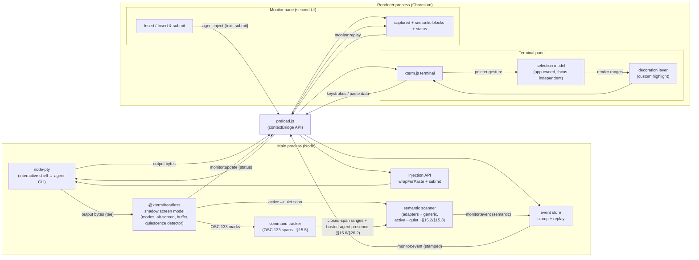

### Data flows

**A. Output (PTY → UI, teed)**
`bash`/agent writes → PTY master emits `data` → main **(a)** forwards over IPC channel `pty:data` → preload → `term.write(bytes)`, and **(b)** writes the same bytes into the shadow terminal. The shadow is therefore always an accurate model of the screen the user sees, independent of the renderer.

**B. Keystrokes (UI → PTY)**
User types in `xterm.js` → `term.onData(cb)` fires → renderer calls `api.input(data)` → IPC `pty:input` → main calls `ptyProcess.write(data)`.

**C. Selection (app-owned, keyboard-driven)**
1. User drags over output. The app writes the range into an **application-owned selection model** (absolute buffer coordinates + extracted text), not the browser's native selection.
2. The app renders the persistent highlight itself via xterm.js **decorations**; xterm's native selection paints the *live drag* and is suppressed only once focus leaves (§7.1). The decoration persists regardless of where focus goes.
3. The selection is acted on by the keyboard alone (§7.7): **Copy** writes `model.text` to the clipboard; **Escape** while a selection is active clears it (§7.5.1); paste/select-all run their chords. The selection survives focus changes; only an explicit clear (Escape) removes it. (The former in-terminal Send/Capture/Clear toolbar was removed in v2.132; capture-to-todo now lives in the drawer Todo tab and the Artifacts view, §16/§20.2.)

**D. Monitor-pane actions (second UI → agent)** — *the new headline flow*
User clicks **Insert into agent** (or **Insert & submit**) on a captured block → monitor pane calls `api.inject({text, submit})` → IPC `agent:inject` → main reads the **live** bracketed-paste mode from the shadow (`shadow.modes.bracketedPasteMode`), wraps via `wrapForPaste`, writes to the PTY, and if `submit` is set follows with `\r` after a short settle delay (§9.3). This path never touches the renderer's xterm — it works even if the terminal pane is unfocused, scrolled away, or (later) in a different process.

**E. Monitor status (shadow → second UI)**
After PTY writes settle (debounced), main reads shadow state — `buffer.active.type` (normal/alternate), `modes.bracketedPasteMode` — and combines it with the quiescence detector's output-activity state (§8.3). When anything changed, it emits `monitor:update`. The monitor pane shows these as live indicators (e.g. "agent: working / quiet", "agent is full-screen", "paste mode on").

**F. Resize**
`FitAddon` computes `{cols, rows}` on window resize → renderer calls `api.resize(cols, rows)` → IPC `pty:resize` → main resizes **both** `ptyProcess` **and** the shadow terminal (they must never diverge, or captures will mis-wrap).

**G. Lifecycle**
On `ptyProcess.onExit` → main sends `pty:exit` → both panes show a notice. On window close → main kills the PTY and disposes the shadow.

**G2. Flow audit record (observe-only)** — *§25*
A main-process recorder taps the flow lifecycle, the TODO store, the agent-loop `state.yaml` mirror, and OSC-133 command spans, and writes a per-run append-only YAML record under `~/.agent-terminal/audit/`. It is observe-only and best-effort — it injects nothing and never throws into the flow path. This overview omits it from the component diagram above (whose flow/TODO/loop sources are themselves not depicted there); its lifecycle is the §25.4 `stateDiagram-v2` and its event vocabulary is §25.5.

**H. Agent-semantic capture (shadow → event store → monitor)** — *§15.2/§15.3*
On the active→quiet transition (§8.3), the **semantic scanner** reads the shadow buffer from a marker watermark, dispatches the scan window to the per-agent adapters (or the generic heuristic fallback when none match), dedups regions by content, and emits each new region on `monitor:event` (`source: shadow-scan` / `heuristic`). Detection only — the scanner never acts on what it finds.

**I. Command-output capture (OSC 133 → command tracker → monitor)** — *§15.5*
The **command tracker** segments the stream into command spans from OSC 133 marks (`A` prompt-start, `B` command-start, `C` output-start, `D;exit` finished), keyed off the marks and independent of the §8.3 quiescence machinery. The spans are consumed **entirely in the main process**: closed-span output ranges gate the generic heuristic so command output is not mistaken for an agent prompt (§15.6), and the live spans drive hosted-agent presence (§26.2) and the shell-busy signal. (The former renderer-facing command-history channels — `monitor:commands` / `monitor:commandsChanged` / `monitor:captureCommandText` / `monitor:clearCommands` — were removed in v2.132 along with the Capture-selection button that was their only consumer; the tracker's own capture capability is retained and unit-tested.)

---

## 5. Spawning the shell with the user's configuration

This is the requirement most easily gotten subtly wrong.

A PTY-attached shell detects an interactive session automatically (it has a controlling TTY). The remaining question is **which startup files load**, which depends on login vs. non-login — and the convention differs by platform:

- **Linux:** native terminals launch a **non-login interactive** shell, which sources `~/.bashrc`.
- **macOS:** Terminal.app/iTerm launch a **login** shell, which sources `~/.bash_profile` (then `~/.bash_login` / `~/.profile`).

To match what the user already experiences in their native terminal, branch on platform:

```js
const os = require('os');
const isMac = process.platform === 'darwin';

// Default to the user's own login shell; APP_SHELL overrides, bash is the last resort (v2.79).
const shellPath = process.env.APP_SHELL || process.env.SHELL || 'bash';
const shellArgs = isMac ? ['-l'] : [];   // login on macOS, plain interactive on Linux

const ptyProcess = pty.spawn(shellPath, shellArgs, {
  name: 'xterm-256color',                // sets TERM; matches xterm.js capabilities
  cols: 80,
  rows: 24,
  cwd: process.env.HOME || os.homedir(),
  env: {
    ...process.env,
    TERM: 'xterm-256color',
    COLORTERM: 'truecolor',
  },
});
```

**Notes / gotchas**
- The `cwd` is the **resolved launch root L** (§23.4), not always `$HOME`: a launched instance roots its shell at a caller-supplied target directory when one is given and usable, else at F (`$HOME`). The same L feeds the viewer (§20.1) and todo scope (§16.3). The flow global dir (§18.1) is **not** an L surface — it stays at the per-user home, independent of L.
- `name: 'xterm-256color'` makes `node-pty` advertise the right terminfo; without it, color and key handling degrade.
- The session defaults to the user's own login shell via `$SHELL` (v2.79); `APP_SHELL` overrides it and `bash` is the last-resort fallback when `$SHELL` is unset. macOS ships bash 3.2 at `/bin/bash`; if the user wants bash but a modern Homebrew build (`/opt/homebrew/bin/bash` on Apple Silicon, `/usr/local/bin/bash` on Intel), they point `APP_SHELL` at it.
- Do **not** pass `--rcfile` or `--noprofile`; that would defeat "use the user's default configuration."
- The locale-dependent vars (`LANG`, `LC_*`) are inherited via `...process.env`, which keeps Unicode/emoji rendering correct.
- **GUI launches start with a barren environment.** When the app is opened from Launchpad or a Linux `.desktop` file rather than a terminal, Electron's `process.env` lacks the user's interactive `PATH` (nvm/asdf shims, `~/.local/bin`, Homebrew) — and agent CLIs are typically npm-installed onto exactly those paths. macOS is covered: the `-l` login shell re-evaluates the profile inside the PTY. On Linux the non-login shell sources `~/.bashrc`, which rebuilds `PATH` for most nvm/asdf setups — but `PATH` set only in `~/.profile` (login-only) will be missing. **Verify that `claude`/`codex` resolve in a GUI-launched session on Linux**; if not, probe once at startup with the user's own resolved shell (`APP_SHELL || $SHELL || bash`, run `-l -c 'echo $PATH'`) and seed the PTY env with the result — asking a hardcoded `bash` would miss a non-bash `$SHELL` user's shell-specific PATH. (Launching from a terminal has the inverse issue — a pre-polluted inherited env — which is acceptable: it matches what a nested shell would see.)
- **Shell-integration hook (§15.5, added v2.5).** To segment command output, the spawn env gets `APP_TERM_INTEGRATION=<app-owned script path>` and `PROMPT_COMMAND=source "$APP_TERM_INTEGRATION"`. `PROMPT_COMMAND` is bash's only **post-rc** env seam, so the script loads *after* the user's startup files — preserving the "use the user's own configuration" rule above (still no `--rcfile`/`--noprofile`). The script installs OSC 133 marks (`A`/`B` via PS1, `C` via PS0, `D;exit` via a precmd), self-heals each prompt, and degrades silently if a foreign/non-bash shell inherits the env without the file. Opt out with `APP_SHELL_INTEGRATION=0` or a non-bash `APP_SHELL`. Known, accepted limit: an rc that *overwrites* (not appends to) `PROMPT_COMMAND` removes the hook — command capture then becomes unavailable, with no heuristic fallback this phase.
- **Why a shell at all (not the agent directly):** the user's shell config provides their PATH, credentials helpers, and aliases that agent CLIs depend on; and a shell lets the user choose/restart/switch agents within one session. Direct-spawn of an agent binary is a possible later optimization, not the foundation.
- **The shell IS the session — its exit terminates the app (v2.95).** When the PTY's shell exits (`exit`, Ctrl-D, or the process dying), the app terminates rather than lingering: `pty:exit` fires (the renderer's reaction is transient, §9.2) and main closes the window, running teardown and quitting. **Exception — startup-failure grace:** a shell that exits in *less than* `startupExitGraceMs` after spawn (default 1000 ms, `APP_STARTUP_EXIT_GRACE_MS`; an uptime of exactly the grace terminates) is treated as a startup failure (broken rc, bad `APP_SHELL`, instant crash); the app stays open so the `[process exited: N]` diagnostic is visible instead of the window flashing and vanishing undiagnosably. A relaunch in the same launch root L spawns a **fresh** shell with a clean terminal — the dead shell's processes, in-shell env, and unwritten history are not restored. Curated pane state that persists per-directory (monitor capture events `<L>/.agent-terminal/monitor-events.json` §8.4, todos §16.3, flow progression §19.1) is restored on relaunch in the same directory, independent of how the prior instance terminated.

  ```mermaid
  stateDiagram-v2
      [*] --> Running : shell spawned
      Running --> StartupFailureVisible : shell exits, uptime < grace
      Running --> Terminating : shell exits, uptime >= grace
      Terminating --> [*] : close window, teardown, quit
      note right of StartupFailureVisible : window stays open, diagnostic visible
  ```
- **Agent CLIs care about the terminal they see.** Claude Code, Codex, etc. read `TERM`, the window size, and color support to choose their rendering. The settings above (xterm-256color, truecolor, live resize) are what they expect. Note: agents differ in which buffer they draw to — **Claude Code 2.x and Codex both take the alternate screen** (full-screen TUI), while older scrolling-transcript agents stay on the **normal** buffer. Both cases are handled by this design — see the alt-screen notes in §7.4 and §8.2, and the on-demand alt capture in §21.1.

---

## 6. IPC contract

Use `contextIsolation: true`, `nodeIntegration: false`, and a preload script exposing a narrow, typed surface. No raw `ipcRenderer` in the renderer.

All payloads carry a `sessionId` (a single fixed id in this version). This costs nothing now and means multi-session support later is additive, not a channel redesign.

| Channel | Direction | Payload | Meaning |
|---|---|---|---|
| `pty:data` | main → renderer | `{sessionId, data: string}` | Output bytes to write to xterm. |
| `pty:input` | renderer → main | `{sessionId, data: string}` | Keystrokes or pasted text to write to the PTY. |
| `pty:resize` | renderer → main | `{sessionId, cols, rows}` | Resize the PTY **and** the shadow terminal. |
| `pty:exit` | main → renderer | `{sessionId, code: number}` | Shell exited; main then terminates the app (§5). The renderer's reaction is transient. |
| `monitor:capture` | renderer → main | `{sessionId, text, range, source: 'selection'}` | User captured a region; main stamps `{id, capturedAt}` and broadcasts it back on `monitor:event`. |
| `monitor:event` | main → renderer | `{sessionId, event}` | Manual captures, semantic events, and command-output blocks. `event = {id, type, source, text, range, parentId, truncated, capturedAt}`; `type`/`source` are the §15.4 unions, `parentId` links a finding to its report (§15.4 / v2.6). **Amended v2.27 (§21/D39):** reports/findings no longer arrive on this push channel — they are pulled on demand via `capture:last`. The channel remains for any non-report event use. |
| `monitor:eventRemoved` | main → renderer | `{sessionId, eventId}` | The scanner retracted a prior semantic event because a later capture supersedes it (its text is an exact prefix of the newer one — §15.3 / v2.13); the pane drops the block, cascading to a report's findings. **Retired v2.27 (§21/D39):** single-slot capture replaces in place, so cross-transition retraction is no longer used. |
| `monitor:update` | main → renderer | `{sessionId, altScreen: boolean, bracketedPaste: boolean, agentState: 'active'\|'quiet', quietSince: number\|null}` | Debounced shadow-state and activity changes (live status indicators). **Status-only** — it carries no command data. |
| `monitor:replay` | renderer → main (invoke) | `() → MonitorEvent[]` | A (re)loaded monitor pane requests the captures stamped so far (§8.4). |
| `monitor:currentRepo` | renderer → main (invoke) | `{sessionId} → {cwd, repoKey} \| null` | The agent's current repo, queried on mount so the pane learns the key even when it missed the live `cwd:changed` broadcast (§16.3, v2.19). |
| `monitor:dismiss` | renderer → main | `{sessionId, eventId}` | Remove a captured event from the store; dismissing a report cascades to its findings, so a reloaded pane's replay won't resurrect it (§15.6 / v2.6). |
| `monitor:dismissAll` | renderer → main | `{sessionId}` | Clear every captured event from the store (Dismiss-all; §15.6 / v2.6). **Retired v2.27 (§21/D39):** no capture list to clear under single-slot capture. |
| `monitor:learnChrome` | renderer → main | `{sessionId, eventId, sample}` | **Mark as chrome** (§15.x / v2.14): learn the block's leading glyphs as chrome markers (persisted), then retract the capture via `monitor:eventRemoved` (cascading to findings). |
| `agent:inject` | renderer → main | `{sessionId, text, submit: boolean}` | Action-window action: paste-wrap per live mode, write to PTY, optionally submit. Focus follows the §16.2 rule (renderer-side): Insert → terminal, Insert & submit → stays. |
| `todo:list` | renderer → main (invoke) | `{sessionId, repoKey} → TodoItem[]` | Current repo's todos (active + done), order-sorted (§16.3). |
| `todo:add` | renderer → main (invoke) | `{sessionId, repoKey, text, source?} → TodoItem[]` | Append a todo (manual or Add-to-todo); returns the fresh list (§16.4). |
| `todo:update` | renderer → main (invoke) | `{sessionId, repoKey, id, text} → TodoItem[]` | Save an in-place edit (§16.4). |
| `todo:reorder` | renderer → main (invoke) | `{sessionId, repoKey, orderedIds} → TodoItem[]` | Persist a new active-list order (drag / up-down; §16.4). |
| `todo:setStatus` | renderer → main (invoke) | `{sessionId, repoKey, id, status} → TodoItem[]` | Set the tri-state status `active`/`in_progress`/`done` (§16.3): checkbox flips not-done→done or done→active; Send marks `in_progress`. |
| `todo:delete` | renderer → main (invoke) | `{sessionId, repoKey, id} → TodoItem[]` | Remove a todo (§16.4). |
| `cwd:changed` | main → renderer | `{sessionId, repoKey, cwd}` | The agent's repo key changed (OSC 7 → §16.3); the pane re-pulls `todo:list`, blocking a swap mid-edit (§16.3). |
| `ui:getSettings` | renderer → main (invoke) | `() → UiSettings` | Global UI prefs — `{splitRatio, lastTab, theme, artifactTreeWidth, artifactFullscreenTreeWidth?, keymapProfile, keymapOverrides?}` (§16.6 / §7.7). |
| `ui:setSettings` | renderer → main | `{settings: Partial<UiSettings>}` | Persist global UI prefs to userData (§16.6). |
| `term:clipboardWrite` | renderer → main | `{text}` | Write to the OS clipboard (§7.7) — owned by main since the sandboxed preload cannot import electron's `clipboard`. App-global, **no `sessionId`** (the §16.6 `UiSettings` exception). |
| `term:clipboardRead` | renderer → main (invoke) | `() → string` | Read the OS clipboard for the sanitized paste path (§7.7/§9.3). App-global, no `sessionId`. |
| `menu:edit` | main → renderer | `{action}` (`action ∈ copy \| paste \| selectAll`) | macOS Edit-menu accelerators route here (§7.7); the renderer dispatches to the terminal clipboard action or the focused input's native editing. App-global, no `sessionId`. |
| `capture:last` | renderer → main (invoke) | `{sessionId} → MonitorEvent[]` | **(v2.27, §21/D39; shape v2.34)** Run report-detection (§15.3) **on demand** against the current shadow buffer and return the single latest report **followed by its findings** as stored `MonitorEvent`s — `[]` when none. Mirrors `monitor:replay`'s shape so the pane renders a button-capture and a replay identically; the handler replaces any prior `report` in the store first (single-slot). Skips a candidate that is just the echoed command line, or one an active classifier flags as its agent's end-of-turn meta-summary (Claude Code's `※ recap:` line — a meta-summary, not a report; v2.96, §15.3). |
| `flow:list` | renderer → main (invoke) | `{sessionId} → FlowDef[]` | **(v2.27, §18)** The merged flow-definition library (global ∪ per-repo, repo wins on name clash — §18.4). |
| `flow:start` | renderer → main (invoke) | `{sessionId, flowName, inputs} → FlowState` | **(v2.27, §19)** Instantiate the chosen definition, begin step 1, run its entry actions (incl. `bootstrap: pickup` if declared — §18.3). |
| `flow:state` | renderer → main (invoke) | `{sessionId, repoKey} → FlowStateView` | **(v2.27, §19; repoKey/view v2.52)** Current step, per-step status, gate state, derived loop progress, refs, loop activity, and optional `userTitle` (§19.1 / §22.3.1). |
| `flow:setTitle` | renderer → main (invoke) | `{sessionId, repoKey, title} → FlowStateView` | **(v2.133, §22.3.1)** Name the registered worktree's work. `title` is bounded by `TITLE_MAX`; blank clears it. The response is the newly persisted view, while a refused or unsafe write rejects for visible rollback/error handling. |
| `flow:advance` | renderer → main (invoke) | `{sessionId} → FlowState` | **(v2.27, §19.2)** User-driven advance to the next step. Warns (does not block) if the current gate is unsatisfied (`ready: false` in the result). |
| `flow:undo` | renderer → main (invoke) | `{sessionId, repoKey} → FlowStateView` | **(v2.64, §24.2.2)** Revert a manual advance: `done → in_progress` **without** re-running the step's entry actions (distinct from `flow:restart`). `window.flow.undo(repoKey)`. |
| `flow:gate` | renderer → main | `{sessionId, action: 'approve'\|'request-changes'\|'impasse', reason?}` | **(v2.27, §19.3)** Drive an agent-loop gate by **injecting** the matching slash command (§19.3); refuses while a process is running (§19.3/D32). |
| `flow:composeFeedback` | renderer → main (invoke) | `{sessionId, todoIds, instructions?, mode: 'compose'\|'verbatim'} → string` | **(v2.27, §19.4)** Build request-changes feedback from selected review todos (+ optional instructions): agent-composed or submitted verbatim (D9/D11). |
| `flow:openChild` | renderer → main (invoke) | `{sessionId, prRef, atStep} → {worktree, launched}` | **(v2.27, §23)** Create a git worktree for an epic child PR and launch a new instance, seeding its flow-state at the right step (D22). |
| `flow:onStateChanged` | main → renderer | `{sessionId}` | **(v2.27, §19; built v2.63, §24.2.2 S5)** A flow-relevant input changed — a count-changing todo mutation or the §8.3 `active↔quiet` flip; the strip re-pulls `flow:state` (whose `in_progress` view carries the derived `n/m done` + activity + readiness). `window.flow.onStateChanged(cb)` returns an unsubscribe. (Agent-loop file-watch is still future.) |
| `viewer:tree` | renderer → main (invoke) | `{sessionId, scope: 'curated'\|'repo'} → ArtifactTree` | **(v2.27/§20.1; built v2.37)** Hierarchical, provenance-tagged tree off the session cwd: curated (the superset of working-tree changes ∪ files committed on the branch over its PR base ∪ `.agent-loop/`) or whole repo, tagged `changed`/`loop`/`pr` (§20.1); `ArtifactTree` wraps `nodes` + `root` + `isRepo` + `scope`, so outside a repo it returns the cwd tree with `isRepo:false`. |
| `viewer:read` | renderer → main (invoke) | `{sessionId, relPath} → ViewerFile \| null` | **(v2.27/§20.2; built v2.37)** File content for the viewer (markdown / code), classified by extension; null on missing/binary/oversized/path-escape. **(v2.41; v2.98)** `ViewerFile.changedLines` carries the code file's lines that differ from the PR base (the merge-base, else `HEAD`; §20.2) — added/modified, 1-based; absent when none. |
| `viewer:onChanged` | main → renderer | `{sessionId}` | **(v2.83, §20.1)** A file under the viewer's tree root changed on disk; the viewer re-pulls `viewer:tree`/`viewer:read`. Payload-free beyond the session (the viewer re-discovers against its own live cwd), mirroring `flow:onStateChanged`. One recursive watcher, re-rooted on each `cwd:changed`, coalesced over `VIEWER_WATCH_DEBOUNCE_MS` and filtered against `IGNORED_DIRS` so a refresh's own git write can't loop. |
| `viewer:ghRefresh` | renderer → main (invoke) | `{sessionId, ref} → {path}` | **(v2.27, §20.3)** Refresh a ticket/PR markdown via the `gh` CLI from main and update the cached artifact (D24). |
| `todoTemplate:list` | renderer → main (invoke) | `{sessionId, repoKey} → TodoTemplateList` | **(v2.27, §21.2; repoKey v2.58; v2.59)** Templates co-located with the repo's flow.yaml (§18.6) **gated to an in_progress step**, plus the bound `defaultRef`; `name` is the H1/humanized label. On `window.monitor` (§9.1), surfaced by the todo-overlay picker (§4.1). |
| `todoTemplate:instantiate` | renderer → main (invoke) | `{sessionId, repoKey, ref} → TodoItem[]` | **(v2.27, §21.2)** Parse a markdown-list template (named or file path — D37/D38) into todos and append them. |
| `cli:install` | renderer → main (invoke) | `{sessionId} → CliInstallResult` | **(v2.89, §23.4 / #25)** Install the `agent-terminal` launch shim onto PATH for the running build. No path payload (the install target derives from the process's launch facts); `CliInstallResult = {ok, path?, error?}` — `ok` only when runnable from a new shell, else a visible `error` (no partial-success state). |
| `examples:preview` | renderer → main (invoke) | `{sessionId} → InstallExamplesPreview` | **(v2.134, §18.1 / #41)** Report, **per destination**, the bundled files that already exist and differ. Writes nothing. A destination's preview is a discriminated union: no conflict carries no files and asks for no decision. |
| `examples:apply` | renderer → main (invoke) | `{sessionId, replace: InstallDestinationId[]} → InstallExamplesResult` | **(v2.134, §18.1 / #41)** Seed every destination. `replace` names the destinations the user consented to replace conflicting files in — one decision per destination, so consenting in one never replaces files in another; absent files are created regardless. The result groups `created`/`overwritten`/`skipped` **by destination**, so two destinations sharing a file name yield two attributable entries. A failure carries `created`/`overwritten` too (see §18.1). |

> Captures are routed **through main** (rather than renderer-internally, which would be simpler today) so the monitor pane has no dependency on the terminal pane. When the monitor pane later becomes a separate `WebContentsView`/web app, and when captures start originating from the shadow model instead of user selection, nothing about this contract changes.

**preload.js**
```js
const { contextBridge, ipcRenderer } = require('electron');

contextBridge.exposeInMainWorld('term', {
  onData:   (cb) => ipcRenderer.on('pty:data', (_e, m) => cb(m.data)),
  onExit:   (cb) => ipcRenderer.on('pty:exit', (_e, m) => cb(m)),
  input:    (data) => ipcRenderer.send('pty:input',  { sessionId: SID, data }),
  resize:   (size) => ipcRenderer.send('pty:resize', { sessionId: SID, ...size }),
});

contextBridge.exposeInMainWorld('monitor', {
  capture:  (block) => ipcRenderer.send('monitor:capture', { sessionId: SID, ...block }),
  onEvent:  (cb) => ipcRenderer.on('monitor:event',  (_e, m) => cb(m.event)),
  onUpdate: (cb) => ipcRenderer.on('monitor:update', (_e, m) => cb(m)),
  onExit:   (cb) => ipcRenderer.on('pty:exit',       (_e, m) => cb(m)), // session alive/exited (§9.2)
  replay:   () => ipcRenderer.invoke('monitor:replay'),
  inject:   (req) => ipcRenderer.send('agent:inject', { sessionId: SID, ...req }),
  // Todo (§16) — repoKey threaded so an in-flight edit always targets its own repo
  todoList:   (repoKey) => ipcRenderer.invoke('todo:list',   { sessionId: SID, repoKey }),
  todoAdd:    (repoKey, text, source) => ipcRenderer.invoke('todo:add', { sessionId: SID, repoKey, text, source }),
  todoUpdate: (repoKey, id, text) => ipcRenderer.invoke('todo:update', { sessionId: SID, repoKey, id, text }),
  todoReorder:(repoKey, orderedIds) => ipcRenderer.invoke('todo:reorder', { sessionId: SID, repoKey, orderedIds }),
  todoSetStatus:(repoKey, id, status) => ipcRenderer.invoke('todo:setStatus', { sessionId: SID, repoKey, id, status }),
  todoDelete: (repoKey, id) => ipcRenderer.invoke('todo:delete', { sessionId: SID, repoKey, id }),
  onCwdChanged: (cb) => ipcRenderer.on('cwd:changed', (_e, m) => cb(m)),
  getSettings: () => ipcRenderer.invoke('ui:getSettings'),
  setSettings: (settings) => ipcRenderer.send('ui:setSettings', { settings }),
  captureLast: () => ipcRenderer.invoke('capture:last', { sessionId: SID }), // v2.27, §21
});

// v2.27 (§17–§24): task-flow management exposes two further namespaces, same narrow/typed pattern.
contextBridge.exposeInMainWorld('flow', {
  list:    () => ipcRenderer.invoke('flow:list', { sessionId: SID }),
  start:   (flowName, inputs) => ipcRenderer.invoke('flow:start', { sessionId: SID, flowName, inputs }),
  state:   () => ipcRenderer.invoke('flow:state', { sessionId: SID }),
  advance: () => ipcRenderer.invoke('flow:advance', { sessionId: SID }),
  gate:    (action, reason) => ipcRenderer.send('flow:gate', { sessionId: SID, action, reason }),
  composeFeedback: (todoIds, instructions, mode) => ipcRenderer.invoke('flow:composeFeedback', { sessionId: SID, todoIds, instructions, mode }),
  openChild: (prRef, atStep) => ipcRenderer.invoke('flow:openChild', { sessionId: SID, prRef, atStep }),
  onStateChanged: (cb) => ipcRenderer.on('flow:onStateChanged', (_e, m) => cb(m)),
  templateList: () => ipcRenderer.invoke('todoTemplate:list', { sessionId: SID }),
  templateInstantiate: (repoKey, ref) => ipcRenderer.invoke('todoTemplate:instantiate', { sessionId: SID, repoKey, ref }),
});
contextBridge.exposeInMainWorld('viewer', {
  tree: (scope) => ipcRenderer.invoke('viewer:tree', { sessionId: SID, scope }),
  read: (relPath) => ipcRenderer.invoke('viewer:read', { sessionId: SID, relPath }),
  ghRefresh: (ref) => ipcRenderer.invoke('viewer:ghRefresh', { sessionId: SID, ref }),
});
```

---

## 7. Renderer behavior and the app-owned selection subsystem

### 7.0 Why a custom selection mechanism

xterm.js's built-in selection is the browser's native selection: it is tied to DOM focus and is cleared whenever focus moves elsewhere or the user clicks another element. For this app the selection must instead be a **first-class application state** that:

- **survives focus changes** — clicking the Send/Capture buttons, typing in the terminal, or clicking into the monitor pane must not erase it;
- is **owned, rendered, and cleared by the app**, so it can later be created/inspected/manipulated programmatically (e.g. the monitor pane highlighting the region a capture came from), not just by mouse;
- can outlive any single gesture and, eventually, allow more than one persistent highlight.

The mechanism below delivers this. It keeps an app-owned model in buffer coordinates and **renders the persistent highlight itself** using xterm.js decorations. xterm's native selection highlight is **left on while the terminal is focused** — it paints the live drag per-frame, the one thing the disposed-and-recreated decoration cannot do mid-gesture — and is **suppressed only on blur** (`selectionInactiveBackground` transparent), so off-focus the decoration is the sole highlight and the two never double-tint (§7.1). The drag *gesture* is still detected through xterm (so we inherit its correct cell hit-testing and wrapped-line handling), but the *selection state* is entirely ours and is never auto-cleared on blur.

> **Recommended (Option A — below):** app-owned model + decoration rendering, gesture sourced from xterm. Lowest risk, reuses xterm's hit-testing.
> **Option B (deferred, §11):** a transparent pointer-capture overlay with our own pixel→cell mapping and drag state, depending on xterm for *nothing*. Needed when we must select on the **alternate screen buffer** (full-screen TUIs — which includes Codex's TUI, so this lands sooner than v1.2 assumed), support multiple simultaneous selections, or define gestures xterm doesn't provide.

### 7.1 Base terminal setup

```js
import { Terminal } from '@xterm/xterm';
import { FitAddon } from '@xterm/addon-fit';
import '@xterm/xterm/css/xterm.css';

const term = new Terminal({
  fontFamily: 'monospace',
  fontSize: 14,
  cursorBlink: true,
  scrollback: 5000,
  allowProposedApi: true,                 // buffer/marker/decoration access
  theme: {
    // Focused selection paints the live drag (xterm's per-frame hit-testing); blurred selection
    // is transparent so the persistent app-owned decoration is the sole off-focus highlight (§7.1).
    selectionBackground: SEL_COLOR,                  // shared with the decoration, exported by §7.4
    selectionInactiveBackground: 'rgba(0,0,0,0)',
  },
});
const fit = new FitAddon();
term.loadAddon(fit);
term.open(document.getElementById('terminal'));
fit.fit();

// PTY wiring
window.term.onData((data) => term.write(data));
term.onData((data) => window.term.input(data));         // keystrokes out
window.term.onExit(({ code }) => term.write(`\r\n[process exited: ${code}]\r\n`));

// Resize — debounced: a drag-resize during an agent output burst can otherwise leave
// the PTY, renderer, and shadow wrapping lines at different widths (§14).
const sendResize = () => { fit.fit(); window.term.resize({ cols: term.cols, rows: term.rows }); };
let resizeTimer = null;
window.addEventListener('resize', () => {
  clearTimeout(resizeTimer);
  resizeTimer = setTimeout(sendResize, 80);
});
sendResize();
```

### 7.2 The selection model

A single source of truth, in **absolute buffer coordinates** (row index into the full buffer including scrollback), plus the extracted text. One persistent selection for this version; the shape generalizes to an array later.

```js
const selection = {
  active: false,
  start: null,    // { x, y }  absolute buffer coords, inclusive
  end:   null,    // { x, y }  absolute buffer coords, inclusive
  text:  '',
  baseY: 0,            // buffer.active.baseY at gesture time — coordinate-era stamp (§7.3)
  bufferType: 'normal', // buffer the gesture happened on: 'normal' | 'alternate'
  decorations: [], // IDecoration[] currently drawn
};
```

### 7.3 Capturing the gesture (focus-independent)

We drive the model from xterm's drag, but we deliberately **ignore the "selection cleared" signal** that fires on blur — that is exactly the browser-focus coupling we are removing. Only a non-empty selection updates the model; clearing is explicit (§7.5.1).

```js
term.onSelectionChange(() => {
  let range, text;
  try {
    range = term.getSelectionPosition();       // IBufferRange | undefined (absolute buffer coords)
    text  = term.getSelection();
  } catch {
    return;   // alt-buffer / mid-swap extraction edge cases must never crash the renderer
  }
  if (!range || text.length === 0) return;     // IGNORE blur-clears: focus independence

  selection.active = true;
  selection.start = { x: range.start.x, y: range.start.y };
  selection.end   = { x: range.end.x,   y: range.end.y };
  selection.text  = text;                              // extracted NOW — the durable payload
  selection.baseY = term.buffer.active.baseY;          // coordinate-era stamp
  selection.bufferType = term.buffer.active.type;      // 'normal' | 'alternate'
  renderSelection();                           // re-draw our own highlight live during drag
});
```

> **Verify on integration:** confirm whether `getSelectionPosition()` returns *absolute* buffer rows (including scrollback) or viewport-relative rows in your pinned xterm.js version, and convert once in this function if needed. Everything downstream assumes absolute rows. Also verify that `getSelection()` / `getSelectionPosition()` behave sanely on the **alternate buffer** and across a normal↔alt swap mid-gesture — historical xterm.js versions have had surprises here; the `try/catch` above is the backstop, not the plan.

> **Coordinate drift under output bursts:** absolute rows are stable only until scrollback overflows — once rows trim off the top (a noisy agent can do this *between* the drag and a later Send/Capture click, or even mid-drag), every stored index points at different content. This is why the model treats the **text extracted at gesture time** as the durable payload — coordinates are never used to re-extract text at click time — and stamps `baseY`/`bufferType` so consumers can tell which coordinate era a range belongs to. (The rendered highlight is unaffected: decorations are marker-anchored and move with their lines, dying naturally when trimmed — §7.4.)

### 7.4 Rendering the highlight (our own, persistent)

Render the selection as xterm.js **decorations** — one per line (not one tall decoration; multi-row backgrounds render incorrectly, xterm.js #4855). A decoration is anchored to a `marker` (a buffer line that scrolls with content), so the highlight stays glued to the right text as output scrolls, and persists across focus changes because it is part of the terminal's render layer, not the DOM selection.

```js
const SEL_COLOR = 'rgba(80, 140, 255, 0.35)';  // translucent so text stays legible

function clearDecorations() {
  for (const d of selection.decorations) d.dispose();
  selection.decorations = [];
}

// Convert an absolute buffer row to a marker at that row.
function markerAtRow(absRow) {
  const buf = term.buffer.active;
  const cursorAbs = buf.baseY + buf.cursorY;
  return term.registerMarker(absRow - cursorAbs);   // offset relative to cursor row
}

function renderSelection() {
  clearDecorations();
  if (!selection.active) return;

  const cols = term.cols;
  const { start, end } = selection;

  for (let row = start.y; row <= end.y; row++) {
    const x     = row === start.y ? start.x : 0;
    const xEnd  = row === end.y   ? end.x   : cols;
    const width = Math.max(1, xEnd - x);

    const marker = markerAtRow(row);
    if (!marker) continue;                         // off-buffer / trimmed
    const deco = term.registerDecoration({ marker, x, width, height: 1 });
    if (!deco) continue;                           // undefined on ALT buffer — see caveat
    deco.onRender((el) => { el.style.backgroundColor = SEL_COLOR; });
    selection.decorations.push(deco);
  }
}

// Re-anchor highlight when the user scrolls the viewport.
term.onScroll(() => renderSelection());
```

> **Alt-buffer caveat:** `registerDecoration()` / `registerMarker()` return `undefined` while the **alternate screen buffer** is active. Full-screen TUI agents (Claude Code 2.x, Codex, vim/htop) run there: the drag still populates the model and **select / capture / copy still work** via xterm's native selection (`getSelectionPosition()` returns a valid range and `getSelection()` the text on the alt buffer in the pinned 5.5.0 — text extraction needs no decorations), but the app-owned **persistent** highlight and the **cross-highlight reveal** won't draw until Option B (§11). The monitor pane's `altScreen` indicator (§9) tells the user which regime they're in.

### 7.5 Sending selection as input (bracketed-paste aware)

"Send to terminal" must behave like a **paste**, not a stream of keystrokes, because the hosted agents (Claude Code, Codex) — and modern bash/zsh themselves — turn on **bracketed paste mode** and rely on it. In that mode the running program asks the terminal to fence pasted text between two markers:

```
ESC[200~   <the pasted text>   ESC[201~
```

The program turns the mode on/off with `ESC[?2004h` / `ESC[?2004l`; we never decide it — we only honor whatever the foreground app currently wants. When the markers are present, the app knows the block was pasted and (a) inserts a multi-line selection as one editable block **without running each line**, and (b) routes it to its input box instead of treating newlines as "submit." Without the markers, a multi-line selection pasted into Claude Code or a REPL gets the first line executed and the rest mangled — the exact bug this prevents.

xterm.js already tracks the mode and does the wrapping, newline normalization, and security sanitization for us. The rule: **inject via `term.paste()`, not a raw write.** `paste()` fires the normal data event, so it flows through the same `onData → pty:input` path already wired in §7.1.

```js
// Single renderer-side injection point. Honors the foreground app's bracketed-paste mode.
function injectText(text) {
  if (!text) return;
  // term.paste():
  //   - wraps in ESC[200~ … ESC[201~ IFF term.modes.bracketedPasteMode is on,
  //   - normalizes newlines,
  //   - strips any embedded ESC[201~ so pasted text can't "break out" of paste mode,
  //   - emits via onData -> forwarded to the PTY by our §7.1 wiring.
  term.paste(text);
}

function cleanSelectionText() {
  let text = selection.text.replace(/[ \t]+$/gm, '');   // trim per-line cell padding
  return text.replace(/\r?\n$/, '');                     // drop one trailing newline (don't auto-submit)
}

// The selection has no in-terminal toolbar (removed in v2.132). It is acted on by the keyboard
// alone (§7.7): Copy writes cleanSelectionText() to the clipboard; Escape (while active) clears it
// (§7.5.1). injectText() above is the renderer-side paste path the Paste chord routes through — it
// is not tied to any button; the §9.3 injection API is the separate main-process path (see below).
```

> **Why two injection paths exist:** the renderer path uses `term.paste()`, which reads the live mode and sanitizes for free. The **monitor pane** (and any future programmatic actor) must not depend on the renderer's xterm instance, so it uses the main-process injection API (§9.3), which reads the same mode from the **shadow** terminal and applies the equivalent `wrapForPaste` sanitization. Both paths are mode-honoring; neither caches the mode.

**Escape hatch:** if a user lands in an odd session (some SSH hops, a REPL that lies about supporting paste), set the terminal option `ignoreBracketedPasteMode: true` to force raw sending. Note the default matters — defaulting to *ignore* is a known footgun that breaks multi-line paste into zsh/Claude Code, so leave bracketed paste **honored** by default (and mirror any override into the main-process injector so the two paths never disagree).

### 7.5.1 Clear and lifecycle

```js
// Explicit clear — the ONLY way the selection goes away.
function clearSelection() {
  selection.active = false;
  selection.start = selection.end = null;
  selection.text = '';
  clearDecorations();
  term.clearSelection();          // also drop xterm's native selection (visible while focused, §7.1)
}
// Escape (while a selection is active) is the only clear affordance — there is no toolbar button (§7.5.1, v2.132).
term.attachCustomKeyEventHandler((e) => {
  if (e.type === 'keydown' && e.key === 'Escape') { clearSelection(); return false; }
  return true;
});
```

> **Escape-key caveat for agents:** Claude Code and other TUIs bind Escape themselves (interrupt/back). Swallowing it globally for "clear selection" conflicts with driving the agent. Rule: Escape clears the selection **only when a selection is active**; otherwise it passes through to the PTY (`return true`). Revisit the binding once agents are the daily workload.

The terminal view carries **no selection toolbar** (the former **Send selection** / **Capture selection** / **Clear selection** buttons were removed in v2.132); the selection is driven by the keyboard alone (Copy via the keymap, Clear via Escape — §7.7).

### 7.5.2 Agent key bindings (added v2.8)

> Generalized in v2.72 into the cross-platform keymap (**§7.7**); the motion chords below are the OS-agnostic editing subset of that model, now sourced from `BYTES_FOR`.

The terminal pane translates a small set of editor-style chords into the exact byte sequences a coding agent's input box (Claude Code) and `readline` expect, so the prompt behaves like an editor rather than submitting on every Return. The mapping is a pure function (`keyEventToBytes`, `src/renderer/src/keymap.ts`); the bytes **are** the contract:

| Chord | Bytes sent | Meaning |
| --- | --- | --- |
| **Shift+Enter**, **Alt/Option+Enter** | `\x1b\r` (ESC + CR) | Insert a newline **without** submitting (Meta+Enter "newline" form). |
| Plain **Enter** | — (passed through → bare `\r`) | Submit the line. |
| **Alt/Option+Left** | `\x1bb` (meta-b) | Move backward one word. |
| **Alt/Option+Right** | `\x1bf` (meta-f) | Move forward one word. |
| **Alt/Option+Backspace** | `\x1b\x7f` (ESC + DEL) | Delete the previous word (backward-kill-word). |

Design constraints:

- **Why ESC+CR for newline, not CSI-u.** `@xterm/xterm` 5.5 does not implement the kitty keyboard protocol, so the agent never negotiates CSI-u mode; the `\x1b[13;2u` form would arrive as literal text in the prompt. `ESC CR` is the portable Meta+Enter form Claude Code reads as "insert newline."
- **Why the meta (ESC-prefixed) word forms.** `\eb`/`\ef`/`\e\x7f` are bound by default in stock bash `readline` **and** understood by Claude Code without any `inputrc` configuration; the CSI modifier forms (`\e[1;3D`) are not bound by stock readline. Intercepting *before* xterm's defaults is therefore an improvement on Linux (where xterm would emit the unbound CSI form) as well as on macOS (where Option is not Meta unless `macOptionIsMeta` is set — we avoid relying on that platform flag).
- **Chords that also hold Ctrl or Meta are not hijacked** — they pass through to the agent/TUI.
- **One handler.** xterm permits a single `attachCustomKeyEventHandler`; the keymap shares it with the §7.5.1 Escape rule (Escape is resolved first, then `handleTerminalKey` sends the mapped bytes via the §6 input path and suppresses xterm's default, also calling `preventDefault` so the hidden textarea doesn't double-edit).

### 7.6 Design decisions

- **The model — not the DOM — is the source of truth.** This is what makes the selection independent of browser focus. Native xterm selection paints only the live drag (focused) and is suppressed on blur; it is **never read at send time** — the model is (§7.1).
- **Ignore empty `onSelectionChange` events.** They are the blur-clears we are decoupling from. A new non-empty drag replaces the model; only §7.5.1 clears it.
- **Per-line, height-1 decorations** styled via `onRender` with an `rgba` tint. Avoids the multi-row-background bug and keeps underlying text legible. (`IDecorationOptions.backgroundColor` only accepts opaque `#RRGGBB`, so translucency is applied on the element instead.)
- **Trim trailing whitespace, drop one trailing newline** before sending or capturing — avoids stray padding and prevents auto-submitting the command.
- **Send as a paste, honoring bracketed-paste mode.** Required for multi-line selections to land correctly in Claude Code/Codex/REPLs instead of part-executing. We never force the mode on or off; we honor the running app's choice (with `ignoreBracketedPasteMode` as a manual override).
- **Capture and send are independent, non-destructive actions** on the same selection. Capture is the manual stand-in for the future semantic capture pipeline; it exercises the identical `monitor:capture → monitor:event` plumbing.

### 7.7 Cross-platform keymap (clipboard + editing, profile-driven & rebindable) (added v2.72)

The §7.5.2 chords generalize into a **data-driven keymap**: a profile maps each logical **action** to one or more **chords**, the renderer resolves a key event to an action and runs it. The model is pure and OS-agnostic (`src/shared/keymap.ts`): `KeyActionId` (the terminal actions `copy`, `paste`, `selectAll`, `newlineNoSubmit`, `wordBack`, `wordForward`, `deleteWordBack`, `deleteLine`, plus the §24.1C app-navigation actions `toggleDrawer`, `viewTerminal`, `viewArtifacts`, `openSettings` — see the App-navigation note below), `Chord {key, ctrl?, alt?, shift?, meta?}`, `Keymap = Record<KeyActionId, Chord[]>`; `matchChord(event, keymap)` → action id or `null`, `resolveKeymap(base, overrides)`, `eventToChord(event)` (rebinding capture), and `BYTES_FOR` (the §7.5.2 motion bytes — the bytes are still the contract). Clipboard actions are **side effects**, not bytes.

- **Interrupt is intentionally unbound.** `Ctrl+C` matches no action, so it passes straight through to the PTY as SIGINT; plain `Enter` likewise submits. Copy is *only ever* the profile/override chord — never a "smart Ctrl+C."
- **Two built-in profiles.** `MAC_DEFAULTS` (Cmd-based: `⌘C`/`⌘V`/`⌘A`) and `PC_DEFAULTS` (`Ctrl+Shift+C`/`V`/`A`, the ~20-year Linux/GNOME convention). The editing motions are identical in both (they key off Option/Alt, which the DOM reports the same on every OS).
- **Profile resolution + override.** `UiSettings.keymapProfile` (`auto`|`mac`|`pc`; `auto` → `mac` on `darwin` else `pc`) — a user override is mandatory because the OS and the desired layout can disagree (a Mac keyboard on Linux). The renderer resolves via `window.term.platform`; `keymapController` (`src/renderer/src/keymapController.ts`) holds the active keymap and is read **live per keydown** by the §7.5 dispatch, so a switch needs no rewire. `UiSettings.keymapOverrides` (per-action chords, omitted when none) merge over the profile.
- **Copy / paste / select-all wiring.** Copy writes the **app-owned selection** (§7), not xterm's hidden native one, to the OS clipboard. Paste reads the OS clipboard and goes through `term.paste(stripPasteBreakout(…))` so the **§9.3 breakout sanitization always runs** — the browser/xterm *native* paste bypasses it, so our handler `preventDefault`s and owns the path. Select-all calls `term.selectAll()`, which feeds the model via the existing `onSelectionChange` listener (so the highlight and Copy reflect it). The clipboard is an OS resource owned by **main** (the sandboxed preload cannot import electron's `clipboard`), routed via `term:clipboardWrite` / `term:clipboardRead`; `window.term.platform` exposes the OS for `auto` resolution.
- **Keyboard settings UI.** `src/renderer/src/keyboardSettings.ts` (a relocatable organism) is a dedicated **Settings view** (shell view 4), reached from the rail gear and the `openSettings` chord (**⌘,** / **Ctrl+,**) — not the rail foot. It renders the **Auto/macOS/PC** profile control plus per-action rows grouped by category (Clipboard / Editing / Navigation), each chord drawn as **keycaps** (`chordToCaps`). **Set** captures the next keypress (`eventToChord`, ignoring modifier-only presses); a combination already bound elsewhere is **blocked and named** (`findChordOwner`), keeping the old binding; an overridden row offers **Reset** (`keymapController.clearOverride`, restoring the profile default).
- **App-navigation actions (§24.1C).** The shell shortcuts are part of the same keymap (so they are profile-aware and rebindable): `toggleDrawer`, `viewTerminal`, `viewArtifacts`, `openSettings`. On **PC** the drawer is **Ctrl+Shift+K** (not bare Ctrl+K, which is left to readline kill-line); views are Ctrl+1/2 (the `viewTodos`/⌘3 chord was removed with the Todos view, v2.132). On **mac** they are ⌘K and ⌘1/2. `shell.ts` matches these via the shared keymap; the terminal dispatch ignores them (no `BYTES_FOR`, so they pass through), and the shell's capture-phase handler claims them first.
- **macOS Edit menu.** Because macOS routes ⌘C/⌘V/⌘A through the application menu (and the default Edit roles act on xterm's *hidden native* selection), on darwin `src/main/appMenu.ts` installs a menu whose Copy/Paste/Select All `click` to the renderer (`menu:edit`); `src/renderer/src/menuActions.ts` routes each to the **terminal** clipboard action when the terminal is focused, else the focused input's native editing (so text fields keep ⌘C/⌘V/⌘A). Off darwin no menu is installed and the renderer keymap owns the chords.

### 7.6.1 (note) §7.5.2 is the motion subset

The §7.5.2 table is now the editing-motion subset of §7.7; the same `attachCustomKeyEventHandler` resolves Escape (§7.5.1) first, then dispatches the active keymap.

### 7.8 Dropping files onto the terminal (added v2.85)

A file dragged from the OS onto the terminal pane **pastes its path at the prompt**, so an agent that consumes a file by path (e.g. dragging an image into Claude Code) gets it the way a native terminal would. xterm does not handle file drops; the pane wires its own `dragenter`/`dragover`/`dragleave`/`drop` handlers (`wireTerminalDrop` in `terminal.ts`, a disposer-returning organism helper alongside the §7.1 listener wiring).

- **Path resolution.** `File.path` is gone under `contextIsolation`, so the renderer resolves a dropped `File` to its absolute path through the preload `webUtils.getPathForFile` bridge (`window.term.pathForFile`, §6). A drag item with no filesystem path (dragged web text/URL) resolves to `''` and is skipped.
- **What lands at the prompt.** Every dropped **file** (any type, not image-only) contributes its path; the paths are **single-quoted** (POSIX `'\''` escaping, so spaces survive) and **space-joined**. The text is inserted via the **same §7.5/§9.3 sanitized paste seam** as the Paste chord and Copy/Paste — `term.paste(stripPasteBreakout(…))`, which honors the foreground app's bracketed-paste mode and strips an `ESC[201~` breakout (a hostile filename cannot inject one). **No submit**: nothing appends a CR — and because a POSIX filename may legally contain `\r`/`\n` (which `term.paste` would normalize to a submitting CR when bracketed-paste is off), **all C0 control chars are stripped from each path** before quoting, so a crafted filename cannot submit a line. The user adds a message and presses Enter.
- **Affordance.** While a file drag is over the pane, the terminal shows a drop-target outline (a `drag-over` class, themed via `tokens`/`--signal`); a depth counter over `dragenter`/`dragleave` keeps it stable across the pane's nested xterm elements, and `dragover` is `preventDefault`ed so the pane is a valid drop target (otherwise the webview would navigate to the file).
- **Scope.** Files only — dragged text, URLs, and directories are out of scope this phase. The handler lives in the terminal pane and touches nothing else; **no IPC channel** is added (`webUtils` runs in-process in the preload — `pathForFile` is a bridge method on the existing `term` namespace).
- **RED-first.** DOM unit tests fire `drop`/`dragenter`/`dragleave` on the host and pin the paste text (single-quoting, multi-file join, empty-path skip, `ESC[201~` strip, affordance toggle, disposer teardown); a preload unit pins `pathForFile` delegating to `webUtils.getPathForFile`; full-loop e2e drive a real native `drop` (a `File` obtained via a hidden `<input>` so the bridge resolves a real OS path) and assert the single-quoted path appears at the prompt, plus the drag affordance appears/clears.

---

## 8. The shadow screen model (output tee) — main process

This is the foundation of all agent monitoring. Every byte the PTY emits is written to **two** consumers: the renderer's xterm (what the user sees) and a main-process `@xterm/headless` terminal (what the application *knows*).

### 8.1 Why a shadow terminal, and why in main

- **Capture needs a screen model, not a byte stream.** Agent output is full of cursor movement, line rewrites (spinners, progress), and color codes. Grepping raw bytes is hopeless; reading rows out of a maintained screen grid is trivial. `@xterm/headless` is the same parser as the renderer, so the two views can never disagree about what's on screen.
- **Injection needs live mode state without the renderer.** `shadow.modes.bracketedPasteMode` tells the main-process injector exactly how to wrap text at the moment of injection (§9.3). No IPC round-trip to the renderer, no cached/stale mode.
- **Alt-screen detection is free.** `shadow.buffer.active.type === 'alternate'` distinguishes scrolling-transcript agents from full-screen TUI agents (Claude Code 2.x, Codex) — which changes both what capture means and what selection can render (§7.4). On-demand capture reads the visible alt frame either way (§21.1); the auto path stays normal-buffer-only.
- **Main-process placement** means monitoring and injection keep working regardless of renderer state, and later survive the monitor pane moving to a separate process, or the renderer being remote.

### 8.2 Implementation sketch

```js
// main process
const { Terminal: ShadowTerminal } = require('@xterm/headless');

const shadow = new ShadowTerminal({
  cols: 80, rows: 24,
  scrollback: 5000,            // match the renderer
  allowProposedApi: true,
});

let lastStatus = { altScreen: false, bracketedPaste: false, agentState: 'quiet' };
let settleTimer = null;

ptyProcess.onData((data) => {
  win.webContents.send('pty:data', { sessionId: SID, data });  // render path
  shadow.write(data);                                          // tee
  noteOutputActivity();                                        // quiescence detector (§8.3)
  clearTimeout(settleTimer);
  settleTimer = setTimeout(publishStatus, 80);                 // debounce: agents redraw in bursts
});

function publishStatus() {
  const status = {
    altScreen: shadow.buffer.active.type === 'alternate',
    bracketedPaste: shadow.modes.bracketedPasteMode,
    agentState,                                                // 'active' | 'quiet' (§8.3)
  };
  if (status.altScreen !== lastStatus.altScreen ||
      status.bracketedPaste !== lastStatus.bracketedPaste ||
      status.agentState !== lastStatus.agentState) {
    lastStatus = status;
    win.webContents.send('monitor:update', { sessionId: SID, ...status, quietSince });
  }
}

// Resize: PTY and shadow move together (pty:resize handler).
function onResize({ cols, rows }) {
  ptyProcess.resize(cols, rows);
  shadow.resize(cols, rows);
}
```

**Notes**
- `shadow.write()` is asynchronous (parsed on a queue). For *status events* the debounce above is enough. Anything that must read the buffer **after** specific bytes are parsed should use the write callback: `shadow.write(data, () => { /* buffer is current */ })`. The injector (§9.3) reads modes at injection time, after the queue has long settled, so this rarely matters in practice — but never read the buffer synchronously right after a `write()` and assume it's current.
- **Version-pin** `@xterm/headless` to the same core version as `@xterm/xterm`. Two parsers at different versions can disagree on edge-case sequences, and capture correctness depends on agreement.
- Throughput: writing every chunk twice is cheap (headless has no renderer); this is the same pattern VS Code uses for its terminal process model. Not a concern at interactive rates.
- **Reading captured text out of the shadow** (used later by semantic capture; available now for debugging): walk `shadow.buffer.active` rows via `getLine(y).translateToString(true)`, or attach `@xterm/addon-serialize` for formatted snapshots. The skeleton's capture comes from user selection in the renderer, but the shadow is the source the automated pipeline will read from — keep it accurate from day one.

### 8.3 Quiescence detection

The agent is **`active`** while its **rendered screen keeps changing** and flips to **`quiet`** once the visible buffer has been unchanged for `QUIET_MS`. Quiet is the "the agent is probably waiting for you" signal — surfaced in the monitor pane, the injection engine's "injectable" gate (§26.2), and the **trigger hook** the semantic pipeline attaches to (scan the shadow buffer on the `active → quiet` transition, not per output chunk). **Activity is a screen change, not a byte** (the shipped screen-stability refinement below): the shadow computes the visible viewport's text after each write settles and only counts a write that *changed* it as activity — so a full-screen TUI agent (Claude Code, Codex) that repaints an unchanged frame on a timer while idle correctly reads `quiet`, and a spinner/stream reads `active`.

```js
const QUIET_MS = 1000;        // no output for this long => 'quiet'; tune per agent (§14)
let agentState = 'quiet';     // 'active' | 'quiet'
let quietSince = null;        // epoch ms of the last active->quiet transition (null while active)
let quietTimer = null;

function noteOutputActivity() {
  if (agentState !== 'active') {
    agentState = 'active';
    quietSince = null;
    publishStatus();          // flip to 'working' immediately — don't wait for the settle debounce
  }
  clearTimeout(quietTimer);
  quietTimer = setTimeout(() => {
    agentState = 'quiet';
    quietSince = Date.now();
    publishStatus();          // the active->quiet transition: future semantic-scan trigger
  }, QUIET_MS);
}
```

**Semantics and design decisions**
- **Two timescales, two jobs.** The 80 ms settle debounce (§8.2) smooths redraw bursts before *reading* shadow state; the 1000 ms quiescence threshold is a *semantic* judgment that the agent has stopped talking. Keep them separate — merging them either makes status laggy or quiescence trigger-happy.
- **Quiet means "the screen stopped changing," not "waiting for input."** An agent can be thinking or waiting on the network without repainting (false quiet). A TUI that *animates* while idle (a live clock, a looping animation) still reads `active` — but a TUI that merely repaints the **same** frame does not, since an identical repaint is not a screen change. Claude Code animates a spinner *while working* (correctly `active`) and settles to a static input box when idle (correctly `quiet`) — verify per agent and treat `quiet` as a strong hint, not proof.
- **It tracks the agent, not the user.** User keystrokes don't reset the timer directly; the echo/redraw they provoke does. A session sitting at a quiet prompt stays `quiet` even as the user types — correct, since the question being answered is "has the agent stopped producing output."
- **Transitions, not levels, are the API.** Consumers (the status strip now, the semantic scanner later) subscribe to changes via `monitor:update`; nothing polls `agentState`.
- **Screen-stability quiescence (shipped).** The detector counts only output that *changed the shadow's visible buffer* as activity: `shadow.write` compares the just-parsed viewport text to the prior one and notes activity to the detector only on a difference (`quiescence.ts` is unchanged — it debounces "activity noted", the shadow decides what counts). This was the deferred refinement; it landed because byte-presence pinned a full-screen TUI agent `active` forever, which stalled the §26.2 injection gate (every turn deferred, nothing injected). The `active` flip now arrives one parse-callback tick later than byte-presence did (the buffer must be parsed to compare it) — imperceptible, and quiet is unaffected.

### 8.4 Capture events (skeleton scope)

In this version, capture events originate from the user's selection (`monitor:capture`, §6/§7.5). Main assigns `{id, capturedAt}` and rebroadcasts on `monitor:event`. The event shape is deliberately the one the future semantic pipeline will emit:

```ts
interface MonitorEvent {
  id: string;
  sessionId: string;
  type: 'capture';            // later: 'agent-question' | 'tool-use' | 'diff' | ...
  source: 'selection';        // later: 'heuristic' | 'shadow-scan' | ...
  text: string;
  range: { start: Cell; end: Cell; baseY: number;
           bufferType: 'normal'|'alternate' } | null;  // provenance only (§7.3) — never re-extract from these
  capturedAt: string;         // ISO timestamp, stamped by main
}
```

Main keeps the session's event list in memory and replays it to a (re)loaded monitor pane on request. The list is also persisted per launch-directory (`<L>/.agent-terminal/monitor-events.json`, atomic tmp+rename + owner-only `0o600`; the app never writes `.gitignore`, so ignoring `.agent-terminal/` is the user's choice, §19.1; written after each mutation) and seeded from that file on construct. The file is an **untrusted** source (a cloned repo can ship one), so on load each element is validated to the §15.4 event shape (malformed entries dropped), the file is refused above a size cap (CWE-400), the write uses an unpredictable temp name + exclusive create so a planted symlink cannot redirect it (CWE-59), and inject-able events (`command-output`, §16.2) are dropped on restore so the file cannot seed an Insert-at-cursor card (CWE-78). The `command-output` drop is **permanent, not a phase limit** — a restored file is indistinguishable from an attacker-shipped one, so even a user's own prior-session command-output never restores. Restored non-inject-able events (capture/finding/completion) remain viewable and addable to todos; their text can still reach the prompt via the manual Add-to-todo → todo Insert path, but only `submit=false` (no auto-execution) and only by deliberate multi-step user action — that manual, visible-at-prompt path is the **accepted boundary**, distinct from the one-click direct affordance the `command-output` drop removes. Events thus survive an app restart in the same directory regardless of how the prior instance terminated (v2.95), reusing this same replay path. The list is unbounded by design this phase — an accepted limit; a future eviction cap would mirror todoStore's `maxDoneTodos` (§16.4).

---

## 9. The monitor pane (second UI)

The right-hand pane. In the full product this is where the application surfaces what the agent is doing and offers actions; in the skeleton it is deliberately minimal but **real**: it renders genuinely captured content and its actions genuinely drive the agent.

**Terminology, pinned:** in *this version* the monitor pane is a **shared-renderer DOM component** — "second UI" names its role, not a process boundary. Its isolation is architectural, not physical: every interaction is mediated by the main process (§9.1), which is precisely what makes the later move to a separate process (§13.2) a relocation rather than a rewrite. Wherever this document says "(later) in a different process," it refers to that deferred move.

### 9.1 Architectural rule

The monitor pane **talks only to main-process APIs** (`window.monitor.*` — §6). It never reads the renderer xterm, the selection model, or any terminal-pane state directly, even though they share a document in this version. This keeps it trivially relocatable to a `WebContentsView` / separate web app later — the stated product direction — with zero contract change.

### 9.2 Skeleton UI

- **Status strip:** session alive/exited (the "exited" state is transient — the app terminates on shell exit, §5); **activity indicator** — `working` (output flowing) / `quiet` (no output ≥ 1 s), with a "quiet for _N_ s" counter derived from `quietSince`; `altScreen` indicator ("agent is full-screen"); `bracketedPaste` indicator. Driven by `monitor:update`.
- **Captured blocks list:** each `monitor:event` of type `capture` appends a block showing its text (monospace, scrollable if long) and timestamp.
- **Per-block actions:**
  - **Insert into agent** → `monitor.inject({ text, submit: false })` — places the text in the agent's input box as one editable block; nothing runs.
  - **Insert & submit** → `monitor.inject({ text, submit: true })` — same, then submits.
- Layout: terminal pane and monitor pane side by side (CSS flex, terminal keeps whole-cell sizing for `FitAddon`).

**Amended v2.7 (action window — see §16):** the monitor pane is now a **tabbed action window** — a **Capture** tab (the live-detection view above + §15) and a persistent, repo-scoped **Todo** tab (§16.3). Semantic captures (`report`/`finding`) replace their inject buttons with **Add to todo** + **Dismiss**; manual selection capture (§7.5) routes **straight to the Todo list**; command history keeps **Insert / Insert & submit** and gains **Clear commands**. Injection follows the **focus rule** (Insert → terminal, Insert & submit → stays; §16.2). The terminal↔action-window divider is a **resizable splitter** with a globally-persisted ratio (§16.6). **Amended v2.132:** the renderer command-history list and its **Clear commands** action were removed with the `monitor:commands`/`monitor:clearCommands` channels (§15.4/§15.5); the OSC-133 tracker is now main-process-only, and only the report/finding capture and the Todo tab remain in the action window.

### 9.3 The main-process injection API

The single injection point for everything that doesn't go through the renderer's xterm. Reads the live mode from the shadow; mirrors `term.paste()`'s sanitization.

```js
// main process
ipcMain.on('agent:inject', (_e, { sessionId, text, submit }) => injectToAgent(text, { submit }));

function wrapForPaste(text, bracketed) {
  const body = text.replace(/\r?\n/g, '\r')              // newlines -> CR (what a terminal sends)
                   .replace(/\x1b\[201~/g, '');          // strip end-marker (paste-mode breakout guard)
  return bracketed ? `\x1b[200~${body}\x1b[201~` : body;
}

// A setting, not a constant: a hardcoded 50 ms races on loaded machines and in CI (§14).
const SUBMIT_DELAY_MS = Number(process.env.APP_SUBMIT_DELAY_MS) || 50;

function injectToAgent(text, { submit = false } = {}) {
  if (!text) return;
  const bracketed = shadow.modes.bracketedPasteMode;     // LIVE read at injection time — never cached
  ptyProcess.write(wrapForPaste(text, bracketed));
  if (submit) setTimeout(() => ptyProcess.write('\r'), SUBMIT_DELAY_MS);
}
```

**Design decisions**
- **Mode is read at injection time from the shadow** — the same "never cache it" rule as the renderer path (§7.5), satisfied without renderer involvement.
- **Submit is `\r` after a settle delay**, not embedded in the paste. Inside bracketed-paste markers a trailing newline is *content*, not submission; the CR must arrive after the end marker, and agents need a beat to process the paste before receiving it. The race is real: if the agent is still draining the pasted block when the CR lands, the submission is silently swallowed — which is why the delay is **a setting (`APP_SUBMIT_DELAY_MS`) from day one**, not a constant to dig out later when CI flakes. The robust upgrade (deferred, but the seam is here): **echo confirmation** — after writing the paste, watch the shadow model until the pasted text appears on screen (or output activity settles, §8.3) before sending the CR, with the timeout as fallback. Verify against Claude Code and Codex and revisit (§12).
- **`submit: false` is the default posture.** Same philosophy as §7.5: nothing runs without an explicit user choice. "Insert & submit" is the deliberate, separately-labeled action.
- **Sanitization is not optional.** Captured text comes from agent output and could contain `ESC[201~`; stripping it is the breakout guard, in both this helper and `term.paste()`.

---

## 10. Project structure

Built with **electron-vite** (TypeScript, `strict`), three tsconfig projects (main/preload share the node project; renderer is the web project). The IPC contract is a shared module both sides import.

```
agent-terminal/
├── package.json
├── electron.vite.config.ts
├── src/
│   ├── main/            # window + node-pty lifecycle + shadow terminal + IPC + injection API (§5, §8, §9.3)
│   │   ├── index.ts     # window, IPC wiring, output gate, navigation guards
│   │   ├── pty.ts  shadow.ts  quiescence.ts  inject.ts  eventStore.ts
│   │   ├── outputGate.ts  sessionIpc.ts  ipcValidation.ts  rendererTarget.ts  windowGuards.ts
│   │   ├── scanner.ts  commandTracker.ts  extraction.ts  spanTypes.ts  runtimeConfig.ts  shellIntegration.ts  findings.ts  # §15
│   │   ├── adapters/    # types.ts, claudeCode.ts, generic.ts — per-agent semantic detection (§15.3)
│   │   └── assets/      # shell-integration.bash — sourced PROMPT_COMMAND OSC-133 marks (§15.5)
│   ├── preload/index.ts # contextBridge: term + monitor namespaces (§6)
│   ├── renderer/
│   │   ├── index.html   # two-pane layout: <main> #terminal | <aside> #monitor (status, blocks)
│   │   └── src/         # terminal.ts, selection.ts, selectionModel.ts, monitor.ts, styles.css (§7, §9)
│   └── shared/ipc.ts    # the typed IPC contract — single source of truth (§6)
├── tests/               # unit + integration (vitest) + e2e (playwright _electron)
└── out/ , dist/         # electron-vite build + electron-builder output
```

**Minimal `index.html` layout**
```html
<div id="app">
  <div id="terminal-pane">
    <div id="terminal"></div>
  </div>
  <div id="monitor">
    <div id="monitor-status"></div>
    <div id="monitor-blocks"></div>
  </div>
</div>
```
CSS: panes side by side via flex; `#terminal` fills its pane's remaining height and stays sized to whole character cells so `FitAddon` reflows cleanly; the monitor pane scrolls independently.

---

## 11. Build, run, and packaging

The repo uses **pnpm** (`packageManager` in `package.json`). `.npmrc` pins `node-linker=hoisted` so `@electron/rebuild` and electron-builder see a flat `node_modules`, and `pnpm.onlyBuiltDependencies` allows node-pty/electron/esbuild to run install scripts (pnpm v10 blocks build scripts by default).

### Dependencies
```
pnpm add @xterm/xterm @xterm/headless @xterm/addon-fit node-pty
pnpm add -D electron electron-builder @electron/rebuild
```
(Pin `@xterm/xterm` and `@xterm/headless` to the same version — §8.2.)

### The native-module gotcha
`node-pty` is a native addon and must be compiled against **Electron's** Node ABI, not the system Node. After install (and after any Electron version bump), run:
```
pnpm exec electron-rebuild -f -w node-pty
```
electron-builder triggers this during packaging; for `electron .` dev runs you must do it manually once.

### Run (dev)
```
pnpm run rebuild   # electron-rebuild for node-pty (also runs on postinstall)
pnpm run dev       # electron-vite dev (renderer HMR)
```

### Package
`electron-builder` targets: macOS `dmg`/`zip` and Linux `AppImage`/`deb`. Note that `node-pty` ships as a native binary per platform, so build on (or cross-build for) each target OS.

---

## 12. Acceptance criteria

The foundation is "done" when all of the following pass on both Linux and macOS:

> **Verification status (2026-06-12):** a checked box means the criterion is proven by the automated suite (38 vitest unit/integration tests + 8 Playwright `_electron` e2e tests, `tests/e2e/app.spec.ts`) — on **Linux only**; the macOS pass is pending across the board. Unchecked boxes note exactly what remains: most are the agent-in-the-loop criteria, which require a manual session with real Claude Code / an alt-screen TUI via `pnpm run dev`.

**Terminal hosting (unchanged from v1.x)**
- [x] Launching the app opens a window with an interactive shell prompt. *(e2e)*
- [ ] The user's **own** prompt, aliases, and functions work (proves their startup files loaded). *(implemented — no `--rcfile`/`--noprofile`, platform login-shell rules per §5 — but only a manual check in a real user environment proves it)*
- [ ] Typing commands and seeing output works; `vim`/`htop`/`less` render and respond to keys. *(plain commands e2e-verified; full-screen apps manual)*
- [ ] 256-color and truecolor output display correctly. *(terminal identity — `TERM`/`COLORTERM` — e2e-verified; actual color rendering is a manual visual check)*
- [x] Resizing the window reflows the terminal and `tput cols` reports the new width. *(e2e)*

**Selection (unchanged behavior + capture)**
- [x] Dragging to select output shows the app's own highlight (custom translucent decoration, not native xterm highlight). *(e2e, including absolute-coordinate placement after 100 lines of scrollback)*
- [x] **Focus independence:** the highlight remains after clicking any button, typing in the terminal, or focusing the monitor pane. It disappears **only** on Clear / Escape-with-active-selection / starting a new selection. *(e2e: monitor-click persistence + Clear; Escape-clears and Escape-passthrough now e2e too)*
- [x] The app-owned selection stays highlighted through focus changes and clears only on **Escape** while active (§7.5.1); trim/newline handling is unit-tested via `cleanSelectionText`. *(The former **Send selection** button was removed in v2.132; a selection is copied via the keymap and re-used through the drawer Todo tab / Artifacts add-to-todo.)*
- [ ] The highlight stays glued to its text when the buffer scrolls. *(implemented — marker-anchored decorations + `onScroll` re-render; no automated assertion yet)*

**Agent hosting + monitor loop (new — the product-defining criteria)**
- [ ] Running **Claude Code** (`claude`) inside the session works: it renders correctly, accepts input, and the monitor status strip shows `bracketedPaste: on` while it runs. *(manual — real agent required)*
- [x] Running an **alt-screen TUI** (Codex TUI, or `htop` as a stand-in) flips the monitor's `altScreen` indicator on, and back off on exit. *(e2e via `ESC[?1049h/l`; spot-check with a real TUI manually)*
- [ ] **Quiescence:** while Claude Code is generating output the monitor shows **working**; within ~1 s of it finishing and idling at its input box the indicator flips to **quiet** (and the quiet-for counter starts); submitting a new message flips it back to **working**. *(mechanism e2e-verified with bash output bursts; the Claude Code-specific behavior and `QUIET_MS` tuning (§14) are manual)*
- [x] **Capture:** the monitor pane's **"Capture last report"** action (§21.1) snapshots the current report + findings; each finding is **Add-to-todo**-able. Works on the alt buffer too (even though the in-terminal highlight may not draw there — known §7.4 limitation). *(The per-selection **Capture selection** button was removed in v2.132; capture-to-todo now lives in the drawer Todo tab and the Artifacts view.)*
- [ ] **Insert into agent:** with Claude Code running, clicking **Insert into agent** on a captured multi-line block places the whole block in Claude Code's input box as one editable unit, **without running anything** — including when the terminal pane is not focused. *(mechanics e2e-verified against bash, including injection with the terminal pane unfocused; the Claude Code input box is manual)*
- [ ] **Insert & submit:** the same block lands and is submitted; Claude Code receives it as a single message. *(same: bash path e2e-verified; Claude Code manual)*
- [x] **Mode honoring:** the same insert against a session with bracketed paste off (plain bash prompt with the mode disabled) arrives as raw input — no stray `ESC[200~` markers visible. *(e2e, both directions: `?2004l` → no markers, `?2004h` → fenced)*
- [x] Injected text containing the literal sequence `ESC[201~` does not break out of paste mode (sanitization works on both paths). *(main path e2e-verified end-to-end; the shared `stripPasteBreakout` guard is unit-tested and applied on both the main `wrapForPaste` and renderer `term.paste()` paths; the Send-button path is e2e-verified)*

**Lifecycle**
- [ ] Exiting the shell (`exit`) shows the exit notice in both panes; closing the window terminates the shell process (no orphaned PTY) and disposes the shadow terminal. *(exit notices in both panes e2e-verified; PTY-kill/shadow-dispose on window close implemented but not asserted by a test)*

---

## 13. Future extensions (explicitly deferred)

These shape choices above (the shadow model, the event schema, the `sessionId` field, main-process injection) but are not built now:

1. **Semantic capture pipeline.** Replace/augment manual capture with shadow-side detection: recognize agent questions, permission prompts, tool-use blocks, diffs, and completion summaries, and emit them as typed `monitor:event`s (`type: 'agent-question'`, etc.). Likely per-agent adapters (Claude Code's transcript layout differs from Codex's TUI) plus generic heuristics (stable top/bottom rows = status), triggered by the `active → quiet` transition the §8.3 quiescence detector already emits — including its screen-stability refinement if no-op repaints prove noisy. The §8.4 event schema is designed to absorb this. **Requirements now drafted in §15** (together with command-output capture).
2. **Richer monitor UI / out-of-process pane.** Move the monitor pane to a `WebContentsView` or separate web app; add structured rendering of typed events (answer buttons for agent questions, diff viewers, approve/deny actions). The §9.1 rule means this is a relocation, not a rewrite.
3. **Multiple agent sessions.** A `SessionManager` in main owning N (pty + shadow) pairs; the `sessionId` already in every payload becomes meaningful; the monitor pane grows a session list.
4. **Option B — full pointer-capture selection (alt-buffer + multi-select).** A transparent overlay above the terminal captures pointer events directly, maps pixels to cells, and maintains its own drag state. Required to *highlight* selections on the alternate screen buffer (Codex TUI, vim) and to support multiple simultaneous highlights. The §7 model/text/clear contract stays the same; only gesture capture and rendering change, so Option A code ports forward. **Priority raised** vs. v1.2: alt-screen agents are now a primary workload, not an edge case.
5. **Per-agent submit profiles.** Codify how each agent CLI accepts injected input and submission (paste-then-CR timing, multi-line semantics, interrupt keys) as small adapter configs consumed by the §9.3 injector.
6. **Capture persistence and export.**

> **v2.27:** items 2 (richer monitor UI / out-of-process pane) and 3 (multiple sessions) are now subsumed by the **task-flow management** phase — see **§17–§24**. That phase reuses §13's seams (shadow model, event schema, `sessionId`, main-process injection, the §9.1 relocation rule) rather than discarding them.

---

## 14. Risks and open questions

- **`node-pty` rebuilds** are the most common setup failure; document the `electron-rebuild` step prominently for contributors.
- **bash version on macOS** (3.2 vs. Homebrew) changes behavior; the `APP_SHELL` override mitigates this.
- **Submit timing (`SUBMIT_DELAY_MS`).** The CR after a paste must arrive after the agent has processed the paste; too fast and the CR is swallowed mid-drain (worse under load and in CI), too slow and the UX feels laggy. 50 ms is a starting guess and configurable from day one (`APP_SUBMIT_DELAY_MS`); the durable fix is shadow-side echo confirmation (§9.3); expect both to land in per-agent profiles (§13.5).
- **Submit key assumptions.** `\r` submits in Claude Code's input box; other agents may differ (some TUIs want `\n`, some need the input box focused first). Another driver for per-agent profiles.
- **Shadow/renderer divergence.** Two VT parsers see the same bytes; if their versions differ they can disagree on edge cases, silently corrupting captures. Mitigation: version-pin `@xterm/headless` to `@xterm/xterm` (§8.2) and add a debug command that diffs the two buffers.
- **Resize races during output bursts.** A drag-resize while the agent is streaming can leave the PTY emitting lines wrapped at the old width while the renderer/shadow are already at the new width (or vice versa), corrupting line wrapping in the headless grid. Mitigations: debounce renderer resize ~80 ms before `fit()` + IPC (§7.1), and always resize PTY and shadow together in one handler (§8.2). Residual mismatch self-heals on the agent's next full repaint; the buffer-diff debug command (above) catches anything persistent.
- **Shadow write asynchrony.** `shadow.write()` parses on a queue; reads that must reflect specific bytes need the write callback (§8.2). The status debounce and injection-time mode reads are safe; future semantic-capture code must respect this.
- **Heavy agent redraw rates.** Agents repaint spinners/progress many times per second; the 80 ms settle debounce keeps `monitor:update` quiet, and the §8.3 quiescence transition gives the future semantic pipeline its scan trigger (scan on quiescence, never per chunk).
- **Quiescence is a heuristic.** `quiet` = "no output for `QUIET_MS`," not "awaiting input": agents can think or wait on the network silently (false quiet), and idle TUIs that repaint periodically never go quiet (false active). Validate `QUIET_MS = 1000` against Claude Code and Codex; expect it to join the per-agent profiles (§13.5), and reach for the screen-stability refinement (§8.3) if no-op repaints cause false actives.
- **Auto-execute on send/insert** — both injection paths default to *no* submission (paste only, no trailing newline). "Insert & submit" is the explicit, separately-labeled exception. Confirm this split matches user expectations once real agent workflows exist.
- **Bracketed-paste mode detection** — read live at injection time on both paths (`term.paste()` in the renderer; `shadow.modes` in main). Never cache it; it flips as agents start/exit. If `ignoreBracketedPasteMode` is exposed as a user toggle it must apply to **both** paths or they'll behave differently.
- **Sessions that mishandle paste markers** — some SSH hops or REPLs don't support bracketed paste; expose `ignoreBracketedPasteMode` as a user toggle. Keep the default as *honor* the mode — defaulting to ignore is a known footgun that breaks multi-line paste into zsh/Claude Code.
- **End-marker injection** — pasted/captured text containing `ESC[201~` could break out of paste mode; `term.paste()` strips it and `wrapForPaste` (§9.3) must too. Captured agent output makes this a *live* concern, not theoretical.
- **Escape-key contention** — Escape is both "clear selection" and a key agents use (interrupt in Claude Code). The §7.5.1 rule (only swallow when a selection is active) is a compromise; watch for friction.
- **Selection of wrapped lines** — verify trimmed multi-row selections inject as the user expects (xterm joins wrapped rows; long pasted commands should remain a single logical line).
- **`getSelectionPosition()` coordinate base** — confirm absolute-buffer vs. viewport-relative rows in the pinned xterm.js version (§7.3) and convert once if needed; everything downstream assumes absolute rows.
- **Decorations are normal-buffer only** — the custom highlight will not draw inside full-screen TUIs (Codex) until Option B (§13.4) lands. Capture and injection are unaffected; only the visual highlight is. Separately, text *extraction* on the alt buffer (and across a normal↔alt swap mid-gesture) must be verified against the pinned xterm.js version; the §7.3 `try/catch` keeps any edge case from crashing the renderer.
- **GUI-launched environment** — apps started from Launchpad / `.desktop` files inherit a minimal `process.env`, so agent CLIs on nvm/asdf-managed paths may not resolve inside the session. macOS is covered by the login shell; on Linux, verify `~/.bashrc` rebuilds `PATH`, with a one-time probe of the user's resolved shell (`APP_SHELL || $SHELL || bash`, `-l -c 'echo $PATH'`) as the fallback (§5).
- **Marker lifetime** — markers (and their decorations) are disposed when their line is trimmed from scrollback; a selection scrolled far past `scrollback` will silently lose its highlight. Expected behavior; note it if users report "disappearing" highlights.
- **Capture provenance on a scrolling buffer** — absolute coordinates shift *live* once scrollback overflows and rows trim, which a noisy agent can cause between the drag and the click (or mid-drag). The model therefore extracts text at gesture time (the durable payload) and stamps `baseY`/`bufferType` as a coordinate-era marker (§7.3); treat `range` as best-effort provenance and never re-extract content from stored coordinates.

---

## 15. Next phase — semantic capture & command-output capture (requirements)

> **Status:** requirements for the next build phase, drafted v2.3. Nothing in this section changes the walking-skeleton scope or the §12 acceptance criteria. It elaborates §13.1 (semantic capture) and adds a sibling capability (command-output capture) that shares the same event plumbing.

### 15.1 Goal & boundary

- **Amended v2.27 (capture is manual + single-slot — §21/D39):** the recognition logic below still stands, but it is **no longer driven automatically**. Reports/findings are **not emitted on the `active→quiet` transition**; instead the user clicks **"Capture last report"** and the scanner runs **once, on demand**, against the current shadow buffer, returning the single latest report (`capture:last`, §6) which **replaces** any prior capture. Everywhere §15 says "emit on the quiet transition," read "detect on demand when the button is pressed." Detection, `splitFindings`, the chrome/classifier model, scrollback/watermark extraction, and the `SCANNER_DEBUG` trace are all retained; only the *trigger* and the *list/dismiss UI* change. The rest of §15 is preserved for the detection contract it specifies.
- Automatically recognize meaningful regions of **agent output** — tool-use blocks, diffs, and (the primary target) **agent reports** — and surface them as typed blocks in the monitor pane, replacing the need for the user to manually select and capture them. **Amended v2.6:** permission-prompt / agent-question detection is **removed** — it false-positived on report prose and on code/diff lines that merely contain `?` or "do you want" while sitting in scrollback. A `report` is surfaced as a group whose **findings** (one per top-level list item, one per non-list paragraph) are individually actionable while remaining a single grouped finding (§15.3/§15.6).
- Additionally, capture **ordinary command output** (e.g. `ls`, `git status`) as cleanly-delimited, on-demand capturable units (§15.5) — a segmentation problem, solved by shell-integration marks, not a recognition problem.
- Manual selection capture (§7.5) remains and is unchanged; both new capture families are additive alongside it.
- **Detection only, no autonomy:** the pipeline emits events; it never acts on them (no auto-answer, no auto-submit). Actions remain the user's, via the per-block actions (post-v2.7: Add-to-todo for semantic captures, Insert / Insert & submit for todos — §16.2; the renderer command-history actions were removed v2.132, §15.5).
- **Self-injection suppression (v2.7, §16.5):** text the app injects (either inject path — §7.5, §9.3) is echoed back and must **not** be re-emitted as a `report`/`finding`. Byte-matching is insufficient (long pastes echo as a `[Pasted text #N +k lines]` placeholder); the scanner instead gates emission on an injection signal seeded by the inject path. The agent's *reply* to the injected text is still captured.
- **Deferral (v2.5):** `completion` stays in the `MonitorEventType` union (§15.4) but **no detector emits it this phase** — completion-summary recognition is deferred; the type is reserved so adding it later is additive, not a contract change.

### 15.2 Trigger, data source, and scan scope

- Agent-semantic scanning runs **only on the `active → quiet` quiescence transition** (§8.3) — never per output chunk, never on a polling timer. The transition callback the detector already exposes is the attachment point. **Amended v2.27 (§21/D39):** scanning is instead triggered **on demand** by the **"Capture last report"** action (`capture:last`, §6). The quiescence transition is no longer the scan trigger for reports/findings (it still drives the live status indicators of `monitor:update`, and command spans still key off OSC-133 marks). The scan still reads the same public shadow read-path under the same watermark/trim/wrapped-line rules; it just runs when the button is pressed rather than on every quiet gap.
- The scanner reads **only the shadow model's public read path** (buffer rows via `getLine(y).translateToString(true)` or equivalent) — never the renderer's xterm, never the raw byte stream — and runs entirely in the **main process**: it must keep working when the renderer is unfocused, reloaded, or (later) out-of-process.
- Reads must respect shadow write asynchrony (§8.2): a scan must observe a buffer that reflects all bytes written before the quiet transition (write callback or equivalent settling guarantee).
- **Scan scope is the full buffer including scrollback, with a watermark.** The scanner tracks the absolute row it last scanned up to and processes everything from there to the current end on each quiet transition. This is what makes long reports that have scrolled off the viewport capturable in full (they sit contiguously in scrollback by the time the quiet transition fires), and it is the natural basis for dedup. Visible-region stability heuristics (§15.3) may inform *detection*, but *extraction* always reads scrollback.
- **Trim-loss is detected, never silent.** Scrollback is a ring (`scrollback: 5000`, pinned to the renderer's — §8.2): content trimmed past the watermark between scans is unrecoverable. The scanner must notice the trim (baseY shift / trim events) and stamp the resulting event `truncated: true` rather than emitting a partial capture that looks complete. *Deferred mitigation if truncation shows up in practice:* an activity-based checkpoint — when sustained output exceeds a set fraction of scrollback without a quiet gap, run an interim extraction pass. Raising only the shadow's scrollback is **not** an acceptable mitigation: shadow and renderer scrollback stay pinned together or coordinate provenance (§7.3) breaks.
- **Wrapped-line fidelity:** each wrapped row is a separate buffer line; extraction joins rows flagged `isWrapped` so captured text has its original logical lines, not hard breaks at the terminal width (same behavior as `getSelection()` on the manual path).

### 15.3 Agent-semantic detection

- **Inverted architecture (v2.17):** capture is decided by a **glyph-agnostic baseline**, not by per-agent glyph patterns. Per-agent adapters are demoted to **enrichment that can never gate capture**:
  - The **baseline** (always runs, every scan): captures contiguous runs of substantial **new non-chrome prose** as `report`s. A row is prose unless it is chrome (§15.x), inside a finished command-output span (§15.6), or claimed by a classifier (below). Wordless lines (blank, or a pure frame/rule/separator) are paragraph separators — a **box is content, not chrome** (Claude frames real summaries in boxes), so a box's text is captured while its frame doesn't pollute it. When the window opens mid-prose (a report streaming across scans, §8.3) the run is **walked up** past the window start to re-gather the whole report; content-dedup + retraction (§15.3 / v2.13) collapse the partial into the grown capture. It keys on **no agent glyph**, so a themed/version-changed bullet (`⏺`→`●`) can never cost a capture.
  - A per-agent **classifier** (enrichment) for **Claude Code**: recognizes the structured blocks Claude draws deterministically — `⏺ Name(args)` tool calls and `±` diffs — and emits them as `tool-use` / `diff` events. The scanner **carves their rows out** of the baseline so the same text isn't also folded into a report. A classifier can only *type* content; it can never suppress capture (at worst its glyphs don't match and the baseline still captures the prose). Disabling it (§15.7) drops only the enrichment.
  - **No adapter selection / fingerprinting.** Every classifier runs, then the baseline runs, every scan. There is no "pick one adapter," so a window can never be claimed-and-dropped. (The alt buffer still emits nothing — §15.9.)
- **Findings (v2.6):** the baseline splits a report's text into findings via the shared `splitFindings` — one finding per top-level list item (sub-bullets/wrapped lines stay with their item) and one per non-list paragraph — and emit them as `finding` events linked to the report by `parentId`. Findings are emitted only when there are ≥2 (a single-segment report stands alone). Report emission is gated by a minimum size, `APP_REPORT_MIN_CHARS` (§15.7), so trivial one-liners and short command output stay below threshold.
- **Alt-screen agents** (Claude Code 2.x, Codex TUI): the scanner must not crash or mis-capture. **Amended v2.6:** with permission/question detection removed, the **auto** scan emits nothing on the alt buffer. **Amended v2.84:** **on-demand** capture (`captureLast`, §21.1) now reads the visible alt frame — the agent's primary regime — while *precise* structural alt-screen region parsing remains out of scope (§13.4 / §15.9).
- **Deduplication:** the same region must not re-emit an event on every subsequent quiet transition while it remains unchanged; recognition state must survive scrollback trimming without re-firing. Dedup is keyed at the **report (parent) level** — findings ride on their parent, so an unchanged report and all its findings are skipped wholesale, and identical finding text across different reports never collides. **Amended v2.27 (§21/D39):** with capture now manual and **single-slot** (each "Capture last report" **replaces** the prior capture), cross-transition dedup/retraction is **no longer load-bearing** — there is at most one captured report and re-clicking simply re-detects the current latest report. The dedup machinery (and `monitor:eventRemoved` retraction) is **retired** from the capture path; the detector need only return *the* latest report on demand.
- **Quiescence refinement (conditional):** if no-op repaints (idle spinners, clocks) cause false `active` flips that starve or spam the scanner, implement the §8.3 screen-stability refinement — hash the visible shadow buffer after settle and count only screen-changing output as activity. This slots into the existing `noteOutputActivity` seam.

### 15.4 Event contract

- Events are emitted on the existing `monitor:event` channel using the §8.4 `MonitorEvent` shape — the part the schema was designed to absorb. The contract must not break existing consumers:
  - `type` is `'capture' | 'report' | 'finding' | 'tool-use' | 'diff' | 'completion' | 'command-output'`. **Amended v2.6:** `permission-prompt` and `agent-question` were **removed** (false-positive-prone); `report` and `finding` were added.
  - `source` widens to `'selection' | 'shadow-scan' | 'shell-integration'` (and `'heuristic'` if adapter vs generic provenance is distinguished).
  - A `truncated: boolean` field marks trim-loss (§15.2); a `parentId: string | null` field links a `finding` to its `report` (**v2.6**).
  - `text` is the durable payload, extracted at scan time; `range` remains best-effort provenance, never re-extracted from (§7.3 rule applies unchanged). `id`/`capturedAt` stamped by main; every payload carries `sessionId`.
- Events append to the existing in-memory event store and are included in replay, so a reloaded monitor pane sees semantic, command, and manual captures in one ordered history.
- ~~No new renderer-direction IPC channels; the §6 contract gains only the widened unions and fields.~~ **Amended v2.5:** building command-output capture required two renderer→main channels, `monitor:commands` and `monitor:captureCommand` (§6), in the same class as the already-shipped `monitor:replay`, plus one main→renderer signal channel, `monitor:commandsChanged` (a command span opened/closed; the pane re-pulls `monitor:commands`), so history stays live off the OSC-133 marks rather than the §8.3 quiescence tick. Everything else holds: the widened `type`/`source` unions and `truncated` field live in `src/shared/ipc.ts` (strict-typed, no `any`), and `monitor:update` stays status-only (it does **not** carry commands). **Superseded v2.132:** all four command-history channels (`monitor:commands`, `monitor:commandsChanged`, `monitor:captureCommandText`, `monitor:clearCommands`) were removed when their only renderer consumer — the Capture-selection button — was deleted; the command tracker is now main-process-only (§15.5), and the §6 contract no longer carries any renderer-direction command channel.

### 15.5 Command-output capture (shell integration)

- **Segmentation via OSC 133 shell-integration marks** (FinalTerm/iTerm2/VS Code convention): `OSC 133;A` prompt start, `B` command start, `C` output start, `D;exitcode` finished. The shadow parses these with a registered OSC handler (`parser.registerOscHandler(133, …)` — public xterm API, available in `@xterm/headless`), yielding deterministic boundaries: command text, full output span, exit code. **Never prompt-regex heuristics** — user prompts are too variable, and agents print prompt-looking text constantly.
- Output rows between `C` and `D` are extracted from scrollback under the same watermark / truncation / wrapped-line rules as §15.2.
- **Opt-out shell-integration injection (amends §5 when built):** bash does not emit OSC 133 on its own; the hosted session sources a small integration script (`PROMPT_COMMAND`/`PS0` hooks) *after* the user's own startup files — env-var hook, **not** `--rcfile`/`--noprofile`, preserving §5's "user's own configuration" rule. Documented and disableable (e.g. `APP_SHELL_INTEGRATION=0`). Marks are invisible in the renderer (xterm ignores unhandled OSC). When marks are absent (user execs another shell, SSHes away, opt-out), command-output capture is simply unavailable — no heuristic fallback this phase; agent-semantic capture is unaffected.
- **Capture-on-demand, not block-per-command:** every completed command is *capturable*, but plain commands must not each spam a monitor block (`ls; cd; git status` would bury real agent events). **Amended v2.132:** the renderer command-history list and its Capture-selection → Todo route were removed; the OSC-133 command tracker is now main-process-only, feeding the §15.6 scanner heuristic and §26.2 hosted-agent presence rather than any renderer surface.
- **Boundary cases:** a command still running at scan time (no `D` yet) is an open span, capturable as "output so far." Command tracking keys off marks, not quiet transitions — it is independent of the §8.3 quiescence machinery, so the tracker's spans update on each mark rather than on an `active→quiet` flip.
- **Composition with agent capture:** an agent CLI launched as a command is itself one OSC-delimited span, telling the scanner exactly which scrollback region belongs to the agent session. The two capture families compose.

### 15.6 Monitor pane

- Typed events render with a visible type badge; unknown future types render as a generic block, never dropped.
- Semantic and command blocks get the same Insert / Insert & submit actions as manual captures (same `agent:inject` path, same sanitization — §9.3). **Amended v2.7 (§16.2):** semantic captures (`report`/`finding`) **no longer inject** — they offer **Add to todo** + **Dismiss**; command-history entries keep Insert / Insert & submit and gain **Clear commands**; injecting happens from the Todo tab (§16.4). **Amended v2.132:** the command-history entries and **Clear commands** were removed with their IPC channels (§15.4/§15.5); the OSC-133 tracker is main-process-only, so no command-history entries surface in the pane.
- **Reports (v2.6):** a `report` renders as a group with whole-report actions; its `finding` children nest inside in natural order. A report with no findings shows its full text inline. **Amended v2.7:** the per-item action is **Add to todo** (a finding adds that finding; the report group adds the whole report — §16.2), not inject.
- **Dismissal (v2.6):** every block, report group, and finding carries a dismiss control. Dismissing a report cascades to its findings; a **Dismiss-all** action clears the pane. Dismissal removes the event from main's store (`monitor:dismiss` / `monitor:dismissAll` — §6) so a reloaded pane's replay does not resurrect it. In-memory only — persistence remains out of scope (§15.9). **Amended v2.27 (§21/D39):** the Capture tab no longer holds a *list*, so per-block Dismiss / Dismiss-all are **retired** — there is one captured report (with its findings) or none, and the next capture **replaces** it. The remaining per-finding action is **Add to todo** (§16.2).
- **Ordering (v2.6):** captured blocks **and** command history are shown newest-first; findings keep natural order within their report group. **Amended v2.27:** "newest-first list" applies to **command history** only; the captured report is a single slot, findings in natural order. **Amended v2.132:** the renderer command-history list was removed (§15.5), so no newest-first command list remains; the captured report is the pane's only content.
- The pane continues to talk only to `window.monitor.*` (§9.1) — no new coupling to the terminal pane.
- Event volume stays readable via the dedup (§15.3) and capture-on-demand (§15.5) rules, not UI-side throttling.

### 15.7 Configuration & tuning

- `QUIET_MS` and adapter-specific thresholds become **per-agent profile values** (§13.5 seam), env-overridable like `APP_SUBMIT_DELAY_MS`; no new magic numbers. The report-size gate is `APP_REPORT_MIN_CHARS` (default 120, **v2.6**); the self-injection suppression window is `APP_SELF_INJECT_WINDOW_MS` (default 30 000, **v2.7**, §16.5).
- Adapters individually disableable (escape hatch when a heuristic misfires on a new agent version).

### 15.8 Testing

- Adapter and heuristic tests drive the **real `@xterm/headless` shadow** with scripted byte streams (recorded from real Claude Code / Codex sessions where possible) and assert on **emitted events** — type, text, dedup, truncation — never on internal parsing steps or which detector matched.
- Command-capture tests feed scripted streams containing OSC 133 marks and assert command text, output, exit code, and open-span behavior.
- Quiescence-trigger integration tests assert scans fire on the transition and not per chunk (injectable timers).
- E2E: scripted output makes a semantic block appear in the monitor pane and Insert & submit drives the shell from it; real bash with the integration script sourced runs `ls` and its OSC-133 span is captured by the main-process tracker (§15.5). **Amended v2.132:** the renderer re-injection route for captured command output was removed with the command channels (§15.4/§15.5); the tracker capture is now asserted at the main-process/integration layer, not via a renderer surface.
- **False-positive budget:** a plain bash session running ordinary commands produces zero *agent-semantic* events (regression suite of "boring" transcripts); those commands are segmented by the main-process command tracker (§15.5) instead.

### 15.9 Out of scope (this phase)

- Acting on events automatically (answer buttons, approve/deny — §13.2 richer UI).
- Persistence/export of **captures** (§13.6) — still out of scope. **Amended v2.7:** **todos** and **global UI prefs** *do* persist (§16.3 / §16.6); captures (reports/findings/command history) remain in-memory and session-scoped.
- Multi-session routing (schema already carries `sessionId`; no manager built).
- ML/LLM-based classification — heuristics and adapters only, keeping behavior deterministic and testable.
- Heuristic (mark-less) command segmentation; precise alt-screen region parsing (§13.4 / Option B).

---

## 16. Action window — tabs, todo lists, and layout (v2.7)

> Builds on §9 (monitor pane) and §15 (capture). The monitor pane becomes the **action window**: a tabbed surface whose **Capture** tab is the §15 live-detection view and whose **Todo** tab is a persistent, repo-scoped work queue. Everything still obeys §9.1 — the pane talks only to `window.monitor.*` / main-process APIs, never to the terminal pane or its xterm/selection state.

### 16.1 Tabs

- Two tabs: **Capture** (live detection — reports, findings, command history; session-scoped, §15) and **Todo** (persistent, repo-scoped — §16.3). **Amended v2.132:** command history was removed from the Capture tab with its IPC channels (§15.4/§15.5) — the tab shows reports and findings only.
- The Capture tab shows an **unread dot** when a new `monitor:event` arrives while another tab is active; the Todo tab shows the **active-todo count**.
- The last-selected tab is remembered **globally** (`UiSettings.lastTab`, §16.6), not per repo.
- **Amended v2.27 (§21/§22, D39/D40):** the Capture tab becomes **manual single-slot** — a **"Capture last report"** button plus the one current captured report (findings individually Add-to-todo-able); no growing list, no unread dot driven by auto-emit (nothing auto-emits). In the **task-flow UI** (§22) these same two tabs (`Todo | Capture`) are the body of the **quick-send overlay** and of the Todos+Status view — placement-agnostic widgets positioned by layout config (§22.4).

### 16.2 Injection model (supersedes the §9.2 / §15.6 "every block injects" posture)

- **Semantic captures** (`report`, `finding`): **no inject**. Each offers **Add to todo** (item-level — a finding adds that finding; a report group adds the whole report) and **Dismiss**. Add-to-todo appends a todo and then shows an **in-place Undo** on the block for `TODO_UNDO_MS` (60 000 ms). The block is **dismissed and removed only when that window elapses** (committing the add); clicking **Undo** within the window **deletes the just-added todo** (`todo:delete`, by the new item's own `repoKey`) and restores the block's **Add to todo** action — the source is **never dismissed on undo**. **Amended v2.27 (§21/D39):** the captured report comes from the manual **"Capture last report"** action (`capture:last`, §6), is **single-slot** (a new capture replaces it), and **Dismiss** is dropped (replace, don't dismiss). **Add to todo + Undo** are unchanged; the Add-to-todo path is what feeds curated **review todos** into the request-changes feedback composer (§19.4).
- **Add-to-todo** (from the **Artifacts** view, §20.2): appends the todo through the `captureToTodo` helper (text-only since v2.132) and signals the action window via a decoupled `app:todos-changed` window event (same bus as `app:focus-terminal`) so the repo-scoped **todo count/list refreshes immediately**; without it the count would lag until the next re-pull. (Item-level Add-to-todo from a semantic capture uses the capture path in the bullet above — `addFromCapture`, source `capture`, with the Undo window — not this helper.) (The terminal-pane **Capture selection** route — selected text, else the latest command's output — that also used this signal was **removed in v2.132**, along with the renderer command-history list and its **Clear commands** action; the OSC-133 command tracker itself is unchanged and now main-process-only, §15.5.)
- **Todo items**: **Insert / Insert & submit** (§16.4).
- **Focus rule:** **Insert** moves focus to the terminal pane (the user finishes/submits in the agent); **Insert & submit** leaves focus in the action window (fire-and-forget — keep curating). Renderer-side focus only — the §9.3 injection path and contract are unchanged.

### 16.3 Todo data model, scope, and persistence

- `TodoItem = { id, repoKey, text, status: 'active' | 'in_progress' | 'done', order, createdAt, source?: { type, eventId? } }`, strict-typed in `src/shared/ipc.ts` (no `any`).
- **Scope = git repo root.** The store is keyed by the **git repo root** of the agent's cwd; any subdirectory of the same repo shares one list. A non-repo cwd keys on the directory itself. Before the first OSC 7 the scope falls back to the **launch root L** (§23.4), so a launched instance scopes todos to its target directory's repo — or, when that directory is not in a repo, to the directory itself.
- **Persistence = in-repo file.** Each list persists to `.agent-terminal/todos.json` at the repo root (non-repo: at that directory). The app **does not** modify `.gitignore` — committing the file is the user's choice. This is the app's first on-disk persistence; writes are atomic, and a missing/corrupt file degrades to an empty list (never a throw).
- **cwd tracking = OSC 7.** The shell-integration script (§15.5) additionally emits **OSC 7** (`file://…` cwd) on each prompt; a main-process cwd tracker parses it from the shadow (`shadow.onOsc`), resolves the repo key, and broadcasts `cwd:changed` (§6) only when the key changes.
- **Swap on cd is silent** (no header / notice). **Exception — mid-edit:** while a todo edit is open, a repo change is **blocked** (the displayed list does not swap) until the edit is saved or cancelled. Todo mutations carry their target `repoKey`, so an in-flight edit always writes to the repo it belongs to regardless of cwd.

### 16.4 Todo tab interactions

- **Active list** (status `active`), newest **appended to the bottom**. **Manual add** creates a fresh todo from typed text.
- **Reorder** via a **drag handle** *and* **up/down buttons** (keyboard / a11y); the new order persists (`todo:reorder`).
- **Edit in place:** the row's text becomes **`contenteditable` in place** (no textarea-box swap) with Save/Cancel + Enter-commits/Escape-cancels; Save persists (`todo:update`). Edits are **todo-only** — independent of any source capture. *(Amended §24.2.1/v2.45: replaced the original auto-growing-textarea affordance.)*
- **Completion:** toggling the checkbox sets the item `done`. *(Amended §24.2.1/v2.32+v2.45: done todos render **inline (dimmed)** in the one flat list — the original collapsible **Done** section and its `APP_MAX_DONE_TODOS` cap were dropped, not backlogged.)*

### 16.5 Self-injection suppression (the capture fix — amends §15.3)

- Text the app injects (both the §9.3 monitor path and the §7.5 renderer paste path) is echoed back into the session and must **not** be re-captured as a `report`/`finding`. Exact-byte dedup is insufficient: the agent renders long pasted input as a `[Pasted text #N +k lines]` placeholder, so the echoed bytes differ from the injected bytes.
- The inject paths seed a **suppression signal** — an injection watermark (buffer position at inject time) plus a short time window — that the scanner consults at the next quiet transition to exclude the echoed user-input region from emission. The agent's **reply** to the injected text is **not** suppressed (it is genuine new agent output).
- **Chosen signal (implemented):** the inject path (`onInject`, seeded at paste time *before* the echo returns, so the cursor still sits at the pre-echo row) registers a **shadow marker** at the cursor row — exactly where the echoed input renders — paired with a timestamp. On the next quiet scan the scanner suppresses any detected region whose `[startRow, endRow]` **contains** a live, unexpired watermark (and remembers its dedup key so it never re-emits). The agent's reply renders at rows *below* the echo, so its region does not contain the watermark and is emitted. The watermark retires when its row trims out of scrollback (`marker.line < 0`) or the window lapses; window default `APP_SELF_INJECT_WINDOW_MS` (§15.7, 30 000 ms) must exceed the active→quiet gap of the agent's reply.
- The contract fixed here is **behavioral: injected input is never re-emitted; the agent's response still is.** *Recorded gap (per §12):* the watermark→reply row separation and the window default are tuned against scripted/bash echo; the real Claude Code `[Pasted text #N]` placeholder + reply layout is verified in the §F e2e (plan PR5) — flagged with a `TODO(dylan)` at the wiring site until then.

### 16.6 Layout — resizable splitter & global UI settings

- The terminal pane and action window are separated by a **draggable vertical splitter** that sets their width ratio. **Min widths** on both panes; **double-click** resets to the default ratio; the divider is a focusable `role="separator"` (`aria-valuenow` / `aria-valuemin` / `aria-valuemax`) movable with ←/→.
- The split ratio and last tab are **global UI preferences** — `UiSettings = { splitRatio: number, lastTab: 'capture' | 'todo', theme: 'light' | 'dark', artifactTreeWidth: number, artifactFullscreenTreeWidth?: number }` (grown over v2.30/v2.39/v2.43; `src/shared/ipc.ts` is the source of truth) — persisted to `app.getPath('userData')/ui-settings.json`, the one piece of state outside the repo (it is app-wide, not per-repo). Channels: `ui:getSettings` (invoke), `ui:setSettings` (§6).

### 16.7 Out of scope (delta on §15.9)

- Captures (reports / findings / command history) stay **in-memory / session-scoped** — only todos and UI prefs persist.
- Todo sync across machines, todo export, and reconciling a committed `.agent-terminal/todos.json` across branches/merges — deferred.
- Multi-session routing, ML classification, alt-screen region parsing — still deferred (§15.9).

### 16.8 Cross-highlight between the terminal and the capture pane (v2.23)

The capture pane and the terminal carry the **same content** at different stations, so a user who sees one should be able to jump to the other. Both directions are driven by a **double-click** and ride the decoupled `window`-event bus (the same mechanism as `app:focus-terminal`, §16.2), so the monitor pane never imports terminal modules and stays relocatable (§9.1).

- **The coordinate, marker-anchored (v2.28).** A scan-emitted event carries its on-screen span in `MonitorEvent.range` (a `SelectionRange`: absolute buffer rows from the detected region, plus `baseY`/`bufferType`). Absolute rows are **scan-time** coordinates, and a window resize **reflows** the transcript — lines re-wrap, so those rows then name different content. So the **terminal pane owns the coordinates**: when the capture pane renders a ranged block/finding it publishes the span (`app:capture-range-add { id, range }`) and the terminal **anchors an xterm marker** to its first and last rows; markers track their buffer lines through scroll **and** reflow (the §7.4 guarantee), so the link survives resizes. When a block is dropped the pane publishes `app:capture-range-remove { id }` and the markers are disposed. **A report and each of its findings carry their own span** (the report text has one line per buffer row, so a finding's line range maps straight back to absolute rows); **manual captures** carry the selection range they were made from. The capture pane itself holds **no coordinates** — it deals only in capture **ids** — so it stays relocatable (§9.1).
- **Terminal → capture** (`app:reveal-capture { id }`): a double-click word-selects in xterm; the terminal pane reads the selected row (`getSelectionPosition().start.y`, absolute) and resolves it against the markers' **live** lines to the **most specific** capture whose span covers it — a **finding** in preference to its enclosing report (`pickRevealTarget`) — then dispatches that **id**. The capture pane **scrolls it into view** and gives it a **revealed** outline for `REVEAL_HIGHLIGHT_MS` (10 s); a row no capture covers, or an id no longer rendered, reveals nothing.
- **Capture → terminal** (`app:reveal-terminal { id }`): double-clicking a **finding** dispatches that chunk's **id** (and stops there, so it does not bubble up to reveal the whole report); double-clicking elsewhere in a report dispatches the report's id. The terminal reads that capture's **current marker rows**, `scrollToLine`s to them, and draws a **self-clearing amber reveal decoration** over them — distinct from the blue selection highlight, and on its own decoration list so clearing one never wipes the other — for the same 10 s. A capture with no range (a manual capture made without a stored span) anchors no marker and asks for nothing.
- **Best-effort.** Like all `SelectionRange` provenance (§7.3/§8.4) these coordinates are never used to re-extract content; a marker trimmed out of scrollback disposes itself, so a capture whose rows have scrolled away before the reveal simply highlights nothing.

> **§24.1 note:** the mockup-exact capture panel (v2.32) renders findings as flat `.finding` cards, not report-nested ones, and publishes/​reveals exactly as above; a double-click on a finding card dispatches `app:reveal-terminal { id }`, and the terminal resolves a double-clicked row back to the covering card's id.

---

## 17. Next phase — task-flow management (requirements)

> **Status:** requirements for the next build phase, drafted v2.27. Folds the design captured in the rationale companion `flow-management-requirements.md` (decisions **D1–D40**). It builds a **management layer** on top of the §1–§16 terminal host and the external **`agent-loop`** engine (config-driven loops with phases, gates, verdicts; state in `.agent-loop/state.yaml`). Like §15, nothing here changes the shipped §12 acceptance criteria until promoted; **on any conflict with the companion doc, the spec wins.**

### 17.1 Goal & boundary

- Turn the terminal host into a **single-operator harness** that drives one coding task **from input artifact to merged PR**. The app adds **flow** orchestration, **artifact** review, **todo/feedback** curation, and a **fast 3-view UI**; it does **not** reimplement `agent-loop`.
- A **flow** starts from an input artifact (document(s) or a GitHub ticket) and is an ordered list of **steps**, each producing output artifacts and ending in a **gate** — a human "ready to transition" decision (D3).
- **Configuration is authored outside the app** — by a Claude Code skill or by hand (§18.5/D20). The app **runs** definitions; there is no in-app flow-authoring UI.

### 17.2 Two-layer ownership (D1/D2)

- **The app owns flow-progression state** (`flow-state.yaml`); **agent-loop owns its per-step loop state** (`.agent-loop/state.yaml`). The app keeps the two in sync: it drives a gate, then re-reads loop state (§19.1).
- **Gates are driven by injection, not a private API** (D2): the app types `/agent-loop-approve`, `/agent-loop-request-changes`, `/agent-loop-impasse`, … into the hosted terminal via the §9.3 path. The agent executes the transition; the app reconciles from `state.yaml`. One execution context, visible to the user.

### 17.3 Reuse map (D4)

- **Reused as-is/lightly:** PTY (§5), shadow + quiescence (§8), injection (§9.3), scanner **report-detection** (§15), todo store (§16), OSC-133 command tracker, the `sessionId` convention, the §9.1 relocation rule.
- **Reshaped:** monitor pane → **Todo + Capture tabs** in the quick-send overlay / Todos+Status view (§22); capture → **manual single-slot** (§21.1); status indicators → the **status strip** (§22.3).
- **New:** flow engine, artifact viewer + file tree, todo templates, feedback composer, 3-view shell + overlay + layout config, `gh` bridge, worktree/child-instance launcher, cross-instance guard.

---

## 18. Flow definitions (`flow.yaml`)

### 18.1 Shape & library (D10/D13/D14/D23)

- A flow definition is a **declarative YAML file** the app reads and watches. The **instantiated** definition for a run lives at `<worktree>/.agent-terminal/flow.yaml`; progression at `<worktree>/.agent-terminal/flow-state.yaml` (§19.1).
- **Library:** definitions are chosen from a merged library — **global** `~/.config/agent-terminal/flows/*.yaml` ∪ **per-repo** `<repo>/.agent-terminal/flows/*.yaml`; **repo entries win on name clash** (`flow:list`).
- **Global directory = the per-user home `~/.agent-terminal/` (§23.4).** The "global" flow definition/template lookup resolves relative to the user's home (F = `$HOME`, else the OS home) — a fixed per-process anchor that does not track later cwd changes, **independent of the launch root L**. The local-first repo tier (`<repo>/.agent-terminal/flow.yaml`) already covers the repo the instance launched at; the global tier is the per-user fallback for a repo that has none, so it must never be re-anchored to L (which would shadow the user's `~/.agent-terminal/flow.yaml` rather than fall back to it).
- **Install-examples action — a user-invoked seed across a set of destinations (v2.134, was flow-home-only).** A Settings affordance seeds what the bundle carries into the places their readers discover them from. There are four **destinations**, and a destination is the unit the user consents to, the unit a conflict is reported under, and the unit a result is grouped by: the **flow home** (above); the **engine's loop-config location** (§24.2.3); and the two directories **Claude Code** — a separate process — loads **skills** and **slash commands** from. Nothing the app reads out of its own bundle makes a persona or a command discoverable, so the files must physically land there.
  - **Global, never override-aware.** The loops destination is the **user-level** loops directory, not whatever `resolveLoopDir` would answer for the repo the app is pointed at. A repo carrying an override has deliberately taken ownership of what that override contains; reconciling it against a newly-seeded global definition is the user's business (§24.2.3 resolution order, unchanged). An install that landed inside one repo would leave every other repo — and the packaged app opened against none — unseeded.
  - **Skills fan in.** A LoopDef names its personas by bare skill name and Claude Code discovers a skill only as `<skills root>/<skill name>/`, so each bundled skill is written **twice**: once under its own loop's directory at the loop-config destination (the §26.5 layout the engine reads), and once under the shared skills root. It is a copy-out, not a move.
  - **Non-destructive, per destination.** A file that is absent is created; a file present and byte-identical is skipped; a file present and differing is replaced **only** in a destination the user consented to. Consent in one destination never replaces files in another. Enumeration is tree-driven over the bundle, so a file added to the bundle later is seeded with no code change.
  - **All-or-nothing is bounded to a pre-write check.** **Before the first write**, every destination is checked: its bundle tree is present (an absent tree is a mispackaged build, and is refused — never enumerated as "no files" and reported as a successful install of nothing), every planned file resolves inside its destination (the link-following refusal, CWE-59), and its container is writable. If any check fails, nothing is written anywhere. A failure appearing only *after* writing has begun is **not** rolled back: the result then names every file the action created or overwrote before failing, and nothing outside that list differs from its pre-action bytes. That is a reporting guarantee, not a transactional one.
  - **The bundle is copied as bytes.** A bundled asset need not be UTF-8 text; it is written byte-for-byte, so a binary asset is neither corrupted on the way out nor left permanently mismatched against the byte-compare that classifies it.
  - **A destination root the USER has symlinked is followed, not refused.** The four destination roots are derived by the app (the home dir, `CLAUDE_CONFIG_DIR`) and never read out of untrusted content, so a link the user placed at one — a dotfiles repo, a stow-style setup — is their own configuration. The tools that *read* those directories follow it, so refusing to write through it seeds nothing the reader will load, and grants no protection: whatever could plant the link can already write the directory. The write is confined to the **resolved** root, and a link *inside* it that escapes is still refused (CWE-22/59).
  - **The loops container confers execution authority.** `loopExecAllowed` (§26.6) admits an `exec` action only from an `operator-config`-origin def, which is exactly a def read from the user-level loops directory. Seeding there is what makes the bundled `plan-loop`'s `exec` gate runnable, so the container guard on that destination protects an execution-authority boundary (CWE-829), not merely a config directory.
  - The action **never** deletes, and never edits a `.gitignore` (§19.1). It is the explicit, user-invoked exemption to the no-silent-rewrite rule: it writes only where the user asked, and asks before replacing a file it did not create.

```mermaid
flowchart TD
  CLICK["User clicks Install examples"] --> PREVIEW["examples:preview — confine, then classify each bundled file per destination"]
  PREVIEW -->|"refused — ok: false"| PERR["Error surfaced, nothing written"]
  PREVIEW -->|"no destination differs"| APPLY["examples:apply {replace: []}"]
  PREVIEW -->|"one or more differ"| CONSENT["Consent step: one checkbox per CONFLICTING destination"]
  CONSENT -->|"dismissed"| NOOP["Nothing written"]
  CONSENT -->|"confirmed"| APPLY2["examples:apply {replace: consented ids}"]
  APPLY --> GATE{"Bundle trees present, every file confined to its destination, every container writable?"}
  APPLY2 --> GATE
  GATE -->|"no"| REFUSE["ok: false — nothing written anywhere"]
  GATE -->|"yes"| WRITE["Write, destination by destination"]
  WRITE -->|"a write fails partway"| PARTIAL["ok: false — NOT rolled back; names what already landed"]
  WRITE -->|"all writes land"| RESULT["Result groups created / overwritten / skipped by destination"]

  subgraph BUNDLE["Bundle (read-only)"]
    BF["example/flow"]
    BL["example/loops/&lt;loop&gt;"]
    BC["example/commands"]
  end

  subgraph DEST["Destinations (write targets)"]
    DF["flow — ~/.agent-terminal &#40;§23.4&#41;"]
    DL["loops — user-config loops dir &#40;§24.2.3, never override-aware&#41;"]
    DS["skills — user-config skills dir &#40;Claude Code&#41;"]
    DC["commands — user-config commands dir &#40;Claude Code&#41;"]
  end

  WRITE --> DEST
  BF -->|"flow.yaml + .md templates &#40;§18.6&#41;"| DF
  BL -->|"whole tree"| DL
  BL -->|"skills/ fan in — written twice"| DS
  BC -->|"whole tree"| DC
```

```yaml
name: feature-dev
steps:
  - id: groom-ticket
    kind: manual
    skill: groom-ticket            # reference: skill name OR file path; injected on entry (§18.6)
    todo_template: ticket-grooming # reference: template name OR file path (§18.6/§21.2)
    inputs:  [{name: ticket, type: github-ticket, required: true}]   # §18.4
    outputs: [{name: ticket, type: github-ticket}]
  - id: plan
    kind: loop
    loop: plan-loop                # agent-loop LoopDef name
    bootstrap: pickup              # on ENTRY to this step: `agent-loop pickup <ticket>` → PR (§18.3)
    inputs:  [{name: ticket, type: github-ticket, required: true}]
    outputs: [{name: pr, type: pr}, {name: plan, type: files, paths: [plan.md]}]
  - id: implement
    kind: loop
    loop: impl-loop
    inputs:  [{name: pr, type: pr, required: true}]
    outputs: [{name: pr, type: pr}]
  - id: open-for-review
    kind: action
    command: gh pr ready "$PR"     # declared shell command, run in the hosted terminal (§18.2/D30)
    inputs:  [{name: pr, type: pr, required: true}]
    outputs: [{name: pr, type: pr}]
```

### 18.2 Steps & kinds (D3/D7/D30)

- Every step is **typed**: `loop` (runs an agent-loop), `manual` (a human produces an artifact), `action` (a declared side-effect). **All kinds end in a gate.**
- **`loop`** binds a `loop:` LoopDef and may declare `bootstrap:` (§18.3). **Only loop steps** can be **sent back for more work** (request-changes — §19.4/D7); manual/action steps are done/not-done.
- **`manual`** may bind `skill:` and `todo_template:` (§18.6); the human decides when done.
- **`action`** declares a `command:` string run in the hosted terminal via the §9.3 path (subject to the running-process refusal of §19.3); e.g. `gh pr ready "$PR"`. No built-in typed-action catalog in v1.

### 18.3 Bootstrap is a per-step entry action (D15)

- `bootstrap: pickup` runs `agent-loop pickup <input>` **on entry to the step that declares it** — which may be **any** step, including the first. A flow whose first step needs a PR bootstraps at the very start; a flow opening with a `manual` step does not. Bootstrap is therefore **not intrinsically a "flow start" action**.
- Worked example: step 1 `manual` groom-ticket (no PR yet) → on entering step 2 `loop plan-loop` with `bootstrap: pickup`, the app runs `agent-loop pickup <ticket>` to create the PR, then `agent-loop <pr> --loop plan-loop`; output may be a single PR (+ issues) or an epic of N PRs (§23.2).

### 18.4 Typed step inputs (D29/D34)

- Each step declares its required **typed inputs**; when an input isn't already available the app prompts with the matching **picker**. v1 catalog (extensible registry): `github-ticket`, `pr`, `files`, `free-text`. Outputs are likewise typed; agent-loop may **create** outputs (new PRs) not known up front.

### 18.5 Authoring is separate (D20)

- Definitions are authored by the **flow-author skill** (§24, W19) or by hand. The app only lists/starts/drives them.

### 18.6 Skill & template references — reference, never inline (D37)

- `skill:` and `todo_template:` are **always references** (a registered name **or** a file path), never inline bodies — they can be large and shared, and inlining would bloat the YAML. Resolution mirrors §18.4/D14: a known registered name is used, otherwise the value is a file path (repo-relative against the worktree).
- `skill:` → a **Claude Code skill**; on step entry the app **injects the skill invocation** so the agent loads its playbook (distinct from the §18.5 flow-author skill, which runs once at config time).
- `todo_template:` → a **markdown-list** template (§21.2). Unlike `skill:`, it is **not** an auto-run entry action: it names the **default selection** of the **on-demand** template picker offered while the step is active (§4.1/§6). The picker lists every template co-located with the flow.yaml under `todo-templates/` (v2.58), so the human chooses and instantiates rather than the app auto-filling the list.

---

## 19. Flow progression, gates & feedback

### 19.1 Flow-state & the agent-loop bridge (D1/D33)

- `flow-state.yaml` records the current step, per-step status, and gate state. A main-process **bridge** watches/parses `.agent-loop/state.yaml` and derives **loop progress** (iteration, severity cycle, latest verdict, open-findings count) for the status strip (§22.3); changes fire `flow:onStateChanged` and the pane re-pulls `flow:state`.
- **VCS:** the app **does not** modify `.gitignore` — for `flow-state.yaml`, the audit pointer, or any app-owned `.agent-terminal/` file (matching the todoStore, §16.3). Whether to ignore or commit `.agent-terminal/` (so progression travels with a branch) is the user's choice; the production system never edits the user's VCS config.

### 19.2 Advance is user-driven, with a not-ready warning (D31)

- The flow **never auto-advances**. The app detects whether the current step's gate is satisfied and surfaces an **"Advance to <next step>"** control (status strip). Advancing on an unsatisfied gate **warns** ("not ready — <reason>") but **proceeds** (human override). `flow:advance` returns the new state with a `ready` flag; on entry it runs the next step's entry actions (§18.3/§18.6).

### 19.3 Gate driver & the running-process refusal (D2/D32)

- Gate actions inject the matching agent-loop slash command (`approve` / `request-changes` / `impasse`), then reconcile via the bridge (§19.1).
- **Injection refuses while a foreground process is running** — the shell is not at a ready prompt (detected via §8.3 quiescence / OSC-133 marks). The app **stops and tells the user what to do** ("agent is busy — wait or interrupt, then retry") rather than typing over a live process. The same rule governs `action` commands (§18.2) and `bootstrap` (§18.3).

### 19.4 Request-changes feedback (D7/D9/D11)

- Only loop steps take request-changes. At the gate the user **selects which review todos** to include (a curated subset — sourced via §21.1 capture → Add-to-todo), optionally **adds free-text instructions**, and chooses **"Compose with agent"** (selected todos + instructions → agent writes the reason → inject `/agent-loop-request-changes`) **or "Submit todos as-is"** (verbatim). `flow:composeFeedback` builds the reason; the gate driver (§19.3) injects it.

---

## 20. Artifacts & the built-in viewer

### 20.1 Discovery & provenance (D8)

- Default review/search set = **agent-loop artifacts** (from the LoopDef `artifacts:` declarations ∪ `.agent-loop/`) ∪ **everything in the current PR** (changed files). A checkbox expands to **any file in the repo**, with **provenance tags**: changed-in-working-tree, part-of-agent-loop, part-of-PR. `viewer:tree` returns the tagged tree; the file tree is searchable and hierarchical.
- **The curated set is the superset (v2.98):** it is the union of **working-tree changes** (`git status`, tagged `changed`) **and files the branch commits over its PR base** (tagged `pr`) ∪ agent-loop files — so a file **committed on the branch but clean in the working tree** still lists (it would be invisible under a `git status`-only view). The **PR base** is the branch's real base (a file changes-in-PR relative to the **merge-base** of the base branch and HEAD). Resolution keeps the network off the synchronous path: it uses **local refs only** — the repo default branch (`origin/HEAD`, else local `main`/`master`), a bounded local git call like the rest of discovery (never a network round-trip), and none when nothing resolves (curated then reverts to working-tree ∪ loop) — while the real PR base (`gh pr view --json baseRefName`, possibly a non-default branch) is refined **off-thread** and re-points the per-branch-memoized base, re-pulling the viewer only when it differs from the local one; a failed `gh` lookup never poisons the cache. A file can carry both `changed` and `pr`.
- **Root before the first OSC 7 = the launch root L (§23.4).** Until the shell reports a cwd, the viewer's tree root falls back to L — the caller-supplied target directory when a launched instance is rooted there, else F (`$HOME`) — not the Electron process dir. After the first OSC 7 it follows the reported cwd (below).
- **Live reload (v2.83):** main recursively watches the tree root and pushes `viewer:onChanged` when a file under it changes on disk, so a displayed artifact re-renders on an external edit with no `cd`. The watcher re-roots on each `cwd:changed`, coalesces bursts (`VIEWER_WATCH_DEBOUNCE_MS`), and ignores `IGNORED_DIRS` at any depth (so a refresh's own `git status` write can't feed a reload loop); the watch root is resolved through the same `gitRootOf` discovery uses, so the watch root and the discovery root cannot drift. The watched *surface* is a coarse superset of the curated tree: any non-ignored change under the root fires a debounced re-pull.

### 20.2 Viewer (D25/D35)

- Renders **code** (read-only, syntax-highlighted), **markdown with Mermaid** blocks, and **standalone Mermaid** charts. Tech: **CodeMirror 6** (code; strong text-selection for select-to-send), **markdown-it**, **mermaid.js**. No dedicated diff/image/PDF view in v1.
- **Changed-line markers (v2.41; base-relative v2.98):** a source file in a git repo marks the lines that **differ from the PR base** (§20.1 — the merge-base with the base branch, else `HEAD` when no base resolves) — added or modified lines in their **current-file position** (not a diff: no deleted-line rows). Diffing the working tree against the merge-base is the **superset**: it marks both **committed-in-PR** and **uncommitted** lines in one pass, so a line committed on the branch highlights even when the working tree is clean vs `HEAD`. Each marked line gets **both** a gutter **stripe** and a line-background **tint** (`--changed`/`--changed-wash`). An **untracked** file marks every line; markdown, unchanged files, and files outside a repo carry none. The set is computed in main (`ViewerFile.changedLines`, from `git diff -U0 <base>`) and painted by a static CodeMirror extension.
- **Select-to-send:** a selection in the viewer can be **sent to the agent** (inject, §9.3) or **added to a todo** — the same two sinks as the terminal-pane selection (§16.2). The two sink buttons are **disabled until something is highlighted** (v2.42); a button's `mousedown` is `preventDefault`ed so focusing it does not collapse the live selection it acts on.
- **Changed-section navigation (v2.42):** alongside the sink buttons, **‹ prev / next ›** controls with a **current / total** readout step through the file's changed sections — the contiguous runs of `changedLines`. The readout and targets are **viewport-driven**: *current* is the last section scrolled onto/past the screen, *next/prev* jump to the nearest section below/above the visible area, and a control disables only when no section exists in that direction (so a change off-screen at open is reachable, and scrolling updates the number on its own). The code render seam returns a `CodeView` handle (`revealLine` / `visibleLines` / `onViewportChange`) the organism reads; the controls hide when the file has no changes.
- **File tree (v2.39):** a WAI-ARIA `tree` — **keyboard-navigable** (↑/↓ rows, →/← expand·collapse / parent·child, Enter·Space open·toggle, Home/End). File names render **in full, never truncated** (v2.40); the pane scrolls horizontally to reach a long name, and each row also carries its full path as a `title`. The tree/viewer split is **drag-resizable** at the edge (also arrow-key nudge, double-click reset; clamped 140–640px), persisted in `UiSettings.artifactTreeWidth` (§16.6).
- **Full-screen mode (v2.43):** a toolbar button (`⛶`, `aria-pressed`) maximises the viewer — **all app chrome is hidden** (left rail incl. the status strip, and the quick-send drawer) via `app.viewer-fullscreen`, and the viewer fills the window. On enter, the **viewer header** slides off the top and the **file tree** slides off the left, each reachable by a **thin edge strip** (a focusable button with `aria-expanded`) that pops it open and closed. The tree popout is **drag-resizable** at its right edge (also arrow-key nudge), with its **own remembered width** (`UiSettings.artifactFullscreenTreeWidth`, separate from the slim split-view width) that **defaults to ≥30% of the viewport** so it opens usefully wide. Exit via the same button in the (revealed) header or **Escape**; switching views also exits. The shell owns the chrome state, ESC, and exit-on-view-change; the viewer organism owns its header/tree slide, the strips, the toggle button, and focus (moved to the top strip on enter, back to the toggle on exit) — coordinated through the contract (`Shell.setViewerFullscreen` ↔ `ShellDeps.onViewerFullscreenChange` ↔ `Artifacts.setFullscreen` / `ArtifactsDeps.onRequestFullscreen`), no DOM reach-across.

### 20.3 GitHub as markdown (D19/D24)

- GitHub tickets and PR bodies are **markdown artifacts** shown in the viewer. The app **prefers agent/loop-written artifacts** (e.g. `pr-context.md`, `ticket.md`) and offers **"Refresh from GitHub"** (`gh` CLI from main, `viewer:ghRefresh`) to pull live state on demand and update the cached markdown.

---

## 21. Manual capture & todo templates

### 21.1 Manual single-slot capture (D39 — reconciles §15/§16)

- Capture is **completely manual**: a **"Capture last report"** button runs report-detection (§15.3) **on demand** against the current shadow buffer (`capture:last`, §6); the pane holds **one** captured report — each capture **replaces** the prior.
- The captured report still **splits into findings** (§15.7 `splitFindings`), each individually **Add-to-todo**-able; the whole report can be added wholesale. **No auto-emit, no growing list, no Dismiss-all / dedup / retraction** (retired — §15.1/§15.2/§15.3/§15.6/§16.1/§16.2 amendments). Report-detection logic and the `SCANNER_DEBUG` `/tmp/scanner.log` trace are kept.
- This is the engine of **review-todo curation**: capture last report → add the relevant findings as todos → curate the subset at the request-changes gate (§19.4).

### 21.2 Todo templates (D12/D38)

- Templates are **markdown lists** — named global templates in `~/.config/agent-terminal/todo-templates/`, or external files referenced by a step (§18.6). `todoTemplate:instantiate` maps each **top-level list item** to one **active** todo (`[ ]`/`[x]` marker ignored); **nested sub-bullets and wrapped lines fold into their item**; **headings/prose are ignored** (so a template can carry a title + instructions). Reuses the flat todo model (§16.3) — no new on-disk schema; instantiation just emits `todo:add`.

---

## 22. UI shell — views, overlay, status strip, layout

### 22.1 Three full-screen views (D26)

- **1 Terminal** (work with the agent), **2 Artifacts** (file tree + viewer, §20), and the **Settings** view (§7.7, reached via the gear / ⌘,). Hotkey switching; each view's state is preserved across switches. **Amended v2.132:** the originally-planned **view 3 Todos + Status** was removed — todos and captures live in the **drawer overlay** (§22.2) and status on the **rail status strip** (§22.3), so there is no standalone Todos view and no ⌘3 chord.

### 22.2 Tabbed quick-send overlay (D26/D40)

- A hotkey **overlay** pops over any view with two tabs — **`Todo | Capture`**: the Todo tab → pick a todo → send to the terminal; the Capture tab → "Capture last report" (§21.1) → Add-to-todo / Insert. This is the headline efficiency feature — curate-and-send without leaving the current view — and, since v2.132, the **only** home of the Todo/Capture widgets (the former view 3 that also hosted them was removed).

### 22.3 Status strip (D6/D27)

- A persistent slim strip shows, glanceably: **step position** (n/total + name), **gate state**, and **loop progress** (iteration, severity cycle, latest verdict + open-findings count) for loop steps. The strip is **hideable** ("deep work"); the full step timeline and the **gate controls** (a collapsible section) are one click away. Engine activity moved to the always-visible status bar in v2.133 (§22.3.1).
- **Deferred (OPEN-10):** the precise meaning of "deep work mode" — strip-hidden-only vs. collapse-to-terminal-only, and its toggle — is left to user testing; v1 ships a strip-visibility toggle on the Terminal view, not a separate mode.

#### 22.3.1 The status bar (v2.133)

A second, **always-visible** surface, pinned atop the active view in the always-visible main region — outside the rail, so hiding the strip ("deep work") can never suppress it. It is **not** hideable, not dismissable, and never collapses: it is the one place that answers *what am I working on, what is the engine doing, and does it need me?*

Three parts, all **coexisting** — the bar never suppresses one to show another:

1. **The title.** Precedence **PR → ticket → user-typed**. A ref shows its number immediately (it rides `flow:state`) and upgrades in place to the GitHub title (best-effort, §24.2.3 T7); on failure the number stays, and the control is **not** offered as operable until a URL actually resolves. A **user title** is typed in place, persists per worktree, and is **outranked but never discarded** when a ref supplies one — it returns if the refs go away.
2. **The engine activity** — the §26 phrase + spinner. This is the **only** surface that shows it; the strip carries no busy signal of its own.
3. **The attention state** (§24.2.3 T4) — the bar turns red while, and only while, the loop is blocked on a human. There is nothing to dismiss: it clears when the loop leaves the human-needed family. The alert **is** the control, so activating it opens the panel and lands focus on the first available target: a gate decision, the recovery **Retry** in the error state, or the panel's **Close** control as its stable entry point when neither action exists.

**The name belongs to the worktree, not to a flow.** A directory whose `flow.yaml` is missing or malformed is a flow **load-error** — which is *most directories* — and it has no PR and no ticket either, so the user title is the only name it can ever have. It is therefore nameable like any other: the name persists on `flow-state.yaml` independently of the progression, and a broken `flow.yaml` still cannot clobber a good on-disk progression, because naming writes **only** the name.

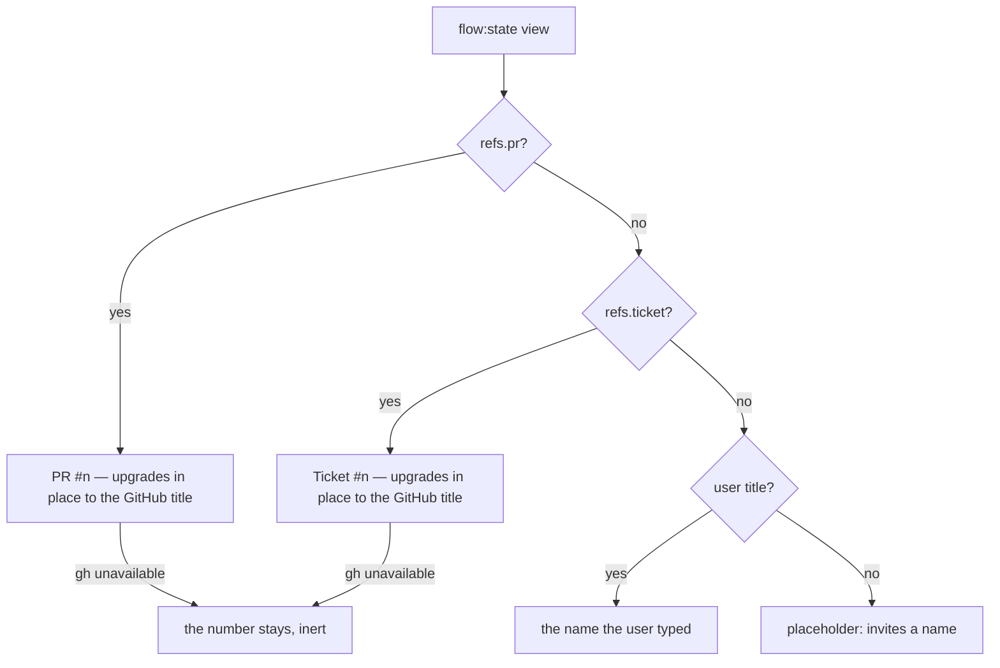

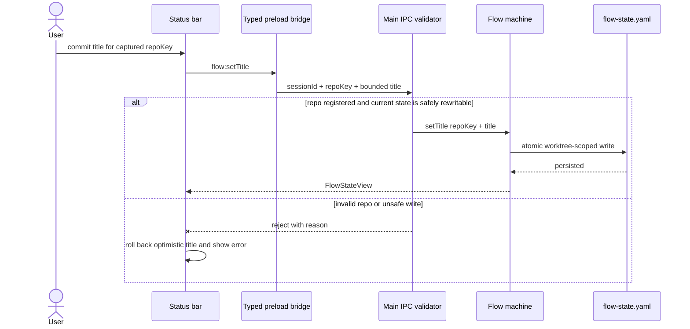

**Under space pressure** the bar sheds in a stated **order**, expressed as shrink factors rather than script: the **title** yields its width first, the **activity phrase** next, and the **alert last** — and the alert yields only its detail, so *"Loop needs you"* can never be pushed off the bar's edge. Nothing sheds to **zero**: the title and the phrase **floor** at a legible width and truncate with an ellipsis. Content shrunk to nothing is *removed from perception* rather than truncated, and a zero-width control stays in the tab order (WCAG 1.4.4 Resize Text, 1.4.10 Reflow, 2.4.11 Focus Not Obscured). The bar's height is therefore **constant**, and the terminal below it never needs a refit.

**Announcement:** the alert is assertive (the human is the blocker); the activity is polite (a phrase change must not interrupt what is being read). Both regions are **permanently mounted and never hidden** — a region pruned from the accessibility tree (by removal *or* by `display:none`) does not announce the content that arrives with it (WCAG 4.1.3). The title is not announced as news — it is a name.

### 22.4 Layout is data, not code (D17/D28/D36)

- The UI is built from **placement-agnostic widgets** (terminal, viewer, file tree, todos, capture, gate panel, status strip, overlay) positioned by a **layout config** at `~/.config/agent-terminal/layout.json`: which view holds which widgets, what the overlay shows, the hotkeys. **No runtime drag-dock** in v1 — changing layout = editing config, not rewriting widgets. This is a **first-class architectural constraint** (clean widget boundaries), not a nice-to-have.
- Hotkey defaults: **Ctrl/Cmd+1/2** (views) + **Ctrl/Cmd+K** (overlay), remappable via the config (⌘3 was retired with view 3, v2.132).

---

## 23. Multi-instance & epics

### 23.1 One flow per instance, many instances (D5)

- **One flow per app instance**; concurrency is achieved by **running many instances**, each driving its own terminal session, repo/branch/PR, and agent-loop chain. No in-app multi-flow dashboard.

### 23.2 Epics = N instances over N worktrees (D18/D22/D23)

- When a loop step produces N PRs (an epic), **all steps of the flow run on each PR** — each PR becomes its **own flow** in its **own git worktree** on its PR branch. There is no going back, so ancestry isn't tracked. The app **assists**: for each child PR it creates the worktree and launches a new instance, **seeding that worktree's flow-state** at the correct step (`flow:openChild`). Per-flow state lives in the worktree (§19.1).

### 23.3 Cross-instance guard (D21)

- Instances are independent, but if two target the **same repo+branch (or same PR)**, the second **warns** ("already managed elsewhere") to avoid clobbering agent-loop state.

### 23.4 Launch-root resolution (added v2.88)

So one instance can run per worktree/repo (§23.1), a launched instance roots at a **caller-supplied target directory** instead of always at `$HOME`. The target crosses the **OS process boundary** (a launch argument / environment variable / OS open-directory event — implementation's choice), never an IPC channel; per-process input keeps two concurrent OS-process instances independent.

- **Launch root L.** L is resolved **once per process** and is the single source of truth three spawn-cwd surfaces read: the PTY shell cwd (§5), the artifact-viewer fallback root (§20.1), and the todo/repo-scope fallback (§16.3). The three read this one value — they do **not** each re-resolve — so a behavior-preserving edit to one surface cannot desync it from the others. The flow **global** directory (§18.1) is **not** one of these surfaces: it is the per-user home (F-derived), independent of L (see the app-global-anchors bullet) — the local-first repo tier already covers a launch-at-a-repo, so binding the global tier to L would shadow `~/.agent-terminal/flow.yaml` rather than fall back to it.
- **Resolution.** Given a target, L = the target resolved to an absolute **real path** (relative → absolute, symlink → canonical) when it is an **enterable directory**; otherwise L = **F**. **F** is the pre-existing no-target home value (`$HOME`, else the OS home dir) — unchanged by this section, and returned **verbatim** on fallback (never re-canonicalized), so the no-target and unusable-target paths are behavior-preserving.
- **Enterable directory.** The target is usable only when its real path exists, is a directory, and can be entered (traverse/execute permission). A target that does not exist, is a file, or cannot be entered (permission denied, broken symlink) is **unusable** → L = F; the instance still launches. Validation runs once and must not throw into the launch path.
- **Per-surface OSC-7 lifecycle.** The shell starts at L and tracks the shell thereafter (§5). The viewer root (§20.1) and todo/repo scope (§16.3) equal L **before the first OSC 7** and follow the reported cwd after it.
- **App-global anchors are home-rooted, not L-rooted.** The flow **global** directory (§18.1), the audit root (§25, `auditPaths.ts` reads `os.homedir()` directly), user-data, and config-dir lookups all anchor at the per-user home (F), **independent of the launch target** and fixed for the life of the process. The flow global directory is a fixed per-process home anchor that does not track OSC 7. Re-rooting these by mutating the process-global `HOME` is **forbidden**: it would also re-root the child shell's env and the audit root.
- **The launch directive does not leak to the child.** The per-process launch input is consumed once at startup by the resolver and is **stripped from the spawned shell's environment**, the symmetric guarantee to the `HOME`-mutation prohibition above: a nested instance launched from within an instance's own terminal does not inherit the parent's launch directory — with the directive stripped it resolves no target and roots at F unless the §23.5 CLI shim supplies its own target.

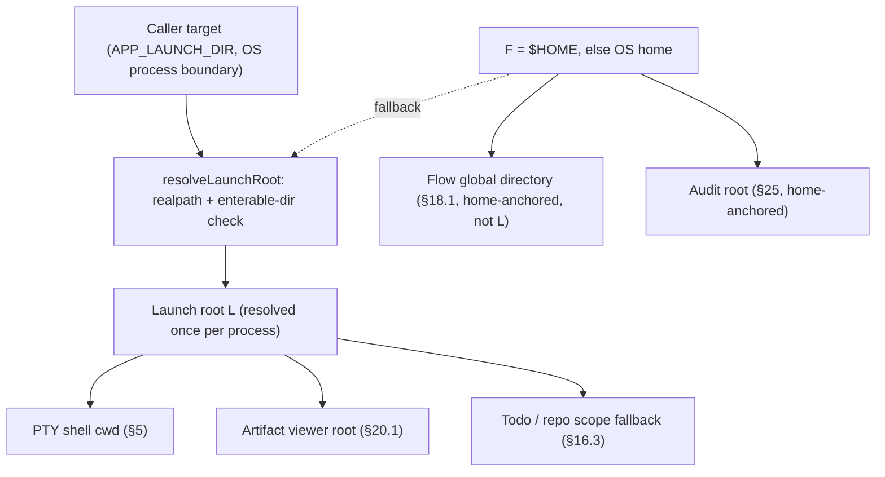

### 23.5 Launch shim — the `agent-terminal` CLI launcher (added v2.89, #25)

The §23.4 *producer*: an `agent-terminal [dir]` command on the user's PATH that opens a **new, independent** instance rooted at a directory (like `code .`), plus an in-app action that installs it. The shim is the launch-root producer; §23.4's `resolveLaunchRoot` is the consumer, **reused unchanged**.

- **Install action.** A Settings affordance invokes `cli:install` (§6); main writes a generated shim into the **most logical bin directory for this user on this machine** and ensures it is reachable from a new shell. **Location preference:** when a conventional user bin directory (`~/.local/bin`, then `~/bin`) is **already on the running PATH and writable by the user alone** — a candidate that is, **or whose ancestor below `home` (along its symlink-resolved real path) is, group- or other-writable is rejected** so another local user cannot rename it and substitute the on-PATH launcher (CWE-276/426, CWE-59) — the shim lands there and **no shell profile is edited**; the command works in new shells (and the current one) immediately, with no restart. When none qualifies — **or the preferred-dir write fails** — main falls back to a dedicated **`~/.agent-terminal/bin`** it creates and PATH-wires by adding a **marker-guarded block** to the user's existing shell profile(s). The dedicated dir and its app-owned parent are hardened owner-only (0o700, CWE-276/426); a **reused user dir is the user's own — never created or re-permissioned**. Install is **idempotent / reconcile-to-current-build**: a prior block is stripped from **every** candidate profile before the fresh one is appended only to the active shell's profile(s) (and stripped from all of them when the shim instead lands in an already-on-PATH dir), so reinstalling (including from a different build, after a default-shell change, or after switching to an on-PATH dir) re-points the command at the running build with **no duplicate or orphaned PATH/profile entries**. If it can neither write the shim nor put it on PATH it returns a **visible error and never reports success** — there is no "installed but not runnable" state.
- **Build-correct invocation.** The shim embeds this build's launch command — the Electron binary plus, in a dev build (`process.defaultApp`), the resolved main script; a packaged build needs no extra arg. So the installed command launches **this** build.
- **Target across the boundary.** The shim captures the invoking shell's cwd, resolves an optional argument against it (`agent-terminal ./sub` → *shellCwd*/sub, regardless of the launched process's own cwd; no argument → the shell's cwd, distinct from §23.4's no-target `$HOME`), and forwards a single value as **`APP_LAUNCH_DIR`** to the new instance. An unusable target is forwarded verbatim and falls back to F per §23.4.
- **Trust boundary (CWE-78).** The caller path crosses as a **distinct environment value, never spliced into a shell command line**, so shell metacharacters, spaces, or a leading `--` reach the resolver as one verbatim directory operand — never parsed as a launcher flag or evaluated as a shell token.
- **Detached, genuinely independent.** The new instance is launched detached and the shim returns immediately (the launching shell is not blocked, and the child outlives it). On macOS the build binary is exec'd **directly** so a genuinely **separate OS process** is created rather than the running instance being focused; Linux spawns a detached independent process. Either way any already-open instance stays open.

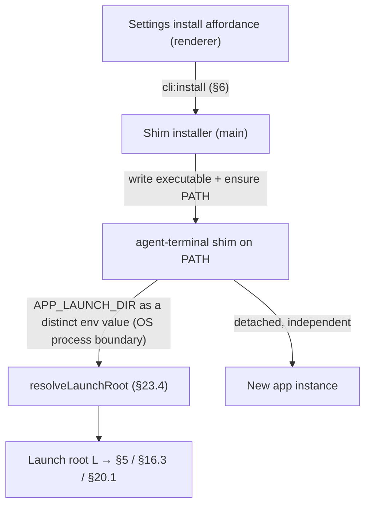

---

## 24. Build plan — UI-inwards

> **Build direction (supersedes the prior bottom-up W1–W19 plan).** We build the flow-management UI **from the skin inwards**: stand up the complete three-view shell (§22) first, with **every widget present and interactive**, then replace mocked backing with real subsystems phase by phase. The four widgets that already have shipped cores — **terminal** (§5–§9), **manual capture** (§15/§16/§21.1), **todos** (§16.3/§16.4/§21), and the **artifact viewer** (§20.2) — are reused **as-is behind the new skin**; everything else (flow runner, gates, status strip, step inputs, feedback compose, artifact discovery, GitHub bridge, multi-instance) is **mocked with fixtures** in Phase 1 and made real in later phases. The rationale: lock the look, feel, and widget boundaries (§22.4) before wiring deep machinery, so the visible product converges early and the §22.4 placement-agnostic-widget constraint is enforced from day one rather than retrofitted.
>
> **TDD applies unchanged (CLAUDE.md).** Design artifacts in §24.1A/B (mood studies, theme mockups) are non-code HTML and are outside the code-TDD rule. Everything built into the app in §24.1C and every later phase is code: RED-first, observable behavior, no emulator/PTY mocks. View switching, hotkeys, overlay open/close, theme toggle, and mocked-widget rendering are all observable at the DOM/e2e boundary and are tested there. Reuse of a shipped core behind the new skin starts with a **pinning test** asserting the core's existing observable behavior still holds through the new widget boundary.

### 24.1 Phase 1 — the three-view UI, mocked

> **Progress:** 24.1A Mood ✅ · 24.1B Options ✅ · 24.1C Implement ✅ — **Phase 1 is complete** (v2.36): the full three-view shell is the live UI with every widget present and interactive in both themes, the shipped cores (terminal, capture, todos) reused behind the skin, and the **artifact viewer** now real (markdown-it+mermaid / CodeMirror, §20.2). The §24.2.1 drawer-panel restorations are now **complete** (v2.45). What remains is **not Phase 1**: the §24.2 backlog of real flow machinery (status strip / gate / flow runner are intentionally still fixture-driven mocks). Design artifacts live in `design/` (`design/README.md` is the running log); mood studies in `design/mood/`, shell mockups in `design/shell/`.
>
> **Amended v2.132 — view 3 removed.** The Phase-1 build below describes a **three-view** shell whose **view 3** held the fixture-mocked **Todos + Review-gate** widgets. That view was later removed: the real Todo/Capture widgets live only in the drawer overlay (§22.2), and the fixture gate panel (`createGatePanel`/`SAMPLE_FLOW` in the former `src/renderer/src/flow.ts`) was superseded by the real §26 loop/gate panel and deleted. Read the "view 3 / gate panel" items in this section as **historical build record**; the live shell is view 1 Terminal, view 2 Artifacts, and the Settings view (⌘1/⌘2 + gear/⌘,).

Deliver the full §22 shell: **view 1 Terminal**, **view 2 Artifacts** (file tree + viewer), **view 3 Todos + Status**, the **`Todo | Capture` quick-send overlay** (§22.2), the **status strip** (§22.3), and **Ctrl/Cmd+1/2/3 + Ctrl/Cmd+K** hotkeys (§22.4) — in **both light and dark themes** with a toggle. State is preserved across view switches.

**Real (shipped cores, reused behind the new skin):**
- **Terminal** — the xterm pane and app-owned selection (§7), the PTY/shadow loop (§5/§8), injection (§9.3).
- **Capture** — manual single-slot "Capture last report" (`capture:last`, §21.1/§15/§16), finding → `todo:add`. Capture lives in the **docked drawer's Capture tab** (view 3 shows Todos + the gate, not capture — §24.1C).
- **Todos** — the todo data model, persistence, and interactions (§16.3/§16.4), select-and-send to the terminal. The Todo tab of the overlay and the todos widget in view 3 are the **same widget**.
- **Artifact viewer** — CodeMirror 6 + markdown-it + mermaid.js rendering, select-to-send / `todo:add` (§20.2), fed by **real git/fs discovery** (§20.1, v2.37) scoped to the session's live cwd.

**Mocked (widget present and interactive; fixture data behind it):**
- **Status strip** (§22.3) — step position n/total, gate state, agent activity, loop progress rendered from a fixture flow-state; hide/show real.
- **Gate panel + step timeline** (§19.2/§19.3) — controls render and are clickable; actions are stubbed (no real injection of loop slash-commands yet).
- **Flow runner / flow-state / agent-loop bridge** (§18.3/§19.1) — a hardcoded sample flow drives the timeline and strip; no `flow-state.yaml`, no `.agent-loop/state.yaml` watching.
- ~~**Artifacts file tree** (§20.1) — populated from the fixture set; no real discovery/provenance.~~ **Now real (v2.37):** `viewer:tree`/`viewer:read` discover the session's repo (curated = the superset of working-tree changes ∪ committed-in-PR files ∪ `.agent-loop/`, whole-repo on a checkbox) or, outside a repo, the cwd tree — with `changed`/`loop`/`pr` provenance tags. The **PR** provenance tag ships (v2.98, gh-resolved base); the LoopDef `artifacts:` declarations still wait on the agent-loop bridge (§24.2).
- **Feedback compose path** (§19.4) — the compose-with-agent affordance is present but stubbed; verbatim select-and-send works (it rides the real todo/capture send).

**Acceptance:** launch the app, switch views with hotkeys and persist state, toggle light/dark, open the overlay over any view and send a real todo / capture a real report, render a fixture artifact in the viewer and send a selection, drive a real agent in the terminal — all while the strip, timeline, and gate panel show coherent (mocked) flow state.

#### 24.1A Mood — ✅ done

Use the **`frontend-design`** skill to produce **mood studies** that fix the look-and-feel direction: a compact token system (palette as 4–6 named hex values, display/body/utility typefaces, layout concept, one signature element), grounded in this product's subject (a single-operator harness for driving coding agents). Output is a small set of non-code mood boards; **converge on one direction** before any mockups.

- [x] Four directions explored (`design/mood/`): Telemetry, Galley, Schematic, Galley · Lit.
- [x] **Chosen: Galley · Lit** (`design/mood/04-galley-lit.html`) — readable margin-proof model lit by a live cyan signal on a bright board; light + dark. **Rule:** saturated color is spent only on **signal** (cyan = where the work is / provenance link, §16.8) and **act** (red = request changes); everything else is quiet ink. Type: Fraunces / IBM Plex Sans / IBM Plex Mono. Tokens in `design/README.md`.

#### 24.1B Options — ✅ done

From the chosen mood, produce mockups of the full three-view shell + overlay + status strip, **each in light and dark**, then **converge to a single option** before implementation. Output is interactive HTML/CSS mockups (view switching, overlay, theme toggle; no app/backing wiring).

- [x] Three layouts explored (`design/shell/`), sharing placement-agnostic widgets via `design/shell/tokens.css` (§22.4 — only the frame differs): **Console** (slim strip on top), **Cockpit** (persistent left rail + drawer), **Reading room** (document-first).
- [x] **Converged on `design/shell/converged.html`** (Reading room dropped):
  - **Slim left chrome** — Console's minimal feel as a ~200px left rail (views nav + vertical flow + compact status + quick-send/theme); main area full-bleed.
  - **Docked, non-blurring quick-send** — the drawer is a real layout column (no scrim/blur), so the **terminal stays visible beside it**. This is required for **cross-highlight (§16.8)**: hovering a finding lights its source line in the terminal, both on screen at once. This amends the §22.2 "overlay pops over any view" framing for the Terminal view: quick-send **docks** rather than covers, specifically to preserve terminal↔capture cross-highlight.
  - ⌘1/2/3 views, ⌘K toggles the drawer; light + dark (theme applied in `<head>` to avoid FOUC).

#### 24.1C Implement — ✅ done (frame + cores + artifact viewer; §24.2.1 panel restorations follow-on)

Built **`design/shell/converged.html`** as the live renderer UI per the §24.1 real/mocked split, **both themes** with a toggle, RED-first throughout.

- [x] **Frame** — `src/renderer/index.html` is the rail · three views · docked drawer; tokens + layout folded into `styles.css`. `shell.ts` owns view switching, ⌘/Ctrl+1-3, ⌘/Ctrl+K, drawer dock/undock, and theme; `crossHighlight.ts` does §16.8. Both are organisms per `UI-STANDARDS.md` (typed factory, host-only DOM, injected theme seam) with DOM-level unit tests; the frame behaviours have e2e (view switch, dock/undock without scrim, ⌘K through a focused terminal, theme persists, terminal refit on dock).
- [x] **Real cores reused behind the skin** — terminal + selection (view 1); the action window's Capture/Todo tabs + status strip relocated to the docked drawer and rail, element-id contracts unchanged so their shipped behaviour (and e2e) still holds.
- [x] **`theme` added to `UiSettings`** (§16.6), validated + persisted; `<html data-theme>`.
- [x] **Splitter removed** (§16.6) — replaced by the docked drawer; module + tests deleted (`splitRatio` left in the contract, unused).
- [x] **Widget reskin** — the reused capture/todo/status widget CSS is on Galley · Lit tokens (both themes; no hardcoded colors outside the token blocks). A pixel-level polish pass with populated widgets is still worthwhile but not blocking.
- [x] **Fixture-driven mocked widgets** — `flow.ts` renders the flow timeline, rail gate/loop status, and the view-3 gate panel from one typed `SAMPLE_FLOW` fixture; the gate's Approve / Request-changes buttons are clickable **stubs** that reflect a verdict locally and notify a handler but inject nothing (§19.2/§19.3). DOM-unit-tested; gate-stub wiring has an e2e.
- [x] **Artifact viewer** — ✅ **done (v2.36), discovery made real (v2.37), since extended (v2.41–v2.44).** View 2 is the real viewer: `artifacts.ts` is a placement-agnostic organism (file tree + viewer, injected render seams + the two §16.2 sinks) fed by **real git/fs discovery** (`viewer:tree`/`viewer:read`, v2.37 — the fixture set is gone); `viewerRender.ts` lazily loads **markdown-it + mermaid** (markdown with rendered diagrams) and a read-only **CodeMirror 6** editor (highlighted code). A selection in either routes to **send-to-agent** (inject, no submit — §9.3) or **add-to-todo** (`captureToTodo`, §16.2), captured via `selectionchange`, and the sinks are disabled until there is a selection (v2.42). Subsequent §20.2 work: **changed-line markers** (v2.41), **viewport-driven changed-section navigation** (v2.42), a **full-screen mode** with a resizable tree popout (v2.43), a name-only tree filter that re-renders matching nodes, and **keyboard-accessible scrolling + reusable accessible show/hide** (v2.44). DOM-unit-tested (fakes for the libs) + full-loop e2e. Both themes via tokens.

> **Known limitation:** ⌘K is intercepted in the capture phase so a focused xterm can't swallow it; the chord still cannot be globally rebound per-OS yet. Three §15/§16 command-capture e2e fail in some environments (shell-integration dependent) — pre-existing, verified against the prior commit.

### 24.2 Backlog — functionality not yet assigned to a phase

Everything below is real backing logic that Phase 1 mocks or omits. Each becomes (or joins) a later phase; none is in Phase 1. Spec sections in parentheses.

- [ ] **Flow definition schema + loader** (§18.1) — `flow.yaml` JSON-Schema, parser/validator, library merge (global ∪ repo, repo wins).
- [ ] **Flow-progression state store** (§19.1) — `flow-state.yaml` read/write per worktree; transitions persist + reload.
- [ ] **agent-loop state bridge** (§19.1) — watch/parse `.agent-loop/state.yaml` → derived flow/gate/loop-progress.
- [ ] **Flow runner** (§18.3/§19.2) — start; per-step entry actions (`bootstrap: pickup`, `skill:` injection); user-driven advance with not-ready warning; per-kind behavior. Replaces the Phase 1 hardcoded sample flow.
- [ ] **Gate driver + running-process refusal** (§19.3) — inject loop slash-commands; refuse injection over a non-quiescent shell. Makes the Phase 1 gate panel real.
- [ ] **Typed step-input prompts** (§18.4) — resolve declared inputs; prompt with the right picker only when unsatisfied.
- [ ] **Feedback composer — compose-with-agent path** (§19.4) — select todos (+instructions) → compose-with-agent vs verbatim → gate driver. (Verbatim send already real in Phase 1.)
- [x] **Artifact discovery + provenance tree** (§20.1) — ✅ **done (v2.37):** `src/main/artifactTree.ts` discovers the real tree off the session cwd (git in a repo, fs walk outside one) and reads files for the viewer (`viewer:tree`/`viewer:read`), replacing the fixture set. `changed` + `loop` + `pr` provenance ship (the **PR** tag via the gh-resolved base, v2.98); the LoopDef `artifacts:` declarations (need the agent-loop bridge) remain deferred.
- [ ] **GitHub bridge** (§20.3) — prefer written artifacts; `gh` refresh; fallback to artifact when offline.
- [ ] **Todo templates** (§21.2) — markdown-list parse, named + file templates; headings ignored, sub-bullets folded.
- [ ] **Layout config system** (§22.4) — load `~/.config/agent-terminal/layout.json`; a config change relocates a widget with no widget-code change. (Phase 1 keeps widgets placement-agnostic but ships a hardcoded layout.)
- [ ] **Worktree + child-instance launcher** (§23.2) — `flow:openChild`; child launch seeds the expected `flow-state.yaml` at the right step.
- [ ] **Cross-instance guard** (§23.3) — second open on the same repo+branch (or PR) warns.
- [ ] **Flow-author skill** (§18.5) — separate deliverable; a skill, not app code.

#### 24.2.1 Drawer-panel functionality deferred by the mockup-exact panels — ✅ done (v2.45)

The §24.1 drawer panels were rebuilt to the converged mockup exactly (v2.32), which is intentionally leaner than the shipped §15/§16 components. These controls existed and work in the codebase's main process; they were dropped from the **renderer** and are the **next priority** to restore — re-skinned into the mockup's card / checkbox / linkbtn language, not the old chrome. The IPC + main-process backing for each still exists.

Todo panel:
- [x] **Send must not submit** (§9.3/§16.2) — ✅ **done (v2.35).** The **Send** pill injects with `submit: false`: it pastes the todo content into the agent's input box (no trailing `\r`) and **leaves it there for the user to edit or augment** before they submit it themselves, moving focus to the terminal (the old §16.2 *Insert*, not *Insert & submit*). One-line renderer fix (`todoTab.ts` → `doInject(t.text, false)`); the `agent:inject {submit}` path already supported it.
- [x] **Reorder** (§16.4) — ✅ **done (v2.45).** ↑/↓ buttons (keyboard/a11y path) + HTML5 drag, persisted via `todoReorder`; the full display order is sent so the flat done-inline list stays stable.
- [x] **Edit-in-place + a better edit UI** (§16.3) — ✅ **done (v2.45).** Editing via `todoUpdate` with a better affordance than the old textarea swap: the `.tx` becomes `contenteditable` in place (Save/Cancel + Enter/Escape, no box swap); the mid-edit repo-swap deferral is kept (a swap while editing surfaces a `.swap-blocked` notice, applied once the edit resolves).
- [x] **Manual add** (§16.4) — ✅ **done (v2.45).** A top add-row (`#todo-new` + Add) → `todoAdd {type:'manual'}` (empty/whitespace guarded).
- [x] **Delete — recoverable, two-step** (§16.4) — ✅ **done (v2.45).** Per-todo `todoDelete` via the `origin/main` (commit `c992fe7`, v2.27) design, re-skinned into the mockup row: `×` → inline **Confirm delete? / Cancel**; confirming **defers** the `todoDelete` and shows a **Deleted / Undo** row for `TODO_UNDO_MS`; Undo restores with no round-trip; the deferred delete captures the item's own `repoKey` so a mid-window repo swap still deletes from the right list.

Capture panel:
- [x] **Bulk triage** (§16.2) — ✅ **done (v2.45).** A `.chunk-check` checkbox per card + a pane toolbar: **Add to todo** (concatenates the checked chunks in appeared order, blank-line separated, into **one** todo) and **Dismiss selected**, re-skinned from the `c992fe7` (v2.27) `chunk-check` / `add-selected` / `dismiss-selected` into the card language. **Supersedes** the per-card "Add to todo" the mockup shipped and subsumes **Dismiss + Dismiss all**.
- [x] **Dismiss + Dismiss all** (§15.6) — ✅ **done (v2.45).** Toolbar **Dismiss selected** (`dismiss`) and **Dismiss all** (`dismissAll`); folded into **Bulk triage**.
- [x] **Add-to-todo Undo + in-flight cue** (§16.2) — ✅ **done (v2.45).** The bulk Add-to-todo opens an in-place **Added / Undo** window (`TODO_UNDO_MS`); while pending the contributing chunks read as **processed** (dimmed, checkbox disabled) until the window commits (chunks dismissed) or Undo reverts (the just-added todo is deleted, chunks stay) — the `c992fe7` "processed chunk" behaviour.
- [x] **Report prose / summary view** (§15.x) — ✅ **done (v2.45).** A report that carves no findings renders as an expandable `.report-prose` summary card (`<details>`) showing the report body — prose has a home without reintroducing the blob.

> **Retained from the old panels (not deferred):** the **double-click → terminal reveal** cross-highlight (§16.8) stays in the mockup-exact capture panel — now **resize-safe** (marker-anchored, id-keyed) after merging `origin/main`. **Dropped and not currently backlogged** (call out if wanted): command-history list + Clear-commands (§15.5/§15.6), type badges + timestamps + truncation markers (§15.6), "Mark as chrome" (§15.x `learnChrome`), Insert/Insert&submit on command-output and the Insert-without-submit todo action (§16.2), the collapsible Done section (§16.4).
>
> **Reference implementation:** the deferred Capture/Todo usability (bulk triage, undoable delete, processed-chunk cue) shipped working + tested on `origin/main` in commit `c992fe7`; it lives in git history as the starting point for re-skinning into the mockup, rather than a from-scratch rebuild.

#### 24.2.2 Manual-step tracer bullet — start → work → complete, status-strip-valid — planned

The first real §24.2 flow machinery, built as **tracer bullets** per the CLAUDE.md *Tracer-bullet development* requirement: a **walking skeleton** first (the whole `not_started → in_progress → done` arc, hand-drivable in the UI on day one), then **one layer deepened per slice** behind that unchanged arc. Each slice replaces exactly one mock/seam and leaves the app demoable. **Scope: the `manual` kind only** (§18.2) — `loop`/`action` kinds, the gate driver's agent-loop slash-commands (§19.3), typed input pickers (§18.4), request-changes/compose (§19.4), and epics (§23) are out. This promotes slices of the §24.2 items **Flow definition schema + loader** (§18.1), **Flow-progression state store** (§19.1), **Flow runner** (§18.3/§19.2), **Todo templates** (§21.2), and makes the **status strip** (§22.3) real for this path. Each item names its **fire** (user action) / **land** (observable UI) / **e2e** (the proof), RED-first throughout.

- [x] **S1 — Walking skeleton: start a manual step, advance it to done. ✅ done (v2.48).** The complete lifecycle spine across every layer: a **minimal single-`manual`-step definition** (`id`, `name`, `kind: manual`) from a **hardcoded constant in main** — *the one deliberate seam this slice carries, replaced in S2*; a real **workflow state machine** in `src/main/flow.ts` (`not_started --start--> in_progress --advance--> done`; `done` is terminal — advancing past the step's gate, §18.2, completes it and, with no next step, the flow); **IPC** `flow:state → {stepName, position, status}`, `flow:start`, `flow:advance` (§6) + `window.flow` (preload); the **status strip** (§22.3) shows `1/1 · <name>` + live status with a control that is **Start** in `not_started`, **Advance** in `in_progress`, gone in `done`. State is in-memory in main (persistence is S3). **Fire:** click Start, then Advance. **Land:** strip reads `not started` → `in progress` → `done`; the control follows; a second Advance is impossible. **e2e:** launch → `not started` → Start → `in progress` → Advance → `done`, no further control; under it a main unit test of the state machine (legal transitions only, `done` terminal) and a renderer DOM test that the strip/control render from `flow:state` and emit `flow:start`/`flow:advance`. **Retires:** the §24.1 fixture-driven status strip / flow state.
- [x] **S2 — The step definition comes from a real `flow.yaml`. ✅ done (v2.49).** Replaced S1's hardcoded constant with `src/main/flow.ts` `loadFlowDefinition(worktreeDir)` reading & validating `<worktree>/.agent-terminal/flow.yaml` (§18.1 minimal shape: `name` + one `kind: manual` step with `id`, `skill`, `todo_template`; parsed with `js-yaml`); `createFlowMachine(load)` sources the step name from it. Workflow, IPC, and UI are unchanged — only the definition's **source** became real (read once at the spawn cwd, §5/§20.1). A missing/malformed/invalid file is an inert `error` state (new `FlowStatus` member + optional `FlowStateView.error`), not a crash. **Fire:** open the app on a worktree whose `flow.yaml` names the step. **Land:** the strip shows the name from the file; a malformed/missing file shows the error with no control. **e2e:** seed a temp worktree's `flow.yaml` → strip text + drive to done; a no-file case → error state, no control, app still launches; under it `flow.ts` parse/validate integration tests against temp dirs (real fs, no mocks) and a renderer DOM error-render test. **Retired:** the hardcoded step definition.
- [x] **S3 — Progression persists across reload. ✅ done (v2.50).** `src/main/flowState.ts` `createFlowStateStore(worktreeDir)` writes/reads `<worktree>/.agent-terminal/flow-state.yaml` (§19.1, atomic; missing/corrupt → null); `createFlowMachine(load, store?)` resumes the persisted status on construction (only when the step id matches the current definition) and persists every `flow:start`/`flow:advance`; the store gitignored `flow-state.yaml` on first write — **removed in v2.93** (§19.1: the app never modifies the user's `.gitignore`). `flow:onStateChanged` is **deferred to S5** — it has no firing trigger until an external mutator exists, so wiring it now would be untested. **Fire:** Start the step, then relaunch the app. **Land:** the step is still `in progress` after relaunch (and `done` stays `done`). **e2e:** Start → in-progress → relaunch → still in-progress; advance → relaunch → still done; under it `flowState.ts` write/read integration tests + (post-v2.93) assertions that the store **creates no `.gitignore`** and leaves a pre-existing one byte-for-byte unchanged, and machine-resume tests. **Retired:** in-memory-only progression; **(v2.93)** the gitignore-on-first-use write.
- [x] **S4 — Step entry injects the skill; todos come from an on-demand template picker. ✅ done (v2.56–v2.58).** On entering the manual step (Start, re-entering on Restart) the only automatic action is **skill injection**: the `skill:` ref is injected as a `/<name>` invocation via §9.3, **subject to the §19.3 running-process refusal** — an open OSC-133 command span (shell not at a ready prompt) refuses injection and surfaces a one-shot `FlowStateView.notice` instead. **Todos are NOT auto-instantiated** (corrected in v2.58 per §6/§4.1 — the spec models instantiation as on-demand, overriding D37): while the step is **active**, the **todo overlay** (not the flow strip — v2.59, §9.1) shows a progressive-disclosure **picker** of the templates co-located with the flow.yaml under `<flowDir>/todo-templates/*.md` (`listTodoTemplates` → `TodoTemplateRef{ref,name}`, name = H1/humanized), defaulting to the step's bound `todo_template:`; choosing one runs `todoTemplate:instantiate` (load → `parseTodoTemplate` → `todoStore.add` per item, silent dedup, §21.2). The channels are on `window.monitor`; main gates the list to an in_progress step; the strip fires `FLOW_CHANGED_EVENT` so the overlay re-pulls the picker as the step activates. Seam: `createFlowMachine(…, onEnter?)` fires `onEnter(step)` (skill only) after a start/restart transition and merges its notice onto that transition view only. **Fire:** click Start, then pick a template. **Land:** Start injects the skill at the ready prompt and adds **no** todos; the picker lists the co-located templates by name and instantiates only the chosen one. **e2e:** Start → `/groomctl` typed, no todos → on-demand control adds them; a 2-template picker lists names, defaults to the bound ref, instantiates only the chosen list; a `cat`-busy shell → the refusal notice and no injection. **Retired:** the inert no-entry-action seam **and** (v2.58) the auto-instantiation of todos on entry.
- [x] **S5 — The working status is live and valid. ✅ done (v2.63).** `flow:state` derives the in-progress status from real signals — agent activity (active/quiet, §8.3) + todo completion (`n/m done`) + gate readiness (every todo done) — via the pure `deriveFlowView(view, todos, activity)` (non-`in_progress` passes through; input never mutated), rendered as the strip's `.flow-derived` line. The slice **lands `flow:onStateChanged` end-to-end** (deferred here from S3): the main→renderer **event channel** in `src/shared/ipc.ts` (§6), the **`window.flow.onStateChanged(cb)`** preload subscription returning an unsubscribe, and the **strip subscribing on mount to re-pull `flow:state`** — fired by main on count-changing todo mutations (`add`/`setStatus`/`delete`, `todoTemplate:instantiate`) and the §8.3 `active↔quiet` flip (off the shadow `onStatus`, which now stamps the latest activity). Advancing while not-ready **warns but proceeds** (§19.2): `flow:advance` reads pre-advance readiness and rides a one-shot `notice` on the `done` response when todos are still outstanding. **Fire:** check off a todo; run a command; click Advance with todos unchecked. **Land:** the `n/m` count moves as todos are checked **without a manual refresh** (proving the push path); the derived activity reflects the §8.3 signal; advancing not-ready shows the warning but still reaches `done`. **e2e:** Start → add todos → check one → the strip `n/m` moves on its own; advance with a todo outstanding → warning notice **and** still reaches Completed; under them a main unit test that `deriveFlowView` is a pure function of (flow-state, todos, activity), and a renderer test that an emitted `flow:onStateChanged` triggers a `flow:state` re-pull. **Retired:** the in-S3-deferred `flow:onStateChanged` wiring gap; the strip's status is derived from real signals, not a fixture.

#### 24.2.3 Loop steps, the agent-loop bridge & gates — planned

The next real §24.2 flow machinery, extending the §24.2.2 manual-step spine to the **`loop` kind** and the two-layer **agent-loop bridge** (§17.2/§19.1), built as **tracer bullets** in an **observe → assist → notify → drive** order: a read-only `state.yaml` mirror lands *before* the app injects anything, so the app cannot corrupt agent-loop state until it has earned the right to drive it. **Scope in:** multi-step flows; `loop` steps; the bridge that reads `<repo>/.agent-loop/state.yaml`; bootstrap entry with a typed-input prompt; awaiting-human detection; the three-option gate (approve / request-changes / impasse) driven by §9.3 injection. **Scope out (named, later phases):** the `action` kind (§18.2), epics / N-PR output (§23.2), the GitHub bridge (§20.3), the cross-instance guard (§23.3). **Grounded in the real engine:** the v4 `state.yaml` is `{schema_version, pr, branch, iteration, status, sessions}` — the **state machine lives in `status`** and "needs you" is the explicit `awaiting-*` family — and the **human options are declared per-gate in the LoopDef** (`human_options: [approve, request-changes, impasse]`), so the gate UI is data-driven and **impasse is first-class**. This promotes slices of the §24.2 items **Flow runner** (loop kind, §18.3/§19.2), **agent-loop state bridge** (§19.1), **Gate driver + running-process refusal** (§19.3), **Typed step-input prompts** (§18.4), and **Feedback composer** (§19.4). **Sequenced `T0 ∥ S5 → reconcile → T1 → …`:** **T0** is design-only (no code), so it **starts before §24.2.2 S5 lands** — it can proceed in parallel with S5 because it touches no flow code. **S5 is still a hard prerequisite for the code slices**, since it establishes the live-push `flow:onStateChanged` model that **T2** and **T4** reuse (without it a `state.yaml` mirror cannot update live). So once S5 lands there is an explicit **reconcile/analysis gate**: re-examine the shipped S5 (its final push contract + status derivation) against the T0 mockups and adjust either before any code slice begins. **T2, T4, T5, and T6 consume the T0 mockups at 100% fidelity** (the §24.1 skin-first principle + the mockup-fidelity rule). Each **code** slice (T1–T7) names its **fire / land / e2e**, RED-first throughout; **T0 is design-only** — artifacts, no tests, outside the code-TDD rule, like §24.1A/B. **T7** (added v2.94) is a later follow-on extending the same spine — it surfaces the ticket/PR a flow is working in the popout and re-requests stage-transition inputs on restart — not part of the original observe → assist → notify → drive sequence.

**T4 data flow (the "notify" slice):** one derivation (main classifies human-needed) feeds two delivery surfaces (the always-visible status bar's alert, §22.3.1, and the unfocused-only OS notification); the notification's activation lands the user on the read-out through the shipped `Shell` seams.

A distinct human-needed entry becomes **pending** for its repo. Pending is not signalled: it raises on the *first* moment the window is unfocused, which is usually the user leaving the app rather than the entry arriving (v2.128). A refused raise is recorded, never dropped.

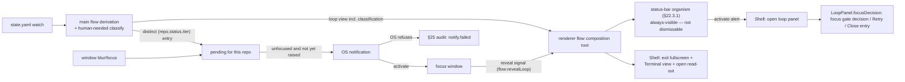

**Delivery is gated on the app's code signature (macOS).** `UNUserNotificationCenter` authorizes an app only when its signature binds its `Info.plist` and its signing identifier is the bundle id; a linker-signed bundle is denied outright with `UNErrorDomain 1`. An ad-hoc `codesign --sign -` satisfies this — no Developer ID is required. Both the vendored `Electron.app` (`postinstall` → `scripts/sign-bundle.sh`) and the packaged app (`mac.identity: "-"`) are signed accordingly.

- [x] **T0 — UI design for the loop-step / gate surfaces (design-only, no code). ✅ done (reconciled v2.66).** Like §24.1A/B, the deliverables are **design artifacts** — mockups in `design/shell/` (updating `converged.html`), any new tokens in `tokens.css`, a `design/README.md` log entry — **outside the code-TDD rule**; the contract back to the code slices is that each surface T1–T6 builds **matches its T0 mockup at 100% fidelity**, and any state the mockup doesn't cover is **decided before** that slice, never invented mid-implementation. Evolves the Phase-1 fixture (`SAMPLE_FLOW` in `src/renderer/src/flow.ts`: a 4-step rail + Review gate + a loop block whose `severity`/`openFindings`/`lastVerdict` the real v4 schema lacks). **Surfaces (→ consuming slice):** (1) **multi-step station rail** (→T1) — N stations + a **loop-vs-manual** station distinction; (2) **loop-state mirror** (→T2) — the real v4 read-out (`status` **pill**, `iteration`, `pr #` link, `branch`) with a **generic status-pill** treatment since `status` is per-LoopDef and unbounded (reconciles §22.3); (3) **awaiting-human attention cue** (→T4) — placement, **re-fire per iteration cycle**, behavior under the hideable "deep-work" strip (§22.3 OPEN-10); (4) **gate decision panel** (→T5/T6) — **data-driven** from the gate's `human_options` (variable button set), the §19.4 **request-changes composer** (curate review-todo subset + free text + compose-with-agent vs submit-as-is), the **impasse** affordance, the §19.3 **refusal** notice (reuse S4's `.flow-notice`), and a cue distinguishing **approve→advance-flow** from **approve→loop-continues**; (5) **typed-input prompt** (→T3) — per-type pickers for the v1 catalog (`github-ticket`/`pr`/`files`/`free-text`), modal vs inline, surfaced on step entry. **Deliverable:** all five surfaces in **both light + dark** (Galley · Lit), a README log entry, and a **written list of the mockup-gap decisions taken**. No `src/` changes, no tests. **Unblocks:** T1–T6 by giving each its 100%-fidelity target. **Reconciled against the shipped S5 (v2.66):** the deliverables are `design/shell/loop-flow.html` (five surfaces, light + dark) + the `design/README.md` log; the reconcile gate confirmed S5's `flow:onStateChanged` push seam + `FlowDerived` and produced four shaping rulings for T1/T2 — (a) the loop mirror rides the **existing** push seam (no new plumbing); (b) the v4 mirror is a **separate `loop?` field parallel to `derived?`**, not nested, because loop state outlives the manual `in_progress` window; (c) the 3-tone status pill maps to the loop **`status`** string (T2), **not** S5's binary `activity`; (d) the fixture's `severity`/`openFindings`/`lastVerdict` are **kept as design slots** backed by an agent-loop exposure requirement to resolve in T2.
- [x] **T1 — Multi-step walking skeleton (`manual` only).** ✅ done (spec v2.67). The unchanged-arc slice — no new backing, just N steps. `loadFlowDefinition` accepts `steps: [...]` (>1); the machine tracks a current-step index and advances across steps (`done` only past the last); the §22.3 rail renders one station per step. **Fire:** open a 3-`manual`-step flow → Start → Advance ×3. **Land:** the rail walks `todo→active→done` per station, position reads `n/total`, the final Advance reaches `done` with the control gone. **e2e:** seed a 3-step `flow.yaml`, drive start→done asserting station classes; under it a machine unit test (index advances; `done` only past the last; illegal transitions throw). **Retires:** the single-step assumption baked into S1–S5 (the machine now walks N steps). The synthetic Not-started/Completed bookend rail of v2.52 is **kept**, generalized to bracket all N real steps (`FlowStateView.steps: string[]` carries every step name so the strip can render the middle stations).
- [x] **T2 — The `loop` kind + a read-only `state.yaml` mirror. ✅ done (v2.68).** The app **shows** agent-loop state at all times but **drives nothing** — the human runs every `agent-loop`/slash command by hand. Schema accepts `kind: loop` + `loop:`; a new `src/main/agentLoopBridge.ts` watches/parses `<repo>/.agent-loop/state.yaml` (checks `schema_version`; unknown version / missing / corrupt → `null`, never throws — mirrors §19.1) and reads the bound LoopDef's gate list; the strip/panel shows the **real v4 vocabulary** live (`status`, `iteration`, `pr #`, `branch`) carried on a **`loop?` field parallel to S5's `derived?`** (not nested — loop state outlives the manual `in_progress` window) and pushed over the **existing `flow:onStateChanged` seam** (no new plumbing). The mockup's `severity`/`openFindings`/`lastVerdict` are **kept as design slots, not dropped** — they exist in per-iteration review artifacts today but not in `state.yaml`, so this slice **surfaces an agent-loop exposure requirement**: aggregate them from artifacts into a queryable surface (or, for `lastVerdict`, extend the schema/engine to record the last human verdict) and wire them; until that lands they render empty/placeholder, never invented. The generic 3-tone status pill maps to the per-LoopDef **`status`** string, **not** S5's binary `activity`. Manually flow-advancing a loop step whose `status` is not an approved/terminal one **warns but proceeds** (§19.2). *(UI to design: the state mirror — `design/shell/loop-flow.html`.)* **Fire:** open a flow whose step 2 is `kind: loop`; update `state.yaml` by hand. **Land:** the panel reflects `status`/`iteration`/`pr` and updates as the file changes with the app injecting nothing; advancing the loop step early shows the not-ready warning. **e2e:** write a v4 `state.yaml` → panel shows status+iteration; rewrite it → panel updates; advance-early → warning; under it bridge integration tests over temp files (parse v4, watch-fires-change, unknown version → null, corrupt → null) + a pure derive unit test. **As built (v2.68–v2.69):** the rail shows a compact **Loop read-out** (3-tone pill + iter) that opens the **click-to-expand docked panel** (`createLoopPanel`, a 4th grid column matching `loop-flow.html`'s State section). **LoopDef gate-list resolution folded in (v2.70):** `src/main/loopDef.ts` `parseLoopDef` resolves the bound `loop:` name to the engine's real LoopDef yaml (repo `.agent-loop.yaml` `loops:` registry override, else `$CLAUDE_CONFIG_DIR/loops/<name>/<name>.yaml`) and reads its `gates[]` (`id` = status, `human_options`, `kind: terminal`). The panel now renders the **"gate options" row** from the current gate's `human_options`, and **readiness is gate-driven** — `ready` is true only at a **terminal** gate, so mid-work statuses (`impl-draft`) and every awaiting gate read not-ready (correcting the old `awaiting-human-*` prefix heuristic, which is kept only as the no-LoopDef fallback). **Still deferred to T5/T6:** the in-panel gate *decision* section (the actual approve / request-changes / impasse buttons + the §19.4 composer) — the gate UI proper. The `severity`/`openFindings`/`lastVerdict` slots stay **unbacked/unrendered** until the agent-loop exposure requirement lands (the panel notes where they will go).
- [x] **T3 — Bootstrap entry: prompt for the typed input, drive the loop into its start state. ✅ done (v2.71).** A loop step's declared typed input (§18.4, e.g. `{name: ticket, type: github-ticket, required: true}`) is resolved on entry — when unsatisfied the matching picker prompts; the value is **persisted in flow-state and threaded to later steps' inputs** (§18.1 output→input). Entry then injects the bootstrap (`agent-loop pickup <input>` → `agent-loop <pr> --loop <loop>`, §18.3) via §9.3, **subject to the §19.3 running-process refusal** (busy shell → one-shot notice, nothing typed). Fires on **Start of the first step** *and* on advancing into a later loop step. **Picks up the entry-on-advance deferral from T1 (explicit):** T1's machine fires the step's entry actions (`onEnter` — the §18.6 `skill` injection and now this bootstrap) **only on `start`/`restart` of the first step**; advancing from step *i* into step *i+1* deliberately does **not** re-enter, so a later step's `skill`/bootstrap never runs. T3 closes that gap — entry actions fire on **every** entry into a step, whether by Start, Restart, or **Advance into it** — and is the slice that wires it (the §22.3 e2e must drive an advance *into* a step that declares a `skill`/typed input and assert the injection fires, the converse of T1's "advance does not fire `onEnter`" test). From there, mechanics stay manual as in T2. **Fire:** start (or advance into) a loop step needing a ticket → enter the ID, at a ready shell vs. a `cat`-busy shell. **Land:** the ID is captured + persisted, `agent-loop pickup <id>` typed at the ready prompt, busy shell → refusal with nothing injected, the ID appears as the next step's input. **e2e:** two `_electron` runs (ready → command typed + input persisted; busy → refusal); under it an input-resolution unit test (unsatisfied → prompt; satisfied-from-prior-output → no prompt), a refusal gate test, a persistence round-trip. **As built (v2.71):** entry-on-advance landed in `createFlowMachine.advance` (`FlowEnterStep` → `(step, inputs)`); `bootstrap: pickup` + typed `inputs` in the loader; `flowEntryActions` returns a `prompt` when a required input is unsatisfied, else injects `agent-loop pickup <input>` (busy → refusal); flow-wide `inputs` map (persisted to `flow-state.yaml`, hydrated on construct, threaded across steps by name) with a new `provideInput(values)` that persists + re-enters; `FlowStateView.prompt?` + the `flow:provideInput` channel; a relocatable **`createFlowInputModal`** organism rendering `loop-flow.html`'s modal into `#flow-modal-host`, wired through a strip `onPrompt` seam whose prompt is **transition-driven** (a `flow:onStateChanged` refresh never closes an open modal). The second `agent-loop <pr> --loop <loop>` of the §18.3 worked example (the PR comes from agent-loop's runtime output, not a typed prompt) stays for the gate slices. The §18.4 catalog pickers beyond a free-text box (`pr`/`files` specifics) are not yet specialized — the modal renders a labelled text field per input regardless of `type`; specializing them is a later refinement.
- [x] **T4 — Detect "awaiting human" and notify. ✅ done (v2.72).** The bridge classifies `status` as human-needed by matching it against the LoopDef's gate ids / the `awaiting-*` family (explicit in v4 — not a heuristic); on entering such a status it fires S5's `flow:onStateChanged` and the UI raises a notification/attention cue. Because the loop re-enters a gate at `iteration+1` after each request-changes, the cue **re-fires per cycle**, not once. *(UI to design: the attention/notification surface.)* **Fire:** let agent-loop reach `awaiting-human-pr-approval`, then iterate it to the next awaiting state. **Land:** the cue appears with no manual refresh and re-appears on the next cycle. **e2e:** write `status: awaiting-*` → cue shows; bump iteration + re-enter awaiting → cue re-fires; under it a classifier unit test (which statuses are human-needed, driven by the LoopDef gates) + a renderer test that `flow:onStateChanged` raises the cue. **Corrected v2.128:** as shipped, the OS notification had never been delivered — the raise was consumed by the dedup whenever the entry arrived while the window was focused (the common case), and macOS refused every raise from the unsigned bundle regardless. See the v2.128 changelog; the fixes are the `pending`/`lastRaised` split with an `onFocusChanged` seam, ad-hoc bundle signing at both the dev and packaged ends, and the `notify.failed` audit event.
- [ ] **T5 — Approve gate → advance the flow.** At a human-review state, the gate UI renders the options from the current status's gate `human_options` (data-driven, not a hardcoded triplet). **Approve** injects `/agent-loop-approve` (§19.3 refusal), then reconciles from `state.yaml`. The **flow** advances only when the approved gate's `next_status_on_approve` is the loop's terminal/exit status — intermediate approvals keep the flow on the same step (the loop just moves on); that loop-status → "flow step complete" mapping is made explicit. **Fire:** at an `awaiting-*` state, click Approve at a ready shell. **Land:** `/agent-loop-approve` typed; state reconciles; a terminal gate advances the flow station, an intermediate gate keeps the step; busy shell → refusal. **e2e:** terminal-gate approve → flow advances; intermediate approve → same step, loop status moves; busy → refusal; under it a gate-option-derivation unit test (UI options come from the gate), a terminal-vs-intermediate advance-mapping test, a refusal test.
- [ ] **T6 — Request-changes & impasse, with feedback compose (§19.4).** The other two options, both of which **keep the flow on the step** and let the loop iterate. **Request-changes** curates a subset of review todos (+ optional free text) → **Compose-with-agent** (`flow:composeFeedback` writes the reason) **or** **Submit-as-is** (verbatim) → injects `/agent-loop-request-changes` (§19.3 refusal). **Impasse** injects `/agent-loop-impasse`. Neither advances the flow; the loop re-iterates and T4 re-notifies at the next gate. **Fire:** at a review state, pick two todos + a note → request changes; separately, declare impasse. **Land:** the composed/verbatim reason injected as `/agent-loop-request-changes …`; impasse injects `/agent-loop-impasse`; the flow stays put; busy shell → refusal. **e2e:** select todos → request-changes → reason in the PTY with the flow unchanged; impasse → command in the PTY; under it a composer unit test (selected todos + text → reason), gate-driver tests for both commands, a refusal test.
- [x] **T7 — The ticket + PR a flow is working surface in the popout; Restart re-requests stage-transition inputs. ✅ done (v2.94).** A later follow-on (not part of the original observe → assist → notify → drive sequence). **(1) Ticket/PR refs.** The view gains `refs?: {ticket?, pr?}` (`src/shared/ipc.ts`), resolved by the machine on active steps (not just loop steps), with visibility gated on flow progress per (3): the **ticket** is the value of the flow's `github-ticket`-typed input (§18.4), falling back to the loop's `linked_issues` when present (an optional state.yaml field the core v4 schema above does not enumerate; the mirror reads it opportunistically and degrades to `[]` when absent); the **pr** is the value of the flow's `pr`-typed input, falling back to the loop's `state.yaml` `pr`. The docked popout shows a **"Working on"** section — each ref's bare number immediately, then a title, truncated body, and a GitHub link once resolved; a non-loop step shows a compact **`Flow` refs read-out** that opens the same popout, re-pushed live over the §24.2.2 S5 seam. Ref detail is fetched **best-effort via `gh`** (`src/main/githubRefs.ts`, cached per `(repo, kind, number)`, never throws) over a new **`flow:githubRef`** channel; links open through **`app:openExternal`**, which hands the OS the **normalized** url only after an https + GitHub-host allow-list (CWE-601), shared by main and the renderer href sink (`src/shared/githubUrl.ts`). **(2) Restart clears resolved inputs.** `flow.restart()` wipes the persisted `inputs` before re-entering, so a step's required input (e.g. the ticket) is re-requested; `undo()` preserves them. **(3) The "Working on" display is gated on flow progress (v2.96).** Because `pr`/`linked_issues` and the mirror come from the read-only `state.yaml`, which a reset cannot write, the machine gates their visibility on the flow's own progress instead: a `github-ticket`/`pr` typed-input ref shows once a step requesting it is entered; the loop's `linked_issues` ticket, `state.yaml` `pr`, and the mirror show once a **loop step** is entered, staying for the run. A Terminate/Restart returns the flow to its first step, so the "Working on" display clears with no `state.yaml` write and returns only once the gating steps are re-entered (no persisted dismissal state; the same loop advancing never re-reveals it).

```mermaid
flowchart LR
  IN["github-ticket / pr typed inputs OR state.yaml linked_issues + pr &#40;visibility gated on flow progress&#41;"] --> M["main computeRefs &#40;§24.2.3 T7&#41;"]
  M -->|"flow:state refs"| RO["renderer read-out + docked popout"]
  M -->|"flow:state refs"| SB["status bar title &#40;§22.3.1&#41;"]
  RO -->|"flow:githubRef &#40;repoKey, kind, number&#41;"| GH["main githubRefs &#40;gh, cached, never throws&#41;"]
  SB -->|"flow:githubRef &#40;repoKey, kind, number&#41;"| GH
  GH -->|"title / body / url"| RO
  GH -->|"title / url"| SB
  RO -->|"click link: app:openExternal"| V["main allow-list &#40;https + GitHub host, CWE-601&#41;"]
  SB -->|"click link: app:openExternal"| V
  V --> OS["OS browser"]
```

Both renderer consumers carry the **repo** into the fetch *and* into the landing guard: the same ref *number* in another repo is another ref, so a fetch issued for repo A must never answer for repo B's identically-numbered PR (§22.3.1).

  **Fire:** open a flow on a manual step that carries a ticket (typed input) → the read-out opens the popout showing the ticket detail + link; separately, complete a flow then Restart. **Land:** the popout shows the ticket/PR title + truncated body + a working GitHub link once the flow has entered the step that surfaces each ref (a typed input on its requesting step; the loop's `linked_issues`/`pr` on a loop step, per (3)); after Restart the first step re-prompts for its input rather than reusing the prior value. **e2e:** a popout spec (manual step → refs surface) and a restart re-prompt spec; under them machine units (refs from input-first then `linked_issues` fallback, PR, omitted-when-empty, restart-clears-inputs), the `gh` resolver + the shared url allow-list units, the bridge `linked_issues` parse, the `flow:githubRef`/`app:openExternal` validators, and the popout refs-section + non-loop read-out DOM units.

---

## 25. Flow audit record (per-run, append-only)

### 25.1 Goal & boundary (D-audit-1)

Each flow run writes a durable, human-auditable record from which a **complete timeline** of the run can be reconstructed: every lifecycle state change with its timestamp, the TODOs created and each of their state changes, and — added in Phase 2 (§25.5) — the loop inputs/outputs, the ticket and PR numbers involved, the agent-loop status/iteration, and the commands the flow issued on the user's behalf.

**Boundary:** auditing is **observe-only** and **best-effort**. It injects nothing, blocks nothing, and **never throws into the flow path** — it only records what the flow lifecycle and the TODO store already produce (Phase 1) and what the agent-loop bridge already mirrors (Phase 2). A failed audit write is logged and dropped; the flow proceeds unaffected (mirrors the §19.1 "never throws, degrade to null" discipline). **UI:** none this round — files only.

### 25.2 Storage layout (D-audit-2)

Audit root: `~/.agent-terminal/audit/`. One directory per repo, named by the repo **basename only**. One file per `flow:start`, named `<flowName>_<startTimestampZ>.yaml`, where the timestamp is ISO-8601 UTC to the second with `:` replaced by `-` (`2026-06-23T10-00-01Z`).

The repo basename and the flow name are each reduced to a filesystem-safe segment before they reach the path — characters outside `[A-Za-z0-9._-]` become `-` — so an untrusted `flow.yaml` `name:` (a repo is untrusted input) cannot traverse the audit tree (CWE-22). Basename collision across two same-named repos is an **accepted limitation** (§25.7).

```text
~/.agent-terminal/
  audit/
    agent-terminal/                         # repo basename
      feature-dev_2026-06-23T10-00-01Z.yaml # one run
      feature-dev_2026-06-25T14-12-00Z.yaml # a later re-run
```

### 25.3 File format — YAML multi-document stream (D-audit-3)

A **header document**, then one `---`-delimited document **per event**, appended in order. Appending an event is **O(1)** — one complete `---\n…\n` block written in a single append, never a rewrite of prior content. The "a reader never sees a partial event" guarantee rests on the per-event append being one write **plus the reconstructor discarding a trailing partial document** (possible only on a crash mid-append), *not* on atomic rename. The header is written when the file is opened.

```yaml
---
flow: feature-dev
repo: agent-terminal
repoPath: /Users/dylanbarrell/Documents/sourcecode/agent-terminal
started: 2026-06-23T10:00:01Z
---
ts: 2026-06-23T10:00:01Z
type: flow.started
step: plan
---
ts: 2026-06-23T10:02:11Z
type: todo.created
id: a1
text: Wire audit IPC
---
ts: 2026-06-23T10:05:00Z
type: todo.status
id: a1
from: active
to: in_progress
---
ts: 2026-06-23T10:30:00Z
type: step.entered
step: build
---
ts: 2026-06-23T11:00:00Z
type: flow.status
from: in_progress
to: done
---
ts: 2026-06-23T11:00:00Z
type: flow.completed
step: build
```

### 25.4 Lifecycle (D-audit-4)

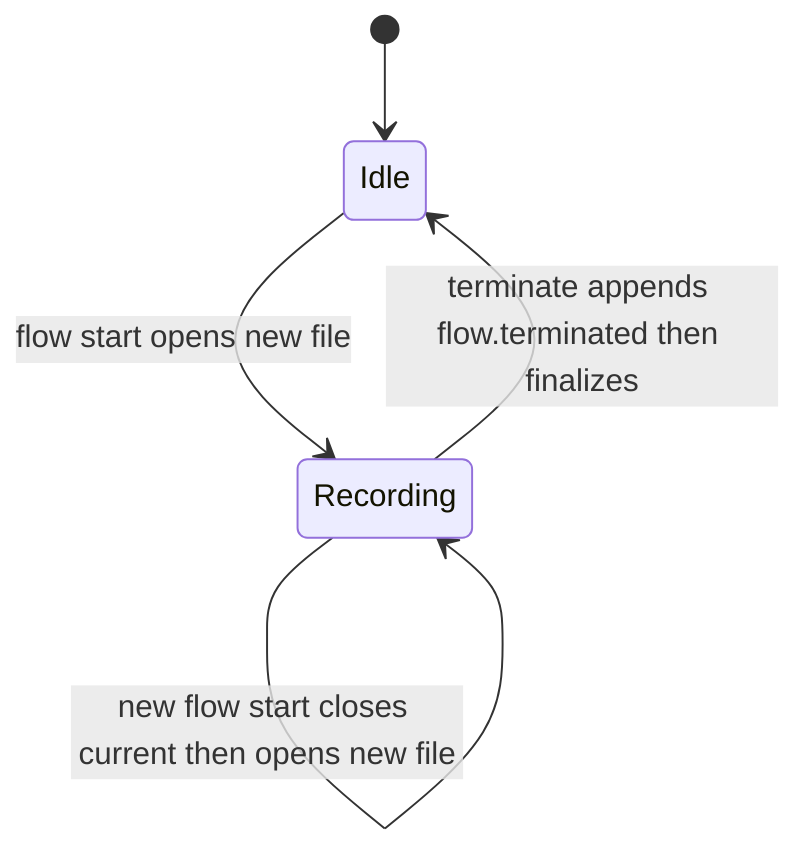

- A fresh `flow:start` **opens a new file** for the run (header document + `flow.started`), **closing** any current run for that repo.
- `advance` / `restart` / `undo` **append** events to the current run's file — no rewrite of prior content.
- Reaching `done` records a `flow.completed` event but **keeps the file open**, so completing a flow and then going back (`undo` / `restart`) continues to append to the **same** file.
- The next `flow:start` **closes** the current run and opens a new file.
- A `flow:terminate` (#26) appends a `flow.terminated` event and **finalizes** the run — closing it and clearing the restart-surviving pointer — so the next `flow:start` opens a new file regardless of whether a run was open at terminate time. Best-effort like every other write (§25.7): it never blocks or rolls back the flow reset.
- The current-run pointer **survives an app restart**: after a restart mid-run, append-on-go-back targets the same run file rather than orphaning it and opening a new one. (How the pointer persists is an implementation choice.)
- TODO events (`todo.*`) are recorded **only while a run is open** for the repo; with no open run, a todo edit records nothing.

### 25.5 Event vocabulary (D-audit-5)

Every event carries an ISO-8601 UTC `ts`.

**Phase 1 — lifecycle + TODO timeline:**

- `flow.started` — entry step of the run (the header carries `flow`, `repo`, `repoPath`, `started`).
- `flow.status` — `{ from, to }` across `not_started` / `in_progress` / `done`.
- `step.entered` — a new step became active within a running flow.
- `flow.completed` — the terminal step was reached (the file stays open for append-on-go-back).
- `flow.terminated` — the run was deliberately abandoned (#26 Terminate); the timeline folds back to `not_started` and the run is finalized so the next start opens a new one.
- `todo.created` — `{ id, text }`.
- `todo.status` — `{ id, from, to }` across `active` / `in_progress` / `done`.
- `todo.text` — `{ id, text }` after an edit.
- `todo.deleted` — `{ id }`.

**Phase 2 — loop integration:** `input.resolved` `{ name, value }` (one per resolved step input), `ticket.assoc` `{ ticket }` (a `github-ticket` input resolving to a positive integer), `pr.assoc` `{ pr }` (from the `state.yaml` mirror), `loop.status` `{ from, to }` and `loop.iteration` `{ n }` (diffed from the mirror on each observation; the first observation records the entry status with `from` empty), `command` `{ source, cmd, exit }` (a flow-injected bootstrap correlated with its OSC-133 command span), `outputs.snapshot` (`.agent-loop/` files `{ path, bytes }` + `pr`, taken on each loop status change).

### 25.6 Shared semantics & timeline reconstruction (D-audit-6)

Per the `src/shared/` rule (CLAUDE.md), the meanings main, the tests, and a future viewer must all agree on live in **one** shared definition reused by both sides rather than two drifting copies: the **event vocabulary** (types), the audit **file-path derivation**, the **start-opens / advance-appends** event classifier, the **serialize ↔ parse** pair (the on-disk format is the contract the writer and any reader must not drift on), and the **timeline reconstructor**. The reconstructor reads a run's stream — tolerating a trailing partial document — and yields the ordered, replayable timeline plus the folded final state (flow status/step, ticket, PR, loop status/iteration, resolved inputs, surviving TODOs, commands, output snapshots) — the "a complete timeline can be reconstructed" acceptance criterion. Module and function names are the implementor's choice.

### 25.7 Constraints & accepted limitations

- **Never throws into the flow path.** A failed audit write is logged and dropped; the flow is never affected.
- **Untrusted strings.** TODO text and the repo/flow names are escaped on write (YAML quoting) and path segments are sanitized (§25.2). Phase 2's `.agent-loop/` snapshot performs the §20.2 realpath check so a symlink cannot escape the repo, and sanitizes the untrusted `state.yaml` `status` (CWE-117, per §16.3 / `loopNotifier`).
- **Basename collision** across same-named repos is **accepted** — the run files co-mingle in one basename directory; the per-repo current-run pointer is keyed by the **full** repo path so each repo still tracks its own open run.
- **Explicit ID sourcing only** (Phase 2) — ticket/PR numbers come from resolved inputs and `state.yaml`, never from branch-name or PR-body scraping.
- **Retention:** keep all, no pruning.

### 25.8 Build — tracer-bullet phases

Per the CLAUDE.md tracer-bullet rule, each slice is fired by an **existing UI control** (flow Start/Advance/Restart/Undo, todo edits) and proven by a **Playwright `_electron` e2e asserting the on-disk YAML**, with main-process integration and shared unit tests underneath. RED-first throughout.

- **Phase 0 — Spec (this section).** The contract the code implements.
- **Phase 1 — Lifecycle + TODO timeline.** The writer core plus every event the flow lifecycle and TODO store already produce (`flow.started` / `flow.status` / `step.entered` / `flow.completed` + `todo.*`). **Fire:** Start, then Advance/Restart/Undo; add/move/edit/delete a TODO while a flow is in progress. **Land:** the per-run file appears with `flow.started`; the lifecycle events accrue with timestamps; a new Start opens a new file; go-back after `done` appends to the same one; `todo.*` events accrue while a flow is active, nothing when none is. **e2e:** drive Start → Advance → done → Undo (same file), then Start again (new file); within an active flow, manipulate a TODO and assert its events.
- **Phase 2 — Loop integration + timeline reconstruction.** Everything sourced from the agent-loop bridge (tickets, PRs, inputs, loop status/iteration, injected commands, output snapshots) plus the timeline reconstructor that proves the whole record is replayable. **Fire:** enter a loop step (the `state.yaml` mirror is observed), resolve a `github-ticket` input (the bootstrap injects `agent-loop pickup <input>`), and let the loop's `state.yaml` change. **Land:** `input.resolved` / `ticket.assoc` on resolution; `loop.status` / `loop.iteration` / `pr.assoc` + an `outputs.snapshot` on each status change; a `command` event once the injected bootstrap runs; the reconstructor folds a full run into its ordered timeline + final state. **e2e:** drive a loop step through `state.yaml` edits and assert the loop/input/ticket/PR/snapshot events on disk; the bootstrap-`command` correlation (OSC-133, §15.5) is proven through the real shadow with scripted bytes at the integration layer, with the full-PTY e2e covering it where shell integration is available.

---

## 26. In-terminal loop engine, v2.99 — RETIRED, superseded by §27

> **Status: RETIRED as of v2.135, but still the contract for code that is still in the tree.** §27 is the live design. This section is kept, unedited, for exactly as long as the engine it describes still runs — it is **not** history, it is the specification of shipped code that has not been deleted yet.
>
> **Why it is still here.** The §27 engine is built alongside this one (§27.15) rather than replacing it turn by turn, so both engines exist in the tree until the N8 sweep. Roughly 800 `§26.x` citations in `src/` and `tests/` annotate the machinery below. Rewriting §27 over this section's numbers would leave every one of them resolving to a clause that had silently changed meaning — nine of the thirteen subsection numbers are reused by §27 for different concepts. The new engine therefore takes a **new number**, and every citation below stays true until the code it annotates is deleted.
>
> **How it goes away.** The N8 sweep (§27.15) deletes this section together with the code that implements it. Until then: **code still implementing what §27.14 retires is not a review finding** — cite the slice that removes it. When `src/` and `tests/` no longer cite `§26`, this section goes, and that grep is the mechanical evidence for the sweep.
>
> The original status note follows, unchanged.

> **Status:** requirements for the next build phase, drafted v2.99. Folds an operator interview into decisions **D41–D62**. **Supersedes the external-engine assumption of §17.2 / §19.1 / §24.2.3 for the `loop` step kind:** the app no longer shells out to the Go `agent-loop` binary to drive a loop — it **becomes** the engine, driving one hosted Claude Code instance by injection (§9.3) and `/clear`, and writing the same `.agent-loop/state.yaml` v4 contract the §24.2.3 mirror already reads. The read-only mirror (§24.2.3 T2) and awaiting-human notify (T4) **remain valid** — `state.yaml` is still the contract — now **written by the app** rather than observed from an external writer. The injected `agent-loop pickup` / `/agent-loop-*` commands of §24.2.3 T3/T5/T6 are **retired** for this path (§26.6/§26.9). On any conflict with §17–§25, this section wins for the in-app loop.

### 26.1 Goal & boundary (D41)

- Turn the app into the **agent-loop engine itself**. Where the external engine spawned many headless `claude -p` sessions (work-agent, parallel reviewer lanes, consolidator) coordinated by a Go state machine, the app drives **one interactive instance** the operator already watches, by composing prompts and `/clear` and injecting them through the §9.3 path. The loop's *meaning* — phases, gates, verdicts, severity, the `.agent-loop/` artifacts — is unchanged; only the *execution substrate* changes from N processes to one instance + subagents.
- **In scope:** the `plan` and `impl` loop shapes as defined by the **`plan-loop` and `impl-loop` LoopDefs** — two **single-phase** definitions (plan-loop has no impl phase; impl-loop inherits a ready PR from its predecessor) that a flow runs **in sequence**: the plan step binds `plan-loop`, the impl step binds `impl-loop`, and **one `state.yaml` carries the flow through both, one after the other** (§26.6). These are the validation targets — *not* `pe-loop` (the combined plan+impl def). The LoopDef YAMLs are the **canonical `github.com/dequelabs/loops` defs, copied verbatim into `example/loops/` as a committed snapshot** (refreshed from upstream by hand), so the build/test validates against the real defs without a submodule/auth dependency in CI. Also in scope: the full inject→detect→consolidate→gate cycle; the three human gate options; cost accounting from logs; in-app bootstrap (pickup); epic **sub-PR creation**.
- **Out of scope (v1):** the external Go binary (no longer invoked for the loop), per-process model/highway/warmer machinery, epic **instance auto-launch** (§26.9), `takeover`, and the per-phase plan-length guard.

### 26.2 The app is the orchestrator (D42)

- **The state machine and every "what to inject next" decision live in the app's main process**, not in the conversation. This is **forced**: `/clear` wipes the conversation, so any orchestration logic placed there would be destroyed at the first `/clear`. The orchestrator therefore reconstructs each step's context from **on-disk artifacts** (`pr-context.md`, `plan.md`, the prior `consolidated.json`, human notes) exactly as the external engine did.
- **Automatic, not human-paced** (D42): within a phase the orchestrator injects each actor turn and `/clear` on its own, advancing the state machine from the artifacts it reads back. The human is involved **only at gates** (§26.6) and on failure (§26.3). Each iteration's work-agent runs **fresh from the on-disk artifacts** — `/clear` (§26.3/D46) wipes the conversation at every actor boundary, so the "interactive instance the operator watches" carries **no context across iterations**; its only memory of prior rounds is the committed code, `plan.md`, the prior `consolidated.json`, and the human notes it re-reads (the same fresh-process property the external engine got from separate `claude -p` sessions).
- This **supersedes §17.2/D2 and §19.3 for the in-app loop**: those described *driving the external engine* by injecting its slash commands so there is "one execution context." Here the app **owns** the state, so a gate transition is an app state mutation (§26.6), not an injected command; single-context visibility is preserved through the status strip and loop panel rather than through terminal echo. Injection remains the substrate for the **actor turns** (work, spawn-reviewers, consolidate), which *are* typed into the instance via §9.3 and are subject to the §19.3 running-process refusal — **redefined for a hosted REPL**: because the interactive agent (Claude Code) is itself the foreground process for the entire run, "the shell is at a ready prompt" cannot mean *the shell* is idle. For this loop **"injectable" means the hosted instance is idle at its own input box** — observed through the completion signal of §26.3/D47a (a turn's done-signal has fired and the instance has gone quiescent), **not** raw `QUIET_MS` silence (which can falsely read a mid-turn model/subagent wait as idle, §8.3). The orchestrator injects only when the instance is injectable by that definition; an injection attempted while a turn is still in flight is refused exactly as §19.3 refuses a busy shell.
- **Human/orchestrator injection contention — accepted risk (v1).** The orchestrator auto-injects into the same instance the operator is watching, and v1 has **no hard interlock** preventing an operator keystroke from interleaving with an in-flight injected prompt (or vice-versa). During automatic iteration the operator is expected to keep hands off the keyboard (involvement is gate-only); a future version may add an explicit "orchestrator owns the prompt" lock. Recorded here so it is a known limitation, not a latent surprise.

### 26.3 The injection cycle, `/clear` cadence, completion & failure (D43–D48)

The orchestrator runs one **actor turn** at a time against the single instance. Each turn is: compose prompt → inject (§9.3) → wait for completion → read the produced artifact → decide the next turn.

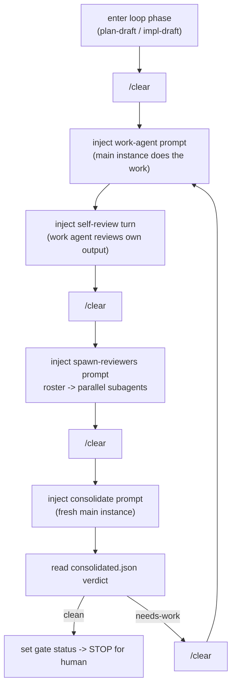

- **work-agent = the main instance itself** (D43): the interactive Claude the operator watches does the plan/impl work in its real context, producing commits and `plan.md` — not a subagent.
- **self-review kept, data-driven** (D44): after the work turn — **where the bound LoopDef declares one for the active phase** (in the real defs self-review runs in the **impl phase only**) — the orchestrator injects a self-review turn in which the work agent critiques its own output against the **roster lenses the LoopDef names** (not a hardcoded triplet — `plan-loop` and `impl-loop` carry different rosters), reusing the work-agent's session (no `/clear` before it). It **skips when the diff is empty** or it has already run for this iteration, matching the engine. The self-review turn produces **no file artifact**; its completion is the §26.3/D47a done-signal (see below), not an artifact check.
- **reviewers = parallel subagents** (§26.4).
- **consolidator = a fresh `/clear` main-instance turn** (D45): `/clear`, then a prompt that reads every persona review under `reviews/<iter>/` and writes **`reviews/<iter>/consolidated.json`** — fresh context so the work-agent's context cannot bias the merge. The consolidate prompt is given the **`verdicts` contract from the bound LoopDef** (§26.5) so the merge is anchored, not improvised: it must apply the LoopDef's **canonical/synonym verdict normalization**, **severity ordering**, the **kept-vs-dismissed** split (each dismissed finding carries a `dismissal_reason`), and the **`phase2_bounce_rules`**, and must emit a **synthetic `needs-work`** when a persona JSON is missing or malformed rather than silently dropping it. The output schema is the engine's `consolidated.json` (`verdict` ∈ {`clean`,`needs-work`}, `findings_kept[]`, `findings_dismissed[]`, `iteration`, `phase_reviewed`). The consolidator reads only the **persona** reviews (`review-<persona>.json`), never its own prior `consolidated.json`, so a re-run cannot read back its last verdict.
- **`/clear` cadence** (D46): a `/clear` sits at each actor boundary — **loop-step entry → the first work turn** (v2.123), work/self-review → reviewers, reviewers → consolidate, consolidate → next iteration's work. Subagents are fresh regardless; `/clear` resets the **main** instance's context and is also the **cost-metering boundary** `cache-analyze` splits on (§26.10).
- **Step completion = done-signal + artifact-confirmed, with a human override** (D47a): `QUIET_MS` silence (§8.3) is **not** a sufficient "done" signal here, and **OSC-133 command spans cannot help** — once the interactive agent is the shell's foreground process the shell emits a single command span for the whole session and never marks per-turn boundaries, so the app's `commandTracker` sees one span, not one per turn. A turn is therefore "done" only when **both**:
  - **(a) a real done-signal has fired.** The orchestrator instructs each injected turn to **write the `.agent-loop/turn-done` file, keyed to the turn, as its last action** — i.e. the agent *tells* the orchestrator it finished, rather than the orchestrator inferring it from silence. The signal is a **file, never a printed line** (v2.124): a hosted TUI agent reflows the injected prompt on echo, so any printable marker named in the prompt is echoed back and read as a completion. The instance must also be quiescent (§8.3) as a secondary guard. This is what "waits out spawned subagents" actually rests on: the main turn does not write its done-file until its `Task` children have returned.
  - **(b) the expected artifact exists and parses** where the turn produces one (`reviews/<persona>.json` is valid JSON against its `json_schema_ref`, `reviews/<iter>/consolidated.json` carries a `verdict`). **Artifact-less turns** — `/clear`, the D44 self-review, and the **impl-phase work turn** (whose product is commits/diff, not a fixed file) — confirm on the **done-signal alone** (the `.agent-loop/turn-done` file, keyed to the turn; the printable sentinel line was retired in v2.124, §26.3/D47a): `/clear` confirms when the instance returns to an empty-context idle prompt; self-review and the impl work turn on their turn-done file. The impl work turn's `workArtifact` is `""` (v2.126), so there is no additional file gate — completion is the turn-done file, full stop.
  - **(c) a UI "done" control.** The loop panel exposes a manual **"mark turn complete"** affordance so the operator can advance a turn the automatic signal missed (a slow or sentinel-less agent) without editing files — the human-in-the-loop escape hatch for the inherent imprecision of driving an opaque REPL. On a turn that stopped in **`error`** with its artifact actually present (a late done-signal the engine gave up on — e.g. a plan finished after the run erred), this same control **accepts** the artifact: it advances to the next turn through the exact chain a signalled completion takes (work→reviewers), **without re-running the turn**, so an accepted plan is never regenerated. Quiescence alone never advances the loop; only (a)+(b), or the explicit (c), does.
- **Failure & stall handling** (D48): completion is the done-signal + artifact (a)+(b) — **there is no wall-clock completion deadline**, so a turn that legitimately runs for many minutes (a large plan, a long build) advances the instant it signals, however long it took. Two distinct failure paths remain:
  - **Missing/invalid artifact on a done-signal** triggers **one** re-injection of the same turn (only when the instance is injectable per §26.2 — never typed over an in-flight turn); a second failure stops the loop in the **`error`** status.
  - **A genuinely frozen instance** is caught by a **stall watchdog**, not a deadline: it is deliberately long (default 20 min, `APP_TURN_TIMEOUT_MS`) and **reset on every §8.3 visible-content change** (the same signal quiescence keys off — `shadow.onActivity`), so it fires **only** when a turn's screen has produced no new content for the whole window. A streaming/repainting-with-progress turn keeps resetting it and never stalls; a truly hung one (or an instance that goes busy-and-silent, never becoming injectable) resolves to **`error`** rather than hanging forever. A stall **never retries** (re-injecting a frozen instance cannot help) and **never kills a working turn** — the escalation is the recovery cue, not a kill of live output.

  The **`error`** status is a **first-class app status** (§26.6) classified human-needed in `src/shared/loopStatus.ts` and recorded in the §25 audit, so the loop panel raises the attention cue with the failed step + reason surfaced, awaiting a human who **Retry**s (re-run the turn), **accepts** it via (c) (advance on the present artifact, no re-run), edits, or declares impasse. The orchestrator never silently advances past a failed turn, and — because there is no deadline racing a slow-but-working turn — a late done-signal that arrives while the turn is still in flight advances normally (the desync that once stranded a completed plan with its reviewers never started is closed by construction). **A persisted `error` is recoverable across a relaunch:** auto-resume (§26.11) never re-drives an `error` (it is human-owned), but it **reconstructs** the errored turn (from the same iteration-scoped artifact evidence that names which turn a run stopped at — `currentTurnByArtifacts`, single-phase defs only) so that after a cold reopen both Retry and accept act on the right turn rather than a dead panel. Reconstruction injects nothing; it only re-establishes the turn context the human's recovery controls need.

### 26.4 Reviewer fan-out as subagents (D49)

- The reviewer **roster** for the phase (from the LoopDef, §26.5) runs as **parallel subagents** of the single instance: the orchestrator injects **one** prompt — composed by main, naming each persona and its review skill ref — instructing the instance to spawn the personas as parallel `Task` subagents, each loading its `review-<phase>-<persona>` skill and writing `reviews/<iter>/review-<persona>.json`.
- **Subagent isolation replaces the engine's lanes/highways/warmer.** Each subagent is a fresh, isolated context (the independent-review property the external engine got from separate `claude -p` sessions) and they run in parallel (no serial `/clear` chain). There is **no warmer** — there is no chain of same-model processes re-reading shared context to amortize; each subagent reads the artifacts it needs.
- **Reviewer cost is captured in the subagent logs** (`~/.claude/projects/<slug>/<uuid>/subagents/agent-*.jsonl`), which **`cache-analyze`** (the existing token-accounting tool at `~/.claude/tools/cache-analyze`) aggregates into the spawning session's totals (§26.7). The app either **invokes `cache-analyze` as a helper** (it is a standalone tool, not engine code) or **reimplements its JSONL parsing in TS** — whichever is cleaner (§26.10). The `~/.claude/projects/.../subagents/agent-*.jsonl` layout is **Claude Code's private log format**: an external dependency the app does not control, so the parser tolerates layout drift (unknown/empty → cost omitted, never throws — the §26.10 unpriced-model discipline).

### 26.5 LoopDef-driven configuration (D50/D51)

- The engine is **data-driven from the bound LoopDef YAML**. The app already resolves and parses LoopDef **gates** in `loopDef.ts` (§24.2.3 T2/v2.70); this extends that reader to the **full set of fields the orchestrator depends on**:
  - **phases** (`id`, `entry_status`, `pre_fanout_actors`, `ordered_fanout`, `primary_work_actor`, `consolidator_actor`, `severity_floor_track`, `exit_predicate`, `post_clean_gate` / `post_needs_work_gate`) — the per-phase shape of the cycle;
  - the **gate set** and each gate's `human_options` (already read), plus each gate's `on_approve` / `on_request_changes` / `on_impasse` **action lists** and `next_status_on_*` (§26.6 executes these in-app);
  - the **reviewer roster** (per phase) for the fan-out (§26.4) and the self-review lenses (§26.3/D44);
  - **`verdicts`** — the orchestrator parses the **`persona`/`consolidated` synonym maps** and **`severities.order`** (the taxonomy `normalizeConsolidatedVerdict`/`isPersonaClean`/the §26.8 signature apply); the `consolidated.canonical` list and `phase2_bounce_rules` are the **consolidator's** to apply (via its prompt, §26.3/D45) and are **not parsed** by the orchestrator until a use for them is built (v2.113, parity with the `resume_contract` precedent);
  - **`artifacts`** (`path_pattern`, `producer`/`consumers`, `freshness`, `json_schema_ref`) — the real read/write paths and the schema the D47a "parses" check validates against, so paths are never hardcoded;
  - **`pickup_contract`** (`initial_status`, `initial_branch_tpl`, `initial_pr_body_ref`, `initial_labels`, `on_conflict`) — drives in-app bootstrap (§26.9);
  - **`resume_contract`** — the orchestrator parses **`mid_iter_safe`** (the flag resume consumes, §26.11); `required_artifacts`/`replay_actors`/`skip_actors` are the loop's declared per-actor-replay contract but are **not parsed** until that deferred feature is built (v2.111);
  - the prompt/context **recipes** (`prompts/work-{phase}.md` + the slot list).

  This **reimplements the recipe-assembly** the Go engine performed (template body + token substitution + artifact slots) in TS.
- **Loops in scope & their source:** the engine must run **`plan-loop` and `impl-loop`** (the §18.1 worked-example flow binds a `plan` step to `plan-loop` and an `implement` step to `impl-loop`); these are the validation targets, **the canonical `github.com/dequelabs/loops` defs copied verbatim into `example/loops/`** (a committed snapshot refreshed from upstream by hand — the real defs, not bespoke fixtures), so the parser is exercised against the real YAML and `parseLoopDef` resolves them via `CLAUDE_CONFIG_DIR` pointed at `example/`. `pe-loop` (combined plan+impl) is **not** a v1 target.
- **Fidelity (D51):** v1 keeps the **phase-2 triage gate** and the **fanout skip-optimization**. The skip reuses a persona's last-clean verdict from `persona_state` (§26.6) via a **per-phase footprint**: in the **impl** phase a persona is pruned when `last_clean_iter == iteration-1` **and** its `last_seen_files` set is unchanged; in the **plan** phase the footprint is the **`plan.md` digest** (`last_seen_plan_digest`), so a persona is pruned when the plan text it last reviewed clean is unchanged. v1 **omits the per-cycle severity-floor ladder** (`severity_floor_track`) — the consolidator's verdict is `clean` / `needs-work` against the LoopDef's default clean policy, without an escalating blocker floor (`severity_floor_track` is read but not enforced). **Accepted consequence (recorded):** without the rising floor, a persistent *minor* finding can hold the verdict at `needs-work` and lengthen a phase; the bound stop is the §26.8 iteration **cap → triage gate** (and the operator's gate options), not the floor. This is an accepted v1 simplification, not an oversight.

### 26.6 The state machine, gates & GitHub side-effects (D52/D53)

**One `state.yaml`, two LoopDefs in sequence.** The statuses and gates below are the v4 contract; the app now **writes** the file rather than reading an external writer's copy. The progression spans **two single-phase LoopDefs bound by the flow step machine**: the flow's **plan step binds `plan-loop`** (its terminal is `plan-human-approved`) and its **impl step binds `impl-loop`** (bootstrapped at `impl-draft`). A **single `state.yaml` carries the run through both, one after the other** — the `plan-human-approved → impl-draft` edge is **not** an intra-loop transition but the **flow advancing from the plan step to the impl step and binding the next LoopDef** (`bound_loop` flips in the same file). The status strings are the engine's exact v4 values (aliased below for mermaid).

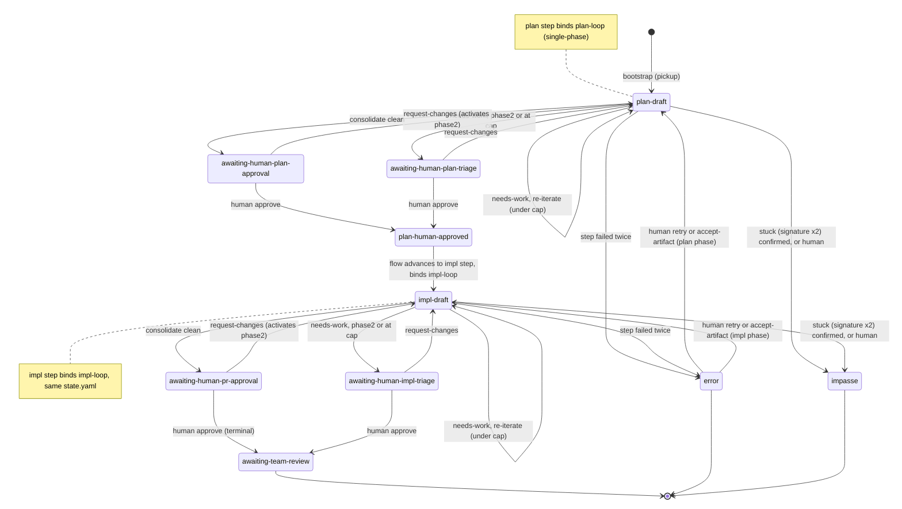

**The app writes a larger contract than the §24.2.3 read set.** The §24.2.3 mirror reads `{schema_version, status, iteration, pr, branch, linked_issues}`; the orchestrator, now the **writer**, is responsible for the full `EngineState` **plus** the `LoopExtension` the engine persists. So "v4 unchanged" holds for the **schema** but not for the **app's write obligations** — it must write, in addition to the read set: `bound_loop` (which LoopDef governs the current phase), `sessions`, `impasse` (the `{consecutive_identical, last_findings_sig}` tracking §26.8 reads), `phase2_active`, `persona_state` (§26.5 skip-opt footprints), `severity_cycle_iter`, `iter_in_flight` / `resume_mid_iter` (§26.11 resume), `epic` / `auto_chain` (§26.9), `notes`, `terminated`, and `updated_at`. The new app-only **`error`** status (§26.3/D48) is written here too, together with its app-only **`error_reason`** (the human-readable reason the turn stopped, which the §24.2.3 mirror reads back to render the panel's `reason` row). `error_reason` is **conditional on `status: error`**: the writer deletes the key on every non-error write, and the mirror decodes it only at that status, so a stale key left by any other writer can never surface. `completed_loops` is **no longer written** — v2.126 made `iteration` a single monotonic counter across chained loops, which removed the cumulative-display apparatus that field fed; a prior writer's value survives the merge as an unmodelled field. **A write is whole-document and valid v4** (every field the engine schema requires is present, defaulted where the app does not use it) so the §24.2.3 mirror, the §25 audit, and any future re-handoff to the Go engine can all still read it; the app never emits a partial doc that a v4 reader would reject. **A write preserves by merge AND heals to whole-document:** the writer layers, low to high, the `LoopExtension` defaults, then the existing document, then the app-owned read set — so a field a prior writer (a later app slice, or the re-handoff engine) populated survives a status-only write (`persona_state`, `impasse`, …), a field a *partial* prior doc is missing is back-filled to its default rather than propagated as a gap, and every read-set member (`pr`/`branch`/`linked_issues`) is emitted uniformly present (defaulted, never conditionally dropped). (Open parity item to verify against the external `EngineState`/`LoopExtension` schema before a real re-handoff: the writer emits `epic` (as `epic.sub_issues`, L8) but writes `human_notes`/`auto_chain` where this obligation list names `notes` — reconcile the naming once the authoritative Go schema is confirmed.)

- **Gate options are data-driven** from the current status's gate `human_options` (`approve` / `request-changes` / `impasse`). The gate **decision** UI is **built in this section's slices on the §24.2.3 T0 design** (the `loop-flow.html` gate surface) — the fixture `createGatePanel` shell was removed in v2.132 (superseded by this real §26 gate panel), and §24.2.3 **T5/T6 were never implemented** (they are retired for this path, §26.12), so there is no shipped gate-decision handler to reuse; §26 builds it (the L5 slice, §26.13).
- **Gate transitions are app-internal** (D52): choosing an option executes the gate's `on_approve` / `on_request_changes` / `on_impasse` action list (from the LoopDef, §26.5) **in the app** — advance `status` to the gate's `next_status_on_*`, increment `iteration`, and run the **GitHub side-effects** — then the orchestrator continues (re-iterate) or stops (terminal). **`phase2_active` is activated by `request-changes`** (the engine's `set-phase2 {active: true}` action), after which a subsequent `needs-work` verdict routes to the **triage gate** (`awaiting-human-*-triage`) instead of auto-iterating; it is **not** an iteration-count trigger. `request-changes` also `clear`s `persona_state` (so every persona re-reviews next round) and appends `human-notes/{iter}.md`. There is **no `/agent-loop-approve` injection**; the app owns the transition.
- **GitHub side-effects run as out-of-band app `gh` calls** (D53), not terminal injection (like `githubRefs.ts`): **publish the PR body** from the consolidator's `pr-description.md` on impl approval; **manage draft/ready** (§26.8); **mirror status onto `agent-loop/*` labels**; **epic-promote** (§26.9). Because they are out of band they cannot be blocked by a busy shell and are best-effort (§26.11).
- **request-changes feedback** reuses §19.4: the human curates a review-todo subset + optional free text and either composes-with-agent or submits-as-is; the app writes the reason into `human-notes/{iter}.md`, which the next work-agent turn's recipe injects.

### 26.7 CI — run, don't block (D54)

- The impl phase **does not wait on CI**. The PR is flipped **non-draft at plan-approval** (`gh pr ready`); thereafter the work-agent's normal impl commits trigger GitHub checks **asynchronously**. At review time the consolidator reads **whatever CI state already exists** (best-effort `gh pr checks` snapshot, omitted if none) and never blocks on pending checks. The external engine's **config-driven CI waiter** (the `ghprchecks` actor that polls until checks reach a terminal state or a configured timeout elapses) is **removed** — the in-app loop never waits on CI.
- **Explicit override (recorded):** this deliberately goes **non-draft mid-impl to run CI**, which conflicts with the operator's standing global `[skip ci]`-on-draft discipline. For this loop the override is intentional and is documented here as such (the standard's "explicit user instruction overrides" clause).

### 26.8 Impasse (D55)

- **Detect-then-confirm, plus human-declared, plus a hard cap.** The orchestrator computes the consolidated finding **signature** each iteration — `SHA256` of the top-3 kept findings sorted by `(severity desc, message)`, the same computation the external engine used (an empty `FindingsKept` set yields an empty signature, which never matches). **Two identical signatures in a row flags the run as stuck** and **surfaces it for the human** (the loop panel raises the human-needed cue); the human confirms by choosing `impasse` at the gate — the engine's `signature×2` is a *stuck detector*, not an automatic terminal transition, and the app preserves that. The human may also choose `impasse` at any gate. **Because byte-identical finding wording rarely repeats across LLM iterations, signature×2 is a best-effort early-out, not the runaway backstop** — the real backstop is the **iteration cap**: a per-phase maximum (sourced from the bound LoopDef, defaulting where the def is silent) at which a `needs-work` verdict routes to the **triage gate** (`awaiting-human-*-triage`, §26.6) for a human decision instead of auto-iterating. Impasse is terminal until the human acts out of band and resumes (§26.10).

### 26.9 Bootstrap (pickup) & epics (D56/D57)

- **Bootstrap is reimplemented in-app** (D56), via `gh`/`git`, with **no dependency on the Go binary**, and is **driven by the bound LoopDef's `pickup_contract`** (§26.5) rather than hardcoded: on entering a flow's first loop step with a resolved `github-ticket` input, the app validates a clean tree, creates the branch (`pickup_contract.initial_branch_tpl`, e.g. `agent-loop/issue-{issue}`), wipes any stale `.agent-loop/`, writes an empty `[skip ci]` start commit, pushes `-u`, assigns the issue + applies `pickup_contract.initial_labels` (drop "ready", add "in_progress"), opens the **draft PR that `closes #n`** (body from `pickup_contract.initial_pr_body_ref`), and writes the initial `state.yaml` (`status` = `pickup_contract.initial_status`, normally `plan-draft`; `iteration: 1`) — the same end-state the external `agent-loop pickup` produced, replacing the §24.2.3 T3 injected `agent-loop pickup`. The `pickup_contract.on_conflict` policy governs re-entry on an existing branch.
- **`on_conflict: wipe-and-retry` is confirm-first** (v2.115): a re-pickup whose target branch already exists (local or remote) is a conflict. Under the vendored `wipe-and-retry` policy the app does **nothing destructive on detection** — it keeps the flow on the loop step and raises a **confirm dialog** naming the branch and stating that wiping **deletes it on `origin` and closes its PR**. On **Confirm** the app wipes the branch (detach, force-delete local, delete the remote head — which closes the PR) and re-runs the bootstrap cleanly to `plan-draft`; on **Cancel/dismiss** it wipes nothing and **rolls the flow back one step** (the same §26.9 rollback). An existing branch under any **other** `on_conflict` value is a hard error (the rollback + error-dialog path, not a wipe prompt). Confirm-first is deliberate: the wipe is destructive and outward-facing, so — unlike the external CLI's silent wipe — the operator authorizes each one. `resume-and-attach` (adopt an in-progress run rather than wipe) remains deferred: no vendored def declares it.
- **A pickup that cannot run never fails silently, and never strands the flow** (v2.114): the in-app bootstrap runs asynchronously after the loop step is entered, so a failure (a dirty tree, an unresolvable base, a conflicting branch, a rejected PR create) arrives after the transition returned. When it does, the app **rolls the flow back one step** — the half-entered loop step reverts to the previous step, still `in_progress`, re-running no entry actions and **preserving the resolved inputs** so the operator can fix the cause and re-advance (a first-step loop, with no previous step, reverts to `not_started`) — and **surfaces the reason in a blocking error dialog** pushed to the renderer (no `state.yaml` is written and no PR is opened, because the bootstrap aborted before either). This is the CLAUDE.md rule that a critical-path failure the operator cannot see or fix by clicking must never be swallowed: the pickup either lands `plan-draft` or it visibly rolls back with a stated cause.
- **Epics create sub-PRs only** (D57): when a plan is **classified an epic** — the signal is the **`classification: epic`** field the work-agent writes into `plan.md` (with the sub-ticket breakdown), not a state-machine status — epic-promote **reuses the current PR for sub-ticket-1 and creates the remaining N−1 sub-tickets/PRs** (out-of-band `gh`), records them in `state.yaml`'s `epic` / `linked_issues` (§26.6 write surface), and **does not auto-launch** child instances (the engine's `auto_chain` is out of scope, §26.1). The operator opens a loop per sub-PR by hand (the §23.2 worktree/instance machinery is not auto-driven in v1). Epic-promote is an out-of-band side-effect of the plan-approval gate (§26.6), not a node in the §26.6 state diagram.

### 26.10 Cost accounting (D58)

- Cost is recovered **from the session JSONL logs**, not from a per-process accountant. The app reads the main session's per-`/clear` token totals (input / cache-create / cache-read / output) and the spawned **subagent** logs — the same parsing **`cache-analyze`** (`~/.claude/tools/cache-analyze`) performs — and applies a **pricing table** (current Claude model prices, kept in `src/shared/` per the shared-semantics rule) to convert tokens to dollars. The token-parsing may be **delegated to `cache-analyze` invoked as a helper** or **reimplemented in TS** (§26.4), whichever is cleaner; either way the JSONL layout is Claude Code's private format and the parser degrades silently on drift. The **subagent logs are nested** (`<session-uuid>/subagents/agent-*.jsonl`), so the sweep is recursive: a flat read of the project dir silently omits the reviewer fan-out, the bulk of an iteration's cost.
- **The meter reports THIS RUN's cost, not the repo's.** The project dir accumulates every Claude Code session ever logged against the worktree — prior runs, and the operator's own interactive conversations. The sweep is therefore bounded below by the instant the **flow started** (persisted as `started_at` in `flow-state.yaml`, stamped when the flow starts or restarts and cleared when it is terminated), and a turn whose timestamp cannot be read is excluded once that bound exists. A flow that recorded no start sweeps unbounded rather than reporting `$0` — an unbounded number is wrong, but a silent zero hides that it is wrong.
- **A billed turn counts once.** Claude Code identifies an API call by `message.id` + `requestId`; resuming or forking a session replays the prior turns verbatim into the new session file. Summing every line multiplies the run's dollars by the number of resumes.
- **Unpriced model (defined):** a token total whose model id is **absent from the pricing table** (a new model, an aliased or `[1m]`-suffixed id, a non-Claude fallback) contributes **zero dollars** and is surfaced as **`unknown`** on the readout — the cost meter **never renders `NaN`** and never blocks. The pricing table is a checked-in default kept current by hand; an unknown id is a display gap, not an error. A model that consumed **no tokens** bills nothing and is therefore **never a gap**, whatever its id — Claude Code logs a `<synthetic>` model on API-error turns with every token field at zero, and reporting it as unpriced would append `+unknown` to a readout that is in fact complete.
- **Granularity:** per **iteration** (the main-session `/clear` segment + that iteration's reviewer-subagent logs) rolled up to **phase** and **whole-run** totals.
- **Surface:** the running cost shows on the status strip (§22.3) and is recorded per-step in the §25 audit YAML (a new cost event in the §25.5 vocabulary). It is **display-only** — it never gates or pauses the loop.

### 26.11 Resume & failure recovery (D59)

- **Auto-resume from `state.yaml`** (D59): on launch the orchestrator reads `<repo>/.agent-loop/state.yaml`; an in-flight run resumes at the recorded `status`/`iteration`. **Resume honors the bound LoopDef's `resume_contract`** (§26.5) rather than blindly re-injecting the current step: it derives which turns of the in-flight iteration already produced their output from **iteration-scoped turn-artifact presence** (a review for this iteration, the consolidated verdict — never `plan.md`, a single file rewritten in place), and honors the `mid_iter_safe` flag to decide whether the interrupted turn is safe to re-enter or must roll back to the iteration's last clean boundary. This prevents a crash mid-fan-out from re-spawning every reviewer or double-committing work. Where `mid_iter_safe` is false, resume rewinds to the iteration's start and re-runs from there. **Deferred (v2.111):** `replay_actors` / `skip_actors`-driven per-actor replay — the shipped resume drives off turn-artifact presence + `mid_iter_safe`, and those fields are re-added to the parsed contract when per-actor replay is built.
- Resume is also offered on **`cd` into the repo** — an OSC-7 `cwd:changed` (§20.1) into a directory whose `state.yaml` shows an interrupted run. This trigger is **best-effort**: while the hosted instance occupies the shell the cwd rarely changes mid-run, so it primarily catches entering a managed repo *before* an instance is launched there.
- The `error` status (§26.3) and `impasse` (§26.8) both persist in `state.yaml`, so a paused or stuck run survives restart and is presented for the human to act on.

### 26.12 Provider & integration (D60/D61/D62)

- **Provider: Claude only** (D60) — the hosted instance is Claude Code; the external engine's Codex adapter is out of scope.
- **Powers the flow `loop` step** (D61): a flow definition's `kind: loop` step (§18.2) runs **this in-app engine**, reusing the §24.2.3 loop panel, gate panel, and status strip and the `.agent-loop/` mirror. The Go `agent-loop` is **not invoked** for the loop.
- **Supersession map** (D62): §24.2.3 **T2 (read-only mirror)** and **T4 (awaiting-human notify)** remain — `state.yaml` is still the live contract, now written by the app. §24.2.3 **T3 (injected `agent-loop pickup`)**, **T5 / T6 (injected `/agent-loop-approve` / `-request-changes` / `-impasse`)** are **retired** for this path and replaced by in-app bootstrap (§26.9) and app-internal gate transitions (§26.6).

### 26.13 Build — tracer-bullet phases

Per the CLAUDE.md tracer-bullet rule, each slice spans main → `src/shared/ipc.ts` → preload → renderer, is fired from an **existing UI control** (the flow strip / loop panel / gate panel), and is proven by a **Playwright `_electron` e2e on a real PTY**, with main-process integration and shared unit tests underneath. RED-first throughout.

**Test seam (no LLM in e2e).** The orchestrator drives whatever agent program sits at the shell prompt; it does not embed an LLM. So e2e substitutes a **deterministic fake-agent on `PATH`** (the analogue of the engine's `fakeclaude` test double) that, on receiving an injected prompt, writes the expected artifact (`plan.md`, `reviews/<persona>.json`, `reviews/<iter>/consolidated.json`), **emits the completion sentinel the orchestrator waits on (§26.3/D47a)**, and goes quiescent. The fake-agent is **scriptable per turn** (which verdict, which footprints/signatures, write-nothing to drive the retry-then-`error` path), and for the cost slice it also **writes fake session-JSONL token logs at a test-controlled log root** (see L7) so the meter has tokens to price without a real LLM. The LoopDef parsing/validation runs against the **real `github.com/dequelabs/loops` defs copied into `example/loops/`** (§26.5), not bespoke fixtures. This proves the **inject → detect → read → advance** logic on a real PTY + real shell without an LLM's nondeterminism — honoring "no mocks for the PTY/emulator": the PTY and shell are real; only the agent program is a scripted stub.

- **L0 — Spec (this section).** The contract the code implements.
- **L1 — App owns `state.yaml`; bootstrap in-app.** Entering a flow `loop` step (the **plan step, binding `plan-loop`**) runs the app's pickup (gh/git, driven by the LoopDef `pickup_contract`, §26.9) and **writes** the initial whole-document `state.yaml` (`status: plan-draft`, `iteration: 1`, `bound_loop: plan-loop`). **Fire:** start a loop step with a ticket input. **Land:** branch + draft PR exist; `state.yaml` is app-written and valid v4; the T2 mirror renders `plan-draft`. **e2e:** start → assert `state.yaml` + draft PR (gh stubbed/recorded). **Replaces:** the §24.2.3 T3 injected `agent-loop pickup`.
- **L2 — One work-agent turn + completion detection. ✅ shipped (v2.102).** The orchestrator composes the `work-plan` prompt from the LoopDef recipe, injects it (only while the instance is injectable, §26.2), and advances on **the done-signal + `plan.md` present** (§26.3/D47a — never on `QUIET_MS` silence alone), retrying once then `error`; the loop panel's manual **"mark turn complete"** control is wired here too. **Fire:** continue from L1. **Land:** the work turn runs in the terminal; `plan.md` appears on the sentinel; the strip shows the iteration; a fake-agent that writes nothing (and emits no sentinel) drives the retry-then-`error` path. **e2e:** fake-agent writes `plan.md` + sentinel → advance; fake-agent no-op → `error` after one retry; the manual "mark complete" control advances a sentinel-less turn. **Done-signal is line-and/or-file** (`src/shared/loopTurn.ts` / `turnSentinel.ts` / `turnDoneFile.ts`); the line scanner matches a **full-line sentinel only** so the echoed injection cannot self-trigger; `error` is now human-needed in `src/shared/loopStatus.ts`; new `loopOrchestrator.ts` / `loopRecipe.ts`; `loopDef.ts` parses `phases`; `APP_TURN_TIMEOUT_MS` is the configurable **stall watchdog** window (§26.3/D48 — activity-gated, not a completion deadline).
- **L3 — Reviewer fan-out as subagents. ✅ shipped (v2.103).** The work turn's completion chains into the fan-out: the orchestrator resolves the phase roster from the bound LoopDef (`reviewerRosterForPhase`), injects the main-composed spawn-reviewers prompt (`composeSpawnReviewersPrompt` — no template file, §26.4), and advances only when **every** roster persona's `reviews/<iter>/<persona>.json` is present and parses (`allReviewsPresent`, the D47a(b) check over the whole fan-out); a partial fan-out retries once then `error` (§26.3/D48). The two turns run as sequential turns over the unchanged turn-runner, each with its own done-signal key (`work-<phase>` / `review-<phase>`). New `reviewArtifacts.ts`; `loopDef.ts` parses the roster catalog + per-phase `roster_override_id`. **Fire:** continue from L2. **Land:** the roster's persona JSONs appear and the fan-out turn records complete; a fake-agent that writes only five of six drives the retry-then-`error` path. **e2e:** fake-agent emits all persona JSONs → advance; omits one → `error` after one retry.
- **L4 — Consolidate + verdict-driven branch. ✅ shipped (v2.106).** When the fan-out completes, the orchestrator `/clear`s the instance (§26.3/D46) and injects the consolidate turn — a template-assembled prompt (`composeConsolidatePrompt` from `prompts/consolidate.md`, §26.5) given the LoopDef `verdicts` taxonomy via `{{CLEAN_POLICY}}` (§26.3/D45) — advancing only when `reviews/<iter>/consolidated.json` parses and carries a `verdict` (`consolidatedVerdict`, retry-then-`error` on a missing/malformed one). The verdict is normalized against the LoopDef taxonomy (`normalizeConsolidatedVerdict`, unknown → `needs-work`) and branched by `decideConsolidateOutcome` (§26.6): `clean` → the phase's `post_clean_gate` status (STOP); `needs-work` → the next iteration at the phase entry status + `/clear` + re-run work. New: `loopDef.ts` parses `verdicts` + phase `post_clean_gate`/`post_needs_work_gate`; `reviewArtifacts.ts` `consolidatedVerdict`; `loopRecipe.ts` `composeConsolidatePrompt`; `loopOrchestrator.ts` `decideConsolidateOutcome`; `index.ts` the `consolidate` turn kind + `/clear`-then-chain. **Deferred (recorded):** the CLR1 `/clear` before the fan-out and the data-driven self-review (D44) — a later fidelity slice; the `{{SEVERITY_FLOOR}}`/`{{CLEAN_POLICY}}` slots use the v1 no-rising-floor policy (§26.5). **Fire:** continue from L3. **Land:** `clean` stops at `awaiting-human-plan-approval`; `needs-work` re-iterates. **e2e:** a `clean` verdict stops at the gate (iteration unchanged, `/clear` received); a `needs-work` verdict re-iterates (iteration-2 `consolidated.json` appears, status stays `plan-draft`, `/clear` received).
- **L5 — Gate decision in-app + the gate side-effects. ✅ shipped (v2.107).** The docked loop panel renders a data-driven gate-decision button per `human_option` (on the §24.2.3 T0 design — T5/T6 were never built, §26.6), firing the one-way `flow:gateDecision` IPC. `loopDef.ts` parses each gate's `on_*` action lists + `next_status_on_*`; `gateActions.ts` `decideGateOutcome` translates the chosen option to a normalized outcome; `gateExecutor.ts` `executeGateOutcome` carries it out through injected ports — the state write, the gh side-effects out of band (`gateGithub.ts` `markPrReady`, best-effort D53), and the human note (`humanNotes.ts`). `loopStateWriter.ts` gains the gate write surface (`phase2Active`/`clearPersonaState`/`terminated`). The **`gh pr ready`** side-effect (PR non-draft at plan-approval) lands **here** — L8 does not repeat it. **Deferred (recorded):** the `epic-promote` (§26.9) action kind lands in L8; the `exec` (ticket-body publish) kind was parsed-then-dropped in v1 and is **now implemented (v2.122; runs only for an operator-authored def, with a `loops_deny_exec` opt-out — v2.129)**; the **`publish-body`** (the §26 out-of-band PR-body publish from `pr-description.md` on impl approval) and **`clear-phase2`/`reset-severity-cycle`** action kinds remain parsed-then-dropped in v1 (`decideGateOutcome` models only the effects `gateExecutor` carries out; the latter two only ever accompany `terminate` in the vendored defs, where they are moot, §26.6/v2.112); the §19.4 composer supplying the human-note text is a later slice (empty note → the decision label); the flow-level advance to the impl step rides the existing flow advance + L1 pickup off the terminal plan gate. **Fire:** click a gate option. **Land:** approve(plan) → terminates at `plan-human-approved` + **PR ready** (gh recorded); request-changes → `human-notes` written, `phase2_active` set, `persona_state` cleared, re-iterate; impasse → terminal at `impasse`. **e2e:** each option's transition + the recorded gh `pr ready` (approve) / its absence (request-changes, impasse). **Supersedes:** the retired §24.2.3 T5/T6 injected `/agent-loop-*` plan.
- **L6 — Full multi-iteration: skip-opt, phase-2 triage, stuck-detect. ✅ shipped (v2.108).** Per-phase footprint persona pruning (`plan.md` digest for the plan phase, §26.5 — `personaSkip.ts` `prunablePersonas`/`recordCleanPersonas`, `reviewArtifacts.ts` `planDigest`/`carryForwardReviews`/`personaVerdict`, `loopDef.ts` `isPersonaClean`); the triage gate when `phase2_active` or at the iteration **cap** (`loopDef.ts` `exit_predicate` parse + `loopOrchestrator.ts` `decideConsolidateOutcome`, §26.6/§26.8); signature-×2 **stuck detection that surfaces for human confirmation** (not an automatic terminal transition, §26.8 — `findingSignature.ts` `findingSignature`/`nextImpasse`, `reviewArtifacts.ts` `consolidatedFindings`, `loopDef.ts` `verdicts.severities.order`). The §26.6 write surface grows `impasse` + `persona_state`, round-tripped through `loopStateWriter.ts` and the new `loopStateReader.ts` (the orchestrator-owned extension the §24.2.3 mirror slice excludes). **Deferred (recorded):** the impl-phase `last_seen_files` footprint wiring — the pure pruning logic is unit-tested, but the orchestrator confines skip-opt to the plan phase (where `plan.md` exists) so impl never wrongly prunes; the v1 no-rising-floor severity policy (B5) is unchanged. **Fire:** drive ≥2 iterations with a fake-agent emitting stable vs changing footprints/signatures. **Land:** unchanged-clean personas pruned (their reviews carried forward); identical signature twice → stuck STOPs at the triage gate; the cap and `phase2_active` route `needs-work` to triage. **e2e:** cap→triage; request-changes→phase-2→needs-work→triage; identical findings ×2 → `impasse.consecutive_identical: 2` + triage; identical plan → the persona review is reused (`seen_iter` keeps the prior stamp), not re-run.
- **L7 — Cost meter. ✅ shipped (v2.109).** Dollars from the session + subagent logs via the pricing table (§26.10), with the **unpriced-model fallback** (`unknown`, never `NaN`); status-strip readout + a §25 audit cost event. New shared `pricing.ts` (`PRICING`/`priceTokens`/`formatCost`) + main `costMeter.ts` (`readSessionTokens`/`sessionLogDir`); the §26.6 write surface + `loopStateWriter.ts`/`loopStateReader.ts` round-trip a `cost` field; `advanceAfterConsolidate` prices at the iteration boundary (best-effort), persists it, and `auditRecorder.ts` `recordCost` appends the `loop.cost` §25.5 event; the strip reads it via `flow.ts` `readLoopCost` → `deriveLoopView` → `FlowLoopView.cost` → `flowStrip.ts` `.loop-cost`. **Test seam:** the fake-agent writes a **session-JSONL token fixture at a test-controlled log root** (`APP_SESSION_LOG_ROOT`) the meter reads, so cost is deterministic. **Fire:** complete an iteration. **Land:** the strip shows the priced cost from the fixture tokens; the audit YAML carries the per-iteration cost event. **e2e:** drive a clean-verdict iteration with a 1M-input-token fixture → the strip read-out shows `$3.00` and the `loop.cost` audit event carries `usd: 3`. **Deferred (recorded):** per-`/clear`-segment attribution (the meter records the run-cumulative total at each boundary — consecutive events diff to deltas); phase/whole-run roll-ups beyond the strip's running total; delegating parsing to the real `cache-analyze`.
- **L8 — CI run-don't-block, resume, epics. ✅ shipped (v2.110).** Three independent slices. **CI (§26.7):** `advanceAfterConsolidate` takes a best-effort, NON-BLOCKING `gh pr checks` snapshot at each iteration boundary and records a `loop.ci` §25.5 audit event — fire-and-forget, so a pending check never stalls the loop (the L5 `gh pr ready` still runs; the engine's polling ci-waiter is removed). New `ciChecks.ts`; `audit.ts`/`auditRecorder.ts` gain the `loop.ci` event. **Resume (§26.11):** on launch the orchestrator auto-resumes an interrupted run from the launch-root repo's `state.yaml`, honoring the bound LoopDef's `resume_contract` (`loopDef.ts` parses it; `loopStateReader.ts` exposes `bound_loop`). New `loopResume.ts` `decideResume` re-enters the earliest turn of the iteration whose artifact is missing (never re-running a completed turn), and rewinds to the iteration start when `mid_iter_safe` is false; a gate/terminal/error status is human-owned and not re-driven. **Epics (§26.9):** approving a plan classified `classification: epic` in `plan.md` reuses the current PR for sub-ticket-1 and creates the remaining N−1 sub-issues out of band, appending them to `linked_issues` + recording `epic.sub_issues` (new `epicPlan.ts`; `gateActions.ts` recognizes the `epic-promote` effect; `gateGithub.ts` `createSubIssue`; `gateExecutor.ts` runs it before the state write; `loopStateWriter.ts` round-trips `epic`). **Fire:** relaunch mid-run; complete an iteration on a non-draft PR; approve an epic plan. **Land:** the run resumes at its status/iteration honoring `mid_iter_safe`; checks are snapshotted without blocking; N−1 sub-issues created. **e2e:** resume round-trip on a real relaunch (no double-execution — resumes at consolidate, work/reviewers markers absent); a pending `gh pr checks` still reaches the gate on iteration 1 + a `loop.ci` event; an epic plan approved → 2 recorded `gh issue create` + `epic` in state.yaml. **Deferred (recorded):** the best-effort mid-session `cd`-into-repo resume trigger (§26.11/B11 no-interlock risk); `replay_actors`/`skip_actors`-driven per-actor replay (resume drives off turn-artifact presence + `mid_iter_safe`); the `exec` gate action was still parsed-then-dropped here and is **now implemented (v2.122)**.

---

## 27. In-terminal loop engine — the live design

> **Status:** requirements, drafted **v2.135** from an operator interview. **This is the live loop design; §26 is retired but still running.** The v2.99 engine (decisions **D41–D62**) shipped as tracer bullets L1–L8; it works, and it is being **replaced rather than extended** because its cost and latency are symptoms of machinery the loop does not need. Its decisions are **retired** — where a D-number survives, it is restated here as an **N-decision**; where it does not appear here, it is **gone** (the retirement map is §27.14). The new decisions are **N1–N14**.
>
> **Why a new section number rather than a rewrite of §26.** The two engines **coexist in the tree** while this one is built (§27.15), so the spec must be able to describe both at once without ambiguity. Rewriting §26 in place would also have reused nine of its thirteen subsection numbers for different concepts, silently redirecting roughly 800 `§26.x` citations in `src/` and `tests/` — and every historical changelog entry from v2.99 to v2.132 — to clauses whose meaning had changed underneath them. A new number costs nothing and keeps every existing citation true. §26 is deleted, with the code it specifies, at the N8 sweep.
>
> **What still holds from the v2.99 design:** the app *is* the engine (it drives one hosted Claude Code instance by injection and context-boundary commands, rather than shelling out to the Go `agent-loop`); the orchestrator lives in the main process because `/clear` would destroy it anywhere else; "injectable" means the hosted instance is idle at its own input box; reviewers are parallel, isolated subagents; and the human is involved only at gates.
>
> **What is gone:** the `.agent-loop/state.yaml` **v4 contract** and every obligation to stay re-handoffable to the Go engine; the per-persona review **JSON artifacts** and the consolidator that merged them; the **re-run-the-work-agent** iteration model; the footprint **skip-optimization** and `persona_state`; **`phase2_active`** and the triage gates; the **severity-floor track**; the SHA256 **finding-signature** impasse detector; the **iteration cap**; and the **self-review** turn.
>
> **On any conflict with §17–§26, this section wins for the in-app loop.** The supersessions it asserts over §17.2, §19.1, §19.3, §19.4, §20.1, §22.3 and §24.2.3 are re-derived in §27.14 — they are **larger** than §26's, because the app now owns state the external engine used to own.

### 27.1 Goal & boundary (N1)

- Turn the app into the **loop engine itself**, driving one interactive Claude Code instance the operator already watches by composing prompts, injecting them (§9.3), and managing the instance's context between actors.
- **In scope:** three loops — **`groom-loop`**, **`plan-loop`**, **`impl-loop`** — which are the *same loop shape* over different data. Each produces an artifact that is the next one's input (§27.10). Also in scope: the review-and-fix cycle, the consolidator, the human gate, in-app bootstrap (pickup), epic sub-PR creation, and whole-run cost accounting.
- **Out of scope:** the external Go binary (never invoked); compatibility with its `state.yaml` v4 contract or its LoopDef schema; `takeover`; epic instance **auto-launch**.
- **Three loops, deliberately.** Building `groom-loop` as well as plan and impl is not scope creep — it is the **proof of generality**. Three defs on one engine make it structurally impossible to hardcode a plan/impl assumption into the orchestrator. `groom-loop` has no definition today; it is authored here.

### 27.2 The app is the orchestrator (N2)

- **The state machine and every "what to inject next" decision live in the app's main process**, not in the conversation. This is **forced**: clearing or compacting the instance's context destroys anything the conversation was holding, so orchestration placed there would not survive the first boundary. The orchestrator reconstructs each turn's context from **on-disk artifacts and its own state**.
- **Automatic, not human-paced.** Within a loop the orchestrator injects each actor turn and each context boundary on its own, advancing from what it reads back. The human is involved **only at the gate** (§27.9), on failure (§27.12), and whenever they choose to interrupt (§27.9).
- **"Injectable" means the hosted instance is idle at its own input box** — observed through the completion signal of §27.12 (a turn's done-signal has fired and the instance has gone quiescent), **not** raw `QUIET_MS` silence, which can falsely read a mid-turn model or subagent wait as idle (§8.3). Because the interactive agent is itself the shell's foreground process for the whole run, "the shell is at a ready prompt" cannot mean *the shell* is idle. The orchestrator injects only when the instance is injectable by that definition; an injection attempted while a turn is in flight is refused exactly as §19.3 refuses a busy shell. *(This is the definition §15.6 and §8.3 currently cross-reference as §26.2; those refs are re-pointed to §27.2 at N8.)*
- **Human/orchestrator injection contention — accepted risk.** The orchestrator auto-injects into the same instance the operator is watching, and there is **no hard interlock** preventing an operator keystroke from interleaving with an in-flight injected prompt. During automatic iteration the operator is expected to keep hands off the keyboard. The one place this is *inverted* is **polish mode** (§27.9), where the orchestrator explicitly stands down and the keyboard is the operator's.

### 27.3 The loop (N3)

The orchestrator runs one **actor turn** at a time against the single instance: compose prompt → inject (§9.3) → wait for completion → read what it produced → decide the next turn.

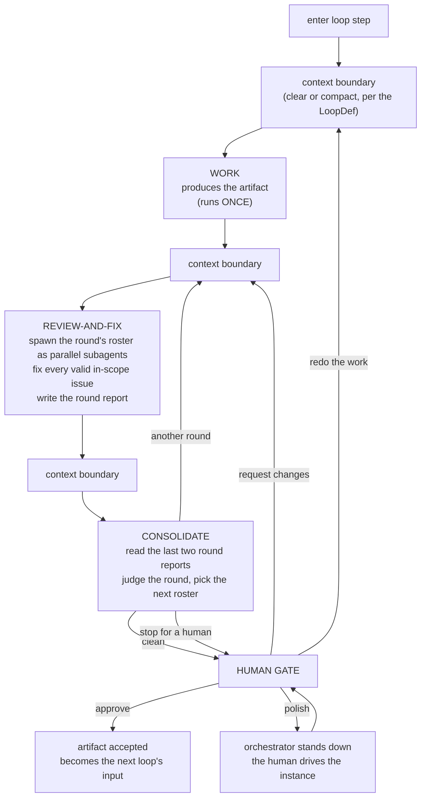

- **WORK runs exactly once (N3a).** The work turn produces the artifact — the groomed ticket, `plan.md`, the implementation. It is **not** re-entered on a consolidator verdict. The only thing that re-enters it is the human's explicit **redo** lever (§27.9). This is the largest structural change from the v2.99 design, where every `needs-work` verdict re-ran the work agent from disk.
- **REVIEW-AND-FIX is one turn, not two (N3b).** The main instance spawns the round's roster as **parallel `Task` subagents** (§27.4), receives their findings **into its own context as tool results**, fixes every valid in-scope issue itself, dismisses what is out of scope or invalid, and writes the **round report** (§27.5). Findings never round-trip through the filesystem to be re-read by a different actor — which is precisely what the app's injection ability is for, and what the v2.99 design paid for in tokens on every round.
- **CONSOLIDATE judges the round, it does not merge findings (§27.6).**
- **Context boundaries are data (§27.7)** — each is `clear`, or `compact` with a custom message, declared per boundary in the LoopDef.

### 27.4 Reviewers pull; the engine never pushes (N4)

**This is the decision the rewrite exists for.**

- A reviewer subagent is handed exactly two things: **the ticket** and **its charter** (the persona's standing instructions — what it is responsible for and how to go about it). It is handed **no diff, no code, no plan, no prior review, no consolidated findings, and no history**. It **pulls what it needs with tools.**
- The engine therefore pushes a **constant-sized** prompt at every reviewer, in every round, forever. A round's review cost is a function of **what each reviewer decides it needs to read**, never of the roster's shared context and never of how many rounds have already run. The cost curve of [#59](https://github.com/dylanb/agent-terminal/issues/59) — per-round cost rising with iteration depth — does not exist to be optimized away; it is **absent by construction**.
- It is also **more accurate**, not merely cheaper: a taint reviewer may need to read half the codebase to trace a flow, while an accessibility reviewer may need only the UI diff. A push model must send the union of what every persona might want; a pull model lets each fetch its own actual need.
- **Reviewers are isolated and parallel.** Each subagent is a fresh context (the independent-review property the external engine got from separate `claude -p` processes) and they run concurrently. There is **no warmer** and nothing to amortize — there is nothing shared to amortize *over*.
- **The roster for a round is chosen by the consolidator** (§27.6), from the catalog the LoopDef declares. **Round 1 runs every persona in the catalog.** A persona the LoopDef does not declare can never be invoked.
- **Reviewer cost is captured in the subagent logs** (`~/.claude/projects/<slug>/<uuid>/subagents/agent-*.jsonl`), which the meter sweeps (§27.11). That layout is Claude Code's private format — an external dependency the app does not control — so the parser tolerates drift (unknown or empty → omitted, never throws).

### 27.5 The round report (N5)

The round report is the **sole contract** between the fixer and the consolidator, and the **only durable record** of what a round did.

- **Format: Markdown with a prescribed structure.** Prescribed, so the engine can validate it is complete before advancing (§27.12) and the consolidator can rely on its shape; Markdown, so the human reads the same document at the gate that the consolidator judged.
- **It must account for every persona the round invoked** — including one that **failed or returned nothing**. The engine validates the report covers the round's roster (which it chose, so it knows). A report missing a persona is **malformed**, and takes the retry-then-`error` path of §27.12. A reviewer that quietly disappears is therefore not something the fixer can hide.
- For every issue raised it records: **the persona that raised it, the issue, its disposition** (`fixed` / `dismissed — out of scope` / `dismissed — invalid` / `needs a human`), **the reason**, and **what changed** if it was fixed.
- **Reports are versioned per iteration** and never overwritten. The versioned series is the forensic record — the equivalent of the per-iteration review artifacts the old engine wrote, in one document per round instead of N.
- **Reports live locally under `<repo>/.agent-terminal/loop/reports/<n>.md` and are never committed.** This is not merely tidiness: the impl-loop's reviewers **pull the diff with tools** (§27.4), so a committed report would appear *inside the diff they are reviewing*. Reports must stay out of the working tree's committed surface or the loop reviews its own commentary.
- **Accepted risk, recorded (N5a): the fixer marks its own homework.** The fixer decides which issues are valid, fixes them, and writes the report — and the consolidator sees **only that report**. Nothing in the loop can detect an issue the fixer declined to write down. This is the load-bearing assumption of the design: it is accepted in exchange for deleting the whole persona-artifact + merge-consolidator apparatus, and it is bounded by three things — the report must account for the full roster (above), the versioned reports are auditable after the fact, and the human gate is the backstop. It is stated here so it is a known limitation, not a latent surprise.

### 27.6 The consolidator (N6)

The consolidator is a fresh turn (its boundary is declared, §27.7) whose job is to **judge the round**, not to merge findings. It has three outputs.

**1. A verdict.** It reads **the last two round reports** — this round's and the previous one's — and nothing else. Two is exactly enough to see whether the loop is converging, and it is a **fixed window**, so the consolidator's own cost cannot grow with iteration depth either.

| verdict | what it means | what happens |
|---|---|---|
| `clean` | the round **changed nothing** — every issue raised was dismissed, and nothing needed fixing | stop at the human gate (§27.9) |
| `another round` | the round **fixed something**, so the artifact changed and needs fresh eyes on the new state | back to review-and-fix |
| `stop for a human` | the loop is **spinning** (something fixed last round is back), or a reviewer raised something the loop is not entitled to decide | stop at the human gate, with the reason |

- **The termination rule is: `clean` = the round changed nothing.** This is what makes memory-less reviewers and a memory-less fixer *correct* rather than merely cheap. **Scope is a function of the ticket, not of history.** A reviewer with no memory will re-raise the same out-of-scope observation every round, and a fixer with no memory will re-dismiss it for the same reason every round — and that is the system correctly **re-deriving a settled judgment**, not failing to converge. The loop terminates when a round produces no changes, which is precisely the statement "the artifact is stable under review."
- **A round in which a reviewer failed can never be `clean`.** The report says the persona failed (§27.5); the consolidator must not read a round with an unrun lens as settled.
- **There is no iteration cap (N6a).** The old engine's cap existed to bound a loop whose termination rule was a counter. This loop's termination rule is a property of the artifact, and the backstop against a runaway is the **human interrupt** (§27.9), not a number. A cap would be exactly the sort of machinery this rewrite is removing.

**2. The next round's roster.** Having just read what the round did, the consolidator **chooses which personas run next** — from the LoopDef's catalog, with a stated reason. This **replaces the footprint skip-optimization outright**: instead of hashing `plan.md` and comparing `last_seen_files` sets to guess who can be pruned, the actor that just read the round's report decides who needs to look. It may also re-run the whole catalog when the artifact changed enough to warrant it.

**3. The interrupt check.** If the operator has armed the interrupt (§27.9), the consolidator routes to the human gate regardless of its verdict — and still states the verdict it would otherwise have reached, so the human arrives knowing whether the loop thought it was clean, progressing, or stuck.

### 27.7 Context boundaries — clear or compact (N7)

A `/clear` at every actor boundary is why nothing in the old loop amortized: every turn re-read everything it needed from disk. But an unconditional *compact* is equally wrong — the consolidator's judgment is worth less if it inherits the fixer's context and its rationalizations.

- The **boundary policy is data-driven from the LoopDef**: each actor boundary declares **`clear`**, or **`compact`** with a **custom compact message** naming exactly what must survive it.
- Different loops make different choices, and the engine has no opinion. It executes the boundary the def names, and confirms it (§27.12).
- The boundary is also the **cost-metering segment marker** (§27.11).

### 27.8 The LoopDef (N8)

- **The defs are owned by agent-terminal**, in a **new schema of its own design**. The `github.com/dequelabs/loops` defs are **not vendored, not parsed, and not a compatibility target** — they remain valid for the legacy Go engine, which this section no longer speaks to. This is the clean break: no dual-schema period, no upstream coordination, no re-vendoring dance.
- A def declares:
  - **`work`** — the work prompt recipe and the artifact it produces;
  - **`reviewers`** — the **catalog** of personas available to this loop, each with its **charter** (a reference, never an inline body — §18.6) and the tools it may use. Round 1 runs the whole catalog; thereafter the consolidator selects from it (§27.6);
  - **`consolidator`** — its prompt recipe;
  - **`boundaries`** — `clear` or `compact: <message>` for each actor boundary (§27.7);
  - **`report`** — the prescribed structure the round report must satisfy (§27.5);
  - **`gate`** — the human options available (§27.9) and their side-effects (§27.13);
  - **`pickup`** — the bootstrap contract (§27.10);
  - **`inputs` / `outputs`** — the artifact this loop consumes and the one it produces, which is what chains groom → plan → impl (§27.10).
- **Origin governs privilege.** A def resolved from **inside the repo under review is attacker-controlled content** and may never name a program to execute; only an **operator-authored** def (from the user's own config) may. This is carried forward unchanged from the v2.129 finding and is not re-litigated here.

### 27.9 The human gate (N9)

The gate is the **whole** human interface to a running loop. Its options are declared per-loop in the def and rendered data-driven.

- **Approve** — accept the artifact. It becomes the next loop's input (§27.10) and the loop's gate side-effects run (§27.13). Terminal for that loop.
- **Request changes** — the human types feedback; it joins the **next review-and-fix round** alongside the reviewers' findings (this reuses the §19.4 composer: curate a review-todo subset + free text, compose-with-agent or submit-as-is). The narrow, incremental lever.
- **Redo the work** — the human types an instruction that **re-enters the work turn**, whose **only** inputs are the **ticket**, the **plan**, and **that instruction**. No findings, no report history, no accumulated context. The deliberate clean-slate lever, for when the artifact is wrong in a way that iterating cannot fix.
- **Polish** — the **orchestrator stands down and releases the prompt.** The loop stops injecting; the operator converses with the live instance directly in the terminal, on the context it holds from the round it just finished; a separate **approve** control ends it. This is the one state where the §27.2 contention risk is inverted by design: the keyboard is the human's, and the orchestrator is the one that must not type.
- **Abandon is not a loop verdict.** Killing a run is the flow-level **Terminate** (§25.5 `flow.terminated`), which already exists. The loop's vocabulary stays about the work, not the lifecycle.

**The interrupt (N9a).** At any point during automatic iteration the operator may **arm an interrupt** ("hand back to me"). It is **queued, not immediate**: the round in flight finishes — reviewers return, fixes land, the report is written — and the **consolidator honors it at its next invocation** (§27.6), routing to the gate regardless of verdict. Nothing is ever killed mid-turn, so there is no such thing as a half-applied round. This is the loop's only bound on runaway iteration, and it is a human, not a counter.

### 27.10 Artifacts, chaining & bootstrap (N10)

**The three loops are the same shape over different data, chained by artifact.**

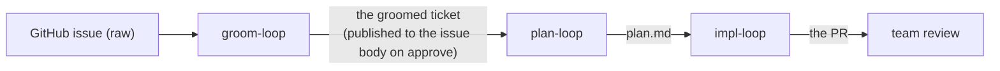

- **`groom-loop`** takes the raw GitHub issue and produces **the groomed ticket**. Its approve gate **publishes the groomed ticket back to the GitHub issue body** (§27.13).
- **`plan-loop`** takes the groomed ticket and produces **`plan.md`**.
- **`impl-loop`** takes the plan and produces **the implementation on the PR**. Its work turn's product is commits, not a file.
- **Bootstrap (pickup) stays a separate app action**, as today: on entering the first loop step that needs one, the app validates a clean tree, creates the branch, writes an empty `[skip ci]` start commit, pushes, assigns the issue and applies labels, and opens the **draft PR that `closes #n`** — driven by the def's `pickup` contract, never hardcoded. **Groom does not absorb it.**
- **A pickup that cannot run never fails silently and never strands the flow.** It runs asynchronously after the loop step is entered, so a failure (dirty tree, unresolvable base, conflicting branch, rejected PR create) arrives after the transition returned. When it does, the app **rolls the flow back one step**, preserving the resolved inputs, and **surfaces the reason in a blocking error dialog**. A destructive re-pickup (an existing target branch under a wipe policy) is **confirm-first**: the app does nothing destructive on detection and names what will be deleted.
- **Loop state is app-owned**, under `<repo>/.agent-terminal/loop/`, in a schema of the app's choosing. **The `.agent-loop/state.yaml` v4 contract is gone** (§27.14) — there is no external writer to reconcile with, no re-handoff to the Go engine to preserve, and no reason to carry fields (`persona_state`, `phase2_active`, `severity_cycle_iter`, `impasse`, `completed_loops`) for machinery this design deleted.
- **Epics create sub-PRs only.** A plan the work agent classifies an epic reuses the current PR for sub-ticket 1 and creates the remaining N−1 sub-tickets/PRs out of band, recording them in the loop state. It **does not auto-launch** child instances; the operator opens a loop per sub-PR by hand.

### 27.11 Cost accounting (N11)

- **The meter reports the cost of the entire run — every token spent from flow start to flow terminate.** Not a per-iteration figure rolled up, and not the review turns alone: the work turn, every reviewer subagent, the consolidator, the human's polish conversation, and every retry are all the run's cost, because they are all money the run spent. This is a **refactor** of the existing meter (which prices per-iteration segments and rolls them up), not a reuse of it.
- Cost is recovered **from the session JSONL logs** — the main session's per-boundary token totals and the nested **subagent** logs (`<session-uuid>/subagents/agent-*.jsonl`) — priced through a checked-in table kept current by hand. The sweep is **recursive**: a flat read of the project dir silently omits the reviewer fan-out, which is the bulk of a round.
- **The sweep is bounded below by the instant the flow started** (`started_at` in `flow-state.yaml`) — the project dir accumulates every Claude Code session ever logged against the worktree, including the operator's own conversations. A flow that recorded no start sweeps unbounded rather than reporting `$0`: an unbounded number is wrong, but a silent zero **hides** that it is wrong.
- **A billed turn counts once.** Claude Code identifies an API call by `message.id` + `requestId`; resuming or forking a session replays prior turns verbatim into the new file. Summing every line multiplies the run's dollars by the number of resumes.
- **Unpriced model:** a token total whose model id is absent from the pricing table contributes **zero dollars** and surfaces as **`unknown`**. The meter **never renders `NaN`** and never blocks. A model that consumed **no tokens** bills nothing and is never a gap, whatever its id.
- **Surface:** the running total on the status strip (§22.3) and a cost event in the §25 audit. It is **display-only** — it never gates or pauses the loop. It is also the **evidence** for the claim this rewrite makes: that per-round cost no longer grows with iteration depth.

### 27.12 Completion, failure & resume (N12)

- **A turn is done only when both (a) a real done-signal has fired and (b) what it was supposed to produce exists and is well-formed.**
  - **(a) The done-signal is a file, never a printed line.** Each injected turn is instructed to write a turn-keyed done-file as its last action — the agent *tells* the orchestrator it finished, rather than the orchestrator inferring it from silence. A hosted TUI agent reflows the injected prompt on echo, so any printable marker named in the prompt is echoed back and read as a completion. The instance must also be quiescent (§8.3) as a secondary guard. This is what "waits out spawned subagents" rests on: the review-and-fix turn does not write its done-file until its `Task` children have returned.
  - **(b) The artifact check** is: the **round report** exists, parses against the def's prescribed structure, and **accounts for every persona in the round's roster** (§27.5); the **consolidator's** output carries a verdict and a next roster. A **context boundary** confirms by observing the instance return to an idle prompt in the expected state. The **impl work turn** produces commits rather than a file, and confirms on the done-signal alone.
  - **(c) A UI "done" control.** The loop panel exposes a manual **"mark turn complete"** affordance so the operator can advance a turn the automatic signal missed. On a turn that stopped in **`error`** with its artifact actually present, this control **accepts** the artifact and advances through the same chain a signalled completion takes, **without re-running the turn** — so an accepted round is never regenerated. It **never injects**. Quiescence alone never advances the loop.
- **A missing or malformed artifact on a done-signal** triggers **one** re-injection of the same turn (only while the instance is injectable); a second failure stops the loop in **`error`**.
- **There is no wall-clock completion deadline.** A turn that legitimately runs for many minutes advances the instant it signals. A genuinely frozen instance is caught by a **stall watchdog** — deliberately long, and **reset on every visible-content change** — so a streaming turn never stalls and a hung one resolves to `error` rather than hanging forever. A stall **never retries** (re-injecting a frozen instance cannot help) and **never kills a working turn**.
- **A failed reviewer subagent is the fixer's problem to handle in-context, not the engine's** — but it **cannot be hidden**, because the report must account for the persona (§27.5) and the consolidator must not call such a round clean (§27.6).
- **`error` is a first-class status**, classified human-needed and recorded in the §25 audit, surfacing the failed turn and its reason. The human **retries**, **accepts** the artifact via (c), edits, or terminates. The orchestrator never silently advances past a failed turn. A persisted `error` **survives a relaunch**: resume never re-drives it (it is human-owned) but reconstructs which turn stopped, so Retry and accept act on the right one.
- **Auto-resume.** On launch the orchestrator reads the loop state and resumes an in-flight run at its recorded round and turn, re-entering the **earliest turn of the round whose output is missing** and never re-running a completed one. A gate, terminal, or `error` status is human-owned and not re-driven.

### 27.13 GitHub side-effects (N13)

- Side-effects run as **out-of-band app `gh` calls**, never as terminal injection — so they cannot be blocked by a busy shell, and they are best-effort.
- **groom approve** → publish the groomed ticket to the **issue body**.
- **plan approve** → flip the PR **non-draft** (`gh pr ready`), so the implementation's commits trigger CI; **epic-promote** if the plan is classified an epic (§27.10).
- **impl approve** → publish the **PR body**; hand off to team review.
- **Throughout** → mirror loop status onto labels.
- **CI runs, it does not block (N13a).** The impl loop never waits on CI. The PR goes non-draft at plan approval and checks run asynchronously; a reviewer that cares about CI **pulls the check state with a tool** like it pulls everything else (§27.4). There is no CI-waiter actor. **Explicit override, recorded:** going non-draft mid-impl to run CI conflicts with the operator's standing `[skip ci]`-on-draft discipline; for this loop the override is intentional.

### 27.14 What this retires (N14 — the supersession map)

Re-derived, and **larger than §26's**, because the app now owns state the external engine used to own.

**"Retired" means scheduled for deletion, not already gone.** Everything in the left column is still in the tree, still specified by §26, and still runs, until the N8 sweep (§27.15) deletes it. A slice that lands the right column does **not** delete the left one. Code implementing the left column is therefore not a review finding while §26 stands.

| retired | replaced by |
|---|---|
| **§17.2/D1 — two-layer ownership** (the app owns flow state; agent-loop owns loop state) | The app owns **both**. There is no external writer and no reconciliation. |
| **§17.2/D2 + §19.3 — gates driven by injecting `/agent-loop-*` slash commands** | Gate transitions are **app-internal** (§27.9). §19.3's **running-process refusal survives**, redefined by §27.2 for a hosted REPL. |
| **§19.1 — the agent-loop bridge** watching `.agent-loop/state.yaml` | The app **writes** its own loop state (§27.10). The read-only mirror and the awaiting-human notify (§24.2.3 T2/T4) **remain valid** as UI, re-pointed at the app-owned file. |
| **§19.1/§22.3 — "severity cycle" and "open-findings count"** on the status strip | Gone with the severity-floor track and the findings-merge consolidator. The strip carries **iteration, last verdict, and running cost** (§27.11). |
| **§19.4 — request-changes composer** | **Survives**, re-pointed: the composed feedback enters the **next review-and-fix round** (§27.9) instead of being injected as a slash command. |
| **§20.1 — artifact discovery over LoopDef `artifacts:` ∪ `.agent-loop/`** | Discovery re-points at `<repo>/.agent-terminal/loop/` (the round reports) ∪ the PR's changed files. |
| **§24.2.3 T3 — injected `agent-loop pickup`** | In-app bootstrap (§27.10). |
| **§24.2.3 T5/T6 — injected `/agent-loop-approve` / `-request-changes` / `-impasse`** | **Never implemented**; retired. The gate is built here (§27.9). |
| **the `.agent-loop/state.yaml` v4 schema + the Go-engine re-handoff obligation** | An app-owned loop state (§27.10). The Go engine can never take a run back; this is accepted. |
| **per-persona review JSON + the merge-consolidator** | The **round report** (§27.5) + the **judging consolidator** (§27.6). |
| **re-running the work agent on `needs-work`** | **Review-and-fix** (§27.3) — the fixer is the main instance, in the same turn as the reviewers it just heard from. |
| **skip-optimization, `persona_state`, footprints** | The **consolidator picks the next roster** (§27.6). |
| **`phase2_active`, the triage gates, `severity_floor_track`, the iteration cap** | The **human interrupt** (§27.9) and the termination rule (§27.6). |
| **the SHA256 finding-signature impasse detector** | The consolidator's **`stop for a human`** verdict, judged from the last two reports (§27.6). |
| **the self-review turn** | Gone. The fixer *is* the work agent, and it already sees the reviewers' findings in context. |
| **the CI-waiter actor** | Reviewers **pull** CI state (§27.13). |

### 27.15 Build — tracer-bullet phases

Per the CLAUDE.md tracer-bullet rule, each slice spans main → `src/shared/ipc.ts` → preload → renderer, is fired from an **existing UI control** (the flow strip / loop panel / gate panel), and is proven by a **Playwright `_electron` e2e on a real PTY**, with main-process integration and shared unit tests underneath. RED-first throughout.

**Test seam (no LLM in e2e).** The orchestrator drives whatever agent program sits at the shell prompt; it does not embed an LLM. e2e substitutes a **deterministic fake-agent on `PATH`** that, on receiving an injected prompt, writes the expected artifact (the round report, the consolidator's output), emits the **done-file** the orchestrator waits on, and goes quiescent. The fake-agent is **scriptable per turn** — which verdict, which roster it selects, which personas it reports as failed, write-nothing to drive the retry-then-`error` path — and for the cost slice it writes **session-JSONL token fixtures at a test-controlled log root**. The PTY and the shell are real; only the agent program is a scripted stub.

**The two engines coexist behind one app-side contract, and the old one is deleted in a single sweep (N8a).** This **reverses** the drafting-time intent to delete each piece of machinery in the slice that replaces it. That intent is incompatible with a working `main`: N1 replaces the def schema and the loop-state schema, which every actor of the §26 engine depends on, so a slice that deleted as it went would leave `main`'s loop broken from N1 until N5. The alternative — landing the whole epic on a long-lived branch — buys a working `main` at the cost of an eight-slice merge nobody reviews at the granularity it deserves. So instead:

- **The seam is the existing app-side contract, which is already engine-neutral.** `FlowLoopView` carries `status` as an **unbounded string** (§24.2.3 T2 — the strip maps it to a tone, never an enum) and `gateOptions` as a **`string[]` read from the def** (§19.4); `humanNeeded` is classified by the shared open predicate of `src/shared/loopStatus.ts`; `loopActivity`, `iteration`, `cost` and `errorReason` name no engine. **Both engines implement one `FlowLoopView` provider and one gate-decision executor**, chosen by the **schema of the def the flow step binds**. The renderer never learns there are two, and `src/shared/ipc.ts` takes only **additive widenings** — `GATE_DECISION_OPTIONS` gains `redo` and `polish` (§27.9), the `LoopActivity` phrase set gains the new actors' names.
- **Compatibility runs to the app boundary and no further.** The §27 engine is API-compatible with **agent-terminal** — the IPC contract, the loop panel, the flow state machine. It is compatible with **nothing** below that line: not the LoopDef schema, not `state.yaml` v4, not the persona artifacts, not any §26 concept. The seam exists to keep the renderer and the contract single; it is **never** a reason to preserve a retired concept in the new engine. A slice that finds itself widening the contract to carry a §26 idea has mis-cut the seam.
- **The old engine is never modified, only routed around.** No §26 code is edited to accommodate §27. It keeps reading its own defs, writing its own `state.yaml`, and driving its own flows, exactly as specified, until N8 deletes it whole.
- **N8 is a big-bang deletion, and it is mechanically checkable.** `grep -r '§26' src tests` returning **zero** is the completion evidence: the retired machinery is *gone from the tree*, not merely unreferenced. A **burn-down test** pins this — the set of files citing §26 may only shrink — so the sweep cannot quietly leave a module behind. The sweep is **reviewed with the operator**, not decided unilaterally.
- **The accepted cost, recorded.** Two engines and two test suites live in the tree for the epic's duration, and the deletion arrives as one large PR rather than eight small ones. That PR is a *deletion* reviewed against a grep, not a design reviewed against a spec, which is the trade being made.

> **Changelog — N1 (sub-ticket 1) departures ([#63](https://github.com/dylanb/agent-terminal/issues/63)).** N1 landed with the divergences below; recorded here because the spec wins or gets a changelog entry, and the base branch is this still-open spec PR.
> - **Engine selection is by the flow step's def *namespace*, not "the schema of the def the flow step binds".** The original phrasing above is circular — a §26 def resolves from an operator-machine-local dir and the three §27 loop names are the same names the shipped flow binds, so a bare name cannot select an engine without depending on what is installed. The flow step's binding names a **closed set** namespace (`legacy` selects §26, `app` selects §27; absence means `legacy`, so every flow file shipped today is unchanged), validated at flow-load like any repo-authored enum and **never joined into a path**; the declared def version is validated *after* resolution. Engine choice is thus a property of the reviewed flow file, not of the operator's machine.
> - **The seam this slice draws is the loop-view provider (read) plus a namespace guard at the §26 gate-decision executor.** The original text names one provider and one executor. This slice implements the §27 provider (which owns the whole view and reads no §26 loop state) and guards the *existing* §26 gate-decision executor so an `app`-bound step resolves no §26 def — the guard is at the operation, not merely the display-only rendering, so a same-named operator §26 def can never be fired for a §27 step. A distinct entry-selector and a gate-decision target-identity field are **not** added here (the §27 provider marks its view non-actionable, so the UI exposes no §27 gate decision to dispatch); either may land with a later slice if a §27 step gains an executable entry.
> - **N1's "Contract: none" is wrong.** This slice adds an app-owned flow-step contract (the `loop_namespace` closed set) and **additive** loop-view widenings: a new `actionable` flag (whether a view's gate options are clickable — the §27 run-less view is display-only), defined once in `src/shared/loopGate.ts` and imported by the provider and the panel.
> - **Two `src/shared/ipc.ts` relaxations land, not only additive widenings.** `FlowLoopView.iteration` becomes **optional** (absent = no round has run — a run-less §27 view has no honest round number, and a coalesce-to-zero would fabricate the identity the dedup key and the §25 audit key on); and `gateOptions`'s presence generalizes from status-scoped to *the options the producing engine's view should display* (the §26 provider keeps populating it status-scoped; the §27 provider fills it from the bound def for a run-less view). "No round has run" is expressed once in each shared vocabulary that carries it — the dedup identity (`occurrence.ts`) and the audit event vocabulary (`audit.ts`, which records no `loop.iteration` event for a view that has none).
> - **N5's "the one additive change §27 makes to `src/shared/ipc.ts`'s gate surface" is falsified.** The `actionable` flag above is a second additive change to the loop view; N5's gate-decision widening is no longer the only one.
> - **The name-primitive lift edits a §26 module.** "No §26 code is edited to accommodate §27" gains one exception: the engine-neutral single-safe-segment predicate is lifted out of `src/main/loopDef.ts` (a §26-owned module, deleted whole at N8) into `src/shared/pathSegment.ts`, which the surviving §27 parser and the §26 parser both import — behavior-preserving, so no §26-bound step's behavior or rendering changes.
> - **N8 sweep-time disposition of the namespace field.** After the sweep the legacy namespace does not exist; the field stays as a closed set of one and **absence is re-pointed at the surviving engine**. Its cost is named: an operator's §26 def of the same name stops being bound (surfaced once on the existing loop-error path), and an explicitly-`legacy` value becomes a surfaced resolve failure. Recorded here because a data default is invisible to the N8 grep.

- **N0 — Spec (this section).** The contract the code implements. Added as **§27**; §26 is marked retired and left standing. **No code.**
- **N1 — The def schema + the three defs.** Author `groom-loop`, `plan-loop`, `impl-loop` in the new schema (§27.8), owned by agent-terminal, with their reviewer catalogs and charters. Parse them with a **new parser**, alongside — never through — the §26 one. **Supersedes (deleted at N8):** the vendored `example/loops/` snapshot and the old schema's parser. **Contract:** none — the def's **gate options** already travel on the loop view as a data-driven `string[]` (§19.4), which is what makes the engine-neutral seam (above) demonstrable on the very first slice. The **reviewer catalog is parsed but not yet surfaced**; it reaches the UI at N4, where the consolidator selects from it and there is something to show. **Fire:** open a flow bound to a new def. **Land:** the loop panel renders that def's gate options; a step bound to a §26 def is unchanged. **e2e:** a flow step bound to each of the three defs resolves and renders its own gate options, and a §26-bound step still renders as it does today.
- **N2 — Work once, and the context boundaries.** The work turn (§27.3) + `clear`-or-`compact`-with-message boundaries driven by the def (§27.7), with done-file completion detection and the retry-then-`error` path (§27.12). **Fire:** start a loop step with a ticket. **Land:** the work turn runs; its artifact appears on the done-file; a fake-agent that writes nothing drives retry-then-`error`; the declared boundary is executed and confirmed.
- **N3 — Review-and-fix as one turn.** The main instance spawns the round's roster as parallel subagents (§27.4), fixes, and writes the **round report** (§27.5). The engine validates the report accounts for the full roster. **Fire:** continue from N2. **Land:** the report appears, versioned; a report omitting a persona is malformed → retry-then-`error`; a persona reported failed is carried, not hidden. **Supersedes (deleted at N8):** the per-persona review JSON artifacts and `reviewArtifacts.ts`'s merge surface.
- **N4 — The consolidator: verdict + next roster + interrupt.** Reads the last two reports (§27.6), emits the verdict and the next roster, honors an armed interrupt. Verdict-driven branch: `another round` → review-and-fix; `clean` / `stop for a human` → the gate. **Contract:** the loop view grows, additively, to carry the def's **reviewer catalog** and the roster the consolidator chose from it — deferred here from N1, because this is the first slice at which a roster is *selected* and the catalog is therefore worth showing. **Fire:** continue from N3. **Land:** a round that changed nothing → `clean` → gate; a round that fixed something → another round with the consolidator's chosen roster, and the loop panel shows which personas it picked out of the catalog; an armed interrupt → the gate with the would-be verdict stated. **Supersedes (deleted at N8):** `personaSkip.ts`, `findingSignature.ts`, the phase2/triage/severity-floor routing, and the iteration cap.
- **N5 — The human gate: approve / request-changes / redo / polish.** The four options (§27.9), data-driven, with their side-effects (§27.13). **Polish** stands the orchestrator down and hands over the prompt. **Redo** re-enters the work turn with **only** the ticket, the plan, and the human's instruction. **Fire:** click each option. **Land:** approve → the loop's side-effect runs and the artifact chains onward; request-changes → the feedback joins the next round; redo → the work turn re-runs on a clean slate; polish → the orchestrator injects nothing until the human approves. **Contract:** `GATE_DECISION_OPTIONS` widens by `redo` and `polish` — the one additive change §27 makes to `src/shared/ipc.ts`'s gate surface. **Supersedes (deleted at N8):** the §26 gate actions and the `state.yaml` v4 write surface.
- **N6 — Chaining: groom → plan → impl, and bootstrap.** The three loops in sequence over one flow, each consuming the previous artifact (§27.10); in-app pickup with its rollback and confirm-first wipe. **Fire:** run a flow from a raw issue. **Land:** groom's approve publishes the issue body; plan's approve flips the PR ready; impl's approve publishes the PR body. **e2e:** the full three-loop chain against the fake-agent, with `gh` recorded.
- **N7 — The whole-run cost meter.** A **whole-run meter for §27**, pricing **everything from flow start to terminate** (§27.11) — work, reviewers, consolidator, polish, retries — with the unpriced-model fallback intact. It is a *new* meter, not an edit to §26's per-iteration one, which keeps running for the §26 engine until N8; the two share only `src/shared/pricing.ts`, which prices tokens and names no engine. **Fire:** complete a run. **Land:** the strip and the audit carry the run's true total. **This slice carries the [#59](https://github.com/dylanb/agent-terminal/issues/59) evidence:** a scripted multi-round run whose per-round material is constant shows a **per-round review cost that does not grow with round depth**.
- **N8 — The sweep (N8a).** Delete the §26 engine — its code, its tests, its defs, its state schema — and **§26 itself**, then re-point the handful of live cross-references (§8.3, §15.6) from §26.2 to §27.2. **Done means `grep -r '§26' src tests` returns nothing**, which is what makes "gone from the tree, not merely unreferenced" a check rather than a claim; the burn-down test that pins the shrinking file set is deleted with it. One PR, **decided with the operator, not unilaterally.**
