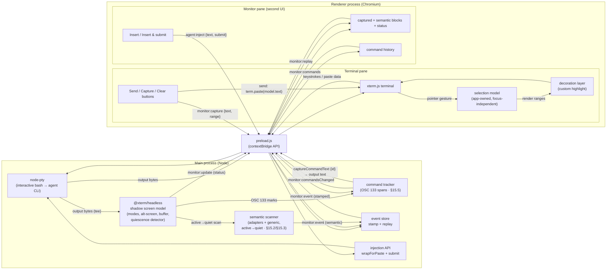

# Technical Specification — Agent Terminal: Foundation for a Coding-Agent Management Application

**Document status:** Draft v2.6
**Scope:** Foundation / "walking skeleton" build only — plus drafted requirements for the next phase (§15)
**Target platforms:** Linux and macOS (Windows out of scope for this version)

> **Changelog v2.11:** Made **Capture selection** the single capture-to-todo surface and removed the **per-command Capture button** (§16.2 / §15.5). The command-history list is now compact and read-only; capturing command output is done from the terminal pane's Capture-selection button — with a selection it adds the selected text, with **no selection** it captures the **latest command's output** and adds that. The renderer→main `monitor:captureCommand` (which materialized a `command-output` Capture-tab block) is **replaced** by an invoke `monitor:captureCommandText {sessionId, commandId} → {text, truncated} | null` (§6) that returns the output text; the renderer adds it via `todo:add` and signals `app:todos-changed`. `command-output` remains a reserved `MonitorEventType` (no producer now, like `completion`); its Capture-tab rendering branch is retained.
>
> **Changelog v2.10:** Fixed the **todo count not refreshing** after a **Capture selection** (§16.2). The Capture-selection add happens in the terminal pane (it owns the selection; §9.1), so the action window — which holds the repo-scoped count/list — never saw it and the count lagged. The terminal pane now dispatches a decoupled `app:todos-changed` window event after the add (same window-event bus as `app:focus-terminal`); the action window listens and re-pulls `todo:list`, so the count updates immediately. The add awaits `todo:add` before signalling, so the re-pull sees the new item.
>
> **Changelog v2.9:** Two action-window fixes (§16.2). **Add to todo** is now **undoable**: clicking it appends the todo and shows an **in-place Undo** on the source block for `TODO_UNDO_MS` (60 000 ms); the block is dismissed/removed only when that window elapses, and Undo within it deletes the just-added todo (by its own `repoKey`) and restores the block — the source is never dismissed on undo. **Clear commands** now drops only **finished** commands, keeping any **still-running** one (`commandTracker.clear()` skips `running` spans); the renderer no longer optimistically wipes — main drops the finished spans and the pane re-renders via `monitor:commandsChanged`.
>
> **Changelog v2.8:** Added **§7.5.2 — agent key bindings**. Editor-style chords in the terminal pane are translated to the byte sequences Claude Code / readline expect, so the agent's input box behaves like an editor instead of submitting on every Return: **Shift+Enter** and **Alt/Option+Enter** send `ESC CR` (`\x1b\r`, the Meta+Enter "insert newline" form — xterm.js 5.5 has no kitty-keyboard protocol, so the CSI-u form would leak as literal text); **Alt/Option+←/→** send the readline word-motion forms `ESC b` / `ESC f`; **Alt/Option+Backspace** sends `ESC DEL` (`\x1b\x7f`, backward-kill-word). Plain Enter still submits (bare `CR`). DOM events report macOS Option as `altKey`, so one rule set covers both platforms; the chords are intercepted *before* xterm's defaults so word motions reach a stock bash readline (which doesn't bind `\e[1;3D`) and Option behaves as Meta on macOS without `macOptionIsMeta`. Lives in the renderer's single `attachCustomKeyEventHandler` alongside the §7.5.1 Escape rule. Detection-only spirit unchanged — this is input ergonomics, not autonomy.

> **Changelog v2.7:** Reworked the **action window** (monitor pane) into a tabbed UI with a persistent, repo-scoped **Todo list**, and fixed self-capture. **§15.3 / §16.5** the scanner now **suppresses self-injected text** from re-capture: text the app injects (either inject path) is echoed back — and, for long pastes, rendered by the agent as a `[Pasted text #N +k lines]` placeholder, so exact-byte dedup can't catch it — so emission is gated on an **injection signal** (an injection watermark + a short time window seeded by the inject path) rather than byte-matching; the agent's *reply* to injected text is still captured. **§9.2 / §16** the pane gains two tabs — **Capture** (live detection, session-scoped, as before) and **Todo** (persistent, repo-scoped). Semantic captures (`report`/`finding`) lose their inject buttons for **Add to todo** + **Dismiss**; manual selection capture (§7.5) now goes **straight to the Todo list**; command history keeps **Insert / Insert & submit** and gains **Clear commands** (`monitor:clearCommands`). **Inject focus rule:** **Insert** moves focus to the terminal; **Insert & submit** keeps focus in the action window. **§16 (new) — Todo lists:** todo items (Insert / Insert & submit / in-place Edit / drag-or-button reorder) persist to `.agent-terminal/todos.json` **inside the repo**, keyed by **git repo root** (non-repo dirs key on the directory); `cd` swaps the displayed list silently (cwd tracked via a new **OSC 7** emission in the shell-integration script), and a swap is **blocked while a todo edit is open**. Completing a todo **marks it done and filters it out** into a collapsible Done section (capped via `APP_MAX_DONE_TODOS`, oldest pruned); done items re-copy back to active. **§6** gains `todo:*` channels (list/add/update/reorder/setStatus/delete), `cwd:changed`, `monitor:clearCommands`, and `ui:getSettings`/`ui:setSettings` for **global** UI prefs (split ratio, last tab). **§9.2 / §16.6** the terminal↔action-window divider is a **resizable splitter** (drag, min widths, double-click reset, keyboard `role="separator"`), its ratio persisted globally. First on-disk persistence in the app (todos in-repo; UI prefs in userData) — §15.9's "in-memory only" now holds for *captures* only. Detection-only, no autonomy, as before.

> **Changelog v2.6:** Refocused agent-semantic capture on **reports**, removed the false-positive-prone permission/question heuristics, and added dismissal + newest-first ordering. **§15.4** the `MonitorEventType` union drops `permission-prompt` and `agent-question` (their detectors false-positived on report prose and on code/diff lines sitting in scrollback) and gains `report` (an agent report group) and `finding` (one individually-actionable item inside a report); `MonitorEvent` gains `parentId: string | null` linking a finding to its report. **§15.3** the Claude Code adapter now recognizes ⏺ **prose reports** (boxes are chrome — scanned past, never emitted) and the generic heuristic surfaces a substantial block of *new* content at a quiet transition as a `report`; both split a report into findings — one per top-level list item and one per non-list paragraph (shared `splitFindings`) — emitting findings only when there are ≥2. Report emission is gated by `APP_REPORT_MIN_CHARS` (§15.7, default 120); the alt buffer emits nothing this phase. **§6** gains two renderer→main channels, `monitor:dismiss` (`{sessionId, eventId}` — removes the event from the store, cascading to a report's findings, so a reloaded pane's replay won't resurrect it) and `monitor:dismissAll` (`{sessionId}`). **§15.6** the monitor pane renders a report as a group with its findings nested and individually injectable, every block/group/finding carries a dismiss control (a report's dismiss cascades), there is a Dismiss-all action, and blocks **and** command history are shown newest-first. The scanner emit path returns the stamped event id so findings link to their parent. Detection-only, no autonomy, as before.
> **Changelog v2.5:** Built §15 — semantic capture & command-output capture — now implemented and automated, not just specified. Amendments from building it: **§15.4** previously read "no new renderer-direction IPC channels"; building command-output capture required two, so the clause is **amended** to admit `monitor:commands` (invoke `{sessionId} → CommandSummary[]`, the sole command-history data path) and `monitor:captureCommand` (`{sessionId, commandId}`, fail-closed materialization of a command block) — same renderer→main class as the already-shipped `monitor:replay` (A1). **§6** gains those two channels; `monitor:event` now carries the widened `type`/`source` unions and a `truncated` field; `monitor:update` is clarified as **status-only** (it does *not* carry commands — the pane re-pulls `monitor:commands` on each update tick for liveness). **§5** gains the opt-out shell-integration hook: the session sources an app-owned script via `PROMPT_COMMAND` *after* the user's startup files (env seam, never `--rcfile`), emitting OSC 133 marks; disable with `APP_SHELL_INTEGRATION=0` or a non-bash `APP_SHELL`; an rc that overwrites `PROMPT_COMMAND` disables command capture (spec-sanctioned absence). **§15.1** `completion` stays in the type union but no detector emits it this phase (minimum scope). Trim truncation is stamped scan-wide, not per-region (conservative, A2). All adapter/heuristic thresholds and resource caps resolve through an env-overridable config seam (§15.7) — no magic numbers. Detection-only, no autonomy, as specified. **Review pass:** command history is now live off the marks via a third channel, `monitor:commandsChanged` (§6 / §15.4) — no longer gated on the quiescence tick; the §4 diagram and §10 structure now reflect the §15 modules; the monitor pane renders each stored event exactly once (replay/live dedupe) and the status live region no longer re-announces the quiet counter every second (WCAG 4.1.3) with per-command Capture buttons individually labeled (WCAG 2.4.6/4.1.2).
> **Changelog v2.4:** Review-driven reconciliation pass (no scope change). Contract: documented the `monitor:replay` invoke channel and `monitor.onExit` in §6 — both shipped in the skeleton but were missing from the table. Security: the renderer Send path now strips the `ESC[201~` breakout marker via a shared `stripPasteBreakout` guard (the pinned `@xterm/xterm` `paste()` does **not** strip it, contrary to the old §7.5 wording); the window denies navigation/window-open and honors `ELECTRON_RENDERER_URL` only in dev builds; renderer→main IPC payloads are validated before reaching the PTY. Reliability: early PTY output is buffered until the renderer subscribes (§8.1); all per-window IPC listeners are torn down on close; the GUI-launch PATH probe now **merges** with the inherited env instead of replacing it (§5); shadow writes/resizes after `dispose()` are no-ops. Docs: §10/§11 updated to the electron-vite/TypeScript layout; the §4 diagram now routes capture through main's event store and Send through `term.paste()`. §12 annotations corrected to match the tests that now exist. A11y: xterm `screenReaderMode` on; landmarks, a status live region, and contrast fixes.
> **Changelog v2.3:** Drafted the requirements for the **next build phase** as §15: the semantic-capture pipeline (previously only sketched in §13.1) and a new sibling capability, **command-output capture** via OSC 133 shell-integration marks. §15 is requirements only — it does not change the walking-skeleton scope or the §12 acceptance criteria. Notable design commitments: scan on the §8.3 `active → quiet` transition with a scrollback watermark and explicit truncation marking; per-agent adapters + generic heuristics, detection-only (no autonomy); `MonitorEvent` `type`/`source` unions widen (the §8.4 schema absorbs this, as designed); command segmentation via OSC 133 (never prompt-regex), which will require an opt-out shell-integration hook amending §5 when built.
> **Changelog v2.2:** Hardening pass from review. Selection model stamps `baseY` + buffer-type at gesture time and extraction is crash-guarded against alt-buffer edge cases (§7.2–§7.3); window resize is debounced to avoid PTY/renderer/shadow width races during output bursts (§7.1); `SUBMIT_DELAY_MS` is a setting (not a constant) with an echo-confirmation upgrade path (§9.3); GUI-launch environment caveat documented (§5); monitor-pane terminology pinned — a shared-renderer DOM component in this version, main-process-mediated by rule (§9).
> **Changelog v2.1:** Added **quiescence detection** to the shadow-model subsystem (§8.3): the main process tracks whether the agent's output stream is **active** or **quiet** and publishes transitions on `monitor:update`. The monitor pane gains a working/quiet activity indicator. This is the skeleton's first (deliberately primitive) monitoring heuristic and the trigger hook the future semantic-capture pipeline will attach to.
> **Changelog v2.0:** Reframed around the actual product: an application that **hosts and manages coding agents** (Claude Code, Codex, etc.) running in the terminal. Two items previously deferred are now core, because the product depends on them: (1) a **teed output pipeline** — PTY output is mirrored into a main-process headless screen model that powers output monitoring/capture and live terminal-mode tracking; (2) a minimal **agent monitor pane** (the "second UI") that displays captured output and injects input back into the agent in response to user actions. Injection is now a **main-process, renderer-independent** API (bracketed-paste aware via the shadow model), because the monitor pane must not depend on the terminal renderer. Selection (§7) gains a "Capture to monitor" action. See §4, §8, §9.
> **Changelog v1.2:** Selection injection is **bracketed-paste aware** — sent via `term.paste()`, honoring the foreground app's bracketed-paste mode (required for Codex/Claude Code/REPLs). See §7.5.
> **Changelog v1.1:** Selection is an **application-owned selection model** — rendered by the app and independent of browser focus / native selection. See §4 flow C and §7.

---

## 1. Purpose

Build the minimal working foundation of an application for **running, monitoring, and steering coding agents** that live in a terminal. The user runs an agent CLI (Claude Code, Codex, aider, …) inside a hosted bash session; the application watches the agent's output, captures relevant pieces of it into a second UI, and lets the user act on what they see there — with those actions flowing back into the agent as terminal input.

The foundation must prove this **full loop** end-to-end, in its smallest form:

1. Run an interactive **bash** session (the agent's host) using the user's own bash configuration, attached to a real PTY.
2. Render the live terminal inside a **web UI** (the user can run the agent hands-on, exactly as in a native terminal).
3. **Tee** all PTY output into a main-process **shadow screen model** that tracks the live screen state, terminal modes, and output activity (quiescence) — the substrate for all monitoring and capture.
4. Let the user **select any region** of terminal output and either **send it back to the agent** or **capture it into the monitor pane**.
5. Show captured output in a **monitor pane** (the second UI) whose actions — *insert into agent*, *insert & submit* — inject text into the agent's input through a renderer-independent, bracketed-paste-aware path.

Automated/semantic capture (recognizing agent questions, tool calls, diffs, etc.) is **out of scope** here; the skeleton proves the plumbing those features will ride on. Manual capture (user-selected regions) stands in for it.

---

## 2. Scope

### In scope
- Spawn one interactive bash process attached to a real pseudoterminal (PTY). Agents are launched by the user *inside* this session (e.g. typing `claude`).
- Honor the user's default bash startup files (`.bashrc` / `.bash_profile` / `.profile`) per platform convention.
- Stream PTY output to an `xterm.js` terminal in the UI; stream user keystrokes back to the PTY.
- **Tee PTY output** into a main-process `@xterm/headless` shadow terminal: live screen model, bracketed-paste-mode tracking, alternate-screen detection.
- **Quiescence detection** (§8.3): track whether the agent's output stream is **active** or **quiet** and publish transitions to the monitor pane — the "agent is probably waiting for you" signal, and the trigger the future semantic pipeline will scan on.
- Full color (256-color / truecolor) and correct resize/reflow behavior (renderer and shadow stay in lockstep).
- Mouse text selection in the terminal (app-owned, focus-independent model).
- A "Send selection to terminal" button (paste-injects the selection back into the foreground app).
- A "Capture selection" button that snapshots the selection into the **monitor pane**.
- A minimal **monitor pane**: lists captured blocks and live session status (working/quiet activity, alt-screen and bracketed-paste indicators); each block offers **Insert into agent** and **Insert & submit** actions.
- A main-process **injection API** (`agent:inject`) used by the monitor pane: wraps text per the *live* bracketed-paste mode read from the shadow model, optionally appends a submit (`\r`).
- Graceful handling of shell exit and window close.

### Out of scope (this version)
- **Semantic/automatic capture** — heuristics that recognize agent prompts, questions, tool-use blocks, diffs, or status regions. (The shadow model is the substrate for this; the heuristics come later.)
- Running the monitor pane as a separate process/web app (`WebContentsView`); in the skeleton it is a pane in the same renderer, but it is **architecturally constrained** to talk only to main-process APIs so it can be moved out later without change (§9.1).
- Multiple concurrent agent sessions / tabs / split panes. (IPC payloads carry a `sessionId` from day one so channels don't need redesign — §6.)
- SSH, remote sessions, or non-bash shells.
- Windows support.
- Persistence of captures, scrollback export, theming UI, settings screens.

---

## 3. Technology stack

| Concern | Choice | Rationale |
|---|---|---|
| Desktop shell | **Electron** | Renderer is a full Chromium page — the monitor pane (and any future richer agent UI) is plain web code; most prior art; uniform rendering across Linux/macOS. |
| Terminal renderer | **@xterm/xterm** + **@xterm/addon-fit** | Industry-standard web terminal (VS Code, Hyper); exposes the selection/buffer/decoration APIs we need. |
| Shadow screen model | **@xterm/headless** | Same VT parser as the renderer, running in the main process. Gives buffer access (capture), `modes` (bracketed paste), and `buffer.active.type` (alt-screen detection) with zero DOM. **Pin to the same xterm core version as the renderer** so both parsers agree. |
| PTY / shell host | **node-pty** | Cross-platform PTY bindings (Linux/macOS/Windows); the same layer VS Code uses. Runs in Electron's main process. |
| Language | TypeScript (recommended) or JavaScript | TS recommended — the IPC contract and capture-event schema benefit most. |
| Packaging | **electron-builder** | Cross-platform installers; handles native-module rebuild. |

> **Alternative:** The architecture maps onto **Tauri 2 + portable-pty** (Rust backend) if a smaller binary is preferred later — but note the shadow screen model would then need a Rust-side VT parser (e.g. `vt100`/`wezterm-term`) instead of `@xterm/headless`. The frontend (xterm.js, selection, monitor pane) is identical. This spec assumes Electron.

---

## 4. Architecture

Two processes, connected by Electron IPC. `node-pty` and the shadow terminal run in the **main process** (node-pty is a native module and must; the shadow lives beside it so monitoring and injection work no matter what the renderer is doing). The renderer hosts two panes: the **terminal pane** and the **monitor pane**.



### Data flows

**A. Output (PTY → UI, teed)**
`bash`/agent writes → PTY master emits `data` → main **(a)** forwards over IPC channel `pty:data` → preload → `term.write(bytes)`, and **(b)** writes the same bytes into the shadow terminal. The shadow is therefore always an accurate model of the screen the user sees, independent of the renderer.

**B. Keystrokes (UI → PTY)**
User types in `xterm.js` → `term.onData(cb)` fires → renderer calls `api.input(data)` → IPC `pty:input` → main calls `ptyProcess.write(data)`.

**C. Selection (capture and re-injection)**
1. User drags over output. The app writes the range into an **application-owned selection model** (absolute buffer coordinates + extracted text), not the browser's native selection.
2. The app renders the highlight itself via xterm.js **decorations**; xterm's native selection highlight is suppressed. The highlight persists regardless of where focus goes.
3. **Send selection** injects `model.text` via `term.paste()` (bracketed-paste aware) back into the foreground app. **Capture selection** sends the text + range over `monitor:capture`; main stamps it and broadcasts it to the monitor pane as a captured block. The selection survives both actions; only an explicit clear removes it.

**D. Monitor-pane actions (second UI → agent)** — *the new headline flow*
User clicks **Insert into agent** (or **Insert & submit**) on a captured block → monitor pane calls `api.inject({text, submit})` → IPC `agent:inject` → main reads the **live** bracketed-paste mode from the shadow (`shadow.modes.bracketedPasteMode`), wraps via `wrapForPaste`, writes to the PTY, and if `submit` is set follows with `\r` after a short settle delay (§9.3). This path never touches the renderer's xterm — it works even if the terminal pane is unfocused, scrolled away, or (later) in a different process.

**E. Monitor status (shadow → second UI)**
After PTY writes settle (debounced), main reads shadow state — `buffer.active.type` (normal/alternate), `modes.bracketedPasteMode` — and combines it with the quiescence detector's output-activity state (§8.3). When anything changed, it emits `monitor:update`. The monitor pane shows these as live indicators (e.g. "agent: working / quiet", "agent is full-screen", "paste mode on").

**F. Resize**
`FitAddon` computes `{cols, rows}` on window resize → renderer calls `api.resize(cols, rows)` → IPC `pty:resize` → main resizes **both** `ptyProcess` **and** the shadow terminal (they must never diverge, or captures will mis-wrap).

**G. Lifecycle**
On `ptyProcess.onExit` → main sends `pty:exit` → both panes show a notice. On window close → main kills the PTY and disposes the shadow.

**H. Agent-semantic capture (shadow → event store → monitor)** — *§15.2/§15.3*
On the active→quiet transition (§8.3), the **semantic scanner** reads the shadow buffer from a marker watermark, dispatches the scan window to the per-agent adapters (or the generic heuristic fallback when none match), dedups regions by content, and emits each new region on `monitor:event` (`source: shadow-scan` / `heuristic`). Detection only — the scanner never acts on what it finds.

**I. Command-output capture (OSC 133 → command tracker → monitor)** — *§15.5*
The **command tracker** segments the stream into command spans from OSC 133 marks (`A` prompt-start, `B` command-start, `C` output-start, `D;exit` finished), keyed off the marks and independent of the §8.3 quiescence machinery. When a span opens or closes it fires `monitor:commandsChanged`; the monitor pane re-pulls the compact, read-only history via `monitor:commands`. **Capturing** a command's output is done from the terminal pane's Capture-selection button when nothing is selected: it invokes `monitor:captureCommandText {id}`, which returns that span's output **text** (fail-closed `null` on an unknown/trimmed id), and the renderer adds it straight to the Todo list (§16.2) — there is no per-row Capture button and no `command-output` Capture-tab block. Closed-span output ranges also gate the generic heuristic so command output is not mistaken for an agent prompt (§15.6).

---

## 5. Spawning bash with the user's configuration

This is the requirement most easily gotten subtly wrong.

A PTY-attached bash detects an interactive session automatically (it has a controlling TTY). The remaining question is **which startup files load**, which depends on login vs. non-login — and the convention differs by platform:

- **Linux:** native terminals launch a **non-login interactive** shell, which sources `~/.bashrc`.
- **macOS:** Terminal.app/iTerm launch a **login** shell, which sources `~/.bash_profile` (then `~/.bash_login` / `~/.profile`).

To match what the user already experiences in their native terminal, branch on platform:

```js
const os = require('os');
const isMac = process.platform === 'darwin';

// User said "bash" specifically. Allow override via env for flexibility.
const shellPath = process.env.APP_SHELL || 'bash';
const shellArgs = isMac ? ['-l'] : [];   // login on macOS, plain interactive on Linux

const ptyProcess = pty.spawn(shellPath, shellArgs, {
  name: 'xterm-256color',                // sets TERM; matches xterm.js capabilities
  cols: 80,
  rows: 24,
  cwd: process.env.HOME || os.homedir(),
  env: {
    ...process.env,
    TERM: 'xterm-256color',
    COLORTERM: 'truecolor',
  },
});
```

**Notes / gotchas**
- `name: 'xterm-256color'` makes `node-pty` advertise the right terminfo; without it, color and key handling degrade.
- macOS ships bash 3.2 at `/bin/bash`. If the user installed a modern bash via Homebrew it lives at `/opt/homebrew/bin/bash` (Apple Silicon) or `/usr/local/bin/bash` (Intel). Expose `APP_SHELL` so they can point at it.
- Do **not** pass `--rcfile` or `--noprofile`; that would defeat "use the user's default configuration."
- The locale-dependent vars (`LANG`, `LC_*`) are inherited via `...process.env`, which keeps Unicode/emoji rendering correct.
- **GUI launches start with a barren environment.** When the app is opened from Launchpad or a Linux `.desktop` file rather than a terminal, Electron's `process.env` lacks the user's interactive `PATH` (nvm/asdf shims, `~/.local/bin`, Homebrew) — and agent CLIs are typically npm-installed onto exactly those paths. macOS is covered: the `-l` login shell re-evaluates the profile inside the PTY. On Linux the non-login shell sources `~/.bashrc`, which rebuilds `PATH` for most nvm/asdf setups — but `PATH` set only in `~/.profile` (login-only) will be missing. **Verify that `claude`/`codex` resolve in a GUI-launched session on Linux**; if not, probe once at startup with `bash -lc 'echo $PATH'` and seed the PTY env with the result. (Launching from a terminal has the inverse issue — a pre-polluted inherited env — which is acceptable: it matches what a nested shell would see.)
- **Shell-integration hook (§15.5, added v2.5).** To segment command output, the spawn env gets `APP_TERM_INTEGRATION=<app-owned script path>` and `PROMPT_COMMAND=source "$APP_TERM_INTEGRATION"`. `PROMPT_COMMAND` is bash's only **post-rc** env seam, so the script loads *after* the user's startup files — preserving the "use the user's own configuration" rule above (still no `--rcfile`/`--noprofile`). The script installs OSC 133 marks (`A`/`B` via PS1, `C` via PS0, `D;exit` via a precmd), self-heals each prompt, and degrades silently if a foreign/non-bash shell inherits the env without the file. Opt out with `APP_SHELL_INTEGRATION=0` or a non-bash `APP_SHELL`. Known, accepted limit: an rc that *overwrites* (not appends to) `PROMPT_COMMAND` removes the hook — command capture then becomes unavailable, with no heuristic fallback this phase.
- **Why bash at all (not the agent directly):** the user's shell config provides their PATH, credentials helpers, and aliases that agent CLIs depend on; and a shell lets the user choose/restart/switch agents within one session. Direct-spawn of an agent binary is a possible later optimization, not the foundation.
- **Agent CLIs care about the terminal they see.** Claude Code, Codex, etc. read `TERM`, the window size, and color support to choose their rendering. The settings above (xterm-256color, truecolor, live resize) are what they expect. Note: Claude Code renders into the **normal** buffer (scrolling transcript); Codex's TUI uses the **alternate screen**. Both cases are handled by this design — see the alt-screen notes in §7.4 and §8.2.

---

## 6. IPC contract

Use `contextIsolation: true`, `nodeIntegration: false`, and a preload script exposing a narrow, typed surface. No raw `ipcRenderer` in the renderer.

All payloads carry a `sessionId` (a single fixed id in this version). This costs nothing now and means multi-session support later is additive, not a channel redesign.

| Channel | Direction | Payload | Meaning |
|---|---|---|---|
| `pty:data` | main → renderer | `{sessionId, data: string}` | Output bytes to write to xterm. |
| `pty:input` | renderer → main | `{sessionId, data: string}` | Keystrokes or selection-send to write to the PTY. |
| `pty:resize` | renderer → main | `{sessionId, cols, rows}` | Resize the PTY **and** the shadow terminal. |
| `pty:exit` | main → renderer | `{sessionId, code: number}` | Shell exited. |
| `monitor:capture` | renderer → main | `{sessionId, text, range, source: 'selection'}` | User captured a region; main stamps `{id, capturedAt}` and broadcasts it back on `monitor:event`. |
| `monitor:event` | main → renderer | `{sessionId, event}` | Manual captures, semantic events, and command-output blocks. `event = {id, type, source, text, range, parentId, truncated, capturedAt}`; `type`/`source` are the §15.4 unions, `parentId` links a finding to its report (§15.4 / v2.6). |
| `monitor:update` | main → renderer | `{sessionId, altScreen: boolean, bracketedPaste: boolean, agentState: 'active'\|'quiet', quietSince: number\|null}` | Debounced shadow-state and activity changes (live status indicators). **Status-only** — it carries no command data; the pane re-pulls `monitor:commands` on each tick for liveness (§15.4). |
| `monitor:replay` | renderer → main (invoke) | `() → MonitorEvent[]` | A (re)loaded monitor pane requests the captures stamped so far (§8.4). |
| `monitor:commands` | renderer → main (invoke) | `{sessionId} → CommandSummary[]` | The sole command-history data path (§15.4 / §15.5); re-invoked on each `monitor:update` tick and `monitor:commandsChanged` signal. |
| `monitor:commandsChanged` | main → renderer | `{sessionId}` | A command span opened or closed (OSC 133). Signal-only — the pane re-pulls `monitor:commands`. Keeps history live off the marks, independent of §8.3 quiescence (§15.5, added v2.5). |
| `monitor:captureCommandText` | renderer → main | invoke `{sessionId, commandId} → {text, truncated} \| null` | A command's output **text**, for adding straight to a todo (§16.2). **Fail-closed**: an unknown/stale/trimmed id returns `null`. (Replaced `monitor:captureCommand`, which materialized a Capture-tab block, when the per-entry Capture button was removed — v2.11.) |
| `monitor:dismiss` | renderer → main | `{sessionId, eventId}` | Remove a captured event from the store; dismissing a report cascades to its findings, so a reloaded pane's replay won't resurrect it (§15.6 / v2.6). |
| `monitor:dismissAll` | renderer → main | `{sessionId}` | Clear every captured event from the store (Dismiss-all; §15.6 / v2.6). |
| `agent:inject` | renderer → main | `{sessionId, text, submit: boolean}` | Action-window action: paste-wrap per live mode, write to PTY, optionally submit. Focus follows the §16.2 rule (renderer-side): Insert → terminal, Insert & submit → stays. |
| `monitor:clearCommands` | renderer → main | `{sessionId}` | Clear **finished** commands from the history, keeping any still-running one (§16.2); fires `monitor:commandsChanged` so the pane re-renders. |
| `todo:list` | renderer → main (invoke) | `{sessionId, repoKey} → TodoItem[]` | Current repo's todos (active + done), order-sorted (§16.3). |
| `todo:add` | renderer → main (invoke) | `{sessionId, repoKey, text, source?} → TodoItem[]` | Append a todo (manual or Add-to-todo); returns the fresh list (§16.4). |
| `todo:update` | renderer → main (invoke) | `{sessionId, repoKey, id, text} → TodoItem[]` | Save an in-place edit (§16.4). |
| `todo:reorder` | renderer → main (invoke) | `{sessionId, repoKey, orderedIds} → TodoItem[]` | Persist a new active-list order (drag / up-down; §16.4). |
| `todo:setStatus` | renderer → main (invoke) | `{sessionId, repoKey, id, status} → TodoItem[]` | Mark done (on inject) or re-activate a done item (§16.4). |
| `todo:delete` | renderer → main (invoke) | `{sessionId, repoKey, id} → TodoItem[]` | Remove a todo (§16.4). |
| `cwd:changed` | main → renderer | `{sessionId, repoKey, cwd}` | The agent's repo key changed (OSC 7 → §16.3); the pane re-pulls `todo:list`, blocking a swap mid-edit (§16.3). |
| `ui:getSettings` | renderer → main (invoke) | `() → UiSettings` | Global UI prefs — `{splitRatio, lastTab}` (§16.6). |
| `ui:setSettings` | renderer → main | `{settings: Partial<UiSettings>}` | Persist global UI prefs to userData (§16.6). |

> Captures are routed **through main** (rather than renderer-internally, which would be simpler today) so the monitor pane has no dependency on the terminal pane. When the monitor pane later becomes a separate `WebContentsView`/web app, and when captures start originating from the shadow model instead of user selection, nothing about this contract changes.

**preload.js**
```js
const { contextBridge, ipcRenderer } = require('electron');

contextBridge.exposeInMainWorld('term', {
  onData:   (cb) => ipcRenderer.on('pty:data', (_e, m) => cb(m.data)),
  onExit:   (cb) => ipcRenderer.on('pty:exit', (_e, m) => cb(m)),
  input:    (data) => ipcRenderer.send('pty:input',  { sessionId: SID, data }),
  resize:   (size) => ipcRenderer.send('pty:resize', { sessionId: SID, ...size }),
});

contextBridge.exposeInMainWorld('monitor', {
  capture:  (block) => ipcRenderer.send('monitor:capture', { sessionId: SID, ...block }),
  onEvent:  (cb) => ipcRenderer.on('monitor:event',  (_e, m) => cb(m.event)),
  onUpdate: (cb) => ipcRenderer.on('monitor:update', (_e, m) => cb(m)),
  onExit:   (cb) => ipcRenderer.on('pty:exit',       (_e, m) => cb(m)), // session alive/exited (§9.2)
  replay:   () => ipcRenderer.invoke('monitor:replay'),
  commands: () => ipcRenderer.invoke('monitor:commands', { sessionId: SID }),
  captureCommandText: (commandId) => ipcRenderer.invoke('monitor:captureCommandText', { sessionId: SID, commandId }),
  clearCommands: () => ipcRenderer.send('monitor:clearCommands', { sessionId: SID }),
  inject:   (req) => ipcRenderer.send('agent:inject', { sessionId: SID, ...req }),
  // Todo (§16) — repoKey threaded so an in-flight edit always targets its own repo
  todoList:   (repoKey) => ipcRenderer.invoke('todo:list',   { sessionId: SID, repoKey }),
  todoAdd:    (repoKey, text, source) => ipcRenderer.invoke('todo:add', { sessionId: SID, repoKey, text, source }),
  todoUpdate: (repoKey, id, text) => ipcRenderer.invoke('todo:update', { sessionId: SID, repoKey, id, text }),
  todoReorder:(repoKey, orderedIds) => ipcRenderer.invoke('todo:reorder', { sessionId: SID, repoKey, orderedIds }),
  todoSetStatus:(repoKey, id, status) => ipcRenderer.invoke('todo:setStatus', { sessionId: SID, repoKey, id, status }),
  todoDelete: (repoKey, id) => ipcRenderer.invoke('todo:delete', { sessionId: SID, repoKey, id }),
  onCwdChanged: (cb) => ipcRenderer.on('cwd:changed', (_e, m) => cb(m)),
  getSettings: () => ipcRenderer.invoke('ui:getSettings'),
  setSettings: (settings) => ipcRenderer.send('ui:setSettings', { settings }),
});
```

---

## 7. Renderer behavior and the app-owned selection subsystem

### 7.0 Why a custom selection mechanism

xterm.js's built-in selection is the browser's native selection: it is tied to DOM focus and is cleared whenever focus moves elsewhere or the user clicks another element. For this app the selection must instead be a **first-class application state** that:

- **survives focus changes** — clicking the Send/Capture buttons, typing in the terminal, or clicking into the monitor pane must not erase it;
- is **owned, rendered, and cleared by the app**, so it can later be created/inspected/manipulated programmatically (e.g. the monitor pane highlighting the region a capture came from), not just by mouse;
- can outlive any single gesture and, eventually, allow more than one persistent highlight.

The mechanism below delivers this. It keeps an app-owned model in buffer coordinates, **renders the highlight itself** using xterm.js decorations, and **suppresses xterm's native selection highlight** so the two never conflict. The drag *gesture* is still detected through xterm (so we inherit its correct cell hit-testing and wrapped-line handling), but the *selection state* is entirely ours and is never auto-cleared on blur.

> **Recommended (Option A — below):** app-owned model + decoration rendering, gesture sourced from xterm. Lowest risk, reuses xterm's hit-testing.
> **Option B (deferred, §11):** a transparent pointer-capture overlay with our own pixel→cell mapping and drag state, depending on xterm for *nothing*. Needed when we must select on the **alternate screen buffer** (full-screen TUIs — which includes Codex's TUI, so this lands sooner than v1.2 assumed), support multiple simultaneous selections, or define gestures xterm doesn't provide.

### 7.1 Base terminal setup

```js
import { Terminal } from '@xterm/xterm';
import { FitAddon } from '@xterm/addon-fit';
import '@xterm/xterm/css/xterm.css';

const term = new Terminal({
  fontFamily: 'monospace',
  fontSize: 14,
  cursorBlink: true,
  scrollback: 5000,
  allowProposedApi: true,                 // buffer/marker/decoration access
  theme: {
    // Hide xterm's NATIVE selection highlight — the app draws its own.
    selectionBackground: 'rgba(0,0,0,0)',
    selectionInactiveBackground: 'rgba(0,0,0,0)',
  },
});
const fit = new FitAddon();
term.loadAddon(fit);
term.open(document.getElementById('terminal'));
fit.fit();

// PTY wiring
window.term.onData((data) => term.write(data));
term.onData((data) => window.term.input(data));         // keystrokes out
window.term.onExit(({ code }) => term.write(`\r\n[process exited: ${code}]\r\n`));

// Resize — debounced: a drag-resize during an agent output burst can otherwise leave
// the PTY, renderer, and shadow wrapping lines at different widths (§14).
const sendResize = () => { fit.fit(); window.term.resize({ cols: term.cols, rows: term.rows }); };
let resizeTimer = null;
window.addEventListener('resize', () => {
  clearTimeout(resizeTimer);
  resizeTimer = setTimeout(sendResize, 80);
});
sendResize();
```

### 7.2 The selection model

A single source of truth, in **absolute buffer coordinates** (row index into the full buffer including scrollback), plus the extracted text. One persistent selection for this version; the shape generalizes to an array later.

```js
const selection = {
  active: false,
  start: null,    // { x, y }  absolute buffer coords, inclusive
  end:   null,    // { x, y }  absolute buffer coords, inclusive
  text:  '',
  baseY: 0,            // buffer.active.baseY at gesture time — coordinate-era stamp (§7.3)
  bufferType: 'normal', // buffer the gesture happened on: 'normal' | 'alternate'
  decorations: [], // IDecoration[] currently drawn
};
```

### 7.3 Capturing the gesture (focus-independent)

We drive the model from xterm's drag, but we deliberately **ignore the "selection cleared" signal** that fires on blur — that is exactly the browser-focus coupling we are removing. Only a non-empty selection updates the model; clearing is explicit (§7.5.1).

```js
term.onSelectionChange(() => {
  let range, text;
  try {
    range = term.getSelectionPosition();       // IBufferRange | undefined (absolute buffer coords)
    text  = term.getSelection();
  } catch {
    return;   // alt-buffer / mid-swap extraction edge cases must never crash the renderer
  }
  if (!range || text.length === 0) return;     // IGNORE blur-clears: focus independence

  selection.active = true;
  selection.start = { x: range.start.x, y: range.start.y };
  selection.end   = { x: range.end.x,   y: range.end.y };
  selection.text  = text;                              // extracted NOW — the durable payload
  selection.baseY = term.buffer.active.baseY;          // coordinate-era stamp
  selection.bufferType = term.buffer.active.type;      // 'normal' | 'alternate'
  renderSelection();                           // re-draw our own highlight live during drag
});
```

> **Verify on integration:** confirm whether `getSelectionPosition()` returns *absolute* buffer rows (including scrollback) or viewport-relative rows in your pinned xterm.js version, and convert once in this function if needed. Everything downstream assumes absolute rows. Also verify that `getSelection()` / `getSelectionPosition()` behave sanely on the **alternate buffer** and across a normal↔alt swap mid-gesture — historical xterm.js versions have had surprises here; the `try/catch` above is the backstop, not the plan.

> **Coordinate drift under output bursts:** absolute rows are stable only until scrollback overflows — once rows trim off the top (a noisy agent can do this *between* the drag and a later Send/Capture click, or even mid-drag), every stored index points at different content. This is why the model treats the **text extracted at gesture time** as the durable payload — coordinates are never used to re-extract text at click time — and stamps `baseY`/`bufferType` so consumers can tell which coordinate era a range belongs to. (The rendered highlight is unaffected: decorations are marker-anchored and move with their lines, dying naturally when trimmed — §7.4.)

### 7.4 Rendering the highlight (our own, persistent)

Render the selection as xterm.js **decorations** — one per line (not one tall decoration; multi-row backgrounds render incorrectly, xterm.js #4855). A decoration is anchored to a `marker` (a buffer line that scrolls with content), so the highlight stays glued to the right text as output scrolls, and persists across focus changes because it is part of the terminal's render layer, not the DOM selection.

```js
const SEL_COLOR = 'rgba(80, 140, 255, 0.35)';  // translucent so text stays legible

function clearDecorations() {
  for (const d of selection.decorations) d.dispose();
  selection.decorations = [];
}

// Convert an absolute buffer row to a marker at that row.
function markerAtRow(absRow) {
  const buf = term.buffer.active;
  const cursorAbs = buf.baseY + buf.cursorY;
  return term.registerMarker(absRow - cursorAbs);   // offset relative to cursor row
}

function renderSelection() {
  clearDecorations();
  if (!selection.active) return;

  const cols = term.cols;
  const { start, end } = selection;

  for (let row = start.y; row <= end.y; row++) {
    const x     = row === start.y ? start.x : 0;
    const xEnd  = row === end.y   ? end.x   : cols;
    const width = Math.max(1, xEnd - x);

    const marker = markerAtRow(row);
    if (!marker) continue;                         // off-buffer / trimmed
    const deco = term.registerDecoration({ marker, x, width, height: 1 });
    if (!deco) continue;                           // undefined on ALT buffer — see caveat
    deco.onRender((el) => { el.style.backgroundColor = SEL_COLOR; });
    selection.decorations.push(deco);
  }
}

// Re-anchor highlight when the user scrolls the viewport.
term.onScroll(() => renderSelection());
```

> **Alt-buffer caveat:** `registerDecoration()` returns `undefined` while the **alternate screen buffer** is active. Claude Code transcripts live on the normal buffer, so selection + highlight work there. Codex's TUI (and vim/htop) run on the alt buffer: the drag still populates the model and **capture still works** (text extraction doesn't need decorations), but the in-terminal highlight won't draw until Option B (§11). The monitor pane's `altScreen` indicator (§9) tells the user which regime they're in.

### 7.5 Sending selection as input (bracketed-paste aware)

"Send to terminal" must behave like a **paste**, not a stream of keystrokes, because the hosted agents (Claude Code, Codex) — and modern bash/zsh themselves — turn on **bracketed paste mode** and rely on it. In that mode the running program asks the terminal to fence pasted text between two markers:

```
ESC[200~   <the pasted text>   ESC[201~
```

The program turns the mode on/off with `ESC[?2004h` / `ESC[?2004l`; we never decide it — we only honor whatever the foreground app currently wants. When the markers are present, the app knows the block was pasted and (a) inserts a multi-line selection as one editable block **without running each line**, and (b) routes it to its input box instead of treating newlines as "submit." Without the markers, a multi-line selection pasted into Claude Code or a REPL gets the first line executed and the rest mangled — the exact bug this prevents.

xterm.js already tracks the mode and does the wrapping, newline normalization, and security sanitization for us. The rule: **inject via `term.paste()`, not a raw write.** `paste()` fires the normal data event, so it flows through the same `onData → pty:input` path already wired in §7.1.

```js
// Single renderer-side injection point. Honors the foreground app's bracketed-paste mode.
function injectText(text) {
  if (!text) return;
  // term.paste():
  //   - wraps in ESC[200~ … ESC[201~ IFF term.modes.bracketedPasteMode is on,
  //   - normalizes newlines,
  //   - strips any embedded ESC[201~ so pasted text can't "break out" of paste mode,
  //   - emits via onData -> forwarded to the PTY by our §7.1 wiring.
  term.paste(text);
}

function cleanSelectionText() {
  let text = selection.text.replace(/[ \t]+$/gm, '');   // trim per-line cell padding
  return text.replace(/\r?\n$/, '');                     // drop one trailing newline (don't auto-submit)
}

// Send selection back into the foreground app.
document.getElementById('send-selection').addEventListener('click', () => {
  injectText(cleanSelectionText());
  // selection intentionally NOT cleared, focus NOT forced back.
});

// Capture selection into the monitor pane (flows through main — §6).
document.getElementById('capture-selection').addEventListener('click', () => {
  if (!selection.active) return;
  window.monitor.capture({
    text: cleanSelectionText(),
    range: { start: selection.start, end: selection.end,
             baseY: selection.baseY, bufferType: selection.bufferType },
    source: 'selection',
  });
  // selection intentionally NOT cleared — the user may capture AND send.
});
```

> **Why two injection paths exist:** the renderer path uses `term.paste()`, which reads the live mode and sanitizes for free. The **monitor pane** (and any future programmatic actor) must not depend on the renderer's xterm instance, so it uses the main-process injection API (§9.3), which reads the same mode from the **shadow** terminal and applies the equivalent `wrapForPaste` sanitization. Both paths are mode-honoring; neither caches the mode.

**Escape hatch:** if a user lands in an odd session (some SSH hops, a REPL that lies about supporting paste), set the terminal option `ignoreBracketedPasteMode: true` to force raw sending. Note the default matters — defaulting to *ignore* is a known footgun that breaks multi-line paste into zsh/Claude Code, so leave bracketed paste **honored** by default (and mirror any override into the main-process injector so the two paths never disagree).

### 7.5.1 Clear and lifecycle

```js
// Explicit clear — the ONLY way the selection goes away.
function clearSelection() {
  selection.active = false;
  selection.start = selection.end = null;
  selection.text = '';
  clearDecorations();
  term.clearSelection();          // also drop xterm's (hidden) native selection
}
document.getElementById('clear-selection').addEventListener('click', clearSelection);
term.attachCustomKeyEventHandler((e) => {
  if (e.type === 'keydown' && e.key === 'Escape') { clearSelection(); return false; }
  return true;
});
```

> **Escape-key caveat for agents:** Claude Code and other TUIs bind Escape themselves (interrupt/back). Swallowing it globally for "clear selection" conflicts with driving the agent. Rule: Escape clears the selection **only when a selection is active**; otherwise it passes through to the PTY (`return true`). Revisit the binding once agents are the daily workload.

`index.html` (§10) therefore has **Send selection**, **Capture selection**, and **Clear selection** buttons.

### 7.5.2 Agent key bindings (added v2.8)

The terminal pane translates a small set of editor-style chords into the exact byte sequences a coding agent's input box (Claude Code) and `readline` expect, so the prompt behaves like an editor rather than submitting on every Return. The mapping is a pure function (`keyEventToBytes`, `src/renderer/src/keymap.ts`); the bytes **are** the contract:

| Chord | Bytes sent | Meaning |
| --- | --- | --- |
| **Shift+Enter**, **Alt/Option+Enter** | `\x1b\r` (ESC + CR) | Insert a newline **without** submitting (Meta+Enter "newline" form). |
| Plain **Enter** | — (passed through → bare `\r`) | Submit the line. |
| **Alt/Option+Left** | `\x1bb` (meta-b) | Move backward one word. |
| **Alt/Option+Right** | `\x1bf` (meta-f) | Move forward one word. |
| **Alt/Option+Backspace** | `\x1b\x7f` (ESC + DEL) | Delete the previous word (backward-kill-word). |

Design constraints:

- **Why ESC+CR for newline, not CSI-u.** `@xterm/xterm` 5.5 does not implement the kitty keyboard protocol, so the agent never negotiates CSI-u mode; the `\x1b[13;2u` form would arrive as literal text in the prompt. `ESC CR` is the portable Meta+Enter form Claude Code reads as "insert newline."
- **Why the meta (ESC-prefixed) word forms.** `\eb`/`\ef`/`\e\x7f` are bound by default in stock bash `readline` **and** understood by Claude Code without any `inputrc` configuration; the CSI modifier forms (`\e[1;3D`) are not bound by stock readline. Intercepting *before* xterm's defaults is therefore an improvement on Linux (where xterm would emit the unbound CSI form) as well as on macOS (where Option is not Meta unless `macOptionIsMeta` is set — we avoid relying on that platform flag).
- **Chords that also hold Ctrl or Meta are not hijacked** — they pass through to the agent/TUI.
- **One handler.** xterm permits a single `attachCustomKeyEventHandler`; the keymap shares it with the §7.5.1 Escape rule (Escape is resolved first, then `handleTerminalKey` sends the mapped bytes via the §6 input path and suppresses xterm's default, also calling `preventDefault` so the hidden textarea doesn't double-edit).

### 7.6 Design decisions

- **The model — not the DOM — is the source of truth.** This is what makes the selection independent of browser focus. Native xterm selection is suppressed visually and never read at send time.
- **Ignore empty `onSelectionChange` events.** They are the blur-clears we are decoupling from. A new non-empty drag replaces the model; only §7.5.1 clears it.
- **Per-line, height-1 decorations** styled via `onRender` with an `rgba` tint. Avoids the multi-row-background bug and keeps underlying text legible. (`IDecorationOptions.backgroundColor` only accepts opaque `#RRGGBB`, so translucency is applied on the element instead.)
- **Trim trailing whitespace, drop one trailing newline** before sending or capturing — avoids stray padding and prevents auto-submitting the command.
- **Send as a paste, honoring bracketed-paste mode.** Required for multi-line selections to land correctly in Claude Code/Codex/REPLs instead of part-executing. We never force the mode on or off; we honor the running app's choice (with `ignoreBracketedPasteMode` as a manual override).
- **Capture and send are independent, non-destructive actions** on the same selection. Capture is the manual stand-in for the future semantic capture pipeline; it exercises the identical `monitor:capture → monitor:event` plumbing.

---

## 8. The shadow screen model (output tee) — main process

This is the foundation of all agent monitoring. Every byte the PTY emits is written to **two** consumers: the renderer's xterm (what the user sees) and a main-process `@xterm/headless` terminal (what the application *knows*).

### 8.1 Why a shadow terminal, and why in main

- **Capture needs a screen model, not a byte stream.** Agent output is full of cursor movement, line rewrites (spinners, progress), and color codes. Grepping raw bytes is hopeless; reading rows out of a maintained screen grid is trivial. `@xterm/headless` is the same parser as the renderer, so the two views can never disagree about what's on screen.
- **Injection needs live mode state without the renderer.** `shadow.modes.bracketedPasteMode` tells the main-process injector exactly how to wrap text at the moment of injection (§9.3). No IPC round-trip to the renderer, no cached/stale mode.
- **Alt-screen detection is free.** `shadow.buffer.active.type === 'alternate'` distinguishes scrolling-transcript agents (Claude Code) from full-screen TUI agents (Codex) — which changes both what capture means and what selection can render (§7.4).
- **Main-process placement** means monitoring and injection keep working regardless of renderer state, and later survive the monitor pane moving to a separate process, or the renderer being remote.

### 8.2 Implementation sketch

```js
// main process
const { Terminal: ShadowTerminal } = require('@xterm/headless');

const shadow = new ShadowTerminal({
  cols: 80, rows: 24,
  scrollback: 5000,            // match the renderer
  allowProposedApi: true,
});

let lastStatus = { altScreen: false, bracketedPaste: false, agentState: 'quiet' };
let settleTimer = null;

ptyProcess.onData((data) => {
  win.webContents.send('pty:data', { sessionId: SID, data });  // render path
  shadow.write(data);                                          // tee
  noteOutputActivity();                                        // quiescence detector (§8.3)
  clearTimeout(settleTimer);
  settleTimer = setTimeout(publishStatus, 80);                 // debounce: agents redraw in bursts
});

function publishStatus() {
  const status = {
    altScreen: shadow.buffer.active.type === 'alternate',
    bracketedPaste: shadow.modes.bracketedPasteMode,
    agentState,                                                // 'active' | 'quiet' (§8.3)
  };
  if (status.altScreen !== lastStatus.altScreen ||
      status.bracketedPaste !== lastStatus.bracketedPaste ||
      status.agentState !== lastStatus.agentState) {
    lastStatus = status;
    win.webContents.send('monitor:update', { sessionId: SID, ...status, quietSince });
  }
}

// Resize: PTY and shadow move together (pty:resize handler).
function onResize({ cols, rows }) {
  ptyProcess.resize(cols, rows);
  shadow.resize(cols, rows);
}
```

**Notes**
- `shadow.write()` is asynchronous (parsed on a queue). For *status events* the debounce above is enough. Anything that must read the buffer **after** specific bytes are parsed should use the write callback: `shadow.write(data, () => { /* buffer is current */ })`. The injector (§9.3) reads modes at injection time, after the queue has long settled, so this rarely matters in practice — but never read the buffer synchronously right after a `write()` and assume it's current.
- **Version-pin** `@xterm/headless` to the same core version as `@xterm/xterm`. Two parsers at different versions can disagree on edge-case sequences, and capture correctness depends on agreement.
- Throughput: writing every chunk twice is cheap (headless has no renderer); this is the same pattern VS Code uses for its terminal process model. Not a concern at interactive rates.
- **Reading captured text out of the shadow** (used later by semantic capture; available now for debugging): walk `shadow.buffer.active` rows via `getLine(y).translateToString(true)`, or attach `@xterm/addon-serialize` for formatted snapshots. The skeleton's capture comes from user selection in the renderer, but the shadow is the source the automated pipeline will read from — keep it accurate from day one.

### 8.3 Quiescence detection

The first monitoring heuristic, deliberately primitive: the agent's output stream is **`active`** while bytes are arriving and flips to **`quiet`** once nothing has arrived for `QUIET_MS`. Quiet is the skeleton's "the agent is probably waiting for you" signal — surfaced in the monitor pane now, and the **trigger hook** the future semantic pipeline attaches to (scan the shadow buffer on the `active → quiet` transition, not per output chunk).

```js
const QUIET_MS = 1000;        // no output for this long => 'quiet'; tune per agent (§14)
let agentState = 'quiet';     // 'active' | 'quiet'
let quietSince = null;        // epoch ms of the last active->quiet transition (null while active)
let quietTimer = null;

function noteOutputActivity() {
  if (agentState !== 'active') {
    agentState = 'active';
    quietSince = null;
    publishStatus();          // flip to 'working' immediately — don't wait for the settle debounce
  }
  clearTimeout(quietTimer);
  quietTimer = setTimeout(() => {
    agentState = 'quiet';
    quietSince = Date.now();
    publishStatus();          // the active->quiet transition: future semantic-scan trigger
  }, QUIET_MS);
}
```

**Semantics and design decisions**
- **Two timescales, two jobs.** The 80 ms settle debounce (§8.2) smooths redraw bursts before *reading* shadow state; the 1000 ms quiescence threshold is a *semantic* judgment that the agent has stopped talking. Keep them separate — merging them either makes status laggy or quiescence trigger-happy.
- **Quiet means "no output," not "waiting for input."** An agent can be thinking or waiting on the network without printing (false quiet), and a TUI that repaints periodically while idle (a clock, an animation) never goes quiet (false active). In practice the signal is good for the primary workload: Claude Code animates a spinner *while working* (correctly `active`) and stops writing when idle at its input box (correctly `quiet`) — but verify per agent and treat `quiet` as a strong hint, not proof.
- **It tracks the agent, not the user.** User keystrokes don't reset the timer directly; the echo/redraw they provoke does. A session sitting at a quiet prompt stays `quiet` even as the user types — correct, since the question being answered is "has the agent stopped producing output."
- **Transitions, not levels, are the API.** Consumers (the status strip now, the semantic scanner later) subscribe to changes via `monitor:update`; nothing polls `agentState`.
- **Planned refinement (deferred): screen-stability quiescence.** If false-actives from no-op repaints show up, upgrade the detector to hash the shadow's visible buffer after each settle and only count output that *changed the screen* as activity. The shadow model makes this cheap; the `noteOutputActivity` seam is where it slots in.

### 8.4 Capture events (skeleton scope)

In this version, capture events originate from the user's selection (`monitor:capture`, §6/§7.5). Main assigns `{id, capturedAt}` and rebroadcasts on `monitor:event`. The event shape is deliberately the one the future semantic pipeline will emit:

```ts
interface MonitorEvent {
  id: string;
  sessionId: string;
  type: 'capture';            // later: 'agent-question' | 'tool-use' | 'diff' | ...
  source: 'selection';        // later: 'heuristic' | 'shadow-scan' | ...
  text: string;
  range: { start: Cell; end: Cell; baseY: number;
           bufferType: 'normal'|'alternate' } | null;  // provenance only (§7.3) — never re-extract from these
  capturedAt: string;         // ISO timestamp, stamped by main
}
```

Main keeps the session's event list in memory (no persistence this version) and replays it to a (re)loaded monitor pane on request.

---

## 9. The monitor pane (second UI)

The right-hand pane. In the full product this is where the application surfaces what the agent is doing and offers actions; in the skeleton it is deliberately minimal but **real**: it renders genuinely captured content and its actions genuinely drive the agent.

**Terminology, pinned:** in *this version* the monitor pane is a **shared-renderer DOM component** — "second UI" names its role, not a process boundary. Its isolation is architectural, not physical: every interaction is mediated by the main process (§9.1), which is precisely what makes the later move to a separate process (§13.2) a relocation rather than a rewrite. Wherever this document says "(later) in a different process," it refers to that deferred move.

### 9.1 Architectural rule

The monitor pane **talks only to main-process APIs** (`window.monitor.*` — §6). It never reads the renderer xterm, the selection model, or any terminal-pane state directly, even though they share a document in this version. This keeps it trivially relocatable to a `WebContentsView` / separate web app later — the stated product direction — with zero contract change.

### 9.2 Skeleton UI

- **Status strip:** session alive/exited; **activity indicator** — `working` (output flowing) / `quiet` (no output ≥ 1 s), with a "quiet for _N_ s" counter derived from `quietSince`; `altScreen` indicator ("agent is full-screen"); `bracketedPaste` indicator. Driven by `monitor:update`.
- **Captured blocks list:** each `monitor:event` of type `capture` appends a block showing its text (monospace, scrollable if long) and timestamp.
- **Per-block actions:**
  - **Insert into agent** → `monitor.inject({ text, submit: false })` — places the text in the agent's input box as one editable block; nothing runs.
  - **Insert & submit** → `monitor.inject({ text, submit: true })` — same, then submits.
- Layout: terminal pane and monitor pane side by side (CSS flex, terminal keeps whole-cell sizing for `FitAddon`).

**Amended v2.7 (action window — see §16):** the monitor pane is now a **tabbed action window** — a **Capture** tab (the live-detection view above + §15) and a persistent, repo-scoped **Todo** tab (§16.3). Semantic captures (`report`/`finding`) replace their inject buttons with **Add to todo** + **Dismiss**; manual selection capture (§7.5) routes **straight to the Todo list**; command history keeps **Insert / Insert & submit** and gains **Clear commands**. Injection follows the **focus rule** (Insert → terminal, Insert & submit → stays; §16.2). The terminal↔action-window divider is a **resizable splitter** with a globally-persisted ratio (§16.6).

### 9.3 The main-process injection API

The single injection point for everything that doesn't go through the renderer's xterm. Reads the live mode from the shadow; mirrors `term.paste()`'s sanitization.

```js
// main process
ipcMain.on('agent:inject', (_e, { sessionId, text, submit }) => injectToAgent(text, { submit }));

function wrapForPaste(text, bracketed) {
  const body = text.replace(/\r?\n/g, '\r')              // newlines -> CR (what a terminal sends)
                   .replace(/\x1b\[201~/g, '');          // strip end-marker (paste-mode breakout guard)
  return bracketed ? `\x1b[200~${body}\x1b[201~` : body;
}

// A setting, not a constant: a hardcoded 50 ms races on loaded machines and in CI (§14).
const SUBMIT_DELAY_MS = Number(process.env.APP_SUBMIT_DELAY_MS) || 50;

function injectToAgent(text, { submit = false } = {}) {
  if (!text) return;
  const bracketed = shadow.modes.bracketedPasteMode;     // LIVE read at injection time — never cached
  ptyProcess.write(wrapForPaste(text, bracketed));
  if (submit) setTimeout(() => ptyProcess.write('\r'), SUBMIT_DELAY_MS);
}
```

**Design decisions**
- **Mode is read at injection time from the shadow** — the same "never cache it" rule as the renderer path (§7.5), satisfied without renderer involvement.
- **Submit is `\r` after a settle delay**, not embedded in the paste. Inside bracketed-paste markers a trailing newline is *content*, not submission; the CR must arrive after the end marker, and agents need a beat to process the paste before receiving it. The race is real: if the agent is still draining the pasted block when the CR lands, the submission is silently swallowed — which is why the delay is **a setting (`APP_SUBMIT_DELAY_MS`) from day one**, not a constant to dig out later when CI flakes. The robust upgrade (deferred, but the seam is here): **echo confirmation** — after writing the paste, watch the shadow model until the pasted text appears on screen (or output activity settles, §8.3) before sending the CR, with the timeout as fallback. Verify against Claude Code and Codex and revisit (§12).
- **`submit: false` is the default posture.** Same philosophy as §7.5: nothing runs without an explicit user choice. "Insert & submit" is the deliberate, separately-labeled action.
- **Sanitization is not optional.** Captured text comes from agent output and could contain `ESC[201~`; stripping it is the breakout guard, in both this helper and `term.paste()`.

---

## 10. Project structure

Built with **electron-vite** (TypeScript, `strict`), three tsconfig projects (main/preload share the node project; renderer is the web project). The IPC contract is a shared module both sides import.

```
agent-terminal/
├── package.json
├── electron.vite.config.ts
├── src/
│   ├── main/            # window + node-pty lifecycle + shadow terminal + IPC + injection API (§5, §8, §9.3)
│   │   ├── index.ts     # window, IPC wiring, output gate, navigation guards
│   │   ├── pty.ts  shadow.ts  quiescence.ts  inject.ts  eventStore.ts
│   │   ├── outputGate.ts  sessionIpc.ts  ipcValidation.ts  rendererTarget.ts  windowGuards.ts
│   │   ├── scanner.ts  commandTracker.ts  extraction.ts  spanTypes.ts  runtimeConfig.ts  shellIntegration.ts  findings.ts  # §15
│   │   ├── adapters/    # types.ts, claudeCode.ts, generic.ts — per-agent semantic detection (§15.3)
│   │   └── assets/      # shell-integration.bash — sourced PROMPT_COMMAND OSC-133 marks (§15.5)
│   ├── preload/index.ts # contextBridge: term + monitor namespaces (§6)
│   ├── renderer/
│   │   ├── index.html   # two-pane layout: <main> #terminal + toolbar | <aside> #monitor (status, command-history, blocks)
│   │   └── src/         # terminal.ts, selection.ts, selectionModel.ts, monitor.ts, styles.css (§7, §9)
│   └── shared/ipc.ts    # the typed IPC contract — single source of truth (§6)
├── tests/               # unit + integration (vitest) + e2e (playwright _electron)
└── out/ , dist/         # electron-vite build + electron-builder output
```

**Minimal `index.html` layout**
```html
<div id="app">
  <div id="terminal-pane">
    <div id="toolbar">
      <button id="send-selection">Send selection</button>
      <button id="capture-selection">Capture selection</button>
      <button id="clear-selection">Clear selection</button>
    </div>
    <div id="terminal"></div>
  </div>
  <div id="monitor">
    <div id="monitor-status"></div>
    <div id="command-history"></div>
    <div id="monitor-blocks"></div>
  </div>
</div>
```
CSS: panes side by side via flex; `#terminal` fills its pane's remaining height and stays sized to whole character cells so `FitAddon` reflows cleanly; the monitor pane scrolls independently.

---

## 11. Build, run, and packaging

### Dependencies
```
npm i @xterm/xterm @xterm/headless @xterm/addon-fit node-pty
npm i -D electron electron-builder @electron/rebuild
```
(Pin `@xterm/xterm` and `@xterm/headless` to the same version — §8.2.)

### The native-module gotcha
`node-pty` is a native addon and must be compiled against **Electron's** Node ABI, not the system Node. After install (and after any Electron version bump), run:
```
npx electron-rebuild -f -w node-pty
```
electron-builder triggers this during packaging; for `electron .` dev runs you must do it manually once.

### Run (dev)
```
npm run rebuild   # electron-rebuild for node-pty (also runs on postinstall)
npm run dev       # electron-vite dev (renderer HMR)
```

### Package
`electron-builder` targets: macOS `dmg`/`zip` and Linux `AppImage`/`deb`. Note that `node-pty` ships as a native binary per platform, so build on (or cross-build for) each target OS.

---

## 12. Acceptance criteria

The foundation is "done" when all of the following pass on both Linux and macOS:

> **Verification status (2026-06-12):** a checked box means the criterion is proven by the automated suite (38 vitest unit/integration tests + 8 Playwright `_electron` e2e tests, `tests/e2e/app.spec.ts`) — on **Linux only**; the macOS pass is pending across the board. Unchecked boxes note exactly what remains: most are the agent-in-the-loop criteria, which require a manual session with real Claude Code / an alt-screen TUI via `npm run dev`.

**Terminal hosting (unchanged from v1.x)**
- [x] Launching the app opens a window with an interactive bash prompt. *(e2e)*
- [ ] The user's **own** prompt, aliases, and functions work (proves their startup files loaded). *(implemented — no `--rcfile`/`--noprofile`, platform login-shell rules per §5 — but only a manual check in a real user environment proves it)*
- [ ] Typing commands and seeing output works; `vim`/`htop`/`less` render and respond to keys. *(plain commands e2e-verified; full-screen apps manual)*
- [ ] 256-color and truecolor output display correctly. *(terminal identity — `TERM`/`COLORTERM` — e2e-verified; actual color rendering is a manual visual check)*
- [x] Resizing the window reflows the terminal and `tput cols` reports the new width. *(e2e)*

**Selection (unchanged behavior + capture)**
- [x] Dragging to select output shows the app's own highlight (custom translucent decoration, not native xterm highlight). *(e2e, including absolute-coordinate placement after 100 lines of scrollback)*
- [x] **Focus independence:** the highlight remains after clicking any button, typing in the terminal, or focusing the monitor pane. It disappears **only** on Clear / Escape-with-active-selection / starting a new selection. *(e2e: monitor-click persistence + Clear; Escape-clears and Escape-passthrough now e2e too)*
- [x] Clicking **Send selection** inserts exactly the selected text (whitespace-trimmed, no trailing newline) at the prompt; the selection stays highlighted. *(e2e: Send pastes an editable command line and the highlight persists; trim/newline logic unit-tested via `cleanSelectionText`)*
- [ ] The highlight stays glued to its text when the buffer scrolls. *(implemented — marker-anchored decorations + `onScroll` re-render; no automated assertion yet)*

**Agent hosting + monitor loop (new — the product-defining criteria)**
- [ ] Running **Claude Code** (`claude`) inside the session works: it renders correctly, accepts input, and the monitor status strip shows `bracketedPaste: on` while it runs. *(manual — real agent required)*
- [x] Running an **alt-screen TUI** (Codex TUI, or `htop` as a stand-in) flips the monitor's `altScreen` indicator on, and back off on exit. *(e2e via `ESC[?1049h/l`; spot-check with a real TUI manually)*
- [ ] **Quiescence:** while Claude Code is generating output the monitor shows **working**; within ~1 s of it finishing and idling at its input box the indicator flips to **quiet** (and the quiet-for counter starts); submitting a new message flips it back to **working**. *(mechanism e2e-verified with bash output bursts; the Claude Code-specific behavior and `QUIET_MS` tuning (§14) are manual)*
- [ ] **Capture:** selecting a region of agent output and clicking **Capture selection** makes the block appear in the monitor pane with its text and timestamp. Capture works on the alt buffer too (even though the in-terminal highlight may not draw there — known §7.4 limitation). *(normal-buffer capture e2e-verified; alt-buffer capture untested)*
- [ ] **Insert into agent:** with Claude Code running, clicking **Insert into agent** on a captured multi-line block places the whole block in Claude Code's input box as one editable unit, **without running anything** — including when the terminal pane is not focused. *(mechanics e2e-verified against bash, including injection with the terminal pane unfocused; the Claude Code input box is manual)*
- [ ] **Insert & submit:** the same block lands and is submitted; Claude Code receives it as a single message. *(same: bash path e2e-verified; Claude Code manual)*
- [x] **Mode honoring:** the same insert against a session with bracketed paste off (plain bash prompt with the mode disabled) arrives as raw input — no stray `ESC[200~` markers visible. *(e2e, both directions: `?2004l` → no markers, `?2004h` → fenced)*
- [x] Injected text containing the literal sequence `ESC[201~` does not break out of paste mode (sanitization works on both paths). *(main path e2e-verified end-to-end; the shared `stripPasteBreakout` guard is unit-tested and applied on both the main `wrapForPaste` and renderer `term.paste()` paths; the Send-button path is e2e-verified)*

**Lifecycle**
- [ ] Exiting the shell (`exit`) shows the exit notice in both panes; closing the window terminates the bash process (no orphaned PTY) and disposes the shadow terminal. *(exit notices in both panes e2e-verified; PTY-kill/shadow-dispose on window close implemented but not asserted by a test)*

---

## 13. Future extensions (explicitly deferred)

These shape choices above (the shadow model, the event schema, the `sessionId` field, main-process injection) but are not built now:

1. **Semantic capture pipeline.** Replace/augment manual capture with shadow-side detection: recognize agent questions, permission prompts, tool-use blocks, diffs, and completion summaries, and emit them as typed `monitor:event`s (`type: 'agent-question'`, etc.). Likely per-agent adapters (Claude Code's transcript layout differs from Codex's TUI) plus generic heuristics (stable top/bottom rows = status), triggered by the `active → quiet` transition the §8.3 quiescence detector already emits — including its screen-stability refinement if no-op repaints prove noisy. The §8.4 event schema is designed to absorb this. **Requirements now drafted in §15** (together with command-output capture).
2. **Richer monitor UI / out-of-process pane.** Move the monitor pane to a `WebContentsView` or separate web app; add structured rendering of typed events (answer buttons for agent questions, diff viewers, approve/deny actions). The §9.1 rule means this is a relocation, not a rewrite.
3. **Multiple agent sessions.** A `SessionManager` in main owning N (pty + shadow) pairs; the `sessionId` already in every payload becomes meaningful; the monitor pane grows a session list.
4. **Option B — full pointer-capture selection (alt-buffer + multi-select).** A transparent overlay above the terminal captures pointer events directly, maps pixels to cells, and maintains its own drag state. Required to *highlight* selections on the alternate screen buffer (Codex TUI, vim) and to support multiple simultaneous highlights. The §7 model/text/clear contract stays the same; only gesture capture and rendering change, so Option A code ports forward. **Priority raised** vs. v1.2: alt-screen agents are now a primary workload, not an edge case.
5. **Per-agent submit profiles.** Codify how each agent CLI accepts injected input and submission (paste-then-CR timing, multi-line semantics, interrupt keys) as small adapter configs consumed by the §9.3 injector.
6. **Capture persistence and export.**

---

## 14. Risks and open questions

- **`node-pty` rebuilds** are the most common setup failure; document the `electron-rebuild` step prominently for contributors.
- **bash version on macOS** (3.2 vs. Homebrew) changes behavior; the `APP_SHELL` override mitigates this.
- **Submit timing (`SUBMIT_DELAY_MS`).** The CR after a paste must arrive after the agent has processed the paste; too fast and the CR is swallowed mid-drain (worse under load and in CI), too slow and the UX feels laggy. 50 ms is a starting guess and configurable from day one (`APP_SUBMIT_DELAY_MS`); the durable fix is shadow-side echo confirmation (§9.3); expect both to land in per-agent profiles (§13.5).
- **Submit key assumptions.** `\r` submits in Claude Code's input box; other agents may differ (some TUIs want `\n`, some need the input box focused first). Another driver for per-agent profiles.
- **Shadow/renderer divergence.** Two VT parsers see the same bytes; if their versions differ they can disagree on edge cases, silently corrupting captures. Mitigation: version-pin `@xterm/headless` to `@xterm/xterm` (§8.2) and add a debug command that diffs the two buffers.
- **Resize races during output bursts.** A drag-resize while the agent is streaming can leave the PTY emitting lines wrapped at the old width while the renderer/shadow are already at the new width (or vice versa), corrupting line wrapping in the headless grid. Mitigations: debounce renderer resize ~80 ms before `fit()` + IPC (§7.1), and always resize PTY and shadow together in one handler (§8.2). Residual mismatch self-heals on the agent's next full repaint; the buffer-diff debug command (above) catches anything persistent.
- **Shadow write asynchrony.** `shadow.write()` parses on a queue; reads that must reflect specific bytes need the write callback (§8.2). The status debounce and injection-time mode reads are safe; future semantic-capture code must respect this.
- **Heavy agent redraw rates.** Agents repaint spinners/progress many times per second; the 80 ms settle debounce keeps `monitor:update` quiet, and the §8.3 quiescence transition gives the future semantic pipeline its scan trigger (scan on quiescence, never per chunk).
- **Quiescence is a heuristic.** `quiet` = "no output for `QUIET_MS`," not "awaiting input": agents can think or wait on the network silently (false quiet), and idle TUIs that repaint periodically never go quiet (false active). Validate `QUIET_MS = 1000` against Claude Code and Codex; expect it to join the per-agent profiles (§13.5), and reach for the screen-stability refinement (§8.3) if no-op repaints cause false actives.
- **Auto-execute on send/insert** — both injection paths default to *no* submission (paste only, no trailing newline). "Insert & submit" is the explicit, separately-labeled exception. Confirm this split matches user expectations once real agent workflows exist.
- **Bracketed-paste mode detection** — read live at injection time on both paths (`term.paste()` in the renderer; `shadow.modes` in main). Never cache it; it flips as agents start/exit. If `ignoreBracketedPasteMode` is exposed as a user toggle it must apply to **both** paths or they'll behave differently.
- **Sessions that mishandle paste markers** — some SSH hops or REPLs don't support bracketed paste; expose `ignoreBracketedPasteMode` as a user toggle. Keep the default as *honor* the mode — defaulting to ignore is a known footgun that breaks multi-line paste into zsh/Claude Code.
- **End-marker injection** — pasted/captured text containing `ESC[201~` could break out of paste mode; `term.paste()` strips it and `wrapForPaste` (§9.3) must too. Captured agent output makes this a *live* concern, not theoretical.
- **Escape-key contention** — Escape is both "clear selection" and a key agents use (interrupt in Claude Code). The §7.5.1 rule (only swallow when a selection is active) is a compromise; watch for friction.
- **Selection of wrapped lines** — verify trimmed multi-row selections inject as the user expects (xterm joins wrapped rows; long pasted commands should remain a single logical line).
- **`getSelectionPosition()` coordinate base** — confirm absolute-buffer vs. viewport-relative rows in the pinned xterm.js version (§7.3) and convert once if needed; everything downstream assumes absolute rows.
- **Decorations are normal-buffer only** — the custom highlight will not draw inside full-screen TUIs (Codex) until Option B (§13.4) lands. Capture and injection are unaffected; only the visual highlight is. Separately, text *extraction* on the alt buffer (and across a normal↔alt swap mid-gesture) must be verified against the pinned xterm.js version; the §7.3 `try/catch` keeps any edge case from crashing the renderer.
- **GUI-launched environment** — apps started from Launchpad / `.desktop` files inherit a minimal `process.env`, so agent CLIs on nvm/asdf-managed paths may not resolve inside the session. macOS is covered by the login shell; on Linux, verify `~/.bashrc` rebuilds `PATH`, with a one-time `bash -lc 'echo $PATH'` probe as the fallback (§5).
- **Marker lifetime** — markers (and their decorations) are disposed when their line is trimmed from scrollback; a selection scrolled far past `scrollback` will silently lose its highlight. Expected behavior; note it if users report "disappearing" highlights.
- **Capture provenance on a scrolling buffer** — absolute coordinates shift *live* once scrollback overflows and rows trim, which a noisy agent can cause between the drag and the click (or mid-drag). The model therefore extracts text at gesture time (the durable payload) and stamps `baseY`/`bufferType` as a coordinate-era marker (§7.3); treat `range` as best-effort provenance and never re-extract content from stored coordinates.

---

## 15. Next phase — semantic capture & command-output capture (requirements)

> **Status:** requirements for the next build phase, drafted v2.3. Nothing in this section changes the walking-skeleton scope or the §12 acceptance criteria. It elaborates §13.1 (semantic capture) and adds a sibling capability (command-output capture) that shares the same event plumbing.

### 15.1 Goal & boundary

- Automatically recognize meaningful regions of **agent output** — tool-use blocks, diffs, and (the primary target) **agent reports** — and surface them as typed blocks in the monitor pane, replacing the need for the user to manually select and capture them. **Amended v2.6:** permission-prompt / agent-question detection is **removed** — it false-positived on report prose and on code/diff lines that merely contain `?` or "do you want" while sitting in scrollback. A `report` is surfaced as a group whose **findings** (one per top-level list item, one per non-list paragraph) are individually actionable while remaining a single grouped finding (§15.3/§15.6).
- Additionally, capture **ordinary command output** (e.g. `ls`, `git status`) as cleanly-delimited, on-demand capturable units (§15.5) — a segmentation problem, solved by shell-integration marks, not a recognition problem.
- Manual selection capture (§7.5) remains and is unchanged; both new capture families are additive alongside it.
- **Detection only, no autonomy:** the pipeline emits events; it never acts on them (no auto-answer, no auto-submit). Actions remain the user's, via the per-block actions (post-v2.7: Add-to-todo for semantic captures, Insert / Insert & submit for command history and todos — §16.2).
- **Self-injection suppression (v2.7, §16.5):** text the app injects (either inject path — §7.5, §9.3) is echoed back and must **not** be re-emitted as a `report`/`finding`. Byte-matching is insufficient (long pastes echo as a `[Pasted text #N +k lines]` placeholder); the scanner instead gates emission on an injection signal seeded by the inject path. The agent's *reply* to the injected text is still captured.
- **Deferral (v2.5):** `completion` stays in the `MonitorEventType` union (§15.4) but **no detector emits it this phase** — completion-summary recognition is deferred; the type is reserved so adding it later is additive, not a contract change.

### 15.2 Trigger, data source, and scan scope

- Agent-semantic scanning runs **only on the `active → quiet` quiescence transition** (§8.3) — never per output chunk, never on a polling timer. The transition callback the detector already exposes is the attachment point.
- The scanner reads **only the shadow model's public read path** (buffer rows via `getLine(y).translateToString(true)` or equivalent) — never the renderer's xterm, never the raw byte stream — and runs entirely in the **main process**: it must keep working when the renderer is unfocused, reloaded, or (later) out-of-process.
- Reads must respect shadow write asynchrony (§8.2): a scan must observe a buffer that reflects all bytes written before the quiet transition (write callback or equivalent settling guarantee).
- **Scan scope is the full buffer including scrollback, with a watermark.** The scanner tracks the absolute row it last scanned up to and processes everything from there to the current end on each quiet transition. This is what makes long reports that have scrolled off the viewport capturable in full (they sit contiguously in scrollback by the time the quiet transition fires), and it is the natural basis for dedup. Visible-region stability heuristics (§15.3) may inform *detection*, but *extraction* always reads scrollback.
- **Trim-loss is detected, never silent.** Scrollback is a ring (`scrollback: 5000`, pinned to the renderer's — §8.2): content trimmed past the watermark between scans is unrecoverable. The scanner must notice the trim (baseY shift / trim events) and stamp the resulting event `truncated: true` rather than emitting a partial capture that looks complete. *Deferred mitigation if truncation shows up in practice:* an activity-based checkpoint — when sustained output exceeds a set fraction of scrollback without a quiet gap, run an interim extraction pass. Raising only the shadow's scrollback is **not** an acceptable mitigation: shadow and renderer scrollback stay pinned together or coordinate provenance (§7.3) breaks.
- **Wrapped-line fidelity:** each wrapped row is a separate buffer line; extraction joins rows flagged `isWrapped` so captured text has its original logical lines, not hard breaks at the terminal width (same behavior as `getSelection()` on the manual path).

### 15.3 Agent-semantic detection

- Detection is structured as **per-agent adapters plus generic fallback heuristics** (§13.1):
  - An adapter for **Claude Code** (normal-buffer scrolling transcript): recognizes ⏺/⎿ tool-use blocks, ± diffs, and ⏺ **prose reports**. Box-drawn prompts (permission/input) are chrome — scanned past, never emitted (**Amended v2.6:** permission/question detection removed).
  - A **generic heuristic** layer that works without knowing the agent: stable rows across scans = chrome; a substantial block of *new* content at a quiet transition is surfaced as a `report`.
  - Adapter selection may use observable shadow state (alt-screen vs normal buffer — §8.1) and simple content fingerprints; it must be overridable and must degrade to the generic heuristics, never to silence, when no adapter matches.
- **Findings (v2.6):** both detectors split a report's text into findings via the shared `splitFindings` — one finding per top-level list item (sub-bullets/wrapped lines stay with their item) and one per non-list paragraph — and emit them as `finding` events linked to the report by `parentId`. Findings are emitted only when there are ≥2 (a single-segment report stands alone). Report emission is gated by a minimum size, `APP_REPORT_MIN_CHARS` (§15.7), so trivial one-liners and short command output stay below threshold.
- **Alt-screen agents** (Codex TUI): the scanner must not crash or mis-capture. **Amended v2.6:** with permission/question detection removed, the alt buffer emits nothing this phase (precise alt-screen region parsing remains out of scope — §13.4 / §15.9).
- **Deduplication:** the same region must not re-emit an event on every subsequent quiet transition while it remains unchanged; recognition state must survive scrollback trimming without re-firing. Dedup is keyed at the **report (parent) level** — findings ride on their parent, so an unchanged report and all its findings are skipped wholesale, and identical finding text across different reports never collides.
- **Quiescence refinement (conditional):** if no-op repaints (idle spinners, clocks) cause false `active` flips that starve or spam the scanner, implement the §8.3 screen-stability refinement — hash the visible shadow buffer after settle and count only screen-changing output as activity. This slots into the existing `noteOutputActivity` seam.

### 15.4 Event contract

- Events are emitted on the existing `monitor:event` channel using the §8.4 `MonitorEvent` shape — the part the schema was designed to absorb. The contract must not break existing consumers:
  - `type` is `'capture' | 'report' | 'finding' | 'tool-use' | 'diff' | 'completion' | 'command-output'`. **Amended v2.6:** `permission-prompt` and `agent-question` were **removed** (false-positive-prone); `report` and `finding` were added.
  - `source` widens to `'selection' | 'shadow-scan' | 'shell-integration'` (and `'heuristic'` if adapter vs generic provenance is distinguished).
  - A `truncated: boolean` field marks trim-loss (§15.2); a `parentId: string | null` field links a `finding` to its `report` (**v2.6**).
  - `text` is the durable payload, extracted at scan time; `range` remains best-effort provenance, never re-extracted from (§7.3 rule applies unchanged). `id`/`capturedAt` stamped by main; every payload carries `sessionId`.
- Events append to the existing in-memory event store and are included in replay, so a reloaded monitor pane sees semantic, command, and manual captures in one ordered history.
- ~~No new renderer-direction IPC channels; the §6 contract gains only the widened unions and fields.~~ **Amended v2.5:** building command-output capture required two renderer→main channels, `monitor:commands` and `monitor:captureCommand` (§6), in the same class as the already-shipped `monitor:replay`, plus one main→renderer signal channel, `monitor:commandsChanged` (a command span opened/closed; the pane re-pulls `monitor:commands`), so history stays live off the OSC-133 marks rather than the §8.3 quiescence tick. Everything else holds: the widened `type`/`source` unions and `truncated` field live in `src/shared/ipc.ts` (strict-typed, no `any`), and `monitor:update` stays status-only (it does **not** carry commands).

### 15.5 Command-output capture (shell integration)

- **Segmentation via OSC 133 shell-integration marks** (FinalTerm/iTerm2/VS Code convention): `OSC 133;A` prompt start, `B` command start, `C` output start, `D;exitcode` finished. The shadow parses these with a registered OSC handler (`parser.registerOscHandler(133, …)` — public xterm API, available in `@xterm/headless`), yielding deterministic boundaries: command text, full output span, exit code. **Never prompt-regex heuristics** — user prompts are too variable, and agents print prompt-looking text constantly.
- Output rows between `C` and `D` are extracted from scrollback under the same watermark / truncation / wrapped-line rules as §15.2.
- **Opt-out shell-integration injection (amends §5 when built):** bash does not emit OSC 133 on its own; the hosted session sources a small integration script (`PROMPT_COMMAND`/`PS0` hooks) *after* the user's own startup files — env-var hook, **not** `--rcfile`/`--noprofile`, preserving §5's "user's own configuration" rule. Documented and disableable (e.g. `APP_SHELL_INTEGRATION=0`). Marks are invisible in the renderer (xterm ignores unhandled OSC). When marks are absent (user execs another shell, SSHes away, opt-out), command-output capture is simply unavailable — no heuristic fallback this phase; agent-semantic capture is unaffected.
- **Capture-on-demand, not block-per-command:** every completed command is *capturable*, but plain commands must not each spam a monitor block (`ls; cd; git status` would bury real agent events). The monitor pane shows a compact, read-only command history (command + exit chip). **Amended v2.11:** capturing a command's output sends it **straight to the Todo list** (the latest command's output, via the terminal pane's Capture-selection button when nothing is selected — §16.2), not a Capture-tab block; the per-row Capture button and the `command-output` block materialization were removed.
- **Boundary cases:** a command still running at scan time (no `D` yet) is an open span, capturable as "output so far." Command capture keys off marks, not quiet transitions — it is independent of the §8.3 quiescence machinery, and the tracker fires `monitor:commandsChanged` (§6) on each span open/close so the pane's history refreshes without waiting for an `active→quiet` flip.
- **Composition with agent capture:** an agent CLI launched as a command is itself one OSC-delimited span, telling the scanner exactly which scrollback region belongs to the agent session. The two capture families compose.

### 15.6 Monitor pane

- Typed events render with a visible type badge; unknown future types render as a generic block, never dropped.
- Semantic and command blocks get the same Insert / Insert & submit actions as manual captures (same `agent:inject` path, same sanitization — §9.3). **Amended v2.7 (§16.2):** semantic captures (`report`/`finding`) **no longer inject** — they offer **Add to todo** + **Dismiss**; command-history entries keep Insert / Insert & submit and gain **Clear commands**; injecting happens from the Todo tab (§16.4).
- **Reports (v2.6):** a `report` renders as a group with whole-report actions; its `finding` children nest inside in natural order. A report with no findings shows its full text inline. **Amended v2.7:** the per-item action is **Add to todo** (a finding adds that finding; the report group adds the whole report — §16.2), not inject.
- **Dismissal (v2.6):** every block, report group, and finding carries a dismiss control. Dismissing a report cascades to its findings; a **Dismiss-all** action clears the pane. Dismissal removes the event from main's store (`monitor:dismiss` / `monitor:dismissAll` — §6) so a reloaded pane's replay does not resurrect it. In-memory only — persistence remains out of scope (§15.9).
- **Ordering (v2.6):** captured blocks **and** command history are shown newest-first; findings keep natural order within their report group.
- The pane continues to talk only to `window.monitor.*` (§9.1) — no new coupling to the terminal pane.
- Event volume stays readable via the dedup (§15.3) and capture-on-demand (§15.5) rules, not UI-side throttling.

### 15.7 Configuration & tuning

- `QUIET_MS` and adapter-specific thresholds become **per-agent profile values** (§13.5 seam), env-overridable like `APP_SUBMIT_DELAY_MS`; no new magic numbers. The report-size gate is `APP_REPORT_MIN_CHARS` (default 120, **v2.6**); the self-injection suppression window is `APP_SELF_INJECT_WINDOW_MS` (default 30 000, **v2.7**, §16.5).
- Adapters individually disableable (escape hatch when a heuristic misfires on a new agent version).

### 15.8 Testing

- Adapter and heuristic tests drive the **real `@xterm/headless` shadow** with scripted byte streams (recorded from real Claude Code / Codex sessions where possible) and assert on **emitted events** — type, text, dedup, truncation — never on internal parsing steps or which detector matched.
- Command-capture tests feed scripted streams containing OSC 133 marks and assert command text, output, exit code, and open-span behavior.
- Quiescence-trigger integration tests assert scans fire on the transition and not per chunk (injectable timers).
- E2E: scripted output makes a semantic block appear in the monitor pane and Insert & submit drives the shell from it; real bash with the integration script sourced runs `ls` and its output is captured and re-injectable.
- **False-positive budget:** a plain bash session running ordinary commands produces zero *agent-semantic* events (regression suite of "boring" transcripts); those commands produce command-history entries (§15.5) instead.

### 15.9 Out of scope (this phase)

- Acting on events automatically (answer buttons, approve/deny — §13.2 richer UI).
- Persistence/export of **captures** (§13.6) — still out of scope. **Amended v2.7:** **todos** and **global UI prefs** *do* persist (§16.3 / §16.6); captures (reports/findings/command history) remain in-memory and session-scoped.
- Multi-session routing (schema already carries `sessionId`; no manager built).
- ML/LLM-based classification — heuristics and adapters only, keeping behavior deterministic and testable.
- Heuristic (mark-less) command segmentation; precise alt-screen region parsing (§13.4 / Option B).

---

## 16. Action window — tabs, todo lists, and layout (v2.7)

> Builds on §9 (monitor pane) and §15 (capture). The monitor pane becomes the **action window**: a tabbed surface whose **Capture** tab is the §15 live-detection view and whose **Todo** tab is a persistent, repo-scoped work queue. Everything still obeys §9.1 — the pane talks only to `window.monitor.*` / main-process APIs, never to the terminal pane or its xterm/selection state.

### 16.1 Tabs

- Two tabs: **Capture** (live detection — reports, findings, command history; session-scoped, §15) and **Todo** (persistent, repo-scoped — §16.3).
- The Capture tab shows an **unread dot** when a new `monitor:event` arrives while another tab is active; the Todo tab shows the **active-todo count**.
- The last-selected tab is remembered **globally** (`UiSettings.lastTab`, §16.6), not per repo.

### 16.2 Injection model (supersedes the §9.2 / §15.6 "every block injects" posture)

- **Semantic captures** (`report`, `finding`): **no inject**. Each offers **Add to todo** (item-level — a finding adds that finding; a report group adds the whole report) and **Dismiss**. Add-to-todo appends a todo and then shows an **in-place Undo** on the block for `TODO_UNDO_MS` (60 000 ms). The block is **dismissed and removed only when that window elapses** (committing the add); clicking **Undo** within the window **deletes the just-added todo** (`todo:delete`, by the new item's own `repoKey`) and restores the block's **Add to todo** action — the source is **never dismissed on undo**.
- **Manual selection capture** (§7.5): routes **straight to the Todo list** — it does not appear in the Capture tab. Because this add happens in the terminal pane (which owns the selection; §9.1), it signals the action window via a decoupled `app:todos-changed` window event (same bus as `app:focus-terminal`) so the repo-scoped **todo count/list refreshes immediately**; without it the count would lag until the next re-pull.
- **Command history**: a compact, read-only list (command + exit chip), newest-first, plus a **Clear commands** action (`monitor:clearCommands`, §6). There is **no per-entry button** — command capture moved to the terminal pane's **Capture selection** button (below). Clear commands drops only **finished** commands; a **still-running** command (and any in-flight command-start) survives until it finishes. The renderer does not optimistically wipe — main drops the finished spans and the pane re-renders via `monitor:commandsChanged`, so a running command is never momentarily hidden.
- **Capture (terminal pane, §7.5)** is the single capture surface → **straight to the Todo list**, never a Capture-tab block: with an active selection it adds the **selected text**; with **no selection** it captures the **latest command's output** (via `monitor:captureCommandText`, §6) and adds that. Either way it refreshes the action window via the `app:todos-changed` signal (above).
- **Todo items**: **Insert / Insert & submit** (§16.4).
- **Focus rule:** **Insert** moves focus to the terminal pane (the user finishes/submits in the agent); **Insert & submit** leaves focus in the action window (fire-and-forget — keep curating). Applies to command-history and todo inject alike. Renderer-side focus only — the §9.3 injection path and contract are unchanged.

### 16.3 Todo data model, scope, and persistence

- `TodoItem = { id, repoKey, text, status: 'active' | 'done', order, createdAt, source?: { type, eventId? } }`, strict-typed in `src/shared/ipc.ts` (no `any`).
- **Scope = git repo root.** The store is keyed by the **git repo root** of the agent's cwd; any subdirectory of the same repo shares one list. A non-repo cwd keys on the directory itself.
- **Persistence = in-repo file.** Each list persists to `.agent-terminal/todos.json` at the repo root (non-repo: at that directory). The app **does not** modify `.gitignore` — committing the file is the user's choice. This is the app's first on-disk persistence; writes are atomic, and a missing/corrupt file degrades to an empty list (never a throw).
- **cwd tracking = OSC 7.** The shell-integration script (§15.5) additionally emits **OSC 7** (`file://…` cwd) on each prompt; a main-process cwd tracker parses it from the shadow (`shadow.onOsc`), resolves the repo key, and broadcasts `cwd:changed` (§6) only when the key changes.
- **Swap on cd is silent** (no header / notice). **Exception — mid-edit:** while a todo edit is open, a repo change is **blocked** (the displayed list does not swap) until the edit is saved or cancelled. Todo mutations carry their target `repoKey`, so an in-flight edit always writes to the repo it belongs to regardless of cwd.

### 16.4 Todo tab interactions

- **Active list** (status `active`), newest **appended to the bottom**. **Manual add** creates a fresh todo from typed text.
- **Reorder** via a **drag handle** *and* **up/down buttons** (keyboard / a11y); the new order persists (`todo:reorder`).
- **Edit in place:** an auto-growing, scrolling textarea with native word-skip shortcuts (Cmd/Opt+Arrow); Save persists (`todo:update`). Edits are **todo-only** — independent of any source capture.
- **Completion:** Insert / Insert & submit set the item `done`, which **filters it out** of the active list into a collapsible **Done** section. Re-copying a done item **moves it back to active**. The Done section is **capped** (`APP_MAX_DONE_TODOS`, §15.7-style config; oldest pruned).

### 16.5 Self-injection suppression (the capture fix — amends §15.3)

- Text the app injects (both the §9.3 monitor path and the §7.5 Send-selection path) is echoed back into the session and must **not** be re-captured as a `report`/`finding`. Exact-byte dedup is insufficient: the agent renders long pasted input as a `[Pasted text #N +k lines]` placeholder, so the echoed bytes differ from the injected bytes.
- The inject paths seed a **suppression signal** — an injection watermark (buffer position at inject time) plus a short time window — that the scanner consults at the next quiet transition to exclude the echoed user-input region from emission. The agent's **reply** to the injected text is **not** suppressed (it is genuine new agent output).
- **Chosen signal (implemented):** the inject path (`onInject`, seeded at paste time *before* the echo returns, so the cursor still sits at the pre-echo row) registers a **shadow marker** at the cursor row — exactly where the echoed input renders — paired with a timestamp. On the next quiet scan the scanner suppresses any detected region whose `[startRow, endRow]` **contains** a live, unexpired watermark (and remembers its dedup key so it never re-emits). The agent's reply renders at rows *below* the echo, so its region does not contain the watermark and is emitted. The watermark retires when its row trims out of scrollback (`marker.line < 0`) or the window lapses; window default `APP_SELF_INJECT_WINDOW_MS` (§15.7, 30 000 ms) must exceed the active→quiet gap of the agent's reply.
- The contract fixed here is **behavioral: injected input is never re-emitted; the agent's response still is.** *Recorded gap (per §12):* the watermark→reply row separation and the window default are tuned against scripted/bash echo; the real Claude Code `[Pasted text #N]` placeholder + reply layout is verified in the §F e2e (plan PR5) — flagged with a `TODO(dylan)` at the wiring site until then.

### 16.6 Layout — resizable splitter & global UI settings

- The terminal pane and action window are separated by a **draggable vertical splitter** that sets their width ratio. **Min widths** on both panes; **double-click** resets to the default ratio; the divider is a focusable `role="separator"` (`aria-valuenow` / `aria-valuemin` / `aria-valuemax`) movable with ←/→.
- The split ratio and last tab are **global UI preferences** — `UiSettings = { splitRatio: number, lastTab: 'capture' | 'todo' }` — persisted to `app.getPath('userData')/ui-settings.json`, the one piece of state outside the repo (it is app-wide, not per-repo). Channels: `ui:getSettings` (invoke), `ui:setSettings` (§6).

### 16.7 Out of scope (delta on §15.9)

- Captures (reports / findings / command history) stay **in-memory / session-scoped** — only todos and UI prefs persist.
- Todo sync across machines, todo export, and reconciling a committed `.agent-terminal/todos.json` across branches/merges — deferred.
- Multi-session routing, ML classification, alt-screen region parsing — still deferred (§15.9).
